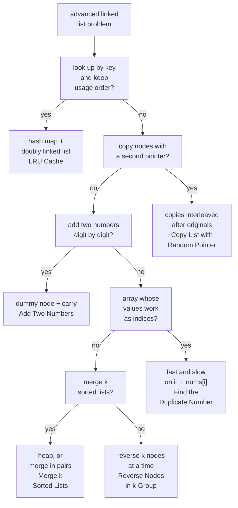

> [!tldr] Quick read
> - Pattern: at this station the [[en/concepts/linked-list|linked list]] does not work alone. It pairs with a [[en/concepts/hash-map|hash map]], with a heap, or with a copy of itself, to do what none of them can do separately.
> - **Hash map + [[en/concepts/doubly-linked-list|doubly linked list]]** (LRU Cache, the anchor problem): the hash map finds a node in O(1), the list keeps the usage order and unlinks a node from the middle in O(1). Measured over 10⁶ operations at capacity 100: 17.9 M ops/s with a hand-written list.
> - **[[en/concepts/node-interleaving|Node interleaving]]** (Copy List with Random Pointer): put each copy right after its original, so "the copy of X" is always `X.next`, no hash map needed.
> - **[[en/concepts/carry-propagation|Carry propagation]]** (Add Two Numbers) and **group reversal** (Reverse Nodes in k-Group) reuse the [[en/concepts/dummy-node|dummy node]] and [[en/concepts/pointer-reversal|pointer reversal]] from station 1; Find the Duplicate Number is [[en/concepts/fast-slow-pointers|fast and slow pointers]] running on an array.
> - **[[en/concepts/divide-and-conquer-merge|Divide-and-conquer merge]]** (Merge k Sorted Lists): merge in pairs, halving the number of lists each round. With 1,000 lists × 100 nodes: 8.3 ms, against 287.1 ms when merging one by one into a single result.

> [!info] Context
> Station 2 of **the NeetCode Line: Linked Structures**. [[en/posts/2026-11-24-neetcode-linked-list|Station 1]] taught four pointer moves: reversal, dummy node, fast and slow, n steps apart. This station reuses all four and pairs them with two structures from earlier lines: the [[en/concepts/hash-map|hash map]] ([[en/series/neetcode-arr|the Arrays and Strings line]]) and the [[en/concepts/heap|heap]] ([[en/series/neetcode-srch|the Search and Heaps line]]). You need no knowledge of caches or Redis; that part is explained right in the post.

> [!abstract]- Quick glossary for this post (click to open)
> - **Node, `next`, `head`, dummy node**: see [[en/posts/2026-11-24-neetcode-linked-list|station 1]] and [[en/concepts/dummy-node|Dummy Node]].
> - **Cache**: a place that keeps a little frequently used data so the next read is faster. Space is limited, so when it is full one key has to go. How that key is chosen is the [[en/concepts/eviction-policy|eviction policy]].
> - **LRU (Least Recently Used)**: evict the key that has gone unused the longest. See [[en/concepts/lru-va-lfu|LRU and LFU]].
> - **Doubly linked list**: each node has both `prev` and `next`, so holding a node is enough to unlink it. See [[en/concepts/doubly-linked-list|Doubly Linked List]].
> - **`random` pointer**: the second pointer of each node in problem 138, pointing at any node or `null`.
> - **Carry**: the "carry the 1" when two digits add up to 10 or more.
> - **Heap**: a structure that always keeps the smallest element on top, with O(log n) insert and removal. See [[en/concepts/heap|Heap]].

## Picture it first: a rail yard

Station 1 was one train at a platform. Station 2 is a **rail yard**, where people do more than recouple cars: they copy whole trains, combine several trains, and keep a holding track with only a few spots.

| Everyday life | Concept |
|---|---|
| A holding track with room for a few cars; a car just used goes to the front, and when it is full the car at the back is hauled away | [[en/concepts/lru-va-lfu\|LRU]] (LRU Cache) |
| A lookup sheet: "car 7 is parked here" | hash map from key to node |
| Each car is coupled to both the car ahead and the car behind, so removing one from the middle does not mean walking from the front | [[en/concepts/doubly-linked-list\|doubly linked list]] |
| Copying a train where each car also has a rope tied to some other car: couple each copy right behind its original, and tie the copy's rope to "the car right behind the original rope's target" | [[en/concepts/node-interleaving\|node interleaving]] (Copy List with Random Pointer) |
| Two trains carrying digits, added car by car, the carry passed to the next pair | [[en/concepts/carry-propagation\|carry propagation]] (Add Two Numbers) |
| Each car says "go on to car X"; when two cars point to the same target, following the signs goes in circles, and the shared target is where the loop starts | fast and slow pointers on an array (Find the Duplicate Number) |
| Several numbered trains, joined in pairs like a knockout tournament until one is left | [[en/concepts/divide-and-conquer-merge\|divide-and-conquer merge]] (Merge k Sorted Lists) |
| Turning around every block of k cars, leaving a short last block as is | group reversal (Reverse Nodes in k-Group) |



## The problem: one structure is not enough

Each familiar structure is good at one thing and bad at another:

- A **hash map** finds by key in O(1) but has no idea which key is old and which is new.
- An **array** keeps order, but moving an element from the middle to the front costs O(n), because every element ahead of it has to shift.
- A **singly linked list** unlinks a node in O(1) if you are standing on the node **before** it, but finding that node costs O(n).

The problems at this station ask for two things at once: find fast **and** keep order (LRU Cache), copy **and** keep the links between nodes (Copy List), merge many lists without comparing every head at each step (Merge k). The shared move is to pair two structures so each covers the other's weak spot, or to borrow the list itself as scratch space.

## How it works

### Hash map + doubly linked list: LRU Cache

<figure class="figure-map" style="--ar: 3 / 4">
<div class="frame"><iframe data-archify="../../diagrams/neetcode-advanced-linked-list/lru-get-put.en.html" title="LRU Cache with capacity 2: the hash map finds the node, the doubly linked list keeps the order" loading="lazy"></iframe></div>
<figcaption><span><b>Figure 1.</b> LRU Cache with capacity 2: put 1 and 2, get(1) moves node 1 to the front, put(3) unlinks the node before tail (key 2) and deletes that key from the hash map, so get(2) returns −1.</span><a href="../diagrams/neetcode-advanced-linked-list/lru-get-put.en.html" target="_blank" rel="noopener">Open full screen</a></figcaption>
</figure>

The anchor problem is [[en/problems/lru-cache|LRU Cache]]: a cache with a fixed capacity, `get(key)` returns the value or −1, `put(key, value)` adds or updates, and when it is full it evicts the key **unused for the longest time**. Both operations must run in O(1) on average.

I used to think a hash map plus a "last used time" per key would do. It turns out that finding the key with the smallest time means scanning the whole map, O(n). The standard approach pairs two structures:

- A **[[en/concepts/doubly-linked-list|doubly linked list]]** orders the nodes by use: right after `head` is the newest, right before `tail` is the oldest. `head` and `tail` are two [[en/concepts/dummy-node|dummy nodes]], so the list is never truly empty and needs no special case for the first or last node.
- The **hash map** points from key to **node**, not to the value. With the node in hand, its `prev` and `next` name both neighbors: unlinking it changes 2 pointers, linking it at the front changes 4 more.

Every `get` hit, and every `put` of an existing key, unlinks that node and relinks it right after `head`. When a `put` brings a new key into a full cache, the oldest node is `tail.prev`: unlink it **and delete its key from the map**. That step needs the key from the node, so every node stores both the key and the value.

The problem page runs three wrong versions, each missing exactly one step, against a slow reference version on 8 cases:

| Wrong version | Effect | Result |
|---|---|---|
| `get` does not move the node to the front | a key just read still counts as old and is evicted first | 4/8 cases |
| Unlinks the last node but forgets to delete it from the map | the map grows past capacity, so the "full" check is never true again: after 10⁴ operations with capacity 50, the map holds 993 keys | 1/8 cases |
| `put` on an existing key only updates the value | a key just written stays at the back and is evicted before older keys | 4/8 cases |

In real systems, Redis has an `allkeys-lru` policy but does **not** run exact LRU like this problem. According to [the Redis eviction docs](https://redis.io/docs/latest/develop/reference/eviction/), each time it needs to evict, Redis samples a few random keys (`maxmemory-samples`, default 5) and evicts the one unused the longest within the sample; since Redis 3.0 it also keeps a pool of good candidates. The stated reason: true LRU costs more memory, because it needs two pointers per key. See also [[en/concepts/lru-va-lfu|LRU and LFU]].

### Node interleaving: Copy List with Random Pointer

[[en/problems/copy-list-with-random-pointer|Copy List with Random Pointer]] gives a list where each node has an extra `random` pointer to any node (or `null`). You must deep-copy it: n new nodes whose `next` and `random` point only at new nodes.

The hard part is that `random` may point at a node **not copied yet**. The direct way is two passes with a hash map from old node to new node: pass 1 creates every copy, pass 2 wires `next` and `random` through the map. Correct, O(n) time, O(n) memory for the map.

[[en/concepts/node-interleaving|Node interleaving]] drops the map by using the list itself as the lookup table:

1. insert each node's copy right after it: `A → A' → B → B' → …`;
2. for each original `X`, `X'.random = X.random.next`, because every node's copy sits right after it;
3. split the two lists, restoring `next` on the originals.

Three passes, O(n) time, O(1) memory beyond the new nodes. Step 3 must put the original list back as it was; the file checks that, and checks that the copy shares no node with the original.

### Carry propagation: Add Two Numbers

[[en/problems/add-two-numbers|Add Two Numbers]] gives two non-negative numbers, each a list of digits **in reverse order**: the head is the ones place. The reverse order lets you add exactly as by hand: from the ones place up, [[en/concepts/carry-propagation|carrying]] into the next place.

Each round: `s = a + b + carry`, write `s % 10` into a new node, `carry = s / 10` (integer part). A dummy node sits before the result, as in station 1. The loop condition is `a || b || carry`: the two lists may have different lengths, and **the final carry** becomes a node of its own. Leave `carry` out of the condition and 9,999,999 + 9,999 loses its leading 1.

### Fast and slow pointers on an array: Find the Duplicate Number

[[en/problems/find-the-duplicate-number|Find the Duplicate Number]] gives an array of n + 1 numbers, each in 1..n, with exactly one value repeated (possibly many times). You must find it **without modifying the array** and with O(1) extra memory: no sorting, no `Set`.

The trick is to treat each index `i` as a node and `nums[i]` as its `next`. Every value is a valid index, so walking from 0 along `i → nums[i]` never stops, and since there are finitely many nodes the walk must fall into a cycle. The repeated value is where two indices point to the same place, that is, the **cycle entrance**. No index points back to 0 (all values are ≥ 1), so 0 lies outside the cycle.

That is exactly Linked List Cycle II: in phase 1, [[en/concepts/fast-slow-pointers|fast and slow]] meet inside the cycle; in phase 2, put one pointer back at 0, move both one step at a time, and where they meet is the cycle entrance. Phase 2 works because the distance from 0 to the entrance equals the distance from the meeting point onward to the entrance, plus some whole number of laps.

### Divide-and-conquer merge: Merge k Sorted Lists

[[en/problems/merge-k-sorted-lists|Merge k Sorted Lists]] merges k sorted lists with N nodes in total. There are three ways, all built on station 1's two-list merge:

| Approach | Time | Notes |
|---|---|---|
| Merge one by one into a single result | O(N · k) | the result keeps growing, the first nodes are walked over k times |
| Heap of the k list heads ([[en/concepts/k-way-merge\|k-way merge]]) | O(N log k) | each step takes the smallest of the k heads |
| [[en/concepts/divide-and-conquer-merge\|Merge in pairs]] | O(N log k) | log k rounds, each touching every node once; no heap needed |

Merging in pairs works like a knockout tournament: round 1 merges list 0 with 1, 2 with 3, …; the next round merges those results. Each node goes through log₂ k merges. Measured with k lists of 100 random sorted nodes each (mulberry32, median of 5):

| k | N | Merge in pairs | Merge one by one |
|---|---|---|---|
| 10 | 1,000 | 0.03 ms | 0.03 ms |
| 100 | 10,000 | 0.48 ms | 1.73 ms |
| 1,000 | 100,000 | 8.28 ms | 287.05 ms |

From k = 100 to k = 1,000, N also grows 10 times. Merging one by one gets 166 times slower (N · k grows 100 times); merging in pairs gets 17 times slower (N log k grows about 15 times).

### Group reversal: Reverse Nodes in k-Group

[[en/problems/reverse-nodes-in-k-group|Reverse Nodes in k-Group]] reverses every block of k consecutive nodes; a last block with fewer than k nodes stays as is. It must use O(1) extra memory.

Each round keeps `groupPrev`, the node right before the block (the dummy node at first):

1. walk k steps ahead to find `kth`, the block's last node. If there are not k nodes, stop: the last block stays as is;
2. reverse the block with station 1's three pointers, but start with `prev = kth.next` instead of `null`, so the block's first node, once reversed, already points to the next block;
3. `groupPrev.next = kth` (link the previous block to the new head), then move `groupPrev` to the old first node, now the block's tail.

Each node is visited twice (count, then reverse): O(n) time, O(1) memory.

### Six problems, six techniques

| Problem | Paired with | Station 1 technique reused | Time, extra memory |
|---|---|---|---|
| [[en/problems/lru-cache\|LRU Cache]] | hash map | dummy nodes (both ends) | O(1) per operation, O(capacity) |
| [[en/problems/copy-list-with-random-pointer\|Copy List with Random Pointer]] | the copy itself | dummy node (when splitting) | O(n), O(1) |
| [[en/problems/add-two-numbers\|Add Two Numbers]] | carry | dummy node | O(max(m, n)), O(1) |
| [[en/problems/find-the-duplicate-number\|Find the Duplicate Number]] | the array as pointers | fast and slow | O(n), O(1) |
| [[en/problems/merge-k-sorted-lists\|Merge k Sorted Lists]] | heap or divide and conquer | two-list merge | O(N log k), O(k) for the array of list heads |
| [[en/problems/reverse-nodes-in-k-group\|Reverse Nodes in k-Group]] | counting k steps ahead | pointer reversal, dummy node | O(n), O(1) |

### Under the hood in five languages

| | Node as hash map key | Heap for k lists | Built-in LRU | Language-specific trap |
|---|---|---|---|---|
| TypeScript / JavaScript | `Map` compares keys by object identity | none built in; write one, or merge in pairs | `Map` remembers insertion order: `delete` then `set` to move a key to the end | taking the oldest key with `keys().next()` slows down as capacity grows: 1.4 M ops/s at capacity 10⁴, against 13.5 M at 100 |
| Python | `dict` hashes by identity, unless the class defines `__eq__` | `heapq` with `(val, i, node)` tuples | `OrderedDict.move_to_end`, `functools.lru_cache` | a class with `__eq__` but no `__hash__` cannot be hashed (`TypeError: unhashable type`); a `(val, node)` tuple without `i` makes `heapq` compare two nodes on equal values: `TypeError: '<' not supported` |
| Go | `map[*Node]*Node` | `container/heap` (implement 5 methods) | `container/list` | `Element.Value` has type `any`, so reads need a type assertion |
| Java | `HashMap` uses `equals`/`hashCode`; `IdentityHashMap` compares identity | `PriorityQueue` with a comparator | `LinkedHashMap(cap, 0.75f, true)` + `removeEldestEntry` | forget `accessOrder = true` and the order is insertion order, so it becomes FIFO: fails 5/8 cases |

## Runnable example

[TypeScript](../code/neetcode-advanced-linked-list/advanced-list-station.ts) · [Python](../code/neetcode-advanced-linked-list/advanced_list_station.py) · [Go](../code/neetcode-advanced-linked-list/advanced_list_station.go) · [Java](../code/neetcode-advanced-linked-list/advanced-list-station.java) · [JavaScript](../code/neetcode-advanced-linked-list/advanced-list-station.js)

Each file solves all six problems and runs 15 shared cases: the problem's example for each one, an empty list (138, 23), two zeros and an addition that carries all the way (2), a value repeated many times (287), updating an existing key (146), and k = 2, k = 3 with a short last block (25). The 138 cases also check that the original list is unchanged and that the copy shares no node with it. The TypeScript version also measures Merge k Sorted Lists.

The first three problems: Copy List with Random Pointer, Add Two Numbers, Find the Duplicate Number.

```ts
// 138: insert a copy right after each node, wire random through the copies, then split the two lists. O(1) extra memory.
function copyRandomList(head: RNode | null): RNode | null {
  for (let p = head; p; p = p.next!.next) { const c = new RNode(p.val); c.next = p.next; p.next = c; }
  for (let p = head; p; p = p.next!.next) p.next!.random = p.random ? p.random.next : null;
  const dummy = new RNode(0);
  let tail = dummy;
  for (let p = head; p; p = p.next) { const c = p.next!; p.next = c.next; tail.next = c; tail = c; }
  return dummy.next;
}

// 2: add digit by digit from the ones place, carrying into the next node.
function addTwoNumbers(a: ListNode | null, b: ListNode | null): ListNode | null {
  const dummy = new ListNode(0);
  let tail = dummy, carry = 0;
  while (a || b || carry) {
    const s = (a ? a.val : 0) + (b ? b.val : 0) + carry;
    carry = s >= 10 ? 1 : 0;
    tail.next = new ListNode(s % 10);
    tail = tail.next;
    a = a ? a.next : null;
    b = b ? b.next : null;
  }
  return dummy.next;
}

// 287: treat i → nums[i] as a next pointer; the duplicate is the cycle entrance (Floyd), O(1) memory, array untouched.
function findDuplicate(nums: number[]): number {
  let slow = 0, fast = 0;
  do { slow = nums[slow]; fast = nums[nums[fast]]; } while (slow !== fast);
  let p = 0;
  while (p !== slow) { p = nums[p]; slow = nums[slow]; }
  return p;
}
```

```python
# 138: insert a copy after each node, wire random through the copies, then split the two lists.
def copy_random_list(head):
    p = head
    while p:
        c = RNode(p.val)
        c.next, p.next = p.next, c
        p = c.next
    p = head
    while p:
        p.next.random = p.random.next if p.random else None
        p = p.next.next
    dummy = tail = RNode(0)
    p = head
    while p:
        c = p.next
        p.next = c.next
        tail.next = c
        tail = c
        p = p.next
    return dummy.next

# 2: add digit by digit, carrying into the next node.
def add_two_numbers(a, b):
    dummy = tail = ListNode()
    carry = 0
    while a or b or carry:
        s = (a.val if a else 0) + (b.val if b else 0) + carry
        carry, digit = divmod(s, 10)
        tail.next = ListNode(digit)
        tail = tail.next
        a = a.next if a else None
        b = b.next if b else None
    return dummy.next

# 287: i → nums[i] is a next pointer; the duplicate is the cycle entrance.
def find_duplicate(nums):
    slow = fast = 0
    while True:
        slow, fast = nums[slow], nums[nums[fast]]
        if slow == fast:
            break
    p = 0
    while p != slow:
        p, slow = nums[p], nums[slow]
    return p
```

```go
// 138: insert a copy after each node, wire random through the copies, then split the two lists.
func copyRandomList(head *RNode) *RNode {
	for p := head; p != nil; p = p.Next.Next {
		p.Next = &RNode{Val: p.Val, Next: p.Next}
	}
	for p := head; p != nil; p = p.Next.Next {
		if p.Random != nil {
			p.Next.Random = p.Random.Next
		}
	}
	dummy := &RNode{}
	tail := dummy
	for p := head; p != nil; p = p.Next {
		c := p.Next
		p.Next = c.Next
		tail.Next = c
		tail = c
	}
	return dummy.Next
}

// 2: add digit by digit, carrying into the next node.
func addTwoNumbers(a, b *ListNode) *ListNode {
	dummy := &ListNode{}
	tail, carry := dummy, 0
	for a != nil || b != nil || carry > 0 {
		s := carry
		if a != nil {
			s, a = s+a.Val, a.Next
		}
		if b != nil {
			s, b = s+b.Val, b.Next
		}
		carry = s / 10
		tail.Next = &ListNode{Val: s % 10}
		tail = tail.Next
	}
	return dummy.Next
}

// 287: i → nums[i] is a next pointer; the duplicate is the cycle entrance.
func findDuplicate(nums []int) int {
	slow, fast := nums[0], nums[nums[0]]
	for slow != fast {
		slow, fast = nums[slow], nums[nums[fast]]
	}
	p := 0
	for p != slow {
		p, slow = nums[p], nums[slow]
	}
	return p
}
```

```java
// 138: insert a copy after each node, wire random through the copies, then split the two lists.
static RNode copyRandomList(RNode head) {
    for (RNode p = head; p != null; p = p.next.next) { RNode c = new RNode(p.val); c.next = p.next; p.next = c; }
    for (RNode p = head; p != null; p = p.next.next) p.next.random = p.random != null ? p.random.next : null;
    RNode dummy = new RNode(0), tail = dummy;
    for (RNode p = head; p != null; p = p.next) { RNode c = p.next; p.next = c.next; tail.next = c; tail = c; }
    return dummy.next;
}

// 2: add digit by digit, carrying into the next node.
static ListNode addTwoNumbers(ListNode a, ListNode b) {
    ListNode dummy = new ListNode(0, null), tail = dummy;
    int carry = 0;
    while (a != null || b != null || carry != 0) {
        int s = carry;
        if (a != null) { s += a.val; a = a.next; }
        if (b != null) { s += b.val; b = b.next; }
        carry = s / 10;
        tail.next = new ListNode(s % 10, null);
        tail = tail.next;
    }
    return dummy.next;
}

// 287: i → nums[i] is a next pointer; the duplicate is the cycle entrance.
static int findDuplicate(int[] nums) {
    int slow = 0, fast = 0;
    do { slow = nums[slow]; fast = nums[nums[fast]]; } while (slow != fast);
    int p = 0;
    while (p != slow) { p = nums[p]; slow = nums[slow]; }
    return p;
}
```

```js
// 138: insert a copy right after each node, wire random through the copies, then split the two lists. O(1) extra memory.
function copyRandomList(head) {
  for (let p = head; p; p = p.next.next) { const c = new RNode(p.val); c.next = p.next; p.next = c; }
  for (let p = head; p; p = p.next.next) p.next.random = p.random ? p.random.next : null;
  const dummy = new RNode(0);
  let tail = dummy;
  for (let p = head; p; p = p.next) { const c = p.next; p.next = c.next; tail.next = c; tail = c; }
  return dummy.next;
}

// 2: add digit by digit from the ones place, carrying into the next node.
function addTwoNumbers(a, b) {
  const dummy = new ListNode(0);
  let tail = dummy, carry = 0;
  while (a || b || carry) {
    const s = (a ? a.val : 0) + (b ? b.val : 0) + carry;
    carry = s >= 10 ? 1 : 0;
    tail.next = new ListNode(s % 10);
    tail = tail.next;
    a = a ? a.next : null;
    b = b ? b.next : null;
  }
  return dummy.next;
}

// 287: treat i → nums[i] as a next pointer; the duplicate is the cycle entrance (Floyd), O(1) memory, array untouched.
function findDuplicate(nums) {
  let slow = 0, fast = 0;
  do { slow = nums[slow]; fast = nums[nums[fast]]; } while (slow !== fast);
  let p = 0;
  while (p !== slow) { p = nums[p]; slow = nums[slow]; }
  return p;
}
```


The other three: LRU Cache, Merge k Sorted Lists, Reverse Nodes in k-Group.

```ts
// 146: a Map maps key → node; a doubly linked list with two sentinels, front is most recently used, back is least.
class DNode {
  key: number; val: number;
  prev: DNode | null = null; next: DNode | null = null;
  constructor(key: number, val: number) { this.key = key; this.val = val; }
}

class LRUCache {
  private map = new Map<number, DNode>();
  private head = new DNode(0, 0);
  private tail = new DNode(0, 0);
  private capacity: number;
  constructor(capacity: number) { this.capacity = capacity; this.head.next = this.tail; this.tail.prev = this.head; }
  private unlink(n: DNode) { n.prev!.next = n.next; n.next!.prev = n.prev; }
  private pushFront(n: DNode) { n.next = this.head.next; n.prev = this.head; this.head.next!.prev = n; this.head.next = n; }
  get(key: number): number {
    const n = this.map.get(key);
    if (!n) return -1;
    this.unlink(n); this.pushFront(n);
    return n.val;
  }
  put(key: number, val: number): void {
    const n = this.map.get(key);
    if (n) { n.val = val; this.unlink(n); this.pushFront(n); return; }
    if (this.map.size === this.capacity) { const old = this.tail.prev!; this.unlink(old); this.map.delete(old.key); }
    const m = new DNode(key, val);
    this.map.set(key, m); this.pushFront(m);
  }
}

// 23: merge the lists in pairs, halving their count each round: O(N log k).
function mergeTwo(a: ListNode | null, b: ListNode | null): ListNode | null {
  const dummy = new ListNode(0);
  let tail = dummy;
  while (a && b) {
    if (a.val <= b.val) { tail.next = a; a = a.next; } else { tail.next = b; b = b.next; }
    tail = tail.next;
  }
  tail.next = a ?? b;
  return dummy.next;
}

function mergeKLists(lists: (ListNode | null)[]): ListNode | null {
  if (lists.length === 0) return null;
  let cur = lists.slice();
  while (cur.length > 1) {
    const next: (ListNode | null)[] = [];
    for (let i = 0; i < cur.length; i += 2) next.push(i + 1 < cur.length ? mergeTwo(cur[i], cur[i + 1]) : cur[i]);
    cur = next;
  }
  return cur[0];
}

// 25: once k nodes are counted, reverse that group in place and relink it; a short last group stays as is.
function reverseKGroup(head: ListNode | null, k: number): ListNode | null {
  const dummy = new ListNode(0, head);
  let groupPrev = dummy;
  while (true) {
    let kth: ListNode | null = groupPrev;
    for (let i = 0; i < k && kth; i++) kth = kth.next;
    if (!kth) break;
    const groupNext = kth.next;
    let prev: ListNode | null = groupNext, cur = groupPrev.next;
    while (cur !== groupNext) { const nx: ListNode | null = cur!.next; cur!.next = prev; prev = cur; cur = nx; }
    const first = groupPrev.next!;
    groupPrev.next = kth;
    groupPrev = first;
  }
  return dummy.next;
}
```

```python
# 146: a dict maps key → node; a doubly linked list with two sentinels.
class DNode:
    __slots__ = ("key", "val", "prev", "next")

    def __init__(self, key=0, val=0):
        self.key, self.val, self.prev, self.next = key, val, None, None

class LRUCache:
    def __init__(self, capacity):
        self.cap, self.map = capacity, {}
        self.head, self.tail = DNode(), DNode()
        self.head.next, self.tail.prev = self.tail, self.head

    def _unlink(self, n):
        n.prev.next, n.next.prev = n.next, n.prev

    def _push_front(self, n):
        n.prev, n.next = self.head, self.head.next
        self.head.next.prev = n
        self.head.next = n

    def get(self, key):
        n = self.map.get(key)
        if n is None:
            return -1
        self._unlink(n)
        self._push_front(n)
        return n.val

    def put(self, key, val):
        n = self.map.get(key)
        if n is not None:
            n.val = val
            self._unlink(n)
            self._push_front(n)
            return
        if len(self.map) == self.cap:
            old = self.tail.prev
            self._unlink(old)
            del self.map[old.key]
        n = DNode(key, val)
        self.map[key] = n
        self._push_front(n)

# 23: merge in pairs, halving the number of lists each round.
def merge_two(a, b):
    dummy = tail = ListNode()
    while a and b:
        if a.val <= b.val:
            tail.next, a = a, a.next
        else:
            tail.next, b = b, b.next
        tail = tail.next
    tail.next = a or b
    return dummy.next

def merge_k_lists(lists):
    if not lists:
        return None
    while len(lists) > 1:
        lists = [merge_two(lists[i], lists[i + 1]) if i + 1 < len(lists) else lists[i]
                 for i in range(0, len(lists), 2)]
    return lists[0]

# 25: once there are k nodes, reverse that group and relink it.
def reverse_k_group(head, k):
    dummy = ListNode(0, head)
    group_prev = dummy
    while True:
        kth = group_prev
        for _ in range(k):
            kth = kth.next
            if kth is None:
                return dummy.next
        group_next = kth.next
        prev, cur = group_next, group_prev.next
        while cur is not group_next:
            cur.next, prev, cur = prev, cur, cur.next
        first = group_prev.next
        group_prev.next = kth
        group_prev = first
```

```go
// 146: a map maps key → node; a doubly linked list with two sentinels.
type DNode struct {
	key, val   int
	prev, next *DNode
}

type LRUCache struct {
	cap        int
	m          map[int]*DNode
	head, tail *DNode
}

func NewLRUCache(capacity int) *LRUCache {
	c := &LRUCache{cap: capacity, m: map[int]*DNode{}, head: &DNode{}, tail: &DNode{}}
	c.head.next, c.tail.prev = c.tail, c.head
	return c
}

func (c *LRUCache) unlink(n *DNode) { n.prev.next, n.next.prev = n.next, n.prev }

func (c *LRUCache) pushFront(n *DNode) {
	n.prev, n.next = c.head, c.head.next
	c.head.next.prev = n
	c.head.next = n
}

func (c *LRUCache) Get(key int) int {
	n, ok := c.m[key]
	if !ok {
		return -1
	}
	c.unlink(n)
	c.pushFront(n)
	return n.val
}

func (c *LRUCache) Put(key, val int) {
	if n, ok := c.m[key]; ok {
		n.val = val
		c.unlink(n)
		c.pushFront(n)
		return
	}
	if len(c.m) == c.cap {
		old := c.tail.prev
		c.unlink(old)
		delete(c.m, old.key)
	}
	n := &DNode{key: key, val: val}
	c.m[key] = n
	c.pushFront(n)
}

// 23: merge in pairs, halving the number of lists each round.
func mergeTwo(a, b *ListNode) *ListNode {
	dummy := &ListNode{}
	tail := dummy
	for a != nil && b != nil {
		if a.Val <= b.Val {
			tail.Next, a = a, a.Next
		} else {
			tail.Next, b = b, b.Next
		}
		tail = tail.Next
	}
	if a != nil {
		tail.Next = a
	} else {
		tail.Next = b
	}
	return dummy.Next
}

func mergeKLists(lists []*ListNode) *ListNode {
	if len(lists) == 0 {
		return nil
	}
	for len(lists) > 1 {
		next := []*ListNode{}
		for i := 0; i < len(lists); i += 2 {
			if i+1 < len(lists) {
				next = append(next, mergeTwo(lists[i], lists[i+1]))
			} else {
				next = append(next, lists[i])
			}
		}
		lists = next
	}
	return lists[0]
}

// 25: once there are k nodes, reverse that group and relink it.
func reverseKGroup(head *ListNode, k int) *ListNode {
	dummy := &ListNode{Next: head}
	groupPrev := dummy
	for {
		kth := groupPrev
		for i := 0; i < k && kth != nil; i++ {
			kth = kth.Next
		}
		if kth == nil {
			return dummy.Next
		}
		groupNext := kth.Next
		prev, cur := groupNext, groupPrev.Next
		for cur != groupNext {
			nx := cur.Next
			cur.Next, prev, cur = prev, cur, nx
		}
		first := groupPrev.Next
		groupPrev.Next = kth
		groupPrev = first
	}
}
```

```java
// 146: a HashMap maps key → node; a doubly linked list with two sentinels.
static class LRUCache {
    static class DNode { int key, val; DNode prev, next; DNode(int k, int v) { key = k; val = v; } }
    final int cap;
    final Map<Integer, DNode> map = new HashMap<>();
    final DNode head = new DNode(0, 0), tail = new DNode(0, 0);
    LRUCache(int capacity) { cap = capacity; head.next = tail; tail.prev = head; }
    void unlink(DNode n) { n.prev.next = n.next; n.next.prev = n.prev; }
    void pushFront(DNode n) { n.next = head.next; n.prev = head; head.next.prev = n; head.next = n; }
    int get(int key) {
        DNode n = map.get(key);
        if (n == null) return -1;
        unlink(n); pushFront(n);
        return n.val;
    }
    void put(int key, int val) {
        DNode n = map.get(key);
        if (n != null) { n.val = val; unlink(n); pushFront(n); return; }
        if (map.size() == cap) { DNode old = tail.prev; unlink(old); map.remove(old.key); }
        DNode m = new DNode(key, val);
        map.put(key, m); pushFront(m);
    }
}

// 23: merge in pairs, halving the number of lists each round.
static ListNode mergeTwo(ListNode a, ListNode b) {
    ListNode dummy = new ListNode(0, null), tail = dummy;
    while (a != null && b != null) {
        if (a.val <= b.val) { tail.next = a; a = a.next; } else { tail.next = b; b = b.next; }
        tail = tail.next;
    }
    tail.next = a != null ? a : b;
    return dummy.next;
}

static ListNode mergeKLists(ListNode[] lists) {
    if (lists.length == 0) return null;
    List<ListNode> cur = new ArrayList<>(Arrays.asList(lists));
    while (cur.size() > 1) {
        List<ListNode> next = new ArrayList<>();
        for (int i = 0; i < cur.size(); i += 2) next.add(i + 1 < cur.size() ? mergeTwo(cur.get(i), cur.get(i + 1)) : cur.get(i));
        cur = next;
    }
    return cur.get(0);
}

// 25: once there are k nodes, reverse that group and relink it.
static ListNode reverseKGroup(ListNode head, int k) {
    ListNode dummy = new ListNode(0, head), groupPrev = dummy;
    while (true) {
        ListNode kth = groupPrev;
        for (int i = 0; i < k && kth != null; i++) kth = kth.next;
        if (kth == null) return dummy.next;
        ListNode groupNext = kth.next, prev = groupNext, cur = groupPrev.next;
        while (cur != groupNext) { ListNode nx = cur.next; cur.next = prev; prev = cur; cur = nx; }
        ListNode first = groupPrev.next;
        groupPrev.next = kth;
        groupPrev = first;
    }
}
```

```js
// 146: a Map maps key → node; a doubly linked list with two sentinels, front is most recently used, back is least.
class DNode {
  constructor(key, val) { this.key = key; this.val = val; this.prev = null; this.next = null; }
}

class LRUCache {
  constructor(capacity) {
    this.capacity = capacity;
    this.map = new Map();
    this.head = new DNode(0, 0);
    this.tail = new DNode(0, 0);
    this.head.next = this.tail; this.tail.prev = this.head;
  }
  unlink(n) { n.prev.next = n.next; n.next.prev = n.prev; }
  pushFront(n) { n.next = this.head.next; n.prev = this.head; this.head.next.prev = n; this.head.next = n; }
  get(key) {
    const n = this.map.get(key);
    if (!n) return -1;
    this.unlink(n); this.pushFront(n);
    return n.val;
  }
  put(key, val) {
    const n = this.map.get(key);
    if (n) { n.val = val; this.unlink(n); this.pushFront(n); return; }
    if (this.map.size === this.capacity) { const old = this.tail.prev; this.unlink(old); this.map.delete(old.key); }
    const m = new DNode(key, val);
    this.map.set(key, m); this.pushFront(m);
  }
}

// 23: merge the lists in pairs, halving their count each round: O(N log k).
function mergeTwo(a, b) {
  const dummy = new ListNode(0);
  let tail = dummy;
  while (a && b) {
    if (a.val <= b.val) { tail.next = a; a = a.next; } else { tail.next = b; b = b.next; }
    tail = tail.next;
  }
  tail.next = a ?? b;
  return dummy.next;
}

function mergeKLists(lists) {
  if (lists.length === 0) return null;
  let cur = lists.slice();
  while (cur.length > 1) {
    const next = [];
    for (let i = 0; i < cur.length; i += 2) next.push(i + 1 < cur.length ? mergeTwo(cur[i], cur[i + 1]) : cur[i]);
    cur = next;
  }
  return cur[0];
}

// 25: once k nodes are counted, reverse that group in place and relink it; a short last group stays as is.
function reverseKGroup(head, k) {
  const dummy = new ListNode(0, head);
  let groupPrev = dummy;
  while (true) {
    let kth = groupPrev;
    for (let i = 0; i < k && kth; i++) kth = kth.next;
    if (!kth) break;
    const groupNext = kth.next;
    let prev = groupNext, cur = groupPrev.next;
    while (cur !== groupNext) { const nx = cur.next; cur.next = prev; prev = cur; cur = nx; }
    const first = groupPrev.next;
    groupPrev.next = kth;
    groupPrev = first;
  }
  return dummy.next;
}
```


Output of `node advanced-list-station.ts`:

```text
advanced-list-station 15/15 cases passed

23: k lists × 100 nodes      pairwise        one by one
k = 10     N = 1000           0.03 ms        0.03 ms
k = 100    N = 10000          0.48 ms        1.73 ms
k = 1000   N = 100000         8.28 ms      287.05 ms
```

*(Output labels translated; the files themselves print Vietnamese.)*

Python, Go, Java and JavaScript also print `15/15 cases passed`.

## Misconceptions and common traps

- **"A hash map from key to value is enough for LRU."** It must map key to **node**. Only with the node can you unlink it from the list in O(1); the value does not help.
- **"A singly linked list works too."** Unlinking a node needs the node before it. A singly linked list has to walk from the head to find it, O(n). The `prev` pointer is what makes this O(1).
- **Forgetting one of the three "move to front" spots.** A `get` hit, a `put` of a new key, a `put` of an existing key: all three make the key the newest. Skip one and the wrong key gets evicted.
- **Evicting without deleting from the map.** The map grows past capacity, and a `get` on an evicted key still returns the old value.
- **Copy List without restoring the original.** The split step must fix `next` on the original nodes too, not only on the copies.
- **Add Two Numbers stopping when both lists run out.** A remaining carry is one more node.
- **Find the Duplicate by negative marking or sorting.** It gives the right answer but modifies the array, which the problem forbids.
- **Merge k by merging one by one.** Correct, but O(N · k): 35 times slower at k = 1,000.
- **Reverse k-Group reversing the last block too.** Count k nodes **before** reversing.

## Self-check questions

> [!question]- Why must an LRU Cache node store the key, not just the value?
> When the cache is full, you know which node to evict (`tail.prev`), but you have to delete its key from the hash map. Without the key in the node you cannot tell which key to delete, short of scanning the whole map.

> [!question]- In the interleaving approach to Copy List, why is `X'.random = X.random.next` correct?
> After step 1, every original node's copy sits right after it. `X.random` is an original node (or `null`), so `X.random.next` is its copy, exactly what `X'.random` should point to.

> [!question]- With `nums = [3, 1, 3, 4, 2]`, what is the walk from 0 along `i → nums[i]`, and where is the cycle?
> 0 → 3 → 4 → 2 → 3 → 4 → … The cycle is 3 → 4 → 2 → 3, and its entrance is 3: both index 0 and index 2 point to 3. The repeated value is 3.

> [!question]- Merge k with a heap and with pairwise merging are both O(N log k). When do you pick which?
> Pairwise merging needs no heap, so it suits languages without a built-in heap (JavaScript) when all k lists are available up front. A heap suits lists that arrive as streams, or when you only need the first few smallest elements: a heap yields nodes in order from the very first step.

> [!question]- In Reverse k-Group, why start with `prev = kth.next` instead of `null`?
> After reversal, the block's first node becomes its last node and must point to the next block. Starting `prev` at the next block's head means the very first flip already sets that pointer, so nothing needs relinking afterwards.

## References

- [NeetCode 150](https://neetcode.io/practice) (problem list and the Linked List group)
- LeetCode: [146 LRU Cache](https://leetcode.com/problems/lru-cache/), [138 Copy List with Random Pointer](https://leetcode.com/problems/copy-list-with-random-pointer/), [2 Add Two Numbers](https://leetcode.com/problems/add-two-numbers/), [287 Find the Duplicate Number](https://leetcode.com/problems/find-the-duplicate-number/), [23 Merge k Sorted Lists](https://leetcode.com/problems/merge-k-sorted-lists/), [25 Reverse Nodes in k-Group](https://leetcode.com/problems/reverse-nodes-in-k-group/)
- [Redis: Key eviction](https://redis.io/docs/latest/develop/reference/eviction/) (LRU approximated by sampling, `maxmemory-samples`, why not true LRU)
- [Python `heapq`](https://docs.python.org/3/library/heapq.html) (the "Priority Queue Implementation Notes" section: tuples whose items cannot be compared)
- [Java `LinkedHashMap`](https://docs.oracle.com/en/java/javase/21/docs/api/java.base/java/util/LinkedHashMap.html) (`accessOrder`, `removeEldestEntry`)
- [Go `container/list`](https://pkg.go.dev/container/list)
- Cormen, Leiserson, Rivest, Stein, *Introduction to Algorithms*, section 10.2 (doubly linked lists with sentinels)
