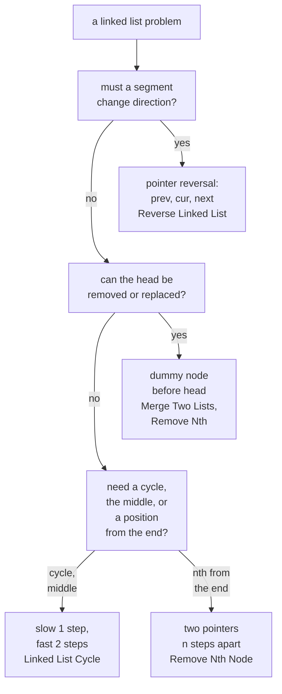

> [!tldr] Quick read
> - Pattern: a [[en/concepts/linked-list|linked list]] has no indices. We hold only the first node, and each node knows only the node after it. Every problem at this station changes a few `next` pointers in the right order without losing the rest of the list.
> - **[[en/concepts/pointer-reversal|In-place pointer reversal]]** (Reverse Linked List, the anchor problem): three pointers `prev`, `cur`, `next`; save `next` before flipping. O(n) time, O(1) memory. The recursive version costs one call frame per node: Python's default stops at 998 nodes, below the problem's limit of 5,000.
> - **[[en/concepts/dummy-node|Dummy node]]** (Merge Two Sorted Lists, Remove Nth Node): put a node with no data before the head, so the real head is handled like every other node.
> - **[[en/concepts/fast-slow-pointers|Slow and fast pointers]]** (Linked List Cycle, Reorder List): one moves 1 step, the other 2. With a cycle they meet; without one, when the fast pointer reaches the end the slow one stands in the middle. Measured on 10⁶ nodes with a cycle: 2.8 ms against 64.1 ms for remembering visited nodes in a `Set`.
> - **Two pointers n steps apart** (Remove Nth Node From End): the leading pointer goes n + 1 steps ahead; when it reaches the end, the trailing one stands right before the node to remove, in one pass.

> [!info] Context
> Station 1, the opening station of the **NeetCode Line: Linked Structures**. The just-finished [[en/series/neetcode-srch|Search and Heaps line]] worked on arrays, where every slot is reachable at once by index. This line works on structures whose elements are joined by pointers: linked lists at stations 1 and 2, then trees and tries. This station needs nothing beyond loops, variables and [[en/concepts/big-o-notation|Big-O]]; the [[en/concepts/two-pointers|two pointers]] technique from the Arrays and Strings line comes back in a new form.

> [!abstract]- Quick glossary for this post (click to open)
> - **Node**: one cell of the list, holding a value `val` and a `next` pointer to the following node. See [[en/concepts/linked-list|Linked List]].
> - **Pointer, reference**: a variable that "points at" a node rather than containing it. `a = b` makes two variables point at the same node.
> - **`head`**: the pointer to the first node, the only thing the problem gives us.
> - **`null`, `None`, `nil`**: "points nowhere". The last node's `next` holds this value. Reading `.next` on it is an error.
> - **Cycle**: some node points back at an earlier node, so following `next` never ends.
> - **Sentinel**: a fake element placed at the boundary so the code needs no special branch for the boundary. See [[en/concepts/sentinel-value|Sentinel Value]].

## Picture it first: a train in a rail yard

A train is a chain of coupled cars. The dispatcher knows only where the first car (with the engine) stands; to reach the fifth car you walk through four. Every job in the yard uncouples and recouples a few hooks; nobody ever lifts a car and puts it somewhere else.

| Everyday | Concept |
|---|---|
| A car | a node |
| The hook to the car behind | the `next` pointer |
| Knowing where the first car stands | `head` |
| Turning the train around: unhook each car and hook it back to the car in front | [[en/concepts/pointer-reversal\|in-place pointer reversal]] (Reverse Linked List) |
| Before unhooking, remember which car was behind | `next = cur.next` |
| An empty car parked at the start of the track, for the result to hook onto | [[en/concepts/dummy-node\|dummy node]] (Merge Two Sorted Lists) |
| Two trains already ordered by car number, joined into one by taking the lower-numbered car at the front of either | merging two sorted lists |
| Two people walk along the train, one twice as fast; if the track loops, the fast one catches the slow one | [[en/concepts/fast-slow-pointers\|slow and fast pointers]] (Linked List Cycle) |
| When the fast one reaches the end, the slow one stands at the middle car | finding the middle node (Reorder List) |
| Two people walk exactly n cars apart; when the front one reaches the end, the back one stands before the nth car from the end | two pointers n steps apart (Remove Nth Node From End) |



Reorder List uses three of the four at once: find the middle with slow and fast, reverse the second half, then weave the two halves.

## The problem: no indices, only pointers

On an array, this station's problems are all easy: reversing swaps the two ends, the nth element from the end is `a[len − n]`, the middle is `a[len / 2]`. A linked list has neither `len` nor `a[i]`. We hold only `head`, and the only way to reach a node is to follow `next` from the front.

Copying everything into an array and working there is always correct, but it costs O(n) memory and skips exactly what these problems teach. Each problem can be restated as: **use O(1) extra memory, change pointers rather than values**. The difficulty then comes down to two things: not losing the rest of the list when you change a pointer, and not writing a special branch for the head.

## How it works

### In-place pointer reversal

<figure class="figure-map" style="--ar: 3 / 4">
<div class="frame"><iframe data-archify="../../diagrams/neetcode-linked-list/pointer-dance.en.html" title="Reversing the list 1 → 2 → 3 with three pointers" loading="lazy"></iframe></div>
<figcaption><span><b>Figure 1.</b> Reverse Linked List on 1 → 2 → 3: each step saves the rest in next, flips cur's arrow back to prev, then advances prev and cur; when cur is empty, prev is the new head.</span><a href="../diagrams/neetcode-linked-list/pointer-dance.en.html" target="_blank" rel="noopener">Open full screen</a></figcaption>
</figure>

The station's anchor problem is [[en/problems/reverse-linked-list|Reverse Linked List]]. Keep three pointers: `prev` heads the reversed segment, `cur` is the node being flipped, `next` holds the rest. Each iteration has exactly four assignments, and their order is the whole problem:

1. `next = cur.next`: save the rest, because the next step overwrites `cur.next`;
2. `cur.next = prev`: flip one arrow;
3. `prev = cur`;
4. `cur = next`.

When `cur` becomes `null`, `prev` heads the reversed list. Drop step 1 and, after step 2, `cur.next` already points at `prev` and nothing points at the rest any more: on the problem page, that version gets only 2/6 cases right and returns a list with a single node.

The recursive version (reverse everything after `head` first, then attach `head` at the end) is shorter but costs one call frame per node. Measured on the problem page: Node 24 stops at about 15,650 nodes, Java 21 at 29,470, Python 3.12 at 998. The problem allows up to 5,000 nodes, so Python's recursive version does **not** pass by default.

### Dummy node: the head is no longer a special case

[[en/problems/merge-two-sorted-lists|Merge Two Sorted Lists]] joins two sorted lists into one. Each step compares the two front nodes and appends the smaller one to the tail of the result. The snag: at first the result is empty, with no tail to append to, so the code easily grows a separate `if (result == null)` branch.

A [[en/concepts/dummy-node|dummy node]] removes that branch: create a `dummy` with no data, set `tail = dummy`, and every step becomes `tail.next = smaller; tail = tail.next`. When one list runs out, append the rest of the other as is, since it is already sorted. The result is `dummy.next`. This is a [[en/concepts/k-way-merge|k-way merge]] with k = 2: with only two fronts to compare, no heap is needed.

[[en/problems/remove-nth-node-from-end-of-list|Remove Nth Node From End of List]] uses a dummy node for a different reason: the node to remove may be the head itself. Unlinking a node means editing the `next` of the node **before** it, and the head has no node before it, unless we set `dummy.next = head`.

### Slow and fast pointers

[[en/problems/linked-list-cycle|Linked List Cycle]] asks whether the list has a cycle. The most direct way remembers every visited node in a set: meeting a node again means a cycle. Correct, but O(n) memory.

[[en/concepts/fast-slow-pointers|Slow and fast pointers]] (Floyd's algorithm) need just two variables: `slow` moves 1 step and `fast` 2 steps per iteration. Without a cycle, `fast` reaches `null` first. With one, once both are inside the cycle, the distance from `fast` to `slow` (measured in the direction of travel) shrinks by exactly 1 per iteration, so it reaches 0 before `slow` completes a lap: they stand on the same node. Compare **the same node** (`===`, `is`, `==` on pointers), not values.

```text
141, n = 10⁶ with a cycle: Set 64.1 ms, slow/fast 2.8 ms
```

On the same list of 10⁶ nodes whose cycle loops back to the middle node, the two pointers are more than 10 times faster (14–23 times across runs), because no node has to be hashed and inserted into a `Set`.

[[en/problems/reorder-list|Reorder List]] uses the same pair to find the **middle node**: when `fast` reaches the end, `slow` has covered only half the distance. The problem rearranges `L0 → L1 → … → Ln` into `L0 → Ln → L1 → Ln−1 → …` and chains three steps: find the middle, split and reverse the second half with the three pointers above, then interleave the halves, one node from each half at a time.

### Two pointers n steps apart

Remove Nth Node From End asks for the nth node **from the end**, and we do not know how long the list is. Counting the length and walking a second time works, but there is a one-pass way: let a `lead` pointer go n + 1 steps ahead starting from the dummy node, then move `lead` and `lag` together until `lead` reaches `null`. The gap between them stays n + 1, so at that moment `lag` stands right **before** the node to remove, and `lag.next = lag.next.next` unlinks it. These are [[en/concepts/two-pointers|two pointers]] moving in the same direction, like a window of fixed width.

### Five problems, four techniques

| Problem | Pointer reversal | Dummy node | Slow and fast | n steps apart | Time, memory |
|---|---|---|---|---|---|
| [[en/problems/reverse-linked-list\|Reverse Linked List]] | yes | | | | O(n), O(1) |
| [[en/problems/merge-two-sorted-lists\|Merge Two Sorted Lists]] | | yes | | | O(m + n), O(1) |
| [[en/problems/linked-list-cycle\|Linked List Cycle]] | | | yes (they meet) | | O(n), O(1) |
| [[en/problems/reorder-list\|Reorder List]] | yes (second half) | | yes (find the middle) | | O(n), O(1) |
| [[en/problems/remove-nth-node-from-end-of-list\|Remove Nth Node From End]] | | yes | | yes | O(n), O(1) |

### Under the hood of the five languages

| | "No node" | Same-node comparison | Dummy node | Specific trap |
|---|---|---|---|---|
| TypeScript / JavaScript | `null`; TypeScript has `strictNullChecks` | `===` | `new ListNode(0)` | the `!` turns off the compiler's `null` check; `a ?? b` appends the rest |
| Python | `None` | `is` (not `==` if the class defines `__eq__`) | `ListNode()` | tuple assignment: right side first, targets assigned left to right; recursion stops at about 1,000 levels by default |
| Go | `nil` | `==` on pointers | `dummy := ListNode{}` then use `&dummy` | reading a field through a `nil` pointer panics |
| Java | `null` | `==` on references (`equals` compares contents) | `new ListNode(0, null)` | `NullPointerException`; the order inside `\|\|` matters |

## Runnable example

[TypeScript](../code/neetcode-linked-list/linked-list-station.ts) · [Python](../code/neetcode-linked-list/linked_list_station.py) · [Go](../code/neetcode-linked-list/linked_list_station.go) · [Java](../code/neetcode-linked-list/linked-list-station.java) · [JavaScript](../code/neetcode-linked-list/linked-list-station.js)

Each file solves all five problems and runs 14 cases on its own: two Reverse Linked List cases, three Merge Two Sorted Lists cases (the problem's example, two empty lists, one empty list), three Linked List Cycle cases (a cycle back to node 1, a cycle back to node 0, no cycle), three Reorder List cases (an even number of nodes, odd, a single node) and three Remove Nth Node cases (the problem's example, removing the only node, removing the head). The TypeScript version also cross-checks Reorder List and Remove Nth Node against an array solution on 2,000 random lists (generated with mulberry32), and measures Linked List Cycle.

```ts
// 206: flip each pointer, saving next before cutting.
function reverseList(head: ListNode | null): ListNode | null {
  let prev: ListNode | null = null, cur = head;
  while (cur) { const next: ListNode | null = cur.next; cur.next = prev; prev = cur; cur = next; }
  return prev;
}

// 21: a dummy node stands before the result, so the head needs no special case.
function mergeTwoLists(a: ListNode | null, b: ListNode | null): ListNode | null {
  const dummy = new ListNode(0);
  let tail = dummy;
  while (a && b) {
    if (a.val <= b.val) { tail.next = a; a = a.next; } else { tail.next = b; b = b.next; }
    tail = tail.next;
  }
  tail.next = a ?? b; // the rest is already sorted, append it whole
  return dummy.next;
}

// 141: slow moves 1 step, fast moves 2; with a cycle, fast catches up with slow.
function hasCycle(head: ListNode | null): boolean {
  let slow = head, fast = head;
  while (fast && fast.next) {
    slow = slow!.next;
    fast = fast.next.next;
    if (slow === fast) return true;
  }
  return false;
}

// 143: find the middle with slow/fast, reverse the second half, then interleave the halves.
function reorderList(head: ListNode | null): void {
  if (!head || !head.next) return;
  let slow: ListNode = head, fast: ListNode | null = head;
  while (fast.next && fast.next.next) { slow = slow.next!; fast = fast.next.next; }
  let second = reverseList(slow.next);
  slow.next = null; // split in two
  let first: ListNode | null = head;
  while (second) {
    const n1: ListNode | null = first!.next, n2: ListNode | null = second.next;
    first!.next = second;
    second.next = n1;
    first = n1;
    second = n2;
  }
}

// 19: dummy node, the leading pointer goes n + 1 steps ahead; when it reaches the end, the trailing one stands right before the node to remove.
function removeNthFromEnd(head: ListNode | null, n: number): ListNode | null {
  const dummy = new ListNode(0, head);
  let lead: ListNode | null = dummy, lag: ListNode = dummy;
  for (let i = 0; i <= n; i++) lead = lead!.next;
  while (lead) { lead = lead.next; lag = lag.next!; }
  lag.next = lag.next!.next;
  return dummy.next;
}
```

```python
# 206: flip each pointer.
def reverse_list(head):
    prev, cur = None, head
    while cur:
        nxt = cur.next
        cur.next = prev
        prev, cur = cur, nxt
    return prev

# 21: a dummy node stands before the result.
def merge_two_lists(a, b):
    dummy = tail = ListNode()
    while a and b:
        if a.val <= b.val:
            tail.next, a = a, a.next
        else:
            tail.next, b = b, b.next
        tail = tail.next
    tail.next = a or b
    return dummy.next

# 141: slow 1 step, fast 2 steps; compare with `is` (the same node), not by value.
def has_cycle(head):
    slow = fast = head
    while fast and fast.next:
        slow, fast = slow.next, fast.next.next
        if slow is fast:
            return True
    return False

# 143: find the middle, reverse the second half, interleave the halves.
def reorder_list(head):
    if head is None or head.next is None:
        return
    slow = fast = head
    while fast.next and fast.next.next:
        slow, fast = slow.next, fast.next.next
    second = reverse_list(slow.next)
    slow.next = None
    first = head
    while second:
        n1, n2 = first.next, second.next
        first.next, second.next = second, n1
        first, second = n1, n2

# 19: dummy node, the leading pointer goes n + 1 steps ahead.
def remove_nth_from_end(head, n):
    dummy = ListNode(0, head)
    lead = lag = dummy
    for _ in range(n + 1):
        lead = lead.next
    while lead:
        lead, lag = lead.next, lag.next
    lag.next = lag.next.next
    return dummy.next
```

```go
// 206: flip each pointer.
func reverseList(head *ListNode) *ListNode {
	var prev *ListNode
	for cur := head; cur != nil; {
		next := cur.Next
		cur.Next = prev
		prev, cur = cur, next
	}
	return prev
}

// 21: the dummy node is a ListNode value on the stack; we only use a pointer to it.
func mergeTwoLists(a, b *ListNode) *ListNode {
	dummy := ListNode{}
	tail := &dummy
	for a != nil && b != nil {
		if a.Val <= b.Val {
			tail.Next, a = a, a.Next
		} else {
			tail.Next, b = b, b.Next
		}
		tail = tail.Next
	}
	if a != nil {
		tail.Next = a
	} else {
		tail.Next = b
	}
	return dummy.Next
}

// 141: compare two pointers with ==, i.e. the same address.
func hasCycle(head *ListNode) bool {
	slow, fast := head, head
	for fast != nil && fast.Next != nil {
		slow, fast = slow.Next, fast.Next.Next
		if slow == fast {
			return true
		}
	}
	return false
}

// 143: find the middle, reverse the second half, interleave the halves.
func reorderList(head *ListNode) {
	if head == nil || head.Next == nil {
		return
	}
	slow, fast := head, head
	for fast.Next != nil && fast.Next.Next != nil {
		slow, fast = slow.Next, fast.Next.Next
	}
	second := reverseList(slow.Next)
	slow.Next = nil
	for first := head; second != nil; {
		n1, n2 := first.Next, second.Next
		first.Next, second.Next = second, n1
		first, second = n1, n2
	}
}

// 19: dummy node, the leading pointer goes n + 1 steps ahead.
func removeNthFromEnd(head *ListNode, n int) *ListNode {
	dummy := &ListNode{0, head}
	lead, lag := dummy, dummy
	for i := 0; i <= n; i++ {
		lead = lead.Next
	}
	for lead != nil {
		lead, lag = lead.Next, lag.Next
	}
	lag.Next = lag.Next.Next
	return dummy.Next
}
```

```java
// 206: flip each pointer.
static ListNode reverseList(ListNode head) {
    ListNode prev = null, cur = head;
    while (cur != null) { ListNode next = cur.next; cur.next = prev; prev = cur; cur = next; }
    return prev;
}

// 21: a dummy node stands before the result.
static ListNode mergeTwoLists(ListNode a, ListNode b) {
    ListNode dummy = new ListNode(0, null), tail = dummy;
    while (a != null && b != null) {
        if (a.val <= b.val) { tail.next = a; a = a.next; } else { tail.next = b; b = b.next; }
        tail = tail.next;
    }
    tail.next = a != null ? a : b;
    return dummy.next;
}

// 141: compare two references with ==, i.e. the same object.
static boolean hasCycle(ListNode head) {
    ListNode slow = head, fast = head;
    while (fast != null && fast.next != null) {
        slow = slow.next;
        fast = fast.next.next;
        if (slow == fast) return true;
    }
    return false;
}

// 143: find the middle, reverse the second half, interleave the halves.
static void reorderList(ListNode head) {
    if (head == null || head.next == null) return;
    ListNode slow = head, fast = head;
    while (fast.next != null && fast.next.next != null) { slow = slow.next; fast = fast.next.next; }
    ListNode second = reverseList(slow.next);
    slow.next = null;
    for (ListNode first = head; second != null; ) {
        ListNode n1 = first.next, n2 = second.next;
        first.next = second;
        second.next = n1;
        first = n1;
        second = n2;
    }
}

// 19: dummy node, the leading pointer goes n + 1 steps ahead.
static ListNode removeNthFromEnd(ListNode head, int n) {
    ListNode dummy = new ListNode(0, head), lead = dummy, lag = dummy;
    for (int i = 0; i <= n; i++) lead = lead.next;
    while (lead != null) { lead = lead.next; lag = lag.next; }
    lag.next = lag.next.next;
    return dummy.next;
}
```

```js
// 206: flip each pointer.
function reverseList(head) {
  let prev = null, cur = head;
  while (cur) { const next = cur.next; cur.next = prev; prev = cur; cur = next; }
  return prev;
}

// 21: a dummy node stands before the result.
function mergeTwoLists(a, b) {
  const dummy = new ListNode();
  let tail = dummy;
  while (a && b) {
    if (a.val <= b.val) { tail.next = a; a = a.next; } else { tail.next = b; b = b.next; }
    tail = tail.next;
  }
  tail.next = a ?? b;
  return dummy.next;
}

// 141: === compares two references, i.e. the same object.
function hasCycle(head) {
  let slow = head, fast = head;
  while (fast && fast.next) {
    slow = slow.next;
    fast = fast.next.next;
    if (slow === fast) return true;
  }
  return false;
}

// 143: find the middle, reverse the second half, interleave the halves.
function reorderList(head) {
  if (!head || !head.next) return;
  let slow = head, fast = head;
  while (fast.next && fast.next.next) { slow = slow.next; fast = fast.next.next; }
  let second = reverseList(slow.next);
  slow.next = null;
  let first = head;
  while (second) {
    const n1 = first.next, n2 = second.next;
    first.next = second;
    second.next = n1;
    first = n1;
    second = n2;
  }
}

// 19: dummy node, the leading pointer goes n + 1 steps ahead.
function removeNthFromEnd(head, n) {
  const dummy = new ListNode(0, head);
  let lead = dummy, lag = dummy;
  for (let i = 0; i <= n; i++) lead = lead.next;
  while (lead) { lead = lead.next; lag = lag.next; }
  lag.next = lag.next.next;
  return dummy.next;
}
```


Output of `node linked-list-station.ts`:

```text
linked-list-station 14/14 cases correct
cross-check of 2000 random lists (143, 19): 0 mismatches
141, n = 10⁶ with a cycle: Set 64.1 ms, slow/fast 2.8 ms
```

*(Output labels translated; the files themselves print Vietnamese.)*

Python, Go, Java and JavaScript also print `14/14 ca đúng` (14/14 cases correct).

## Misconceptions and common traps

- **"A linked list is an array stored differently."** It differs in the thing that matters most: there is no `a[i]`. Reaching node i costs O(i), so every algorithm has to walk in order, and anything that needs to "look back" must be kept in a pointer.
- **Changing a pointer before saving the rest.** Overwrite `cur.next` without saving it and nothing points at the rest any more. Always save first, change second.
- **A special branch for the head.** Usually the buggiest part of the code. A dummy node makes the head like every other node; remember to return `dummy.next`, not the old `head`.
- **Comparing values instead of nodes.** Two different nodes can hold the same value. Cycle detection must compare references.
- **The fast pointer's stop condition.** Check both `fast` and `fast.next` before moving to `fast.next.next`. Without `fast.next`, a list with an odd number of nodes leaves `fast` on the last node and then reads `.next` on `null`; without `fast`, a list with an even number of nodes turns `fast` into `null` and then reads its `.next`. The [[en/problems/linked-list-cycle|Linked List Cycle]] page runs the version missing this check.
- **Recursion on long lists.** One call frame per node. Python's default stops at about 1,000 levels, below the limit of Reverse Linked List itself.

## Self-check questions

> [!question]- Reverse `1 → 2 → 3` with three pointers. After the first iteration, what are `prev`, `cur` and the two segments?
> `prev` points at node 1 and the reversed segment is `1 → null`. `cur` points at node 2 and the unreversed part is `2 → 3 → null`. The two segments are no longer linked.

> [!question]- What must Merge Two Sorted Lists add without a dummy node?
> A separate step to pick the head of the result (the smaller of the two fronts, or the front of the non-empty list), and a check for both lists being empty before picking. The dummy node replaces both with `dummy.next` at the end.

> [!question]- The list's cycle has length 5, and `slow` has just entered the cycle while `fast` stands 3 steps ahead of it in the direction of travel. After how many iterations do they meet?
> The distance `fast` must close to reach `slow` is 5 − 3 = 2 steps. Each iteration shrinks it by 1 (`fast` moves 2, `slow` moves 1), so after 2 iterations they stand on the same node.

> [!question]- Remove Nth Node: why does `lead` go n + 1 steps ahead rather than n?
> So that `lag` stops at the node **before** the one to remove, since unlinking a node means editing the `next` of the node before it. With n steps, `lag` would stop on the node to remove itself, and a singly linked list has no way to step back one node.

## References

- [NeetCode 150](https://neetcode.io/practice) (the problem list and groups)
- LeetCode: [206. Reverse Linked List](https://leetcode.com/problems/reverse-linked-list/), [21. Merge Two Sorted Lists](https://leetcode.com/problems/merge-two-sorted-lists/), [141. Linked List Cycle](https://leetcode.com/problems/linked-list-cycle/), [143. Reorder List](https://leetcode.com/problems/reorder-list/), [19. Remove Nth Node From End of List](https://leetcode.com/problems/remove-nth-node-from-end-of-list/)
- [Python: assignment statements](https://docs.python.org/3/reference/simple_stmts.html#assignment-statements) (right side evaluated first, targets assigned left to right)
- [Go spec: Address operators](https://go.dev/ref/spec#Address_operators) (dereferencing a `nil` pointer panics)
- Cormen, Leiserson, Rivest, Stein, *Introduction to Algorithms*, section 10.2 "Linked lists" (linked lists and sentinels)
- Donald E. Knuth, *The Art of Computer Programming*, volume 1, section 2.2 "Linear Lists"; volume 2, section 3.1, exercise 6 (cycle finding with two pointers, credited by Knuth to Floyd)
