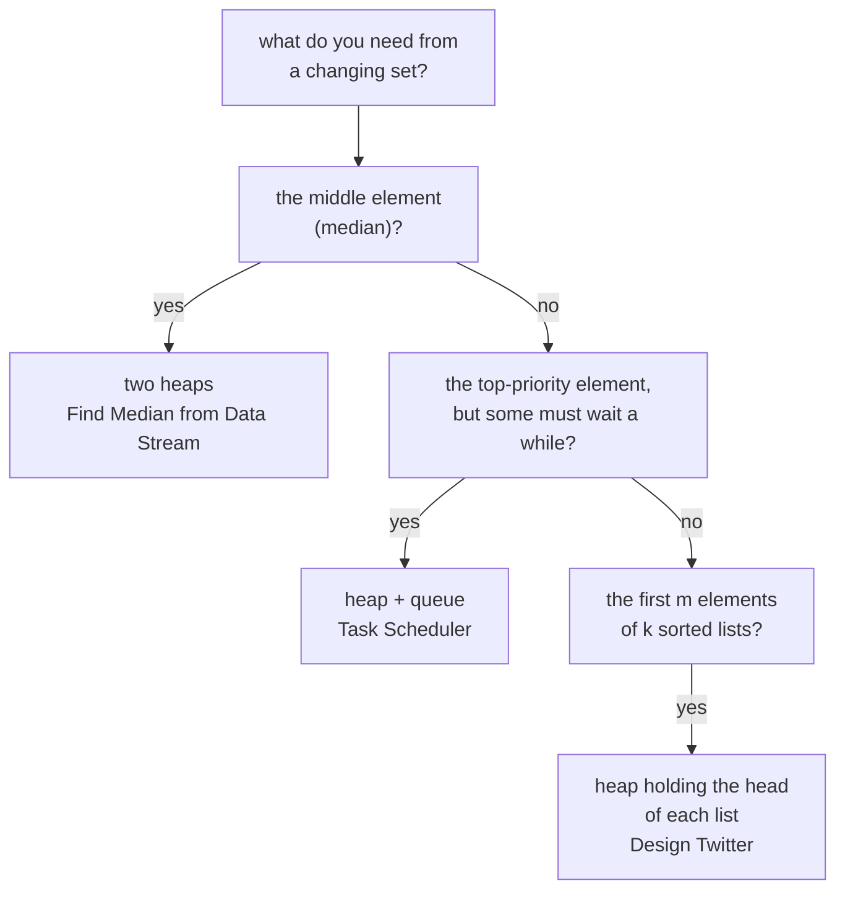

> [!tldr] Quick read
> - Pattern: a heap combined with something else. [[en/posts/2026-11-23-neetcode-heap-top-k|Station 3]] used one heap to know the **front** element; this station uses the heap as one part of a bigger structure.
> - **[[en/concepts/two-heaps|Two heaps]]** (Find Median from Data Stream): the lower half in a max-heap, the upper half in a min-heap, the two tops side by side in the middle of the sequence. The median is read in O(1), a number is added in O(log n). Measured on 2·10⁵ numbers: 50.8 ms against 1,367.6 ms for inserting into a sorted array.
> - **A heap and a queue** (Task Scheduler): each time unit runs the task with the most runs left; a task just run waits n units in a queue before going back to the heap. This problem also has an O(n) counting formula that needs no simulation.
> - **[[en/concepts/k-way-merge|K-way merge]]** (Design Twitter): the news feed is the 10 newest tweets across k time-ordered lists. The heap holds exactly one newest untaken tweet per user; 10 takes and it is done. Measured on 1,000 users × 1,000 tweets: 0.20 ms against 266.17 ms for gathering everything and sorting.
> - This station closes the Search and Heaps line; [[en/series/neetcode-link|the Linked Structures Line]] reuses the k-way merge to merge k linked lists.

> [!info] Context
> Station 4, the last station of **The NeetCode Line: Search and Heaps**. [[en/posts/2026-11-23-neetcode-binary-search|Station 1]] and [[en/posts/2026-11-23-neetcode-binary-search-answer|station 2]] search ordered data; [[en/posts/2026-11-23-neetcode-heap-top-k|station 3]] built the [[en/concepts/heap|heap]] and the [[en/concepts/size-k-heap|size-k heap]] to know the front of unordered data. Here three design problems (the problem gives a class with a few methods, not a single function) use the heap as one part. You need to know what a heap is and how sifting up and down works ([[en/concepts/sift-up-sift-down|Sift Up and Sift Down]]); nothing else.

> [!abstract]- Quick glossary for this post (click to open)
> - **Heap, top**: a binary tree stored in an array, the highest-priority element in slot 0. Min-heap: smallest on top; max-heap: largest on top. See [[en/concepts/heap|Heap]].
> - **Median**: the middle number in ascending order; with an even count, the mean of the two middle numbers.
> - **Stream**: data arriving one element at a time, with the question repeated after each element. See [[en/concepts/running-median|Running Median]].
> - **Cooldown**: two runs of the same kind of task must be at least n time units apart.
> - **Queue**: in at the back, out at the front, in arrival order.
> - **K-way merge**: combining k sorted lists into one sorted list. See [[en/concepts/k-way-merge|K-way Merge]].
> - **Design problem**: the problem gives a class whose methods are called in any order; you pick data structures so that every method is cheap.

## Picture it first: a day in a classroom

The homeroom teacher has three recurring jobs every day, and each one only needs to know "who is at the front" of a changing group.

| Everyday | Concept |
|---|---|
| The class's middle height: split the class into a short line (tallest at the front) and a tall line (shortest at the front) | two heaps: max-heap lower half, min-heap upper half |
| A new student joins the short line, the tallest of the short line moves to the tall line, and if a line gets too long one student moves back | push into the lower half, move its top, rebalance sizes |
| The two students at the front of the lines are the two in the middle of the class | median = one or two tops |
| Cleaning duty: each hour, do the chore with the most turns left | max-heap on runs left |
| A chore just done must rest n hours before it can be done again, waiting on a bench | cooldown queue |
| No chore is ready: the class rests for an hour | an idle time unit |
| The class notice board: each friend has a stack of notes, newest on top | k sorted lists |
| Look only at the top note of each stack, take the newest, then turn to the next note of that stack | k-way merge with a heap |



## The problem: a heap alone only knows the front

A heap answers exactly one question: what is the highest-priority element. The three problems of this station ask something else:

- **Find Median from Data Stream** asks for the **middle** element. A heap knows nothing about the middle. A sorted array does, but each insert shifts half the array: 2·10⁵ numbers take 1.37 seconds.
- **Task Scheduler** asks for the highest-priority element **among those currently allowed**. The task just run may still have the most runs left, but it has to rest; a heap has no notion of "set aside for now".
- **Design Twitter** asks for the first 10 elements of the **union** of k lists. Gathering everything and sorting touches every tweet of every user, when only 10 are needed.

All three are solved by pairing the heap with exactly one more thing: a second heap, a queue, or an index into each list.

## How it works

### Two heaps: holding the middle

<figure class="figure-map" style="--ar: 3 / 4">
<div class="frame"><iframe data-archify="../../diagrams/neetcode-two-heaps/running-median.en.html" title="The median of a stream with two heaps" loading="lazy"></iframe></div>
<figcaption><span><b>Figure 1.</b> Find Median from Data Stream with the stream 5, 2, 8, 1, 9: each number goes into the lower half, the lower top moves to the upper half, and if the upper half gets bigger one number comes back; the median always sits at one or two tops.</span><a href="../diagrams/neetcode-two-heaps/running-median.en.html" target="_blank" rel="noopener">Open full screen</a></figcaption>
</figure>

The anchor problem of the station is [[en/problems/find-median-from-data-stream|Find Median from Data Stream]]. Split the numbers seen so far into a **lower half** (max-heap) and an **upper half** (min-heap), and keep two invariants:

1. every lower number ≤ every upper number;
2. the lower half has as many elements as the upper half, or exactly one more.

Then the lower top is the largest number below the boundary, the upper top is the smallest number above it, and the median is the lower top (odd n) or the mean of the two tops (even n). Adding a number takes three steps: push it into the lower half; move the lower top to the upper half (keeps invariant 1, because the number moved is the largest of the lower half); if the upper half is now bigger, move its top back (keeps invariant 2). Each step is O(log n), reading the median is O(1).

The two wrong versions on the problem page each keep exactly one invariant and are both right on only 3/8 cases: **alternating** between the heaps (sizes right, order broken) and **never rebalancing** (order right, sizes drifting). Compare [[en/problems/median-of-two-sorted-arrays|Median of Two Sorted Arrays]] from station 2, where both arrays already exist and the question is asked once, so a binary search on the cut position gives O(log min(m, n)); here the data arrives over time and the question repeats after each number.

| n | data | Sorted insert | Two heaps | Count array [0, 100] |
|---|---|---|---|---|
| 10⁵ | random ±10⁵ | 292.8 ms | 24.5 ms | 8.6 ms |
| 2·10⁵ | random ±10⁵ | 1,367.6 ms | 50.8 ms | 17.6 ms |
| 2·10⁵ | descending | 3,307.8 ms | 53.7 ms | |
| 10⁶ | random ±10⁵ | (not run) | 281.7 ms | 87.7 ms |

TypeScript measurements from the problem page, median of 5 runs, each insert followed by one query. The sorted insert grows like n², two heaps grow linearly. The last column answers the problem's follow-up: when every number is in [0, 100], a 101-slot count array beats even two heaps.

### A heap and a queue: scheduling with cooldowns

[[en/problems/task-scheduler|Task Scheduler]]: a list of tasks, each a letter; in each time unit the CPU runs one task or idles; two runs of the same letter must be at least n units apart. Find the minimum number of time units.

Greedy: in each unit, run the task **with the most runs left** among those currently allowed. The task with the most runs left is the one most likely to stretch the schedule, so run it early. The structure:

- a **max-heap** of runs left for the tasks currently allowed;
- a **queue** of tasks just run, each with the time it may run again (`now + n`). Since every task rests exactly n units, a task that entered the queue earlier also finishes resting earlier, so a plain queue (in at the back, out at the front) is enough, with no second heap.

Each unit: pop the heap top (if any), decrement it, and if runs remain put it in the queue; when the front of the queue has finished resting, return it to the heap. If the heap is empty while the queue still has tasks, the CPU idles that unit.

This problem also has a solution **without simulation**. Let f be the run count of the most frequent task and c the number of tasks with exactly f runs. The most frequent task splits the schedule into f − 1 frames of length n + 1, plus a final frame holding the c tasks: (f − 1)(n + 1) + c. If the other tasks are numerous enough to fill every frame, the schedule has no idle slot and the answer is the number of tasks. So the answer is max(number of tasks, (f − 1)(n + 1) + c). For `AAABBB`, n = 2: f = 3, c = 2, (3 − 1) · 3 + 2 = 8, that is `A B _ A B _ A B`.

```text
621, 10⁴ tasks, 26 kinds, n = 0  : simulation 10000 (1.67 ms), formula 10000 (0.30 ms)
621, 10⁴ tasks, 26 kinds, n = 2  : simulation 10000 (1.19 ms), formula 10000 (0.27 ms)
621, 10⁴ tasks, 26 kinds, n = 100: simulation 42825 (0.48 ms), formula 42825 (0.27 ms)
```

Simulation and formula agree for all three values of n. The formula counts in a single pass, so it is faster, but the simulation is more general: it can print the schedule, and it stays correct if the rules change (for example a different cooldown per task, in which case the queue has to become a heap keyed on the time each task may run again).

### A heap holding the heads of k lists: k-way merge

[[en/problems/design-twitter|Design Twitter]]: users post tweets, follow and unfollow each other; `getNewsFeed(user)` returns the 10 newest tweets from that user and the users they follow, newest first.

Each user keeps their tweets in a list ordered by posting time, so it is already sorted. The feed is the first 10 elements of **k sorted lists** combined ([[en/concepts/k-way-merge|k-way merge]]):

1. Push onto a max-heap (keyed on time) the newest tweet of each user in the group, together with its position in their list.
2. Pop the top: it is the newest of all tweets not yet taken. Push the next older tweet of the **same user**.
3. Repeat until there are 10 or the heap is empty.

The heap never holds more than k elements, so one `getNewsFeed` costs O(k + 10 log k), regardless of how many tweets each user has posted. Gathering every tweet and sorting costs O(N log N), with N the group's total tweet count.

```text
355, 100 users × ~100 tweets: k-way merge 0.03 ms, gather then sort 1.07 ms, same result: true
355, 1000 users × ~100 tweets: k-way merge 0.21 ms, gather then sort 17.99 ms, same result: true
355, 1000 users × ~1000 tweets: k-way merge 0.20 ms, gather then sort 266.17 ms, same result: true
```

The gap grows with tweets per user: at 1,000 users × 1,000 tweets the k-way merge still takes about 0.2 ms because it touches only the 1,000 list heads and the 10 tweets taken, while gather-then-sort has to sort 10⁶ tweets.

### Three problems, three pairings

| Problem | Heap | Paired with | Per operation |
|---|---|---|---|
| [[en/problems/find-median-from-data-stream\|Find Median from Data Stream]] | max-heap lower half, min-heap upper half | a second heap | `addNum` O(log n), `findMedian` O(1) |
| [[en/problems/task-scheduler\|Task Scheduler]] | max-heap on runs left | a cooldown queue | O(log 26) per time unit; or an O(number of tasks) counting formula |
| [[en/problems/design-twitter\|Design Twitter]] | max-heap on time, one element per user | an index into each user's tweet list | `getNewsFeed` O(k + 10 log k), `postTweet` O(1) |

### Under the hood of the five languages

| | Max-heap | Multi-field elements | Specific trap |
|---|---|---|---|
| TypeScript / JavaScript | hand-written keyed heap, negative keys | arrays `[time, user, index]` | `sort()` without a compare function compares strings |
| Python | `heapq` is min-heap only: negate | tuples, compared left to right | forgetting to negate in one of three places; `//` rounds down, use `/` for the median |
| Go | `container/heap`, flip `Less` | a struct per kind of heap | `Push`, `Pop` need pointer receivers; call `heap.Push(h, x)`; `int / int` is integer division |
| Java | `PriorityQueue` with `Collections.reverseOrder()` | `int[]` with a comparator | the `(a, b) -> b - a` comparator overflows `int`, use `Integer.compare`; `(a + b) / 2` is integer division |

## Runnable example

[TypeScript](../code/neetcode-two-heaps/two-heaps-station.ts) · [Python](../code/neetcode-two-heaps/two_heaps_station.py) · [Go](../code/neetcode-two-heaps/two_heaps_station.go) · [Java](../code/neetcode-two-heaps/two-heaps-station.java) · [JavaScript](../code/neetcode-two-heaps/two-heaps-station.js)

Each file solves all three problems and runs 14 cases: five Task Scheduler cases (the three problem examples, `AAAAAABCDEFG` with n = 2, and n = 0), four Design Twitter cases (the problem example, 11 tweets returning only 10, following yourself without duplicates, three interleaved users) and five Find Median cases (the problem example, descending, negatives, duplicates, interleaved). The TypeScript and JavaScript versions also run the two Task Scheduler and Design Twitter measurements shown above.

```ts
// 621: each time unit runs the task with the most runs left (a max-heap on runs left);
// a task just run waits in the queue and returns to the heap after n idle units.
function leastInterval(tasks: string[], n: number): number {
  const count = new Map<string, number>();
  for (const t of tasks) count.set(t, (count.get(t) ?? 0) + 1);
  const ready = new Heap<number>((c) => -c);
  for (const c of count.values()) ready.push(c);
  const cooling: [number, number][] = []; // [runs left, time it may run again], in time order
  let time = 0;
  while (ready.size > 0 || cooling.length > 0) {
    time++;
    if (ready.size > 0) {
      const left = ready.pop() - 1;
      if (left > 0) cooling.push([left, time + n]);
    } // empty heap: the CPU idles this unit
    if (cooling.length > 0 && cooling[0][1] === time) ready.push(cooling.shift()![0]);
  }
  return time;
}

// 355: each user keeps a time-ordered tweet list; the feed is a merge of k sorted lists (k-way merge)
// with a max-heap on time; each list has only its newest untaken element in the heap.
class Twitter {
  clock = 0;
  tweets = new Map<number, [number, number][]>(); // userId → [[time, tweetId], …] ascending by time
  follows = new Map<number, Set<number>>();
  postTweet(userId: number, tweetId: number): void {
    if (!this.tweets.has(userId)) this.tweets.set(userId, []);
    this.tweets.get(userId)!.push([this.clock++, tweetId]);
  }
  getNewsFeed(userId: number): number[] {
    const heap = new Heap<[number, number, number]>((e) => -e[0]); // [time, user, index in the list]
    for (const u of new Set([userId, ...(this.follows.get(userId) ?? [])])) {
      const list = this.tweets.get(u);
      if (list && list.length > 0) heap.push([list[list.length - 1][0], u, list.length - 1]);
    }
    const feed: number[] = [];
    while (heap.size > 0 && feed.length < 10) {
      const [, u, i] = heap.pop();
      const list = this.tweets.get(u)!;
      feed.push(list[i][1]);
      if (i > 0) heap.push([list[i - 1][0], u, i - 1]); // the next older tweet of the same user
    }
    return feed;
  }
  follow(a: number, b: number): void {
    if (!this.follows.has(a)) this.follows.set(a, new Set());
    this.follows.get(a)!.add(b);
  }
  unfollow(a: number, b: number): void { this.follows.get(a)?.delete(b); }
}

// 295: two heaps. lower (max-heap) holds the lower half, upper (min-heap) the upper half.
class MedianFinder {
  lower = new Heap<number>((x) => -x);
  upper = new Heap<number>((x) => x);
  addNum(x: number): void {
    this.lower.push(x);
    this.upper.push(this.lower.pop()); // largest of the lower half moves to the upper half
    if (this.upper.size > this.lower.size) this.lower.push(this.upper.pop());
  }
  findMedian(): number {
    return this.lower.size > this.upper.size ? this.lower.peek() : (this.lower.peek() + this.upper.peek()) / 2;
  }
}
```

```python
def least_interval(tasks, n):
    # 621: a max-heap on runs left (heapq on negatives); a task just run waits in the queue until it may run again.
    ready = [-c for c in Counter(tasks).values()]
    heapq.heapify(ready)
    cooling = deque()  # (runs left, time it may run again)
    time = 0
    while ready or cooling:
        time += 1
        if ready:
            left = -heapq.heappop(ready) - 1
            if left:
                cooling.append((left, time + n))
        if cooling and cooling[0][1] == time:
            heapq.heappush(ready, -cooling.popleft()[0])
    return time

class Twitter:
    # 355: the feed merges k tweet lists (k-way merge) with a max-heap on time (negated).
    def __init__(self):
        self.clock = 0
        self.tweets = {}  # user → [(time, tweetId), …] ascending
        self.follows = {}

    def postTweet(self, user, tweet):
        self.tweets.setdefault(user, []).append((self.clock, tweet))
        self.clock += 1

    def getNewsFeed(self, user):
        heap = []
        for u in {user} | self.follows.get(user, set()):
            lst = self.tweets.get(u)
            if lst:
                heap.append((-lst[-1][0], u, len(lst) - 1))
        heapq.heapify(heap)
        feed = []
        while heap and len(feed) < 10:
            _, u, i = heapq.heappop(heap)
            lst = self.tweets[u]
            feed.append(lst[i][1])
            if i > 0:
                heapq.heappush(heap, (-lst[i - 1][0], u, i - 1))
        return feed

    def follow(self, a, b):
        self.follows.setdefault(a, set()).add(b)

    def unfollow(self, a, b):
        self.follows.get(a, set()).discard(b)

class MedianFinder:
    # 295: lower is a max-heap (negated) holding the lower half, upper is a min-heap holding the upper half.
    def __init__(self):
        self.lower, self.upper = [], []

    def addNum(self, x):
        heapq.heappush(self.lower, -x)
        heapq.heappush(self.upper, -heapq.heappop(self.lower))
        if len(self.upper) > len(self.lower):
            heapq.heappush(self.lower, -heapq.heappop(self.upper))

    def findMedian(self):
        if len(self.lower) > len(self.upper):
            return -self.lower[0]
        return (-self.lower[0] + self.upper[0]) / 2
```

```go
type maxIntHeap struct{ intHeap }

func (h maxIntHeap) Less(i, j int) bool { return h.intHeap[i] > h.intHeap[j] }

// 621: a max-heap on runs left; a task just run waits in the queue until it may run again.
func leastInterval(tasks string, n int) int {
	count := map[rune]int{}
	for _, t := range tasks {
		count[t]++
	}
	ready := &maxIntHeap{}
	for _, c := range count {
		heap.Push(ready, c)
	}
	type wait struct{ left, at int }
	var cooling []wait
	time := 0
	for ready.Len() > 0 || len(cooling) > 0 {
		time++
		if ready.Len() > 0 {
			if left := heap.Pop(ready).(int) - 1; left > 0 {
				cooling = append(cooling, wait{left, time + n})
			}
		}
		if len(cooling) > 0 && cooling[0].at == time {
			heap.Push(ready, cooling[0].left)
			cooling = cooling[1:]
		}
	}
	return time
}

// 355: the feed merges k tweet lists (k-way merge) with a max-heap on time.
type tweet struct{ at, id int }

type cursor struct{ at, user, i int }

type cursorHeap []cursor

func (h cursorHeap) Less(i, j int) bool { return h[i].at > h[j].at }

func (t *Twitter) GetNewsFeed(user int) []int {
	h := &cursorHeap{}
	users := map[int]bool{user: true}
	for u := range t.follows[user] {
		users[u] = true
	}
	for u := range users {
		if l := t.tweets[u]; len(l) > 0 {
			heap.Push(h, cursor{l[len(l)-1].at, u, len(l) - 1})
		}
	}
	feed := []int{}
	for h.Len() > 0 && len(feed) < 10 {
		c := heap.Pop(h).(cursor)
		l := t.tweets[c.user]
		feed = append(feed, l[c.i].id)
		if c.i > 0 {
			heap.Push(h, cursor{l[c.i-1].at, c.user, c.i - 1})
		}
	}
	return feed
}

// 295: lower is a max-heap holding the lower half, upper is a min-heap holding the upper half.
type MedianFinder struct {
	lower *maxIntHeap
	upper *intHeap
}

func (m *MedianFinder) AddNum(x int) {
	heap.Push(m.lower, x)
	heap.Push(m.upper, heap.Pop(m.lower))
	if m.upper.Len() > m.lower.Len() {
		heap.Push(m.lower, heap.Pop(m.upper))
	}
}

func (m *MedianFinder) FindMedian() float64 {
	if m.lower.Len() > m.upper.Len() {
		return float64(m.lower.intHeap[0])
	}
	return float64(m.lower.intHeap[0]+(*m.upper)[0]) / 2
}
```

```java
// 621: a max-heap on runs left; a task just run waits in the queue until it may run again.
static int leastInterval(char[] tasks, int n) {
    int[] count = new int[26];
    for (char t : tasks) count[t - 'A']++;
    PriorityQueue<Integer> ready = new PriorityQueue<>(Collections.reverseOrder());
    for (int c : count) if (c > 0) ready.offer(c);
    ArrayDeque<int[]> cooling = new ArrayDeque<>(); // {runs left, time it may run again}
    int time = 0;
    while (!ready.isEmpty() || !cooling.isEmpty()) {
        time++;
        if (!ready.isEmpty()) {
            int left = ready.poll() - 1;
            if (left > 0) cooling.add(new int[]{left, time + n});
        }
        if (!cooling.isEmpty() && cooling.peek()[1] == time) ready.offer(cooling.poll()[0]);
    }
    return time;
}

// 355: the feed merges k tweet lists (k-way merge) with a max-heap on time.
static class Twitter {
    int clock = 0;
    Map<Integer, List<int[]>> tweets = new HashMap<>(); // user → [{time, tweetId}, …] ascending
    Map<Integer, Set<Integer>> follows = new HashMap<>();

    void postTweet(int user, int id) { tweets.computeIfAbsent(user, k -> new ArrayList<>()).add(new int[]{clock++, id}); }

    List<Integer> getNewsFeed(int user) {
        PriorityQueue<int[]> heap = new PriorityQueue<>((a, b) -> Integer.compare(b[0], a[0])); // {time, user, index}
        Set<Integer> users = new HashSet<>(follows.getOrDefault(user, Set.of()));
        users.add(user);
        for (int u : users) {
            List<int[]> l = tweets.get(u);
            if (l != null && !l.isEmpty()) heap.offer(new int[]{l.get(l.size() - 1)[0], u, l.size() - 1});
        }
        List<Integer> feed = new ArrayList<>();
        while (!heap.isEmpty() && feed.size() < 10) {
            int[] c = heap.poll();
            List<int[]> l = tweets.get(c[1]);
            feed.add(l.get(c[2])[1]);
            if (c[2] > 0) heap.offer(new int[]{l.get(c[2] - 1)[0], c[1], c[2] - 1});
        }
        return feed;
    }

    void follow(int a, int b) { follows.computeIfAbsent(a, k -> new HashSet<>()).add(b); }

    void unfollow(int a, int b) { follows.getOrDefault(a, new HashSet<>()).remove(b); }
}

// 295: lower is a max-heap holding the lower half, upper is a min-heap holding the upper half.
static class MedianFinder {
    PriorityQueue<Integer> lower = new PriorityQueue<>(Collections.reverseOrder());
    PriorityQueue<Integer> upper = new PriorityQueue<>();

    void addNum(int x) {
        lower.offer(x);
        upper.offer(lower.poll());
        if (upper.size() > lower.size()) lower.offer(upper.poll());
    }

    double findMedian() {
        if (lower.size() > upper.size()) return lower.peek();
        return ((long) lower.peek() + upper.peek()) / 2.0;
    }
}
```

```js
// 621: each time unit runs the task with the most runs left (a max-heap on runs left);
// a task just run waits in the queue and returns to the heap after n idle units.
function leastInterval(tasks, n) {
  const count = new Map();
  for (const t of tasks) count.set(t, (count.get(t) ?? 0) + 1);
  const ready = new Heap((c) => -c);
  for (const c of count.values()) ready.push(c);
  const cooling = []; // [runs left, time it may run again], in time order
  let time = 0;
  while (ready.size > 0 || cooling.length > 0) {
    time++;
    if (ready.size > 0) {
      const left = ready.pop() - 1;
      if (left > 0) cooling.push([left, time + n]);
    } // empty heap: the CPU idles this unit
    if (cooling.length > 0 && cooling[0][1] === time) ready.push(cooling.shift()[0]);
  }
  return time;
}

// 355: each user keeps a time-ordered tweet list; the feed is a merge of k sorted lists (k-way merge)
// with a max-heap on time; each list has only its newest untaken element in the heap.
class Twitter {
  clock = 0;
  tweets = new Map(); // userId → [[time, tweetId], …] ascending by time
  follows = new Map();
  postTweet(userId, tweetId) {
    if (!this.tweets.has(userId)) this.tweets.set(userId, []);
    this.tweets.get(userId).push([this.clock++, tweetId]);
  }
  getNewsFeed(userId) {
    const heap = new Heap((e) => -e[0]); // [time, user, index in the list]
    for (const u of new Set([userId, ...(this.follows.get(userId) ?? [])])) {
      const list = this.tweets.get(u);
      if (list && list.length > 0) heap.push([list[list.length - 1][0], u, list.length - 1]);
    }
    const feed = [];
    while (heap.size > 0 && feed.length < 10) {
      const [, u, i] = heap.pop();
      const list = this.tweets.get(u);
      feed.push(list[i][1]);
      if (i > 0) heap.push([list[i - 1][0], u, i - 1]); // the next older tweet of the same user
    }
    return feed;
  }
  follow(a, b) {
    if (!this.follows.has(a)) this.follows.set(a, new Set());
    this.follows.get(a).add(b);
  }
  unfollow(a, b) {
    this.follows.get(a)?.delete(b);
  }
}

// 295: two heaps. lower (max-heap) holds the lower half, upper (min-heap) the upper half.
class MedianFinder {
  lower = new Heap((x) => -x);
  upper = new Heap((x) => x);
  addNum(x) {
    this.lower.push(x);
    this.upper.push(this.lower.pop()); // largest of the lower half moves to the upper half
    if (this.upper.size > this.lower.size) this.lower.push(this.upper.pop());
  }
  findMedian() {
    return this.lower.size > this.upper.size ? this.lower.peek() : (this.lower.peek() + this.upper.peek()) / 2;
  }
}
```


Output of `node two-heaps-station.ts`:

```text
two-heaps-station 14/14 cases correct
621, 10⁴ tasks, 26 kinds, n = 0  : simulation 10000 (1.67 ms), formula 10000 (0.30 ms)
621, 10⁴ tasks, 26 kinds, n = 2  : simulation 10000 (1.19 ms), formula 10000 (0.27 ms)
621, 10⁴ tasks, 26 kinds, n = 100: simulation 42825 (0.48 ms), formula 42825 (0.27 ms)
355, 100 users × ~100 tweets: k-way merge 0.03 ms, gather then sort 1.07 ms, same result: true
355, 1000 users × ~100 tweets: k-way merge 0.21 ms, gather then sort 17.99 ms, same result: true
355, 1000 users × ~1000 tweets: k-way merge 0.20 ms, gather then sort 266.17 ms, same result: true
```

*(Output labels translated; the files themselves print Vietnamese.)*

Python, Go, Java and JavaScript also print `14/14 ca đúng` ("14/14 cases correct"). The TypeScript version uses the hand-written `Heap<T>` from [[en/posts/2026-11-23-neetcode-heap-top-k|station 3]]; the Go version shares an `intHeap` type (not printed above) for the min-heap.

## Misconceptions and common traps

- **"A median needs a fully sorted structure."** It needs only the two middle numbers. Two heaps sort nothing inside and still put exactly those two at their tops.
- **Two heaps: keeping one invariant and forgetting the other.** Alternating keeps the sizes but breaks the order; comparing with the top without rebalancing keeps the order but breaks the sizes. Both are right on only 3/8 cases on the problem page.
- **Task Scheduler: running tasks in alphabetical order, or the least frequent first.** Leave the most frequent task for the end and it has to wait out many cooldowns at the end of the schedule. Always pick the task with the most runs left.
- **Task Scheduler: using a heap for the queue.** Not wrong, but unnecessary: every task rests exactly n units, so tasks leave the queue in the order they entered.
- **Design Twitter: pushing every tweet into the heap.** Correct but O(N log N); one tweet per user is enough, pushing the next one when a tweet is taken.
- **Design Twitter: forgetting yourself, or counting yourself twice.** The feed includes the user's own tweets. If they follow themselves and the group is not merged as a set, their tweets show up twice.
- **Integer division when computing the median.** `(a + b) / 2` in Go and Java loses the .5.

## Self-check questions

> [!question]- Add 6, 10, 2 to two heaps. The two heaps and the median after each?
> 6: lower [6], upper []: 6. 10: 10 into lower, then up: lower [6], upper [10]: 8. 2: 2 into lower [6, 2], top 6 to upper [6, 10], upper is bigger so 6 comes back: lower [6, 2], upper [10]: 6.

> [!question]- Task Scheduler with `AAABBBCC`, n = 2. What does the formula give? Write a schedule.
> f = 3 (A and B), c = 2: (3 − 1) · 3 + 2 = 8, equal to the number of tasks, so there is no idle slot. A schedule: `A B C A B C A B`.

> [!question]- Design Twitter with k followed users, m tweets each. What does the k-way merge cost? When is gather-then-sort not bad?
> O(k + 10 log k) ([[en/concepts/heapify|build a heap]] of k elements, then 10 pops and pushes). Gather-then-sort costs O(km log(km)). When km is small (a few dozen tweets in total) both are instant; the k-way merge wins when each user has many tweets.

> [!question]- Why does Task Scheduler use a max-heap on runs left rather than on task name?
> Picking the task with the most runs left reduces the forced idle slots later. If you finish the less frequent tasks first, the end of the schedule holds only one frequent task, and each run has to wait n units.

## References

- [NeetCode 150](https://neetcode.io/practice) (the list and its groups)
- LeetCode: [621. Task Scheduler](https://leetcode.com/problems/task-scheduler/), [355. Design Twitter](https://leetcode.com/problems/design-twitter/), [295. Find Median from Data Stream](https://leetcode.com/problems/find-median-from-data-stream/)
- [Python `heapq`](https://docs.python.org/3/library/heapq.html) (min-heap, `heapq.merge` for merging several sorted inputs)
- [Go `container/heap`](https://pkg.go.dev/container/heap) (`heap.Interface`, the `PriorityQueue` example)
- [Java 21 `PriorityQueue`](https://docs.oracle.com/en/java/javase/21/docs/api/java.base/java/util/PriorityQueue.html)
- Donald E. Knuth, *The Art of Computer Programming*, volume 3, section 5.4.1 (multiway merging with a selection tree)
- Cormen, Leiserson, Rivest, Stein, *Introduction to Algorithms*, chapter 6 "Heapsort" (priority queues) and exercise 6.5-9 of the third edition (merging k sorted lists in O(n log k))
