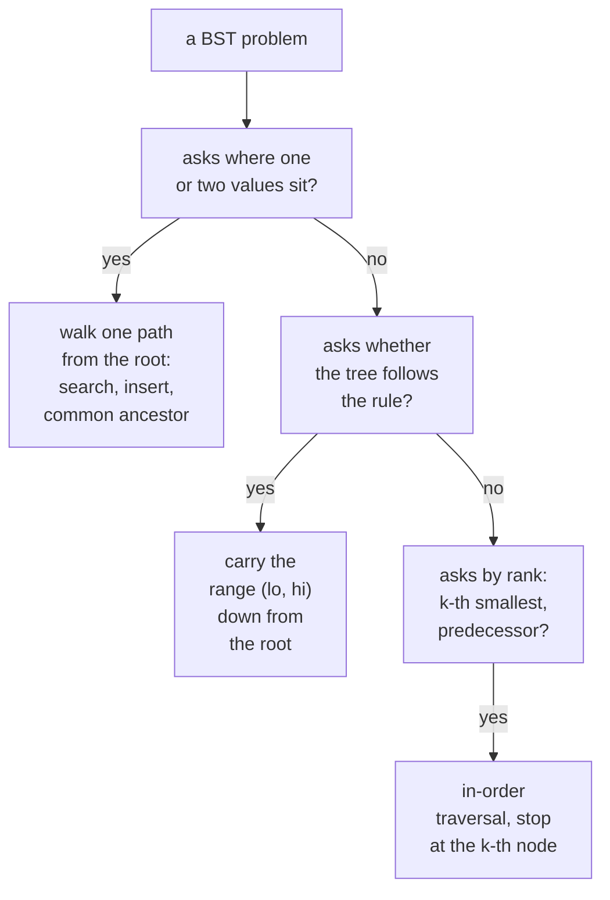

> [!tldr] Quick read
> - Pattern: a [[en/concepts/binary-search-tree|binary search tree]] (BST) keeps one rule at **every** node: the **whole** left subtree is smaller than the node, the **whole** right subtree is larger. The station's three problems are three ways of reading that rule.
> - **Carry the range down** (Validate Binary Search Tree, the anchor problem): each node receives an open range (lo, hi) from all its ancestors; going left lowers the upper bound, going right raises the lower bound. Comparing a node only with its parent is wrong: out of 238 broken trees, that check accepts 66. See [[en/concepts/bounds-propagation|Bounds Propagation]].
> - **Walk one path** (Lowest Common Ancestor of a Binary Search Tree): if both values are smaller than the node, go left; if both are larger, go right; otherwise this is the answer. O(h): 0.34 µs per query on a 10⁶-node tree, against 10.9 ms when you ignore the order and walk the whole tree.
> - **In-order is a sorted sequence** (Kth Smallest Element in a BST): an [[en/concepts/in-order-traversal|in-order traversal]] with a stack that stops at the k-th node, O(h + k): k = 10 takes 0.4 µs, collecting the whole tree into an array takes 23 ms.
> - Every cost here is **O(h), not O(log n)**: on a skewed tree, h = n. The problems allow up to 10⁵ nodes, enough to break recursion in Python.

> [!info] Context
> Station 4 of **the NeetCode Line: Linked Structures**. [[en/posts/2026-11-25-neetcode-tree-recursion|Station 3]] works with arbitrary binary trees: to learn anything about the tree, you ask both subtrees. This station adds a rule about the **order of values**, and that rule lets you discard half the tree after every comparison, just like [[en/concepts/binary-search|binary search]] on a sorted array. All three problems are Medium. You only need binary trees, height and recursion at the level of station 3; everything else is explained in the post.

> [!abstract]- Quick glossary for this post (click to open)
> - **Node, root, leaf, subtree, height, level-order array**: see [[en/posts/2026-11-25-neetcode-tree-recursion|station 3]] and [[en/concepts/binary-tree|Binary Tree]].
> - **Ancestor, descendant**: a node's ancestors are all the nodes on the path from the root down to it; the node is their descendant. By LeetCode's convention, a node is also an ancestor of itself.
> - **BST (binary search tree)**: a binary tree where, at every node, every value on the left is smaller and every value on the right is larger. See [[en/concepts/binary-search-tree|Binary Search Tree]].
> - **Open range (lo, hi)**: the numbers greater than lo **and** less than hi, not counting the two ends.
> - **In-order traversal**: visit the left subtree, then the node, then the right subtree. See [[en/concepts/in-order-traversal|In-order Traversal]].
> - **O(h)**: a cost proportional to the tree's height h, not to the number of nodes n.
> - **Stack**: see [[en/concepts/stack|Stack]].
> - **Sentinel value**: a special value that stands in for "none", like −∞ here. See [[en/concepts/sentinel-value|Sentinel Value]].

## Picture it first: a library with a sign at every fork

Picture a library where the aisle splits in two at every fork. Each fork has a sign with a call number: books with a smaller number go down the left aisle, larger ones down the right. The rule applies to **the whole section behind it**, not just the shelf next to the fork.

| Everyday life | Concept |
|---|---|
| The aisle splits in two at every fork, the sign says "smaller turn left, larger turn right" | [[en/concepts/binary-search-tree\|binary search tree]] |
| Finding a book: you take one aisle and never turn back | search in a BST, O(h) |
| Two people looking for two books walk together up to the fork where the sign sends them different ways | [[en/concepts/lowest-common-ancestor\|lowest common ancestor]] (Lowest Common Ancestor of a Binary Search Tree) |
| Wherever you walk, you note "this section only holds numbers from … to …", combining every sign you passed | [[en/concepts/bounds-propagation\|bounds propagation]] (Validate Binary Search Tree) |
| A book that is in the right place relative to the nearest sign but wrong relative to an earlier one | the "compare a node only with its parent" trap |
| Walking every aisle from left to right: the call numbers appear in increasing order | [[en/concepts/in-order-traversal\|in-order traversal]] |
| You need the book with the k-th smallest number: start from the leftmost aisle, count k books, stop | Kth Smallest Element in a BST |
| Books shelved in increasing order, every fork opens only to the right: one long corridor | skewed tree, h = n |



## The problem: reading the ordering rule without the word "whole"

I used to think that checking whether a tree is a BST only needed, at each node, a comparison with its two children: the left child smaller, the right child larger. The tree below passes that check at every node:

```text
        10
       /  \
      5    15
     / \   / \
    2   7 12  20
          /
         9
```

Node 9 is smaller than its parent 12, fine. But 9 sits in the **right** subtree of the root 10, so it must be greater than 10. This tree is not a BST. The parent-child check looks one level deep, while the rule is about the whole subtree.

This mistake is not rare. The station's file builds 300 random BSTs, changes the value of one node in each at random, and checks them again: 238 trees end up broken, and the parent-child check **wrongly accepts 66 of them**, almost 28%.

The opposite mistake costs too: treating a BST like any binary tree and ignoring the order. Finding the common ancestor of two nodes the station 3 way (ask both subtrees at every node) is correct, but walks almost the whole tree: 10.9 ms per query on a 10⁶-node tree, while walking one path by value takes only 0.34 µs, about 30,000 times faster.

## How it works

### The rule applies to whole subtrees, and three ways to read it

For every node x of a BST: every value in x's left subtree is **smaller** than `x.val`, and every value in its right subtree is **larger** than `x.val`. All three LeetCode problems use the strict definition, with no duplicate values.

Three consequences follow from that rule, and each one is a template:

```ts
// illustration, not runnable on its own
// (1) Walk one path: each comparison discards a whole branch. O(h).
let node = root;
while (node && !found(node)) node = target < node.val ? node.left : node.right;

// (2) Carry the range down: the constraints of all ancestors fit in (lo, hi). O(n).
function check(node, lo, hi) {
  if (!node) return true;
  return lo < node.val && node.val < hi && check(node.left, lo, node.val) && check(node.right, node.val, hi);
}

// (3) In-order: left, node, right yields an increasing sequence. It can stop midway.
for (const v of inorder(root)) if (--k === 0) return v;
```

Information flows in two different directions. At station 3, the height flows **bottom-up** ([[en/concepts/post-order-traversal|post-order]]). In template (2), the range flows **top-down**: the parent knows which range the child must fall in before the child is visited.

### Carry the range down: Validate Binary Search Tree

<figure class="figure-map" style="--ar: 16 / 10">
<div class="frame"><iframe data-archify="../../diagrams/neetcode-binary-search-tree/bounds.en.html" title="Validate BST: the range narrows on the way down" loading="lazy"></iframe></div>
<figcaption><span><b>Figure 1.</b> Each node is labeled with the open range it receives from its ancestors. The root 10 receives (−∞, +∞); going right to 15 makes the lower bound 10; going left to 12 makes the upper bound 15. Node 9 under 12 receives (10, 12) and fails because 9 < 10, even though it is in the right place relative to its parent 12.</span><a href="../diagrams/neetcode-binary-search-tree/bounds.en.html" target="_blank" rel="noopener">Open full screen</a></figcaption>
</figure>

The anchor problem is [[en/problems/validate-binary-search-tree|Validate Binary Search Tree]]: given a binary tree of up to 10⁴ nodes, with values in the 32-bit int range, decide whether it is a strict BST.

The key idea: every constraint the ancestors put on a node fits in **two numbers**. Walking from the root down to the node, each left turn at a node with value v adds the constraint "less than v", and each right turn adds "greater than v". Among the "less than" constraints only the tightest one matters, which is the nearest one. So you only need to remember a lower bound `lo` and an upper bound `hi`:

- the root receives (−∞, +∞);
- going to the left child: `(lo, node.val)`;
- going to the right child: `(node.val, hi)`;
- a node is valid when `lo < node.val < hi`.

Each node is compared once: O(n) time, O(h) memory for the call stack, with the [[en/concepts/sentinel-value|sentinel values]] −∞ and +∞ standing in for "no bound yet".

The second way uses consequence (3): a tree is a strict BST if and only if its in-order sequence is **strictly increasing**. Traverse in order with a stack, remember the previous value, and stop at the first value that is not larger. This version does not recurse, so it handles a skewed 10⁴-node tree in every language.

### Walk one path: Lowest Common Ancestor of a Binary Search Tree

[[en/problems/lowest-common-ancestor-of-a-binary-search-tree|Lowest Common Ancestor of a Binary Search Tree]] gives a BST of 2 to 10⁵ nodes with distinct values, and two nodes p and q that are in the tree. Find the [[en/concepts/lowest-common-ancestor|lowest common ancestor]]: the deepest node that has both p and q in its subtree.

Standing at a node, compare p and q with the node's value:

- both smaller: both lie in the left subtree, so the answer is further down on the left;
- both larger: likewise, go right;
- otherwise: either the two values lie on different sides, or one of them **is** this node. Going further down either side would lose one of them, so this node is the answer.

The function needs no recursion and no extra memory: O(h) time, O(1) memory. The case "one node is an ancestor of the other" is where people slip: the common ancestor of 10 and 17 in the sample tree is 10, not the root 20.

### In-order gives a sorted sequence: Kth Smallest Element in a BST

[[en/problems/kth-smallest-element-in-a-bst|Kth Smallest Element in a BST]] asks for the k-th smallest value (counting from 1) in a BST of up to 10⁴ nodes.

The direct way: traverse in order, collect every value into an array, take element k − 1. Correct, but it always costs O(n) time and O(n) memory, even when k = 1.

The better way: traverse in order with a [[en/concepts/stack|stack]] and **stop** once you have counted k. The stack holds the nodes "passed on the way left, not yet handled":

1. go left as far as possible, pushing each node onto the stack;
2. pop the top node: it is the smallest value not yet counted, so count it;
3. move to its right subtree and go back to step 1.

The cost is O(h + k): reaching the smallest node takes h steps, and each value after that costs O(1) on average. On a 10⁶-node tree, k = 10 takes 0.4 µs; collecting the whole tree takes 23 ms. With k = n/2, stopping early still walks half the tree, so it is only about 5 times faster (3.9 ms against 21.4 ms).

The problem's follow-up: what if the tree is modified by inserts and deletes all the time and "k-th smallest" queries come often? Then each node also stores the **size of its subtree**. At a node whose left subtree has L nodes: if k ≤ L, go left; if k = L + 1, it is this node; otherwise go right with k − L − 1. Each query drops to O(h), and an insert or delete only has to update sizes along one path. The problem page works this out in detail.

### Three problems, one rule

| Problem | What differs | How it reads the order | Time, extra memory |
|---|---|---|---|
| [[en/problems/lowest-common-ancestor-of-a-binary-search-tree\|Lowest Common Ancestor of a Binary Search Tree]] | two values walk together until they split | walk one path from the root | O(h), O(1) |
| [[en/problems/validate-binary-search-tree\|Validate Binary Search Tree]] | you may not trust the tree to follow the rule; you must check it | carry the range (lo, hi) down, or check that in-order is strictly increasing | O(n), O(h) |
| [[en/problems/kth-smallest-element-in-a-bst\|Kth Smallest Element in a BST]] | asks by rank, not by value | in-order with a stack, stop at k | O(h + k), O(h) |

### O(h), not O(log n)

Every O(h) figure above is only good when the tree is short. A balanced 10⁶-node tree is 20 tall. But a BST does not balance itself: insert values in increasing order and every node has only a right child, so the tree becomes a chain n tall. The problems do not promise a balanced tree, so a skewed 10⁵-node input to problem 235 makes the loop take 10⁵ steps, and the recursive version of problem 98 on a 10⁴-node chain breaks in Python:

```text
98 recursive on a 10^4-node chain: RecursionError; stack version: True
```

*(Output labels translated; the files themselves print Vietnamese.)*

Each language's recursion limit was measured at [[en/posts/2026-11-25-neetcode-tree-recursion|station 3]] (see [[en/concepts/recursion-depth-limit|Recursion Depth Limit]]). At this station, problem 235 is most natural as a loop, while 98 and 230 have stack versions that run at any depth. Outside LeetCode, the ordered trees in standard libraries (Java's `TreeMap`, C++'s `std::map`) are red-black trees, which rotate themselves to keep the height around log n.

### Under the five languages

| | "Infinity" for the range | Language-specific trap |
|---|---|---|
| TypeScript / JavaScript | `-Infinity`, `Infinity` | values are `number` (64-bit floats), so comparisons with ±Infinity always work; no overflow trap in this problem |
| Python | `-math.inf`, `math.inf`; `lo < node.val < hi` can be written as one chained comparison | a recursive `yield from` generator is neat, but every value has to pass through h generator levels: with k = n it is 5 times slower than the stack version (51.8 ms against 10.0 ms on a 2·10⁵-node tree) |
| Go | `math.MinInt`, `math.MaxInt`: `int` is 64-bit, so they lie outside every int32 value in the problem | using `math.MinInt32` as a bound makes a node equal to −2³¹ fail; a nested recursive function must be declared first with `var check func(…)` |
| Java | `long`: `Long.MIN_VALUE`, `Long.MAX_VALUE` | using `Integer.MIN_VALUE`, `Integer.MAX_VALUE` as infinity makes the single-node tree `[2147483647]` come out `false` (the file prints exactly that); the other option is `Integer` with `null` meaning "no bound" |

## Runnable example

[TypeScript](../code/neetcode-binary-search-tree/bst.ts) · [Python](../code/neetcode-binary-search-tree/bst.py) · [Go](../code/neetcode-binary-search-tree/bst.go) · [Java](../code/neetcode-binary-search-tree/bst.java) · [JavaScript](../code/neetcode-binary-search-tree/bst.js)

Each file solves all three problems and runs 14 shared cases: four common-ancestor cases on the sample tree `[20, 10, 30, 5, 15, 25, 35, null, null, 12, 17]` (including one where a node is an ancestor of the other), the BST-checking cases (a deep node violating an ancestor, duplicate values, a value exactly 2³¹ − 1 and −2³¹), and the k-th smallest cases (a tree with only a left branch, only a right branch). Case 13 generates 300 random BSTs with mulberry32: it compares 230 with the sorted sequence for every k, compares 235 with a common-ancestor search that ignores the order, and checks 98 on the original tree and then on the tree with one node changed at random. The last case runs 98 and 230 on a skewed 10⁵-node chain. After the checks, each file prints the measurements above.

The anchor problem, two ways: carrying the range down, and a strictly increasing in-order sequence.

```ts
// 98: every node must lie in the open range (lo, hi) set by ALL its ancestors, not just the parent.
// Going left lowers hi to the node's value; going right raises lo to the node's value.
function isValidBST(root: TreeNode | null): boolean {
  const check = (node: TreeNode | null, lo: number, hi: number): boolean => {
    if (!node) return true;
    if (node.val <= lo || node.val >= hi) return false;
    return check(node.left, lo, node.val) && check(node.right, node.val, hi);
  };
  return check(root, -Infinity, Infinity);
}

// 98, second way: in-order traversal with a stack, values must be strictly increasing. No recursion, handles skewed trees.
function isValidBSTInorder(root: TreeNode | null): boolean {
  const stack: TreeNode[] = [];
  let node = root, prev = -Infinity;
  while (node || stack.length) {
    while (node) { stack.push(node); node = node.left; }
    node = stack.pop()!;
    if (node.val <= prev) return false;
    prev = node.val;
    node = node.right;
  }
  return true;
}
```

```python
# 98: every node must lie in the open range (lo, hi) set by ALL its ancestors.
def is_valid_bst(root):
    def check(node, lo, hi):
        if node is None:
            return True
        if not lo < node.val < hi:
            return False
        return check(node.left, lo, node.val) and check(node.right, node.val, hi)

    return check(root, -math.inf, math.inf)


# 98, second way: in-order with a stack, values must be strictly increasing. No recursion.
def is_valid_bst_inorder(root):
    stack, node, prev = [], root, -math.inf
    while node or stack:
        while node:
            stack.append(node)
            node = node.left
        node = stack.pop()
        if node.val <= prev:
            return False
        prev = node.val
        node = node.right
    return True
```

```go
// 98: every node must lie in the open range (lo, hi) set by ALL its ancestors.
// Go's int is 64-bit, so math.MinInt/MaxInt lie outside every int32 value in the problem.
func isValidBST(root *TreeNode) bool {
	var check func(*TreeNode, int, int) bool
	check = func(node *TreeNode, lo, hi int) bool {
		if node == nil {
			return true
		}
		if node.Val <= lo || node.Val >= hi {
			return false
		}
		return check(node.Left, lo, node.Val) && check(node.Right, node.Val, hi)
	}
	return check(root, math.MinInt, math.MaxInt)
}

// 98, second way: in-order with a stack, values must be strictly increasing. No recursion.
func isValidBSTInorder(root *TreeNode) bool {
	var stack []*TreeNode
	node, first, prev := root, true, 0
	for node != nil || len(stack) > 0 {
		for node != nil {
			stack = append(stack, node)
			node = node.Left
		}
		node = stack[len(stack)-1]
		stack = stack[:len(stack)-1]
		if !first && node.Val <= prev {
			return false
		}
		first, prev = false, node.Val
		node = node.Right
	}
	return true
}
```

```java
// 98: every node must lie in the open range (lo, hi) set by ALL its ancestors.
// The range is long: Long.MIN_VALUE/MAX_VALUE lie outside every int value in the problem.
static boolean isValidBST(TreeNode root) { return check(root, Long.MIN_VALUE, Long.MAX_VALUE); }
static boolean check(TreeNode node, long lo, long hi) {
    if (node == null) return true;
    if (node.val <= lo || node.val >= hi) return false;
    return check(node.left, lo, node.val) && check(node.right, node.val, hi);
}

// 98, second way: in-order with a stack, values must be strictly increasing. No recursion.
static boolean isValidBSTInorder(TreeNode root) {
    ArrayDeque<TreeNode> stack = new ArrayDeque<>();
    TreeNode node = root;
    long prev = Long.MIN_VALUE;
    while (node != null || !stack.isEmpty()) {
        while (node != null) { stack.push(node); node = node.left; }
        node = stack.pop();
        if (node.val <= prev) return false;
        prev = node.val;
        node = node.right;
    }
    return true;
}
```

```js
// 98: every node must lie in the open range (lo, hi) set by ALL its ancestors, not just the parent.
// Going left lowers hi to the node's value; going right raises lo to the node's value.
function isValidBST(root) {
  const check = (node, lo, hi) => {
    if (!node) return true;
    if (node.val <= lo || node.val >= hi) return false;
    return check(node.left, lo, node.val) && check(node.right, node.val, hi);
  };
  return check(root, -Infinity, Infinity);
}

// 98, second way: in-order traversal with a stack, values must be strictly increasing. No recursion, handles skewed trees.
function isValidBSTInorder(root) {
  const stack = [];
  let node = root, prev = -Infinity;
  while (node || stack.length) {
    while (node) { stack.push(node); node = node.left; }
    node = stack.pop();
    if (node.val <= prev) return false;
    prev = node.val;
    node = node.right;
  }
  return true;
}
```

The Java version of the second way has one subtle point: `prev` starts at `Long.MIN_VALUE`, smaller than every `int`, so a first node equal to −2³¹ still passes. The Go version uses a `first` flag instead of a sentinel value.

The other two problems: walking one path, and in-order that stops at k.

```ts
// 235: walk one path from the root. Both smaller than the node → go left; both larger → go right;
// otherwise (the two split here, or the node is p or q itself) → this node is the lowest common ancestor.
function lowestCommonAncestor(root: TreeNode, p: TreeNode, q: TreeNode): TreeNode {
  let node: TreeNode = root;
  for (;;) {
    if (p.val < node.val && q.val < node.val) node = node.left!;
    else if (p.val > node.val && q.val > node.val) node = node.right!;
    else return node;
  }
}

// 230: the in-order sequence of a BST is increasing. Walk it with a stack, count, stop at the k-th node: O(h + k).
function kthSmallest(root: TreeNode | null, k: number): number {
  const stack: TreeNode[] = [];
  let node = root;
  for (;;) {
    while (node) { stack.push(node); node = node.left; }
    node = stack.pop()!;
    if (--k === 0) return node.val;
    node = node.right;
  }
}
```

```python
# 235: walk one path from the root. Both smaller → left; both larger → right; otherwise → this is the answer.
def lowest_common_ancestor(root, p, q):
    node = root
    while True:
        if p.val < node.val and q.val < node.val:
            node = node.left
        elif p.val > node.val and q.val > node.val:
            node = node.right
        else:
            return node


# 230: the in-order sequence of a BST is increasing. Walk it with a stack, count, stop at the k-th node: O(h + k).
def kth_smallest(root, k):
    stack, node = [], root
    while True:
        while node:
            stack.append(node)
            node = node.left
        node = stack.pop()
        k -= 1
        if k == 0:
            return node.val
        node = node.right
```

```go
// 235: walk one path from the root. Both smaller → left; both larger → right; otherwise → this is the answer.
func lowestCommonAncestor(root, p, q *TreeNode) *TreeNode {
	node := root
	for {
		if p.Val < node.Val && q.Val < node.Val {
			node = node.Left
		} else if p.Val > node.Val && q.Val > node.Val {
			node = node.Right
		} else {
			return node
		}
	}
}

// 230: the in-order sequence of a BST is increasing. Walk it with a stack, count, stop at the k-th node: O(h + k).
func kthSmallest(root *TreeNode, k int) int {
	var stack []*TreeNode
	node := root
	for {
		for node != nil {
			stack = append(stack, node)
			node = node.Left
		}
		node = stack[len(stack)-1]
		stack = stack[:len(stack)-1]
		k--
		if k == 0 {
			return node.Val
		}
		node = node.Right
	}
}
```

```java
// 235: walk one path from the root. Both smaller → left; both larger → right; otherwise → this is the answer.
static TreeNode lowestCommonAncestor(TreeNode root, TreeNode p, TreeNode q) {
    TreeNode node = root;
    while (true) {
        if (p.val < node.val && q.val < node.val) node = node.left;
        else if (p.val > node.val && q.val > node.val) node = node.right;
        else return node;
    }
}

// 230: the in-order sequence of a BST is increasing. Walk it with a stack, count, stop at the k-th node: O(h + k).
static int kthSmallest(TreeNode root, int k) {
    ArrayDeque<TreeNode> stack = new ArrayDeque<>();
    TreeNode node = root;
    while (true) {
        while (node != null) { stack.push(node); node = node.left; }
        node = stack.pop();
        if (--k == 0) return node.val;
        node = node.right;
    }
}
```

```js
// 235: walk one path from the root. Both smaller than the node → go left; both larger → go right;
// otherwise (the two split here, or the node is p or q itself) → this node is the lowest common ancestor.
function lowestCommonAncestor(root, p, q) {
  let node = root;
  for (;;) {
    if (p.val < node.val && q.val < node.val) node = node.left;
    else if (p.val > node.val && q.val > node.val) node = node.right;
    else return node;
  }
}

// 230: the in-order sequence of a BST is increasing. Walk it with a stack, count, stop at the k-th node: O(h + k).
function kthSmallest(root, k) {
  const stack = [];
  let node = root;
  for (;;) {
    while (node) { stack.push(node); node = node.left; }
    node = stack.pop();
    if (--k === 0) return node.val;
    node = node.right;
  }
}
```

Output of `node bst.ts`:

```text
bst 14/14 cases passed
98 on 300 trees with one node changed: 238 broken trees, the parent-child-only check wrongly accepts 66 trees
235 on a balanced 10^6-node BST: walking by value 0.34 µs/query, generic LCA 10.9 ms/query
230 on a balanced 10^6-node BST, k = 10: early stop 0.4 µs, collecting the whole tree 23.3 ms
230 on a balanced 10^6-node BST, k = 500000: early stop 3.9 ms, collecting the whole tree 21.4 ms
```

All five files print `14/14` and the same numbers 238 and 66, because they share the same random generator with the same seed. The measurements of each file:

```text
python3 bst.py
98 recursive on a 10^4-node chain: RecursionError; stack version: True
235 on a balanced 2·10^5-node BST: walking by value 0.66 µs/query, generic LCA 16.1 ms/query
230 on a balanced 2·10^5-node BST, k = 10: early stop 0.7 µs, collecting the whole tree 11.9 ms
230 on a balanced 2·10^5-node BST, k = 100000: early stop 5.1 ms, collecting the whole tree 11.9 ms
230 with k = 200000: stack 10.0 ms, yield from generator 51.8 ms

go run bst.go
235 on a balanced 10^6-node BST: walking by value 0.12 µs/query, generic LCA 3.9 ms/query
230 on a balanced 10^6-node BST, k = 10: early stop 0.3 µs, collecting the whole tree 18.0 ms
230 on a balanced 10^6-node BST, k = 500000: early stop 1.3 ms, collecting the whole tree 18.1 ms

java bst.java
98 with Integer.MIN_VALUE/MAX_VALUE as infinity: tree [2147483647] judged false, long version: true
235 on a balanced 10^6-node BST: walking by value 0.14 µs/query, generic LCA 2.6 ms/query
230 on a balanced 10^6-node BST, k = 10: early stop 0.4 µs, collecting the whole tree 17.6 ms
230 on a balanced 10^6-node BST, k = 500000: early stop 1.6 ms, collecting the whole tree 13.5 ms
```

The pairs measured for problem 235 are two adjacent values (v, v + 2), so the common ancestor sits deep and the path is nearly as long as the height; two values chosen at random usually split right at the root. Timings vary from run to run; the ratios between approaches hold.

## Misconceptions and common traps

- **"Checking a BST only needs a comparison of each node with its two children."** The rule is about the whole subtree. A deep node can be right relative to its parent and wrong relative to a more distant ancestor; the parent-child check wrongly accepts 66 of 238 broken trees in the station's file.
- **Using the smallest and largest int as infinity.** Problem 98 allows values of exactly −2³¹ and 2³¹ − 1. Java with `Integer.MAX_VALUE` as the upper bound judges the tree `[2147483647]` invalid. Use `long`, floating-point infinity, or `null`.
- **Allowing duplicate values.** Problem 98 is strict: neither `[5, 5]` nor `[5, null, 5]` is a BST. Writing `<=` instead of `<` in one place lets them through.
- **"The common ancestor must sit above both nodes."** A node is an ancestor of itself. If p lies in q's subtree, the answer is q, and the "otherwise" branch of the loop catches exactly that case.
- **Finding the common ancestor in a BST as in any tree.** Correct, but O(n) instead of O(h): 10.9 ms against 0.34 µs on a 10⁶-node tree.
- **"In a BST every operation is O(log n)."** Only when the tree is balanced. A tree built by inserting in increasing order is a chain, h = n, and recursion on it breaks just like at station 3.
- **Collecting the whole in-order sequence into an array and then taking element k.** Correct, but always O(n) time and memory. A stack lets you stop at k.
- **Writing in-order as a recursive generator in Python because it is shorter.** Every value passes through h levels of `yield from`; with k = n it is 5 times slower than the stack version.

## Self-check questions

> [!question]- Why are two numbers (lo, hi) enough to hold every constraint the ancestors put on a node?
> Each ancestor adds either a "less than v" constraint (if the node is on its left) or a "greater than v" one (if on its right). Among several "less than" constraints only the one with the smallest v matters, and that is always the one nearest the node, because the path already satisfies the earlier constraints. The same goes for "greater than". So you only need to remember the tightest lower bound and the tightest upper bound.

> [!question]- In problem 235, why is a node the answer when p and q lie on its two sides (or one of them is the node itself)?
> That node is certainly a common ancestor, because the path from the root to it goes the right way for both. Going down the left loses the value on the right (or the node itself), going down the right loses the value on the left. No deeper node still contains both.

> [!question]- A binary tree has a strictly increasing in-order sequence. Is it certainly a BST? And the other way around?
> Yes, both ways. If the tree is a BST, the in-order sequence lists the left subtree (all smaller values), then the node, then the right subtree (all larger values), so it is strictly increasing. Conversely, if the sequence is strictly increasing, every value that comes before a node in the sequence, including its whole left subtree, is smaller than the node, and every value in its right subtree comes after it and so is larger.

> [!question]- Kth Smallest with early stopping costs O(h + k). With k = 1 on a skewed tree of n nodes that only has a left branch, what does it cost?
> O(n). Reaching the smallest node means going left as far as possible, h = n steps, even though only one value has to be counted. Stopping early only cuts the "count k" part, not the "walk down" part.

> [!question]- If the tree is modified by inserts and deletes all the time and "k-th smallest" queries come very often, what should change?
> Store the size of each node's subtree in the node. At a node whose left subtree has L nodes: if k ≤ L go left, if k = L + 1 return this node, otherwise go right with k − L − 1. Each query is O(h); inserts and deletes update sizes along one path. Combined with a self-balancing tree, h ≈ log n.

## References

- [NeetCode 150](https://neetcode.io/practice) (problem list and the Trees group)
- LeetCode: [235 Lowest Common Ancestor of a Binary Search Tree](https://leetcode.com/problems/lowest-common-ancestor-of-a-binary-search-tree/), [98 Validate Binary Search Tree](https://leetcode.com/problems/validate-binary-search-tree/), [230 Kth Smallest Element in a BST](https://leetcode.com/problems/kth-smallest-element-in-a-bst/)
- [Python reference: yield expressions](https://docs.python.org/3/reference/expressions.html#yieldexpr) (`yield from` delegates to a subgenerator)
- [Java `TreeMap`](https://docs.oracle.com/en/java/javase/21/docs/api/java.base/java/util/TreeMap.html) (implemented as a red-black tree, operations in O(log n))
- Cormen, Leiserson, Rivest, Stein, *Introduction to Algorithms*, third edition, chapter 12 (binary search trees) and section 14.1 (order-statistic trees, storing subtree sizes)
