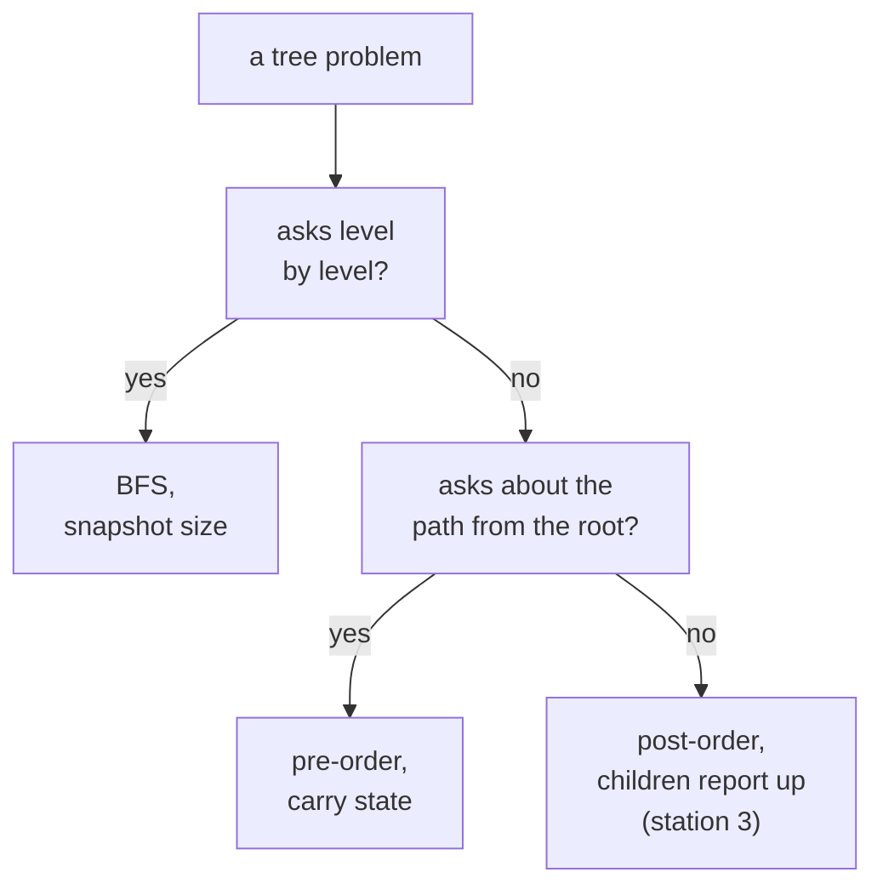

> [!tldr] Quick read
> - Pattern: two ways to move information through a tree without children returning results upward. **By level**: a queue visits a whole level before the next one. **By path**: a parent hands its children one value that sums up the whole path from the root.
> - **Level size snapshot** (Binary Tree Level Order Traversal, the anchor problem): at the top of each round, read that the queue holds `size` nodes, and take out exactly `size` nodes: that is one whole level. Without the snapshot, the children just pushed get taken too: on 300 random trees, that version is wrong on 294. See [[en/concepts/level-size-snapshot|Level Size Snapshot]].
> - **The last node of each level** (Binary Tree Right Side View): same template, keep only node `i = size − 1`. Following right children from the root fails whenever the left branch goes deeper (279/300 trees).
> - **Carry state down** (Count Good Nodes in Binary Tree): a [[en/concepts/pre-order-traversal|pre-order traversal]] where each node receives the largest value on the path from the root. One comparison is enough, O(n). Comparing only with the parent is wrong on 255/300 trees. See [[en/concepts/path-state|Path State]].
> - The queue must hand out its front node in O(1): JavaScript's array `shift()` and Python's `list.pop(0)` move the whole array: on a 131,071-node tree, 528 ms against 3.7 ms (TypeScript), 506 ms against 7.3 ms (Python).

> [!info] Context
> Station 5 of **the NeetCode Line: Linked Structures**. [[en/posts/2026-11-25-neetcode-tree-recursion|Station 3]] lets information flow **bottom-up**: children finish, then hand their result to the parent. [[en/posts/2026-11-25-neetcode-binary-search-tree|Station 4]] carries a range (lo, hi) **top-down**. This station does two more things: it walks the tree **sideways**, level by level, with a queue, and it carries down a state more general than a range. All three problems are Medium. You need binary trees and recursion at the level of station 3; the queue is explained right below.

> [!abstract]- Quick glossary for this post (click to open)
> - **Node, root, leaf, subtree, height, level-order array**: see [[en/posts/2026-11-25-neetcode-tree-recursion|station 3]] and [[en/concepts/binary-tree|Binary Tree]].
> - **Level, depth**: the root is at level 0, its children at level 1, and so on. A node's depth is its level number.
> - **Queue**: a list you take from at the front and add to at the back: first in, first out, like people lining up at a counter. Here it is an in-memory data structure, not a RabbitMQ message queue.
> - **Deque**: a double-ended queue; adding and taking at either end are both O(1). Python has `collections.deque`, Java has `ArrayDeque`.
> - **BFS, DFS**: breadth-first search (one level at a time) and depth-first search (go all the way down one branch before coming back). See [[en/concepts/breadth-first-search|Breadth-First Search]].
> - **Pre-order, post-order**: handle the node before its two children, or after them. See [[en/concepts/pre-order-traversal|Pre-order Traversal]] and [[en/concepts/post-order-traversal|Post-order Traversal]].
> - **Stack**: last in, first out. See [[en/concepts/stack|Stack]].

## Picture it first: meetings along an org chart

Picture a company whose org chart is a tree: the director at the top, each person managing at most two people. There are two jobs to do on that chart. The first is holding meetings level by level: level 0 meets first, then level 1, then level 2. The second is passing a slip of paper down: each person gets the slip from their direct manager, reads it, updates it and passes it on to the people below.

| Everyday life | Concept |
|---|---|
| An org chart where each person manages at most two people | [[en/concepts/binary-tree\|binary tree]] |
| People outside the meeting room form one line; whoever enters calls their reports to the back of the line | [[en/concepts/breadth-first-search\|BFS]] with a queue |
| The doorkeeper counts the people in line when a session opens: exactly that many go into this session, anyone arriving later waits for the next | [[en/concepts/level-size-snapshot\|level size snapshot]] (Binary Tree Level Order Traversal) |
| The doorkeeper forgets to count and lets people in until the line is empty: the whole company ends up in one session | the "no snapshot" trap |
| A photo of the chart taken from the right: at each level you see only the person at the right edge | Binary Tree Right Side View |
| The slip says "highest seniority among the managers from the director down to you"; anyone with at least that seniority gets their name written down | [[en/concepts/path-state\|path state]] (Count Good Nodes in Binary Tree) |
| Read the slip, update it, then pass it down | [[en/concepts/pre-order-traversal\|pre-order traversal]] |
| Compare only with your direct manager, without reading the slip | the "compare with the parent only" trap |
| The waiting room must hold the most crowded level; the slip in transit is only as long as the number of levels | BFS memory versus DFS memory |



## The problem: the queue doesn't know where a level ends

I used to think level-order traversal was just "push the root into a queue; take a node out and push its two children at the back". That visits nodes in the right order: 1, 2, 3, 4, 5, 6, 7 for the tree below. But problem 102 doesn't ask for a sequence; it asks for **the list of levels**: `[[1], [2, 3], [4, 5, 6], [7]]`.

```text
        1
       / \
      2   3
     /   / \
    4   5   6
     \
      7
```

A queue is just a row of nodes. When 3 comes out and 5, 6 go in, the queue is `[4, 5, 6]`, with nothing marking 4 as the first node of a new level. Write the loop as "take until the queue is empty" and the whole tree becomes one level. The station's file runs that wrong version on 300 random trees: it is wrong on 294; the other 6 trees have a single node.

Problem 1448 has a trap from the same family. A node is "good" when no ancestor is larger than it. My first version compared each node with its parent. The tree `[5, 1, null, 3]` has node 3 larger than its parent 1 but smaller than its grandparent 5: comparing with the parent counts 2, the answer is 1. On 300 random trees, comparing with the parent is wrong on 255.

Both bugs come from missing information: the queue lacks a level boundary, and the node lacks news about ancestors beyond its parent. This station is two ways of supplying what is missing.

## How it works

### Two new directions for information

At station 3, height flows bottom-up: each node waits for its two children to return before computing ([[en/concepts/post-order-traversal|post-order]]). At station 4, the range (lo, hi) flows top-down ([[en/concepts/bounds-propagation|Bounds Propagation]]). This station has two templates:

```ts
// illustration, not runnable on its own
// (1) By level: a queue + a size snapshot. Each round of the while loop is one level.
while (head < queue.length) {
  const size = queue.length - head;              // snapshot
  for (let i = 0; i < size; i++) { const node = queue[head++]; /* handle it; push children at the back */ }
}

// (2) By path: pre-order, the state is a parameter.
function go(node, state) {
  if (!node) return;
  /* use state for node */
  go(node.left, next(state, node));
  go(node.right, next(state, node));
}
```

Template (1) is [[en/concepts/breadth-first-search|BFS]]; template (2) is a pre-order DFS. The two can stand in for each other: a DFS that carries the depth can rebuild the levels too, and a BFS can carry state if the state goes into the queue together with the node.

### Level size snapshot: Binary Tree Level Order Traversal

<figure class="figure-map" style="--ar: 3 / 4">
<div class="frame"><iframe data-archify="../../diagrams/neetcode-level-order/level-snapshot.en.html" title="Level order: snapshot the queue length to split levels" loading="lazy"></iframe></div>
<figcaption><span><b>Figure 1.</b> BFS on the tree [1, 2, 3, 4, null, 5, 6, null, 7]. At the start of each level, the loop snapshots size as the queue length, then takes exactly size nodes. Children pushed meanwhile (like 4, 5, 6 while taking 2 and 3) sit outside the snapshot, so they wait for the next level.</span><a href="../diagrams/neetcode-level-order/level-snapshot.en.html" target="_blank" rel="noopener">Open full screen</a></figcaption>
</figure>

The anchor problem is [[en/problems/binary-tree-level-order-traversal|Binary Tree Level Order Traversal]]: given a binary tree of at most 2000 nodes (possibly empty), return its values level by level, each level from left to right.

The property that makes the template work: at the start of a round of the while loop, the queue holds **exactly the nodes of one level** and nothing else. At first it holds only the root, which is level 0. Suppose at the start of a round it holds all of level k. The for loop takes out exactly those `size` nodes and, while doing so, pushes their children at the back from left to right, which is all of level k + 1. When the for loop ends, level k is gone and exactly level k + 1 remains. This is a [[en/concepts/loop-invariant|loop invariant]].

Each node enters and leaves the queue once: O(n) time. The extra memory is the longest the queue gets, which is the **widest level**, up to about n/2 nodes.

The second way is a pre-order DFS that carries the depth: a node at depth d is added to `res[d]`. The left child is visited before the right one, so within each level the order is still left to right. This version is short, but its recursion is as deep as the tree is tall.

### The last node of each level: Binary Tree Right Side View

[[en/problems/binary-tree-right-side-view|Binary Tree Right Side View]] asks: standing to the right of the tree and looking at it, which values do you see, from top to bottom? At each level you see exactly one node: the rightmost node of that level. The problem allows at most 100 nodes.

A common misreading is "follow the right children from the root". In the tree `[1, 2, 3, 4]`, node 4 is the left child of 2, at level 2, and level 2 has no other node. From the right you still see 4. The answer is `[1, 3, 4]`, while following right children gives only `[1, 3]`.

Two correct ways:
- **BFS**: the same template as 102, keeping only the node with `i === size - 1`. This is the second place where the size snapshot pays off: you need `size` to know which node is last.
- **DFS going right first, carrying the depth**: the first time you reach depth d (when `res.length === d`), that node is the rightmost of level d, because every node to its right on the same level was visited earlier.

### Carry state down: Count Good Nodes in Binary Tree

[[en/problems/count-good-nodes-in-binary-tree|Count Good Nodes in Binary Tree]] calls a node **good** when no node on the path from the root to it is larger than it. Count the good nodes. The problem allows 1 to 10⁵ nodes, with values in [−10⁴, 10⁴]. The root is always good.

"No ancestor is larger" is the same as "at least as large as the largest ancestor". So each node needs only one number: the max of the path down to it. The parent knows that number, updates it with its own value, and hands it to both children:

- the root receives −∞;
- a node is good when `node.val >= maxSoFar`;
- both children receive `max(maxSoFar, node.val)`.

That is a [[en/concepts/path-state|path state]]: one value that is enough to answer a question about the whole path, updated at every step down. Each call has its own copy, so the left branch raising the max does not affect the right branch. The total cost is O(n), against O(n·h) if you keep the whole path and rescan it at every node.

The problem allows up to 10⁵ nodes, and the tree may be a chain. The recursive version on a 10⁵-node chain breaks in TypeScript (`RangeError`), Python (`RecursionError`) and Java (`StackOverflowError`); only Go survives, because a goroutine's stack grows on its own (see [[en/concepts/recursion-depth-limit|Recursion Depth Limit]]). The stack version pushes (node, max) pairs and runs in every language.

### Three problems, two templates

| Problem | What differs | Template | Time, extra memory |
|---|---|---|---|
| [[en/problems/binary-tree-level-order-traversal\|Binary Tree Level Order Traversal]] | returns the full list of levels | BFS with a `size` snapshot; or DFS carrying the depth | O(n), O(widest level) |
| [[en/problems/binary-tree-right-side-view\|Binary Tree Right Side View]] | needs only one node per level | BFS keeping `i = size − 1`; or DFS right first, first node at each depth | O(n), O(widest level) or O(h) |
| [[en/problems/count-good-nodes-in-binary-tree\|Count Good Nodes in Binary Tree]] | needs no levels, needs news about the whole path | pre-order carrying `maxSoFar`; a stack of (node, max) pairs | O(n), O(h) |

### BFS or DFS: memory follows the shape of the tree

Both are O(n) time. They differ in memory: BFS holds one level, DFS holds one path. The station's file measures two extreme trees:

```text
perfect tree of 2^20 - 1 nodes: longest BFS queue 524288, deepest DFS recursion 20 levels
skewed chain of 10^5 nodes: longest BFS queue 1, deepest DFS recursion 100000 levels
```

*(Output labels translated; the files themselves print Vietnamese.)*

A wide tree makes BFS expensive in memory; a deep tree makes recursive DFS overflow the stack. Problems 102 and 199 are naturally BFS. Problem 1448 is naturally DFS, and since the tree can be a 10⁵-node chain, the safe submission is the stack version (or a BFS carrying the state; the station's file has that version too).

### Under the five languages

| | Queue | Language-specific trap |
|---|---|---|
| TypeScript / JavaScript | an array + a `head` index | `queue.shift()` moves the whole array on every take. On a 2¹⁷ − 1 node tree: 528 ms against 3.7 ms with `head`, and every doubling of the node count makes it 4 times slower. At the problem's limit of 2000 nodes it doesn't show yet. |
| Python | `collections.deque`, taking with `popleft()` | `list.pop(0)` also moves the whole list: 506 ms against 7.3 ms on the same tree. On the other hand, `for _ in range(len(queue))` snapshots the size by itself, because `range` is evaluated once when the loop starts. |
| Go | a slice; read `queue[i]` within the level, then cut `queue = queue[size:]` once | the condition `i < len(queue)` is re-evaluated each round, so assign `size := len(queue)` first. Recursion 10⁵ levels deep works (7.4 ms). |
| Java | `ArrayDeque`, `offer` and `poll` | `ArrayDeque` rejects `null`: `offer(null)` throws `NullPointerException`, so check that a child is not null before pushing it. `for (int i = 0; i < queue.size(); i++)` rereads the size every round. |

## Runnable example

[TypeScript](../code/neetcode-level-order/level-order.ts) · [Python](../code/neetcode-level-order/level_order.py) · [Go](../code/neetcode-level-order/level_order.go) · [Java](../code/neetcode-level-order/level-order.java) · [JavaScript](../code/neetcode-level-order/level-order.js)

Each file solves all three problems and runs 14 shared cases: four for 102 (empty tree, one node, the four-level tree above, a tree with only a left branch), four for 199 (including one where the left branch goes deeper), four for 1448 (including a grandchild smaller than its grandparent, equal values and a negative root). Case 13 generates 300 random trees with mulberry32, with values in [−5, 5] so that many values repeat, and cross-checks: 102 by BFS against 102 by DFS; 199 by BFS, by DFS, and as the last node of each 102 level; 1448 recursive, with a stack and with BFS against a brute-force version that keeps the whole path. The last case runs the non-recursive versions on a skewed 10⁵-node chain.

The anchor problem and Right Side View, one BFS template:

```ts
// 102: BFS with a queue. At the top of each round, SNAPSHOT how many nodes are waiting: exactly the nodes of this level.
// Their children are pushed in after that, so the for loop takes exactly `size` nodes and stops.
// The queue is an array + a front index `head`: taking a node is head++, O(1), no shifting.
function levelOrder(root: TreeNode | null): number[][] {
  const res: number[][] = [];
  if (!root) return res;
  const queue: TreeNode[] = [root];
  let head = 0;
  while (head < queue.length) {
    const size = queue.length - head;          // snapshot the level size
    const level: number[] = [];
    for (let i = 0; i < size; i++) {
      const node = queue[head++];
      level.push(node.val);
      if (node.left) queue.push(node.left);
      if (node.right) queue.push(node.right);
    }
    res.push(level);
  }
  return res;
}

// 199: from the right you see the LAST node of each level. Same BFS template, keep only node i = size - 1.
function rightSideView(root: TreeNode | null): number[] {
  const res: number[] = [];
  if (!root) return res;
  const queue: TreeNode[] = [root];
  let head = 0;
  while (head < queue.length) {
    const size = queue.length - head;
    for (let i = 0; i < size; i++) {
      const node = queue[head++];
      if (i === size - 1) res.push(node.val);
      if (node.left) queue.push(node.left);
      if (node.right) queue.push(node.right);
    }
  }
  return res;
}
```

```python
# 102: BFS with a deque. range(len(queue)) is evaluated ONCE when the for loop starts,
# so it snapshots the level size by itself: children pushed later don't make the loop longer.
def level_order(root):
    res = []
    if root is None:
        return res
    queue = deque([root])
    while queue:
        level = []
        for _ in range(len(queue)):  # snapshot the level size
            node = queue.popleft()
            level.append(node.val)
            if node.left:
                queue.append(node.left)
            if node.right:
                queue.append(node.right)
        res.append(level)
    return res


# 199: the LAST node of each level. Same BFS template, keep only node i == size - 1.
def right_side_view(root):
    res = []
    if root is None:
        return res
    queue = deque([root])
    while queue:
        size = len(queue)
        for i in range(size):
            node = queue.popleft()
            if i == size - 1:
                res.append(node.val)
            if node.left:
                queue.append(node.left)
            if node.right:
                queue.append(node.right)
    return res
```

```go
// 102: BFS with a slice as the queue. Snapshot size := len(queue) before the for loop:
// children are appended after it, so the for loop takes exactly the nodes of this level.
func levelOrder(root *TreeNode) [][]int {
	res := [][]int{}
	if root == nil {
		return res
	}
	queue := []*TreeNode{root}
	for len(queue) > 0 {
		size := len(queue) // snapshot the level size
		level := make([]int, 0, size)
		for i := 0; i < size; i++ {
			node := queue[i]
			level = append(level, node.Val)
			if node.Left != nil {
				queue = append(queue, node.Left)
			}
			if node.Right != nil {
				queue = append(queue, node.Right)
			}
		}
		queue = queue[size:] // drop the whole processed level at once
		res = append(res, level)
	}
	return res
}

// 199: the LAST node of each level.
func rightSideView(root *TreeNode) []int {
	res := []int{}
	if root == nil {
		return res
	}
	queue := []*TreeNode{root}
	for len(queue) > 0 {
		size := len(queue)
		for i := 0; i < size; i++ {
			node := queue[i]
			if i == size-1 {
				res = append(res, node.Val)
			}
			if node.Left != nil {
				queue = append(queue, node.Left)
			}
			if node.Right != nil {
				queue = append(queue, node.Right)
			}
		}
		queue = queue[size:]
	}
	return res
}
```

```java
// 102: BFS with an ArrayDeque. Snapshot size = queue.size() BEFORE the for loop; children are offered after it.
// ArrayDeque rejects null, so check that a child is not null before offering it.
static List<List<Integer>> levelOrder(TreeNode root) {
    List<List<Integer>> res = new ArrayList<>();
    if (root == null) return res;
    ArrayDeque<TreeNode> queue = new ArrayDeque<>();
    queue.offer(root);
    while (!queue.isEmpty()) {
        int size = queue.size(); // snapshot the level size
        List<Integer> level = new ArrayList<>(size);
        for (int i = 0; i < size; i++) {
            TreeNode node = queue.poll();
            level.add(node.val);
            if (node.left != null) queue.offer(node.left);
            if (node.right != null) queue.offer(node.right);
        }
        res.add(level);
    }
    return res;
}

// 199: the LAST node of each level.
static List<Integer> rightSideView(TreeNode root) {
    List<Integer> res = new ArrayList<>();
    if (root == null) return res;
    ArrayDeque<TreeNode> queue = new ArrayDeque<>();
    queue.offer(root);
    while (!queue.isEmpty()) {
        int size = queue.size();
        for (int i = 0; i < size; i++) {
            TreeNode node = queue.poll();
            if (i == size - 1) res.add(node.val);
            if (node.left != null) queue.offer(node.left);
            if (node.right != null) queue.offer(node.right);
        }
    }
    return res;
}
```

```js
// 102: BFS with a queue. At the top of each round, SNAPSHOT how many nodes are waiting: exactly the nodes of this level.
// Their children are pushed in after that, so the for loop takes exactly `size` nodes and stops.
// The queue is an array + a front index `head`: taking a node is head++, O(1), no shifting.
function levelOrder(root) {
  const res = [];
  if (!root) return res;
  const queue = [root];
  let head = 0;
  while (head < queue.length) {
    const size = queue.length - head; // snapshot the level size
    const level = [];
    for (let i = 0; i < size; i++) {
      const node = queue[head++];
      level.push(node.val);
      if (node.left) queue.push(node.left);
      if (node.right) queue.push(node.right);
    }
    res.push(level);
  }
  return res;
}

// 199: from the right you see the LAST node of each level. Same BFS template, keep only node i = size - 1.
function rightSideView(root) {
  const res = [];
  if (!root) return res;
  const queue = [root];
  let head = 0;
  while (head < queue.length) {
    const size = queue.length - head;
    for (let i = 0; i < size; i++) {
      const node = queue[head++];
      if (i === size - 1) res.push(node.val);
      if (node.left) queue.push(node.left);
      if (node.right) queue.push(node.right);
    }
  }
  return res;
}
```

The Go version doesn't take nodes off the front of the slice one by one: it reads `queue[i]` for the whole level, then cuts `queue[size:]` once. The Python version of 102 needs no `size` variable, because `range(len(queue))` already takes the snapshot.

Count Good Nodes, recursive and with a stack:

```ts
// 1448: pre-order, CARRY DOWN the largest value on the path from the root to the node. A node is good when val >= that max.
function goodNodes(root: TreeNode | null): number {
  const go = (node: TreeNode | null, maxSoFar: number): number => {
    if (!node) return 0;
    const good = node.val >= maxSoFar ? 1 : 0;
    const m = Math.max(maxSoFar, node.val);
    return good + go(node.left, m) + go(node.right, m);
  };
  return go(root, -Infinity);
}

// 1448, second way: a hand-managed stack of pairs (node, max on the path to it). No recursion.
function goodNodesIter(root: TreeNode | null): number {
  if (!root) return 0;
  let count = 0;
  const stack: [TreeNode, number][] = [[root, -Infinity]];
  while (stack.length) {
    const [node, maxSoFar] = stack.pop()!;
    if (node.val >= maxSoFar) count++;
    const m = Math.max(maxSoFar, node.val);
    if (node.right) stack.push([node.right, m]);
    if (node.left) stack.push([node.left, m]);
  }
  return count;
}
```

```python
# 1448: pre-order, CARRY DOWN the largest value on the path from the root. A node is good when val >= that max.
def good_nodes(root):
    def go(node, max_so_far):
        if node is None:
            return 0
        good = 1 if node.val >= max_so_far else 0
        m = max(max_so_far, node.val)
        return good + go(node.left, m) + go(node.right, m)

    return go(root, -math.inf)


# 1448, second way: a hand-managed stack of pairs (node, max on the path to it). No recursion.
def good_nodes_iter(root):
    if root is None:
        return 0
    count, stack = 0, [(root, -math.inf)]
    while stack:
        node, max_so_far = stack.pop()
        if node.val >= max_so_far:
            count += 1
        m = max(max_so_far, node.val)
        if node.right:
            stack.append((node.right, m))
        if node.left:
            stack.append((node.left, m))
    return count
```

```go
// 1448: pre-order, CARRY DOWN the largest value on the path from the root.
func goodNodes(root *TreeNode) int {
	var gofn func(*TreeNode, int) int
	gofn = func(node *TreeNode, maxSoFar int) int {
		if node == nil {
			return 0
		}
		good := 0
		if node.Val >= maxSoFar {
			good = 1
		}
		m := max(maxSoFar, node.Val)
		return good + gofn(node.Left, m) + gofn(node.Right, m)
	}
	return gofn(root, math.MinInt)
}

// 1448, second way: a stack of pairs (node, max on the path to it).
type item struct {
	node     *TreeNode
	maxSoFar int
}

func goodNodesIter(root *TreeNode) int {
	if root == nil {
		return 0
	}
	count := 0
	stack := []item{{root, math.MinInt}}
	for len(stack) > 0 {
		it := stack[len(stack)-1]
		stack = stack[:len(stack)-1]
		if it.node.Val >= it.maxSoFar {
			count++
		}
		m := max(it.maxSoFar, it.node.Val)
		if it.node.Right != nil {
			stack = append(stack, item{it.node.Right, m})
		}
		if it.node.Left != nil {
			stack = append(stack, item{it.node.Left, m})
		}
	}
	return count
}
```

```java
// 1448: pre-order, CARRY DOWN the largest value on the path from the root.
static int goodNodes(TreeNode root) { return good(root, Integer.MIN_VALUE); }
static int good(TreeNode node, int maxSoFar) {
    if (node == null) return 0;
    int g = node.val >= maxSoFar ? 1 : 0;
    int m = Math.max(maxSoFar, node.val);
    return g + good(node.left, m) + good(node.right, m);
}

// 1448, second way: a stack of pairs (node, max on the path to it). A record bundles the two values.
record Item(TreeNode node, int maxSoFar) {}
static int goodNodesIter(TreeNode root) {
    if (root == null) return 0;
    int count = 0;
    ArrayDeque<Item> stack = new ArrayDeque<>();
    stack.push(new Item(root, Integer.MIN_VALUE));
    while (!stack.isEmpty()) {
        Item it = stack.pop();
        if (it.node().val >= it.maxSoFar()) count++;
        int m = Math.max(it.maxSoFar(), it.node().val);
        if (it.node().right != null) stack.push(new Item(it.node().right, m));
        if (it.node().left != null) stack.push(new Item(it.node().left, m));
    }
    return count;
}
```

```js
// 1448: pre-order, CARRY DOWN the largest value on the path from the root to the node. A node is good when val >= that max.
function goodNodes(root) {
  const go = (node, maxSoFar) => {
    if (!node) return 0;
    const good = node.val >= maxSoFar ? 1 : 0;
    const m = Math.max(maxSoFar, node.val);
    return good + go(node.left, m) + go(node.right, m);
  };
  return go(root, -Infinity);
}

// 1448, second way: a hand-managed stack of pairs (node, max on the path to it). No recursion.
function goodNodesIter(root) {
  if (!root) return 0;
  let count = 0;
  const stack = [[root, -Infinity]];
  while (stack.length) {
    const [node, maxSoFar] = stack.pop();
    if (node.val >= maxSoFar) count++;
    const m = Math.max(maxSoFar, node.val);
    if (node.right) stack.push([node.right, m]);
    if (node.left) stack.push([node.left, m]);
  }
  return count;
}
```

In Java, `Integer.MIN_VALUE` is a safe starting value because the problem's values lie in [−10⁴, 10⁴] and the comparison is `>=`: a node equal to exactly −2³¹ would still count as good.

Result of `node level-order.ts`:

```text
level-order 14/14 cases passed
traps on 300 random trees: no level size snapshot wrong on 294 trees, right children only wrong on 279 trees, parent only wrong on 255 trees
perfect tree of 2^20 - 1 nodes: longest BFS queue 524288, deepest DFS recursion 20 levels
skewed chain of 10^5 nodes: longest BFS queue 1, deepest DFS recursion 100000 levels
1448 recursive on a 10^5-node chain: RangeError; stack version: 100000
102 on a perfect tree of 2^15 - 1 nodes: head index 0.5 ms, queue.shift() 30.1 ms
102 on a perfect tree of 2^16 - 1 nodes: head index 1.4 ms, queue.shift() 123.1 ms
102 on a perfect tree of 2^17 - 1 nodes: head index 3.7 ms, queue.shift() 528.5 ms
```

All five files print `14/14 ca đúng` ("14/14 cases passed") and the same three numbers 294, 279, 255, because they share the random generator and its seed. Each file's own measurements:

```text
python3 level_order.py
1448 recursive on a 10^5-node chain: RecursionError; stack version: 100000
102 on a perfect tree of 2^15 - 1 nodes: deque.popleft() 1.7 ms, list.pop(0) 31.4 ms
102 on a perfect tree of 2^16 - 1 nodes: deque.popleft() 3.4 ms, list.pop(0) 125.2 ms
102 on a perfect tree of 2^17 - 1 nodes: deque.popleft() 7.3 ms, list.pop(0) 506.3 ms

go run level_order.go
1448 recursive on a 10^5-node chain: runs, 100000 good nodes, 7.4 ms
102 on a perfect tree of 2^20 - 1 nodes: 50.4 ms

java level-order.java
1448 recursive on a 10^5-node chain: StackOverflowError; stack version: 100000
ArrayDeque.offer(null): NullPointerException
```

`node level-order.js` prints the same lines as the TypeScript version; timings vary from run to run, while the ratios between approaches hold. Look at the `shift()` and `pop(0)` columns: twice the nodes takes about 4 times as long, the signature of O(n²).

## Misconceptions and common traps

- **"Level-order traversal is just push in, take out."** The visiting order is right, but the queue doesn't mark where a level ends. Without the size snapshot, every node lands in one level: wrong on 294/300 trees.
- **Letting the for loop's condition reread the queue length.** `i < queue.length` (JS), `i < len(queue)` (Go) and `i < queue.size()` (Java) are all re-evaluated every round. Assign `size` to a variable before the for loop. Python's `range(len(queue))` snapshots by itself.
- **"Right Side View means following the right children."** A left node on a deep level is still visible if that level has nothing to its right. That approach is wrong on 279/300 trees.
- **"A good node is one at least as large as its parent."** It must be compared with every ancestor, that is, with the path max. The tree `[5, 1, null, 3]` has answer 1, not 2.
- **Using `>` instead of `>=` in 1448.** A node equal to the path max is still good; `[2, 2, 2]` has 3 good nodes.
- **Taking from the front with `shift()` or `pop(0)`.** O(n) per take, so BFS becomes O(n²). At problem 102's 2000 nodes it doesn't show; at 131,071 nodes it is 70 to 140 times slower.
- **Recursion for 1448 because "it's just a tree".** The problem allows up to 10⁵ nodes and doesn't promise a balanced tree. Recursion on a 10⁵-node chain breaks in TS, JS, Python and Java.
- **Java: pushing `null` into an `ArrayDeque`.** It throws `NullPointerException`. `LinkedList` accepts `null`, so the error moves to the moment you take it out and read `.val`.

## Self-check questions

> [!question]- Why does the queue hold exactly one level, and nothing else, at the start of every round of the while loop?
> At first it holds only the root, which is level 0. If at the start of a round it holds all of level k, the for loop takes out exactly those `size` nodes and, while doing so, pushes their children from left to right, which is all of level k + 1. When the for loop ends, level k is gone and exactly level k + 1 remains. That is the template's loop invariant.

> [!question]- How does a DFS that goes right first solve Right Side View, and why is it correct?
> Carry the depth d through the calls; when `res.length === d`, that is, the first time depth d is reached, record the current node. Going right first means that at every depth, nodes are reached from right to left, so the first node reached is the rightmost of that level.

> [!question]- In 1448, why is one number maxSoFar enough instead of the whole path?
> "No ancestor is larger than the node" is the same as "the node is at least the max of its ancestors". Only the max affects the answer, and the path max for a child equals max(maxSoFar, node.val), computable in O(1) at each step down.

> [!question]- A tree has 10⁶ nodes. When does BFS use more memory than recursive DFS, and when is it the other way around?
> BFS holds one level, DFS holds one path. In a perfect tree, the last level has about n/2 nodes (524,288 for 2²⁰ − 1 nodes) while a path is only 20 long: BFS uses more. In a tree skewed into a chain, each level has one node while the path is n long: DFS uses more, and recursion overflows the stack.

> [!question]- Can 1448 be rewritten with BFS? What does it need?
> Yes. The state must travel with the node: push (node, maxSoFar) pairs into the queue instead of bare nodes. Visiting order doesn't matter for this problem, as long as each node receives the right max for its path. The station's file has a `goodNodesBfs` version and cross-checks it on 300 trees.

## References

- [NeetCode 150](https://neetcode.io/practice) (problem list and the Trees group)
- LeetCode: [102 Binary Tree Level Order Traversal](https://leetcode.com/problems/binary-tree-level-order-traversal/), [199 Binary Tree Right Side View](https://leetcode.com/problems/binary-tree-right-side-view/), [1448 Count Good Nodes in Binary Tree](https://leetcode.com/problems/count-good-nodes-in-binary-tree/)
- [Python `collections.deque`](https://docs.python.org/3/library/collections.html#collections.deque) (O(1) appends and pops at both ends; a list's `pop(0)` is O(n))
- [Java `ArrayDeque`](https://docs.oracle.com/en/java/javase/21/docs/api/java.base/java/util/ArrayDeque.html) ("Null elements are prohibited")
- [ECMAScript `Array.prototype.shift`](https://tc39.es/ecma262/#sec-array.prototype.shift) (the spec moves every element forward by one place)
- Cormen, Leiserson, Rivest, Stein, *Introduction to Algorithms*, third edition, section 22.2 (breadth-first search)
