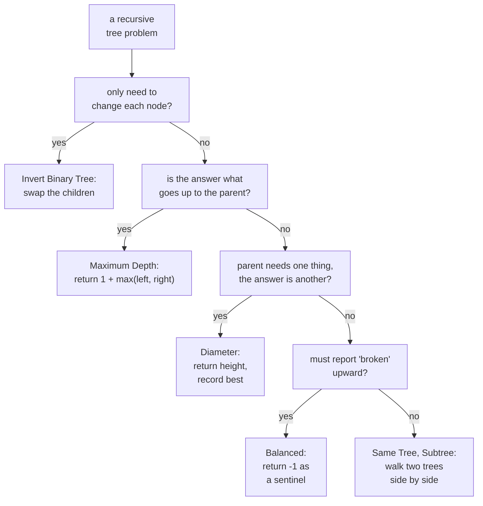

> [!tldr] Quick read
> - Pattern: a [[en/concepts/binary-tree|binary tree]] is a root plus two subtrees, so a problem on the whole tree is usually: solve the left subtree, solve the right subtree, combine at the node. Combining **after** both children are done is [[en/concepts/post-order-traversal|post-order traversal]].
> - **Return one thing, record another** (Diameter of Binary Tree, the anchor problem): the function returns the **height** to the parent, while the best **diameter** goes into a running-best variable outside. The naive version recomputes the height at every node and costs O(n²): 134 ms on a 4,000-node chain, against 0.09 ms.
> - **Return a "something broke" signal too** (Balanced Binary Tree): return the height, or -1 as a [[en/concepts/sentinel-value|sentinel value]] so the parent knows to stop right away.
> - **Walk two trees at once** (Same Tree, Subtree of Another Tree): each call takes a pair of nodes. Subtree tries every node as a root, O(m · n); [[en/concepts/tree-hashing|tree hashing]] brings it down to O(m + n).
> - **Skewed trees break the call stack**: Python stops at 997 nodes, Node at about 14,000, Java at about 39,000, while Go runs 10⁶ levels. See [[en/concepts/recursion-depth-limit|Recursion Depth Limit]].

> [!info] Context
> Station 3 of **the NeetCode Line: Linked Structures**, the first station about trees. [[en/posts/2026-11-24-neetcode-linked-list|Station 1]] and [[en/posts/2026-11-24-neetcode-advanced-linked-list|station 2]] work with nodes that have **one** pointer, `next`; the nodes at this station have **two**, `left` and `right`. All six problems are Easy and all are solved with the same recursive template. You need no prior knowledge of trees or recursion; both are explained right in the post.

> [!abstract]- Quick glossary for this post (click to open)
> - **Node, pointer, `null`**: see [[en/posts/2026-11-24-neetcode-linked-list|station 1]].
> - **Binary tree**: each node has at most two children, `left` and `right`. The node at the top is the **root**; a node with no children is a **leaf**. See [[en/concepts/binary-tree|Binary Tree]].
> - **Subtree**: a node together with every node below it. A node's subtree is itself a binary tree.
> - **Height**: the number of nodes on the longest path from a node down to a leaf. An empty tree has height 0, a leaf height 1. LeetCode calls the height of the whole tree its *maximum depth*.
> - **Recursion**: a function that calls itself on a smaller part of the data, with a **base case** (here: the empty tree) where it stops.
> - **Call stack**: the pile of function calls waiting for a result. Each level of recursion adds a frame to the pile; returning removes it. The pile has a limit, and going past it is a stack overflow.
> - **Stack**: see [[en/concepts/stack|Stack]].
> - **Level-order array**: how LeetCode writes a tree, read top to bottom and left to right, with `null` for an empty spot. `[1, null, 2]` is root 1, no left child, right child 2.

## Picture it first: reporting up an org chart

Picture a company where each person manages at most two direct reports. The CEO wants one number about the whole company but can only ask the two people right below. Each of them asks their own two reports, and only answers upward **after** both reports have answered.

| Everyday life | Concept |
|---|---|
| An org chart where each person manages at most two reports | [[en/concepts/binary-tree\|binary tree]] |
| An employee who manages nobody | leaf |
| Reporting upward only after both reports have finished reporting | [[en/concepts/post-order-traversal\|post-order]] |
| "How many levels deep is my branch?": each person answers 1 + the deeper of their two reports' branches | height (Maximum Depth of Binary Tree) |
| Redrawing the chart as a mirror image: everyone swaps their two reports | Invert Binary Tree |
| The longest chain of contact between two employees: each person reports upward only "my deepest branch", but if the chain that bends through them is a record, they write it on a shared board | height returned, diameter recorded as a running best (Diameter of Binary Tree) |
| A team whose two branches differ by more than one level reports "broken"; a manager who hears "broken" reports "broken" too, without asking further | -1 as a [[en/concepts/sentinel-value\|sentinel value]] (Balanced Binary Tree) |
| Comparing the charts of two branch offices, position by position | recursion on two trees (Same Tree) |
| Checking whether team X's chart matches some branch of the company exactly | Subtree of Another Tree |
| A company with so many levels that the pile of "waiting for my reports" notes no longer fits on the desk | call stack overflow, [[en/concepts/recursion-depth-limit\|recursion depth limit]] |



## The problem: asking about the whole tree with one loop gets messy

With a linked list, one `while (p)` loop visits every node. With a tree, each node forks two ways, so a loop has to remember "which branches have I not walked yet" on its own, which means managing a [[en/concepts/stack|stack]] by hand. Recursion does that for us: the language's call stack is exactly the stack that remembers the unfinished branches.

The second difficulty is **combining results**. I used to think computing a tree's diameter only needed, at each node, one call to a `height` function on the left child and one on the right, add them, and keep the largest. That is correct, but `height` walks the whole subtree every time it is called. On a skewed tree of n nodes, the node at depth k calls `height` on n − k nodes, about n²/2 steps in total. Measured with the station's TypeScript file:

| Skewed chain | Recompute the height at each node | Return the height to the parent |
|---|---|---|
| 1,000 nodes | 8.41 ms | 0.02 ms |
| 2,000 nodes | 34.24 ms | 0.05 ms |
| 4,000 nodes | 134.16 ms | 0.09 ms |

Doubling n makes the naive version about 4 times slower, the shape of O(n²). The fix is to let each node compute its height **once**, return it to the parent, and use the moment it holds both children's heights to do the other job too.

## How it works

### The shared template: ask both children, combine at the node

All six problems are variants of one function:

```ts
// illustration, not runnable on its own
function solve(node: TreeNode | null): Result {
  if (!node) return BASE;                  // base case: the empty tree
  const left = solve(node.left);           // trust: the function is already right on a smaller tree
  const right = solve(node.right);
  record(node, left, right);               // (depends on the problem) record into an outer running best
  return combine(node, left, right);       // what the parent needs to know
}
```

Two decisions make each problem: **what the function returns to the parent** (`combine`) and **whether it records anything in a running best** (`record`). The trick to writing it correctly is not to trace each level of calls in your head. Check only two things: the base case is right, and if `solve` is already right on both subtrees, the `combine` line gives the right result on the whole tree.

### Return one thing, record another: Diameter of Binary Tree

<figure class="figure-map" style="--ar: 3 / 4">
<div class="frame"><iframe data-archify="../../diagrams/neetcode-tree-recursion/diameter.en.html" title="Diameter of Binary Tree: return the height upward, record the diameter as a running best" loading="lazy"></iframe></div>
<figcaption><span><b>Figure 1.</b> A four-node tree: root 1 has only a left child 2, and node 2 has two leaves, 3 and 4. Each leaf returns height 1; node 2 records l + r = 2 as the best but returns only height 2 to the root. At the root, l + r = 2 + 0 does not beat the best, so the answer is 2 edges (3 → 2 → 4), while the function at the root returns 3.</span><a href="../diagrams/neetcode-tree-recursion/diameter.en.html" target="_blank" rel="noopener">Open full screen</a></figcaption>
</figure>

The anchor problem is [[en/problems/diameter-of-binary-tree|Diameter of Binary Tree]]: find the number of **edges** on the longest path between any two nodes. That path does not have to pass through the root.

Every path in a tree has exactly one "highest" node, where it bends from the left branch to the right branch. The longest path bending at node `x` has exactly `height(x.left) + height(x.right)` edges: all the way down the left, all the way down the right. So the answer is the largest value of that sum over all nodes.

The key point: the parent does **not** need the child's diameter. A path that already bends at the child cannot be extended up to the parent. The parent only needs the child's height to compute the path bending at itself. So the function splits in two:

- it **returns** the height, `1 + max(l, r)`, which is what the parent needs;
- it **records** `l + r` in the outer variable `best` if that beats the record, which is what the problem asks.

Each node is visited once: O(n) time, O(h) memory for the call stack, where h is the tree's height. The "longest path not through the root" case (`[1, 2, null, 3, 4, 5, null, null, 6]`, answer 4) catches a version that only computes `l + r` at the root.

### Returning a "something broke" signal: Balanced Binary Tree

[[en/problems/balanced-binary-tree|Balanced Binary Tree]] asks: at **every** node, do the heights of the two subtrees differ by at most 1? Checking only the root is not enough; the case `[1, 2, 2, 3, null, null, 3, 4, null, null, 4]` has a balanced root (both sides have height 3) but unbalanced children.

The function has to send two pieces of information upward: the height, and "is anything below already unbalanced". Instead of returning a pair, we use **-1 as a [[en/concepts/sentinel-value|sentinel value]]**: a real height is never negative, so -1 cannot be mistaken for one. If a child returns -1, the node returns -1 right away without looking at the other child. The version that checks every node with a separate `height` is O(n²) on a skewed tree, the same trap as the previous section.

### Two trees at once: Same Tree and Subtree of Another Tree

[[en/problems/same-tree|Same Tree]] walks two trees side by side: each call takes a **pair** of nodes `(p, q)`. If both nodes are empty, they match; if only one is empty, they differ; otherwise compare the values, then the pair of left children and the pair of right children. The line `if (!p || !q) return p === q` packs the first three cases into one.

[[en/problems/subtree-of-another-tree|Subtree of Another Tree]] asks whether the tree `sub` matches some subtree of `root` exactly, including every node below it. The direct way tries every node of `root` as a root and calls Same Tree each time: O(m · n) in the worst case. The "head matches but extra nodes below" case is a reminder that a subtree goes all the way down to the leaves: `[4, 1, 2]` is not a subtree of a tree where node 4 has another child below. To get down to O(m + n), [[en/concepts/tree-hashing|tree hashing]] gives every subtree a code computed in post-order, then just looks for the code of `sub` among the codes of `root`. The problem page compares these approaches.

### Order does not matter: Invert Binary Tree and Maximum Depth of Binary Tree

[[en/problems/invert-binary-tree|Invert Binary Tree]] swaps the two children at every node. The children's results do not affect the work at the node, so before, between or after the two child calls all work, and so does a level-order walk with a queue. The only care needed is in the swap: `root.left = invert(root.right); root.right = invert(root.left)` is wrong, because the second line reads a `root.left` that was just overwritten. Keep a temporary variable, or assign the pair at once as Python and Go do.

[[en/problems/maximum-depth-of-binary-tree|Maximum Depth of Binary Tree]] is the template in its tightest form: what goes up to the parent is the answer itself, `1 + max(left, right)`. It is also the easiest one to rewrite without recursion: a stack holds (node, depth) pairs, and the order they come out in does not matter.

### Six problems, one template

| Problem | What differs | Returned to the parent | Running best | Time, extra memory |
|---|---|---|---|---|
| [[en/problems/invert-binary-tree\|Invert Binary Tree]] | changes the tree in place, any traversal order works | the node itself | no | O(n), O(h) |
| [[en/problems/maximum-depth-of-binary-tree\|Maximum Depth of Binary Tree]] | the returned value is the answer | height | no | O(n), O(h) |
| [[en/problems/diameter-of-binary-tree\|Diameter of Binary Tree]] | the answer differs from what the parent needs | height | largest `l + r` | O(n), O(h) |
| [[en/problems/balanced-binary-tree\|Balanced Binary Tree]] | must report failure upward and stop early | height or -1 | no | O(n), O(h) |
| [[en/problems/same-tree\|Same Tree]] | walks two trees side by side | true or false | no | O(min(m, n)), O(h) |
| [[en/problems/subtree-of-another-tree\|Subtree of Another Tree]] | tries every node as a root, calling Same Tree each time | true or false | no | O(m · n), O(h); tree hashing O(m + n) |

### When the tree is too deep: each language's recursion limit

Recursion uses a call stack as deep as the tree is tall. A balanced tree of 10⁶ nodes is only about 20 tall; the random 10⁶-node tree in the measurement file is 25 tall. But a **skewed** tree, one child per node, is exactly as tall as its node count. The six problems' constraints range from 100 nodes (226, 100) to 5,000 (110), 2,000 (572) and 10⁴ nodes (104, 543): the last three are large enough for a skewed tree to exceed Python's default limit. Measuring recursive `maxDepth` on a skewed chain:

| Language | Default limit | Measured | Past the limit |
|---|---|---|---|
| Python 3.12 | `sys.getrecursionlimit()` = 1000 | 997 nodes; 998 gives `RecursionError` | catchable with `except RecursionError` |
| Node.js 24 | V8 stack of 984 KB (`node --stack-size`) | 13,911 to 15,633 nodes depending on the run; about 7,000 while the function is still on its first run, not yet optimized by the JIT | `RangeError: Maximum call stack size exceeded`, catchable |
| Java 21 | `-Xss` default of 1 MB (`ThreadStackSize = 1024`) | 39,289 nodes on the main thread | `StackOverflowError`, catchable |
| Go 1.25 | goroutine stack grows on demand, capped at 1 GB | a 10⁶-node chain runs to the end, 62.8 ms | `fatal error: stack overflow`, **cannot** be `recover`ed |

From Python 3.11 on, a call from one Python function to another no longer uses the C stack, so `sys.setrecursionlimit(200_000)` is enough to run a 10⁵-node chain (19.3 ms). Java lets you create a thread with a bigger stack: `new Thread(null, task, "deep", 256L << 20)` runs a 10⁶-node chain.

The way that depends on no limit at all is to drop recursion and manage an explicit [[en/concepts/stack|stack]] on the heap. Post-order without recursion pushes each node **twice**: first with a "children not visited" flag so it can push its two children on top of it, then with a "children done" flag to compute the node itself once both children's heights sit in a hash map. This version runs a 100,000-node chain in all five languages, but it is clearly slower on an ordinary tree. Measuring 543 on a random tree of 10⁶ nodes (Python: 2·10⁵ nodes), median of 5 runs:

| Language | Recursive | Explicit stack |
|---|---|---|
| TypeScript (Node 24) | 25.7 ms | 194.2 ms |
| Go | 23.1 ms | 184.8 ms |
| Java | 22.5 ms | 201.1 ms |
| Python (2·10⁵ nodes) | 53.0 ms | 88.0 ms |

The extra time comes from the node → height hash map and the `(node, flag)` tuples allocated at every step. Python is only 1.7 times slower because in Python the function call itself is already expensive. My takeaway: write recursion by default, and switch to an explicit stack when the tree can be skewed deeper than the limit of the language you are using.

### Under the hood in five languages

| | Recording a best from a nested function | Comparing empty nodes | Language-specific trap |
|---|---|---|---|
| TypeScript / JavaScript | a closure assigns the outer `let best` directly | `p === q` when either is `null` | `undefined` and `null` differ under `===`: in a hand-built tree that forgot to set `left = null`, `!p` is still true but `p === q` is false |
| Python | `nonlocal best` in the nested function | `p is q` | forget `nonlocal` and `best = …` creates a new local variable: `UnboundLocalError` right at the `max(best, …)` line |
| Go | a closure assigns `best`; a recursive nested function must be declared first with `var height func(*TreeNode) int` | `p == q` on pointers | `height := func…` cannot call itself, because the name does not exist yet when the body is compiled |
| Java | a lambda cannot assign an outer local variable; use an array `int[] best = {0}`, a field, or a helper that takes `best` | `p == q` compares identity | `Integer` compared with `==` is only right in the range -128..127 (the cache); comparing node values of type `Integer` needs `equals` |

## Runnable example

[TypeScript](../code/neetcode-tree-recursion/tree-recursion.ts) · [Python](../code/neetcode-tree-recursion/tree_recursion.py) · [Go](../code/neetcode-tree-recursion/tree_recursion.go) · [Java](../code/neetcode-tree-recursion/tree-recursion.java) · [JavaScript](../code/neetcode-tree-recursion/tree-recursion.js)

Each file builds trees from level-order arrays, solves all six problems and runs 16 shared cases: a problem-style example for each problem, an empty tree (226), a tree with only a right branch (104), a longest path not through the root (543), a balanced root with unbalanced children (110), same values in a different shape (100), and a head that matches with extra nodes below (572). Case 15 generates 300 random trees with mulberry32 and checks each solution against a slow reference: diameter and balance recompute the height at every node, recursive depth is compared with the iterative one, inverting twice must give back the original tree, and a subtree copied out of the tree itself must be found. The last case runs the iterative version on a 100,000-node skewed chain. After the checks, each file prints the measurements above.

The three single-tree problems: Invert Binary Tree, Maximum Depth of Binary Tree, Diameter of Binary Tree.

```ts
// 226: swap the two children at every node. Any traversal order works, as long as it visits every node.
function invertTree(root: TreeNode | null): TreeNode | null {
  if (!root) return null;
  const left = invertTree(root.left);
  root.left = invertTree(root.right);
  root.right = left;
  return root;
}

// 104: height = 1 + the taller child's height. An empty tree has height 0.
function maxDepth(root: TreeNode | null): number {
  if (!root) return 0;
  return 1 + Math.max(maxDepth(root.left), maxDepth(root.right));
}

// 543: the recursive function RETURNS the height, while the diameter is RECORDED in an outer variable at each node.
function diameterOfBinaryTree(root: TreeNode | null): number {
  let best = 0;
  const height = (node: TreeNode | null): number => {
    if (!node) return 0;
    const l = height(node.left), r = height(node.right);
    best = Math.max(best, l + r); // longest path through node: l edges down the left, r edges down the right
    return 1 + Math.max(l, r);
  };
  height(root);
  return best;
}
```

```python
# 226: swap the two children at every node.
def invert_tree(root):
    if root is None:
        return None
    root.left, root.right = invert_tree(root.right), invert_tree(root.left)
    return root


# 104: height = 1 + the taller child's height.
def max_depth(root):
    if root is None:
        return 0
    return 1 + max(max_depth(root.left), max_depth(root.right))


# 543: the inner function RETURNS the height, the diameter is RECORDED in an outer variable (nonlocal).
def diameter_of_binary_tree(root):
    best = 0

    def height(node):
        nonlocal best
        if node is None:
            return 0
        l, r = height(node.left), height(node.right)
        best = max(best, l + r)
        return 1 + max(l, r)

    height(root)
    return best
```

```go
// 226: swap the two children at every node.
func invertTree(root *TreeNode) *TreeNode {
	if root == nil {
		return nil
	}
	root.Left, root.Right = invertTree(root.Right), invertTree(root.Left)
	return root
}

// 104: height = 1 + the taller child's height.
func maxDepth(root *TreeNode) int {
	if root == nil {
		return 0
	}
	return 1 + max(maxDepth(root.Left), maxDepth(root.Right))
}

// 543: the closure RETURNS the height, the diameter is RECORDED in the outer variable best.
func diameterOfBinaryTree(root *TreeNode) int {
	best := 0
	var height func(*TreeNode) int
	height = func(node *TreeNode) int {
		if node == nil {
			return 0
		}
		l, r := height(node.Left), height(node.Right)
		best = max(best, l+r)
		return 1 + max(l, r)
	}
	height(root)
	return best
}
```

```java
// 226: swap the two children at every node.
static TreeNode invertTree(TreeNode root) {
    if (root == null) return null;
    TreeNode left = invertTree(root.left);
    root.left = invertTree(root.right);
    root.right = left;
    return root;
}

// 104: height = 1 + the taller child's height.
static int maxDepth(TreeNode root) {
    if (root == null) return 0;
    return 1 + Math.max(maxDepth(root.left), maxDepth(root.right));
}

// 543: the function RETURNS the height, the diameter is RECORDED in a one-element array (a Java lambda cannot assign an outer variable).
static int diameterOfBinaryTree(TreeNode root) {
    int[] best = {0};
    height(root, best);
    return best[0];
}
static int height(TreeNode node, int[] best) {
    if (node == null) return 0;
    int l = height(node.left, best), r = height(node.right, best);
    best[0] = Math.max(best[0], l + r);
    return 1 + Math.max(l, r);
}
```

```js
// 226: swap the two children at every node. Any traversal order works, as long as it visits every node.
function invertTree(root) {
  if (!root) return null;
  const left = invertTree(root.left);
  root.left = invertTree(root.right);
  root.right = left;
  return root;
}

// 104: height = 1 + the taller child's height. An empty tree has height 0.
function maxDepth(root) {
  if (!root) return 0;
  return 1 + Math.max(maxDepth(root.left), maxDepth(root.right));
}

// 543: the recursive function RETURNS the height, while the diameter is RECORDED in an outer variable at each node.
function diameterOfBinaryTree(root) {
  let best = 0;
  const height = (node) => {
    if (!node) return 0;
    const l = height(node.left), r = height(node.right);
    best = Math.max(best, l + r); // longest path through node: l edges down the left, r edges down the right
    return 1 + Math.max(l, r);
  };
  height(root);
  return best;
}
```

The other three: Balanced Binary Tree, Same Tree, Subtree of Another Tree.

```ts
// 110: return the height, or -1 as a sentinel meaning "unbalanced somewhere below".
function isBalanced(root: TreeNode | null): boolean {
  const check = (node: TreeNode | null): number => {
    if (!node) return 0;
    const l = check(node.left);
    if (l === -1) return -1;
    const r = check(node.right);
    if (r === -1 || Math.abs(l - r) > 1) return -1;
    return 1 + Math.max(l, r);
  };
  return check(root) !== -1;
}

// 100: recurse on two trees at once, walking pairs of nodes side by side.
function isSameTree(p: TreeNode | null, q: TreeNode | null): boolean {
  if (!p || !q) return p === q;
  return p.val === q.val && isSameTree(p.left, q.left) && isSameTree(p.right, q.right);
}

// 572: try every node of root as the root, comparing the whole tree with isSameTree each time. O(m · n) worst case.
function isSubtree(root: TreeNode | null, sub: TreeNode | null): boolean {
  if (!root) return sub === null;
  return isSameTree(root, sub) || isSubtree(root.left, sub) || isSubtree(root.right, sub);
}
```

```python
# 110: return the height, or -1 as a sentinel for "unbalanced below".
def is_balanced(root):
    def check(node):
        if node is None:
            return 0
        l = check(node.left)
        if l == -1:
            return -1
        r = check(node.right)
        if r == -1 or abs(l - r) > 1:
            return -1
        return 1 + max(l, r)

    return check(root) != -1


# 100: walk both trees side by side.
def is_same_tree(p, q):
    if p is None or q is None:
        return p is q
    return p.val == q.val and is_same_tree(p.left, q.left) and is_same_tree(p.right, q.right)


# 572: try every node as the root, compare the whole tree. O(m · n) worst case.
def is_subtree(root, sub):
    if root is None:
        return sub is None
    return is_same_tree(root, sub) or is_subtree(root.left, sub) or is_subtree(root.right, sub)
```

```go
// 110: return the height, or -1 as a sentinel for "unbalanced below".
func isBalanced(root *TreeNode) bool {
	var check func(*TreeNode) int
	check = func(node *TreeNode) int {
		if node == nil {
			return 0
		}
		l := check(node.Left)
		if l == -1 {
			return -1
		}
		r := check(node.Right)
		if r == -1 || l-r > 1 || r-l > 1 {
			return -1
		}
		return 1 + max(l, r)
	}
	return check(root) != -1
}

// 100: walk both trees side by side.
func isSameTree(p, q *TreeNode) bool {
	if p == nil || q == nil {
		return p == q
	}
	return p.Val == q.Val && isSameTree(p.Left, q.Left) && isSameTree(p.Right, q.Right)
}

// 572: try every node as the root, compare the whole tree. O(m · n) worst case.
func isSubtree(root, sub *TreeNode) bool {
	if root == nil {
		return sub == nil
	}
	return isSameTree(root, sub) || isSubtree(root.Left, sub) || isSubtree(root.Right, sub)
}
```

```java
// 110: return the height, or -1 as a sentinel for "unbalanced below".
static boolean isBalanced(TreeNode root) { return check(root) != -1; }
static int check(TreeNode node) {
    if (node == null) return 0;
    int l = check(node.left);
    if (l == -1) return -1;
    int r = check(node.right);
    if (r == -1 || Math.abs(l - r) > 1) return -1;
    return 1 + Math.max(l, r);
}

// 100: walk both trees side by side.
static boolean isSameTree(TreeNode p, TreeNode q) {
    if (p == null || q == null) return p == q;
    return p.val == q.val && isSameTree(p.left, q.left) && isSameTree(p.right, q.right);
}

// 572: try every node as the root, compare the whole tree. O(m · n) worst case.
static boolean isSubtree(TreeNode root, TreeNode sub) {
    if (root == null) return sub == null;
    return isSameTree(root, sub) || isSubtree(root.left, sub) || isSubtree(root.right, sub);
}
```

```js
// 110: return the height, or -1 as a sentinel meaning "unbalanced somewhere below".
function isBalanced(root) {
  const check = (node) => {
    if (!node) return 0;
    const l = check(node.left);
    if (l === -1) return -1;
    const r = check(node.right);
    if (r === -1 || Math.abs(l - r) > 1) return -1;
    return 1 + Math.max(l, r);
  };
  return check(root) !== -1;
}

// 100: recurse on two trees at once, walking pairs of nodes side by side.
function isSameTree(p, q) {
  if (!p || !q) return p === q;
  return p.val === q.val && isSameTree(p.left, q.left) && isSameTree(p.right, q.right);
}

// 572: try every node of root as the root, comparing the whole tree with isSameTree each time. O(m · n) worst case.
function isSubtree(root, sub) {
  if (!root) return sub === null;
  return isSameTree(root, sub) || isSubtree(root.left, sub) || isSubtree(root.right, sub);
}
```

Post-order without recursion for 543, used in the 100,000-node skewed chain case:

```ts
// 543 without recursion: post-order with a stack; a "children done" flag decides when to compute the node.
function diameterIter(root: TreeNode | null): number {
  if (!root) return 0;
  const h = new Map<TreeNode | null, number>([[null, 0]]);
  const stack: [TreeNode, boolean][] = [[root, false]];
  let best = 0;
  while (stack.length) {
    const [node, childrenDone] = stack.pop()!;
    if (childrenDone) {
      const l = h.get(node.left)!, r = h.get(node.right)!;
      best = Math.max(best, l + r);
      h.set(node, 1 + Math.max(l, r));
    } else {
      stack.push([node, true]);
      if (node.right) stack.push([node.right, false]);
      if (node.left) stack.push([node.left, false]);
    }
  }
  return best;
}
```

```python
# 543 without recursion: post-order with a stack and a "children done" flag.
def diameter_iter(root):
    if root is None:
        return 0
    h = {None: 0}
    stack, best = [(root, False)], 0
    while stack:
        node, children_done = stack.pop()
        if children_done:
            l, r = h[node.left], h[node.right]
            best = max(best, l + r)
            h[node] = 1 + max(l, r)
        else:
            stack.append((node, True))
            if node.right:
                stack.append((node.right, False))
            if node.left:
                stack.append((node.left, False))
    return best
```

```go
// 543 without recursion: post-order with a stack and a "children done" flag.
func diameterIter(root *TreeNode) int {
	if root == nil {
		return 0
	}
	type item struct {
		node         *TreeNode
		childrenDone bool
	}
	h := map[*TreeNode]int{nil: 0}
	stack := []item{{root, false}}
	best := 0
	for len(stack) > 0 {
		it := stack[len(stack)-1]
		stack = stack[:len(stack)-1]
		if it.childrenDone {
			l, r := h[it.node.Left], h[it.node.Right]
			best = max(best, l+r)
			h[it.node] = 1 + max(l, r)
		} else {
			stack = append(stack, item{it.node, true})
			if it.node.Right != nil {
				stack = append(stack, item{it.node.Right, false})
			}
			if it.node.Left != nil {
				stack = append(stack, item{it.node.Left, false})
			}
		}
	}
	return best
}
```

```java
// 543 without recursion: post-order with a stack and a "children done" flag.
static int diameterIter(TreeNode root) {
    if (root == null) return 0;
    Map<TreeNode, Integer> h = new HashMap<>();
    ArrayDeque<TreeNode> nodes = new ArrayDeque<>(List.of(root));
    ArrayDeque<Boolean> done = new ArrayDeque<>(List.of(false));
    int best = 0;
    while (!nodes.isEmpty()) {
        TreeNode node = nodes.pop();
        boolean childrenDone = done.pop();
        if (childrenDone) {
            int l = h.getOrDefault(node.left, 0), r = h.getOrDefault(node.right, 0);
            best = Math.max(best, l + r);
            h.put(node, 1 + Math.max(l, r));
        } else {
            nodes.push(node); done.push(true);
            if (node.right != null) { nodes.push(node.right); done.push(false); }
            if (node.left != null) { nodes.push(node.left); done.push(false); }
        }
    }
    return best;
}
```

```js
// 543 without recursion: post-order with a stack; a "children done" flag decides when to compute the node.
function diameterIter(root) {
  if (!root) return 0;
  const h = new Map([[null, 0]]);
  const stack = [[root, false]];
  let best = 0;
  while (stack.length) {
    const [node, childrenDone] = stack.pop();
    if (childrenDone) {
      const l = h.get(node.left), r = h.get(node.right);
      best = Math.max(best, l + r);
      h.set(node, 1 + Math.max(l, r));
    } else {
      stack.push([node, true]);
      if (node.right) stack.push([node.right, false]);
      if (node.left) stack.push([node.left, false]);
    }
  }
  return best;
}
```

Output of `node tree-recursion.ts`:

```text
tree-recursion 16/16 cases passed
104 recursion on a skewed tree: survives 13911 nodes, 13912 nodes gives RangeError
543 on a random tree of 10^6 nodes (height 25): recursive 25.7 ms, stack 194.2 ms
543 on a chain of 1000 nodes: recompute height 8.41 ms, return height upward 0.02 ms
543 on a chain of 2000 nodes: recompute height 34.24 ms, return height upward 0.05 ms
543 on a chain of 4000 nodes: recompute height 134.16 ms, return height upward 0.09 ms
```

*(Output labels translated; the files themselves print Vietnamese.)*

Python, Go, Java and JavaScript also print `16/16 cases passed`. The measurement part of each file:

```text
python3 tree_recursion.py
104 recursion on a skewed tree: limit 1000, survives 997 nodes, 998 nodes gives RecursionError
104 after setrecursionlimit(200000): chain of 100 000 nodes, height 100000, 19.3 ms
543 on a random tree of 2·10^5 nodes (height 22): recursive 53.0 ms, stack 88.0 ms

go run tree_recursion.go
104 recursion on a chain of 100000 nodes: height 100000, 7.8 ms
104 recursion on a chain of 1000000 nodes: height 1000000, 62.8 ms
543 on a random tree of 10^6 nodes (height 25): recursive 23.1 ms, stack 184.8 ms

java tree-recursion.java
104 recursion on a skewed tree, main thread: survives about 39289 nodes
104 recursion on a chain of 1000000 nodes, thread with a 256 MB stack: height 1000000
543 on a random tree of 10^6 nodes (height 25): recursive 22.5 ms, stack 201.1 ms
```

The timings vary between runs (on a busy machine the stack version once reached 250 ms); the ratio between the two versions holds.

## Misconceptions and common traps

- **"The diameter always passes through the root."** No. The longest path can sit entirely inside one branch; you have to consider `l + r` at **every** node, which is why the running best is needed.
- **Returning `l + r` to the parent.** The parent needs the height to extend by one edge. A path that already bends at the child cannot be extended upward, so returning `l + r` gives a result that is too large.
- **Mixing two ways of counting height.** 543 asks for edges. In this post the height counts nodes (a leaf is 1), so the path bending at a node has exactly `l + r` edges. If you switch to counting height in edges (a leaf is 0, an empty tree −1), the same path has `l + r + 2` edges. Mixing the two conventions makes the result off by 1 or 2.
- **Balanced checks only the root.** A balanced root does not mean balanced children. You must check every node, and the cheap way is to report -1 upward.
- **Computing `height` separately at every node.** Correct, but O(n²) on a skewed tree: 134 ms at 4,000 nodes against 0.09 ms.
- **Subtree compares only the root values and stops.** The two trees must match all the way down to the leaves, empty spots included: one extra node below makes them different.
- **Swapping the two children with two consecutive assignments.** The second one reads the value the first one just overwrote. Keep a temporary variable.
- **Assuming that passing on LeetCode means passing in production.** Trees that users send in (nested JSON, directory trees, comment threads) can be skewed arbitrarily deep. Python breaks at 997 levels.

## Self-check questions

> [!question]- In Diameter of Binary Tree, why does the function return the height and not the diameter?
> The parent uses the child's result to compute the path bending at itself, and that needs to know how far down the child can go, which is the height. The child's diameter is a path that already bends; it cannot be extended up to the parent. The diameter is recorded in the running-best variable at each node instead of being returned.

> [!question]- Why does -1 work as a sentinel value in Balanced Binary Tree, but 0 does not?
> A real height is always ≥ 0, and 0 is the valid height of an empty tree. If 0 meant "unbalanced", the parent could not tell "empty child" from "unbalanced child". -1 is never a height, so it cannot be confused with one.

> [!question]- Invert Binary Tree works with the swap before, between or after the two child calls. Why then must Diameter be post-order?
> The work at each node in Invert does not need the children's results: swapping two pointers is all it does. Diameter needs both children's heights to compute `l + r` and to return `1 + max(l, r)`, so it has to wait for both child calls to finish first.

> [!question]- A skewed tree of 50,000 nodes: in which of the five languages does the recursive version run with default settings?
> Only Go: the goroutine stack grows on its own up to 1 GB. Python stops at 997, Node at about 7,000 to 15,600, Java at about 39,000 on the main thread. Those three need a raised limit, a thread with a bigger stack (Java), or a rewrite with an explicit stack.

> [!question]- Same Tree runs in O(min(m, n)), not O(m + n). Why?
> The two trees are walked side by side, pair by pair, and the function stops at the first pair that differs, including when one side is empty and the other is not. The number of pairs visited cannot exceed the node count of the smaller tree.

## References

- [NeetCode 150](https://neetcode.io/practice) (problem list and the Trees group)
- LeetCode: [226 Invert Binary Tree](https://leetcode.com/problems/invert-binary-tree/), [104 Maximum Depth of Binary Tree](https://leetcode.com/problems/maximum-depth-of-binary-tree/), [543 Diameter of Binary Tree](https://leetcode.com/problems/diameter-of-binary-tree/), [110 Balanced Binary Tree](https://leetcode.com/problems/balanced-binary-tree/), [100 Same Tree](https://leetcode.com/problems/same-tree/), [572 Subtree of Another Tree](https://leetcode.com/problems/subtree-of-another-tree/)
- [Python `sys.setrecursionlimit`](https://docs.python.org/3/library/sys.html#sys.setrecursionlimit) (the default limit and the warning about setting it too high)
- [What's New in Python 3.11](https://docs.python.org/3/whatsnew/3.11.html) (Python-to-Python calls no longer use the C stack)
- [Go `runtime/debug.SetMaxStack`](https://pkg.go.dev/runtime/debug#SetMaxStack) (the goroutine stack cap, 1 GB by default on 64-bit systems)
- [Java `Thread(ThreadGroup, Runnable, String, long)`](https://docs.oracle.com/en/java/javase/21/docs/api/java.base/java/lang/Thread.html) (the `stackSize` parameter)
- Cormen, Leiserson, Rivest, Stein, *Introduction to Algorithms*, section 12.1 (pre-order, in-order and post-order tree walks)
