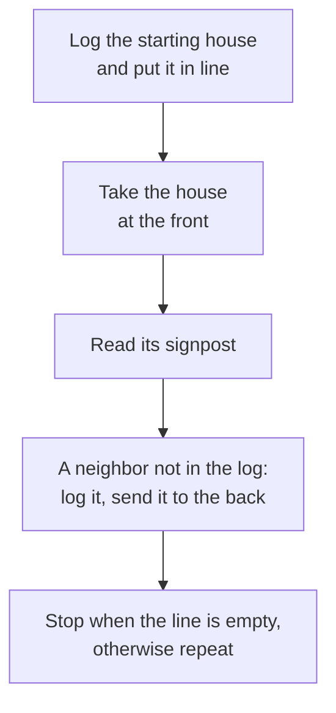
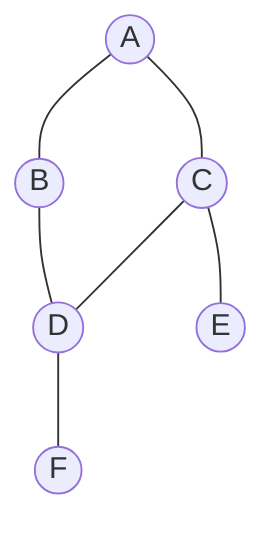

> [!tldr] Quick read
> - A **graph** is a set of vertices joined by edges. I write it down as an [[en/concepts/adjacency-list|adjacency list]]: each vertex keeps a list of the vertices right next to it.
> - The [[en/concepts/breadth-first-search|BFS]] template has only three parts: a queue, a visited log, and a function "give me the neighbors of x". Writing a vertex in the log as soon as it is queued means each vertex enters the queue exactly once, for a total cost of O(V + E).
> - The four problems on this station keep the template and change one thing: the visited log doubles as a [[en/concepts/clone-map|clone map]] (133); start at the target and [[en/concepts/reverse-reachability|walk backward]] (417); start from the edge of the board (130); generate neighbors by a rule in an [[en/concepts/implicit-graph|implicit graph]] (127).
> - BFS gives the fewest steps on a graph where every edge has the same length. [[en/concepts/bidirectional-bfs|Bidirectional BFS]] gives the same answer, but in my measurement it took out only 102 words instead of 4,293.

> [!info] Context
> This is station 2 on the [[en/series/neetcode-grph|NeetCode Graphs line]]. On [[en/posts/2026-11-26-neetcode-grid-traversal|station 1]], a cell's neighbors came from its coordinates: up, down, left, right. On this station a vertex can be a node with pointers, a cell on a height map, or an English word. All you need to know is what a queue is (explained right below); the traversal itself is rebuilt from scratch on a six-vertex example.

> [!abstract]- Quick glossary for this post (click to open)
> - A *vertex* (or node) is a "point" of the graph. An *edge* joins two vertices. In an *undirected graph*, the edge A–B can be walked both ways.
> - The *neighbors* of x are the vertices joined directly to x by one edge.
> - A *queue* is first in, first out (FIFO): add at the back, take from the front. Here it is the in-memory data structure, not a message queue.
> - *BFS* (breadth-first search) visits every vertex 1 step away, then every vertex 2 steps away, and so on. *DFS* (depth-first search) goes as deep as it can along one branch before coming back.
> - The *visited log* records the vertices already accepted into the queue, so no vertex is queued twice. On station 1 it was the `distance = -1` table.
> - *Layer* d holds the vertices exactly d edges from the start.
> - V is the number of vertices and E the number of edges. O(V + E) means the time grows with the total of vertices and edges.

## Picture it first: a town and a messenger

Picture a small town. Each **house** is a vertex, and each **road** joining two houses is an edge. In front of every house stands a **signpost** listing the houses right next door. A messenger sets out from the post office. They carry a **log** and follow a **waiting line**: a house they are about to visit goes into the log and to the back of the line. So they visit every house one road away from the post office before any house two roads away.

The four problems on this station are four different jobs in that same town:

| Everyday life | Concept |
|---|---|
| Houses, and the roads joining two houses | vertices and edges of a graph |
| The signpost in front of each house, listing the houses next door | [[en/concepts/adjacency-list\|adjacency list]] |
| Delivering along a waiting line: near houses first, far houses later | [[en/concepts/breadth-first-search\|BFS]] |
| Writing a house in the log when the visit is scheduled, not on arrival | [[en/concepts/mark-on-enqueue\|mark on enqueue]] |
| Building a scale model of the town, with a "real house → model house" log | [[en/concepts/clone-map\|clone map]] (Clone Graph) |
| Finding the houses that drain into both rivers: stand on the riverbank and walk uphill | [[en/concepts/reverse-reachability\|walk backward from the target]] (Pacific Atlantic Water Flow) |
| Filling in the inner courtyards that have no way out to the town gate | start from the edge (Surrounded Regions) |
| A town with no map, only the rule "next door means a house number that differs in exactly one letter" | [[en/concepts/implicit-graph\|implicit graph]] (Word Ladder) |
| Two messengers start from both ends and meet in the middle | [[en/concepts/bidirectional-bfs\|bidirectional BFS]] |

The messenger repeats one loop:



## The problem: without a grid, where do neighbors come from?

I used to think BFS was a grid thing: try four directions and you are done. It turns out "try four directions" is just **one way to answer the question "who are x's neighbors?"**. On a grid, the answer comes from coordinates. In a network of nodes with pointers, the answer already sits in the node's `neighbors` list. For English words there is no list at all: two words are neighbors if they differ in exactly one letter, and I have to generate them myself.

The rest of BFS does not change. If I pull the "neighbors" function out of the loop, all four problems on this station share one template. The real difficulty is that each problem asks a slightly different question, and the naive question often costs many times more:

- Copying a graph that has a cycle, without a log, never stops copying.
- Asking each cell "does water from here reach the ocean?" runs one traversal per cell.
- Comparing every pair of words to find neighbors means N² comparisons over 5,000 words.

## How it works

### Step 1: write the graph as an adjacency list

Take a town of six houses, A–F. The post office is at A. The roads are A–B, A–C, B–D, C–D, C–E and D–F.



The **adjacency list** records, for each house, the houses joined directly to it. Since roads go both ways, the edge A–B appears twice: in A's list and in B's.

| House | Next door |
|---|---|
| A | B, C |
| B | A, D |
| C | A, D, E |
| D | B, C, F |
| E | C |
| F | D |

The lists add up to 2 × 6 edges = 12 entries. That is why BFS costs O(V + E): each house is taken out once, and each list is read once.

### Step 2: run BFS step by step on the small example

I run BFS from A. The "log" column records the distance from A. A house goes into the log **as soon as it is queued**.

| Step | Taken out | Signpost read | New log entries | Line after the step |
|---|---|---|---|---|
| 0 | (none yet) | | A = 0 | [A] |
| 1 | A | B, C | B = 1, C = 1 | [B, C] |
| 2 | B | A (logged), D | D = 2 | [C, D] |
| 3 | C | A (logged), D (logged), E | E = 2 | [D, E] |
| 4 | D | B, C (logged), F | F = 3 | [E, F] |
| 5 | E | C (logged) | | [F] |
| 6 | F | D (logged) | | [] |

Two things in the table are worth noticing:

- **Step 3:** C sees that D is already in the log, even though D is still waiting in line. Because a house is logged when it is queued, D enters the line only once. If I waited until taking it out to log it, D would enter the line twice, from B and from C.
- **The order things come out is A | B C | D E | F**, which is exactly layer 0, 1, 2, 3. A FIFO queue guarantees layer d is fully taken out before layer d+1 starts. So the first time a house is logged is also when it has the fewest roads from A.

<figure class="figure-map" style="--ar: 3 / 4">
<div class="frame"><iframe data-archify="../../diagrams/neetcode-graph-bfs/bfs-trace.en.html" title="BFS on a six-house graph, step by step" loading="lazy"></iframe></div>
<figcaption><span><b>Figure 1.</b> The messenger only reads signposts and writes in the log; D was logged from B, so C skips it, and every house enters the line exactly once.</span><a href="../diagrams/neetcode-graph-bfs/bfs-trace.en.html" target="_blank" rel="noopener">Open full screen</a></figcaption>
</figure>

### Step 3: pull "neighbors" out as a parameter

The table above uses nothing about the town except its signposts. So I write the template once and take the `neighbors` function from outside:

```ts
// illustration, not runnable on its own: taken from graph-bfs.ts
function bfs<T>(starts: T[], neighbors: (x: T) => T[], key: (x: T) => string): Map<string, number> {
  const dist = new Map<string, number>()
  const queue: T[] = []
  for (const s of starts) {
    if (dist.has(key(s))) continue
    dist.set(key(s), 0) // write in the log as soon as it is queued
    queue.push(s)
  }
  for (let head = 0; head < queue.length; head++) {
    const x = queue[head]
    for (const y of neighbors(x)) {
      if (dist.has(key(y))) continue
      dist.set(key(y), dist.get(key(x))! + 1)
      queue.push(y)
    }
  }
  return dist
}
```

- `starts` is the list of starting points. One element gives plain BFS; several give [[en/concepts/multi-source-bfs|multi-source BFS]], like the rotting oranges on station 1.
- `key` turns a vertex into a key for the log. The cell `[r, c]` becomes the string `"r,c"`, because two arrays `[1, 2]` are different objects in JavaScript even with the same contents.
- `head` is the index of the front of the line. I avoid `shift()` because it moves the whole array every time.

### BFS or DFS?

Both find **every vertex reachable** from the start, and both cost O(V + E). They differ in order and in memory.

| Question | Use |
|---|---|
| Need the fewest steps (every edge the same length) | BFS. DFS may reach the target along a long detour first. |
| Only need to know whether something is reachable, or fill a whole region | Either BFS or DFS. |
| A very deep graph (a chain tens of thousands of vertices long) | BFS, or DFS with a stack you manage yourself. Recursive DFS easily hits the [[en/concepts/recursion-depth-limit\|recursion depth limit]]. |

The first three problems of this station only need "reachable or not", so each problem page also shows DFS. Word Ladder asks for the fewest steps, so it has to be BFS.

### Twist 1 · Clone Graph: the visited log doubles as a clone map

The problem hands me one node of a connected undirected graph. I must return a **deep copy**: new nodes, connected exactly like the old ones, reusing no old node.

Try it on four nodes in a ring, 1–2–3–4–1. If I copy by "make a copy of every neighbor I meet", I walk 1 → 2 → 3 → 4 → 1 → 2 … forever, and node 1 gets several copies.

The fix: keep an **`old → new` map** that also serves as the visited log.

- The first time I meet an old node `u`: make its copy, record `copyOf[u]`, queue `u`.
- Every time I read an edge `u – v`: connect `copyOf[u]` to `copyOf[v]`, whether `v` is new or not.

The map both stops the cycle and answers "which node is v's copy?" when I need to connect an edge. That is the [[en/concepts/clone-map|clone map]]. The page for [[en/problems/clone-graph|LC-0133]] explains the order of creating nodes and connecting edges in detail.

### Twist 2 · Pacific Atlantic: start at the target and walk backward

The problem gives a height map. The Pacific touches the top and left edges; the Atlantic touches the bottom and right edges. Water flows from a cell to a neighboring cell that is **not higher**. The question: which cells let water reach **both** oceans?

The naive question runs one traversal from **every cell** to see where its water goes. With R × C cells, that is R·C traversals, each of which can take R·C steps.

Flip the question: "which cells drain into the Pacific?" is the same as "starting from the Pacific shore and walking **against the flow**, which cells can I reach?". Walking against the flow means stepping only onto a cell that is **not lower** than the current one. Now two multi-source BFS runs are enough: one from the whole Pacific edge, one from the whole Atlantic edge. The answer is the cells that appear in both logs. That is [[en/concepts/reverse-reachability|reverse reachability]].

An example with a spiral grid:

```text
1 2 3
8 9 4
7 6 5
```

- Climbing from the Pacific edge (1, 2, 3, 8, 7): 3 → 4 → 5 → 6, and 8 → 9. The Pacific log has all 9 cells.
- Climbing from the Atlantic edge (3, 4, 5, 6, 7): 7 → 8 → 9. Cell 2 is lower than cell 3, so I can't climb onto it; the same goes for cell 1. The Atlantic log has 7 cells.
- The two logs share 7 cells: all except 1 and 2. Checking in the forward direction: water at 2 can only flow down to 1, and 1 only touches the Pacific.

The page for [[en/problems/pacific-atlantic-water-flow|LC-0417]] compares this with running from every cell.

### Twist 3 · Surrounded Regions: start from the edge

The problem gives a board of `X` and `O`. A region of `O` is **surrounded** if none of its cells lies on the edge of the board. I must flip every surrounded region to `X`.

"Is this region surrounded?" is hard to answer from inside. The opposite question is easier: "which `O` cells **connect to the edge**?". Queue every `O` on the edge, then BFS through neighboring `O` cells. Every cell that gets logged is safe. Every other `O` flips.

```text
X X X X        X X X X
X O O X   →    X X X X
X X O X        X X X X
X O X X        X O X X
```

Only the `O` in the bottom row lies on the edge. It is not connected to the three-cell region in the middle, so the middle region flips while it stays. This is also walking backward from the target, where the "target" is the edge of the board. See [[en/problems/surrounded-regions|LC-0130]].

### Twist 4 · Word Ladder: a graph that isn't written down

The problem gives a start word, a target word and a list of words of the same length. Each step changes **exactly one letter**, and the new word must be in the list. The question: how many **words** does the shortest chain have (counting the start and the target), or 0 if there is no chain?

Here nobody gives me an adjacency list. This is an [[en/concepts/implicit-graph|implicit graph]]: the vertices are words, and two words are neighbors if they differ in exactly one letter. The `neighbors` function has to generate the neighbors itself. With the list `cord, card, ward, warm, word, worm, wore, core`:

```text
cold → cord → card → ward → warm      (5 words)
cold → cord → word → worm → warm      (also 5 words)
```

There are three ways to generate neighbors:

1. **Compare every pair:** for each word taken out, scan the whole list and count differing letters. With N words that can reach N² comparisons.
2. **Pattern buckets:** replace each letter in turn with `*`. `cord` goes into the buckets `*ord`, `c*rd`, `co*d`, `cor*`. Two words are neighbors exactly when they share a bucket. Build the buckets once; after that each word only reads its own L buckets (L is the word length).
3. **Bidirectional BFS:** run BFS from the start word and the target word at the same time. Each round expands **a whole layer** of whichever side is currently smaller, and stops when a newly generated word already belongs to the other side. Each side only has to go about half way. If each word has about b neighbors and the path has length d, one side going all the way touches around b^d words, while two sides each touch only around b^(d/2).

The measurement in the Runnable example uses 5,000 six-letter words (built at random from the five letters a–e), from `aaaaaa` to `eeeeee`: all three ways find a chain of 8 words. Comparing every pair takes out 4,234 words and needs about 474 ms; pattern buckets take out 4,293 words in about 14 ms; bidirectional BFS takes out only 102 words in about 2 ms. See [[en/problems/word-ladder|LC-0127]] for why bidirectional BFS must expand a full layer per round.

### Four problems, one template

| Problem | What changes |
|---|---|
| [[en/problems/clone-graph\|LC-0133 · Clone Graph]] | The visited log is an `old → new` map; every edge read connects two copies. |
| [[en/problems/pacific-atlantic-water-flow\|LC-0417 · Pacific Atlantic Water Flow]] | Two multi-source BFS runs from the two edges, stepping onto cells that are not lower; take the cells in both logs. |
| [[en/problems/surrounded-regions\|LC-0130 · Surrounded Regions]] | BFS from the `O` cells on the edge; an `O` that never gets logged flips. |
| [[en/problems/word-ladder\|LC-0127 · Word Ladder]] | An implicit graph: generate neighbors with pattern buckets or by replacing each letter; fewest steps means it has to be BFS. |

### Cost

- Shared template: O(V + E) time, O(V) memory for the log and the queue.
- Clone Graph: O(V + E), plus O(V) for the clone map.
- Pacific Atlantic and Surrounded Regions: an R × C grid has V = R·C and E ≤ 4·R·C, so O(R·C).
- Word Ladder with pattern buckets: N words of length L. Building the buckets costs O(N·L²) because each pattern is a string of length L. BFS reads every bucket of every word, for O(N·L²) plus the number of neighbor pairs.

## Runnable example

Each file solves all four problems with the same `bfs` function and checks 14 cases. Besides the examples in this post, three cases are random: 200 height maps and 200 `X/O` boards checked against brute force, and 200 word pairs checked across the three ways of generating neighbors. Download [TypeScript](../code/neetcode-graph-bfs/graph-bfs.ts), [Python](../code/neetcode-graph-bfs/graph_bfs.py), [Go](../code/neetcode-graph-bfs/graph_bfs.go), [Java](../code/neetcode-graph-bfs/graph-bfs.java) or [JavaScript](../code/neetcode-graph-bfs/graph-bfs.js). Run them with `node graph-bfs.ts`, `python3 graph_bfs.py`, `go run graph_bfs.go`, `java graph-bfs.java` or `node graph-bfs.js`. Below is the solution part; the checks sit at the end of each file.

```ts
// Station GRPH-02: one BFS template for four graph problems.
// Run: node graph-bfs.ts

// ---------- Shared template: BFS from one or more starting points ----------
// neighbors(x) returns the vertices adjacent to x. key(x) turns a vertex into a key for the log.
function bfs<T>(starts: T[], neighbors: (x: T) => T[], key: (x: T) => string): Map<string, number> {
  const dist = new Map<string, number>()
  const queue: T[] = []
  for (const s of starts) {
    if (dist.has(key(s))) continue
    dist.set(key(s), 0) // write in the log as soon as it is queued
    queue.push(s)
  }
  for (let head = 0; head < queue.length; head++) {
    const x = queue[head]
    for (const y of neighbors(x)) {
      if (dist.has(key(y))) continue
      dist.set(key(y), dist.get(key(x))! + 1)
      queue.push(y)
    }
  }
  return dist
}

// ---------- 133. Clone Graph: the visited log doubles as an "old → new" map ----------
class GraphNode {
  val: number
  neighbors: GraphNode[] = []
  constructor(val: number) { this.val = val }
}

function cloneGraph(node: GraphNode | null): GraphNode | null {
  if (!node) return null
  const copyOf = new Map<GraphNode, GraphNode>([[node, new GraphNode(node.val)]])
  const queue = [node]
  for (let head = 0; head < queue.length; head++) {
    const old = queue[head]
    for (const nb of old.neighbors) {
      if (!copyOf.has(nb)) { // first time seen: make the copy, then queue it
        copyOf.set(nb, new GraphNode(nb.val))
        queue.push(nb)
      }
      copyOf.get(old)!.neighbors.push(copyOf.get(nb)!) // connect the edge between the two copies
    }
  }
  return copyOf.get(node)!
}

// ---------- 417. Pacific Atlantic: walk backward from the ocean, uphill ----------
type Cell = [number, number]
const DIRS: Cell[] = [[-1, 0], [1, 0], [0, -1], [0, 1]]

function pacificAtlantic(h: number[][]): Cell[] {
  const R = h.length, C = h[0].length
  const k = ([r, c]: Cell) => `${r},${c}`
  // From cell x, we can walk BACKWARD (uphill) to cell y if y is not lower than x.
  const uphill = ([r, c]: Cell): Cell[] =>
    DIRS.map(([dr, dc]) => [r + dr, c + dc] as Cell)
      .filter(([nr, nc]) => nr >= 0 && nr < R && nc >= 0 && nc < C && h[nr][nc] >= h[r][c])
  const pacific: Cell[] = [], atlantic: Cell[] = []
  for (let r = 0; r < R; r++) { pacific.push([r, 0]); atlantic.push([r, C - 1]) }
  for (let c = 0; c < C; c++) { pacific.push([0, c]); atlantic.push([R - 1, c]) }
  const P = bfs(pacific, uphill, k), A = bfs(atlantic, uphill, k)
  const out: Cell[] = []
  for (let r = 0; r < R; r++) for (let c = 0; c < C; c++) {
    if (P.has(`${r},${c}`) && A.has(`${r},${c}`)) out.push([r, c])
  }
  return out
}

// Brute force for cross-checking: from each cell, let the water flow down and see which ocean it touches.
function pacificAtlanticBrute(h: number[][]): Cell[] {
  const R = h.length, C = h[0].length, out: Cell[] = []
  for (let r = 0; r < R; r++) for (let c = 0; c < C; c++) {
    const downhill = ([x, y]: Cell): Cell[] =>
      DIRS.map(([dx, dy]) => [x + dx, y + dy] as Cell)
        .filter(([a, b]) => a >= 0 && a < R && b >= 0 && b < C && h[a][b] <= h[x][y])
    const seen = bfs([[r, c] as Cell], downhill, ([a, b]) => `${a},${b}`)
    let pac = false, atl = false
    for (const s of seen.keys()) {
      const [a, b] = s.split(",").map(Number)
      if (a === 0 || b === 0) pac = true
      if (a === R - 1 || b === C - 1) atl = true
    }
    if (pac && atl) out.push([r, c])
  }
  return out
}

// ---------- 130. Surrounded Regions: start from the edge; every cell reached is safe ----------
function solve(board: string[][]): void {
  const R = board.length, C = board[0].length
  const k = ([r, c]: Cell) => `${r},${c}`
  const open = ([r, c]: Cell): Cell[] =>
    DIRS.map(([dr, dc]) => [r + dr, c + dc] as Cell)
      .filter(([nr, nc]) => nr >= 0 && nr < R && nc >= 0 && nc < C && board[nr][nc] === "O")
  const border: Cell[] = []
  for (let r = 0; r < R; r++) for (let c = 0; c < C; c++) {
    if ((r === 0 || c === 0 || r === R - 1 || c === C - 1) && board[r][c] === "O") border.push([r, c])
  }
  const safe = bfs(border, open, k)
  for (let r = 0; r < R; r++) for (let c = 0; c < C; c++) {
    if (board[r][c] === "O" && !safe.has(`${r},${c}`)) board[r][c] = "X"
  }
}

// Brute force: an O cell flips when a fill from that cell never touches the edge.
function solveBrute(board: string[][]): string[][] {
  const R = board.length, C = board[0].length
  return board.map((row, r) => row.map((v, c) => {
    if (v !== "O") return v
    const open = ([x, y]: Cell): Cell[] =>
      DIRS.map(([dx, dy]) => [x + dx, y + dy] as Cell)
        .filter(([a, b]) => a >= 0 && a < R && b >= 0 && b < C && board[a][b] === "O")
    const seen = bfs([[r, c] as Cell], open, ([a, b]) => `${a},${b}`)
    for (const s of seen.keys()) {
      const [a, b] = s.split(",").map(Number)
      if (a === 0 || b === 0 || a === R - 1 || b === C - 1) return "O"
    }
    return "X"
  }))
}

// ---------- 127. Word Ladder: an implicit graph, neighbors generated by a rule ----------
let expanded = 0 // counts the words taken out of the queue, to compare the three ways

// Way 1: compare every pair. Each time a word comes out, scan the whole list.
function ladderNaive(begin: string, end: string, words: string[]): number {
  if (!words.includes(end)) return 0
  const dist = new Map<string, number>([[begin, 1]])
  const queue = [begin]
  const oneApart = (a: string, b: string) => {
    let diff = 0
    for (let i = 0; i < a.length; i++) if (a[i] !== b[i] && ++diff > 1) return false
    return diff === 1
  }
  for (let head = 0; head < queue.length; head++) {
    const w = queue[head]; expanded++
    for (const v of words) {
      if (dist.has(v) || !oneApart(w, v)) continue
      if (v === end) return dist.get(w)! + 1
      dist.set(v, dist.get(w)! + 1)
      queue.push(v)
    }
  }
  return 0
}

// Way 2: pattern buckets. "hot" sits in the buckets "*ot", "h*t", "ho*".
function ladderBuckets(begin: string, end: string, words: string[]): number {
  if (!words.includes(end)) return 0
  const buckets = new Map<string, string[]>()
  for (const w of [begin, ...words]) {
    for (let i = 0; i < w.length; i++) {
      const p = w.slice(0, i) + "*" + w.slice(i + 1)
      if (!buckets.has(p)) buckets.set(p, [])
      buckets.get(p)!.push(w)
    }
  }
  const dist = new Map<string, number>([[begin, 1]])
  const queue = [begin]
  for (let head = 0; head < queue.length; head++) {
    const w = queue[head]; expanded++
    for (let i = 0; i < w.length; i++) {
      for (const v of buckets.get(w.slice(0, i) + "*" + w.slice(i + 1))!) {
        if (dist.has(v)) continue
        if (v === end) return dist.get(w)! + 1
        dist.set(v, dist.get(w)! + 1)
        queue.push(v)
      }
    }
  }
  return 0
}

// Way 3: bidirectional BFS. Each round expands the side with fewer words; stop when the two sides touch.
function ladderBidirectional(begin: string, end: string, words: string[]): number {
  const dict = new Set(words)
  if (!dict.has(end)) return 0
  let front = new Set([begin]), back = new Set([end])
  const seen = new Set([begin, end])
  let length = 1
  while (front.size && back.size) {
    if (front.size > back.size) [front, back] = [back, front]
    const next = new Set<string>()
    length++
    for (const w of front) {
      expanded++
      for (let i = 0; i < w.length; i++) {
        for (let ch = 97; ch <= 122; ch++) {
          const v = w.slice(0, i) + String.fromCharCode(ch) + w.slice(i + 1)
          if (back.has(v)) return length
          if (!dict.has(v) || seen.has(v)) continue
          seen.add(v)
          next.add(v)
        }
      }
    }
    front = next
  }
  return 0
}
```
```python
# Station GRPH-02: one BFS template for four graph problems.
# Run: python3 graph_bfs.py
import random
from collections import deque

DIRS = ((-1, 0), (1, 0), (0, -1), (0, 1))


# ---------- Shared template: BFS from one or more starting points ----------
def bfs(starts, neighbors):
    dist = {}
    queue = deque()
    for s in starts:
        if s in dist:
            continue
        dist[s] = 0  # write in the log as soon as it is queued
        queue.append(s)
    while queue:
        x = queue.popleft()
        for y in neighbors(x):
            if y in dist:
                continue
            dist[y] = dist[x] + 1
            queue.append(y)
    return dist


# ---------- 133. Clone Graph: the visited log doubles as an "old → new" map ----------
class Node:
    def __init__(self, val=0, neighbors=None):
        self.val = val
        self.neighbors = neighbors if neighbors is not None else []


def clone_graph(node):
    if node is None:
        return None
    copy_of = {node: Node(node.val)}
    queue = deque([node])
    while queue:
        old = queue.popleft()
        for nb in old.neighbors:
            if nb not in copy_of:  # first time seen: make the copy, then queue it
                copy_of[nb] = Node(nb.val)
                queue.append(nb)
            copy_of[old].neighbors.append(copy_of[nb])  # connect the edge between the two copies
    return copy_of[node]


# ---------- 417. Pacific Atlantic: walk backward from the ocean, uphill ----------
def pacific_atlantic(h):
    R, C = len(h), len(h[0])

    # From cell x, we can walk BACKWARD (uphill) to cell y if y is not lower than x.
    def uphill(cell):
        r, c = cell
        return [(r + dr, c + dc) for dr, dc in DIRS
                if 0 <= r + dr < R and 0 <= c + dc < C and h[r + dr][c + dc] >= h[r][c]]

    pacific = [(r, 0) for r in range(R)] + [(0, c) for c in range(C)]
    atlantic = [(r, C - 1) for r in range(R)] + [(R - 1, c) for c in range(C)]
    P, A = bfs(pacific, uphill), bfs(atlantic, uphill)
    return [[r, c] for r in range(R) for c in range(C) if (r, c) in P and (r, c) in A]


# Brute force for cross-checking: from each cell, let the water flow down and see which ocean it touches.
def pacific_atlantic_brute(h):
    R, C = len(h), len(h[0])
    out = []
    for r in range(R):
        for c in range(C):
            def downhill(cell):
                x, y = cell
                return [(x + dx, y + dy) for dx, dy in DIRS
                        if 0 <= x + dx < R and 0 <= y + dy < C and h[x + dx][y + dy] <= h[x][y]]
            seen = bfs([(r, c)], downhill)
            pac = any(a == 0 or b == 0 for a, b in seen)
            atl = any(a == R - 1 or b == C - 1 for a, b in seen)
            if pac and atl:
                out.append([r, c])
    return out


# ---------- 130. Surrounded Regions: start from the edge; every cell reached is safe ----------
def solve(board):
    R, C = len(board), len(board[0])

    def open_cells(cell):
        r, c = cell
        return [(r + dr, c + dc) for dr, dc in DIRS
                if 0 <= r + dr < R and 0 <= c + dc < C and board[r + dr][c + dc] == "O"]

    border = [(r, c) for r in range(R) for c in range(C)
              if (r in (0, R - 1) or c in (0, C - 1)) and board[r][c] == "O"]
    safe = bfs(border, open_cells)
    for r in range(R):
        for c in range(C):
            if board[r][c] == "O" and (r, c) not in safe:
                board[r][c] = "X"


# Brute force: an O cell flips when a fill from that cell never touches the edge.
def solve_brute(board):
    R, C = len(board), len(board[0])

    def open_cells(cell):
        x, y = cell
        return [(x + dx, y + dy) for dx, dy in DIRS
                if 0 <= x + dx < R and 0 <= y + dy < C and board[x + dx][y + dy] == "O"]

    out = []
    for r in range(R):
        row = []
        for c in range(C):
            if board[r][c] != "O":
                row.append(board[r][c])
                continue
            seen = bfs([(r, c)], open_cells)
            edge = any(a in (0, R - 1) or b in (0, C - 1) for a, b in seen)
            row.append("O" if edge else "X")
        out.append(row)
    return out


# ---------- 127. Word Ladder: an implicit graph, neighbors generated by a rule ----------
# Way 1: compare every pair. Each time a word comes out, scan the whole list.
def ladder_naive(begin, end, words):
    if end not in words:
        return 0

    def one_apart(a, b):
        return sum(x != y for x, y in zip(a, b)) == 1

    dist = {begin: 1}
    queue = deque([begin])
    while queue:
        w = queue.popleft()
        for v in words:
            if v in dist or not one_apart(w, v):
                continue
            if v == end:
                return dist[w] + 1
            dist[v] = dist[w] + 1
            queue.append(v)
    return 0


# Way 2: pattern buckets. "hot" sits in the buckets "*ot", "h*t", "ho*".
def ladder_buckets(begin, end, words):
    if end not in words:
        return 0
    buckets = {}
    for w in [begin, *words]:
        for i in range(len(w)):
            buckets.setdefault(w[:i] + "*" + w[i + 1:], []).append(w)
    dist = {begin: 1}
    queue = deque([begin])
    while queue:
        w = queue.popleft()
        for i in range(len(w)):
            for v in buckets[w[:i] + "*" + w[i + 1:]]:
                if v in dist:
                    continue
                if v == end:
                    return dist[w] + 1
                dist[v] = dist[w] + 1
                queue.append(v)
    return 0


# Way 3: bidirectional BFS. Each round expands the side with fewer words; stop when the two sides touch.
def ladder_bidirectional(begin, end, words):
    words = set(words)
    if end not in words:
        return 0
    front, back = {begin}, {end}
    seen = {begin, end}
    length = 1
    while front and back:
        if len(front) > len(back):
            front, back = back, front
        nxt = set()
        length += 1
        for w in front:
            for i in range(len(w)):
                for ch in "abcdefghijklmnopqrstuvwxyz":
                    v = w[:i] + ch + w[i + 1:]
                    if v in back:
                        return length
                    if v not in words or v in seen:
                        continue
                    seen.add(v)
                    nxt.add(v)
        front = nxt
    return 0
```
```go
// Station GRPH-02: one BFS template for four graph problems.
// Run: go run graph_bfs.go
package main

import (
	"fmt"
	"math/rand"
	"reflect"
	"slices"
)

// ---------- Shared template: BFS from one or more starting points ----------
func bfs[T comparable](starts []T, neighbors func(T) []T) map[T]int {
	dist := map[T]int{}
	queue := []T{}
	for _, s := range starts {
		if _, ok := dist[s]; ok {
			continue
		}
		dist[s] = 0 // write in the log as soon as it is queued
		queue = append(queue, s)
	}
	for head := 0; head < len(queue); head++ {
		x := queue[head]
		for _, y := range neighbors(x) {
			if _, ok := dist[y]; ok {
				continue
			}
			dist[y] = dist[x] + 1
			queue = append(queue, y)
		}
	}
	return dist
}

// ---------- 133. Clone Graph: the visited log doubles as an "old → new" map ----------
type Node struct {
	Val       int
	Neighbors []*Node
}

func cloneGraph(node *Node) *Node {
	if node == nil {
		return nil
	}
	copyOf := map[*Node]*Node{node: {Val: node.Val}}
	queue := []*Node{node}
	for head := 0; head < len(queue); head++ {
		old := queue[head]
		for _, nb := range old.Neighbors {
			if _, ok := copyOf[nb]; !ok { // first time seen: make the copy, then queue it
				copyOf[nb] = &Node{Val: nb.Val}
				queue = append(queue, nb)
			}
			copyOf[old].Neighbors = append(copyOf[old].Neighbors, copyOf[nb]) // connect the edge between the two copies
		}
	}
	return copyOf[node]
}

// ---------- 417. Pacific Atlantic: walk backward from the ocean, uphill ----------
type cell struct{ r, c int }

var dirs = []cell{{-1, 0}, {1, 0}, {0, -1}, {0, 1}}

// near returns the adjacent cells in the grid that satisfy ok(from, to).
func near(R, C int, ok func(a, b cell) bool) func(cell) []cell {
	return func(x cell) []cell {
		var out []cell
		for _, d := range dirs {
			y := cell{x.r + d.r, x.c + d.c}
			if y.r >= 0 && y.r < R && y.c >= 0 && y.c < C && ok(x, y) {
				out = append(out, y)
			}
		}
		return out
	}
}

func pacificAtlantic(h [][]int) [][]int {
	R, C := len(h), len(h[0])
	// From cell x, we can walk BACKWARD (uphill) to cell y if y is not lower than x.
	uphill := near(R, C, func(a, b cell) bool { return h[b.r][b.c] >= h[a.r][a.c] })
	var pacific, atlantic []cell
	for r := 0; r < R; r++ {
		pacific = append(pacific, cell{r, 0})
		atlantic = append(atlantic, cell{r, C - 1})
	}
	for c := 0; c < C; c++ {
		pacific = append(pacific, cell{0, c})
		atlantic = append(atlantic, cell{R - 1, c})
	}
	P, A := bfs(pacific, uphill), bfs(atlantic, uphill)
	out := [][]int{}
	for r := 0; r < R; r++ {
		for c := 0; c < C; c++ {
			_, p := P[cell{r, c}]
			_, a := A[cell{r, c}]
			if p && a {
				out = append(out, []int{r, c})
			}
		}
	}
	return out
}

// Brute force for cross-checking: from each cell, let the water flow down and see which ocean it touches.
func pacificAtlanticBrute(h [][]int) [][]int {
	R, C := len(h), len(h[0])
	downhill := near(R, C, func(a, b cell) bool { return h[b.r][b.c] <= h[a.r][a.c] })
	out := [][]int{}
	for r := 0; r < R; r++ {
		for c := 0; c < C; c++ {
			pac, atl := false, false
			for x := range bfs([]cell{{r, c}}, downhill) {
				pac = pac || x.r == 0 || x.c == 0
				atl = atl || x.r == R-1 || x.c == C-1
			}
			if pac && atl {
				out = append(out, []int{r, c})
			}
		}
	}
	return out
}

// ---------- 130. Surrounded Regions: start from the edge; every cell reached is safe ----------
func solve(board [][]byte) {
	R, C := len(board), len(board[0])
	open := near(R, C, func(_, b cell) bool { return board[b.r][b.c] == 'O' })
	var border []cell
	for r := 0; r < R; r++ {
		for c := 0; c < C; c++ {
			if (r == 0 || c == 0 || r == R-1 || c == C-1) && board[r][c] == 'O' {
				border = append(border, cell{r, c})
			}
		}
	}
	safe := bfs(border, open)
	for r := 0; r < R; r++ {
		for c := 0; c < C; c++ {
			if _, ok := safe[cell{r, c}]; board[r][c] == 'O' && !ok {
				board[r][c] = 'X'
			}
		}
	}
}

// Brute force: an O cell flips when a fill from that cell never touches the edge.
func solveBrute(board [][]byte) [][]byte {
	R, C := len(board), len(board[0])
	open := near(R, C, func(_, b cell) bool { return board[b.r][b.c] == 'O' })
	out := make([][]byte, R)
	for r := range board {
		out[r] = slices.Clone(board[r])
		for c := range board[r] {
			if board[r][c] != 'O' {
				continue
			}
			edge := false
			for x := range bfs([]cell{{r, c}}, open) {
				edge = edge || x.r == 0 || x.c == 0 || x.r == R-1 || x.c == C-1
			}
			if !edge {
				out[r][c] = 'X'
			}
		}
	}
	return out
}

// ---------- 127. Word Ladder: an implicit graph, neighbors generated by a rule ----------
// Way 1: compare every pair. Each time a word comes out, scan the whole list.
func ladderNaive(begin, end string, words []string) int {
	if !slices.Contains(words, end) {
		return 0
	}
	oneApart := func(a, b string) bool {
		diff := 0
		for i := range a {
			if a[i] != b[i] {
				diff++
			}
		}
		return diff == 1
	}
	dist := map[string]int{begin: 1}
	queue := []string{begin}
	for head := 0; head < len(queue); head++ {
		w := queue[head]
		for _, v := range words {
			if _, ok := dist[v]; ok || !oneApart(w, v) {
				continue
			}
			if v == end {
				return dist[w] + 1
			}
			dist[v] = dist[w] + 1
			queue = append(queue, v)
		}
	}
	return 0
}

// Way 2: pattern buckets. "hot" sits in the buckets "*ot", "h*t", "ho*".
func ladderBuckets(begin, end string, words []string) int {
	if !slices.Contains(words, end) {
		return 0
	}
	buckets := map[string][]string{}
	for _, w := range append([]string{begin}, words...) {
		for i := range w {
			p := w[:i] + "*" + w[i+1:]
			buckets[p] = append(buckets[p], w)
		}
	}
	dist := map[string]int{begin: 1}
	queue := []string{begin}
	for head := 0; head < len(queue); head++ {
		w := queue[head]
		for i := range w {
			for _, v := range buckets[w[:i]+"*"+w[i+1:]] {
				if _, ok := dist[v]; ok {
					continue
				}
				if v == end {
					return dist[w] + 1
				}
				dist[v] = dist[w] + 1
				queue = append(queue, v)
			}
		}
	}
	return 0
}

// Way 3: bidirectional BFS. Each round expands the side with fewer words; stop when the two sides touch.
func ladderBidirectional(begin, end string, words []string) int {
	dict := map[string]bool{}
	for _, w := range words {
		dict[w] = true
	}
	if !dict[end] {
		return 0
	}
	front, back := map[string]bool{begin: true}, map[string]bool{end: true}
	seen := map[string]bool{begin: true, end: true}
	length := 1
	for len(front) > 0 && len(back) > 0 {
		if len(front) > len(back) {
			front, back = back, front
		}
		next := map[string]bool{}
		length++
		for w := range front {
			b := []byte(w)
			for i := range b {
				orig := b[i]
				for ch := byte('a'); ch <= 'z'; ch++ {
					b[i] = ch
					v := string(b)
					if back[v] {
						return length
					}
					if !dict[v] || seen[v] {
						continue
					}
					seen[v] = true
					next[v] = true
				}
				b[i] = orig
			}
		}
		front = next
	}
	return 0
}
```
```java
// Station GRPH-02: one BFS template for four graph problems.
// Run: java graph-bfs.java
import java.util.*;
import java.util.function.Function;

class GraphBfs {
    // ---------- Shared template: BFS from one or more starting points ----------
    static <T> Map<T, Integer> bfs(List<T> starts, Function<T, List<T>> neighbors) {
        Map<T, Integer> dist = new HashMap<>();
        ArrayDeque<T> queue = new ArrayDeque<>();
        for (T s : starts) {
            if (dist.containsKey(s)) continue;
            dist.put(s, 0); // write in the log as soon as it is queued
            queue.add(s);
        }
        while (!queue.isEmpty()) {
            T x = queue.poll();
            for (T y : neighbors.apply(x)) {
                if (dist.containsKey(y)) continue;
                dist.put(y, dist.get(x) + 1);
                queue.add(y);
            }
        }
        return dist;
    }

    // ---------- 133. Clone Graph: the visited log doubles as an "old → new" map ----------
    static class Node {
        int val;
        List<Node> neighbors = new ArrayList<>();
        Node(int val) { this.val = val; }
    }

    static Node cloneGraph(Node node) {
        if (node == null) return null;
        // IdentityHashMap: compares the object itself, not equals()
        Map<Node, Node> copyOf = new IdentityHashMap<>();
        copyOf.put(node, new Node(node.val));
        ArrayDeque<Node> queue = new ArrayDeque<>(List.of(node));
        while (!queue.isEmpty()) {
            Node old = queue.poll();
            for (Node nb : old.neighbors) {
                if (!copyOf.containsKey(nb)) { // first time seen: make the copy, then queue it
                    copyOf.put(nb, new Node(nb.val));
                    queue.add(nb);
                }
                copyOf.get(old).neighbors.add(copyOf.get(nb)); // connect the edge between the two copies
            }
        }
        return copyOf.get(node);
    }

    // ---------- 417. Pacific Atlantic: walk backward from the ocean, uphill ----------
    record Cell(int r, int c) {}
    static final int[][] DIRS = {{-1, 0}, {1, 0}, {0, -1}, {0, 1}};

    interface Edge { boolean ok(Cell from, Cell to); }

    // near returns the adjacent cells in the grid that satisfy ok(from, to).
    static Function<Cell, List<Cell>> near(int R, int C, Edge edge) {
        return x -> {
            List<Cell> out = new ArrayList<>();
            for (int[] d : DIRS) {
                Cell y = new Cell(x.r() + d[0], x.c() + d[1]);
                if (y.r() >= 0 && y.r() < R && y.c() >= 0 && y.c() < C && edge.ok(x, y)) out.add(y);
            }
            return out;
        };
    }

    static List<List<Integer>> pacificAtlantic(int[][] h) {
        int R = h.length, C = h[0].length;
        // From cell x, we can walk BACKWARD (uphill) to cell y if y is not lower than x.
        var uphill = near(R, C, (a, b) -> h[b.r()][b.c()] >= h[a.r()][a.c()]);
        List<Cell> pacific = new ArrayList<>(), atlantic = new ArrayList<>();
        for (int r = 0; r < R; r++) { pacific.add(new Cell(r, 0)); atlantic.add(new Cell(r, C - 1)); }
        for (int c = 0; c < C; c++) { pacific.add(new Cell(0, c)); atlantic.add(new Cell(R - 1, c)); }
        var P = bfs(pacific, uphill);
        var A = bfs(atlantic, uphill);
        List<List<Integer>> out = new ArrayList<>();
        for (int r = 0; r < R; r++)
            for (int c = 0; c < C; c++)
                if (P.containsKey(new Cell(r, c)) && A.containsKey(new Cell(r, c))) out.add(List.of(r, c));
        return out;
    }

    // Brute force for cross-checking: from each cell, let the water flow down and see which ocean it touches.
    static List<List<Integer>> pacificAtlanticBrute(int[][] h) {
        int R = h.length, C = h[0].length;
        var downhill = near(R, C, (a, b) -> h[b.r()][b.c()] <= h[a.r()][a.c()]);
        List<List<Integer>> out = new ArrayList<>();
        for (int r = 0; r < R; r++)
            for (int c = 0; c < C; c++) {
                boolean pac = false, atl = false;
                for (Cell x : bfs(List.of(new Cell(r, c)), downhill).keySet()) {
                    pac |= x.r() == 0 || x.c() == 0;
                    atl |= x.r() == R - 1 || x.c() == C - 1;
                }
                if (pac && atl) out.add(List.of(r, c));
            }
        return out;
    }

    // ---------- 130. Surrounded Regions: start from the edge; every cell reached is safe ----------
    static void solve(char[][] board) {
        int R = board.length, C = board[0].length;
        var open = near(R, C, (a, b) -> board[b.r()][b.c()] == 'O');
        List<Cell> border = new ArrayList<>();
        for (int r = 0; r < R; r++)
            for (int c = 0; c < C; c++)
                if ((r == 0 || c == 0 || r == R - 1 || c == C - 1) && board[r][c] == 'O') border.add(new Cell(r, c));
        var safe = bfs(border, open);
        for (int r = 0; r < R; r++)
            for (int c = 0; c < C; c++)
                if (board[r][c] == 'O' && !safe.containsKey(new Cell(r, c))) board[r][c] = 'X';
    }

    // Brute force: an O cell flips when a fill from that cell never touches the edge.
    static char[][] solveBrute(char[][] board) {
        int R = board.length, C = board[0].length;
        var open = near(R, C, (a, b) -> board[b.r()][b.c()] == 'O');
        char[][] out = new char[R][];
        for (int r = 0; r < R; r++) {
            out[r] = board[r].clone();
            for (int c = 0; c < C; c++) {
                if (board[r][c] != 'O') continue;
                boolean edge = false;
                for (Cell x : bfs(List.of(new Cell(r, c)), open).keySet())
                    edge |= x.r() == 0 || x.c() == 0 || x.r() == R - 1 || x.c() == C - 1;
                if (!edge) out[r][c] = 'X';
            }
        }
        return out;
    }

    // ---------- 127. Word Ladder: an implicit graph, neighbors generated by a rule ----------
    // Way 1: compare every pair. Each time a word comes out, scan the whole list.
    static int ladderNaive(String begin, String end, List<String> words) {
        if (!words.contains(end)) return 0;
        Map<String, Integer> dist = new HashMap<>(Map.of(begin, 1));
        ArrayDeque<String> queue = new ArrayDeque<>(List.of(begin));
        while (!queue.isEmpty()) {
            String w = queue.poll();
            for (String v : words) {
                if (dist.containsKey(v)) continue;
                int diff = 0;
                for (int i = 0; i < w.length(); i++) if (w.charAt(i) != v.charAt(i)) diff++;
                if (diff != 1) continue;
                if (v.equals(end)) return dist.get(w) + 1;
                dist.put(v, dist.get(w) + 1);
                queue.add(v);
            }
        }
        return 0;
    }

    // Way 2: pattern buckets. "hot" sits in the buckets "*ot", "h*t", "ho*".
    static int ladderBuckets(String begin, String end, List<String> words) {
        if (!words.contains(end)) return 0;
        Map<String, List<String>> buckets = new HashMap<>();
        List<String> all = new ArrayList<>(words);
        all.add(0, begin);
        for (String w : all)
            for (int i = 0; i < w.length(); i++)
                buckets.computeIfAbsent(w.substring(0, i) + "*" + w.substring(i + 1), p -> new ArrayList<>()).add(w);
        Map<String, Integer> dist = new HashMap<>(Map.of(begin, 1));
        ArrayDeque<String> queue = new ArrayDeque<>(List.of(begin));
        while (!queue.isEmpty()) {
            String w = queue.poll();
            for (int i = 0; i < w.length(); i++)
                for (String v : buckets.get(w.substring(0, i) + "*" + w.substring(i + 1))) {
                    if (dist.containsKey(v)) continue;
                    if (v.equals(end)) return dist.get(w) + 1;
                    dist.put(v, dist.get(w) + 1);
                    queue.add(v);
                }
        }
        return 0;
    }

    // Way 3: bidirectional BFS. Each round expands the side with fewer words; stop when the two sides touch.
    static int ladderBidirectional(String begin, String end, List<String> words) {
        Set<String> dict = new HashSet<>(words);
        if (!dict.contains(end)) return 0;
        Set<String> front = new HashSet<>(Set.of(begin)), back = new HashSet<>(Set.of(end));
        Set<String> seen = new HashSet<>(Set.of(begin, end));
        int length = 1;
        while (!front.isEmpty() && !back.isEmpty()) {
            if (front.size() > back.size()) { Set<String> t = front; front = back; back = t; }
            Set<String> next = new HashSet<>();
            length++;
            for (String w : front) {
                char[] b = w.toCharArray();
                for (int i = 0; i < b.length; i++) {
                    char orig = b[i];
                    for (char ch = 'a'; ch <= 'z'; ch++) {
                        b[i] = ch;
                        String v = new String(b);
                        if (back.contains(v)) return length;
                        if (!dict.contains(v) || !seen.add(v)) continue;
                        next.add(v);
                    }
                    b[i] = orig;
                }
            }
            front = next;
        }
        return 0;
    }
```
```js
// Station GRPH-02: one BFS template for four graph problems.
// Run: node graph-bfs.js

// ---------- Shared template: BFS from one or more starting points ----------
// neighbors(x) returns the vertices adjacent to x. key(x) turns a vertex into a key for the log.

function bfs(starts, neighbors, key) {
  const dist = new Map()
  const queue = []
  for (const s of starts) {
    if (dist.has(key(s))) continue
    dist.set(key(s), 0) // write in the log as soon as it is queued
    queue.push(s)
  }
  for (let head = 0; head < queue.length; head++) {
    const x = queue[head]
    for (const y of neighbors(x)) {
      if (dist.has(key(y))) continue
      dist.set(key(y), dist.get(key(x)) + 1)
      queue.push(y)
    }
  }
  return dist
}

// ---------- 133. Clone Graph: the visited log doubles as an "old → new" map ----------

class GraphNode {
  val
  neighbors = []
  constructor(val) {
    this.val = val
  }
}

function cloneGraph(node) {
  if (!node) return null
  const copyOf = new Map([[node, new GraphNode(node.val)]])
  const queue = [node]
  for (let head = 0; head < queue.length; head++) {
    const old = queue[head]
    for (const nb of old.neighbors) {
      if (!copyOf.has(nb)) {
        // first time seen: make the copy, then queue it
        copyOf.set(nb, new GraphNode(nb.val))
        queue.push(nb)
      }
      copyOf.get(old).neighbors.push(copyOf.get(nb)) // connect the edge between the two copies
    }
  }
  return copyOf.get(node)
}

// ---------- 417. Pacific Atlantic: walk backward from the ocean, uphill ----------
const DIRS = [
  [-1, 0],
  [1, 0],
  [0, -1],
  [0, 1],
]

function pacificAtlantic(h) {
  const R = h.length,
    C = h[0].length
  const k = ([r, c]) => `${r},${c}`
  // From cell x, we can walk BACKWARD (uphill) to cell y if y is not lower than x.
  const uphill = ([r, c]) =>
    DIRS.map(([dr, dc]) => [r + dr, c + dc]).filter(
      ([nr, nc]) => nr >= 0 && nr < R && nc >= 0 && nc < C && h[nr][nc] >= h[r][c],
    )
  const pacific = [],
    atlantic = []
  for (let r = 0; r < R; r++) {
    pacific.push([r, 0])
    atlantic.push([r, C - 1])
  }
  for (let c = 0; c < C; c++) {
    pacific.push([0, c])
    atlantic.push([R - 1, c])
  }
  const P = bfs(pacific, uphill, k),
    A = bfs(atlantic, uphill, k)
  const out = []
  for (let r = 0; r < R; r++)
    for (let c = 0; c < C; c++) {
      if (P.has(`${r},${c}`) && A.has(`${r},${c}`)) out.push([r, c])
    }
  return out
}
// Brute force for cross-checking: from each cell, let the water flow down and see which ocean it touches.

function pacificAtlanticBrute(h) {
  const R = h.length,
    C = h[0].length,
    out = []
  for (let r = 0; r < R; r++)
    for (let c = 0; c < C; c++) {
      const downhill = ([x, y]) =>
        DIRS.map(([dx, dy]) => [x + dx, y + dy]).filter(
          ([a, b]) => a >= 0 && a < R && b >= 0 && b < C && h[a][b] <= h[x][y],
        )
      const seen = bfs([[r, c]], downhill, ([a, b]) => `${a},${b}`)
      let pac = false,
        atl = false
      for (const s of seen.keys()) {
        const [a, b] = s.split(",").map(Number)
        if (a === 0 || b === 0) pac = true
        if (a === R - 1 || b === C - 1) atl = true
      }
      if (pac && atl) out.push([r, c])
    }
  return out
}

// ---------- 130. Surrounded Regions: start from the edge; every cell reached is safe ----------

function solve(board) {
  const R = board.length,
    C = board[0].length
  const k = ([r, c]) => `${r},${c}`
  const open = ([r, c]) =>
    DIRS.map(([dr, dc]) => [r + dr, c + dc]).filter(
      ([nr, nc]) => nr >= 0 && nr < R && nc >= 0 && nc < C && board[nr][nc] === "O",
    )
  const border = []
  for (let r = 0; r < R; r++)
    for (let c = 0; c < C; c++) {
      if ((r === 0 || c === 0 || r === R - 1 || c === C - 1) && board[r][c] === "O") border.push([r, c])
    }
  const safe = bfs(border, open, k)
  for (let r = 0; r < R; r++)
    for (let c = 0; c < C; c++) {
      if (board[r][c] === "O" && !safe.has(`${r},${c}`)) board[r][c] = "X"
    }
}
// Brute force: an O cell flips when a fill from that cell never touches the edge.

function solveBrute(board) {
  const R = board.length,
    C = board[0].length
  return board.map((row, r) =>
    row.map((v, c) => {
      if (v !== "O") return v
      const open = ([x, y]) =>
        DIRS.map(([dx, dy]) => [x + dx, y + dy]).filter(
          ([a, b]) => a >= 0 && a < R && b >= 0 && b < C && board[a][b] === "O",
        )
      const seen = bfs([[r, c]], open, ([a, b]) => `${a},${b}`)
      for (const s of seen.keys()) {
        const [a, b] = s.split(",").map(Number)
        if (a === 0 || b === 0 || a === R - 1 || b === C - 1) return "O"
      }
      return "X"
    }),
  )
}

// ---------- 127. Word Ladder: an implicit graph, neighbors generated by a rule ----------
let expanded = 0 // counts the words taken out of the queue, to compare the three ways
// Way 1: compare every pair. Each time a word comes out, scan the whole list.

function ladderNaive(begin, end, words) {
  if (!words.includes(end)) return 0
  const dist = new Map([[begin, 1]])
  const queue = [begin]
  const oneApart = (a, b) => {
    let diff = 0
    for (let i = 0; i < a.length; i++) if (a[i] !== b[i] && ++diff > 1) return false
    return diff === 1
  }
  for (let head = 0; head < queue.length; head++) {
    const w = queue[head]
    expanded++
    for (const v of words) {
      if (dist.has(v) || !oneApart(w, v)) continue
      if (v === end) return dist.get(w) + 1
      dist.set(v, dist.get(w) + 1)
      queue.push(v)
    }
  }
  return 0
}
// Way 2: pattern buckets. "hot" sits in the buckets "*ot", "h*t", "ho*".

function ladderBuckets(begin, end, words) {
  if (!words.includes(end)) return 0
  const buckets = new Map()
  for (const w of [begin, ...words]) {
    for (let i = 0; i < w.length; i++) {
      const p = w.slice(0, i) + "*" + w.slice(i + 1)
      if (!buckets.has(p)) buckets.set(p, [])
      buckets.get(p).push(w)
    }
  }
  const dist = new Map([[begin, 1]])
  const queue = [begin]
  for (let head = 0; head < queue.length; head++) {
    const w = queue[head]
    expanded++
    for (let i = 0; i < w.length; i++) {
      for (const v of buckets.get(w.slice(0, i) + "*" + w.slice(i + 1))) {
        if (dist.has(v)) continue
        if (v === end) return dist.get(w) + 1
        dist.set(v, dist.get(w) + 1)
        queue.push(v)
      }
    }
  }
  return 0
}
// Way 3: bidirectional BFS. Each round expands the side with fewer words; stop when the two sides touch.

function ladderBidirectional(begin, end, words) {
  const dict = new Set(words)
  if (!dict.has(end)) return 0
  let front = new Set([begin]),
    back = new Set([end])
  const seen = new Set([begin, end])
  let length = 1
  while (front.size && back.size) {
    if (front.size > back.size) [front, back] = [back, front]
    const next = new Set()
    length++
    for (const w of front) {
      expanded++
      for (let i = 0; i < w.length; i++) {
        for (let ch = 97; ch <= 122; ch++) {
          const v = w.slice(0, i) + String.fromCharCode(ch) + w.slice(i + 1)
          if (back.has(v)) return length
          if (!dict.has(v) || seen.has(v)) continue
          seen.add(v)
          next.add(v)
        }
      }
    }
    front = next
  }
  return 0
}
```

Output of the TypeScript version. The JavaScript version prints all four lines the same way; the Python, Go and Java versions print only the first line, also `14/14 cases passed`.

```text
graph-bfs 14/14 cases passed
127 compare every pair: length 8, took out 4234 words, 473.9 ms
127 pattern buckets: length 8, took out 4293 words, 13.9 ms
127 bidirectional BFS: length 8, took out 102 words, 1.9 ms
```

*(Output labels translated; the files themselves print Vietnamese.)*

The milliseconds change with the machine and the run (three back-to-back runs gave 474 to 533 ms for comparing every pair). The number of words taken out does not change. Read the ratios between the three ways.

## Misconceptions and common traps

- **"Logging a vertex when it comes out works too."** The result is still correct, but a vertex can enter the queue several times. In the six-house example, D enters twice. On a dense graph the queue can grow to around E instead of V.
- **Copying a graph without a clone map.** On a graph with a cycle, the loop never stops. In Java, if the `Node` class defines `equals` by `val`, a `HashMap` treats two different nodes with the same value as one; `IdentityHashMap` compares the objects themselves.
- **Pacific Atlantic: climbing with a strict comparison.** Water flows onto a cell of **equal** height, so walking backward must step onto `>=`, not `>`. The `>` version misses flat steps.
- **Pacific Atlantic: running from every cell and caching the results.** Cells of equal height form cycles, so "the neighbor's result" may not be finished when I need it. Walking backward from the ocean avoids the issue entirely.
- **Surrounded Regions with recursive DFS.** A 200 × 200 board can hold one winding `O` region 40,000 cells long. Python allows only about 1,000 levels of recursion by default. BFS or a hand-managed stack has no such limit.
- **Word Ladder: counting edges instead of words.** The problem counts words, so `cold → cord` is 2, not 1. If the target is not in the list, return 0 right away. The start word does not need to be in the list.
- **Bidirectional BFS stopping in the middle of a layer.** Expand a full layer before switching sides. If each round takes one word and alternates sides, the first meeting is not guaranteed to be the shortest path.

## Self-check questions

> [!question]- In the six-house example, if the road C–D is removed, what is the distance from A to F?
> Still 3: A → B → D → F. The road C–D only added another path of length 2 to D. E is still 2, through C.

> [!question]- Why does Clone Graph need an `old → new` map instead of just a visited set?
> A visited set says whether I have met an old node. To connect an edge I also need to know **which node is its copy**. The map answers both.

> [!question]- In Pacific Atlantic, walking backward from the ocean, can I step from a cell of height 5 onto a cell of height 5? Onto a cell of height 4?
> Onto height 5, yes: water from that cell can flow onto the current one. Onto height 4, no: water from there can't flow up to height 5.

> [!question]- An `O` region has one cell on the right edge of the board. Does the region flip?
> No. The BFS from the edge logs that cell and then spreads through the whole region. Every cell of the region is safe.

> [!question]- Word Ladder has 5,000 words of 10 letters. At most how many patterns do the pattern buckets create?
> Each word creates 10 patterns, so at most 50,000 (10 more counting the start word). Words that share patterns make the real number smaller.

## References

- [Princeton Algorithms · Undirected Graphs](https://algs4.cs.princeton.edu/41graph/) presents adjacency lists and why BFS and DFS take time proportional to V + E.
- [Princeton Algorithms · BreadthFirstPaths](https://algs4.cs.princeton.edu/41graph/BreadthFirstPaths.java.html) marks a vertex before queueing it and accepts several sources at once.
- [Wikipedia · Bidirectional search](https://en.wikipedia.org/wiki/Bidirectional_search) explains why searching from both ends reduces the number of vertices expanded.
- Original problems: [LeetCode 133](https://leetcode.com/problems/clone-graph/), [417](https://leetcode.com/problems/pacific-atlantic-water-flow/), [130](https://leetcode.com/problems/surrounded-regions/), [127](https://leetcode.com/problems/word-ladder/). I read the limits on LeetCode on November 26, 2026: 133 has 0–100 nodes; 417 and 130 have grids of 1–200 per side; 127 has words of length 1–10 and up to 5,000 words.
