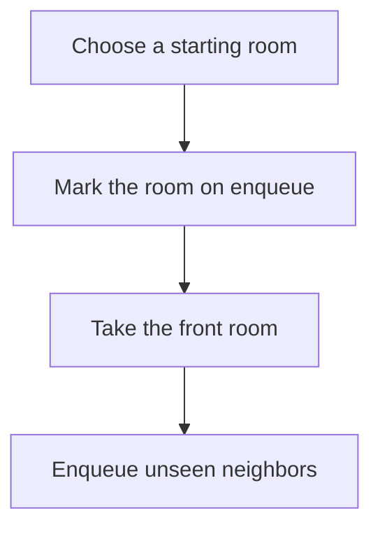

> [!tldr] Quick read
> - Every traversable cell is a vertex in a four-way grid graph. Generate neighbors as needed and check bounds before reading a cell.
> - Scan for unseen land and start one fill per island. The number of fills counts islands, and the cells visited by one fill give its area.
> - Mark each cell when it enters the queue so two paths reaching the same cell produce only one scheduled visit.
> - When the question asks for the nearest source, put every source in layer zero. BFS first reaches each cell at its shortest distance.

> [!info] Context
> This is station 1 on the [[en/series/neetcode-grph|NeetCode Graphs line]]. On the Linked Structures line, a tree already provided links to its children. On a square map, coordinates and the four allowed moves are enough to compute neighbors. I use one queue to count connected regions and measure how far a wave has spread from several sources.

> [!abstract]- Quick glossary for this post (click to open)
> - *Four-way adjacency* joins cells that share a side. Cells touching only at a corner are separate.
> - [[en/concepts/breadth-first-search|BFS]] processes cells in queue order. *Layer* d contains cells d steps from the source.
> - A *seed* is where a traversal starts. A *visited cell* has been recorded, even if it is still waiting in the queue.
> - `INF` is 2147483647 in Walls and Gates and represents a room without a finite distance yet.

## Picture it first: a map of hallways

Imagine a floor drawn as a grid. To find every cluster of connected rooms, I pick an unlabeled room and mark all the rooms that I can reach through neighboring doors. To find the nearest gate, I send teams out from every gate at once. Each team moves one cell per minute, so its first arrival gives the fewest steps.

| Everyday life | Concept |
|---|---|
| Rooms are cells and doors join side neighbors | [[en/concepts/grid-graph\|Grid graph]] |
| Labels spread to reachable rooms | [[en/concepts/flood-fill\|Flood fill]] |
| Every room in a cluster can reach the rest | [[en/concepts/connected-component\|Connected component]] |
| Label a room when scheduling the visit | [[en/concepts/mark-on-enqueue\|Mark on enqueue]] |
| Every team leaves its gate at minute zero | [[en/concepts/multi-source-bfs\|Multi-source BFS]] |



## The problem: one grid, two questions

I can scan the grid by row to find every cell, but one patch of land can wind through several rows. Counting land cells gives the total area. Counting patches requires remembering which cells an earlier fill already covered. Distance changes the question. If two gates can reach a room, I need the fewest steps from either. Searching from every gate independently answers that question while repeating work on shared routes.

## How it works

### Generate neighbors from coordinates

At `(r,c)`, try `(r-1,c)`, `(r+1,c)`, `(r,c-1)`, and `(r,c+1)`. Check that the coordinates are in bounds, that the cell type is traversable, and that the cell has no mark. The example uses `distance = -1` for unseen cells in a separate table. When discovering a cell, write `distance[next] = distance[current] + 1` before enqueueing it. Any other neighbor that reaches the same cell now sees that it has been claimed.

### One fill per component

Use 1 for land and 0 for water:

```text
1 0 0 1 1
0 0 0 1 1
0 1 0 1 0
1 1 0 0 0
```

The scan first finds seed `(0,0)`, and its fill ends with a single cell. The second fill starts at `(0,3)` and visits five cells. Cell `(1,4)` is next to both `(1,3)` and `(0,4)`. The second edge sees the mark and skips it. Finally `(2,1)` starts a three-cell fill. The grid has three islands, and the largest has five cells.

A fill follows only valid edges, so every discovered cell belongs to the seed's component. Suppose there were still an unseen cell in that component when the queue emptied. On a path from the seed, the first unseen cell would have a predecessor that was already processed. That predecessor would have enqueued it. So the fill covers the entire component. DFS can do the fill too when the question only asks which cells are reachable.

<figure class="figure-map" style="--ar: 3 / 4">
<div class="frame"><iframe data-archify="../../diagrams/neetcode-grid-traversal/worked-example.en.html" title="Mark each cell as it enters the queue" loading="lazy"></iframe></div>
<figcaption><span><b>Figure 1.</b> Mark each cell as it enters the queue.</span><a href="../diagrams/neetcode-grid-traversal/worked-example.en.html" target="_blank" rel="noopener">Open full screen</a></figcaption>
</figure>

<details>
<summary>Read the steps</summary>
<ol>
<li>Start the second island and mark its seed. <code>Q = [(0,3)]</code></li>
<li>Pop (0,3) and add two new cells. <code>Q = [(1,3), (0,4)]</code></li>
<li>Pop (1,3) and mark two more cells. <code>Q = [(0,4), (2,3), (1,4)]</code></li>
<li>From (0,4), find (1,4) already marked. <code>dist[1][4] = 2</code></li>
<li>Visit all five cells exactly once. <code>area = 5</code></li>
</ol>
</details>

### Multiple sources, one queue

For the oranges problem, put all initially rotten oranges in one queue at distance zero. A fresh cell adjacent to a source gets distance 1. One that needs another round of spread gets distance 2. A FIFO queue finishes the rest of layer d before it processes layer d+1. If a cell first receives d and has a shorter route, the previous cell on that route would have been processed earlier and assigned it first. Since every edge costs one step, the first distance is the minimum over all sources.

On `[[2,1,1,0,2],[0,1,1,1,1]]`, the sources are `(0,0)` and `(0,4)`. Minute 1 reaches `(0,1)` and `(1,4)`. Minute 2 reaches three more cells. At minute 3, three directions can reach `(1,2)`, but the cell enters the queue once. The last minute is 3. Return `-1` if any fresh orange remains unreachable and 0 if there were no fresh oranges to begin with.

For gates, the sources are all cells marked 0. Walls are -1 and only `INF` rooms receive new distances. An isolated room keeps `INF`. The shared example returns a new grid so the input and output are easy to compare. The LC-0286 page includes the in-place update required by the problem.

### Cost of the shared pattern

For R rows and C columns, scanning the board takes O(RC). Each eligible cell enters the queue at most once, with at most four edges checked on removal. Even with multiple island seeds, the total time stays O(RC) because the marks carry over between fills. The sample uses O(RC) auxiliary space for distances, filtered cell lists, and the queue. A head index avoids moving elements as JavaScript's `shift()` or Python's `pop(0)` would.

| Problem | What changes |
|---|---|
| [[en/problems/number-of-islands\|LC-0200 · Number of Islands]] | Count each discovery of unseen land that starts a fill. |
| [[en/problems/max-area-of-island\|LC-0695 · Max Area of Island]] | Keep the largest cell count among all fills. |
| [[en/problems/rotting-oranges\|LC-0994 · Rotting Oranges]] | Read the last minute among fresh cells and detect unreachable ones. |
| [[en/problems/walls-and-gates\|LC-0286 · Walls and Gates]] | Record each room's shortest distance to any gate. |

## Runnable example

All five versions run the same 10 cases. Along with the three-island grid and the two-source orange grid, they check corner-touching land, blocked oranges, a walled-off room, and a room with no gate. Download [TypeScript](../code/neetcode-grid-traversal/grid-demo.ts), [Python](../code/neetcode-grid-traversal/grid_demo.py), [Go](../code/neetcode-grid-traversal/grid_demo.go), [Java](../code/neetcode-grid-traversal/grid-demo.java), or [JavaScript](../code/neetcode-grid-traversal/grid-demo.js). Run with `node grid-demo.ts`, `python3 grid_demo.py`, `go run grid_demo.go`, `java grid-demo.java`, or `node grid-demo.js`.

```ts
type Cell = [number, number]
const directions: Cell[] = [[-1, 0], [1, 0], [0, -1], [0, 1]]
const INF = 2147483647

function blankDistances(grid: number[][]) {
  return grid.map(row => row.map(() => -1))
}

function cellsWith(grid: number[][], value: number): Cell[] {
  const cells: Cell[] = []
  grid.forEach((row, r) => row.forEach((cell, c) => {
    if (cell === value) cells.push([r, c])
  }))
  return cells
}

function flood(grid: number[][], distance: number[][], queue: Cell[], enter: number) {
  for (const [r, c] of queue) distance[r][c] = 0
  for (let head = 0; head < queue.length; head++) {
    const [r, c] = queue[head]
    for (const [dr, dc] of directions) {
      const nr = r + dr
      const nc = c + dc
      if (grid[nr]?.[nc] !== enter || distance[nr][nc] !== -1) continue
      distance[nr][nc] = distance[r][c] + 1
      queue.push([nr, nc])
    }
  }
  return queue.length
}

function islands(grid: number[][]) {
  const distance = blankDistances(grid)
  let count = 0
  let largest = 0
  for (const [r, c] of cellsWith(grid, 1)) {
    if (distance[r][c] !== -1) continue
    count++
    largest = Math.max(largest, flood(grid, distance, [[r, c]], 1))
  }
  return [count, largest]
}

function minutes(grid: number[][]) {
  const distance = blankDistances(grid)
  flood(grid, distance, cellsWith(grid, 2), 1)
  let last = 0
  for (const [r, c] of cellsWith(grid, 1)) {
    if (distance[r][c] === -1) return -1
    last = Math.max(last, distance[r][c])
  }
  return last
}

function nearestGates(grid: number[][]) {
  const distance = blankDistances(grid)
  flood(grid, distance, cellsWith(grid, 0), INF)
  return grid.map((row, r) => row.map((value, c) =>
    value === INF && distance[r][c] !== -1 ? distance[r][c] : value,
  ))
}

const land = [[1, 0, 0, 1, 1], [0, 0, 0, 1, 1], [0, 1, 0, 1, 0], [1, 1, 0, 0, 0]]
const oranges = [[2, 1, 1, 0, 2], [0, 1, 1, 1, 1]]
const rooms = [[INF, -1, 0], [INF, INF, INF], [0, -1, INF]]
const cases = [
  islands(land).join() === "3,5",
  islands([[1, 0], [0, 1]]).join() === "2,1",
  islands([[0]]).join() === "0,0",
  minutes(oranges) === 3,
  minutes([[2, 0, 1]]) === -1,
  minutes([[0, 2]]) === 0,
  minutes([[1]]) === -1,
  JSON.stringify(nearestGates(rooms)) === "[[2,-1,0],[1,2,1],[0,-1,2]]",
  nearestGates([[0, -1, INF]])[0][2] === INF,
  nearestGates([[INF]])[0][0] === INF,
]
if (!cases.every(Boolean)) throw new Error("Có ca sai")
console.log(`${cases.length}/${cases.length} ca đúng`)
```
```python
DIRECTIONS = ((-1, 0), (1, 0), (0, -1), (0, 1))
INF = 2147483647


def blank_distances(grid):
    return [[-1] * len(row) for row in grid]


def cells_with(grid, value):
    return [(r, c) for r, row in enumerate(grid) for c, cell in enumerate(row) if cell == value]


def flood(grid, distance, queue, enter):
    for r, c in queue:
        distance[r][c] = 0
    head = 0
    while head < len(queue):
        r, c = queue[head]
        head += 1
        for dr, dc in DIRECTIONS:
            nr, nc = r + dr, c + dc
            if not (0 <= nr < len(grid) and 0 <= nc < len(grid[nr])):
                continue
            if grid[nr][nc] != enter or distance[nr][nc] != -1:
                continue
            distance[nr][nc] = distance[r][c] + 1
            queue.append((nr, nc))
    return len(queue)


def islands(grid):
    distance = blank_distances(grid)
    count, largest = 0, 0
    for r, c in cells_with(grid, 1):
        if distance[r][c] == -1:
            count += 1
            largest = max(largest, flood(grid, distance, [(r, c)], 1))
    return count, largest


def minutes(grid):
    distance = blank_distances(grid)
    flood(grid, distance, cells_with(grid, 2), 1)
    last = 0
    for r, c in cells_with(grid, 1):
        if distance[r][c] == -1:
            return -1
        last = max(last, distance[r][c])
    return last


def nearest_gates(grid):
    distance = blank_distances(grid)
    flood(grid, distance, cells_with(grid, 0), INF)
    return [
        [distance[r][c] if value == INF and distance[r][c] != -1 else value
         for c, value in enumerate(row)]
        for r, row in enumerate(grid)
    ]


land = [[1, 0, 0, 1, 1], [0, 0, 0, 1, 1], [0, 1, 0, 1, 0], [1, 1, 0, 0, 0]]
oranges = [[2, 1, 1, 0, 2], [0, 1, 1, 1, 1]]
rooms = [[INF, -1, 0], [INF, INF, INF], [0, -1, INF]]
cases = [
    islands(land) == (3, 5),
    islands([[1, 0], [0, 1]]) == (2, 1),
    islands([[0]]) == (0, 0),
    minutes(oranges) == 3,
    minutes([[2, 0, 1]]) == -1,
    minutes([[0, 2]]) == 0,
    minutes([[1]]) == -1,
    nearest_gates(rooms) == [[2, -1, 0], [1, 2, 1], [0, -1, 2]],
    nearest_gates([[0, -1, INF]])[0][2] == INF,
    nearest_gates([[INF]])[0][0] == INF,
]
if not all(cases):
    raise AssertionError("Có ca sai")
print(f"{len(cases)}/{len(cases)} ca đúng")
```
```go
package main

import (
	"fmt"
	"reflect"
	"slices"
)

type cell struct{ r, c int }

var directions = [...]cell{{-1, 0}, {1, 0}, {0, -1}, {0, 1}}

const INF = 2147483647

func blankDistances(grid [][]int) [][]int {
	distance := make([][]int, len(grid))
	for r, row := range grid {
		distance[r] = make([]int, len(row))
		for c := range row {
			distance[r][c] = -1
		}
	}
	return distance
}

func cellsWith(grid [][]int, value int) []cell {
	var cells []cell
	for r, row := range grid {
		for c, item := range row {
			if item == value {
				cells = append(cells, cell{r, c})
			}
		}
	}
	return cells
}

func flood(grid, distance [][]int, queue []cell, enter int) int {
	for _, p := range queue {
		distance[p.r][p.c] = 0
	}
	for head := 0; head < len(queue); head++ {
		p := queue[head]
		for _, step := range directions {
			r, c := p.r+step.r, p.c+step.c
			if r < 0 || r >= len(grid) || c < 0 || c >= len(grid[r]) {
				continue
			}
			if grid[r][c] != enter || distance[r][c] != -1 {
				continue
			}
			distance[r][c] = distance[p.r][p.c] + 1
			queue = append(queue, cell{r, c})
		}
	}
	return len(queue)
}

func islands(grid [][]int) [2]int {
	distance := blankDistances(grid)
	count, largest := 0, 0
	for _, p := range cellsWith(grid, 1) {
		if distance[p.r][p.c] == -1 {
			count++
			largest = max(largest, flood(grid, distance, []cell{p}, 1))
		}
	}
	return [2]int{count, largest}
}

func minutes(grid [][]int) int {
	distance := blankDistances(grid)
	flood(grid, distance, cellsWith(grid, 2), 1)
	last := 0
	for _, p := range cellsWith(grid, 1) {
		d := distance[p.r][p.c]
		if d == -1 {
			return -1
		}
		last = max(last, d)
	}
	return last
}

func nearestGates(grid [][]int) [][]int {
	distance := blankDistances(grid)
	flood(grid, distance, cellsWith(grid, 0), INF)
	result := make([][]int, len(grid))
	for r, row := range grid {
		result[r] = slices.Clone(row)
		for c, value := range row {
			if value == INF && distance[r][c] != -1 {
				result[r][c] = distance[r][c]
			}
		}
	}
	return result
}

func main() {
	land := [][]int{{1, 0, 0, 1, 1}, {0, 0, 0, 1, 1}, {0, 1, 0, 1, 0}, {1, 1, 0, 0, 0}}
	oranges := [][]int{{2, 1, 1, 0, 2}, {0, 1, 1, 1, 1}}
	rooms := [][]int{{INF, -1, 0}, {INF, INF, INF}, {0, -1, INF}}
	cases := []bool{
		islands(land) == [2]int{3, 5},
		islands([][]int{{1, 0}, {0, 1}}) == [2]int{2, 1},
		islands([][]int{{0}}) == [2]int{0, 0},
		minutes(oranges) == 3,
		minutes([][]int{{2, 0, 1}}) == -1,
		minutes([][]int{{0, 2}}) == 0,
		minutes([][]int{{1}}) == -1,
		reflect.DeepEqual(nearestGates(rooms), [][]int{{2, -1, 0}, {1, 2, 1}, {0, -1, 2}}),
		nearestGates([][]int{{0, -1, INF}})[0][2] == INF,
		nearestGates([][]int{{INF}})[0][0] == INF,
	}
	for _, pass := range cases {
		if !pass {
			panic("Có ca sai")
		}
	}
	fmt.Printf("%d/%d ca đúng\n", len(cases), len(cases))
}
```
```java
import java.util.ArrayList;
import java.util.Arrays;
import java.util.List;

class GridDemo {
    record Cell(int r, int c) {}

    static final int INF = Integer.MAX_VALUE;
    static final int[][] DIRECTIONS = {{-1, 0}, {1, 0}, {0, -1}, {0, 1}};

    static int[][] blankDistances(int[][] grid) {
        int[][] distance = new int[grid.length][];
        for (int r = 0; r < grid.length; r++) {
            distance[r] = new int[grid[r].length];
            Arrays.fill(distance[r], -1);
        }
        return distance;
    }

    static List<Cell> cellsWith(int[][] grid, int value) {
        List<Cell> cells = new ArrayList<>();
        for (int r = 0; r < grid.length; r++) {
            for (int c = 0; c < grid[r].length; c++) {
                if (grid[r][c] == value) cells.add(new Cell(r, c));
            }
        }
        return cells;
    }

    static int flood(int[][] grid, int[][] distance, List<Cell> queue, int enter) {
        for (Cell p : queue) distance[p.r()][p.c()] = 0;
        for (int head = 0; head < queue.size(); head++) {
            Cell p = queue.get(head);
            for (int[] step : DIRECTIONS) {
                int r = p.r() + step[0], c = p.c() + step[1];
                if (r < 0 || r >= grid.length || c < 0 || c >= grid[r].length) continue;
                if (grid[r][c] != enter || distance[r][c] != -1) continue;
                distance[r][c] = distance[p.r()][p.c()] + 1;
                queue.add(new Cell(r, c));
            }
        }
        return queue.size();
    }

    static int[] islands(int[][] grid) {
        int[][] distance = blankDistances(grid);
        int count = 0, largest = 0;
        for (Cell p : cellsWith(grid, 1)) {
            if (distance[p.r()][p.c()] == -1) {
                count++;
                largest = Math.max(largest, flood(grid, distance, new ArrayList<>(List.of(p)), 1));
            }
        }
        return new int[] {count, largest};
    }

    static int minutes(int[][] grid) {
        int[][] distance = blankDistances(grid);
        flood(grid, distance, cellsWith(grid, 2), 1);
        int last = 0;
        for (Cell p : cellsWith(grid, 1)) {
            int d = distance[p.r()][p.c()];
            if (d == -1) return -1;
            last = Math.max(last, d);
        }
        return last;
    }

    static int[][] nearestGates(int[][] grid) {
        int[][] distance = blankDistances(grid);
        flood(grid, distance, cellsWith(grid, 0), INF);
        int[][] result = new int[grid.length][];
        for (int r = 0; r < grid.length; r++) {
            result[r] = grid[r].clone();
            for (int c = 0; c < grid[r].length; c++) {
                if (grid[r][c] == INF && distance[r][c] != -1) result[r][c] = distance[r][c];
            }
        }
        return result;
    }

    public static void main(String[] args) {
        int[][] land = {{1, 0, 0, 1, 1}, {0, 0, 0, 1, 1}, {0, 1, 0, 1, 0}, {1, 1, 0, 0, 0}};
        int[][] oranges = {{2, 1, 1, 0, 2}, {0, 1, 1, 1, 1}};
        int[][] rooms = {{INF, -1, 0}, {INF, INF, INF}, {0, -1, INF}};
        boolean[] cases = {
            Arrays.equals(islands(land), new int[] {3, 5}),
            Arrays.equals(islands(new int[][] {{1, 0}, {0, 1}}), new int[] {2, 1}),
            Arrays.equals(islands(new int[][] {{0}}), new int[] {0, 0}),
            minutes(oranges) == 3,
            minutes(new int[][] {{2, 0, 1}}) == -1,
            minutes(new int[][] {{0, 2}}) == 0,
            minutes(new int[][] {{1}}) == -1,
            Arrays.deepEquals(nearestGates(rooms), new int[][] {{2, -1, 0}, {1, 2, 1}, {0, -1, 2}}),
            nearestGates(new int[][] {{0, -1, INF}})[0][2] == INF,
            nearestGates(new int[][] {{INF}})[0][0] == INF,
        };
        for (boolean pass : cases) {
            if (!pass) throw new AssertionError("Có ca sai");
        }
        System.out.printf("%d/%d ca đúng%n", cases.length, cases.length);
    }
}
```
```js
const directions = [[-1, 0], [1, 0], [0, -1], [0, 1]]
const INF = 2147483647

function blankDistances(grid) {
  return grid.map(row => row.map(() => -1))
}

function cellsWith(grid, value) {
  const cells = []
  grid.forEach((row, r) => row.forEach((cell, c) => {
    if (cell === value) cells.push([r, c])
  }))
  return cells
}

function flood(grid, distance, queue, enter) {
  for (const [r, c] of queue) distance[r][c] = 0
  for (let head = 0; head < queue.length; head++) {
    const [r, c] = queue[head]
    for (const [dr, dc] of directions) {
      const nr = r + dr
      const nc = c + dc
      if (grid[nr]?.[nc] !== enter || distance[nr][nc] !== -1) continue
      distance[nr][nc] = distance[r][c] + 1
      queue.push([nr, nc])
    }
  }
  return queue.length
}

function islands(grid) {
  const distance = blankDistances(grid)
  let count = 0
  let largest = 0
  for (const [r, c] of cellsWith(grid, 1)) {
    if (distance[r][c] !== -1) continue
    count++
    largest = Math.max(largest, flood(grid, distance, [[r, c]], 1))
  }
  return [count, largest]
}

function minutes(grid) {
  const distance = blankDistances(grid)
  flood(grid, distance, cellsWith(grid, 2), 1)
  let last = 0
  for (const [r, c] of cellsWith(grid, 1)) {
    if (distance[r][c] === -1) return -1
    last = Math.max(last, distance[r][c])
  }
  return last
}

function nearestGates(grid) {
  const distance = blankDistances(grid)
  flood(grid, distance, cellsWith(grid, 0), INF)
  return grid.map((row, r) => row.map((value, c) =>
    value === INF && distance[r][c] !== -1 ? distance[r][c] : value,
  ))
}

const land = [[1, 0, 0, 1, 1], [0, 0, 0, 1, 1], [0, 1, 0, 1, 0], [1, 1, 0, 0, 0]]
const oranges = [[2, 1, 1, 0, 2], [0, 1, 1, 1, 1]]
const rooms = [[INF, -1, 0], [INF, INF, INF], [0, -1, INF]]
const cases = [
  islands(land).join() === "3,5",
  islands([[1, 0], [0, 1]]).join() === "2,1",
  islands([[0]]).join() === "0,0",
  minutes(oranges) === 3,
  minutes([[2, 0, 1]]) === -1,
  minutes([[0, 2]]) === 0,
  minutes([[1]]) === -1,
  JSON.stringify(nearestGates(rooms)) === "[[2,-1,0],[1,2,1],[0,-1,2]]",
  nearestGates([[0, -1, INF]])[0][2] === INF,
  nearestGates([[INF]])[0][0] === INF,
]
if (!cases.every(Boolean)) throw new Error("Có ca sai")
console.log(`${cases.length}/${cases.length} ca đúng`)
```

```text
10/10 cases passed
```

*(Output labels translated; the files themselves print Vietnamese.)*

## Misconceptions and common traps

- **Corner contact makes one island.** On a four-way grid, `[[1,0],[0,1]]` contains two islands.
- **Clear the marks before every fill.** The scan depends on earlier marks to count each component once.
- **Wait to mark a cell until it is popped.** Two cells in the same layer can both enqueue their common neighbor. Marking on discovery keeps each cell in the queue once.
- **Count a minute for every orange popped.** Several oranges change state in the same minute. Read the largest distance or count waves that actually spread.
- **Process the sources in turn and keep the first hit.** The first source can reach a room by a long route. Seed every source at distance zero before expanding.

## Self-check questions

> [!question]- Two land cells touch only at a corner. How many islands do they form here?
> Two. A path of side-adjacent cells is required to connect them.

> [!question]- A fill starts from a seed and finds five cells. How do the two counts change?
> The island count rises by one because one fill started. The candidate area is five because the fill recorded five cells.

> [!question]- Two cells in layer 1 both see an unseen cell. How many times is it added and at what layer?
> Once at layer 2. The first processed neighbor writes distance 2 before adding it.

> [!question]- One room is three steps from gate A and two from gate B. What distance is assigned?
> Two. Multi-source BFS considers the two-step routes before the three-step routes.

## References

- [Princeton Algorithms · BreadthFirstPaths](https://algs4.cs.princeton.edu/41graph/BreadthFirstPaths.java.html) shows marking before enqueueing and loading all sources with distance zero.
- [Princeton Algorithms · CC](https://github.com/kevin-wayne/algs4/blob/master/src/main/java/edu/princeton/cs/algs4/CC.java) starts one traversal from every as-yet-unassigned vertex.
- [LeetCode 200](https://leetcode.com/problems/number-of-islands/), [695](https://leetcode.com/problems/max-area-of-island/), [994](https://leetcode.com/problems/rotting-oranges/), and [286](https://leetcode.com/problems/walls-and-gates/) are the original problems. [Islands and Treasure](https://neetcode.io/problems/islands-and-treasure/question) is the public equivalent of the gate problem.
