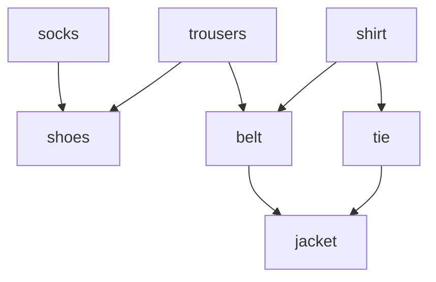
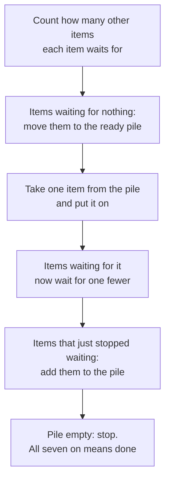
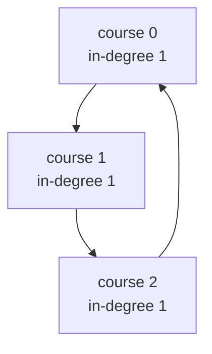

> [!tldr] Quick read
> - Many problems really ask one question: here are some tasks and a few rules of the form "task X must be done before task Y". Line them up so that no rule is broken. That line is a [[en/concepts/topological-sort|topological order]].
> - Write each rule as an arrow X → Y. That gives a directed graph. A line-up exists if and only if the graph has **no loop**, that is, it is a [[en/concepts/directed-acyclic-graph|DAG]].
> - The easiest way to understand is Kahn's algorithm. Count how many other tasks each task still waits for (its [[en/concepts/in-degree|in-degree]]). Do a task that waits for nothing, then cross it off the waiting lists of the tasks after it. If you end up doing fewer than n tasks, there is a loop.
> - The second way is DFS with three colours: white means not touched yet, gray means in progress, black means done. Meeting a **gray** vertex again means a loop. Meeting a **black** one is fine. That is where [[en/concepts/three-color-dfs|three-color DFS]] differs from a plain DFS.
> - The three problems on this station share one template. 207 only asks "can it be lined up". 210 wants the line itself. 269 gives no rules, so you have to pull the [[en/concepts/precedence-constraint|precedence constraints]] out of a sorted word list yourself.

> [!info] Context
> This is station 3 on the [[en/series/neetcode-grph|NeetCode Graphs line]]. On [[en/posts/2026-11-26-neetcode-graph-bfs|station 2]], edges went both ways and the question was "where can I get to". On this station edges have a **direction** and mean "before–after". You only need arrays, loops and a queue. Everything else is rebuilt from an example with seven items of clothing.

> [!abstract]- Quick glossary for this post (click to open)
> - A *vertex* is one task (a course, an item of clothing, a letter). A *directed edge* X → Y means "X must come before Y".
> - A *directed graph* is a graph where every edge has an arrow. You may only follow an edge in the direction of its arrow.
> - A *cycle* (loop) is a path that follows the arrows and comes back to where it started, for example A → B → C → A.
> - A [[en/concepts/directed-acyclic-graph|DAG]] (directed acyclic graph) is a directed graph with no cycle at all.
> - A [[en/concepts/topological-sort|topological order]] lines up every vertex so that every arrow points from left to right.
> - The [[en/concepts/in-degree|in-degree]] of a vertex is the number of arrows coming **into** it, that is, how many tasks it still waits for.
> - [[en/concepts/adjacency-list|Adjacency list]]: each vertex keeps a list of the vertices it points an arrow at.
> - *Queue*: first in, first out. Here it is an in-memory data structure.
> - *DFS* (depth-first search) goes as deep as it can along one branch before coming back. *Recursion* is a function calling itself, the shortest way to write a DFS.
> - V is the number of vertices, E the number of edges. O(V + E) means the time grows with the sum of the two.

## Picture it first: getting dressed in the morning

Every morning I put on seven items: socks, trousers, shirt, shoes, belt, tie, jacket. The order is not free. Socks come before shoes, because once the shoes are on you cannot pull socks on. Trousers also come before shoes. The belt needs the trousers and the shirt first. The tie needs the shirt. The jacket goes on last, after the belt and the tie.

Seven items, seven rules. I want an order of dressing that breaks no rule. Several orders work: socks before trousers or trousers before socks are both fine.

| Everyday life | Concept |
|---|---|
| Each item of clothing | a vertex |
| The rule "put on X before Y" | a directed edge X → Y |
| A rule book with nothing like "socks before shoes, shoes before socks" | [[en/concepts/directed-acyclic-graph\|DAG]] |
| A way to put on all seven items without breaking a rule | [[en/concepts/topological-sort\|topological order]] |
| How many items must still go on before this one | [[en/concepts/in-degree\|in-degree]] |
| The pile of items you can put on right now, waiting for nothing | the queue in Kahn's algorithm |
| An item half put on (gray) and an item fully on (black) | [[en/concepts/three-color-dfs\|three-color DFS]] |
| Nobody hands you the rule book; you work out the rules from traces | [[en/concepts/precedence-constraint\|precedence constraint]] (Alien Dictionary) |

Here are the seven items and seven rules, drawn as arrows:



Every morning I run exactly one loop:



## The problem: line up n tasks with before–after rules

Course Schedule says this. There are `n` courses, numbered 0 to n−1. There is a list of prerequisites, where each pair `[a, b]` means "to take `a` you must first finish `b`". Question: can you finish every course? The next problem, Course Schedule II, also asks: if so, in what order?

My first idea was to **try every order**. With 7 items of clothing there are 7! = 5,040 orders. With 2,000 courses the number of orders has more than 5,700 digits. That cannot be tried.

My second idea was "just run a DFS and you will see the loop". I wrote a DFS with a `visited` set as on stations 1 and 2, and treated "meeting a visited vertex again" as a loop. It turned out wrong on the clothing example straight away:

- The DFS goes from **socks** to **shoes** and marks both.
- Later the DFS goes from **trousers** to **shoes**. Shoes are already in `visited`, so the code reports "loop".
- But the wardrobe has no loop. Shoes simply have **two** items that must go on before them.

Meeting a vertex again does not mean a loop. There is a loop when you meet a vertex that is **still on the path you are walking**. How it works fixes this in two ways.

## How it works

### Step 1: rules become arrows, and which way they point

Each rule "X before Y" becomes an arrow X → Y. I write the graph as an [[en/concepts/adjacency-list|adjacency list]]: each item keeps the list of items waiting for it. At the same time I count the [[en/concepts/in-degree|in-degree]], the number of arrows coming into each item.

| Item | Arrows out (items waiting for it) | In-degree (items it still waits for) |
|---|---|---|
| socks | shoes | 0 |
| trousers | shoes, belt | 0 |
| shirt | belt, tie | 0 |
| shoes | | 2 (socks, trousers) |
| belt | jacket | 2 (trousers, shirt) |
| tie | jacket | 1 (shirt) |
| jacket | | 2 (belt, tie) |

> [!warning] Which way the edge points in the problem
> In Course Schedule the pair `[a, b]` means **take `b` before `a`**. So the arrow is `b → a`, the opposite of the order inside the pair. Get the direction wrong and Course Schedule I still passes, because reversing every arrow neither creates nor removes a loop. But Course Schedule II will return the order **backwards**.

### Step 2: Kahn's algorithm, step by step

The idea fits in one sentence: **a task that waits for nobody can be done now**. Once a task is done, every task waiting for it waits for one fewer. Arthur Kahn published the algorithm in 1962.

I run it on the seven items. The queue starts with the three items of in-degree 0, in numbering order.

| Step | Take out and put on | In-degree changes | Queue after the step |
|---|---|---|---|
| 0 | | | [socks, trousers, shirt] |
| 1 | socks | shoes 2 → 1 | [trousers, shirt] |
| 2 | trousers | shoes 1 → **0**, belt 2 → 1 | [shirt, shoes] |
| 3 | shirt | belt 1 → **0**, tie 1 → **0** | [shoes, belt, tie] |
| 4 | shoes | (nothing waits for shoes) | [belt, tie] |
| 5 | belt | jacket 2 → 1 | [tie] |
| 6 | tie | jacket 1 → **0** | [jacket] |
| 7 | jacket | | [] |

The dressing order is **socks, trousers, shirt, shoes, belt, tie, jacket**. All 7 of 7 items went on, so there is no loop.

<figure class="figure-map" style="--ar: 3 / 4">
<div class="frame"><iframe data-archify="../../diagrams/neetcode-topological-sort/kahn-trace.en.html" title="Kahn's algorithm on seven items of clothing" loading="lazy"></iframe></div>
<figcaption><span><b>Figure 1.</b> The dresser only does two things: take an item that waits for nothing and put it on, then subtract one from every item waiting for it. Each item joins the line exactly once, so getting all 7 of 7 on proves there is no loop.</span><a href="../diagrams/neetcode-topological-sort/kahn-trace.en.html" target="_blank" rel="noopener">Open full screen</a></figcaption>
</figure>

Three things worth noticing in the table:

- **An item joins the queue exactly when its in-degree reaches 0.** At step 2 the shoes had not joined yet even though the socks were on, because the shoes still waited for the trousers. So no item goes on before an item it needs.
- **Each item joins the queue exactly once**, because in-degrees only go down and reach 0 only once. Each arrow is read once, when the item at its tail is taken out. The total cost is O(V + E).
- **The order is not unique.** If the queue starts as [trousers, socks, shirt], you get a different order that is also correct. Course Schedule II accepts any correct order.

### Step 3: with a loop, Kahn gets stuck

Now try three courses waiting on each other in a loop: course 0 needs course 1, course 1 needs course 2, course 2 needs course 0.



The arrows here point "take first → take after". Every course still waits for one course. No course has in-degree 0, so the queue is empty from the start and Kahn takes out **0 of 3** courses.

More generally: every vertex on a loop (and every vertex after that loop) **never** reaches in-degree 0. Each vertex on the loop still waits for the vertex before it on the loop, and that one is never taken out either. Conversely, if the graph has no loop there is always at least one vertex of in-degree 0 left. Walk backwards along the arrows from any vertex; since there is no loop you must stop at a vertex with no arrow coming in.

So to know whether there is a loop, **you do not need to find the loop**. Just count: take out all n vertices and there is no loop; come up short and there is one.

### Step 4: the second way, three-color DFS

DFS goes deep along the arrows. To tell "meeting an item that is done" from "meeting an item in progress", I give each vertex one of three colours:

| Colour | Meaning | What happens when an arrow leads to a vertex of this colour |
|---|---|---|
| White | not touched yet | go into it |
| Gray | on the current path, not done | **loop**: you went round and came back |
| Black | done, every item after it already handled | skip it, not a loop |

A vertex turns **gray** when the DFS steps into it. It turns **black** when the DFS has followed all its arrows and steps back out. Record the order in which vertices turn black, then **reverse** it, and you get a topological order. The reason: a vertex only turns black after every vertex that comes after it has already turned black.

On the seven items, starting from the lowest-numbered item:

| Step | What the DFS does | "Done" list (black) |
|---|---|---|
| 1 | into **socks** (gray) → into **shoes** (gray). Shoes have no arrow out: shoes black | shoes |
| 2 | back at socks, no arrows left: socks black | shoes, socks |
| 3 | into **trousers** (gray). Trousers → shoes: shoes are **black**, skip, not a loop | shoes, socks |
| 4 | trousers → **belt** (gray) → **jacket** (gray). Jacket black, then belt black | shoes, socks, jacket, belt |
| 5 | trousers has no arrows left: trousers black | …, belt, trousers |
| 6 | into **shirt** (gray). Shirt → belt: black, skip. Shirt → **tie** (gray) → jacket: black, skip. Tie black, shirt black | …, trousers, tie, shirt |

The black list is shoes, socks, jacket, belt, trousers, tie, shirt. Reversed, it gives **shirt, tie, trousers, belt, jacket, socks, shoes**. That differs from Kahn's order but is also correct: every arrow still points from left to right.

Step 3 is where a DFS with a single `visited` set raises a false alarm. The shoes have been visited, but they are **black**, not gray. Three colours fix exactly that bug.

The two ways side by side:

| | Kahn (queue-based) | Three-color DFS |
|---|---|---|
| Idea | do tasks that wait for nothing first | go deep, record when done, reverse at the end |
| Detecting a loop | number of vertices taken out < n | meeting a gray vertex |
| Extra memory | in-degree array + queue | colour array + recursion stack |
| Trap | getting the edge direction wrong | recursion too deep on a long chain (Python stops at about 1,000 levels by default) |
| Time | O(V + E) | O(V + E) |

All three problem pages show both ways. When I need to write one quickly, I pick Kahn: no recursion, and the loop check is a single comparison.

### Three problems, one template

| Problem | What changes |
|---|---|
| [[en/problems/course-schedule\|LC-0207 · Course Schedule]] | Yes/no only. Run Kahn and compare the number of courses taken out with `numCourses`. Remember to turn the pair `[a, b]` into the edge `b → a`. |
| [[en/problems/course-schedule-ii\|LC-0210 · Course Schedule II]] | Return the order Kahn takes out. With a loop, return an empty array. Any correct order is accepted. |
| [[en/problems/alien-dictionary\|LC-0269 · Alien Dictionary]] | The rules are not given. Compare each **pair of adjacent words**; the first differing letter gives one edge. Vertices are the letters that appear. A long word placed before its own prefix (`abc` before `ab`) makes the list impossible, so return `""`. |

### Alien Dictionary: pulling the rules out of a sorted list

Imagine you pick up a dictionary of a strange language. The letters look Latin, but the alphabet order is different. The words in the dictionary are **already sorted** by that alphabet. Question: what is the alphabet order?

Take four words `ba`, `bc`, `ac`, `cab`, in dictionary order.

| Adjacent pair | First differing letter | Rule found |
|---|---|---|
| `ba` / `bc` | position 2: `a` and `c` | a → c |
| `bc` / `ac` | position 1: `b` and `a` | b → a |
| `ac` / `cab` | position 1: `a` and `c` | a → c (already known) |

The letters that appear are b, a, c. Running Kahn on the two edges b → a and a → c gives **`bac`**.

Things I had to think through carefully:

- **Compare adjacent pairs only.** The first and last words also give a rule, but that rule already follows from the adjacent pairs. Adjacent pairs are enough to keep the whole list in order.
- **Take only the first differing letter.** `ba` < `bc` only says `a` < `c`. The letters after that position say nothing.
- **One word is a prefix of the other.** `ab` before `abc` is normal and gives no rule. But `abc` before `ab` cannot be sorted by any alphabet, so return `""`.
- **Letters with no edge must still appear** in the answer. With `za`, `zb`, the letter `z` has no arrow at all, but the answer must contain `z`, `a` and `b`.

This is the idea of a [[en/concepts/precedence-constraint|precedence constraint]]: data that is already sorted holds "before–after" rules, and the job is to pull them out as edges.

### Cost

- Kahn and three-color DFS: O(V + E) time, O(V + E) memory for the adjacency list.
- Course Schedule I and II: V = `numCourses` ≤ 2,000. Problem 207 has at most 5,000 prerequisites. Problem 210 allows up to `numCourses × (numCourses − 1)` prerequisites, so E can reach almost 4 million.
- Alien Dictionary: building the edges costs O(C), where C is the total number of letters in all words, because each adjacent pair is compared only up to its first differing letter. V ≤ 26 letters, E ≤ number of words − 1.

## Runnable example

Each file solves all three problems with the same `kahn` function, adds the three-color DFS for 207 and 210, and checks 14 cases:

- the seven-item clothing example, the three-course loop, a chain of 2,000 courses, the four-word example, the prefix trap;
- 300 random graphs checked Kahn against DFS. 205 of them have a loop. Every order returned is checked against every rule;
- 200 random word lists, sorted by a reversed alphabet. The alphabet found must sort each list correctly again.

Download [TypeScript](../code/neetcode-topological-sort/topological-sort.ts), [Python](../code/neetcode-topological-sort/topological_sort.py), [Go](../code/neetcode-topological-sort/topological_sort.go), [Java](../code/neetcode-topological-sort/topological-sort.java) or [JavaScript](../code/neetcode-topological-sort/topological-sort.js). Run them with `node topological-sort.ts`, `python3 topological_sort.py`, `go run topological_sort.go`, `java topological-sort.java` or `node topological-sort.js`. Below is the solution part; the checks sit at the end of each file.

```ts
// Station GRPH-03: topological sort for Course Schedule, Course Schedule II, Alien Dictionary.
// Run: node topological-sort.ts

// ---------- Shared template: Kahn's algorithm ----------
// n vertices 0..n-1, edges are pairs [before, after]. Returns the order taken out.
// If the order is shorter than n, the graph has a cycle.
function kahn(n: number, edges: [number, number][]): number[] {
  const adj: number[][] = Array.from({ length: n }, () => [])
  const indeg = new Array<number>(n).fill(0)
  for (const [before, after] of edges) {
    adj[before].push(after)
    indeg[after]++ // "after" waits for one more task
  }
  const queue: number[] = []
  for (let v = 0; v < n; v++) if (indeg[v] === 0) queue.push(v)
  const order: number[] = []
  for (let head = 0; head < queue.length; head++) {
    const v = queue[head]
    order.push(v)
    for (const w of adj[v]) {
      indeg[w]--
      if (indeg[w] === 0) queue.push(w) // nothing left to wait for: ready
    }
  }
  return order
}

// The problem's [a, b] means "take b before a", i.e. edge b → a.
function toEdges(prerequisites: number[][]): [number, number][] {
  return prerequisites.map(([a, b]) => [b, a] as [number, number])
}

// ---------- 207. Course Schedule: only asks whether every course can be finished ----------
function canFinish(numCourses: number, prerequisites: number[][]): boolean {
  return kahn(numCourses, toEdges(prerequisites)).length === numCourses
}

// Second way: three-color DFS. White = not visited, gray = on the current path, black = done.
const WHITE = 0, GRAY = 1, BLACK = 2

function canFinishDfs(numCourses: number, prerequisites: number[][]): boolean {
  const adj: number[][] = Array.from({ length: numCourses }, () => [])
  for (const [b, a] of toEdges(prerequisites)) adj[b].push(a)
  const color = new Array<number>(numCourses).fill(WHITE)
  const hasCycleFrom = (v: number): boolean => {
    color[v] = GRAY
    for (const w of adj[v]) {
      if (color[w] === GRAY) return true // back to a vertex still on the path: cycle
      if (color[w] === WHITE && hasCycleFrom(w)) return true
    }
    color[v] = BLACK
    return false
  }
  for (let v = 0; v < numCourses; v++) {
    if (color[v] === WHITE && hasCycleFrom(v)) return false
  }
  return true
}

// ---------- 210. Course Schedule II: return one order of courses ----------
function findOrder(numCourses: number, prerequisites: number[][]): number[] {
  const order = kahn(numCourses, toEdges(prerequisites))
  return order.length === numCourses ? order : []
}

// DFS: a course is "done" (black) after every course that comes after it. The reversed finishing order is a topological order.
function findOrderDfs(numCourses: number, prerequisites: number[][]): number[] {
  const adj: number[][] = Array.from({ length: numCourses }, () => [])
  for (const [b, a] of toEdges(prerequisites)) adj[b].push(a)
  const color = new Array<number>(numCourses).fill(WHITE)
  const finished: number[] = []
  const visit = (v: number): boolean => {
    color[v] = GRAY
    for (const w of adj[v]) {
      if (color[w] === GRAY) return false
      if (color[w] === WHITE && !visit(w)) return false
    }
    color[v] = BLACK
    finished.push(v)
    return true
  }
  for (let v = 0; v < numCourses; v++) {
    if (color[v] === WHITE && !visit(v)) return []
  }
  return finished.reverse()
}

// ---------- 269. Alien Dictionary: build the edges from adjacent word pairs ----------
function alienOrder(words: string[]): string {
  const letters: string[] = [] // in order of first appearance
  const id = new Map<string, number>()
  for (const word of words) {
    for (const ch of word) {
      if (!id.has(ch)) {
        id.set(ch, letters.length)
        letters.push(ch)
      }
    }
  }
  const edges: [number, number][] = []
  const seenEdge = new Set<string>()
  for (let i = 0; i + 1 < words.length; i++) {
    const a = words[i], b = words[i + 1]
    const len = Math.min(a.length, b.length)
    let j = 0
    while (j < len && a[j] === b[j]) j++
    if (j === len) {
      if (a.length > b.length) return "" // "abc" before "ab": the list is invalid
      continue // one word is a prefix of the other: tells us nothing
    }
    const key = a[j] + b[j]
    if (!seenEdge.has(key)) { // add each edge once, so the adjacency list and in-degrees match
      seenEdge.add(key)
      edges.push([id.get(a[j])!, id.get(b[j])!])
    }
  }
  const order = kahn(letters.length, edges)
  return order.length === letters.length ? order.map((v) => letters[v]).join("") : ""
}
```
```python
# Station GRPH-03: topological sort for Course Schedule, Course Schedule II, Alien Dictionary.
# Run: python3 topological_sort.py
import sys
from collections import deque

# Recursive DFS on a chain of 2,000 courses goes 2,000 levels deep; Python allows about 1,000 by default.
sys.setrecursionlimit(10_000)


# ---------- Shared template: Kahn's algorithm ----------
# n vertices 0..n-1, edges are pairs (before, after). Returns the order taken out.
# If the order is shorter than n, the graph has a cycle.
def kahn(n, edges):
    adj = [[] for _ in range(n)]
    indeg = [0] * n
    for before, after in edges:
        adj[before].append(after)
        indeg[after] += 1  # "after" waits for one more task
    queue = deque(v for v in range(n) if indeg[v] == 0)
    order = []
    while queue:
        v = queue.popleft()
        order.append(v)
        for w in adj[v]:
            indeg[w] -= 1
            if indeg[w] == 0:  # nothing left to wait for: ready
                queue.append(w)
    return order


# The problem's [a, b] means "take b before a", i.e. edge b → a.
def to_edges(prerequisites):
    return [(b, a) for a, b in prerequisites]


# ---------- 207. Course Schedule: only asks whether every course can be finished ----------
def can_finish(num_courses, prerequisites):
    return len(kahn(num_courses, to_edges(prerequisites))) == num_courses


# Second way: three-color DFS. White = not visited, gray = on the current path, black = done.
WHITE, GRAY, BLACK = 0, 1, 2


def can_finish_dfs(num_courses, prerequisites):
    adj = [[] for _ in range(num_courses)]
    for b, a in to_edges(prerequisites):
        adj[b].append(a)
    color = [WHITE] * num_courses

    def has_cycle_from(v):
        color[v] = GRAY
        for w in adj[v]:
            if color[w] == GRAY:  # back to a vertex still on the path: cycle
                return True
            if color[w] == WHITE and has_cycle_from(w):
                return True
        color[v] = BLACK
        return False

    return not any(color[v] == WHITE and has_cycle_from(v) for v in range(num_courses))


# ---------- 210. Course Schedule II: return one order of courses ----------
def find_order(num_courses, prerequisites):
    order = kahn(num_courses, to_edges(prerequisites))
    return order if len(order) == num_courses else []


# DFS: a course is "done" (black) after every course that comes after it. The reversed finishing order is a topological order.
def find_order_dfs(num_courses, prerequisites):
    adj = [[] for _ in range(num_courses)]
    for b, a in to_edges(prerequisites):
        adj[b].append(a)
    color = [WHITE] * num_courses
    finished = []

    def visit(v):
        color[v] = GRAY
        for w in adj[v]:
            if color[w] == GRAY:
                return False
            if color[w] == WHITE and not visit(w):
                return False
        color[v] = BLACK
        finished.append(v)
        return True

    for v in range(num_courses):
        if color[v] == WHITE and not visit(v):
            return []
    return finished[::-1]


# ---------- 269. Alien Dictionary: build the edges from adjacent word pairs ----------
def alien_order(words):
    letters = []  # in order of first appearance
    ids = {}
    for word in words:
        for ch in word:
            if ch not in ids:
                ids[ch] = len(letters)
                letters.append(ch)
    edges = []
    seen_edge = set()
    for a, b in zip(words, words[1:]):
        n = min(len(a), len(b))
        j = 0
        while j < n and a[j] == b[j]:
            j += 1
        if j == n:
            if len(a) > len(b):
                return ""  # "abc" before "ab": the list is invalid
            continue  # one word is a prefix of the other: tells us nothing
        if (a[j], b[j]) not in seen_edge:  # add each edge once, so the adjacency list and in-degrees match
            seen_edge.add((a[j], b[j]))
            edges.append((ids[a[j]], ids[b[j]]))
    order = kahn(len(letters), edges)
    return "".join(letters[v] for v in order) if len(order) == len(letters) else ""
```
```go
// Station GRPH-03: topological sort for Course Schedule, Course Schedule II, Alien Dictionary.
// Run: go run topological_sort.go
package main

import (
	"fmt"
	"sort"
	"strings"
)

// ---------- Shared template: Kahn's algorithm ----------
// n vertices 0..n-1, edges are pairs {before, after}. Returns the order taken out.
// If the order is shorter than n, the graph has a cycle.
func kahn(n int, edges [][2]int) []int {
	adj := make([][]int, n)
	indeg := make([]int, n)
	for _, e := range edges {
		before, after := e[0], e[1]
		adj[before] = append(adj[before], after)
		indeg[after]++ // "after" waits for one more task
	}
	queue := []int{}
	for v := 0; v < n; v++ {
		if indeg[v] == 0 {
			queue = append(queue, v)
		}
	}
	order := []int{}
	for head := 0; head < len(queue); head++ {
		v := queue[head]
		order = append(order, v)
		for _, w := range adj[v] {
			indeg[w]--
			if indeg[w] == 0 { // nothing left to wait for: ready
				queue = append(queue, w)
			}
		}
	}
	return order
}

// The problem's [a, b] means "take b before a", i.e. edge b → a.
func toEdges(prerequisites [][]int) [][2]int {
	edges := make([][2]int, len(prerequisites))
	for i, p := range prerequisites {
		edges[i] = [2]int{p[1], p[0]}
	}
	return edges
}

func buildAdj(n int, prerequisites [][]int) [][]int {
	adj := make([][]int, n)
	for _, e := range toEdges(prerequisites) {
		adj[e[0]] = append(adj[e[0]], e[1])
	}
	return adj
}

// ---------- 207. Course Schedule: only asks whether every course can be finished ----------
func canFinish(numCourses int, prerequisites [][]int) bool {
	return len(kahn(numCourses, toEdges(prerequisites))) == numCourses
}

// Second way: three-color DFS. White = not visited, gray = on the current path, black = done.
const (
	white = 0
	gray  = 1
	black = 2
)

func canFinishDfs(numCourses int, prerequisites [][]int) bool {
	adj := buildAdj(numCourses, prerequisites)
	color := make([]int, numCourses)
	var hasCycleFrom func(v int) bool
	hasCycleFrom = func(v int) bool {
		color[v] = gray
		for _, w := range adj[v] {
			if color[w] == gray { // back to a vertex still on the path: cycle
				return true
			}
			if color[w] == white && hasCycleFrom(w) {
				return true
			}
		}
		color[v] = black
		return false
	}
	for v := 0; v < numCourses; v++ {
		if color[v] == white && hasCycleFrom(v) {
			return false
		}
	}
	return true
}

// ---------- 210. Course Schedule II: return one order of courses ----------
func findOrder(numCourses int, prerequisites [][]int) []int {
	order := kahn(numCourses, toEdges(prerequisites))
	if len(order) != numCourses {
		return []int{}
	}
	return order
}

// DFS: a course is "done" (black) after every course that comes after it. The reversed finishing order is a topological order.
func findOrderDfs(numCourses int, prerequisites [][]int) []int {
	adj := buildAdj(numCourses, prerequisites)
	color := make([]int, numCourses)
	finished := []int{}
	var visit func(v int) bool
	visit = func(v int) bool {
		color[v] = gray
		for _, w := range adj[v] {
			if color[w] == gray {
				return false
			}
			if color[w] == white && !visit(w) {
				return false
			}
		}
		color[v] = black
		finished = append(finished, v)
		return true
	}
	for v := 0; v < numCourses; v++ {
		if color[v] == white && !visit(v) {
			return []int{}
		}
	}
	for i, j := 0, len(finished)-1; i < j; i, j = i+1, j-1 {
		finished[i], finished[j] = finished[j], finished[i]
	}
	return finished
}

// ---------- 269. Alien Dictionary: build the edges from adjacent word pairs ----------
// The problem uses only lowercase a-z, so I walk the bytes.
func alienOrder(words []string) string {
	letters := []byte{} // in order of first appearance
	id := map[byte]int{}
	for _, word := range words {
		for i := 0; i < len(word); i++ {
			if _, ok := id[word[i]]; !ok {
				id[word[i]] = len(letters)
				letters = append(letters, word[i])
			}
		}
	}
	edges := [][2]int{}
	seenEdge := map[[2]byte]bool{}
	for i := 0; i+1 < len(words); i++ {
		a, b := words[i], words[i+1]
		n := min(len(a), len(b))
		j := 0
		for j < n && a[j] == b[j] {
			j++
		}
		if j == n {
			if len(a) > len(b) {
				return "" // "abc" before "ab": the list is invalid
			}
			continue // one word is a prefix of the other: tells us nothing
		}
		key := [2]byte{a[j], b[j]}
		if !seenEdge[key] { // add each edge once, so the adjacency list and in-degrees match
			seenEdge[key] = true
			edges = append(edges, [2]int{id[a[j]], id[b[j]]})
		}
	}
	order := kahn(len(letters), edges)
	if len(order) != len(letters) {
		return ""
	}
	var sb strings.Builder
	for _, v := range order {
		sb.WriteByte(letters[v])
	}
	return sb.String()
}
```
```java
// Station GRPH-03: topological sort for Course Schedule, Course Schedule II, Alien Dictionary.
// Run: java topological-sort.java
import java.util.*;

public class Main {
    // ---------- Shared template: Kahn's algorithm ----------
    // n vertices 0..n-1, edges are pairs {before, after}. Returns the order taken out.
    // If the order is shorter than n, the graph has a cycle.
    static List<Integer> kahn(int n, List<int[]> edges) {
        List<List<Integer>> adj = new ArrayList<>();
        for (int i = 0; i < n; i++) adj.add(new ArrayList<>());
        int[] indeg = new int[n];
        for (int[] e : edges) {
            adj.get(e[0]).add(e[1]);
            indeg[e[1]]++; // "after" waits for one more task
        }
        ArrayDeque<Integer> queue = new ArrayDeque<>();
        for (int v = 0; v < n; v++) if (indeg[v] == 0) queue.add(v);
        List<Integer> order = new ArrayList<>();
        while (!queue.isEmpty()) {
            int v = queue.poll();
            order.add(v);
            for (int w : adj.get(v)) {
                if (--indeg[w] == 0) queue.add(w); // nothing left to wait for: ready
            }
        }
        return order;
    }

    // The problem's [a, b] means "take b before a", i.e. edge b → a.
    static List<int[]> toEdges(int[][] prerequisites) {
        List<int[]> edges = new ArrayList<>();
        for (int[] p : prerequisites) edges.add(new int[] {p[1], p[0]});
        return edges;
    }

    static List<List<Integer>> buildAdj(int n, int[][] prerequisites) {
        List<List<Integer>> adj = new ArrayList<>();
        for (int i = 0; i < n; i++) adj.add(new ArrayList<>());
        for (int[] e : toEdges(prerequisites)) adj.get(e[0]).add(e[1]);
        return adj;
    }

    // ---------- 207. Course Schedule: only asks whether every course can be finished ----------
    static boolean canFinish(int numCourses, int[][] prerequisites) {
        return kahn(numCourses, toEdges(prerequisites)).size() == numCourses;
    }

    // Second way: three-color DFS. White = not visited, gray = on the current path, black = done.
    static final int WHITE = 0, GRAY = 1, BLACK = 2;

    static boolean canFinishDfs(int numCourses, int[][] prerequisites) {
        List<List<Integer>> adj = buildAdj(numCourses, prerequisites);
        int[] color = new int[numCourses];
        for (int v = 0; v < numCourses; v++) {
            if (color[v] == WHITE && hasCycleFrom(v, adj, color)) return false;
        }
        return true;
    }

    static boolean hasCycleFrom(int v, List<List<Integer>> adj, int[] color) {
        color[v] = GRAY;
        for (int w : adj.get(v)) {
            if (color[w] == GRAY) return true; // back to a vertex still on the path: cycle
            if (color[w] == WHITE && hasCycleFrom(w, adj, color)) return true;
        }
        color[v] = BLACK;
        return false;
    }

    // ---------- 210. Course Schedule II: return one order of courses ----------
    static int[] findOrder(int numCourses, int[][] prerequisites) {
        List<Integer> order = kahn(numCourses, toEdges(prerequisites));
        if (order.size() != numCourses) return new int[0];
        return order.stream().mapToInt(Integer::intValue).toArray();
    }

    // DFS: a course is "done" (black) after every course that comes after it. The reversed finishing order is a topological order.
    static int[] findOrderDfs(int numCourses, int[][] prerequisites) {
        List<List<Integer>> adj = buildAdj(numCourses, prerequisites);
        int[] color = new int[numCourses];
        List<Integer> finished = new ArrayList<>();
        for (int v = 0; v < numCourses; v++) {
            if (color[v] == WHITE && !visit(v, adj, color, finished)) return new int[0];
        }
        Collections.reverse(finished);
        return finished.stream().mapToInt(Integer::intValue).toArray();
    }

    static boolean visit(int v, List<List<Integer>> adj, int[] color, List<Integer> finished) {
        color[v] = GRAY;
        for (int w : adj.get(v)) {
            if (color[w] == GRAY) return false;
            if (color[w] == WHITE && !visit(w, adj, color, finished)) return false;
        }
        color[v] = BLACK;
        finished.add(v);
        return true;
    }

    // ---------- 269. Alien Dictionary: build the edges from adjacent word pairs ----------
    static String alienOrder(String[] words) {
        List<Character> letters = new ArrayList<>(); // in order of first appearance
        Map<Character, Integer> id = new HashMap<>();
        for (String word : words) {
            for (char ch : word.toCharArray()) {
                if (!id.containsKey(ch)) {
                    id.put(ch, letters.size());
                    letters.add(ch);
                }
            }
        }
        List<int[]> edges = new ArrayList<>();
        Set<String> seenEdge = new HashSet<>();
        for (int i = 0; i + 1 < words.length; i++) {
            String a = words[i], b = words[i + 1];
            int len = Math.min(a.length(), b.length());
            int j = 0;
            while (j < len && a.charAt(j) == b.charAt(j)) j++;
            if (j == len) {
                if (a.length() > b.length()) return ""; // "abc" before "ab": the list is invalid
                continue; // one word is a prefix of the other: tells us nothing
            }
            String key = "" + a.charAt(j) + b.charAt(j);
            if (seenEdge.add(key)) { // add each edge once, so the adjacency list and in-degrees match
                edges.add(new int[] {id.get(a.charAt(j)), id.get(b.charAt(j))});
            }
        }
        List<Integer> order = kahn(letters.size(), edges);
        if (order.size() != letters.size()) return "";
        StringBuilder sb = new StringBuilder();
        for (int v : order) sb.append(letters.get(v));
        return sb.toString();
    }
```
```js
// Station GRPH-03: topological sort for Course Schedule, Course Schedule II, Alien Dictionary.
// Run: node topological-sort.js

// ---------- Shared template: Kahn's algorithm ----------
// n vertices 0..n-1, edges are pairs [before, after]. Returns the order taken out.
// If the order is shorter than n, the graph has a cycle.
function kahn(n, edges) {
  const adj = Array.from({ length: n }, () => [])
  const indeg = new Array(n).fill(0)
  for (const [before, after] of edges) {
    adj[before].push(after)
    indeg[after]++ // "after" waits for one more task
  }
  const queue = []
  for (let v = 0; v < n; v++) if (indeg[v] === 0) queue.push(v)
  const order = []
  for (let head = 0; head < queue.length; head++) {
    const v = queue[head]
    order.push(v)
    for (const w of adj[v]) {
      indeg[w]--
      if (indeg[w] === 0) queue.push(w) // nothing left to wait for: ready
    }
  }
  return order
}

// The problem's [a, b] means "take b before a", i.e. edge b → a.
function toEdges(prerequisites) {
  return prerequisites.map(([a, b]) => [b, a])
}

// ---------- 207. Course Schedule: only asks whether every course can be finished ----------
function canFinish(numCourses, prerequisites) {
  return kahn(numCourses, toEdges(prerequisites)).length === numCourses
}

// Second way: three-color DFS. White = not visited, gray = on the current path, black = done.
const WHITE = 0, GRAY = 1, BLACK = 2

function canFinishDfs(numCourses, prerequisites) {
  const adj = Array.from({ length: numCourses }, () => [])
  for (const [b, a] of toEdges(prerequisites)) adj[b].push(a)
  const color = new Array(numCourses).fill(WHITE)
  const hasCycleFrom = (v) => {
    color[v] = GRAY
    for (const w of adj[v]) {
      if (color[w] === GRAY) return true // back to a vertex still on the path: cycle
      if (color[w] === WHITE && hasCycleFrom(w)) return true
    }
    color[v] = BLACK
    return false
  }
  for (let v = 0; v < numCourses; v++) {
    if (color[v] === WHITE && hasCycleFrom(v)) return false
  }
  return true
}

// ---------- 210. Course Schedule II: return one order of courses ----------
function findOrder(numCourses, prerequisites) {
  const order = kahn(numCourses, toEdges(prerequisites))
  return order.length === numCourses ? order : []
}

// DFS: a course is "done" (black) after every course that comes after it. The reversed finishing order is a topological order.
function findOrderDfs(numCourses, prerequisites) {
  const adj = Array.from({ length: numCourses }, () => [])
  for (const [b, a] of toEdges(prerequisites)) adj[b].push(a)
  const color = new Array(numCourses).fill(WHITE)
  const finished = []
  const visit = (v) => {
    color[v] = GRAY
    for (const w of adj[v]) {
      if (color[w] === GRAY) return false
      if (color[w] === WHITE && !visit(w)) return false
    }
    color[v] = BLACK
    finished.push(v)
    return true
  }
  for (let v = 0; v < numCourses; v++) {
    if (color[v] === WHITE && !visit(v)) return []
  }
  return finished.reverse()
}

// ---------- 269. Alien Dictionary: build the edges from adjacent word pairs ----------
function alienOrder(words) {
  const letters = [] // in order of first appearance
  const id = new Map()
  for (const word of words) {
    for (const ch of word) {
      if (!id.has(ch)) {
        id.set(ch, letters.length)
        letters.push(ch)
      }
    }
  }
  const edges = []
  const seenEdge = new Set()
  for (let i = 0; i + 1 < words.length; i++) {
    const a = words[i], b = words[i + 1]
    const len = Math.min(a.length, b.length)
    let j = 0
    while (j < len && a[j] === b[j]) j++
    if (j === len) {
      if (a.length > b.length) return "" // "abc" before "ab": the list is invalid
      continue // one word is a prefix of the other: tells us nothing
    }
    const key = a[j] + b[j]
    if (!seenEdge.has(key)) { // add each edge once, so the adjacency list and in-degrees match
      seenEdge.add(key)
      edges.push([id.get(a[j]), id.get(b[j])])
    }
  }
  const order = kahn(letters.length, edges)
  return order.length === letters.length ? order.map((v) => letters[v]).join("") : ""
}
```

Output of all five versions:

```text
topological-sort 14/14 cases passed      (TypeScript)
topological_sort 14/14 cases passed      (Python)
topological_sort 14/14 cases passed      (Go)
topological-sort 14/14 cases passed      (Java)
topological-sort 14/14 cases passed      (JavaScript)
```

## Misconceptions and common traps

- **"Meeting a visited vertex again means a loop."** Only if that vertex is still **gray**, that is, still on the path you are walking. Shoes are visited from socks and met again from trousers, yet the wardrobe has no loop. A single `visited` set cannot tell these two cases apart.
- **"If there is a loop you have to find it."** Course Schedule only asks yes or no. Kahn answers with a count: fewer than n vertices taken out means a loop.
- **Getting the edge direction wrong.** `[a, b]` means "take `b` before `a`", so the edge is `b → a`. Problem 207 still passes with the edges reversed, so this bug slips into problem 210 and returns the order backwards.
- **Forgetting vertices with no edge.** A course with no prerequisites must still be in the order. The starting queue must check **every** vertex from 0 to n−1, not only the ones in the prerequisite list.
- **"The topological order is unique."** It is unique only when every two neighbours in the order are joined by an edge. Don't write a test that compares element by element with someone else's answer. Check every rule.
- **Recursive DFS on a long chain.** A chain of 2,000 courses makes the recursion 2,000 levels deep. Python stops at about 1,000 levels by default, so my Python version has to raise the limit. Kahn has no such problem.
- **Alien Dictionary comparing every pair of words, or taking every differing letter.** Only adjacent pairs and only the first differing letter carry information. Taking letters further along invents wrong rules.

## Self-check questions

> [!question]- In the clothing example, add the rule "shoes before trousers". Which items does Kahn take out?
> Three items: socks, shirt, tie. The new rule creates the loop trousers → shoes → trousers, so trousers and shoes never stop waiting. The belt waits for the trousers and the jacket waits for the belt, so those two are stuck as well even though they are not on the loop. Taking out 3 of 7 items means there is a loop.

> [!question]- Why does taking out fewer than n vertices guarantee a loop?
> When Kahn stops, every remaining vertex has an in-degree above 0. Arrows from vertices already taken out have all been subtracted, so each remaining vertex has at least one arrow coming in from a vertex that **also remains**. Keep walking backwards along those arrows. There are finitely many vertices, so sooner or later you return to a vertex you have passed, and that is a loop.

> [!question]- In three-color DFS, what happens when you meet a black vertex? A gray one?
> A black vertex is done and everything after it has been handled, so you skip it. A gray vertex is still on the current path, meaning there is a path from it to the current vertex and now an arrow back to it: that is a loop.

> [!question]- Course Schedule gives the pair `[1, 0]`. Is the edge `0 → 1` or `1 → 0`?
> `0 → 1`. The pair `[1, 0]` means to take 1 you must take 0 first, so 0 comes before 1.

> [!question]- Which alphabet does the word list `x`, `xy`, `y` give?
> Pair `x`/`xy`: `x` is a prefix of `xy`, no rule. Pair `xy`/`y`: the first differing letter is at position 1, giving `x → y`. The answer is `xy`.

## References

- [Princeton Algorithms · Directed Graphs](https://algs4.cs.princeton.edu/42digraph/) covers directed graphs, DAGs, and why the reversed postorder of a DFS is a topological order.
- [Princeton Algorithms · Topological.java](https://algs4.cs.princeton.edu/42digraph/Topological.java.html) and [DirectedCycle.java](https://algs4.cs.princeton.edu/42digraph/DirectedCycle.java.html): an implementation of topological order and of finding a loop with an "on the stack" array.
- [Wikipedia · Topological sorting](https://en.wikipedia.org/wiki/Topological_sorting) describes Kahn's algorithm, the DFS way, and when the order is unique.
- A. B. Kahn, [Topological sorting of large networks](https://doi.org/10.1145/368996.369025), Communications of the ACM, 1962: the original paper of the in-degree counting method.
- Original problems: [LeetCode 207](https://leetcode.com/problems/course-schedule/), [210](https://leetcode.com/problems/course-schedule-ii/), [269](https://leetcode.com/problems/alien-dictionary/) (269 is a Premium problem). Limits I read on 26 November 2026: 207 and 210 have 1–2,000 courses with all prerequisite pairs distinct, and 207 has at most 5,000 pairs; 269 has 1–100 words, each 1–100 lowercase letters.
