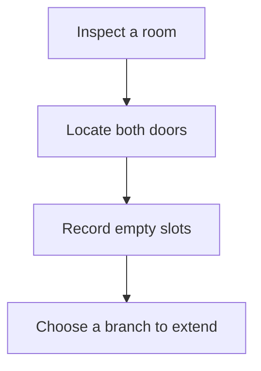

> [!tldr] Quick read
> - To rebuild a tree from two traversals, take the next root from preorder and look up its inorder position to split left from right.
> - To serialize a tree in preorder, write one token for each empty child slot. A single left child and a single right child can produce the same sequence of values.
> - To find the maximum path sum, a node can combine both branches in a candidate path and send one branch up to its parent.

> [!info] Context
> This is station 6 on the [[en/series/neetcode-link|NeetCode Linked Structures line]]. Back at [[en/posts/2026-11-25-neetcode-tree-recursion|station 3]], I used the results from both children to compute the diameter. Here I use the same subtree thinking to rebuild a tree from two lists, write it to a string, and compute a weighted path. All you need to know is that each binary-tree node has two child slots, left and right.

> [!abstract]- Quick glossary for this post (click to open)
> - [[en/concepts/pre-order-traversal|Preorder]] reads the root, then the entire left branch, then the entire right branch.
> - [[en/concepts/in-order-traversal|Inorder]] reads the entire left branch, then the root, then the entire right branch.
> - [[en/concepts/post-order-traversal|Postorder]] handles a root once both branches are done.
> - A token is one piece of a string, here an integer or a `#` between commas.
> - `[lo, hi)` is a range of indices starting at `lo` and stopping just before `hi`.

## Picture it first: a map of storage rooms

Imagine each room has a number on its sign, two doors marked Left and Right leading to its children, and a staircase up to its parent. Two clerks visit the same rooms but read each sign at different times. If all I have are their ledgers, I want to rebuild the layout, record it on paper, or find the route with the highest score.

| Everyday life | Concept |
|---|---|
| Ledger A records the room sign before its children, and ledger B records it between branches | [[en/concepts/tree-reconstruction\|Tree reconstruction]] from preorder and inorder |
| Mark the boundary at the room sign in ledger B | An [[en/concepts/inorder-interval\|inorder interval]] for each subtree |
| Draw a dash for a door with no room behind it | A [[en/concepts/null-marker\|null marker]] preserves left and right |
| Pack the ledger, including room numbers and dashes, into one line | [[en/concepts/tree-serialization\|Tree serialization]] for reading it back |
| A route can turn between two doors in a room, but a route that uses the staircase has room for only one door | The [[en/concepts/downward-path-gain\|downward path gain]] sent up to the parent |



## The problem: what has to travel with a subtree?

I used to think the order of visits was enough to reconstruct a tree. Try a root of 8 with a single child of 3. Put 3 on the left or the right and preorder is still `[8, 3]`. Two shapes can produce the same sequence. Along with the order, I need a way to decide which branch each node belongs to.

Information can get lost in the other direction too. If a subtree tells its parent “my best path sums to 9,” the parent has no way to tell whether that path touches the child root so it can extend it. The right information depends on what the caller needs to do with it.

## How it works

### Rebuild from two traversals

Take `preorder = [8, 3, 6, 11, -2]` and `inorder = [3, 6, 8, -2, 11]`. The call `visit(lo, hi)` owns exactly the inorder interval `[lo, hi)`. An empty interval returns `null` and leaves the read position where it is. For a nonempty interval, the next preorder value is its root. Distinct values give each root exactly one split point in the position index.

1. Take 8 from preorder and find it at index 2 in inorder. The two new intervals are `[0, 2)` and `[3, 5)`.
2. Go left first. Root 3 is at the start of its own interval, so its left child is empty and 6 belongs on its right.
3. Once the left branch is done, take 11 as the root of the right interval. The -2 precedes 11 there, so it is the left child of 11.

Assume that each child call stays within its own interval. The left call will consume exactly the number of nodes to the left of the root, so the preorder cursor is at the right root when the right call starts. The empty subtree closes the induction without consuming a token. Both intervals shrink whenever the algorithm creates a node, so it terminates. The position index uses O(n) space and gives O(n) expected time with hash lookups. The call stack adds O(h) for height h. Scanning for the split on every subtree can take O(n²) on a skewed tree.

<figure class="figure-map" style="--ar: 3 / 4">
<div class="frame"><iframe data-archify="../../diagrams/neetcode-tree-reconstruction/split-at-root.en.html" title="Building a tree by splitting at the root" loading="lazy"></iframe></div>
<figcaption><span><b>Figure 1.</b> The position of 8 splits inorder into two intervals, while preorder supplies the roots in the order they have to be built.</span><a href="../diagrams/neetcode-tree-reconstruction/split-at-root.en.html" target="_blank" rel="noopener">Open full screen</a></figcaption>
</figure>

### Record empty slots so the tree can be read back

I use the rule `Tree := # | integer Tree Tree`, with commas between tokens. A `#` fills an empty slot and ends that call. An integer creates a node, then the reader consumes the whole left subtree followed by the whole right subtree. For example, `8,3,#,#,#` puts 3 on the left, while `8,#,3,#,#` puts it on the right.

A tree with n real nodes has 2n child slots and n−1 edges to real children. That leaves n+1 empty slots. The empty tree also uses one `#` token for the empty root. The format therefore uses 2n+1 tokens and allows duplicate values. The encoder and reader pass through the tokens in linear time. Splitting the whole string and gathering tokens before joining both use space linear in the representation size. Count characters by calling the string length L and the running time O(L).

### Compute the maximum path sum

In the same tree, the branch from 3 down to 6 sums to 9. The branch from 11 can skip its child -2 and contribute 11. At node 8 I try `9 + 8 + 11 = 28`. If 8 is itself a child of another node, the value it can send up is `8 + max(9, 11) = 19`. A simple path entering 8 from its parent has room for just one direction out.

At each node, use `max(0, gain(child))` so a child branch that reduces the sum can be dropped. Each path has exactly one highest node by depth. Trying the best combination at each node therefore considers the best path for each possible highest node. Initialize the answer with the root's value so an all-negative tree still chooses a real node. The traversal takes O(n) time and O(h) stack space.

| Problem | What changes |
|---|---|
| [[en/problems/construct-binary-tree-from-preorder-and-inorder-traversal\|LC-0105 · Construct Binary Tree]] | Read the root in preorder and use its inorder position to split the two calls. |
| [[en/problems/binary-tree-maximum-path-sum\|LC-0124 · Binary Tree Maximum Path Sum]] | Traverse in postorder, return one branch, and try combining both branches in the answer. |
| [[en/problems/serialize-and-deserialize-binary-tree\|LC-0297 · Serialize and Deserialize Binary Tree]] | Use a null marker so each reader call knows when a subtree ends. |

## Runnable example

All five files reconstruct the tree above, check its exact encoding, and verify the sum of 28. The other cases tell left from right, preserve duplicates, read an empty tree, and avoid returning 0 for an all-negative tree.

Download [TypeScript](../code/neetcode-tree-reconstruction/tree-station.ts), [Python](../code/neetcode-tree-reconstruction/tree_station.py), [Go](../code/neetcode-tree-reconstruction/tree_station.go), [Java](../code/neetcode-tree-reconstruction/tree-station.java), or [JavaScript](../code/neetcode-tree-reconstruction/tree-station.js). Run with `node tree-station.ts`, `python3 tree_station.py`, `go run tree_station.go`, `java tree-station.java`, or `node tree-station.js`.

```ts
type Tree = { value: number; left: Tree; right: Tree } | null

function rebuild(preorder: number[], inorder: number[]): Tree {
  const position = new Map(inorder.map((value, index) => [value, index]))
  let next = 0
  function visit(lo: number, hi: number): Tree {
    if (lo === hi) return null
    const value = preorder[next++]
    const split = position.get(value)!
    return { value, left: visit(lo, split), right: visit(split + 1, hi) }
  }
  return visit(0, inorder.length)
}

function maxPath(root: NonNullable<Tree>): number {
  let best = root.value
  function gain(node: Tree): number {
    if (!node) return 0
    const left = Math.max(0, gain(node.left))
    const right = Math.max(0, gain(node.right))
    best = Math.max(best, node.value + left + right)
    return node.value + Math.max(left, right)
  }
  gain(root)
  return best
}

function encode(root: Tree): string {
  const tokens: string[] = []
  function visit(node: Tree) {
    if (!node) {
      tokens.push("#")
      return
    }
    tokens.push(String(node.value))
    visit(node.left)
    visit(node.right)
  }
  visit(root)
  return tokens.join(",")
}

function decode(data: string): Tree {
  const tokens = data.split(",")
  let next = 0
  function visit(): Tree {
    const token = tokens[next++]
    return token === "#" ? null : { value: Number(token), left: visit(), right: visit() }
  }
  return visit()
}

const wire = "8,3,#,6,#,#,11,-2,#,#,#"
const rebuilt = rebuild([8, 3, 6, 11, -2], [3, 6, 8, -2, 11])
const cases = [
  encode(rebuilt) === wire,
  encode(rebuild([8, 3], [3, 8])) === "8,3,#,#,#",
  encode(rebuild([8, 3], [8, 3])) === "8,#,3,#,#",
  maxPath(rebuilt!) === 28,
  maxPath(decode("-8,-3,#,#,-5,#,#")!) === -3,
  encode(decode(wire)) === wire,
  encode(decode("4,#,4,#,#")) === "4,#,4,#,#",
  decode("#") === null,
]
if (!cases.every(Boolean)) throw new Error("Có ca sai")
console.log(`${cases.length}/${cases.length} ca đúng`)
```
```python
from dataclasses import dataclass


@dataclass
class Tree:
    value: int
    left: "Tree | None" = None
    right: "Tree | None" = None


def rebuild(preorder, inorder):
    position = {value: index for index, value in enumerate(inorder)}
    values = iter(preorder)

    def visit(lo, hi):
        if lo == hi:
            return None
        value = next(values)
        split = position[value]
        return Tree(value, visit(lo, split), visit(split + 1, hi))

    return visit(0, len(inorder))


def max_path(root):
    best = root.value

    def gain(node):
        nonlocal best
        if node is None:
            return 0
        left = max(0, gain(node.left))
        right = max(0, gain(node.right))
        best = max(best, node.value + left + right)
        return node.value + max(left, right)

    gain(root)
    return best


def encode(root):
    tokens = []

    def visit(node):
        if node is None:
            tokens.append("#")
            return
        tokens.append(str(node.value))
        visit(node.left)
        visit(node.right)

    visit(root)
    return ",".join(tokens)


def decode(data):
    tokens = iter(data.split(","))

    def visit():
        token = next(tokens)
        return None if token == "#" else Tree(int(token), visit(), visit())

    return visit()


wire = "8,3,#,6,#,#,11,-2,#,#,#"
rebuilt = rebuild([8, 3, 6, 11, -2], [3, 6, 8, -2, 11])
cases = [
    encode(rebuilt) == wire,
    encode(rebuild([8, 3], [3, 8])) == "8,3,#,#,#",
    encode(rebuild([8, 3], [8, 3])) == "8,#,3,#,#",
    max_path(rebuilt) == 28,
    max_path(decode("-8,-3,#,#,-5,#,#")) == -3,
    encode(decode(wire)) == wire,
    encode(decode("4,#,4,#,#")) == "4,#,4,#,#",
    decode("#") is None,
]
if not all(cases):
    raise AssertionError("Có ca sai")
print(f"{len(cases)}/{len(cases)} ca đúng")
```
```go
package main

import (
	"fmt"
	"strconv"
	"strings"
)

type Tree struct {
	value       int
	left, right *Tree
}

func rebuild(preorder, inorder []int) *Tree {
	position := make(map[int]int, len(inorder))
	for index, value := range inorder {
		position[value] = index
	}
	next := 0
	var visit func(int, int) *Tree
	visit = func(lo, hi int) *Tree {
		if lo == hi {
			return nil
		}
		value := preorder[next]
		next++
		split := position[value]
		return &Tree{value, visit(lo, split), visit(split+1, hi)}
	}
	return visit(0, len(inorder))
}

func maxPath(root *Tree) int {
	best := root.value
	var gain func(*Tree) int
	gain = func(node *Tree) int {
		if node == nil {
			return 0
		}
		left := max(0, gain(node.left))
		right := max(0, gain(node.right))
		best = max(best, node.value+left+right)
		return node.value + max(left, right)
	}
	gain(root)
	return best
}

func encode(root *Tree) string {
	var tokens []string
	var visit func(*Tree)
	visit = func(node *Tree) {
		if node == nil {
			tokens = append(tokens, "#")
			return
		}
		tokens = append(tokens, strconv.Itoa(node.value))
		visit(node.left)
		visit(node.right)
	}
	visit(root)
	return strings.Join(tokens, ",")
}

func decode(data string) *Tree {
	tokens := strings.Split(data, ",")
	next := 0
	var visit func() *Tree
	visit = func() *Tree {
		token := tokens[next]
		next++
		if token == "#" {
			return nil
		}
		value, err := strconv.Atoi(token)
		if err != nil {
			panic(err)
		}
		return &Tree{value, visit(), visit()}
	}
	return visit()
}

func main() {
	wire := "8,3,#,6,#,#,11,-2,#,#,#"
	rebuilt := rebuild([]int{8, 3, 6, 11, -2}, []int{3, 6, 8, -2, 11})
	cases := []bool{
		encode(rebuilt) == wire,
		encode(rebuild([]int{8, 3}, []int{3, 8})) == "8,3,#,#,#",
		encode(rebuild([]int{8, 3}, []int{8, 3})) == "8,#,3,#,#",
		maxPath(rebuilt) == 28,
		maxPath(decode("-8,-3,#,#,-5,#,#")) == -3,
		encode(decode(wire)) == wire,
		encode(decode("4,#,4,#,#")) == "4,#,4,#,#",
		decode("#") == nil,
	}
	for _, pass := range cases {
		if !pass {
			panic("Có ca sai")
		}
	}
	fmt.Printf("%d/%d ca đúng\n", len(cases), len(cases))
}
```
```java
import java.util.ArrayList;
import java.util.HashMap;
import java.util.List;
import java.util.Map;

class TreeStation {
    record Tree(int value, Tree left, Tree right) {}

    static Tree rebuild(int[] preorder, int[] inorder) {
        Map<Integer, Integer> position = new HashMap<>();
        for (int index = 0; index < inorder.length; index++) {
            position.put(inorder[index], index);
        }
        class Builder {
            int next;

            Tree visit(int lo, int hi) {
                if (lo == hi) return null;
                int value = preorder[next++];
                int split = position.get(value);
                return new Tree(value, visit(lo, split), visit(split + 1, hi));
            }
        }
        return new Builder().visit(0, inorder.length);
    }

    static int maxPath(Tree root) {
        class Path {
            int best = root.value();

            int gain(Tree node) {
                if (node == null) return 0;
                int left = Math.max(0, gain(node.left()));
                int right = Math.max(0, gain(node.right()));
                best = Math.max(best, node.value() + left + right);
                return node.value() + Math.max(left, right);
            }
        }
        Path path = new Path();
        path.gain(root);
        return path.best;
    }

    static String encode(Tree root) {
        List<String> tokens = new ArrayList<>();
        class Encoder {
            void visit(Tree node) {
                if (node == null) {
                    tokens.add("#");
                    return;
                }
                tokens.add(Integer.toString(node.value()));
                visit(node.left());
                visit(node.right());
            }
        }
        new Encoder().visit(root);
        return String.join(",", tokens);
    }

    static Tree decode(String data) {
        String[] tokens = data.split(",");
        class Decoder {
            int next;

            Tree visit() {
                String token = tokens[next++];
                if (token.equals("#")) return null;
                return new Tree(Integer.parseInt(token), visit(), visit());
            }
        }
        return new Decoder().visit();
    }

    public static void main(String[] args) {
        String wire = "8,3,#,6,#,#,11,-2,#,#,#";
        Tree rebuilt = rebuild(new int[]{8, 3, 6, 11, -2}, new int[]{3, 6, 8, -2, 11});
        boolean[] cases = {
            encode(rebuilt).equals(wire),
            encode(rebuild(new int[]{8, 3}, new int[]{3, 8})).equals("8,3,#,#,#"),
            encode(rebuild(new int[]{8, 3}, new int[]{8, 3})).equals("8,#,3,#,#"),
            maxPath(rebuilt) == 28,
            maxPath(decode("-8,-3,#,#,-5,#,#")) == -3,
            encode(decode(wire)).equals(wire),
            encode(decode("4,#,4,#,#")).equals("4,#,4,#,#"),
            decode("#") == null,
        };
        for (boolean pass : cases) {
            if (!pass) throw new AssertionError("Có ca sai");
        }
        System.out.printf("%d/%d ca đúng%n", cases.length, cases.length);
    }
}
```
```js
function rebuild(preorder, inorder) {
  const position = new Map(inorder.map((value, index) => [value, index]))
  let next = 0
  function visit(lo, hi) {
    if (lo === hi) return null
    const value = preorder[next++]
    const split = position.get(value)
    return { value, left: visit(lo, split), right: visit(split + 1, hi) }
  }
  return visit(0, inorder.length)
}

function maxPath(root) {
  let best = root.value
  function gain(node) {
    if (!node) return 0
    const left = Math.max(0, gain(node.left))
    const right = Math.max(0, gain(node.right))
    best = Math.max(best, node.value + left + right)
    return node.value + Math.max(left, right)
  }
  gain(root)
  return best
}

function encode(root) {
  const tokens = []
  function visit(node) {
    if (!node) {
      tokens.push("#")
      return
    }
    tokens.push(String(node.value))
    visit(node.left)
    visit(node.right)
  }
  visit(root)
  return tokens.join(",")
}

function decode(data) {
  const tokens = data.split(",")
  let next = 0
  function visit() {
    const token = tokens[next++]
    return token === "#" ? null : { value: Number(token), left: visit(), right: visit() }
  }
  return visit()
}

const wire = "8,3,#,6,#,#,11,-2,#,#,#"
const rebuilt = rebuild([8, 3, 6, 11, -2], [3, 6, 8, -2, 11])
const cases = [
  encode(rebuilt) === wire,
  encode(rebuild([8, 3], [3, 8])) === "8,3,#,#,#",
  encode(rebuild([8, 3], [8, 3])) === "8,#,3,#,#",
  maxPath(rebuilt) === 28,
  maxPath(decode("-8,-3,#,#,-5,#,#")) === -3,
  encode(decode(wire)) === wire,
  encode(decode("4,#,4,#,#")) === "4,#,4,#,#",
  decode("#") === null,
]
if (!cases.every(Boolean)) throw new Error("Có ca sai")
console.log(`${cases.length}/${cases.length} ca đúng`)
```

```text
8/8 cases passed
```

*(Output labels translated; the files themselves print Vietnamese.)*

## Misconceptions and common traps

- **Any two traversals are enough.** For a root of 8 with one child 3 on either side, preorder is still `[8, 3]` and postorder is still `[3, 8]`. Inorder changes because it visits the root between the two branches.
- **The index works with duplicate values.** Two nodes with value 4 can occupy two indices, but an index keyed by value keeps only one position. The reconstruction problem guarantees distinct values. The `#` format still decodes a tree with duplicates because token structure determines position.
- **Return 0 as the answer when a branch is negative.** Zero allows a child branch to be skipped. A valid path still has to include the node under consideration, even when it is negative.
- **If it runs on a small tree, it will run on a chain.** The recursive examples assume valid traversals or a string produced by the matching encoder. For a skewed tree, h can be n. Use an explicit stack when you need predictable memory and want to avoid runtime call-depth limits, as in the iterative examples on the problem pages. A reader taking external data needs to validate bad, missing, and extra tokens.

## Self-check questions

> [!question]- With preorder `[4, 2]` and inorder `[4, 2]`, where does 2 go?
> On the right. In inorder, 2 follows the root 4.

> [!question]- Can I remove the last two `#` markers from `4,#,9,#,#`?
> Under this format, no. Node 9 needs two child slots. The reader would run out of data before finishing the tree.

> [!question]- A node of value 5 has branches contributing 4 and 7. What does it record and return?
> The path through the node sums to 16. The function returns 12 so its parent can extend the branch from 5 through 7.

## References

- [MIT 6.046 · Problem Set 4 Solutions](https://courses.csail.mit.edu/6.046/fall03/handouts/pset4-sol.pdf) explains the inorder split and gives a preorder–postorder counterexample.
- [OpenDSA · Binary Tree Traversals](https://opendsa.cs.vt.edu/ODSA/Books/Catalog/html/BinaryTreeTraversal.html) defines the three traversal orders.
- [LeetCode 105](https://leetcode.com/problems/construct-binary-tree-from-preorder-and-inorder-traversal/), [124](https://leetcode.com/problems/binary-tree-maximum-path-sum/), and [297](https://leetcode.com/problems/serialize-and-deserialize-binary-tree/) are the original statements and provide each problem's conditions.
- [Python · sys.getrecursionlimit](https://docs.python.org/3/library/sys.html#sys.getrecursionlimit) describes the interpreter stack limit.
