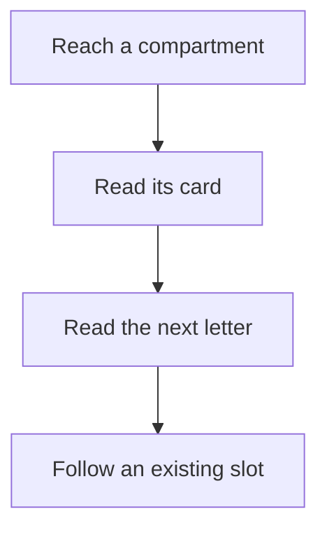

> [!tldr] Quick read
> - A trie stores each prefix once. Reaching the node for `car` answers the prefix question. To match a word, the last node also needs a terminal marker.
> - Each `.` consumes exactly one letter. Try the edges that actually exist at the current node.
> - When searching a letter board, carry the trie node along with the path. Stop at a missing edge, record complete words, and keep searching for longer ones.
> - A small alphabet suits a child array. When most nodes have few children, a map stores only the edges in use.

> [!info] Context
> This is station 7, the final station on the [[en/series/neetcode-link|NeetCode Linked Structures line]]. At [[en/posts/2026-11-26-neetcode-tree-reconstruction|station 6]], left and right determined the shape of a tree. Here every edge carries a letter, so the path from the root tells me which prefix I have read. I use that same structure for a word dictionary and a small letter board.

> [!abstract]- Quick glossary for this post (click to open)
> - A prefix starts at the first character. `car` is a prefix of both `cart` and itself.
> - Depth-first search (DFS) explores a branch before trying the next one.
> - [[en/concepts/backtracking|Backtracking]] marks a choice for the current path and undoes it on return.
> - The wildcard `.` in problem 211 matches exactly one letter.

## Picture it first: an alphabetical card cabinet

Imagine a filing cabinet with a compartment for each letter. After opening compartment `c` and then compartment `a`, I have chosen prefix `ca`. A compartment can hold a registered word's card and still lead to deeper compartments.

| Everyday life | Concept |
|---|---|
| Cards with the same beginning use the same starting compartments | A [[en/concepts/trie|trie]] shares prefix paths |
| A registration card sits inside a compartment | A [[en/concepts/terminal-marker|terminal marker]] distinguishes word and prefix queries |
| For a smudged letter, try each available subcompartment | [[en/concepts/wildcard-branching|Wildcard branching]] |
| If the next compartment is missing, abandon that route | [[en/concepts/trie-prefix-pruning|Prefix pruning]] |
| Build 26 compartments up front or fit only the ones used | [[en/concepts/sparse-trie-children|Sparse child storage]] and fixed child arrays |



## The problem: what does a path tell me?

I have inserted `cart` and `cat`. To ask whether `car` is a prefix, I can follow `c`, `a`, and `r` and answer yes. If I ask whether `car` has been inserted as a word, the answer is no. A node represents what I have read so far. It confirms a word when that node is marked.

If I store every word in a [[en/concepts/hash-map|hash map]], I can check a full word quickly after hashing the string. To ask for an arbitrary prefix in the same map, the direct approach tries words until one matches. A trie trades the cost of building and storing a tree for character-by-character prefix processing. On the board, that allows words with the same beginning to share work.

## How it works

### Use two ending conditions

The root represents the empty string. Each edge adds one letter to the prefix. To insert a word, walk from the root and create nodes at missing edges. Mark the end when the string runs out. In the runnable example below, `word` holds the original word at a marked node. The prefix query just has to reach the last node. The word query also checks `word`. When I insert `car` after `cart`, I update the node for `car` and keep the edge to `cart`.

Each step follows one edge, so inserting or looking up a string of length L takes L edge steps when the entire string is read. An array of 26 entries takes one indexed access per step and reserves 26 child slots per node. A map stores the edges in use and looks them up by character. With lowercase English letters and expected constant-time map lookups, both take O(L) time. If the dictionary contains P distinct prefixes including the root, it has P nodes and P−1 edges. Count the overhead of each map and node object when deciding which representation uses less memory.

<figure class="figure-map" style="--ar: 3 / 4">
<div class="frame"><iframe data-archify="../../diagrams/neetcode-trie/prefix-and-word.en.html" title="A path for car, a word at cart" loading="lazy"></iframe></div>
<figcaption><span><b>Figure 1.</b> The path to car answers the prefix query. The terminal markers at cart and cat identify the two stored words.</span><a href="../diagrams/neetcode-trie/prefix-and-word.en.html" target="_blank" rel="noopener">Open full screen</a></figcaption>
</figure>

### Track the pattern position when a character creates branches

To match `ca.`, the first two letters route me to `ca`. The dot picks one existing child and advances by one pattern position. The branch through `r` stops at `car`: before `car` is inserted as a word, its marker is unset. The `t` branch reaches `cat` and succeeds. The pattern `c..t` matches `cart` because it finishes at depth four. A search can stop as soon as a branch consumes the whole pattern and reaches a word.

For a pattern of length L with d dots, each depth has at most 26^d states in this alphabet. That gives the loose upper bound O(L·26^d). Missing edges and early success often make the number of visited nodes smaller. The stack depth is O(L). Problem 211 limits d to two, so the all-dot branching case across a long pattern falls outside its input constraints.

### Search the board with the current trie node

The example board has two rows, `c a t` and `d r e`. When I start at `c` and move right to `a`, the trie node holds exactly the state for `ca`. Moving right reaches `t` and records `cat`. Moving down reaches `r`, which records `car` if it is in the dictionary, then continues to `e` to find `care`. Moving from `r` to `t` would be diagonal, so `cart` is absent from this board. The word `cata` would need to reuse `a` on the same path and is ruled out.

At each cell, check the bounds, the visited marker, and the character edge from the current trie node. When the edge is missing, every extension of the path would share that missing prefix, so the search stops there. When the edge exists, record any completed word, mark the cell, try the four neighbors, and restore the cell. The result set keeps each word once, even when several paths find it.

Building the trie processes O(S) characters, where S is the total word length. For an R × C board, let H be the smaller of the cell count and the maximum word length. Excluding result collection and sorting, one upper bound on search steps is O(RC·3^H). The first move can go in four directions, and after that the previous cell is marked, leaving at most three. Prefix pruning reduces the actual number of steps based on the input. A path has depth at most O(H), and the example restores the board to avoid storing a separate visited grid.

| Problem | What changes |
|---|---|
| [[en/problems/implement-trie-prefix-tree|LC-0208 · Implement Trie]] | Follow a string and choose between a terminal check and a path check. |
| [[en/problems/design-add-and-search-words-data-structure|LC-0211 · Design Add and Search Words]] | At a dot, try the existing children and carry the pattern position. |
| [[en/problems/word-search-ii|LC-0212 · Word Search II]] | Search board paths, carry a trie node, and restore cells during backtracking. |

## Runnable example

All five versions check the same 13 cases. These cover an existing prefix that has not been stored as a word, adding a short word after a longer one, wildcard patterns, diagonal moves, and attempted cell reuse. The board example uses lowercase ASCII letters, stores words at terminal nodes, and sorts the results to make the tests easy to compare.

Download [TypeScript](../code/neetcode-trie/trie-station.ts), [Python](../code/neetcode-trie/trie_station.py), [Go](../code/neetcode-trie/trie_station.go), [Java](../code/neetcode-trie/trie-station.java), or [JavaScript](../code/neetcode-trie/trie-station.js). Run with `node trie-station.ts`, `python3 trie_station.py`, `go run trie_station.go`, `java trie-station.java`, or `node trie-station.js`.

```ts
type TrieNode = { children: Map<string, TrieNode>; word: string | null }
const makeNode = (): TrieNode => ({ children: new Map(), word: null })

function insert(root: TrieNode, word: string) {
  let node = root
  for (const letter of word) {
    let child = node.children.get(letter)
    if (!child) {
      child = makeNode()
      node.children.set(letter, child)
    }
    node = child
  }
  node.word = word
}

function walk(root: TrieNode, text: string): TrieNode | undefined {
  let node = root
  for (const letter of text) {
    const child = node.children.get(letter)
    if (!child) return undefined
    node = child
  }
  return node
}

function matches(node: TrieNode, pattern: string, i = 0): boolean {
  if (i === pattern.length) return node.word !== null
  if (pattern[i] === ".") {
    for (const child of node.children.values()) {
      if (matches(child, pattern, i + 1)) return true
    }
    return false
  }
  const child = node.children.get(pattern[i])
  return child !== undefined && matches(child, pattern, i + 1)
}

function findWords(board: string[][], words: string[]): string[] {
  const root = makeNode()
  for (const word of words) insert(root, word)
  const found = new Set<string>()
  function visit(row: number, col: number, parent: TrieNode) {
    const letter = board[row]?.[col]
    if (letter === undefined || letter === "#") return
    const node = parent.children.get(letter)
    if (!node) return
    if (node.word !== null) found.add(node.word)
    board[row][col] = "#"
    visit(row - 1, col, node)
    visit(row + 1, col, node)
    visit(row, col - 1, node)
    visit(row, col + 1, node)
    board[row][col] = letter
  }
  board.forEach((row, r) => row.forEach((_, c) => visit(r, c, root)))
  return [...found].sort()
}

const root = makeNode()
for (const word of ["cart", "cat", "dog"]) insert(root, word)
const board = [["c", "a", "t"], ["d", "r", "e"]]
const cases = [
  walk(root, "car") !== undefined,
  walk(root, "car")?.word === null,
  walk(root, "cart")?.word === "cart",
  walk(root, "cab") === undefined,
  matches(root, "ca."),
  matches(root, "c..t"),
  matches(root, ".og"),
  !matches(root, "c.t."),
  !matches(root, "do"),
  findWords(board, ["car", "care", "cat", "cart", "cata"]).join(",") === "car,care,cat",
  board.map(row => row.join("")).join(",") === "cat,dre",
  findWords([["a", "a"]], ["a", "aa", "aaa"]).join(",") === "a,aa",
]
insert(root, "car")
cases.push(walk(root, "car")?.word === "car" && walk(root, "cart")?.word === "cart")
if (!cases.every(Boolean)) throw new Error("Có ca sai")
console.log(`${cases.length}/${cases.length} ca đúng`)
```
```python
class TrieNode:
    def __init__(self):
        self.children = {}
        self.word = None


def insert(root, word):
    node = root
    for letter in word:
        if letter not in node.children:
            node.children[letter] = TrieNode()
        node = node.children[letter]
    node.word = word


def walk(root, text):
    node = root
    for letter in text:
        node = node.children.get(letter)
        if node is None:
            break
    return node


def matches(node, pattern, i=0):
    if i == len(pattern):
        return node.word is not None
    if pattern[i] == ".":
        return any(matches(child, pattern, i + 1) for child in node.children.values())
    child = node.children.get(pattern[i])
    return child is not None and matches(child, pattern, i + 1)


def find_words(board, words):
    root = TrieNode()
    for word in words:
        insert(root, word)
    found = set()

    def visit(row, col, parent):
        if not (0 <= row < len(board) and 0 <= col < len(board[row])):
            return
        letter = board[row][col]
        if letter == "#":
            return
        node = parent.children.get(letter)
        if node is None:
            return
        if node.word is not None:
            found.add(node.word)
        board[row][col] = "#"
        visit(row - 1, col, node)
        visit(row + 1, col, node)
        visit(row, col - 1, node)
        visit(row, col + 1, node)
        board[row][col] = letter

    for r, row in enumerate(board):
        for c in range(len(row)):
            visit(r, c, root)
    return sorted(found)


root = TrieNode()
for word in ("cart", "cat", "dog"):
    insert(root, word)
board = [list("cat"), list("dre")]
cases = [
    walk(root, "car") is not None,
    walk(root, "car").word is None,
    walk(root, "cart").word == "cart",
    walk(root, "cab") is None,
    matches(root, "ca."),
    matches(root, "c..t"),
    matches(root, ".og"),
    not matches(root, "c.t."),
    not matches(root, "do"),
    find_words(board, ["car", "care", "cat", "cart", "cata"]) == ["car", "care", "cat"],
    board == [list("cat"), list("dre")],
    find_words([list("aa")], ["a", "aa", "aaa"]) == ["a", "aa"],
]
insert(root, "car")
cases.append(walk(root, "car").word == "car" and walk(root, "cart").word == "cart")
if not all(cases):
    raise AssertionError("Có ca sai")
print(f"{len(cases)}/{len(cases)} ca đúng")
```
```go
package main

import (
	"fmt"
	"sort"
	"strings"
)

type trieNode struct {
	children map[byte]*trieNode
	word     string
}

func makeNode() *trieNode {
	return &trieNode{children: make(map[byte]*trieNode)}
}

func insert(node *trieNode, word string) {
	for i := range len(word) {
		letter := word[i]
		if node.children[letter] == nil {
			node.children[letter] = makeNode()
		}
		node = node.children[letter]
	}
	node.word = word
}

func walk(node *trieNode, text string) *trieNode {
	for i := range len(text) {
		node = node.children[text[i]]
		if node == nil {
			return nil
		}
	}
	return node
}

func matches(node *trieNode, pattern string, i int) bool {
	if i == len(pattern) {
		return node.word != ""
	}
	if pattern[i] == '.' {
		for _, child := range node.children {
			if matches(child, pattern, i+1) {
				return true
			}
		}
		return false
	}
	child := node.children[pattern[i]]
	return child != nil && matches(child, pattern, i+1)
}

func findWords(board [][]byte, words []string) []string {
	root := makeNode()
	for _, word := range words {
		insert(root, word)
	}
	found := make(map[string]bool)
	var visit func(int, int, *trieNode)
	visit = func(row, col int, parent *trieNode) {
		if row < 0 || row >= len(board) || col < 0 || col >= len(board[row]) {
			return
		}
		letter := board[row][col]
		node := parent.children[letter]
		if letter == '#' || node == nil {
			return
		}
		if node.word != "" {
			found[node.word] = true
		}
		board[row][col] = '#'
		visit(row-1, col, node)
		visit(row+1, col, node)
		visit(row, col-1, node)
		visit(row, col+1, node)
		board[row][col] = letter
	}
	for r, row := range board {
		for c := range row {
			visit(r, c, root)
		}
	}
	result := make([]string, 0, len(found))
	for word := range found {
		result = append(result, word)
	}
	sort.Strings(result)
	return result
}

func main() {
	root := makeNode()
	for _, word := range []string{"cart", "cat", "dog"} {
		insert(root, word)
	}
	board := [][]byte{[]byte("cat"), []byte("dre")}
	cases := []bool{
		walk(root, "car") != nil,
		walk(root, "car").word == "",
		walk(root, "cart").word == "cart",
		walk(root, "cab") == nil,
		matches(root, "ca.", 0),
		matches(root, "c..t", 0),
		matches(root, ".og", 0),
		!matches(root, "c.t.", 0),
		!matches(root, "do", 0),
		strings.Join(findWords(board, []string{"car", "care", "cat", "cart", "cata"}), ",") == "car,care,cat",
		string(board[0]) == "cat" && string(board[1]) == "dre",
		strings.Join(findWords([][]byte{[]byte("aa")}, []string{"a", "aa", "aaa"}), ",") == "a,aa",
	}
	insert(root, "car")
	cases = append(cases, walk(root, "car").word == "car" && walk(root, "cart").word == "cart")
	for _, pass := range cases {
		if !pass {
			panic("Có ca sai")
		}
	}
	fmt.Printf("%d/%d ca đúng\n", len(cases), len(cases))
}
```
```java
import java.util.Arrays;
import java.util.HashMap;
import java.util.HashSet;
import java.util.List;
import java.util.Map;
import java.util.Set;

class TrieStation {
    static class TrieNode {
        final Map<Character, TrieNode> children = new HashMap<>();
        String word;
    }

    static void insert(TrieNode node, String word) {
        for (int i = 0; i < word.length(); i++) {
            node = node.children.computeIfAbsent(word.charAt(i), ignored -> new TrieNode());
        }
        node.word = word;
    }

    static TrieNode walk(TrieNode node, String text) {
        for (int i = 0; i < text.length(); i++) {
            node = node.children.get(text.charAt(i));
            if (node == null) return null;
        }
        return node;
    }

    static boolean matches(TrieNode node, String pattern, int i) {
        if (i == pattern.length()) return node.word != null;
        if (pattern.charAt(i) == '.') {
            for (TrieNode child : node.children.values()) {
                if (matches(child, pattern, i + 1)) return true;
            }
            return false;
        }
        TrieNode child = node.children.get(pattern.charAt(i));
        return child != null && matches(child, pattern, i + 1);
    }

    static void visit(char[][] board, int row, int col, TrieNode parent, Set<String> found) {
        if (row < 0 || row >= board.length || col < 0 || col >= board[row].length) return;
        char letter = board[row][col];
        TrieNode node = parent.children.get(letter);
        if (letter == '#' || node == null) return;
        if (node.word != null) found.add(node.word);
        board[row][col] = '#';
        visit(board, row - 1, col, node, found);
        visit(board, row + 1, col, node, found);
        visit(board, row, col - 1, node, found);
        visit(board, row, col + 1, node, found);
        board[row][col] = letter;
    }

    static List<String> findWords(char[][] board, String... words) {
        TrieNode root = new TrieNode();
        for (String word : words) insert(root, word);
        Set<String> found = new HashSet<>();
        for (int row = 0; row < board.length; row++) {
            for (int col = 0; col < board[row].length; col++) {
                visit(board, row, col, root, found);
            }
        }
        return found.stream().sorted().toList();
    }

    public static void main(String[] args) {
        TrieNode root = new TrieNode();
        for (String word : List.of("cart", "cat", "dog")) insert(root, word);
        char[][] board = {"cat".toCharArray(), "dre".toCharArray()};
        boolean[] cases = {
            walk(root, "car") != null,
            walk(root, "car").word == null,
            "cart".equals(walk(root, "cart").word),
            walk(root, "cab") == null,
            matches(root, "ca.", 0),
            matches(root, "c..t", 0),
            matches(root, ".og", 0),
            !matches(root, "c.t.", 0),
            !matches(root, "do", 0),
            findWords(board, "car", "care", "cat", "cart", "cata").equals(List.of("car", "care", "cat")),
            Arrays.deepEquals(board, new char[][]{"cat".toCharArray(), "dre".toCharArray()}),
            findWords(new char[][]{"aa".toCharArray()}, "a", "aa", "aaa").equals(List.of("a", "aa")),
        };
        insert(root, "car");
        if (!"car".equals(walk(root, "car").word) || !"cart".equals(walk(root, "cart").word)) {
            throw new AssertionError("Có ca sai");
        }
        for (boolean pass : cases) {
            if (!pass) throw new AssertionError("Có ca sai");
        }
        System.out.printf("%d/%d ca đúng%n", cases.length + 1, cases.length + 1);
    }
}
```
```js
const makeNode = () => ({ children: new Map(), word: null })

function insert(root, word) {
  let node = root
  for (const letter of word) {
    let child = node.children.get(letter)
    if (!child) {
      child = makeNode()
      node.children.set(letter, child)
    }
    node = child
  }
  node.word = word
}

function walk(root, text) {
  let node = root
  for (const letter of text) {
    const child = node.children.get(letter)
    if (!child) return undefined
    node = child
  }
  return node
}

function matches(node, pattern, i = 0) {
  if (i === pattern.length) return node.word !== null
  if (pattern[i] === ".") {
    for (const child of node.children.values()) {
      if (matches(child, pattern, i + 1)) return true
    }
    return false
  }
  const child = node.children.get(pattern[i])
  return child !== undefined && matches(child, pattern, i + 1)
}

function findWords(board, words) {
  const root = makeNode()
  for (const word of words) insert(root, word)
  const found = new Set()
  function visit(row, col, parent) {
    const letter = board[row]?.[col]
    if (letter === undefined || letter === "#") return
    const node = parent.children.get(letter)
    if (!node) return
    if (node.word !== null) found.add(node.word)
    board[row][col] = "#"
    visit(row - 1, col, node)
    visit(row + 1, col, node)
    visit(row, col - 1, node)
    visit(row, col + 1, node)
    board[row][col] = letter
  }
  board.forEach((row, r) => row.forEach((_, c) => visit(r, c, root)))
  return [...found].sort()
}

const root = makeNode()
for (const word of ["cart", "cat", "dog"]) insert(root, word)
const board = [["c", "a", "t"], ["d", "r", "e"]]
const cases = [
  walk(root, "car") !== undefined,
  walk(root, "car")?.word === null,
  walk(root, "cart")?.word === "cart",
  walk(root, "cab") === undefined,
  matches(root, "ca."),
  matches(root, "c..t"),
  matches(root, ".og"),
  !matches(root, "c.t."),
  !matches(root, "do"),
  findWords(board, ["car", "care", "cat", "cart", "cata"]).join(",") === "car,care,cat",
  board.map(row => row.join("")).join(",") === "cat,dre",
  findWords([["a", "a"]], ["a", "aa", "aaa"]).join(",") === "a,aa",
]
insert(root, "car")
cases.push(walk(root, "car")?.word === "car" && walk(root, "cart")?.word === "cart")
if (!cases.every(Boolean)) throw new Error("Có ca sai")
console.log(`${cases.length}/${cases.length} ca đúng`)
```

```text
13/13 cases passed
```

*(Output labels translated; the files themselves print Vietnamese.)*

## Misconceptions and common traps

- **A word can end only at a leaf.** Both `car` and `cart` can be words. Mark both nodes and keep the edge from the parent.
- **A dot can skip a letter or match several.** Each dot consumes exactly one edge. When the pattern ends, the node still needs a terminal marker.
- **Finding a word ends the branch.** A board path that finds `car` may be able to continue to `care`.
- **A cell is available only once in the whole search.** The restriction applies to one path. Restore a cell when backtracking so other paths can use it.
- **A 26-slot array handles any alphabet.** The examples assume the lowercase English alphabet from the problems. For a Unicode dictionary, choose a character unit and normalization policy before building the tree.

## Self-check questions

> [!question]- After inserting only `cart` and `cat`, what do the two queries for `car` return?
> The prefix query returns true and the full-word query returns false. Both return true after inserting `car`.

> [!question]- Does the pattern `c...` match `cat`?
> No. The pattern consumes four characters and `cat` has three.

> [!question]- Why stop at `cad` if the trie has no `d` edge after `ca`?
> Any word beginning with `cad` would need that edge. Extending the board path cannot create a missing prefix in the trie.

> [!question]- When each node uses a small fraction of the alphabet, what should I measure before choosing an array or a map?
> Measure the number of edges actually used and the runtime's representation size. An array reserves space for the whole alphabet, while a map has separate overhead for each node and entry.

## References

- [Princeton Algorithms · TrieST](https://github.com/kevin-wayne/algs4/blob/master/src/main/java/edu/princeton/cs/algs4/TrieST.java) illustrates multiway tries, terminal markers, and pattern queries.
- [Princeton · Boggle FAQ](https://coursera.cs.princeton.edu/algs4/assignments/boggle/faq.php) explains prefix pruning on a board. Boggle uses different adjacency rules from problem 212.
- [LeetCode 208](https://leetcode.com/problems/implement-trie-prefix-tree/), [211](https://leetcode.com/problems/design-add-and-search-words-data-structure/), and [212](https://leetcode.com/problems/word-search-ii/) are the original problems.
