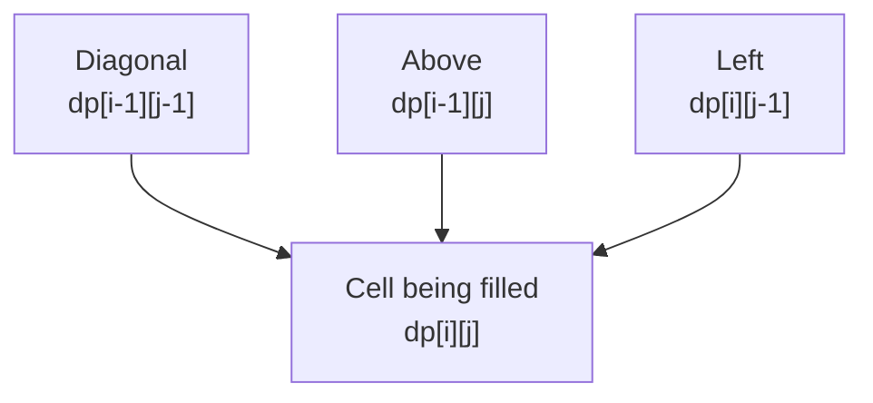

> [!tldr] Quick read
> - All five problems use one table `dp[i][j]`. A cell is a corner of the grid, or the answer for the prefix pair `a[:i]` and `b[:j]`.
> - Each cell reads at most three filled cells: the one above, the one to the left and the diagonal one above-left. Filling row by row from the top, left to right within a row, is enough.
> - Row 0 and column 0 stand for an empty prefix. Get those values wrong and the whole table is wrong with them.
> - The five problems differ in how they combine (sum, max, OR, min) and in what a matching pair of characters lets you do on the diagonal.
> - If you only need a length or a count, one row is enough. To print the solution itself, keep the whole table so you can trace back.

> [!info] Context
> This is the fifth station on [[en/series/neetcode-dp|the NeetCode Line: Dynamic Programming]]. The four earlier stations used a 1-D array: one index was enough to describe what had been read. At this station, what has been read has two dimensions, because I am walking a grid or reading two strings side by side. You only need 2-D arrays, nested loops and the idea of a [[en/concepts/dp-state|DP state]] from station 1.

> [!abstract]- Quick glossary for this post (click to open)
> - A **prefix** `a[:i]` is the first i characters of string a. `a[:0]` is the empty string.
> - A **subsequence** keeps the order of characters and may skip characters in between. `ace` is a subsequence of `abcde`. A **substring** must be contiguous.
> - [[en/concepts/grid-path-dp|Grid Path DP]] counts or optimizes paths on a grid where you may only move down and right.
> - [[en/concepts/two-sequence-dp|Two-Sequence DP]] lets `dp[i][j]` be the answer for two prefixes, one from each string.
> - [[en/concepts/lcs-table|LCS Table]] is the table of longest-common-subsequence lengths for every pair of prefixes.
> - [[en/concepts/edit-operations|Edit Operations]] are the three operations insert, delete and replace one character, each costing 1.
> - A [[en/concepts/recurrence-relation|recurrence relation]] says which cells the current cell is computed from.
> - [[en/concepts/rolling-state|Rolling state]] reuses the storage of an old row once nobody reads it anymore.

## Picture it first: graph paper with letters along two edges

I take a sheet of graph paper. Along the top edge I write the letters of `mop`, down the left edge the letters of `map`. Before the first letter on each edge there is an empty row and an empty column, meaning "no letter read yet". I fill each cell in pencil, and each cell looks only at three neighbors that are already filled: the one directly above, the one directly to the left, and the diagonal one above-left. For Unique Paths, the sheet is simply the street map of a block grid, with no letters on the edges.

| Everyday life | Concept |
|---|---|
| The empty row and column along the edges | Row 0, column 0: an empty prefix |
| The cell in row i, column j | `dp[i][j]`: the answer for `a[:i]` and `b[:j]` |
| Three filled neighbors: above, left, diagonal | The three cells the recurrence reads |
| Fill one whole row, then move down | Row-by-row fill order |
| Erase the old line to write the new one | Keeping one row (rolling state) |
| Trace back from the last cell to the top-left corner | Rebuilding the solution, which needs the whole table |



## The problem: two-index recursion calls itself far too often

I used to solve LCS with straight recursion: compare the last characters of the two strings; if they match, drop both; if not, try dropping the last character of one string or of the other. Each mismatch spawns two branches, so the number of calls can grow exponentially in the total length.

But every call only asks about one pair `(i, j)`: i characters of a and j characters of b have been read. There are only `(m+1)·(n+1)` such pairs. This station is about spotting that the state has two indices, then laying it out as a table instead of letting the recursion walk old branches again.

## How it works

<figure class="figure-map" style="--ar: 3 / 4">
<div class="frame"><iframe data-archify="../../diagrams/neetcode-grid-two-strings/lcs-table.en.html" title="Filling the LCS table for map and mop" loading="lazy"></iframe></div>
<figcaption><span><b>Figure 1.</b> For <code>map</code> and <code>mop</code>, the two matches go diagonal and add 1, the <code>a</code>/<code>o</code> mismatch only copies the larger number, so the corner cell comes out as 2.</span><a href="../diagrams/neetcode-grid-two-strings/lcs-table.en.html" target="_blank" rel="noopener">Open full screen</a></figcaption>
</figure>

### The shared template: define the cell, the border, the order

With two strings, I let `dp[i][j]` be the answer for `a[:i]` and `b[:j]`. The table has `(m+1)` rows and `(n+1)` columns, because the empty prefix counts too. The characters under consideration at cell `(i, j)` are `a[i-1]` and `b[j-1]`. Being off by one here is the most common bug at this station.

The three neighbors carry three meanings:
- **The diagonal cell** `dp[i-1][j-1]`: use both last characters at once, usually when they match.
- **The cell above** `dp[i-1][j]`: skip (or finish using) the last character of a.
- **The cell to the left** `dp[i][j-1]`: skip the last character of b.

All three sit in the row above, or to the left in the same row. So two loops, `for i` then `for j`, both increasing, always fill a cell before the cell that needs it. The border is where each problem decides for itself: row 0 and column 0 answer the question when one side is empty.

For LCS, when one side is empty there is no common character, so the border is all 0. When `a[i-1] == b[j-1]`, some longest common subsequence can end with this character in both strings, so `dp[i][j] = dp[i-1][j-1] + 1`. When the two characters differ, at least one of them is not at the end of the common subsequence, so take `max(dp[i-1][j], dp[i][j-1])`. Time O(m·n), memory O(m·n) for the whole table.

### Keeping one row, plus a temporary for the diagonal

Row i only reads row i-1 and itself, so I can keep a single array `row` of length n+1. Before I write `row[j]`, that slot still holds the value from the row above, while `row[j-1]` already holds the current row's value. So the cell above and the cell to the left are both at hand.

The diagonal is not: the row-above value of `row[j-1]` was overwritten one step earlier. Edit Distance and the one-row LCS keep an extra variable `diag`: read `top = row[j]` before writing, then set `diag = top` after writing. Distinct Subsequences only reads the cell above and the diagonal, so it can walk j **downward**: then `row[j-1]` has not been written yet and is still the diagonal. Memory drops to O(n) (put the shorter string on the columns to get O(min(m, n))).

The price is losing the table. To print the common subsequence or the sequence of edits, I have to walk back from `dp[m][n]`: diagonal on a match, otherwise to the neighbor that produced the value. That needs the whole table, or at least a table of recorded choices.

### Five problems on one template

| Problem | What differs |
|---|---|
| [[en/problems/unique-paths|Unique Paths]] | An m×n grid, no strings. The border is all 1, and each cell is the cell above plus the cell to the left. |
| [[en/problems/longest-common-subsequence|Longest Common Subsequence]] | The anchor problem. A match takes the diagonal + 1, a mismatch takes `max(above, left)`, border 0. |
| [[en/problems/interleaving-string|Interleaving String]] | A cell is true/false: can `s3[:i+j]` be interleaved from `s1[:i]` and `s2[:j]`. The cell above uses `s1[i-1]`, the cell to the left uses `s2[j-1]`, either must equal `s3[i+j-1]`, combined with OR. Check the total length first. |
| [[en/problems/distinct-subsequences|Distinct Subsequences]] | Count how many ways `t[:j]` appears as a subsequence of `s[:i]`. Always take the cell above (skip `s[i-1]`), and add the diagonal when `s[i-1] == t[j-1]`. Column 0 is 1, row 0 from column 1 on is 0. |
| [[en/problems/edit-distance|Edit Distance]] | The fewest edits. A match takes the diagonal for free. A mismatch is 1 + min of diagonal (replace), above (delete), left (insert). Row 0 is j, column 0 is i. |

## Runnable example

[TypeScript](../code/neetcode-grid-two-strings/tables.ts) · [Python](../code/neetcode-grid-two-strings/tables.py) · [Go](../code/neetcode-grid-two-strings/tables.go) · [Java](../code/neetcode-grid-two-strings/tables.java) · [JavaScript](../code/neetcode-grid-two-strings/tables.js) · [PHP](../code/neetcode-grid-two-strings/tables.php) · [Rust](../code/neetcode-grid-two-strings/tables.rs)

```ts
function longestCommonSubsequence(a: string, b: string): number {
    const dp = Array.from({length: a.length + 1}, () => Array(b.length + 1).fill(0))
    for (let i = 1; i <= a.length; i++) {
        for (let j = 1; j <= b.length; j++) {
            dp[i][j] = a[i - 1] === b[j - 1]
                ? dp[i - 1][j - 1] + 1
                : Math.max(dp[i - 1][j], dp[i][j - 1])
        }
    }
    return dp[a.length][b.length]
}
```

```python
def longest_common_subsequence(a, b):
    dp = [[0] * (len(b) + 1) for _ in range(len(a) + 1)]
    for i in range(1, len(a) + 1):
        for j in range(1, len(b) + 1):
            if a[i - 1] == b[j - 1]:
                dp[i][j] = dp[i - 1][j - 1] + 1
            else:
                dp[i][j] = max(dp[i - 1][j], dp[i][j - 1])
    return dp[len(a)][len(b)]
```

```go
func longestCommonSubsequence(a, b string) int {
	dp := make([][]int, len(a)+1)
	for i := range dp {
		dp[i] = make([]int, len(b)+1)
	}
	for i := 1; i <= len(a); i++ {
		for j := 1; j <= len(b); j++ {
			if a[i-1] == b[j-1] {
				dp[i][j] = dp[i-1][j-1] + 1
			} else {
				dp[i][j] = max(dp[i-1][j], dp[i][j-1])
			}
		}
	}
	return dp[len(a)][len(b)]
}
```

```java
static int longestCommonSubsequence(String a, String b) {
    int[][] dp = new int[a.length() + 1][b.length() + 1];
    for (int i = 1; i <= a.length(); i++) {
        for (int j = 1; j <= b.length(); j++) {
            dp[i][j] = a.charAt(i - 1) == b.charAt(j - 1)
                ? dp[i - 1][j - 1] + 1
                : Math.max(dp[i - 1][j], dp[i][j - 1]);
        }
    }
    return dp[a.length()][b.length()];
}
```

```js
function longestCommonSubsequence(a, b) {
    const dp = Array.from({length: a.length + 1}, () => Array(b.length + 1).fill(0))
    for (let i = 1; i <= a.length; i++) {
        for (let j = 1; j <= b.length; j++) {
            dp[i][j] = a[i - 1] === b[j - 1]
                ? dp[i - 1][j - 1] + 1
                : Math.max(dp[i - 1][j], dp[i][j - 1])
        }
    }
    return dp[a.length][b.length]
}
```

```php
function longestCommonSubsequence(string $a, string $b): int {
    $n = strlen($a);
    $m = strlen($b);
    $dp = array_fill(0, $n + 1, array_fill(0, $m + 1, 0));
    for ($i = 1; $i <= $n; $i++) {
        for ($j = 1; $j <= $m; $j++) {
            $dp[$i][$j] = $a[$i - 1] === $b[$j - 1]
                ? $dp[$i - 1][$j - 1] + 1
                : max($dp[$i - 1][$j], $dp[$i][$j - 1]);
        }
    }
    return $dp[$n][$m];
}
```

```rust
fn longest_common_subsequence(a: &str, b: &str) -> usize {
    let (a, b) = (a.as_bytes(), b.as_bytes());
    let mut dp = vec![vec![0usize; b.len() + 1]; a.len() + 1];
    for i in 1..=a.len() {
        for j in 1..=b.len() {
            dp[i][j] = if a[i - 1] == b[j - 1] {
                dp[i - 1][j - 1] + 1
            } else {
                dp[i - 1][j].max(dp[i][j - 1])
            };
        }
    }
    dp[a.len()][b.len()]
}
```

The tabs show the full LCS table. Each downloadable file solves all five problems of the station: Unique Paths, Interleaving String, Distinct Subsequences and Edit Distance are written in the one-row style, so you can see exactly which cell is overwritten when. The 17 cases include the familiar examples, empty strings, a length mismatch in Interleaving String and a 23×12 grid.

```text
17/17 cases passed
```

*(Output labels translated; the files themselves print Vietnamese.)*

Run it with `node tables.ts`, `python3 tables.py`, `go run tables.go`, `java tables.java`, `node tables.js`, `php tables.php` or `rustc --edition 2021 -O tables.rs -o /tmp/tables && /tmp/tables`.

## Misconceptions and common traps

- Allocating an m×n table instead of (m+1)×(n+1). There is no room for the empty prefix, so the border has to be computed by hand and is easy to get wrong. With a bordered table, the characters of cell `(i, j)` are `a[i-1]`, not `a[i]`.
- Treating a subsequence as a substring. The LCS of `abcde` and `ace` is 3 even though no contiguous run longer than 1 is shared. The longest common substring problem has a different recurrence: on a mismatch the cell drops to 0.
- Keeping one row but walking the wrong way. Edit Distance reads both the new left cell and the old diagonal, so it walks upward and keeps `diag`. Distinct Subsequences never reads the left cell; walking downward removes the need for a temporary. Walking upward there would use one character of s twice.
- Forgetting to check `len(s1) + len(s2) == len(s3)` in Interleaving String. When the totals differ, the table can still produce true in some middle cell, and the index `i+j-1` can run past the length of s3.
- Setting the Distinct Subsequences border to all 0. The empty string is a subsequence of every string in exactly one way, so column 0 must be 1. In this problem the intermediate cells can also be larger than the final answer; see the problem page for each language's number type.
- Thinking a one-row table can still print the common subsequence. The one-row version only keeps the last row, which is not enough to walk back.

## Self-check questions

> [!question]- Why is filling row by row from the top, left to right, a valid order for all five problems?
> Every cell only reads the cell above, the cell to the left and the diagonal above-left. All three have a smaller row index, or the same row with a smaller column, so they are already filled.

> [!question]- In LCS, when the last two characters match, why is there no need to look at the cells above and to the left?
> Neither is larger than the diagonal + 1, because dropping one character lowers the LCS by at most 1. So the diagonal + 1 is already the largest.

> [!question]- What does the one-row Edit Distance need the `diag` variable for?
> To keep `dp[i-1][j-1]`. When computing cell j, `row[j-1]` already holds the row-i value, so the row-(i-1) diagonal only survives in the temporary.

> [!question]- Can Unique Paths replace the table with a formula?
> Yes. Each path is a way to place m-1 down moves among m+n-2 moves, so the answer is the binomial coefficient C(m+n-2, m-1). The DP table is still needed when the grid has blocked cells or costs.

## References

- [Unique Paths](https://leetcode.com/problems/unique-paths/) · [Longest Common Subsequence](https://leetcode.com/problems/longest-common-subsequence/) · [Interleaving String](https://leetcode.com/problems/interleaving-string/) · [Distinct Subsequences](https://leetcode.com/problems/distinct-subsequences/) · [Edit Distance](https://leetcode.com/problems/edit-distance/)
- [MIT 6.006, lecture 21: edit distance and states over suffix pairs](https://ocw.mit.edu/courses/6-006-introduction-to-algorithms-fall-2011/3484e876d81aba07911a1109f5b5e81e_MIT6_006F11_lec21.pdf)
- [Jeff Erickson, Algorithms, the dynamic programming chapter (edit distance)](https://jeffe.cs.illinois.edu/teaching/algorithms/book/Algorithms-JeffE.pdf)
- [Wagner and Fischer (1974), The String-to-String Correction Problem](https://doi.org/10.1145/321796.321811)
