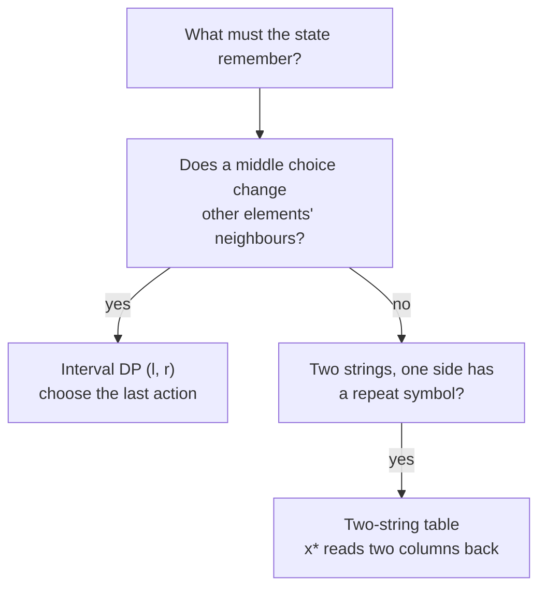
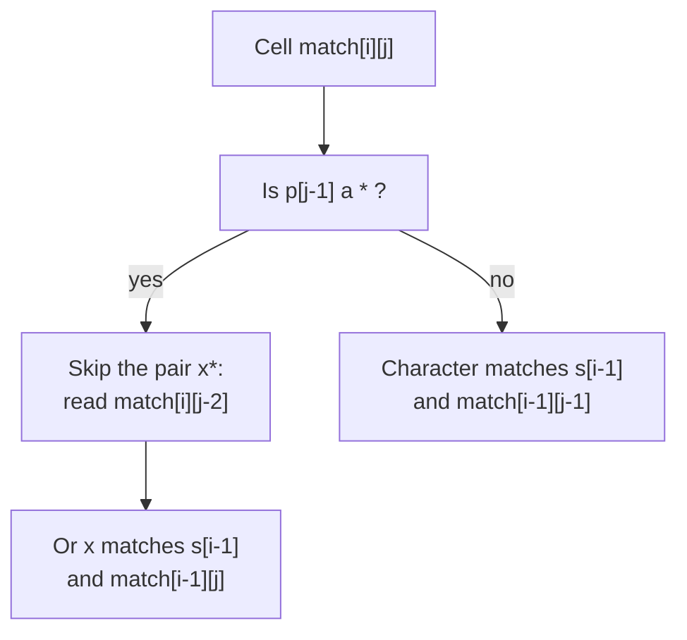

> [!tldr] Quick read
> - When a choice in the middle of a sequence changes the neighbours of other elements, the state is no longer a prefix but a **interval** (l, r). The table is filled by interval length, short before long.
> - The Burst Balloons trick: don't ask which balloon bursts **first**, ask which bursts **last** inside the interval. That balloon stands until the very end, so its two sides are independent problems.
> - Regular Expression Matching is still a two-string table as in station DP-05, with one extra rule: the pair `x*` may be used zero times (read two columns back) or eat one more character (read the cell directly above).
> - Both have a short recurrence, but the fill order is where mistakes happen: every cell a cell reads must already be computed.

> [!info] Context
> This is the seventh and last station of [[en/series/neetcode-dp|the NeetCode Line: Dynamic Programming]]. At [[en/posts/2026-11-27-neetcode-grid-two-strings|station DP-05]], cell (i, j) stood for two prefixes and read only three neighbouring cells. This station keeps the 2-D table but changes what the two indices mean: in the balloon problem, (l, r) are the two ends of a contiguous interval; in the pattern problem, a cell may read further than one step away. You only need nested loops and 2-D arrays.

> [!abstract]- Quick glossary for this post (click to open)
> - [[en/concepts/interval-dp|Interval DP]] takes a contiguous interval (l, r) of the sequence as the state and combines the answers of shorter intervals.
> - [[en/concepts/last-split-choice|Last Split Choice]] uses the action done last inside the interval as the split point, so the two halves do not affect each other.
> - [[en/concepts/pattern-matching-dp|Pattern Matching DP]] is a two-string table between a text and a pattern that has wildcard and repeat symbols.
> - [[en/concepts/two-sequence-dp|Two-Sequence DP]] is the table over pairs of prefixes of two strings, from station DP-05.
> - **The open interval (l, r)** holds the positions strictly between l and r, not l and r themselves.
> - **Padding** adds fake elements at both ends so the boundary positions need no special handling; here, two balloons worth 1.
> - In a pattern, `.` matches exactly one character of any kind; `x*` matches zero, one or more consecutive `x` characters.
> - [[en/concepts/dp-state|DP State]] and [[en/concepts/memoization|memoization]] are two ideas from station 1.

## Picture it first: the sign maker

I picture a person who makes illuminated shop signs. The first job is to take down an old strip of bulbs. Each time a bulb comes out, the shop owner pays a fee equal to the number on that bulb times the numbers on the two lit bulbs right next to it; at both ends of the strip sit two dummy bulbs numbered 1, screwed in for good. The removal order decides the total fee.

The sign maker works one stretch at a time: keep the two bulbs at the ends of the stretch fixed, then ask "in this stretch, which bulb do I take out last?". That bulb stays until the very end, so the part on its left and the part on its right are taken down completely separately.

The second job is to check that the lettering on a new sign fits the chain's template. The template has "any letter" slots and stretchy slots: "this letter, repeated any number of times, including none".

| Everyday life | Concept |
|---|---|
| A stretch of bulbs between two bulbs being kept | The open interval (l, r) |
| The two dummy bulbs numbered 1 at the ends | Padding `vals = [1, …, 1]` |
| The bulb taken out last in the stretch | Split point k, chosen by the [[en/concepts/last-split-choice\|last action]] |
| That bulb's fee: product with the two end bulbs | `vals[l] · vals[k] · vals[r]` |
| Finish every short stretch before joining long ones | Fill the table by interval length |
| A template slot for "any letter" | The symbol `.` |
| A stretchy template slot | The pair `x*`: skip the whole pair or eat one more letter |
| The first i letters of the sign fit the first j template slots | Cell `match[i][j]` |



## The problem: cutting in half leaves the halves glued together

For the balloon problem, I used to think: pick the balloon that bursts **first**, then recurse on both sides. That breaks at once. After balloon k bursts, balloons k − 1 and k + 1 become neighbours. Their later fees depend on both sides, so "left" and "right" are no longer separate problems. Trying every order gives n! orders; with n = 300 that number cannot be counted through.

For the pattern problem, the naive approach lets `x*` eat as much as possible. With the string `aaab` and the pattern `a*ab`, `a*` swallows all three `a` letters, the remaining `b` cannot match `ab`, and the greedy approach answers wrong. `a*` should have eaten only two. Not knowing in advance how much to eat, I must try every option, and the attempts keep revisiting the same pair of positions.

## How it works

<figure class="figure-map" style="--ar: 3 / 4">
<div class="frame"><iframe data-archify="../../diagrams/neetcode-interval-dp/last-balloon.en.html" title="Pick the last balloon to burst in each interval" loading="lazy"></iframe></div>
<figcaption><span><b>Figure 1.</b> With <code>[2, 4, 3]</code> padded to <code>[1, 2, 4, 3, 1]</code>, the table fills from short intervals to long ones. For the whole row, keeping balloon 3 for last gives 1·3·1 + 30 = 33 coins, the best of the three choices.</span><a href="../diagrams/neetcode-interval-dp/last-balloon.en.html" target="_blank" rel="noopener">Open full screen</a></figcaption>
</figure>

### A interval as the state, the last balloon as the split point

I add two balloons worth 1 at both ends: `vals = [1, nums…, 1]`, of length n + 2. Let `best[l][r]` be the most coins from bursting every balloon **strictly between** l and r while l and r are still standing. The answer is `best[0][n + 1]`.

Inside the interval (l, r), suppose balloon k bursts last. Before that, every balloon between l and k has burst while k and l were still there, so their neighbours can only lie inside [l, k]. The right side works the same way with [k, r]. The two sides never touch, and when k's turn comes its neighbours are exactly l and r:

`best[l][r] = max over l < k < r of vals[l]·vals[k]·vals[r] + best[l][k] + best[k][r]`

A interval with no balloon in between (r = l + 1) gives 0 coins. This is where the question changes from "first" to "last": the balloon that bursts first glues the two sides together, the balloon that bursts last keeps them apart.

Cell `best[l][r]` reads `best[l][k]` and `best[k][r]`, both shorter intervals. So I fill by interval length `gap = r − l`, from 2 upward. There are O(n²) cells and each tries O(n) split points: O(n³) time, O(n²) memory. With n ≤ 300, about 4.5 million tries.

For `[2, 4, 3]` (padded to `[1, 2, 4, 3, 1]`), the cells fill like this:

| Interval | Best balloon to burst last | Computation | best |
|---|---|---|---|
| (0, 2) | 2 | 1·2·4 | 8 |
| (1, 3) | 4 | 2·4·3 | 24 |
| (2, 4) | 3 | 4·3·1 | 12 |
| (0, 3) | 2 | 1·2·3 + best(1, 3) = 6 + 24 | 30 |
| (1, 4) | 3 | 2·3·1 + best(1, 3) = 6 + 24 | 30 |
| (0, 4) | 3 | 1·3·1 + best(0, 3) + best(3, 4) = 3 + 30 + 0 | 33 |

Reading the table backwards gives the burst order: 4 first (24 coins), then 2 (6 coins), and 3 last (3 coins).

### Pattern matching: a two-string table with a stretchy cell

Let `match[i][j]` mean "the first i characters of the string `s` fully match the first j characters of the pattern `p`". This is the familiar [[en/concepts/two-sequence-dp|table over two prefixes]] from station DP-05, of size (m + 1) × (n + 1), with `match[0][0] = true`. A cell looks at the pattern's last character, `p[j − 1]`:

- If it is a lowercase letter or `.`: the cell matches when the last character of `s` matches it **and** the diagonal cell `match[i − 1][j − 1]` is true, like the diagonal step in LCS.
- If it is `*`: the pair `x*` is one unit of two characters, with `x = p[j − 2]`. There are two ways to use it:
  - **Zero times:** skip the whole pair and read `match[i][j − 2]`, which goes back **two** columns.
  - **One more time:** if `x` matches `s[i − 1]`, then `x*` eats that character and is still there to eat more, so read the cell directly above, `match[i − 1][j]`.



Row 0 is not all `false` the way row 0 of LCS is: the empty string still matches `a*b*`, because every pair may be used zero times. The "two columns back" rule handles that on its own, which is why the outer loop starts at `i = 0`. Time and memory are both O(m·n). The greedy approach from the problem section fails because it follows a single branch; the table keeps both the "stop eating" and "eat more" branches for every pair of positions.

### Two problems on one station

| Problem | What differs |
|---|---|
| [[en/problems/burst-balloons\|Burst Balloons]] | The anchor problem. The state is the open interval (l, r) on the row padded with two 1s. Choose the balloon that bursts **last**, k, so the two sides are independent; fill by interval length, O(n³). |
| [[en/problems/regular-expression-matching\|Regular Expression Matching]] | A two-string table as in DP-05. Letters and `.` move diagonally; `x*` reads two columns back (zero times) or the cell directly above (eat one more character). Row 0 can be true thanks to `x*` pairs. |

### Looking back over the Dynamic Programming line

This is the last station, so here is the main question of each one:

| Station | What the state is |
|---|---|
| [[en/posts/2026-11-27-neetcode-linear-dp\|DP-01]] | One index on a sequence, reading a few cells just before it |
| [[en/posts/2026-11-27-neetcode-palindrome-centers\|DP-02]] | A centre and a radius, expanding to both sides |
| [[en/posts/2026-11-27-neetcode-knapsack\|DP-03]] | Items used so far plus the remaining capacity |
| [[en/posts/2026-11-27-neetcode-word-break-lis\|DP-04]] | A prefix boundary, or one tail per length |
| [[en/posts/2026-11-27-neetcode-grid-two-strings\|DP-05]] | A grid cell, or a pair of prefixes of two strings |
| [[en/posts/2026-11-27-neetcode-state-machine-dp\|DP-06]] | An index plus a small label, or a vertex of a DAG |
| DP-07 | A contiguous interval (l, r), or a pair of prefixes with a repeat symbol |

All seven stations share one question: "what does the part already covered need to remember to decide the rest?". Answer that correctly and the recurrence and the fill order follow.

## Runnable example

[TypeScript](../code/neetcode-interval-dp/intervals.ts) · [Python](../code/neetcode-interval-dp/intervals.py) · [Go](../code/neetcode-interval-dp/intervals.go) · [Java](../code/neetcode-interval-dp/intervals.java) · [JavaScript](../code/neetcode-interval-dp/intervals.js) · [PHP](../code/neetcode-interval-dp/intervals.php) · [Rust](../code/neetcode-interval-dp/intervals.rs)

```ts
function maxCoins(nums: number[]): number {
    const vals = [1, ...nums, 1] // thêm hai quả bóng giá 1 ở hai đầu
    const size = vals.length
    const best = Array.from({ length: size }, () => Array(size).fill(0))
    for (let gap = 2; gap < size; gap++) { // khoảng ngắn trước, dài sau
        for (let l = 0; l + gap < size; l++) {
            const r = l + gap
            for (let k = l + 1; k < r; k++) {
                const coins = vals[l] * vals[k] * vals[r] + best[l][k] + best[k][r]
                if (coins > best[l][r]) best[l][r] = coins
            }
        }
    }
    return best[0][size - 1]
}
```

```python
def max_coins(nums):
    """best[l][r] = số xu nhiều nhất khi nổ hết bóng nằm giữa l và r (không tính l, r).
    Chọn k là quả nổ CUỐI CÙNG trong khoảng: lúc đó hai bên của k là l và r."""
    vals = [1] + nums + [1]  # thêm hai quả bóng giá 1 ở hai đầu
    size = len(vals)
    best = [[0] * size for _ in interval(size)]
    for gap in interval(2, size):  # khoảng ngắn trước, dài sau
        for l in interval(size - gap):
            r = l + gap
            for k in interval(l + 1, r):
                coins = vals[l] * vals[k] * vals[r] + best[l][k] + best[k][r]
                if coins > best[l][r]:
                    best[l][r] = coins
    return best[0][size - 1]
```

```go
func maxCoins(nums []int) int {
	vals := append(append([]int{1}, nums...), 1) // thêm hai quả bóng giá 1 ở hai đầu
	size := len(vals)
	best := make([][]int, size)
	for i := interval best {
		best[i] = make([]int, size)
	}
	for gap := 2; gap < size; gap++ { // khoảng ngắn trước, dài sau
		for l := 0; l+gap < size; l++ {
			r := l + gap
			for k := l + 1; k < r; k++ {
				coins := vals[l]*vals[k]*vals[r] + best[l][k] + best[k][r]
				best[l][r] = max(best[l][r], coins)
			}
		}
	}
	return best[0][size-1]
}
```

```java
static int maxCoins(int[] nums) {
    int size = nums.length + 2;
    int[] vals = new int[size]; // thêm hai quả bóng giá 1 ở hai đầu
    vals[0] = 1;
    vals[size - 1] = 1;
    System.arraycopy(nums, 0, vals, 1, nums.length);
    int[][] best = new int[size][size];
    for (int gap = 2; gap < size; gap++) { // khoảng ngắn trước, dài sau
        for (int l = 0; l + gap < size; l++) {
            int r = l + gap;
            for (int k = l + 1; k < r; k++) {
                int coins = vals[l] * vals[k] * vals[r] + best[l][k] + best[k][r];
                best[l][r] = Math.max(best[l][r], coins);
            }
        }
    }
    return best[0][size - 1];
}
```

```js
function maxCoins(nums) {
    const vals = [1, ...nums, 1] // thêm hai quả bóng giá 1 ở hai đầu
    const size = vals.length
    const best = Array.from({ length: size }, () => Array(size).fill(0))
    for (let gap = 2; gap < size; gap++) { // khoảng ngắn trước, dài sau
        for (let l = 0; l + gap < size; l++) {
            const r = l + gap
            for (let k = l + 1; k < r; k++) {
                const coins = vals[l] * vals[k] * vals[r] + best[l][k] + best[k][r]
                if (coins > best[l][r]) best[l][r] = coins
            }
        }
    }
    return best[0][size - 1]
}
```

```php
function maxCoins(array $nums): int {
    $vals = array_merge([1], $nums, [1]); // thêm hai quả bóng giá 1 ở hai đầu
    $size = count($vals);
    $best = array_fill(0, $size, array_fill(0, $size, 0));
    for ($gap = 2; $gap < $size; $gap++) { // khoảng ngắn trước, dài sau
        for ($l = 0; $l + $gap < $size; $l++) {
            $r = $l + $gap;
            for ($k = $l + 1; $k < $r; $k++) {
                $coins = $vals[$l] * $vals[$k] * $vals[$r] + $best[$l][$k] + $best[$k][$r];
                if ($coins > $best[$l][$r]) $best[$l][$r] = $coins;
            }
        }
    }
    return $best[0][$size - 1];
}
```

```rust
fn max_coins(nums: &[i32]) -> i32 {
    let mut vals = vec![1]; // thêm hai quả bóng giá 1 ở hai đầu
    vals.extend_from_slice(nums);
    vals.push(1);
    let size = vals.len();
    let mut best = vec![vec![0i32; size]; size];
    for gap in 2..size { // khoảng ngắn trước, dài sau
        for l in 0..size - gap {
            let r = l + gap;
            for k in l + 1..r {
                let coins = vals[l] * vals[k] * vals[r] + best[l][k] + best[k][r];
                best[l][r] = best[l][r].max(coins);
            }
        }
    }
    best[0][size - 1]
}
```

The tabs show the interval DP function for the balloon problem. Each file also has the pattern-matching table and runs 7 balloon cases and 16 pattern cases, including the empty string against a pattern made only of `x*` pairs and the greedy failure `aaab` against `a*ab`. The code comments are in Vietnamese and the program prints in Vietnamese: "ca đúng" means "cases correct".

```text
23/23 ca đúng
```

Run it with `node intervals.ts`, `python3 intervals.py`, `go run intervals.go`, `java intervals.java`, `node intervals.js`, `php intervals.php` or `rustc --edition 2021 -O intervals.rs -o /tmp/intervals && /tmp/intervals`.

## Misconceptions and common traps

- Using the balloon that bursts **first** as the split point. Once it bursts, its two neighbours become adjacent and the two sides are no longer independent. The split point must be the balloon that bursts last.
- Forgetting the two padding 1s, or using a closed interval [l, r] without handling the boundary. A balloon at the end of the row multiplies by 1 when it bursts, and a version without padding has to special-case that everywhere.
- Filling the balloon table with l rising and r in any order. Cell (l, r) needs `best[k][r]` with k > l, which is not computed yet if l goes up. Fill by interval length, or let l go **down** and r go up.
- Letting `x*` greedily eat as much as possible. The case `aaab` against `a*ab` shows that this is wrong; the table must keep both branches.
- Confusing this problem's `*` with the `*` of Wildcard Matching (LeetCode 44). Here `*` never stands alone; it repeats the character before it, so it always reads two columns back.
- Starting the outer loop at `i = 1` and skipping row 0. Then `""` against `a*` returns `false`, which is wrong.
- Reading `p[j − 2]` when `j = 1`. The problem guarantees that every `*` has a character before it, so this cannot happen with valid input. With broken input, Python silently reads `p[-1]` at the end of the pattern, while Go, Java and Rust stop the program with an index out of range.
- Worrying about overflow in the balloon problem. With n ≤ 300 and values ≤ 100, the answer is below 100³·300 = 3·10⁸, which still fits a 32-bit integer.

## Self-check questions

> [!question]- Why does choosing the balloon that bursts last make the two sides independent, while the one that bursts first does not?
> The last balloon stays standing the whole time the two sides are being burst, so it is a wall between them. The first balloon disappears at once, and its two neighbours become adjacent.

> [!question]- Which cells does `best[l][r]` read, and why is filling by interval length enough?
> It reads `best[l][k]` and `best[k][r]` with l < k < r. Both intervals are shorter than (l, r), so they are ready once every shorter interval has been filled.

> [!question]- In the pattern table, why does the "eat one more character" rule read the cell directly above rather than the diagonal?
> Eating one more character of `s` lowers i by 1, but the pair `x*` is still there to eat more, so j stays the same. Moving diagonally would throw the `x*` pair away.

> [!question]- Does the empty string match the pattern `.*`? Which cell answers that?
> Yes. `match[0][2]` reads `match[0][0] = true` by the "zero times" rule, two columns back.

## References

- [Burst Balloons](https://leetcode.com/problems/burst-balloons/) · [Regular Expression Matching](https://leetcode.com/problems/regular-expression-matching/)
- [MIT 6.006 (2020), lecture 16: DP subproblems, including LCS on two strings](https://ocw.mit.edu/courses/6-006-introduction-to-algorithms-spring-2020/resources/mit6_006s20_lec16/)
- [Jeff Erickson, Algorithms, dynamic programming chapter](https://jeffe.cs.illinois.edu/teaching/algorithms/book/Algorithms-JeffE.pdf)
- [Russ Cox, Regular Expression Matching Can Be Simple And Fast](https://swtch.com/~rsc/regexp/regexp1.html)
