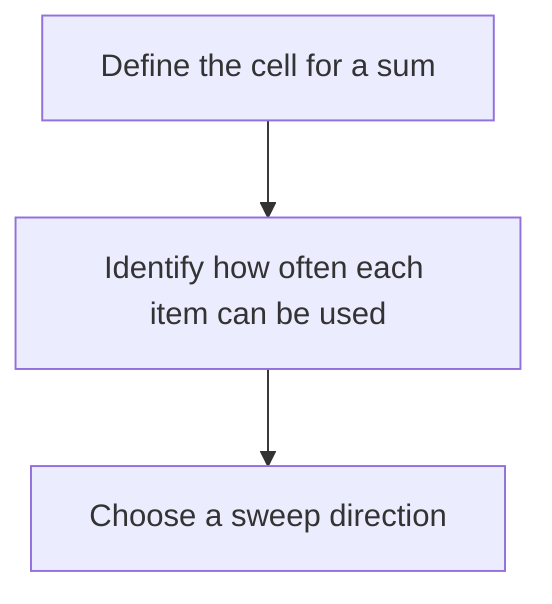

> [!tldr] Quick read
> - Define what the DP cell asks about **exact sum s**. These four problems share a sum index and combine states with OR, min, or addition.
> - With one copy of an item, sweep s downward to read the old row. With reusable types, sweep upward to read the current type's results.
> - When counting coin combinations, put the denomination loop on the outside. Each combination then has one construction order.
> - Target Sum turns a signed total into a count of subsets of positions. A zero still offers two independent choices.

> [!info] Context
> This is the third station of [[en/series/neetcode-dp|the NeetCode Line: Dynamic Programming]]. I use a warehouse scale and a cash drawer to read the same table in two ways. All you need is arrays and loops. [[en/posts/2026-11-27-neetcode-linear-dp|Station DP-01]] explains why knowing the last read lets me store fewer rows.

> [!abstract]- Quick glossary for this post (click to open)
> - A [[en/concepts/knapsack-state|Knapsack State]] describes the exact question for a prefix of types and a sum.
> - [[en/concepts/zero-one-knapsack|0/1 Knapsack]] allows one take-or-skip decision for each item.
> - [[en/concepts/unbounded-knapsack|Unbounded Knapsack]] permits multiple copies of a type.
> - [[en/concepts/knapsack-update-order|Knapsack Update Order]] preserves the correct source row when overwriting a one-dimensional table.
> - [[en/concepts/coin-combinations|Coin Combinations]] distinguish groups by the count of coins of each denomination.
> - The [[en/concepts/signed-subset-sum|Signed Subset-Sum Reduction]] turns a signed sum into a sum of selected positions.

## Picture it first: a scale and a cash drawer

A bag contains a tag of weight 2. With a single tag in stock, I can make weight 2 and still cannot make 4. If the tag represents an abundant item type, after recording 2 I can add another copy to record 4. The same table shape can answer both questions. The sweep determines how the tag is read.

| Everyday life | Concept |
|---|---|
| Every cell asks about a specific weight | State indexed by sum s |
| A physical tag can be packed once | 0/1 |
| A drawer has many copies of one denomination | Unbounded |
| Visit the larger cell while the source is old | Descending sweep |
| Visit the smaller cell first to reuse the new result | Ascending sweep |
| Record quantities by coin type | Counting combinations |



## The problem: preserve the invariant when rolling the table

I write a separate row for each prefix of items or types. Cell s answers about **exactly s**, so zero is the only initial reachable sum. In counting, `dp[0]=1` because there is one empty selection. For feasibility, its value is true. For minimization, it costs zero and unreachable sums receive a sentinel. Reusing one array saves space if every read still sees the right version of its cell.

## How it works

<figure class="figure-map" style="--ar: 3 / 4">
<div class="frame"><iframe data-archify="../../diagrams/neetcode-knapsack/sweep-order.en.html" title="Descending and ascending sweeps with an item of value two" loading="lazy"></iframe></div>
<figcaption><span><b>Figure 1.</b> The sweep decides whether sum 4 can read the newly written sum 2.</span><a href="../diagrams/neetcode-knapsack/sweep-order.en.html" target="_blank" rel="noopener">Open full screen</a></figcaption>
</figure>

### Which row supplies s − x?

With one copy of item x, taking it reads `old[s−x]`. A descending sweep leaves the smaller cell untouched during that iteration. With reusable type x, taking one copy reads `current[s−x]`, which may already use x. An ascending sweep prepares that cell first. The transition also preserves the skip option by starting from the existing `dp[s]`.

With one item x = 2 and goal 4, the descending sweep visits 4 before 2. Its source remains zero in the count table. An ascending sweep writes one way to reach 2 first and then uses it to write one way to reach 4. Zero is a special case in 0/1 counting. Both take and skip read the cell's old value once, doubling the count.

### The outer loop fixes the construction order

With coins `[2,3]` and target 5, there is one combination. Processing all uses of denomination 2 before denomination 3 gives that bag one order of construction. If the sum loop is outside, 2 then 3 and 3 then 2 both reach cell 5 and both contribute. In minimum coin count, both paths have equal cost and taking their minimum permits either loop organization.

| Problem | What changes |
|---|---|
| [[en/problems/coin-change|Coin Change]] | Minimize the number of coins. Reuse each type and combine with min. |
| [[en/problems/partition-equal-subset-sum|Partition Equal Subset Sum]] | Seek exactly half the total. Each position is used once and OR combines candidates. |
| [[en/problems/coin-change-ii|Coin Change II]] | Count combinations. Denominations outside and ascending sums inside. |
| [[en/problems/target-sum|Target Sum]] | Convert signs to a choice of positions. Sweep down and add counts. |

### Costs and fixed-width boundaries

Each item or type sweeps at most W + 1 cells, where W is the relevant target. The rolling array requires O(W+1) space and O(n(W+1)) time. The bound depends on the value of W, rather than the number of bits required to represent it, so it is pseudopolynomial.

Coin Change II guarantees that the **target result** fits a signed 32-bit integer. Other cells can grow much larger. I cap each count at C = 2³¹−1. For nonnegative a and b, `min(C, min(C,a)+min(C,b)) = min(C,a+b)`. Since the recurrence only adds nonnegative counts, a guaranteed in-range final answer remains exact. Java widens before addition. Rust uses saturating addition. TypeScript and JavaScript keep each sum below 2³² before capping, so the sums are exact.

## Runnable example

[TypeScript](../code/neetcode-knapsack/capacity.ts) · [Python](../code/neetcode-knapsack/capacity.py) · [Go](../code/neetcode-knapsack/capacity.go) · [Java](../code/neetcode-knapsack/capacity.java) · [JavaScript](../code/neetcode-knapsack/capacity.js) · [PHP](../code/neetcode-knapsack/capacity.php) · [Rust](../code/neetcode-knapsack/capacity.rs)

```ts
function canPartition(nums: number[]) {
    const sum = nums.reduce((a, b) => a+b, 0)
    if (sum % 2 !== 0) return false
    const goal = sum/2
    const reachable = Array(goal+1).fill(false)
    reachable[0] = true
    for (const x of nums) {
        for (let s = goal; s >= x; s--) {
            reachable[s] ||= reachable[s-x]
        }
    }
    return reachable[goal]
}
```

```python
def can_partition(nums):
    total = sum(nums)
    if total % 2:
        return False
    goal = total // 2
    reachable = [True] + [False] * goal
    for x in nums:
        for s in range(goal, x-1, -1):
            reachable[s] = reachable[s] or reachable[s-x]
    return reachable[goal]
```

```go
func canPartition(nums []int) bool {
	sum := 0
	for _, x := range nums {
		sum += x
	}
	if sum%2 != 0 {
		return false
	}
	goal := sum / 2
	reachable := make([]bool, goal+1)
	reachable[0] = true
	for _, x := range nums {
		for s := goal; s >= x; s-- {
			reachable[s] = reachable[s] || reachable[s-x]
		}
	}
	return reachable[goal]
}
```

```java
static boolean canPartition(int[] nums) {
    int sum = Arrays.stream(nums).sum();
    if (sum%2!=0) return false;
    int goal = sum/2;
    boolean[] reachable = new boolean[goal+1];
    reachable[0] = true;
    for (int x : nums) {
        for (int s=goal;s>=x;s--) reachable[s] |= reachable[s-x];
    }
    return reachable[goal];
}
```

```js
function canPartition(nums) {
    const sum = nums.reduce((a, b) => a+b, 0)
    if (sum % 2 !== 0) return false
    const goal = sum/2
    const reachable = Array(goal+1).fill(false)
    reachable[0] = true
    for (const x of nums) {
        for (let s = goal; s >= x; s--) {
            reachable[s] ||= reachable[s-x]
        }
    }
    return reachable[goal]
}
```

```php
function canPartition(array $nums): bool {
    $sum = array_sum($nums);
    if ($sum % 2 !== 0) return false;
    $goal = intdiv($sum,2);
    $reachable = array_fill(0,$goal+1,false);
    $reachable[0] = true;
    foreach ($nums as $x) {
        for ($s=$goal;$s >= $x;$s--) $reachable[$s] = $reachable[$s] || $reachable[$s-$x];
    }
    return $reachable[$goal];
}
```

```rust
fn can_partition(nums: &[usize]) -> bool {
    let sum: usize = nums.iter().sum();
    if sum % 2 != 0 {
        return false;
    }
    let goal = sum / 2;
    let mut reachable = vec![false; goal + 1];
    reachable[0] = true;
    for &x in nums {
        for s in (x..=goal).rev() {
            reachable[s] |= reachable[s - x];
        }
    }
    reachable[goal]
}
```

The tabs show the half-sum feasibility routine. Every download runs all four problems across 10 checks. A stress case has the 299 even denominations from 2 through 598 plus a coin of 4,999, with target 4,999. Only the odd coin reaches this target, while many even cells exceed the 32-bit count limit.

```text
10/10 cases passed
```

*(Output labels translated; the files themselves print Vietnamese.)*

Run with `node capacity.ts`, `python3 capacity.py`, `go run capacity.go`, `java capacity.java`, `node capacity.js`, `php capacity.php`, or `rustc --edition 2021 -O capacity.rs -o /tmp/capacity && /tmp/capacity`.

## Misconceptions and common traps

- Sweeping up for one-copy items lets a position reproduce itself. For `[2,3,7]), the goal is 6 and there is no matching subset. One value of 2 with the wrong sweep can mark 2, 4, and 6.
- Initializing every cell to one counts sums that have never been reached. Initialize one way at sum zero.
- Putting the sum loop on the outside when counting bags introduces coin order into the answer. Use one fixed denomination order.
- Wider types can still fall short of intermediate counts. Capping at the target's limit has a proof when every merge adds nonnegative values.

## Self-check questions

> [!question]- Why can one tag of value 2 write sum 4 in an upward sweep?
> Cell 2 is written first in the same pass. Cell 4 sees the tag already present at 2 and adds another copy.

> [!question]- Why is there one combination for target zero in Coin Change II?
> Taking no coins makes exactly zero and is the seed for each later combination.

> [!question]- When does a signed-sum problem become a 0/1 problem?
> Once the subset represents the negative positions, each position is either in that subset or outside it.

## References

- [MIT 6.006 on subset sum and pseudopolynomial time](https://ocw.mit.edu/courses/6-006-introduction-to-algorithms-spring-2020/resources/lecture-18-dynamic-programming-part-4-rods-subset-sum-pseudopolynomial/)
- [Coin Change](https://leetcode.com/problems/coin-change/) · [Partition Equal Subset Sum](https://leetcode.com/problems/partition-equal-subset-sum/) · [Coin Change II](https://leetcode.com/problems/coin-change-ii/) · [Target Sum](https://leetcode.com/problems/target-sum/)
