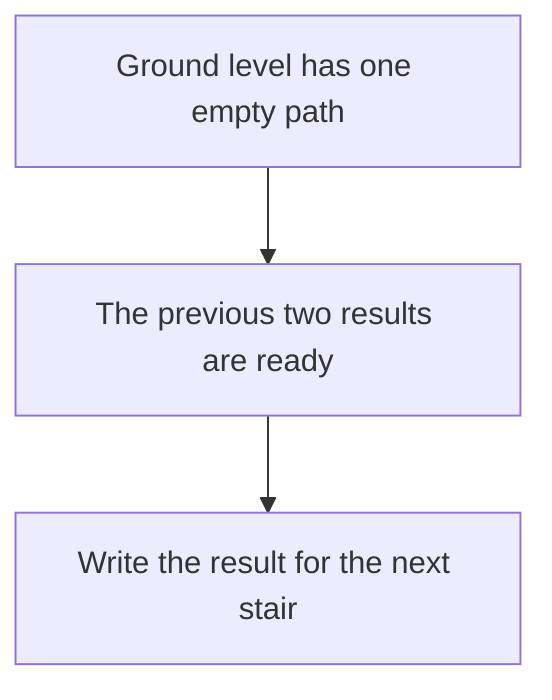

> [!tldr] Quick read
> - Before writing the loop, I describe the question answered by index i. That sentence determines the base cases, recurrence, and result.
> - Use the final choice to express a larger answer through smaller answers. Memoization or an ordered table can compute each index once.
> - Discard a value after its last read. Climbing Stairs keeps two neighboring counts. Maximum Product Subarray keeps both extrema ending at the same position.
> - The six problems use three kinds of combination. Add disjoint counts, take the minimum cost, or take the maximum value.

> [!info] Context
> This is the first station of [[en/series/neetcode-dp|the NeetCode Line: Dynamic Programming]]. I picture a warehouse worker climbing stairs and filling in a ledger. All you need is arrays, loops, and how recursion calls the same function again.

> [!abstract]- Quick glossary for this post (click to open)
> - A [[en/concepts/dp-state|DP State]] is the meaning of an entry. On the stairs, entry i counts move sequences ending exactly at i.
> - A [[en/concepts/recurrence-relation|Recurrence Relation]] tells me which entries feed the next one.
> - [[en/concepts/memoization|Memoization]] saves the answer on the first call so later calls with the same argument can read it.
> - [[en/concepts/rolling-state|Rolling State]] reuses memory after a value's last read.

## Picture it first: filling in the ledger at each stair

A ledger sits by the warehouse staircase. Stair four has five move sequences because stair three has three and stair two has two. Append a move of the appropriate length to land on four. If I switch to asking for the cheapest toll, I still read the previous two entries. I add each stair's toll and choose the cheaper total.

| Everyday life | Concept |
|---|---|
| The question written on each page | State |
| Two old pages used to write a new one | Recurrence |
| Read an existing entry when I see it again | Memoization |
| Hold the last two pages | Rolling state |



## The problem: what does one iteration need to remember?

I used to start by asking whether to use a table or two variables. First I ask what I need to know about the part I have already processed. On the stairs, a count for each stair suffices. In a product problem, retaining only the largest positive product may lose a negative product that changes sign on the next move.

## How it works

<figure class="figure-map" style="--ar: 3 / 4">
<div class="frame"><iframe data-archify="../../diagrams/neetcode-linear-dp/stair-count.en.html" title="Two rolling values in Climbing Stairs" loading="lazy"></iframe></div>
<figcaption><span><b>Figure 1.</b> Each stair reads two counts, then discards the older one.</span><a href="../diagrams/neetcode-linear-dp/stair-count.en.html" target="_blank" rel="noopener">Open full screen</a></figcaption>
</figure>

### Set the state and look at the last move

Let `f(i)` be the count of move sequences from the floor to exactly i. The last move spans one or two stairs. Removing it produces a path to `i−1` or `i−2`. The groups are disjoint, so `f(i) = f(i−1) + f(i−2)`. Stair zero has one empty path. Stair one has one single-move path.

Each call reads only smaller indices. Brute force visits `f(2)` both through `f(3)` and directly from `f(4)`. A memo stores results by index. A table fills them from zero to n. Both compute each entry once. To reconstruct an optimal route, also save the previous choice. If I need only the final count, I can discard `f(i−2)` after iteration i.

### The shared template

1. Write a sentence describing entry i. A prefix of length i and the element at index i refer to different bounds.
2. Partition by the final choice. Add disjoint counts. For optimization, compare alternatives with min or max.
3. Write the smallest cases according to the state definition. Order the computation so every entry reads available values.
4. Sketch a single iteration's dependencies. Keep the entries it can still read, then choose a table or a few variables.

| Problem | What changes |
|---|---|
| [[en/problems/climbing-stairs|Climbing Stairs]] | Add counts grouped by the last move. |
| [[en/problems/min-cost-climbing-stairs|Min Cost Climbing Stairs]] | Minimize cost and charge for the departure stair. |
| [[en/problems/house-robber|House Robber]] | Skip house i, or take it and skip its neighbor. |
| [[en/problems/house-robber-ii|House Robber II]] | The endpoints are neighbors. Run two half-open ranges, each excluding an endpoint. |
| [[en/problems/decode-ways|Decode Ways]] | Include a branch only when the last digit or pair is valid. |
| [[en/problems/maximum-product-subarray|Maximum Product Subarray]] | Keep both extrema ending at i. Multiplication by a negative can reverse their order. |

## Runnable example

[TypeScript](../code/neetcode-linear-dp/recurrences.ts) · [Python](../code/neetcode-linear-dp/recurrences.py) · [Go](../code/neetcode-linear-dp/recurrences.go) · [Java](../code/neetcode-linear-dp/recurrences.java) · [JavaScript](../code/neetcode-linear-dp/recurrences.js) · [PHP](../code/neetcode-linear-dp/recurrences.php) · [Rust](../code/neetcode-linear-dp/recurrences.rs)

```ts
function countStairs(n: number) {
    let older = 1, latest = 1
    for (let i = 2; i <= n; i++) {
        ;[older, latest] = [latest, older + latest]
    }
    return latest
}
```

```python
def count_stairs(n):
    older = latest = 1
    for _ in range(2, n + 1):
        older, latest = latest, older + latest
    return latest
```

```go
func countStairs(n int) int {
	older, latest := 1, 1
	for i := 2; i <= n; i++ {
		older, latest = latest, older+latest
	}
	return latest
}
```

```java
static int countStairs(int n) {
    int older = 1, latest = 1;
    for (int i = 2; i <= n; i++) {
        int next = older + latest;
        older = latest;
        latest = next;
    }
    return latest;
}
```

```js
function countStairs(n) {
    let older = 1, latest = 1
    for (let i = 2; i <= n; i++) {
        ;[older, latest] = [latest, older + latest]
    }
    return latest
}
```

```php
function countStairs(int $n): int {
    $older = $latest = 1;
    for ($i = 2; $i <= $n; $i++) {
        [$older, $latest] = [$latest, $older + $latest];
    }
    return $latest;
}
```

```rust
fn count_stairs(n: usize) -> i32 {
    let (mut older, mut latest) = (1, 1);
    for _ in 2..=n {
        (older, latest) = (latest, older + latest);
    }
    latest
}
```

The tabs show the anchor problem. Each downloadable file runs all six problems across 10 cases, including a single house, a product with zero, and a long digit string with an undecodable tail. The fixed-width implementations cap decoding sums at the signed 32-bit limit. The recurrence only adds nonnegative counts. The final answer is guaranteed to fit, so capping oversized prefixes preserves it. Python's integers extend beyond 32 bits.

```text
10/10 cases passed
```

*(Output labels translated; the files themselves print Vietnamese.)*

Each solution in the file traverses its input at most twice. The loops use O(1) auxiliary space, including the two indices in House Robber II. Run with `node recurrences.ts`, `python3 recurrences.py`, `go run recurrences.go`, `java recurrences.java`, `node recurrences.js`, `php recurrences.php`, or `rustc --edition 2021 -O recurrences.rs -o /tmp/recurrences && /tmp/recurrences`.

## Misconceptions and common traps

- Picking base cases out of habit. `f(0) = 1` counts the empty path, while the cost paid before leaving stair zero is 0.
- Saving a single best value for the entire prefix when the problem asks for a contiguous subarray ending at i. Extending a run multiplies a result ending exactly at i−1.
- Updating a variable too early. Calculate the next value from the old pair before shifting it.
- Slicing two ranges from the ring of houses can allocate a new array in some languages. Start and end indices let both passes read the same array.

## Self-check questions

> [!question]- Which base case accounts for the jump from zero to two?
> The empty path at zero contributes one way before the two-stair jump is appended.

> [!question]- Why keep the minimum product when I need the maximum?
> A negative next value can multiply the smallest negative product into the largest positive product.

> [!question]- When should I keep a table instead of rolling variables?
> Keep it when later reads need old entries or when reconstructing an answer from previous choices.

## References

- [MIT 6.006 lecture on memoization and bottom-up order](https://ocw.mit.edu/courses/6-006-introduction-to-algorithms-fall-2011/resources/mit6_006f11_lec19/)
- [LeetCode 70, Climbing Stairs](https://leetcode.com/problems/climbing-stairs/)
