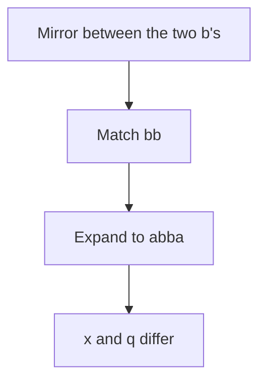

> [!tldr] Quick read
> - A palindrome has a [[en/concepts/palindrome-center|center]] at a character or at a gap.
> - Expanding opposite pairs from each center is the shared template. The longest-substring problem keeps a maximum. The counting problem adds all occurrences.
> - A [[en/concepts/palindrome-radius|virtual radius]] describes the longest span and derives the number of nested intervals.
> - Manacher reuses proven matches in the rightmost window to reach O(n) time.

> [!info] Context
> This is station 2 of the [[en/series/neetcode-dp|NeetCode Dynamic Programming line]]. A DP table is a familiar approach, but here the geometry of a palindrome lets us use less memory. You only need string indexing and integer division.

> [!abstract]- Quick glossary for this post (click to open)
> - A **substring** is a contiguous interval.
> - An **even center** lies between two letters. An **odd center** sits on a letter.
> - A **reflection** maps a position on one side of the center to its equidistant position on the other.

## Picture it first: place a mirror on a strip

I place a mirror between the b's of `xabbaq`. Looking one step each way shows the b pair, expanding again shows the a pair, and then x and q disagree. The longest span here has length 4. This center contributes 2 occurrences.

| Everyday life | Concept |
|---|---|
| Where the mirror stands | A letter or gap center |
| Move one pair outward | One expansion step |
| Expand up to the first mismatch | Maximal radius |
| Circle each mirrored span | The number of palindromes at a center |



## The problem: one symmetry trace, two results

There are n(n+1)/2 contiguous intervals. Checking each from both ends can take O(n³) time. A DP table remembers whether the inner span already matched and reduces this to O(n²) time, while retaining O(n²) entries. For both problems here, each span can be accounted for by its unique center.

## How it works

<figure class="figure-map" style="--ar: 3 / 4">
<div class="frame"><iframe data-archify="../../diagrams/neetcode-palindrome-centers/center-trace.en.html" title="Expand from the gap between the two b's" loading="lazy"></iframe></div>
<figcaption><span><b>Figure 1.</b> One even center yields two nested spans. How we aggregate the results determines which problem we solve.</span><a href="../diagrams/neetcode-palindrome-centers/center-trace.en.html" target="_blank" rel="noopener">Open full screen</a></figcaption>
</figure>

### Expand each center independently

At each center, begin at a letter or a gap. Probe the sides together until a mismatch or the string boundary. All palindromes at a center are nested. A mismatch rules out larger spans there. The template takes O(n²) time in the repeated-character case and O(1) auxiliary space.

Virtual coordinates let the same loop handle both center types. Characters sit at odd positions and gaps at even positions. Two gaps match by definition. The maximal radius r is the original length, and center i gives start `(i-r)/2`.

### Start with proven matches

Manacher stores one radius per center. Within the palindrome with the farthest right edge R, position i starts with what is known at its mirror, capped at `R-i`. Test outward to update R when possible. Each newly tested successful expansion pushes the right edge farther, and each center can stop at at most one mismatch. Time and space are O(n).

| Problem | What changes |
|---|---|
| [[en/problems/longest-palindromic-substring|LC-0005]] | Keep the center with the largest radius and slice one span. |
| [[en/problems/palindromic-substrings|LC-0647]] | Each center contributes `⌊(r+1)/2⌋` spans. Sum over every center. |

## Runnable example

The station files check both the longest span `abba` and the count of 8 for `xabbaq`, using both independent expansion and Manacher. The tabs excerpt the two checks. The [probe-count experiment](../code/neetcode-palindrome-centers/compare.ts) uses 1,000 a's.

[TypeScript](../code/neetcode-palindrome-centers/station.ts) · [Python](../code/neetcode-palindrome-centers/station.py) · [Go](../code/neetcode-palindrome-centers/station.go) · [Java](../code/neetcode-palindrome-centers/station.java) · [JavaScript](../code/neetcode-palindrome-centers/station.js) · [PHP](../code/neetcode-palindrome-centers/station.php) · [Rust](../code/neetcode-palindrome-centers/station.rs)

```typescript
const text = "xabbaq";
for (const reuseMirror of [false, true]) {
  if (longestPalindrome(text, reuseMirror) !== "abba") throw new Error("Sai đoạn dài nhất");
  if (countSubstrings(text, reuseMirror) !== 8) throw new Error("Sai số đoạn");
}
console.log("2/2 ca đúng");
```

```python
text = "xabbaq"
for reuse_mirror in (False, True):
    assert longest_palindrome(text, reuse_mirror) == "abba"
    assert count_substrings(text, reuse_mirror) == 8
print("2/2 ca đúng")
```

```go
func main() {
	text := "xabbaq"
	for _, reuseMirror := range []bool{false, true} {
		if longestPalindrome(text, reuseMirror) != "abba" {
			panic("Sai đoạn dài nhất")
		}
		if countSubstrings(text, reuseMirror) != 8 {
			panic("Sai số đoạn")
		}
	}
	fmt.Println("2/2 ca đúng")
}
```

```java
class Station {
    public static void main(String[] args) {
        String text = "xabbaq";
        for (boolean reuseMirror : new boolean[]{false, true}) {
            if (!Centers.longestPalindrome(text, reuseMirror).equals("abba")) {
                throw new AssertionError("Sai đoạn dài nhất");
            }
            if (Centers.countSubstrings(text, reuseMirror) != 8) {
                throw new AssertionError("Sai số đoạn");
            }
        }
        System.out.println("2/2 ca đúng");
    }
}
```

```javascript
const text = "xabbaq";
for (const reuseMirror of [
    false,
    true
]){
    if (longestPalindrome(text, reuseMirror) !== "abba") throw new Error("Sai đoạn dài nhất");
    if (countSubstrings(text, reuseMirror) !== 8) throw new Error("Sai số đoạn");
}
console.log("2/2 ca đúng");
```

```php
$text = 'xabbaq';
foreach ([false, true] as $reuseMirror) {
    if (longestPalindrome($text, $reuseMirror) !== 'abba') {
        throw new RuntimeException('Sai đoạn dài nhất');
    }
    if (countSubstrings($text, $reuseMirror) !== 8) {
        throw new RuntimeException('Sai số đoạn');
    }
}
echo "2/2 ca đúng\n";
```

```rust
fn main() {
    let text = "xabbaq";
    for reuse_mirror in [false, true] {
        assert_eq!(longest_palindrome(text, reuse_mirror), "abba");
        assert_eq!(count_substrings(text, reuse_mirror), 8);
    }
    println!("2/2 ca đúng");
}
```

All seven station files pass both checks. Output from the TypeScript experiment.

```text
Center expansion: 1000000 probes, 500500 spans
Manacher: 1999 probes, 500500 spans
2/2 cases passed
```

*(Output labels translated; the files themselves print Vietnamese.)*

## Misconceptions and common traps

- A scan of letter centers misses even spans. Probe the gaps as well.
- Summing virtual radii confuses matching gaps with new original spans.
- Equal text somewhere else has a separate contribution. Keep endpoints instead of deduplicating text.

## Self-check questions

> [!question]- Why does the same contribution formula work for both center types?
> An even r gives 2, 4, …, r. An odd r gives 1, 3, …, r. Both lists have `⌊(r+1)/2⌋` terms.

> [!question]- Does Manacher stop comparing individual characters?
> It still compares at the edge of the known range. It avoids rechecking the part already proven to match.

## References

- [Princeton Algorithms, Manacher](https://algs4.cs.princeton.edu/53substring/Manacher.java.html)
- [Manacher's original paper](https://doi.org/10.1145/321892.321896)
- [LC-0005 problem](https://leetcode.com/problems/longest-palindromic-substring/) and [LC-0647 problem](https://leetcode.com/problems/palindromic-substrings/)
