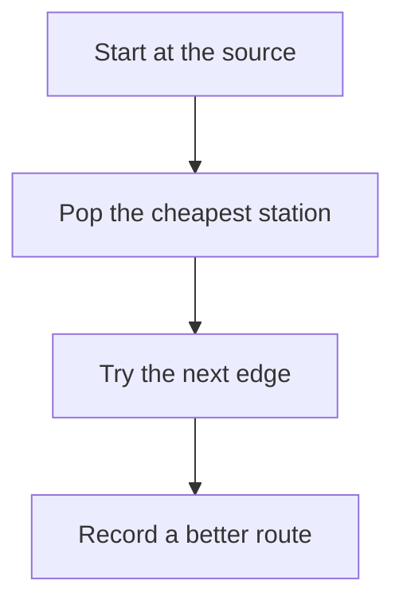

> [!tldr] Quick read
> - I ask how each path is scored before choosing how to traverse the graph. Adding travel times and taking the highest elevation both yield a cost for a path.
> - [[en/concepts/dijkstra|Dijkstra]] pops the cheapest record that still matches the ledger. With nonnegative weights, the remaining path cannot lower the cost.
> - A [[en/concepts/minimax-path|minimax path]] uses `max` in place of addition. Start with the height of the first cell.
> - A flight limit changes the state. [[en/concepts/edge-layer-relaxation|Edge-layer relaxation]] adds at most one edge per round.

> [!info] Context
> This is station 5 on the [[en/series/neetcode-grph|NeetCode Graphs line]]. [[en/posts/2026-11-26-neetcode-graph-bfs|Graph Traversal and BFS]] measured paths by edge count. This time each edge has its own number. Loops and arrays are enough to get started.

> [!abstract]- Quick glossary for this post (click to open)
> - A weight is the time, elevation, or price associated with an edge toward a destination.
> - An [[en/concepts/adjacency-list|adjacency list]] provides the outgoing moves from a vertex.
> - A [[en/concepts/heap|min-heap]] pops the waiting record with the smallest cost.
> - Relaxation tries to replace a recorded cost with a better one via the edge just examined.

## Picture it first: a map of relay stations

I trace a rain warning through four stations. Station 1 reaches 3 in 2 minutes, 3 reaches 2 in 1 minute, and 2 reaches 4 in 4 minutes. The direct channel 1 → 2 takes 9 minutes. Without a transmission limit, station 4 gets the warning at minute 7. If the network allows only two transmissions, this three-edge route is unavailable.

| Everyday life | Concept |
| --- | --- |
| Station and relay channel | Vertex and directed edge |
| Ledger with the earliest arrivals | Tentative distances |
| Waiting station with the earliest time | Record popped from the min-heap |
| Highest point on a route | Minimax cost |
| Transmissions still available | Edge budget in the state |



## The problem: weights change the traversal order

BFS visits vertices in layers by step count. With uneven weights, two short edges can beat one long edge. I need to spell out three things. What is the initial cost, how does extending an edge change it, and are two paths to the same vertex interchangeable?

## How it works

### One loop for two cost rules

Initialize `best` with the source cost and infinity elsewhere. Pop the pair `(d, u)` with the smallest cost. If `d` differs from `best[u]`, the record is stale. If it is current, try each outgoing edge `u → v`. Update `best[v]` and push a record whenever its cost improves.

For the signal problem, extending an edge uses `d + weight`. For the rising water problem, the initial cost is the height at the source and extension uses `max(d, elevation)`. Both rules preserve or raise costs and preserve ordering when extending two paths along the same edge. If we suppose a cheaper cost exists for a vertex about to be popped, the first unfinished vertex along the cheaper route has a smaller waiting cost. That contradiction lets us finalize the entry.

<figure class="figure-map" style="--ar: 2 / 3">
<div class="frame"><iframe data-archify="../../diagrams/neetcode-shortest-path/dijkstra-trace.en.html" title="Records passing through the min-heap" loading="lazy"></iframe></div>
<figcaption><span><b>Figure 1.</b> The entry with cost 9 remains in the heap after cost 3 is recorded for station 2. The loop skips the old entry when it comes out.</span><a href="../diagrams/neetcode-shortest-path/dijkstra-trace.en.html" target="_blank" rel="noopener">Open full screen</a></figcaption>
</figure>

### When an edge limit changes the state

In the flight problem, keeping one price per city can lose a more expensive route with segments to spare. Define layer `i` for routes using at most i edges. Read `best` from the old layer and write into its copy. After `k + 1` rounds, the final layer respects the k intermediate stops.

If a cost can fall when an edge is added, such as a negative additive edge, Dijkstra’s finalization proof no longer applies. Edge-count layers still allow adding a cost while keeping the two versions of the state distinct.

| Problem | What changes |
| --- | --- |
| [[en/problems/network-delay-time\|Network Delay Time]] | Add travel times. Take the maximum of the shortest distances after checking for unreachable stations. |
| [[en/problems/swim-in-rising-water\|Swim in Rising Water]] | Take the highest elevation on the path. Start with the source elevation. |
| [[en/problems/cheapest-flights-within-k-stops\|Cheapest Flights Within K Stops]] | Add fares with a budget of `k + 1` edges. Separate the layers when updating. |

## Runnable example

[TypeScript](../code/neetcode-shortest-path/weighted-route.ts) · [Python](../code/neetcode-shortest-path/weighted_route.py) · [Go](../code/neetcode-shortest-path/weighted_route.go) · [Java](../code/neetcode-shortest-path/weighted-route.java) · [JavaScript](../code/neetcode-shortest-path/weighted-route.js) · [PHP](../code/neetcode-shortest-path/weighted-route.php) · [Rust](../code/neetcode-shortest-path/weighted_route.rs)

The tabs show the shared Dijkstra loop. Each standalone download also includes the grid adapter, the edge-budget loop, and five cases for each of the three problems. Run it with its language runtime. In Rust, compile with `rustc --edition 2021 -O` and run the binary.

```ts
function leastCosts(
  graph: Neighbor[][],
  start: number,
  initial: number,
  extend: (cost: number, weight: number) => number,
): number[] {
  const best = Array<number>(graph.length).fill(Infinity)
  best[start] = initial
  const pending = new MinHeap()
  pending.push([initial, start])
  while (pending.items.length > 0) {
    const [cost, from] = pending.pop()
    if (cost !== best[from]) continue
    for (const [to, weight] of graph[from]) {
      const candidate = extend(cost, weight)
      if (candidate >= best[to]) continue
      best[to] = candidate
      pending.push([candidate, to])
    }
  }
  return best
}
```

```python
def least_costs(graph, start, initial, extend):
    best = [float("inf")] * len(graph)
    best[start] = initial
    pending = [(initial, start)]
    while pending:
        cost, source = heappop(pending)
        if cost != best[source]:
            continue
        for target, weight in graph[source]:
            candidate = extend(cost, weight)
            if candidate < best[target]:
                best[target] = candidate
                heappush(pending, (candidate, target))
    return best
```

```go
func leastCosts(graph [][]neighbor, start, initial int, extend func(int, int) int) []int {
	best := make([]int, len(graph))
	for i := range best {
		best[i] = infinity
	}
	best[start] = initial
	pending := &frontier{{initial, start}}
	for pending.Len() > 0 {
		current := heap.Pop(pending).(entry)
		if current.cost != best[current.node] {
			continue
		}
		for _, edge := range graph[current.node] {
			candidate := extend(current.cost, edge.weight)
			if candidate < best[edge.node] {
				best[edge.node] = candidate
				heap.Push(pending, entry{candidate, edge.node})
			}
		}
	}
	return best
}
```

```java
static int[] leastCosts(List<List<int[]>> graph, int start, int initial, IntBinaryOperator extend) {
    int[] best = new int[graph.size()];
    Arrays.fill(best, Integer.MAX_VALUE);
    best[start] = initial;
    var queue = new PriorityQueue<int[]>(Comparator.comparingInt(entry -> entry[0]));
    queue.add(new int[]{initial, start});
    while (!queue.isEmpty()) {
        int[] entry = queue.remove();
        int cost = entry[0], source = entry[1];
        if (cost != best[source]) continue;
        for (int[] edge : graph.get(source)) {
            int target = edge[0];
            int candidate = extend.applyAsInt(cost, edge[1]);
            if (candidate < best[target]) {
                best[target] = candidate;
                queue.add(new int[]{candidate, target});
            }
        }
    }
    return best;
}
```

```js
function leastCosts(
  graph,
  start,
  initial,
  extend,
) {
  const best = Array(graph.length).fill(Infinity)
  best[start] = initial
  const pending = new MinHeap()
  pending.push([initial, start])
  while (pending.items.length > 0) {
    const [cost, from] = pending.pop()
    if (cost !== best[from]) continue
    for (const [to, weight] of graph[from]) {
      const candidate = extend(cost, weight)
      if (candidate >= best[to]) continue
      best[to] = candidate
      pending.push([candidate, to])
    }
  }
  return best
}
```

```php
function leastCosts(array $graph, int $start, int $initial, callable $extend): array {
    $best = array_fill(0, count($graph), PHP_INT_MAX);
    $best[$start] = $initial;
    $pending = new SplPriorityQueue();
    $pending->insert([$initial, $start], -$initial);
    while (!$pending->isEmpty()) {
        [$cost, $source] = $pending->extract();
        if ($cost !== $best[$source]) {
            continue;
        }
        foreach ($graph[$source] as [$target, $weight]) {
            $candidate = $extend($cost, $weight);
            if ($candidate < $best[$target]) {
                $best[$target] = $candidate;
                $pending->insert([$candidate, $target], -$candidate);
            }
        }
    }
    return $best;
}
```

```rust
fn least_costs(
    graph: &[Vec<(usize, i32)>],
    start: usize,
    initial: i32,
    extend: impl Fn(i32, i32) -> i32,
) -> Vec<i32> {
    let mut best = vec![i32::MAX; graph.len()];
    best[start] = initial;
    let mut pending = BinaryHeap::from([Reverse((initial, start))]);
    while let Some(Reverse((cost, source))) = pending.pop() {
        if cost != best[source] {
            continue;
        }
        for &(target, weight) in &graph[source] {
            let candidate = extend(cost, weight);
            if candidate < best[target] {
                best[target] = candidate;
                pending.push(Reverse((candidate, target)));
            }
        }
    }
    best
}
```

```text
15/15 cases passed
```

*(Output labels translated; the files themselves print Vietnamese.)*

## Misconceptions and common traps

- **Finalize the first record pushed onto the heap.** Station 2 first has cost 9, but that cost can fall.
- **Measure by step count.** Edge weights determine the cost in the signal problem.
- **Use the same addition rule for all three.** Rising water only has to clear the tallest ledge, and the flight problem also tracks segments.

## Self-check questions

> [!question]- Why does an equal-cost update need no heap entry?
> The cost is identical and the extension rule preserves ordering. Inserting another record would duplicate work.

> [!question]- When does the same vertex need two states?
> When different ways of getting there leave different options, such as two remaining segment budgets.

> [!question]- Can Dijkstra handle an edge taking zero time?
> Yes. Adding zero cannot lower the path cost.

## References

- [LeetCode · Network Delay Time](https://leetcode.com/problems/network-delay-time/)
- [LeetCode · Swim in Rising Water](https://leetcode.com/problems/swim-in-rising-water/)
- [LeetCode · Cheapest Flights Within K Stops](https://leetcode.com/problems/cheapest-flights-within-k-stops/)
- [Dijkstra (1959)](https://doi.org/10.1007/BF01386390)
- [MIT 6.006 · Bellman–Ford](https://ocw.mit.edu/courses/6-006-introduction-to-algorithms-spring-2020/resources/mit6_006s20_lec12/)
