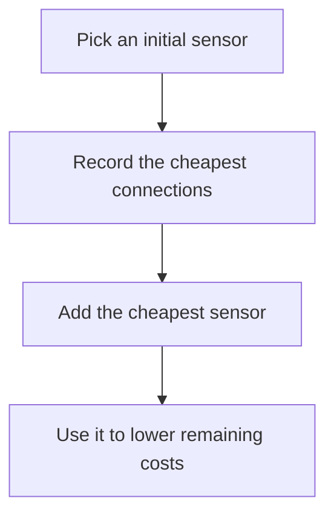

> [!tldr] Quick read
> - A [[en/concepts/minimum-spanning-tree|minimum spanning tree]] selects just enough edges to connect all vertices at the lowest total cost.
> - Prim uses the [[en/concepts/cut-property|cut property]] to grow one tree. Kruskal joins several components into one tree.
> - An [[en/concepts/eulerian-trail|Eulerian trail]] follows every given edge exactly once and may revisit a vertex.
> - [[en/concepts/hierholzers-algorithm|Hierholzer's algorithm]] finalizes a suffix so circuits returning to a vertex can splice in before its final departure.

> [!info] Context
> This is station 6 of the [[en/series/neetcode-grph|NeetCode Graphs line]]. I want to design a low-cost wiring network and plan a delivery route using every prebooked trip. You need arrays, stacks, and the meaning of a graph edge. Kruskal reuses [[en/concepts/disjoint-set-union|Union-Find]].

> [!abstract]- Quick glossary for this post (click to open)
> - A **tree** is a connected undirected graph with no cycles.
> - A **complete graph** has an edge between every distinct pair. Edges can be computed on demand.
> - **Parallel edges** share endpoints. Each plane ticket still represents a distinct edge.
> - A **suffix** is the end of a sequence.

## Picture it first: lay wires and make deliveries

I have four sensors to wire into one network. With one sensor as the start, a ledger stores the cheapest wire from the current group to each remaining sensor. I add the lowest-cost sensor and update the ledger. On the delivery side, each prebooked ticket is a trip I must take. A trip to a dead end belongs at the end, even if its destination code comes first alphabetically.

| Everyday life | Concept |
|---|---|
| The cheapest wiring that still connects every sensor | Minimum spanning tree |
| The boundary between connected and unconnected sensors | Prim's cut |
| Each individual ticket I have to use | Edge of an Eulerian trail |
| Save the dead end for last and splice in return trips | Hierholzer |



## The problem: identify what the edges mean

For wiring, I choose the edges and only need n−1 of them. For an itinerary, the edges are tickets I already have and each must appear once. A minimum-cost tree cannot replace an itinerary, and walking every edge does not minimize the network cost.

## How it works

<figure class="figure-map" style="--ar: 3 / 4">
<div class="frame"><iframe data-archify="../../diagrams/neetcode-spanning-tree-itinerary/prim-trace.en.html" title="Prim's cost ledger" loading="lazy"></iframe></div>
<figcaption><span><b>Figure 1.</b> Each new point reveals only the edges from that point, so the cost ledger updates without materializing the graph.</span><a href="../diagrams/neetcode-spanning-tree-itinerary/prim-trace.en.html" target="_blank" rel="noopener">Open full screen</a></figcaption>
</figure>

### Prim's template

Keep a set of points in the tree and one key `best[i]` per point outside it. The key is the weight of the cheapest **single edge** from the tree to that point. Select the smallest key and use edges from the new point to lower remaining keys. The result has n−1 actual edges because the start has a key of 0. The cut property lets us take the lightest crossing edge. If an optimal tree lacks that edge, adding it makes a cycle. Swap out another crossing edge on that cycle without raising the total.

In the anchor problem, every point can connect to every other point. Scanning arrays n times uses O(n²) time and O(n) space. Kruskal builds every edge, sorts by weight, and skips edges whose ends are already connected, using O(n² log n) time and O(n²) space on the complete graph.

### Hierholzer's template

Follow an unused edge and save the temporary walk on a stack. If the top has no outgoing edges left, move it to the reversed result. After the traversal, reverse once. To find a lexicographically smallest itinerary, sort destinations descending so the smallest can be popped from the end. Each ticket is removed once, although a vertex can be pushed many times. With E tickets, the sort dominates the O(E log E) time bound and space is O(E).

| Problem | What changes |
|---|---|
| [[en/problems/min-cost-to-connect-all-points|LC-1584]] | Edge weight is Manhattan distance. Choose edges by weight. |
| [[en/problems/reconstruct-itinerary|LC-0332]] | Each ticket is directed. Use them all and prefer smaller codes where feasible. |

## Runnable example

The station files check cost 7 with Prim and Kruskal, then check the route `JFK → BBB → JFK → AAA`. The tabs excerpt the two checks. The [TypeScript experiment](../code/neetcode-spanning-tree-itinerary/compare.ts) counts stored edges and ticket selections.

[TypeScript](../code/neetcode-spanning-tree-itinerary/station.ts) · [Python](../code/neetcode-spanning-tree-itinerary/station.py) · [Go](../code/neetcode-spanning-tree-itinerary/station.go) · [Java](../code/neetcode-spanning-tree-itinerary/station.java) · [JavaScript](../code/neetcode-spanning-tree-itinerary/station.js) · [PHP](../code/neetcode-spanning-tree-itinerary/station.php) · [Rust](../code/neetcode-spanning-tree-itinerary/station.rs)

```typescript
const points: Point[] = [[0, 0], [4, 0], [5, 0], [5, 2]];
const tickets: [string, string][] = [["JFK", "AAA"], ["JFK", "BBB"], ["BBB", "JFK"]];
if (prim(points) !== 7 || kruskal(points) !== 7) throw new Error("Sai giá nối");
if (findItinerary(tickets).join(" ") !== "JFK BBB JFK AAA") throw new Error("Sai hành trình");
console.log("2/2 ca đúng");
```

```python
points = [(0, 0), (4, 0), (5, 0), (5, 2)]
tickets = [("JFK", "AAA"), ("JFK", "BBB"), ("BBB", "JFK")]
assert prim(points) == kruskal(points) == 7
assert find_itinerary(tickets) == ["JFK", "BBB", "JFK", "AAA"]
print("2/2 ca đúng")
```

```go
func main() {
	points := []point{{0, 0}, {4, 0}, {5, 0}, {5, 2}}
	tickets := [][2]string{{"JFK", "AAA"}, {"JFK", "BBB"}, {"BBB", "JFK"}}
	if prim(points) != 7 || kruskal(points) != 7 {
		panic("Sai giá nối")
	}
	if strings.Join(findItinerary(tickets), " ") != "JFK BBB JFK AAA" {
		panic("Sai hành trình")
	}
	fmt.Println("2/2 ca đúng")
}
```

```java
class Station {
    public static void main(String[] args) {
        int[][] points = {{0, 0}, {4, 0}, {5, 0}, {5, 2}};
        String[][] tickets = {{"JFK", "AAA"}, {"JFK", "BBB"}, {"BBB", "JFK"}};
        if (Connect.prim(points) != 7 || Connect.kruskal(points) != 7) {
            throw new AssertionError("Sai giá nối");
        }
        if (!String.join(" ", Itinerary.findItinerary(tickets)).equals("JFK BBB JFK AAA")) {
            throw new AssertionError("Sai hành trình");
        }
        System.out.println("2/2 ca đúng");
    }
}
```

```javascript
const points = [
    [
        0,
        0
    ],
    [
        4,
        0
    ],
    [
        5,
        0
    ],
    [
        5,
        2
    ]
];
const tickets = [
    [
        "JFK",
        "AAA"
    ],
    [
        "JFK",
        "BBB"
    ],
    [
        "BBB",
        "JFK"
    ]
];
if (prim(points) !== 7 || kruskal(points) !== 7) throw new Error("Sai giá nối");
if (findItinerary(tickets).join(" ") !== "JFK BBB JFK AAA") throw new Error("Sai hành trình");
console.log("2/2 ca đúng");
```

```php
$points = [[0, 0], [4, 0], [5, 0], [5, 2]];
$tickets = [['JFK', 'AAA'], ['JFK', 'BBB'], ['BBB', 'JFK']];
if (prim($points) !== 7 || kruskal($points) !== 7) {
    throw new RuntimeException('Sai giá nối');
}
if (findItinerary($tickets) !== ['JFK', 'BBB', 'JFK', 'AAA']) {
    throw new RuntimeException('Sai hành trình');
}
echo "2/2 ca đúng\n";
```

```rust
fn main() {
    let points = [(0, 0), (4, 0), (5, 0), (5, 2)];
    let tickets = [("JFK", "AAA"), ("JFK", "BBB"), ("BBB", "JFK")];
    assert_eq!(prim(&points), 7);
    assert_eq!(kruskal(&points), 7);
    assert_eq!(find_itinerary(&tickets), ["JFK", "BBB", "JFK", "AAA"]);
    println!("2/2 ca đúng");
}
```

All seven station files pass both checks. Output from the TypeScript experiment.

```text
Backtracking tries 3928 tickets, Hierholzer consumes 15 tickets
For n=1000: Kruskal stores 499500 edges, Prim stores 1000 best keys
2/2 cases passed
```

*(Output labels translated; the files themselves print Vietnamese.)*

## Misconceptions and common traps

- A Prim key is the weight of one edge into the tree. Accumulating from the root would change the goal to shortest paths.
- A visited-airport set discards needed circuits. Remove each ticket from its list to mark that edge used.
- Backtracking from a small destination can hit a dead end and reopen many branches. Hierholzer records that dead end once in the suffix.

## Self-check questions

> [!question]- Why can two different trees both be optimal?
> When multiple lightest edges cross a cut, choosing different edges can leave the same total cost.

> [!question]- Why sort destinations descending?
> Popping from the end is cheap and still returns the smallest code first.

## References

- [Princeton Algorithms, minimum spanning trees](https://algs4.cs.princeton.edu/43mst/)
- [Princeton Algorithms, directed Eulerian paths](https://algs4.cs.princeton.edu/42digraph/DirectedEulerianPath.java.html)
- [LC-1584 problem](https://leetcode.com/problems/min-cost-to-connect-all-points/) and [LC-0332 problem](https://leetcode.com/problems/reconstruct-itinerary/)
