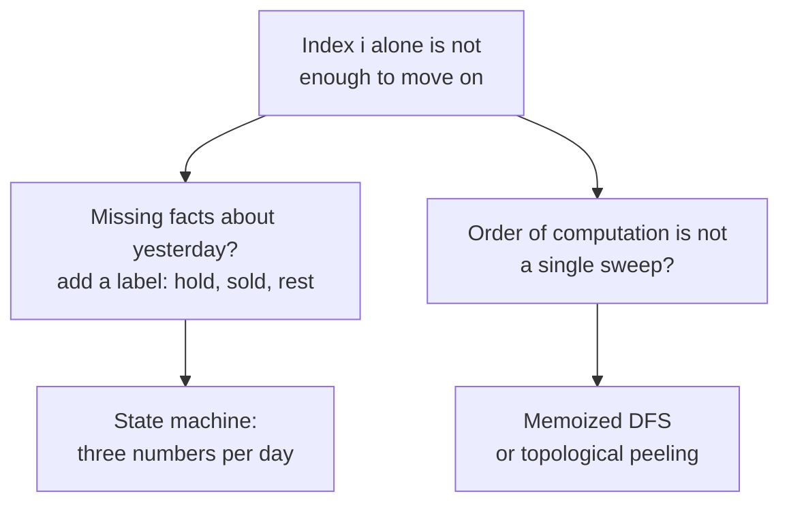
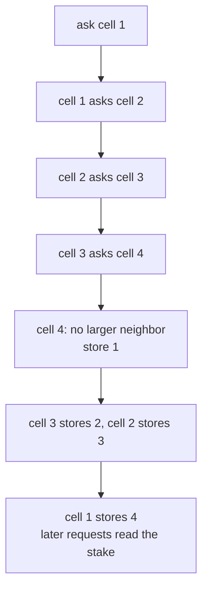

> [!tldr] Quick read
> - In some problems, knowing "I am on day i" is still not enough to choose the next step. With trading under a cooldown, I also need to know whether I am holding a share, have just sold, or am empty-handed.
> - Attach that label to the state: each day carries three numbers, and a table of transitions says which of today's numbers comes from which of yesterday's. That is a state machine.
> - The mandatory rest day is just a missing arrow: there is no direct path from "just sold" to "holding".
> - In other problems the order of computation is not a single left-to-right sweep. On the grid where we look for the longest increasing path, memoized recursion walks to the cell it needs first, because a strictly increasing path never loops.
> - If you want to avoid deep recursion, peel the cells in topological order instead; the answer is the same.

> [!info] Context
> This is the sixth station on [[en/series/neetcode-dp|the NeetCode Line: Dynamic Programming]]. At [[en/posts/2026-11-27-neetcode-grid-two-strings|station DP-05]], one or two indices were enough to describe what had been read, and the fill order was obviously row by row. This station drops both assumptions. You only need loops, 2-D arrays, recursion and the idea of [[en/concepts/memoization|memoization]] from station 1.

> [!abstract]- Quick glossary for this post (click to open)
> - A [[en/concepts/dp-state|DP state]] is what you need to know about the part already covered in order to decide the rest.
> - [[en/concepts/state-machine-dp|State Machine DP]] adds a small label (holding, sold, resting) to the index and writes the transitions between labels.
> - [[en/concepts/memoized-dfs|Memoized DFS]] is depth-first search with memoization: ask for a neighbor's answer by recursion, then store it so the next request reads it at once.
> - A [[en/concepts/directed-acyclic-graph|DAG]] (directed acyclic graph) is a graph where following the arrows never brings you back to where you were.
> - A [[en/concepts/topological-sort|topological order]] lines up the vertices of a DAG so that every arrow points forward.
> - **−∞** (minus infinity) is the value for "impossible", used for a state that cannot have been reached yet.
> - [[en/concepts/rolling-state|Rolling state]] keeps only the numbers of the previous step, because the next step never reads further back.

## Picture it first: a second-hand trader's notebook

Picture a second-hand goods trader who writes in a notebook every evening. The market has a rule: whoever sells today must sit out tomorrow and may not buy stock. Each evening the trader writes not one line but three: the best profit if tonight they are holding goods, if they sold today, and if they are empty-handed. The next morning those three lines are enough to compute three new ones, without leafing back through the whole notebook.

Outside market hours, the same trader looks for the longest climb across a field of mounds of different heights, where each step may only go up to a strictly higher mound right next to the current one. Once a mound has been measured, they drive a stake into it with the number written on it, and the next time they pass by they just read the stake.

| Everyday life | Concept |
|---|---|
| Three lines each evening: holding, just sold, empty-handed | The three states `hold`, `sold`, `rest` of one day |
| The rule "sell today, sit out tomorrow" | A missing arrow in the state machine |
| Computing three new lines from last night's three only | The transitions, and rolling state in O(1) memory |
| Never bought anything, so cannot be "holding" | Initializing `hold = −∞` |
| Only climbing to a higher mound | An edge from a lower cell to a higher one; the graph has no cycle |
| The stake with a number on each measured mound | The memo of the DFS |
| Measuring from the highest mounds first, then working down | Topological order, peeling layers without recursion |



## The problem: one index no longer tells the whole story

In [[en/problems/best-time-to-buy-and-sell-stock|the buy-once, sell-once problem]], I only had to remember the lowest price so far. When you may trade many times but must rest one day after each sale, I first tried to let `best[i]` be the best profit after day i. The recurrence would not come out: whether I can buy today depends on whether I sold yesterday, and whether I can sell depends on whether I am holding. Two histories with the same `best[i]` can lead to two different futures.

The second problem breaks something else. On the grid where we look for the longest increasing path, a cell's answer depends on its higher neighbors, and a higher neighbor can sit in any direction. No row-by-row sweep guarantees that the higher neighbors have been computed first.

## How it works

<figure class="figure-map" style="--ar: 3 / 4">
<div class="frame"><iframe data-archify="../../diagrams/neetcode-state-machine-dp/cooldown-states.en.html" title="The three end-of-day states of trading with a cooldown" loading="lazy"></iframe></div>
<figcaption><span><b>Figure 1.</b> One round: buying goes from Empty-handed to Holding, selling goes to Just sold, and the next day is a forced rest before buying again. The rest day is the missing direct path from Just sold to Holding.</span><a href="../diagrams/neetcode-state-machine-dp/cooldown-states.en.html" target="_blank" rel="noopener">Open full screen</a></figcaption>
</figure>

### Add a label to the state: three numbers per day

I keep three numbers for the end of each day, each the best possible profit (as cash, with purchase prices already subtracted):
- `hold`: at the end of the day I am holding one share.
- `sold`: I sold today, so tomorrow I must rest.
- `rest`: at the end of the day I am empty-handed and not barred from buying tomorrow.

Each new number reads only yesterday's three:

| Today's state | Comes from | Formula |
|---|---|---|
| `hold` | keep holding, or empty-handed and buy today | `max(hold, rest − price)` |
| `sold` | holding and sell today | `hold + price` |
| `rest` | keep resting, or sold yesterday so rest today | `max(rest, sold)` |

The key cell is `hold`: it reads yesterday's `rest`, never yesterday's `sold`. Sell yesterday and you cannot buy today. That is the cooldown, and it needs no separate counter.

Before the first day I cannot be holding or have just sold, so `hold = sold = −∞` and `rest = 0`. The answer is `max(rest, sold)` on the last day: nobody wants to finish still holding goods. Time is O(n), memory O(1), because only three numbers are kept.

For the prices `[1, 4, 2, 7]`, the table runs like this:

| Day | Price | hold | sold | rest |
|---|---|---|---|---|
| 0 | 1 | −1 | −∞ | 0 |
| 1 | 4 | −1 | 3 | 0 |
| 2 | 2 | −1 | 1 | 3 |
| 3 | 7 | −1 | 6 | 3 |

The answer is 6: buy on day 0, sell on day 3. Without a cooldown, I would sell at 4, buy back at 2 and sell at 7 for a profit of 8. But buying on day 2 has to read `rest` from day 1, and at that point `rest` is still 0; it has not received the profit of 3 from the sale. That profit only flows into `rest` on day 2, too late to buy at 2.

### Let recursion find the order: memoized DFS on a DAG

On an integer grid, let `best(r, c)` be the length of the longest increasing path that starts at cell `(r, c)`. From a cell you may only step to an adjacent cell (up, down, left, right) with a strictly larger value, so:

`best(r, c) = 1 + max(best of the larger neighbors)`, or 1 if there is none.

Every step goes up to a strictly larger value, so no path returns to a cell it has visited. The cells and the steps form a DAG. That is why the recursion needs no "visited" set, unlike searching for a word in a grid: it cannot loop. Ask for `best` on a cell whose higher neighbors have no answer yet, and the recursion computes them first, then stores the result. On the example `[[1, 2], [4, 3]]`:



Each cell is computed exactly once and looks at four neighbors, so time is O(m·n) and memory O(m·n). The price is recursion depth: an increasing path can be tens of thousands of cells long. I built a 199×199 snake-shaped grid with walls whose longest increasing path is 20,000 cells. Python with its default recursion limit of 1,000 frames raises `RecursionError`; with a higher limit it returns 20,000.

### No recursion: peel layers in topological order

The order that the recursion discovers can also be built with a loop. For each cell, count its neighbors that are larger. A cell with a count of 0 is a "hilltop": the path from it has length 1. Peel the whole layer of hilltops, decrement the counts of their lower neighbors, and every cell that drops to 0 forms the next layer. The number of layers peeled is exactly the length of the longest increasing path. This is Kahn's algorithm from [[en/posts/2026-11-26-neetcode-topological-sort|the Topological Sort station]], run against the direction of the arrows. Still O(m·n), but independent of stack depth.

### Two problems on one idea

| Problem | What differs |
|---|---|
| [[en/problems/best-time-to-buy-and-sell-stock-with-cooldown|Best Time to Buy and Sell Stock with Cooldown]] | The anchor. A day index plus three labels `hold`, `sold`, `rest`; each day updates all three from yesterday's three numbers. The cooldown is the fact that `hold` reads `rest`, not `sold`. |
| [[en/problems/longest-increasing-path-in-a-matrix|Longest Increasing Path in a Matrix]] | The state is a cell, but the order is not row by row. Memoized DFS visits higher cells first; values increase strictly, so no visited set is needed. Topological peeling gives the same answer without recursion. |

## Runnable example

[TypeScript](../code/neetcode-state-machine-dp/states.ts) · [Python](../code/neetcode-state-machine-dp/states.py) · [Go](../code/neetcode-state-machine-dp/states.go) · [Java](../code/neetcode-state-machine-dp/states.java) · [JavaScript](../code/neetcode-state-machine-dp/states.js) · [PHP](../code/neetcode-state-machine-dp/states.php) · [Rust](../code/neetcode-state-machine-dp/states.rs)

```ts
function maxProfitCooldown(prices: number[]): number {
    let hold = -Infinity // holding one share
    let sold = -Infinity // sold today, must rest tomorrow
    let rest = 0         // empty-handed, free to buy
    for (const price of prices) {
        const prevSold = sold
        sold = hold + price
        hold = Math.max(hold, rest - price)
        rest = Math.max(rest, prevSold)
    }
    return Math.max(rest, sold)
}
```

```python
def max_profit_cooldown(prices):
    hold = float("-inf")  # holding one share
    sold = float("-inf")  # sold today, must rest tomorrow
    rest = 0              # empty-handed, free to buy
    for price in prices:
        hold, sold, rest = max(hold, rest - price), hold + price, max(rest, sold)
    return max(rest, sold)
```

```go
const negInf = -1 << 30 // acts as −∞, with room to subtract more without overflowing int

func maxProfitCooldown(prices []int) int {
	hold, sold, rest := negInf, negInf, 0 // holding, just sold, empty-handed
	for _, price := range prices {
		hold, sold, rest = max(hold, rest-price), hold+price, max(rest, sold)
	}
	return max(rest, sold)
}
```

```java
static final int NEG_INF = -(1 << 30); // acts as −∞, with room to subtract more without overflowing int

static int maxProfitCooldown(int[] prices) {
    int hold = NEG_INF; // holding one share
    int sold = NEG_INF; // sold today, must rest tomorrow
    int rest = 0;       // empty-handed, free to buy
    for (int price : prices) {
        int prevSold = sold;
        sold = hold + price;
        hold = Math.max(hold, rest - price);
        rest = Math.max(rest, prevSold);
    }
    return Math.max(rest, sold);
}
```

```js
function maxProfitCooldown(prices) {
    let hold = -Infinity // holding one share
    let sold = -Infinity // sold today, must rest tomorrow
    let rest = 0         // empty-handed, free to buy
    for (const price of prices) {
        const prevSold = sold
        sold = hold + price
        hold = Math.max(hold, rest - price)
        rest = Math.max(rest, prevSold)
    }
    return Math.max(rest, sold)
}
```

```php
function maxProfitCooldown(array $prices): int {
    $hold = PHP_INT_MIN >> 1; // holding one share
    $sold = PHP_INT_MIN >> 1; // sold today, must rest tomorrow
    $rest = 0;                // empty-handed, free to buy
    foreach ($prices as $price) {
        $prevSold = $sold;
        $sold = $hold + $price;
        $hold = max($hold, $rest - $price);
        $rest = max($rest, $prevSold);
    }
    return max($rest, $sold);
}
```

```rust
const NEG_INF: i32 = -(1 << 30); // acts as −∞, with room to subtract more without overflowing i32

fn max_profit_cooldown(prices: &[i32]) -> i32 {
    let (mut hold, mut sold, mut rest) = (NEG_INF, NEG_INF, 0); // holding, just sold, empty-handed
    for &price in prices {
        let prev_sold = sold;
        sold = hold + price;
        hold = hold.max(rest - price);
        rest = rest.max(prev_sold);
    }
    rest.max(sold)
}
```

The tabs show the state-machine function for the trading problem. Each file also has the memoized DFS and the layer-peeling version for the grid problem, and runs 9 trading cases and 6 grid cases (each grid case checks both methods).

```text
15/15 cases passed
```

*(Output labels translated; the files themselves print Vietnamese.)*

Run it with `node states.ts`, `python3 states.py`, `go run states.go`, `java states.java`, `node states.js`, `php states.php` or `rustc --edition 2021 -O states.rs -o /tmp/states && /tmp/states`.

## Misconceptions and common traps

- Initializing `hold = 0`. That amounts to a free share handed over before day one, sold on day 0 for a profit equal to its price. A state that cannot exist yet must be −∞, or a large enough negative number in a language with fixed-width integers.
- Updating in place and reading a new value by mistake. If `rest` reads the `sold` just computed for today, then tomorrow `hold` can buy right after a sale and the cooldown disappears. Python and Go assign all three at once; the other languages keep `prevSold`.
- Using `Integer.MIN_VALUE` or `i32::MIN` as −∞. This problem only adds positive prices, so it still works, but the variant with a transaction fee subtracts more from `hold + price` and overflows into a huge positive number. I use `-(1 << 30)` to leave headroom.
- Adding a "visited" set and unmarking it on backtrack, as in word search on a grid. A strictly increasing path has no cycles, so the set is redundant. Worse, dropping the memo to keep the backtracking makes the running time exponential.
- Stepping to a neighbor with an equal value. The problem requires strictly increasing values. Allow equality and two equal cells form a cycle, so memoized DFS returns a wrong answer or never stops.
- Forgetting recursion depth. An increasing path can be up to m·n cells long. Python stops at 1,000 frames by default; use `sys.setrecursionlimit` or the layer-peeling version.

## Self-check questions

> [!question]- Why does today's `hold` read yesterday's `rest` and not yesterday's `sold`?
> Because a sale yesterday makes today a mandatory rest day, with no buying allowed. Only the empty-handed, unrestricted state may move to holding.

> [!question]- If the cooldown is removed, how does the state machine change?
> A separate `sold` label is no longer needed: after a sale you are empty-handed at once. Two states remain, `hold = max(hold, rest − price)` and `rest = max(rest, hold + price)`.

> [!question]- Why does DFS on a strictly increasing grid need no visited set?
> Every step goes up to a strictly larger value, so no path returns to a cell already on it. The graph has no cycle, and each cell has one fixed answer to memoize.

> [!question]- Where does topological peeling start, and why does the number of layers equal the answer?
> At the cells with no larger neighbor, where every increasing path must stop. A cell in layer k starts a longest increasing path of exactly length k, so the last layer gives the answer.

## References

- [Best Time to Buy and Sell Stock with Cooldown](https://leetcode.com/problems/best-time-to-buy-and-sell-stock-with-cooldown/) · [Longest Increasing Path in a Matrix](https://leetcode.com/problems/longest-increasing-path-in-a-matrix/)
- [MIT 6.006, lecture 19: memoization and DP on a DAG](https://ocw.mit.edu/courses/6-006-introduction-to-algorithms-fall-2011/resources/mit6_006f11_lec19/)
- [Jeff Erickson, Algorithms, chapters on dynamic programming and DAGs](https://jeffe.cs.illinois.edu/teaching/algorithms/book/Algorithms-JeffE.pdf)
- [Python sys.setrecursionlimit](https://docs.python.org/3/library/sys.html#sys.setrecursionlimit)
