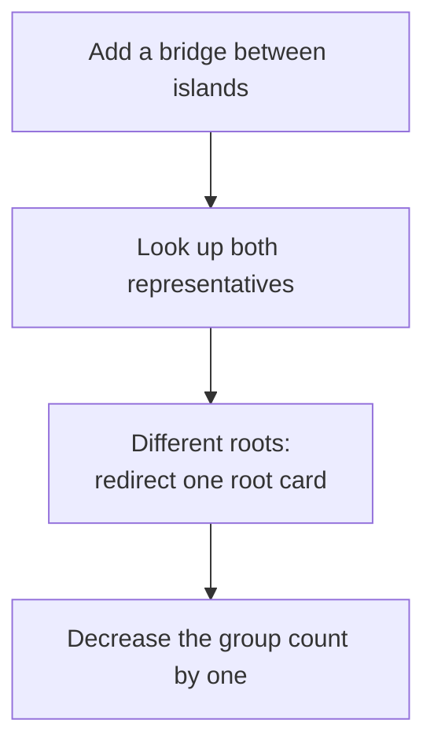

> [!tldr] Quick read
> - [[en/concepts/disjoint-set-union|Disjoint Set Union]] puts each vertex in exactly one group. `find` gets the representative, and `union` merges distinct groups.
> - [[en/concepts/union-by-size|Union by Size]] attaches the smaller tree below the larger root. [[en/concepts/path-compression|Path Compression]] shortens paths to roots during lookup.
> - A successful merge removes one component. A failed merge means the new edge would close a cycle.
> - The same operation answers three questions about undirected graphs. DFS still fits a graph with all its edges available when a single traversal suffices.

> [!info] Context
> This is station 4 on [[en/series/neetcode-grph|the NeetCode Graphs line]]. In [[en/posts/2026-11-26-neetcode-graph-bfs|station 2]], I used adjacency lists to visit vertices. Here, two-way edges arrive one by one, and a compact data structure answers whether two vertices are connected already. You only need arrays, loops, and undirected edges.

> [!abstract]- Quick glossary for this post (click to open)
> - A [[en/concepts/connected-component|connected component]] is a maximal group of mutually reachable vertices.
> - [[en/concepts/disjoint-set-union|DSU]] maintains disjoint groups with exactly one group per element.
> - `parent[x]` points upward in a representative tree. At a root, `parent[x]=x`.
> - [[en/concepts/union-by-size|Union by size]] keeps the representative from the larger group.
> - [[en/concepts/path-compression|Path compression]] rewrites parent pointers along a lookup path so a later search can reach the root sooner.

## Picture it first: the island group registry

Imagine that each island has a code. Before any bridges are built, each island stands on its own. The clerk gives each island a card pointing to itself. When a bridge connects two groups, the registry needs to redirect only the card at one representative. Cards at the other islands still lead to the right new representative when followed in order.

| Everyday life | Concept |
|---|---|
| A card pointing to the next representative | `parent` |
| Follow the cards to a self-pointing card | `find` |
| Find two different representatives | Two components |
| Attach the smaller group's root below the larger one | Union by Size |
| Redirect a card to its grandparent during lookup | One path-halving step |
| The representatives already match | The bridge would close a cycle |



## The problem: from retraversal to keeping the current answer

I receive undirected edges in order. After each edge, I could rebuild adjacency lists and run DFS to find the groups again. Yet the new edge can only merge two groups or leave the partition unchanged. The information I need to maintain is which group each vertex belongs to. If two endpoints have different groups, merge those groups. If they already share one, keep the partition. This edge-addition model lets me update the answer without rereading prior edges.

## How it works

### The parent forest invariant

I represent each group as a tree of parent pointers. Initially every vertex is its own root. After each operation, `find(u) === find(v)` holds exactly when a path through the edges already received connects the vertices. This holds before any edges arrive. When an edge connects distinct trees, attaching one **root** to the other root merges every member on both sides. When the roots match, the partition stays the same. DSU parent pointers store representatives. A pointer may connect a pair with no direct edge in the input graph.

### Two ways to keep root paths short

- **Union by Size.** When the smaller tree is attached below the larger tree, vertices in the smaller tree grow one level deeper. Each such move at least doubles the size of their group. A vertex can undergo only O(log V) such moves, even without path compression.
- **Path Compression.** During `find`, the `path halving` implementation points the current node directly to its grandparent. The parent and grandparent are in the same tree, preserving the root. On `7 → 5 → 4 → 0`, one write sets `parent[7]=4`, changes 7's path to `7 → 4 → 0`, and continues from 4. Size needs to be accurate only at roots. Compression does not change group membership.

Together, the optimizations take O(V) to initialize and O(E α(V)) amortized time for a sequence of E merges, with O(V) space. `α` is the very slowly growing inverse Ackermann function. The amortized bound covers a whole sequence, so I make no one-step guarantee for an individual `find`.

<figure class="figure-map" style="--ar: 3 / 4">
<div class="frame"><iframe data-archify="../../diagrams/neetcode-union-find/edge-trace.en.html" title="Two roads in the same group" loading="lazy"></iframe></div>
<figcaption><span><b>Figure 1.</b> After two merges, the third edge shares a root at both ends, so it closes the cycle.</span><a href="../diagrams/neetcode-union-find/edge-trace.en.html" target="_blank" rel="noopener">Open full screen</a></figcaption>
</figure>

### One template, three answers

| Problem | Distinct decision |
|---|---|
| [[en/problems/redundant-connection\|684. Redundant Connection]] | Read in order and return the first edge with matching roots. Vertex labels start at 1. |
| [[en/problems/number-of-connected-components-in-an-undirected-graph\|323. Number of Connected Components]] | Start with n groups and decrement once after each successful merge. |
| [[en/problems/graph-valid-tree\|261. Graph Valid Tree]] | Require exactly n−1 edges and all merges to succeed. One component remains. |

To compare against retraversal, I ran a sample with a path of 1,000 vertices followed by an edge joining its ends. DFS made 500,500 cumulative vertex visits. DSU attempted 1,000 merges. One DFS traversal remains useful on a static graph when the adjacency lists are available or when I need an actual path. Ordinary DSU maintains a partition, so deleting an edge that can split a group is a different problem.

## Runnable example

[TypeScript](../code/neetcode-union-find/solve.ts) · [Python](../code/neetcode-union-find/solve.py) · [Go](../code/neetcode-union-find/solve.go) · [Java](../code/neetcode-union-find/solve.java) · [JavaScript](../code/neetcode-union-find/solve.js) · [PHP](../code/neetcode-union-find/solve.php) · [Rust](../code/neetcode-union-find/solve.rs)

Each file runs all three problems independently and cross-checks DSU against DFS. The excerpt keeps the DSU code so the three call sites are easy to compare.

```ts
import assert from "node:assert/strict";

type Edge = readonly [number, number];

class DisjointSet {
  private parent: number[];
  private size: number[];
  count: number;

  constructor(n: number) {
    this.parent = Array.from({ length: n }, (_, i) => i);
    this.size = new Array<number>(n).fill(1);
    this.count = n;
  }

  find(node: number): number {
    while (node !== this.parent[node]) {
      this.parent[node] = this.parent[this.parent[node]];
      node = this.parent[node];
    }
    return node;
  }

  union(a: number, b: number): boolean {
    let ra = this.find(a);
    let rb = this.find(b);
    if (ra === rb) return false;
    if (this.size[ra] < this.size[rb]) [ra, rb] = [rb, ra];
    this.parent[rb] = ra;
    this.size[ra] += this.size[rb];
    this.count--;
    return true;
  }
}

function redundantByDsu(n: number, edges: readonly Edge[]): Edge {
  const ds = new DisjointSet(n + 1);
  for (const edge of edges) {
    if (!ds.union(...edge)) return edge;
  }
  throw new Error("Cần đúng một cạnh dư");
}

function componentsByDsu(n: number, edges: readonly Edge[]): number {
  const ds = new DisjointSet(n);
  for (const [a, b] of edges) ds.union(a, b);
  return ds.count;
}

function treeByDsu(n: number, edges: readonly Edge[]): boolean {
  if (edges.length !== n - 1) return false;
  const ds = new DisjointSet(n);
  return edges.every(([a, b]) => ds.union(a, b));
}
```

```python
class DisjointSet:
    def __init__(self, n):
        self.parent = list(range(n))
        self.size = [1] * n
        self.count = n

    def find(self, node):
        while node != self.parent[node]:
            self.parent[node] = self.parent[self.parent[node]]
            node = self.parent[node]
        return node

    def union(self, a, b):
        ra, rb = self.find(a), self.find(b)
        if ra == rb:
            return False
        if self.size[ra] < self.size[rb]:
            ra, rb = rb, ra
        self.parent[rb] = ra
        self.size[ra] += self.size[rb]
        self.count -= 1
        return True


def redundant_by_dsu(n, edges):
    ds = DisjointSet(n + 1)
    for edge in edges:
        if not ds.union(*edge):
            return edge
    raise ValueError("Cần đúng một cạnh dư")

def components_by_dsu(n, edges):
    ds = DisjointSet(n)
    for a, b in edges:
        ds.union(a, b)
    return ds.count

def tree_by_dsu(n, edges):
    if len(edges) != n - 1:
        return False
    ds = DisjointSet(n)
    return all(ds.union(a, b) for a, b in edges)
```

```go
package main

import "fmt"

type edge [2]int

type disjointSet struct {
	parent, size []int
	count        int
}

func newDisjointSet(n int) *disjointSet {
	ds := &disjointSet{make([]int, n), make([]int, n), n}
	for i := range ds.parent {
		ds.parent[i], ds.size[i] = i, 1
	}
	return ds
}

func (ds *disjointSet) find(node int) int {
	for node != ds.parent[node] {
		ds.parent[node] = ds.parent[ds.parent[node]]
		node = ds.parent[node]
	}
	return node
}

func (ds *disjointSet) union(a, b int) bool {
	ra, rb := ds.find(a), ds.find(b)
	if ra == rb {
		return false
	}
	if ds.size[ra] < ds.size[rb] {
		ra, rb = rb, ra
	}
	ds.parent[rb] = ra
	ds.size[ra] += ds.size[rb]
	ds.count--
	return true
}

func redundantByDsu(n int, edges []edge) edge {
	ds := newDisjointSet(n + 1)
	for _, e := range edges {
		if !ds.union(e[0], e[1]) {
			return e
		}
	}
	panic("Cần đúng một cạnh dư")
}

func componentsByDsu(n int, edges []edge) int {
	ds := newDisjointSet(n)
	for _, e := range edges {
		ds.union(e[0], e[1])
	}
	return ds.count
}

func treeByDsu(n int, edges []edge) bool {
	if len(edges) != n-1 {
		return false
	}
	ds := newDisjointSet(n)
	for _, e := range edges {
		if !ds.union(e[0], e[1]) {
			return false
		}
	}
	return true
}
```

```java
class Solve {
    static final class DisjointSet {
        private final int[] parent;
        private final int[] size;
        int count;

        DisjointSet(int n) {
            parent = new int[n];
            size = new int[n];
            count = n;
            for (int i = 0; i < n; i++) {
                parent[i] = i;
                size[i] = 1;
            }
        }

        int find(int node) {
            while (node != parent[node]) {
                parent[node] = parent[parent[node]];
                node = parent[node];
            }
            return node;
        }

        boolean union(int a, int b) {
            int ra = find(a), rb = find(b);
            if (ra == rb) return false;
            if (size[ra] < size[rb]) {
                int swap = ra;
                ra = rb;
                rb = swap;
            }
            parent[rb] = ra;
            size[ra] += size[rb];
            count--;
            return true;
        }
    }

    static int[] redundantByDsu(int n, int[][] edges) {
        var ds = new DisjointSet(n + 1);
        for (int[] e : edges) {
            if (!ds.union(e[0], e[1])) return e;
        }
        throw new IllegalArgumentException("Cần đúng một cạnh dư");
    }

    static int componentsByDsu(int n, int[][] edges) {
        var ds = new DisjointSet(n);
        for (int[] e : edges) ds.union(e[0], e[1]);
        return ds.count;
    }

    static boolean treeByDsu(int n, int[][] edges) {
        if (edges.length != n - 1) return false;
        var ds = new DisjointSet(n);
        for (int[] e : edges) {
            if (!ds.union(e[0], e[1])) return false;
        }
        return true;
    }
}
```

```javascript
import assert from "node:assert/strict";

class DisjointSet {
  parent;
  size;
  count;

  constructor(n) {
    this.parent = Array.from({ length: n }, (_, i) => i);
    this.size = new Array(n).fill(1);
    this.count = n;
  }

  find(node) {
    while (node !== this.parent[node]) {
      this.parent[node] = this.parent[this.parent[node]];
      node = this.parent[node];
    }
    return node;
  }

  union(a, b) {
    let ra = this.find(a);
    let rb = this.find(b);
    if (ra === rb) return false;
    if (this.size[ra] < this.size[rb]) [ra, rb] = [rb, ra];
    this.parent[rb] = ra;
    this.size[ra] += this.size[rb];
    this.count--;
    return true;
  }
}

function redundantByDsu(n, edges) {
  const ds = new DisjointSet(n + 1);
  for (const edge of edges) {
    if (!ds.union(...edge)) return edge;
  }
  throw new Error("Cần đúng một cạnh dư");
}

function componentsByDsu(n, edges) {
  const ds = new DisjointSet(n);
  for (const [a, b] of edges) ds.union(a, b);
  return ds.count;
}

function treeByDsu(n, edges) {
  if (edges.length !== n - 1) return false;
  const ds = new DisjointSet(n);
  return edges.every(([a, b]) => ds.union(a, b));
}
```

```php
<?php
declare(strict_types=1);

final class DisjointSet
{
    private array $parent;
    private array $size;
    public int $count;

    public function __construct(int $n)
    {
        $this->parent = range(0, $n - 1);
        $this->size = array_fill(0, $n, 1);
        $this->count = $n;
    }

    public function find(int $node): int
    {
        while ($node !== $this->parent[$node]) {
            $this->parent[$node] = $this->parent[$this->parent[$node]];
            $node = $this->parent[$node];
        }
        return $node;
    }

    public function union(int $a, int $b): bool
    {
        [$ra, $rb] = [$this->find($a), $this->find($b)];
        if ($ra === $rb) {
            return false;
        }
        if ($this->size[$ra] < $this->size[$rb]) {
            [$ra, $rb] = [$rb, $ra];
        }
        $this->parent[$rb] = $ra;
        $this->size[$ra] += $this->size[$rb];
        $this->count--;
        return true;
    }
}

function redundantByDsu(int $n, array $edges): array
{
    $ds = new DisjointSet($n + 1);
    foreach ($edges as [$a, $b]) {
        if (!$ds->union($a, $b)) {
            return [$a, $b];
        }
    }
    throw new InvalidArgumentException('Cần đúng một cạnh dư');
}

function componentsByDsu(int $n, array $edges): int
{
    $ds = new DisjointSet($n);
    foreach ($edges as [$a, $b]) {
        $ds->union($a, $b);
    }
    return $ds->count;
}

function treeByDsu(int $n, array $edges): bool
{
    if (count($edges) !== $n - 1) {
        return false;
    }
    $ds = new DisjointSet($n);
    foreach ($edges as [$a, $b]) {
        if (!$ds->union($a, $b)) {
            return false;
        }
    }
    return true;
}
```

```rust
type Edge = [usize; 2];

struct DisjointSet {
    parent: Vec<usize>,
    size: Vec<usize>,
    count: usize,
}

impl DisjointSet {
    fn new(n: usize) -> Self {
        Self {
            parent: (0..n).collect(),
            size: vec![1; n],
            count: n,
        }
    }

    fn find(&mut self, mut node: usize) -> usize {
        while node != self.parent[node] {
            self.parent[node] = self.parent[self.parent[node]];
            node = self.parent[node];
        }
        node
    }

    fn union(&mut self, a: usize, b: usize) -> bool {
        let mut ra = self.find(a);
        let mut rb = self.find(b);
        if ra == rb {
            return false;
        }
        if self.size[ra] < self.size[rb] {
            std::mem::swap(&mut ra, &mut rb);
        }
        self.parent[rb] = ra;
        self.size[ra] += self.size[rb];
        self.count -= 1;
        true
    }
}

fn redundant_by_dsu(n: usize, edges: &[Edge]) -> Edge {
    let mut ds = DisjointSet::new(n + 1);
    for &[a, b] in edges {
        if !ds.union(a, b) {
            return [a, b];
        }
    }
    panic!("Cần đúng một cạnh dư");
}

fn components_by_dsu(n: usize, edges: &[Edge]) -> usize {
    let mut ds = DisjointSet::new(n);
    for &[a, b] in edges {
        ds.union(a, b);
    }
    ds.count
}

fn tree_by_dsu(n: usize, edges: &[Edge]) -> bool {
    if edges.len() != n - 1 {
        return false;
    }
    let mut ds = DisjointSet::new(n);
    edges.iter().all(|&[a, b]| ds.union(a, b))
}
```

TypeScript and JavaScript also check the long path, producing the following two lines. The other five files each print 26/26 cases passed.

```text
28/28 cases passed
1000 edges: DFS visits 500500 vertices; DSU attempts 1000 merges
```

*(Output labels translated; the files themselves print Vietnamese.)*

## Misconceptions and common traps

- After `b` stops being a root, `size[b]` no longer determines merges. Always read sizes at roots returned by `find`.
- Merging undirected edges with DSU tells whether vertices connect along two-way edges. It cannot answer reachability along directed arrows.
- Comparing `parent[u]` with `parent[v]` is insufficient. Two branches can share a root with different immediate parents.

## Self-check questions

> [!question]- Do matching roots decrease the component count?
> No. The edge stays inside an existing group, so the component count stays the same.

> [!question]- Why is redirecting a node to its grandparent valid?
> The node and grandparent are already in the same tree, and the new path leads to the old root.

> [!question]- Does DSU give the sequence of vertices on a path from u to v?
> No. DSU's parent registry tracks representatives. To find an actual route, read the graph's edges with DFS, BFS, or another appropriate structure.

## References

- [LeetCode](https://leetcode.com/problems/redundant-connection/)
- [NeetCode](https://neetcode.io/problems/count-connected-components/question)
- [NeetCode](https://neetcode.io/problems/valid-tree/question)
- [Sedgewick and Wayne, Weighted Quick Union](https://github.com/kevin-wayne/algs4/blob/master/src/main/java/edu/princeton/cs/algs4/WeightedQuickUnionUF.java)
- [Robert Tarjan, Efficiency of a Good But Not Linear Set Union Algorithm](https://doi.org/10.1145/321879.321884)
