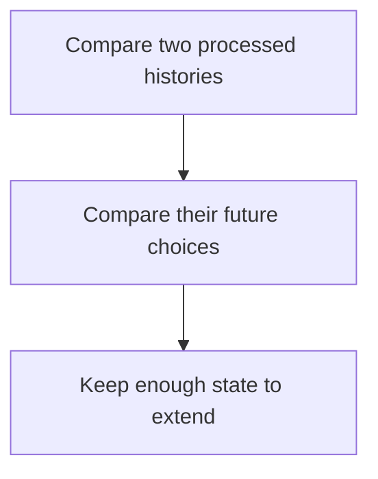

> [!tldr] Quick read
> - Word Break needs to know whether boundary i is reachable. Two splits ending at that boundary have the same suffix and the same next choices.
> - LIS can define a state ending at position i, then extend only an earlier position j whose value is smaller.
> - For a fixed length, the smallest tail preserves every extension a larger tail allows. Keep one tail per length and update it with Lower Bound.
> - The tail array gives the length. To reconstruct an actual subsequence by index, save predecessor information.

> [!info] Context
> This is station four on [[en/series/neetcode-dp|the NeetCode Line: Dynamic Programming]]. I have a tape of labels to cut according to a catalog and a line of packages to select in increasing weight order. You need arrays, loops, and [[en/concepts/lower-bound|Lower Bound]] from the search line.

> [!abstract]- Quick glossary for this post (click to open)
> - [[en/concepts/prefix-reachability|Prefix Reachability]] asks whether valid pieces cover the entire prefix before a boundary.
> - An [[en/concepts/increasing-subsequence|Increasing Subsequence]] keeps index order and strictly increases, with gaps allowed.
> - An [[en/concepts/lis-minimum-tail|LIS Minimum Tail]] records the smallest ending value for each attainable length.
> - A [[en/concepts/dp-state|DP State]] specifies which information from the processed part affects the next decision.

## Picture it first: cutting labels and choosing packages

When cutting a tape, I mark boundaries already reached by valid cuts so I know where another label can begin. In a line of packages, I select packages in arrival order. Two groups can have the same number of packages and different final weights. The lighter ending makes the next package easier to choose.

| Everyday life | Concept |
|---|---|
| A mark after a valid run of labels | A reachable prefix boundary |
| Skip a package while keeping the order of the rest | A subsequence |
| The lightest final package among groups of equal size | A minimum tail |
| The first group whose ending weighs at least the new package | Lower Bound |



## The problem: what information do I need to continue?

In Word Break, boundary i is enough to test words starting at `s[i:]`. In LIS, the best length of a prefix is insufficient. An existing sequence can end above the next value, while a sequence of the same length with a smaller tail can extend. Each objective needs its own invariant.

## How it works

<figure class="figure-map" style="--ar: 3 / 4">
<div class="frame"><iframe data-archify="../../diagrams/neetcode-word-break-lis/prefix-cuts.en.html" title="Two cut boundaries for sunrise" loading="lazy"></iframe></div>
<figcaption><span><b>Figure 1.</b> Keep boundaries 3 and 4. The <code>sunr</code> branch stops, while <code>sun</code> can extend with <code>rise</code>.</span><a href="../diagrams/neetcode-word-break-lis/prefix-cuts.en.html" target="_blank" rel="noopener">Open full screen</a></figcaption>
</figure>

### Word Break merges paths at a boundary

Take boundaries zero through n. There is an edge i → j when `s[i:j]` is a dictionary word, with i < j. A valid segmentation is a path from zero to n. Edges go to larger indices, so a left-to-right sweep visits every predecessor before its destination. Set `reachable[0] = true`. For each reachable boundary, try the words that match there and mark their destinations.

Two paths to the same i differ only in the cuts already made. They share `s[i:]` and can reuse the same dictionary, so combine them with OR. With `sunrise` and `[sun,sunr,rise]`, boundary 4 is a dead end and boundary 3 reaches boundary 7. Choosing the longest matching word first misses the latter path. The diagram compares the branches, while the loop processes boundaries in ascending order.

For D dictionary words, maximum word length L, and input length n, trying words at each boundary takes O(n·D·L) time in the worst case and O(n) auxiliary space, excluding the input. Matching at an offset avoids copying the entire suffix for each candidate.

### LIS keeps a representative for each length

Start with `bestAt[i]`, the longest length ending at i. Use `nums[i]` alone or extend any j < i with `nums[j] < nums[i]`. This takes O(n²) time and O(n) auxiliary space.

To reduce the number of candidate states, let `tails[k]` be the minimum attainable tail of a subsequence of length k + 1 in the current prefix. Among equal-length sequences, every value that can extend a larger tail can extend a smaller one. The tails strictly increase because dropping the final item of a longer subsequence leaves a shorter subsequence with a smaller tail. For a new x, find the first tail ≥ x. The previous slot, if it exists, has a tail < x and can extend with x. A longer sequence ending at x would require a tail < x in the slot just found or farther right, contradicting the invariant. Write x at the found slot, or append it if every tail is smaller.

For `[4,8,1,6,9,2]`, the final tail array is `[1,2,9]`, but 2 occurs after 9. Each cell represents a length independently. The optimal length is three and `[1,6,9]` is a valid witness. Lower Bound uses O(log n) comparisons per input value, giving O(n log n) total time and O(n) auxiliary space.

| Problem | What changes |
|---|---|
| [[en/problems/word-break|Word Break]] | Keep one flag per boundary because every path to it has the same remaining choices. |
| [[en/problems/longest-increasing-subsequence|Longest Increasing Subsequence]] | For a fixed length, preserve the smallest tail because it allows every extension a larger tail allows. |

## Runnable example

[TypeScript](../code/neetcode-word-break-lis/states.ts) · [Python](../code/neetcode-word-break-lis/states.py) · [Go](../code/neetcode-word-break-lis/states.go) · [Java](../code/neetcode-word-break-lis/states.java) · [JavaScript](../code/neetcode-word-break-lis/states.js) · [PHP](../code/neetcode-word-break-lis/states.php) · [Rust](../code/neetcode-word-break-lis/states.rs)

```ts
function wordBreak(s: string, words: string[]): boolean {
    const reachable = Array(s.length + 1).fill(false)
    reachable[0] = true
    for (let start = 0; start < s.length; start++) {
        if (!reachable[start]) continue
        for (const word of words) {
            if (s.startsWith(word, start)) reachable[start + word.length] = true
        }
    }
    return reachable[s.length]
}
```

```python
def word_break(s, words):
    reachable = [True] + [False] * len(s)
    for start in range(len(s)):
        if not reachable[start]:
            continue
        for word in words:
            if s.startswith(word, start):
                reachable[start + len(word)] = True
    return reachable[len(s)]
```

```go
func wordBreak(s string, words []string) bool {
	reachable := make([]bool, len(s)+1)
	reachable[0] = true
	for start := 0; start < len(s); start++ {
		if !reachable[start] {
			continue
		}
		for _, word := range words {
			if strings.HasPrefix(s[start:], word) {
				reachable[start+len(word)] = true
			}
		}
	}
	return reachable[len(s)]
}
```

```java
static boolean wordBreak(String s, String[] words) {
    boolean[] reachable = new boolean[s.length() + 1];
    reachable[0] = true;
    for (int start = 0; start < s.length(); start++) {
        if (!reachable[start]) continue;
        for (String word : words) {
            if (s.startsWith(word, start)) reachable[start + word.length()] = true;
        }
    }
    return reachable[s.length()];
}
```

```js
function wordBreak(s, words) {
    const reachable = Array(s.length + 1).fill(false)
    reachable[0] = true
    for (let start = 0; start < s.length; start++) {
        if (!reachable[start]) continue
        for (const word of words) {
            if (s.startsWith(word, start)) reachable[start + word.length] = true
        }
    }
    return reachable[s.length]
}
```

```php
function wordBreak(string $s, array $words): bool {
    $length = strlen($s);
    $reachable = array_fill(0, $length + 1, false);
    $reachable[0] = true;
    for ($start = 0; $start < $length; $start++) {
        if (!$reachable[$start]) continue;
        foreach ($words as $word) {
            $end = $start + strlen($word);
            if ($end <= $length && substr_compare($s, $word, $start, strlen($word)) === 0) {
                $reachable[$end] = true;
            }
        }
    }
    return $reachable[$length];
}
```

```rust
fn word_break(s: &str, words: &[&str]) -> bool {
    let bytes = s.as_bytes();
    let mut reachable = vec![false; bytes.len() + 1];
    reachable[0] = true;
    for start in 0..bytes.len() {
        if !reachable[start] {
            continue;
        }
        for word in words {
            if bytes[start..].starts_with(word.as_bytes()) {
                reachable[start + word.len()] = true;
            }
        }
    }
    reachable[bytes.len()]
}
```

Each file runs both Word Break and LIS. The tabs show the loop that marks reachable boundaries. Download the full file for the Lower Bound version of LIS and the checks.

```text
16/16 cases passed
```

*(Output labels translated; the files themselves print Vietnamese.)*

Run with `node states.ts`, `python3 states.py`, `go run states.go`, `java states.java`, `node states.js`, `php states.php`, or `rustc --edition 2021 -O states.rs -o /tmp/states && /tmp/states`.

## Misconceptions and common traps

- Keep only the destination of the first matching word. Each boundary can open several edges and a locally valid edge can reach a dead end.
- Take only consecutive increasing values and stop at a decrease. A subsequence can skip positions. In `[2,6,3,4]`, `[2,3,4]` is an increasing subsequence of length three.
- Find the first value greater than x rather than greater than or equal to it. Strict increase lets an equal value replace its existing slot. The LIS of `[2,2,2]` has length one.
- Print the tail values as a subsequence. To return its elements, track endpoint indices and the links needed to recover earlier choices.

## Self-check questions

> [!question]- Do I need to distinguish two segmentations that reach boundary 3?
> No for a feasibility question. Both leave the same suffix and the same words to try next.

> [!question]- Why does replacing a larger tail with a smaller one preserve future choices?
> A later number larger than the old tail is also larger than the new, smaller one. It comes after both in index order.

> [!question]- Why does Lower Bound stop at a tail equal to x without adding length?
> Strict extension requires a preceding tail smaller than x. The slot whose value equals x can retain that value.

## References

- [Word Break](https://leetcode.com/problems/word-break/) · [Longest Increasing Subsequence](https://leetcode.com/problems/longest-increasing-subsequence/)
- [Jeff Erickson, Algorithms, text segmentation and LIS](https://jeffe.cs.illinois.edu/teaching/algorithms/book/Algorithms-JeffE.pdf)
- [MIT 6.006 on subproblems and bottom-up order](https://ocw.mit.edu/courses/6-006-introduction-to-algorithms-fall-2011/resources/mit6_006f11_lec19/)
- [Stanford CS103 on LIS and patience sorting](https://web.stanford.edu/class/archive/cs/cs103/cs103.1254/lectures/25/Lecture%20Slides.pdf)
