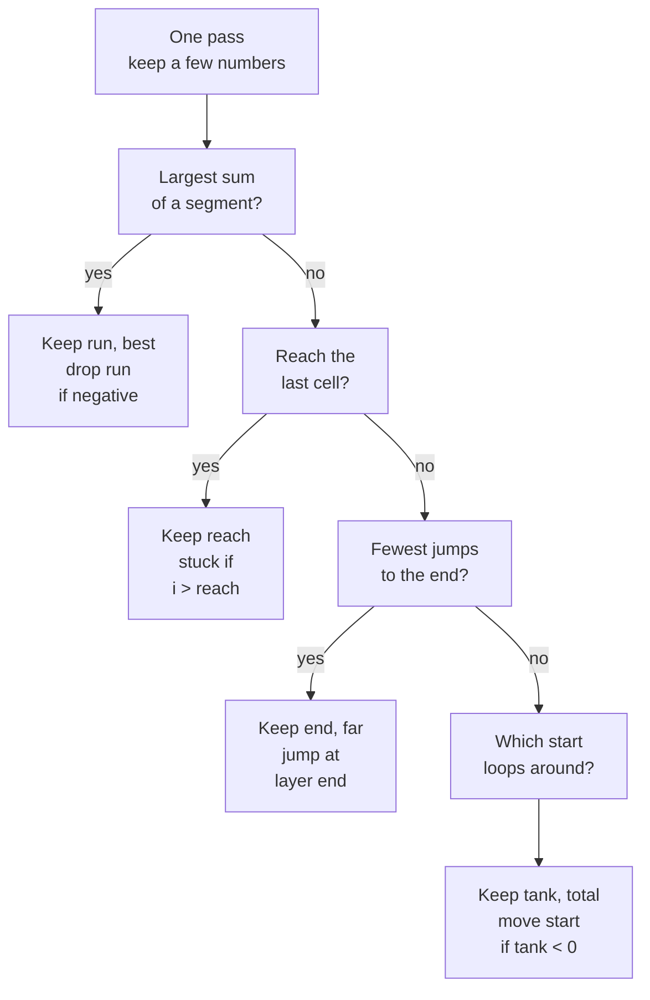
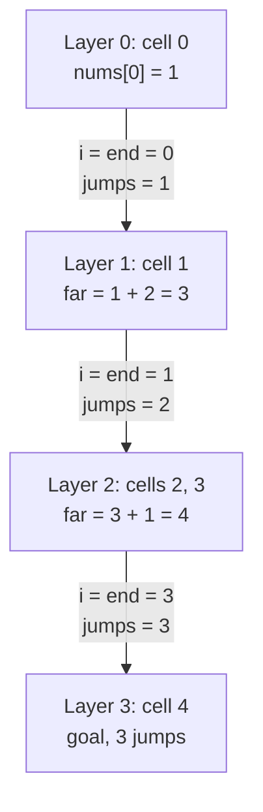
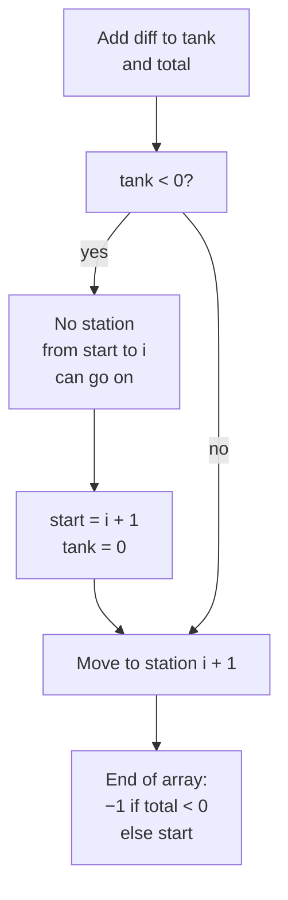

> [!tldr] Quick read
> - The two previous stations ([[en/posts/2026-11-28-neetcode-subsets-combinations|MISC-01]], [[en/posts/2026-11-28-neetcode-permutations-search|MISC-02]]) tried every choice and then undid it. This station does the opposite: **walk the array once from left to right, keep one or two numbers, and at each cell decide right away by a local rule**, never going back.
> - The four problems differ only in the number they keep: the running sum `run` (Maximum Subarray), the farthest reach `reach` (Jump Game), the layer end `end` plus `far` (Jump Game II), the tank `tank` (Gas Station).
> - A local rule is only trustworthy when it comes with a reason. In all four problems the reason has the same shape: **what gets dropped (a negative prefix, a starting station) surely does not hold a better answer**.
> - Greedy is not always right. Making change for `6` with coins `{1, 3, 4}` by "take the biggest coin first" uses 3 coins, while `3 + 3` needs only 2.

> [!info] Context
> This is the third station of [[en/series/neetcode-misc|the NeetCode Line: Mixed Techniques]]. The two backtracking stations before it listed every choice; this one opens the greedy part: choose once, never retry. You only need arrays, a `for` loop and the `max` function. You do not need to read the two previous stations.

> [!abstract]- Quick glossary for this post (click to open)
> - [[en/concepts/greedy-choice|Greedy Choice]] means picking what is best *at the current step* and never reconsidering it, together with an argument that this choice does not lose the optimal answer.
> - [[en/concepts/kadane-algorithm|Kadane's Algorithm]] finds the largest sum of a contiguous segment in one pass: keep the sum of the running segment, and drop it when it goes negative.
> - [[en/concepts/farthest-reach|Farthest Reach]] is a single number that describes every reachable cell: every cell from 0 to `reach` is reachable.
> - [[en/concepts/jump-layers|Jump Layers]] means grouping cells by the fewest jumps needed to reach them; each layer is a contiguous range.
> - [[en/concepts/restart-argument|Restart Argument]] is the proof that when the segment under consideration fails at cell i, every starting point in between fails too, so you restart right after i.
> - A **subarray** is a contiguous piece of the array, like `[4, −1, 3]` in `[2, −5, 4, −1, 3, −7, 2]`; unlike a subsequence, it cannot skip elements.
> - A **prefix** of a segment is its leading part.
> - An **exchange argument** takes any optimal answer, swaps part of it to match the greedy choice, and shows it gets no worse.

## Picture it first: a drive along the highway

I drive straight along a highway with many stops, never turning around, with only a small notebook in my pocket holding one or two numbers. The first job is scoring the scenery of each stretch (pretty adds, ugly subtracts) to find the most memorable continuous stretch: if the stretch I just drove has a negative total, I forget it and start counting again from here. The second job is hitching rides on minibuses: each stop has a sign saying "buses from here go at most k stops", and I note the farthest milestone that any sign I have seen could take me to. The third job is counting the fewest rides: the stops one ride away, the stops that need two rides, and so on. The last job is choosing a gas station to start a full loop from: whenever the tank runs dry at station i, every start from the old one up to i fails as well, so I try again from station i + 1.

| Everyday life | Concept |
|---|---|
| Driving straight, never turning around, only reading the small notebook | One left-to-right pass, O(1) state |
| Deciding at each stop by a rule with a solid reason | [[en/concepts/greedy-choice\|Greedy Choice]] |
| Forgetting a stretch with a negative score and counting again from here | [[en/concepts/kadane-algorithm\|Kadane's Algorithm]]: drop when `run < 0` |
| The record for the best stretch, written in the notebook's corner | `best` |
| The farthest milestone the signs seen so far can reach | [[en/concepts/farthest-reach\|Farthest Reach]]: `reach` |
| Standing at a stop past that milestone means being stuck | Return `false` when `i > reach` |
| Groups of stops one ride away, two rides away | [[en/concepts/jump-layers\|Jump Layers]]: `end` and `far` |
| The tank runs dry at station i: try again from station i + 1 | [[en/concepts/restart-argument\|Restart Argument]]: move `start` when `tank < 0` |



The four result boxes are the four problems of the station. The only thing that changes between them is the number in the notebook.

## The problem: choosing locally without seeing what comes next

I used to think "greedy" was a lucky trick: pick whatever looks best and hope it is right. For Maximum Subarray, the safe way is to try every segment `[i, j]`, which is O(n²) segments. One O(n) pass is far faster, but at cell i I have not seen the rest of the array yet. How can I dare drop anything without knowing the future?

That question has an answer, and the answer is not "hope". Making change is the clearest counter-example. With coins `{1, 3, 4}` and the amount 6, the rule "take the biggest coin that still fits" picks 4, then 1, then 1: three coins. The right answer is 3 + 3, two coins. That is why [[en/problems/coin-change|Coin Change]] has to be solved with dynamic programming. A greedy rule may only be used when an argument proves it never misses a better answer. This station is four problems that have such an argument.

## How it works

<figure class="figure-map" style="--ar: 3 / 5">
<div class="frame"><iframe data-archify="../../diagrams/neetcode-greedy-array/kadane.en.html" title="Kadane on [2, −5, 4, −1, 3, −7, 2]" loading="lazy"></iframe></div>
<figcaption><span><b>Figure 1.</b> Kadane walks <code>[2, −5, 4, −1, 3, −7, 2]</code> once: the running sum goes negative twice and is dropped both times, while the record 6 of the segment <code>[4, −1, 3]</code> stays in the notebook's corner until the end.</span><a href="../diagrams/neetcode-greedy-array/kadane.en.html" target="_blank" rel="noopener">Open full screen</a></figcaption>
</figure>

### The shared template: one pass, a small state, one rule

All four solutions have the same shape:

1. Initialize one or two state variables (a sum, a farthest reach, a tank).
2. Walk `i` from left to right exactly once.
3. At each cell, apply **one local rule**: update the state, and if the state has "gone bad", drop the old part.
4. The answer is already in the state when the loop ends.

Time O(n), memory O(1). The hard part is not the code, which is a few lines, but the question: **why is the rule in step 3 safe?** That is what [[en/concepts/greedy-choice|Greedy Choice]] demands. Two kinds of argument come up often. The *exchange* kind: take any optimal answer, change it to match the greedy choice, and show it gets no worse. The *stays-ahead* kind: after every step, the greedy solution is at least as good as any other way.

### Kadane: why dropping a negative prefix is safe

Let `run` be the largest sum of a segment **ending exactly at cell i**. Every segment ending at i has one of two forms: `[x]` itself, or a segment ending at i − 1 with x appended. The best of the second form is `old_run + x`. If `old_run < 0` then `old_run + x < x`, so appending only makes it worse: drop the prefix and restart at x. That is the whole of [[en/concepts/kadane-algorithm|Kadane]]:

```text
run  = run < 0 ? x : run + x
best = max(best, run)
```

The answer is some segment, and that segment ends at some cell, so `best` (the largest value of `run` across all cells) is sure to catch it. Figure 1 shows two drops: −3 before the 4, and −1 before the final 2. The second one does not change the record, but if the last number were 9, the new segment `[9]` would win.

This is also one-dimensional dynamic programming with `dp[i] = max(x, dp[i − 1] + x)`, except that I keep only the last cell of the table. That is why Kadane is often filed under both groups.

### Jump Game: one number describes the whole set of reachable cells

At each cell i, `nums[i]` is the **maximum** jump. If you can jump to cell j, you can also jump to every cell between i and j. So the set of reachable cells is always a contiguous range `[0, reach]`, and a single integer describes it: [[en/concepts/farthest-reach|Farthest Reach]].

Walk from left to right: if `i > reach`, no earlier cell can take you to i, so return `false`. Otherwise update `reach = max(reach, i + nums[i])`. If you walk the whole array without getting stuck, the last cell is reachable. The array `[2, 0, 1, 0, 3]` gets stuck at cell 4: `reach` stops at 3 because cells 1 and 3 are both 0.

### Jump Game II: count layers instead of jumps

Now the problem asks for the fewest jumps. Cell 0 needs 0 jumps. The cells reachable in one jump form layer 1, the cells that need exactly two jumps form layer 2, and so on. This is breadth-first search (BFS), but each layer is a contiguous range, so no queue is needed: you only need to know that the current layer ends at `end`, and while scanning that layer, record `far`, the farthest cell the next layer reaches. That is [[en/concepts/jump-layers|Jump Layers]].



The diagram above runs on `[1, 2, 0, 1, 0]`. The safety argument is the stays-ahead kind: after t jumps, no way of jumping gets past the `end` of layer t, because `end` is already the farthest point from every cell of the previous layer. The loop stops at `n − 2`: once you stand on the last cell, no more jumps are needed.

### Gas Station: when the tank runs dry, restart after that point

Station i gives `gas[i]` liters and the leg to the next station costs `cost[i]`. Let `diff = gas[i] − cost[i]`. Trying every starting station costs O(n²). The greedy pass relies on the [[en/concepts/restart-argument|Restart Argument]]:

> Starting at `start`, the tank first goes negative when leaving station i. For every station k between `start` and i, the tank was ≥ 0 on arrival at k from `start`. Starting directly at k means an empty tank, that is, less or equal fuel, so it also runs dry at i or earlier. So drop all those stations and try again from i + 1.

If the sum of all `diff` values is negative, no station completes the loop, so return −1. If the sum is ≥ 0, the last `start` works: from `start` to the end of the array the tank never goes negative, and that surplus is enough to cover the pieces dropped at the front of the array, because the total for the whole loop is not negative. With `gas = [3, 1, 2, 5]`, `cost = [2, 4, 3, 1]`, the `diff` values are `[1, −3, −1, 4]`: the tank runs dry at station 1 and then at station 2, and station 3 is the answer.

Dropping a negative prefix in Kadane is a restart by exactly the same argument: the segment from the old start to here has a negative sum, so starting anywhere inside it is no better than restarting.



### Four problems at one station

| Problem | What differs |
|---|---|
| [[en/problems/maximum-subarray\|Maximum Subarray]] | The anchor. Keep `run` and `best`; when `run` is negative, restart at the current element. Initialize with `nums[0]`, not 0, so an all-negative array still works. |
| [[en/problems/jump-game\|Jump Game]] | Keep `reach`; any cell outside `reach` means stuck. Returns true/false, does not count jumps. |
| [[en/problems/jump-game-ii\|Jump Game II]] | Keep `end` (end of the layer being scanned) and `far` (farthest reach of the next layer). Hitting `end` increments `jumps`. The problem guarantees the goal is always reachable. |
| [[en/problems/gas-station\|Gas Station]] | The array is a circle, but it is still walked in one straight pass. Keep `tank` and `total`; when `tank` is negative, `start = i + 1`. Check `total` at the end. |

## Runnable example

[TypeScript](../code/neetcode-greedy-array/greedy.ts) · [Python](../code/neetcode-greedy-array/greedy.py) · [Go](../code/neetcode-greedy-array/greedy.go) · [Java](../code/neetcode-greedy-array/greedy.java) · [JavaScript](../code/neetcode-greedy-array/greedy.js) · [PHP](../code/neetcode-greedy-array/greedy.php) · [Rust](../code/neetcode-greedy-array/greedy.rs)

```ts
// Maximum Subarray (Kadane): drop a negative running sum, restart at the current element.
function maxSubArray(nums: number[]): number {
    let run = nums[0] // sum of the best segment ending at i
    let best = nums[0] // best so far
    for (let i = 1; i < nums.length; i++) {
        run = run < 0 ? nums[i] : run + nums[i] // a negative prefix only drags the sum down: drop it
        best = Math.max(best, run)
    }
    return best
}

// Jump Game: keep the farthest reachable cell; standing beyond it means stuck.
function canJump(nums: number[]): boolean {
    let reach = 0
    for (let i = 0; i < nums.length; i++) {
        if (i > reach) return false // no earlier cell can jump to i
        reach = Math.max(reach, i + nums[i])
    }
    return true
}

// Jump Game II: scan by layers; finishing the current layer costs one more jump.
function jump(nums: number[]): number {
    let jumps = 0
    let end = 0 // last cell of the layer being scanned
    let far = 0 // farthest cell the next layer reaches
    for (let i = 0; i < nums.length - 1; i++) {
        far = Math.max(far, i + nums[i])
        if (i === end) { // finished scanning this layer
            jumps++
            end = far
        }
    }
    return jumps
}

// Gas Station: if the tank runs dry at station i, no start from start to i works.
function canCompleteCircuit(gas: number[], cost: number[]): number {
    let total = 0
    let tank = 0
    let start = 0
    for (let i = 0; i < gas.length; i++) {
        const diff = gas[i] - cost[i]
        total += diff
        tank += diff
        if (tank < 0) { // restart from the next station
            start = i + 1
            tank = 0
        }
    }
    return total < 0 ? -1 : start
}
```

```python
def max_sub_array(nums):
    """Kadane: drop a negative running sum, restart at the current element."""
    run = best = nums[0]  # run: best segment ending at i; best: best so far
    for x in nums[1:]:
        run = x if run < 0 else run + x  # a negative prefix only drags the sum down: drop it
        best = max(best, run)
    return best


def can_jump(nums):
    """Keep the farthest reachable cell; standing beyond it means stuck."""
    reach = 0
    for i, x in enumerate(nums):
        if i > reach:
            return False  # no earlier cell can jump to i
        reach = max(reach, i + x)
    return True


def jump(nums):
    """Scan by layers; finishing the current layer costs one more jump."""
    jumps = end = far = 0  # end: last cell of the layer being scanned; far: farthest reach of the next layer
    for i in range(len(nums) - 1):
        far = max(far, i + nums[i])
        if i == end:  # finished scanning this layer
            jumps += 1
            end = far
    return jumps


def can_complete_circuit(gas, cost):
    """If the tank runs dry at station i, no start from start to i works."""
    total = tank = start = 0
    for i in range(len(gas)):
        diff = gas[i] - cost[i]
        total += diff
        tank += diff
        if tank < 0:  # restart from the next station
            start = i + 1
            tank = 0
    return -1 if total < 0 else start
```

```go
// Maximum Subarray (Kadane): drop a negative running sum, restart at the current element.
func maxSubArray(nums []int) int {
	run := nums[0]  // sum of the best segment ending at i
	best := nums[0] // best so far
	for _, x := range nums[1:] {
		if run < 0 {
			run = x // a negative prefix only drags the sum down: drop it
		} else {
			run += x
		}
		best = max(best, run)
	}
	return best
}

// Jump Game: keep the farthest reachable cell; standing beyond it means stuck.
func canJump(nums []int) bool {
	reach := 0
	for i, x := range nums {
		if i > reach {
			return false // no earlier cell can jump to i
		}
		reach = max(reach, i+x)
	}
	return true
}

// Jump Game II: scan by layers; finishing the current layer costs one more jump.
func jump(nums []int) int {
	jumps, end, far := 0, 0, 0 // end: last cell of the layer being scanned; far: farthest reach of the next layer
	for i := 0; i < len(nums)-1; i++ {
		far = max(far, i+nums[i])
		if i == end { // finished scanning this layer
			jumps++
			end = far
		}
	}
	return jumps
}

// Gas Station: if the tank runs dry at station i, no start from start to i works.
func canCompleteCircuit(gas, cost []int) int {
	total, tank, start := 0, 0, 0
	for i := range gas {
		diff := gas[i] - cost[i]
		total += diff
		tank += diff
		if tank < 0 { // restart from the next station
			start = i + 1
			tank = 0
		}
	}
	if total < 0 {
		return -1
	}
	return start
}
```

```java
// Maximum Subarray (Kadane): drop a negative running sum, restart at the current element.
static int maxSubArray(int[] nums) {
    int run = nums[0]; // sum of the best segment ending at i
    int best = nums[0]; // best so far
    for (int i = 1; i < nums.length; i++) {
        run = run < 0 ? nums[i] : run + nums[i]; // a negative prefix only drags the sum down: drop it
        best = Math.max(best, run);
    }
    return best;
}

// Jump Game: keep the farthest reachable cell; standing beyond it means stuck.
static boolean canJump(int[] nums) {
    int reach = 0;
    for (int i = 0; i < nums.length; i++) {
        if (i > reach) return false; // no earlier cell can jump to i
        reach = Math.max(reach, i + nums[i]);
    }
    return true;
}

// Jump Game II: scan by layers; finishing the current layer costs one more jump.
static int jump(int[] nums) {
    int jumps = 0;
    int end = 0; // last cell of the layer being scanned
    int far = 0; // farthest cell the next layer reaches
    for (int i = 0; i < nums.length - 1; i++) {
        far = Math.max(far, i + nums[i]);
        if (i == end) { // finished scanning this layer
            jumps++;
            end = far;
        }
    }
    return jumps;
}

// Gas Station: if the tank runs dry at station i, no start from start to i works.
static int canCompleteCircuit(int[] gas, int[] cost) {
    int total = 0, tank = 0, start = 0;
    for (int i = 0; i < gas.length; i++) {
        int diff = gas[i] - cost[i];
        total += diff;
        tank += diff;
        if (tank < 0) { // restart from the next station
            start = i + 1;
            tank = 0;
        }
    }
    return total < 0 ? -1 : start;
}
```

```js
// Maximum Subarray (Kadane): drop a negative running sum, restart at the current element.
function maxSubArray(nums) {
    let run = nums[0] // sum of the best segment ending at i
    let best = nums[0] // best so far
    for (let i = 1; i < nums.length; i++) {
        run = run < 0 ? nums[i] : run + nums[i] // a negative prefix only drags the sum down: drop it
        best = Math.max(best, run)
    }
    return best
}

// Jump Game: keep the farthest reachable cell; standing beyond it means stuck.
function canJump(nums) {
    let reach = 0
    for (let i = 0; i < nums.length; i++) {
        if (i > reach) return false // no earlier cell can jump to i
        reach = Math.max(reach, i + nums[i])
    }
    return true
}

// Jump Game II: scan by layers; finishing the current layer costs one more jump.
function jump(nums) {
    let jumps = 0
    let end = 0 // last cell of the layer being scanned
    let far = 0 // farthest cell the next layer reaches
    for (let i = 0; i < nums.length - 1; i++) {
        far = Math.max(far, i + nums[i])
        if (i === end) { // finished scanning this layer
            jumps++
            end = far
        }
    }
    return jumps
}

// Gas Station: if the tank runs dry at station i, no start from start to i works.
function canCompleteCircuit(gas, cost) {
    let total = 0
    let tank = 0
    let start = 0
    for (let i = 0; i < gas.length; i++) {
        const diff = gas[i] - cost[i]
        total += diff
        tank += diff
        if (tank < 0) { // restart from the next station
            start = i + 1
            tank = 0
        }
    }
    return total < 0 ? -1 : start
}
```

```php
// Maximum Subarray (Kadane): drop a negative running sum, restart at the current element.
function maxSubArray(array $nums): int {
    $run = $nums[0]; // sum of the best segment ending at i
    $best = $nums[0]; // best so far
    for ($i = 1; $i < count($nums); $i++) {
        $run = $run < 0 ? $nums[$i] : $run + $nums[$i]; // a negative prefix only drags the sum down: drop it
        $best = max($best, $run);
    }
    return $best;
}

// Jump Game: keep the farthest reachable cell; standing beyond it means stuck.
function canJump(array $nums): bool {
    $reach = 0;
    foreach ($nums as $i => $x) {
        if ($i > $reach) return false; // no earlier cell can jump to i
        $reach = max($reach, $i + $x);
    }
    return true;
}

// Jump Game II: scan by layers; finishing the current layer costs one more jump.
function jump(array $nums): int {
    $jumps = 0;
    $end = 0; // last cell of the layer being scanned
    $far = 0; // farthest cell the next layer reaches
    for ($i = 0; $i < count($nums) - 1; $i++) {
        $far = max($far, $i + $nums[$i]);
        if ($i === $end) { // finished scanning this layer
            $jumps++;
            $end = $far;
        }
    }
    return $jumps;
}

// Gas Station: if the tank runs dry at station i, no start from start to i works.
function canCompleteCircuit(array $gas, array $cost): int {
    $total = 0;
    $tank = 0;
    $start = 0;
    foreach ($gas as $i => $g) {
        $diff = $g - $cost[$i];
        $total += $diff;
        $tank += $diff;
        if ($tank < 0) { // restart from the next station
            $start = $i + 1;
            $tank = 0;
        }
    }
    return $total < 0 ? -1 : $start;
}
```

```rust
// Maximum Subarray (Kadane): drop a negative running sum, restart at the current element.
fn max_sub_array(nums: &[i32]) -> i32 {
    let mut run = nums[0]; // sum of the best segment ending at i
    let mut best = nums[0]; // best so far
    for &x in &nums[1..] {
        run = if run < 0 { x } else { run + x }; // a negative prefix only drags the sum down: drop it
        best = best.max(run);
    }
    best
}

// Jump Game: keep the farthest reachable cell; standing beyond it means stuck.
fn can_jump(nums: &[i32]) -> bool {
    let mut reach = 0usize;
    for (i, &x) in nums.iter().enumerate() {
        if i > reach {
            return false; // no earlier cell can jump to i
        }
        reach = reach.max(i + x as usize);
    }
    true
}

// Jump Game II: scan by layers; finishing the current layer costs one more jump.
fn jump(nums: &[i32]) -> i32 {
    let (mut jumps, mut end, mut far) = (0, 0usize, 0usize); // end: last cell of the layer; far: farthest reach of the next layer
    for i in 0..nums.len() - 1 {
        far = far.max(i + nums[i] as usize);
        if i == end {
            // finished scanning this layer
            jumps += 1;
            end = far;
        }
    }
    jumps
}

// Gas Station: if the tank runs dry at station i, no start from start to i works.
fn can_complete_circuit(gas: &[i32], cost: &[i32]) -> i32 {
    let (mut total, mut tank, mut start) = (0, 0, 0usize);
    for i in 0..gas.len() {
        let diff = gas[i] - cost[i];
        total += diff;
        tank += diff;
        if tank < 0 {
            // restart from the next station
            start = i + 1;
            tank = 0;
        }
    }
    if total < 0 { -1 } else { start as i32 }
}
```

The tabs show all four functions of the file. Each file also runs 19 cases: five for Maximum Subarray (including an all-negative array and a one-element array), five for Jump Game, five for Jump Game II and four for Gas Station (including a case with too little gas and a case whose total is exactly 0). The expected answers were computed beforehand by an independent brute force: trying every segment, searching the graph of cells, dynamic programming for the jump count, and trying every starting station.

```text
19/19 cases passed
```

*(Output labels translated; the files themselves print Vietnamese.)*

Run it with `node greedy.ts`, `python3 greedy.py`, `go run greedy.go`, `java greedy.java`, `node greedy.js`, `php greedy.php` or `rustc --edition 2021 -O greedy.rs -o /tmp/greedy && /tmp/greedy`. All seven print the same line above.

## Misconceptions and common traps

- Thinking greedy means "pick what looks best and hope". Without an argument a local rule can be wrong, as with making change for 6 with coins `{1, 3, 4}`. Before writing, I ask: is what I drop surely free of a better answer?
- Initializing `best = 0` in Kadane. On `[-3, -1, -2]` the function returns 0, which is an empty segment the problem does not allow. Initialize with `nums[0]`.
- Dropping the prefix when the current element is negative, instead of when the **running sum** is. In `[4, −1, 3]`, the −1 is negative but the running sum 3 is still positive, and the best segment needs to keep it.
- In Jump Game, checking `nums[i] == 0` instead of `i > reach`. A 0 is only a problem when no earlier cell can get past it; `[3, 0, 0, 1, 0, 2]` gets stuck at cell 4, while `[1, 2, 0, 1, 0]` passes the 0 at cell 2 just fine.
- In Jump Game II, letting the loop run to `n − 1`. When `end` has just reached the last cell, the loop counts one extra jump; on `[0]` it returns 1 instead of 0.
- In Jump Game II, incrementing `jumps` whenever `far` grows. `far` can grow several times within one layer; a jump is counted only when the layer is finished, that is, when `i == end`.
- In Gas Station, running two laps to simulate the circle. It is not needed: the restart argument plus the `total` check is enough, so one straight pass does it.
- In Rust, `i + nums[i] as usize` is safe only because the problem guarantees `nums[i] ≥ 0`; a negative number cast to `usize` becomes a huge value.

## Self-check questions

> [!question]- Why does dropping the prefix when the running sum is negative never lose the answer?
> Every segment ending at i that is longer than `[x]` is a segment ending at i − 1 plus x, and the best of those is `run + x`. When `run < 0`, `run + x < x`, so keeping the prefix always loses to restarting at x.

> [!question]- Running Kadane on `[−1, 4, −2, 4, −10, 3]`, what values does `run` take in turn?
> −1, 4 (drop −1), 2, 6, −4, 3 (drop −4). `best` is 6, from the segment `[4, −2, 4]`.

> [!question]- Why is one number `reach` enough in Jump Game, with no set of reachable cells?
> Because a jump is a maximum, not a fixed length: if you can reach cell j from cell i, you can reach every cell between i and j. The set of reachable cells is always the range `[0, reach]`.

> [!question]- Gas Station: starting at station 2, the tank first runs dry at station 5. Why is there no need to try stations 3 and 4?
> On the way from station 2 to station 3 or 4, the tank was still ≥ 0. Starting directly there means an empty tank, less or equal, so it also runs dry at station 5 or earlier.

> [!question]- Making change for 6 with coins `{1, 3, 4}`: how many coins does "take the biggest coin" use, and what is the right answer?
> Greedy takes 4 + 1 + 1, three coins. The right answer is 3 + 3, two coins. No exchange argument rescues that rule, so this problem needs dynamic programming.

## References

- [Maximum Subarray](https://leetcode.com/problems/maximum-subarray/) · [Jump Game](https://leetcode.com/problems/jump-game/) · [Jump Game II](https://leetcode.com/problems/jump-game-ii/) · [Gas Station](https://leetcode.com/problems/gas-station/)
- [Jeff Erickson, Algorithms, chapter 4: Greedy Algorithms](https://jeffe.cs.illinois.edu/teaching/algorithms/book/04-greedy.pdf), on exchange arguments and why greedy needs a proof
- [Maximum subarray problem (Wikipedia)](https://en.wikipedia.org/wiki/Maximum_subarray_problem), the history and variants of Kadane's algorithm
