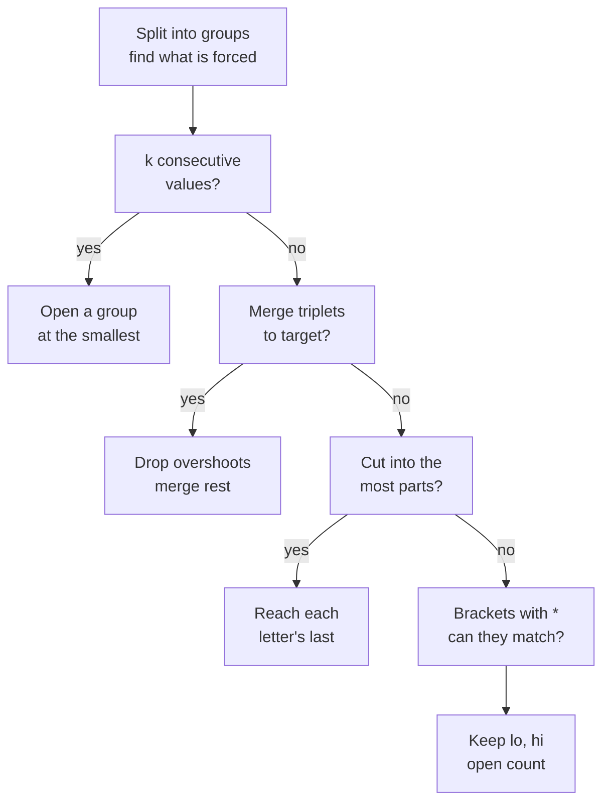
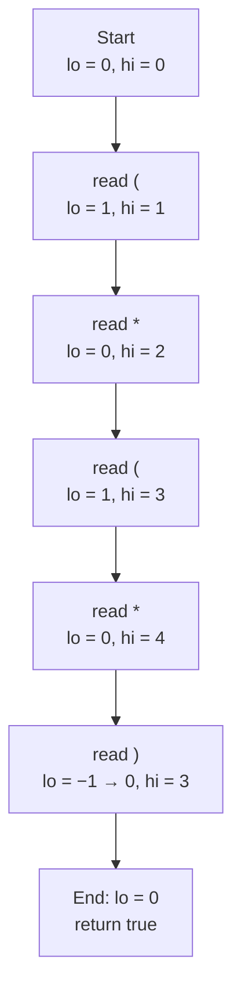

> [!tldr] Quick read
> - The previous station ([[en/posts/2026-11-28-neetcode-greedy-array|MISC-03]]) walked the array once and dropped whatever was surely useless. This station asks a different question: **which element has to share a group with which?** The trick is to find the element whose choice is **forced**, not the choice that looks best.
> - Four forced rules: the smallest remaining card can only *open* a group (Hand of Straights); a triplet that overshoots the target at any position can never be used (Merge Triplets); a part must reach the last occurrence of every letter in it (Partition Labels); the possible counts of open brackets always form a range `[lo, hi]` (Valid Parenthesis String).
> - The safety argument here is stronger than an exchange: **every valid answer has to do exactly what the greedy does**, so doing it first loses nothing; and when the greedy says "impossible", no grouping works.
> - Opening a group at an arbitrary card is wrong: with `[1, 2, 3, 4]` and groups of 2, opening at card 2 gives `{2, 3}` and leaves 1 and 4 stranded, while `{1, 2}, {3, 4}` works.

> [!info] Context
> This is the fourth station of [[en/series/neetcode-misc|the NeetCode Line: Mixed Techniques]], the second greedy station after [[en/posts/2026-11-28-neetcode-greedy-array|station MISC-03: Greedy on Arrays]]. You only need arrays, sorting and a count table (a map from a value to how many times it appears). You do not need to read the previous station.

> [!abstract]- Quick glossary for this post (click to open)
> - [[en/concepts/greedy-choice|Greedy Choice]] means choosing right away at the current step and never reconsidering, together with an argument that the choice does not lose the answer. At this station the argument is usually "this choice is forced".
> - [[en/concepts/smallest-first-grouping|Smallest-First Grouping]] is the rule: the smallest remaining card has no smaller card to stand before it, so it must be the first card of the group that holds it.
> - [[en/concepts/last-occurrence-boundary|Last Occurrence Boundary]] is the rule: a part that holds letter c must reach the last place c appears; cut when the index hits that farthest boundary.
> - [[en/concepts/safe-candidate-filter|Safe Candidate Filter]] is the rule: drop every candidate that would overshoot the target in any component; merging all the remaining candidates can only help.
> - [[en/concepts/open-count-range|Open Count Range]] means keeping the fewest and the most unmatched open brackets possible, instead of keeping every reading of `*`.
> - A **count table** ([[en/concepts/frequency-counting|Frequency Counting]]) is a [[en/concepts/hash-map|hash map]] from a value to the number of times it appears.
> - A **straight** is k consecutive values like `4, 5, 6`, one card per value.
> - A **triplet** is three numbers `[a, b, c]`. Merging two triplets takes the larger number at each position: merging `[1, 4, 2]` with `[3, 1, 5]` gives `[3, 4, 5]`.

## Picture it first: a day at the bookshop

I work at a small bookshop, and all day the only job is splitting things into groups. In the morning, the table holds a pile of loose volumes from one book series, to be bundled into sets of k consecutive volumes: the lowest-numbered volume on the table has no lower volume to go before it, so it is surely the first volume of a bundle. At noon, books ride a conveyor into boxes, and every book by one author must fit inside a single box: the open box has to wait for the last book of every author already in it before it can close. In the afternoon, I receive slips proposing heights for three display stacks; merging slips gives each stack the highest proposed level, and a stack only grows, never shrinks, so any slip that wants a stack taller than the goal gets thrown out at once. At the end of the day, I check the lending log: each line says "borrowed" or "returned", but a few lines are smudged and could be borrowed, returned, or nothing at all. Instead of trying every reading, I only note the fewest and the most books that could be out on loan.

| Everyday life | Concept |
|---|---|
| A pile of loose volumes bundled into sets of k consecutive volumes | Hand of Straights, groups of size `groupSize` |
| The lowest-numbered volume can only be the first of a bundle | [[en/concepts/smallest-first-grouping\|Smallest-First Grouping]] |
| A volume missing in the middle of a bundle means it cannot be wrapped | Return `false` at a gap |
| The open box waits for the last book of every author inside it | [[en/concepts/last-occurrence-boundary\|Last Occurrence Boundary]]: `end` |
| A slip that wants a stack taller than the goal: thrown out, since a stack cannot shrink | [[en/concepts/safe-candidate-filter\|Safe Candidate Filter]] |
| Merge every remaining slip: each stack grows but never past the goal | Merge all safe candidates |
| A smudged log line: borrowed, returned or nothing | The `*` sign: `(`, `)` or empty |
| The fewest and the most books out on loan | [[en/concepts/open-count-range\|Open Count Range]]: `lo`, `hi` |



The four result boxes are the four problems of the station. In each box the rule is not "pick what looks best" but "do what every answer has to do".

## The problem: grouping without trying every grouping

I used to think every grouping problem needed backtracking: try this card in this group, and if that fails, undo it and try another group. The number of groupings explodes with the number of elements, and with a `hand` of up to 10⁴ cards that is hopeless. But an arbitrary greedy rule is wrong. With `[1, 2, 3, 4]` and groups of 2, if I open a group at card 2 I get `{2, 3}`, and the leftover 1 and 4 cannot pair up. The answer is that it can be split: `{1, 2}` and `{3, 4}`.

Valid Parenthesis String is the same. Reading every `*` as the empty string turns `(*))` into `())`, which fails, while reading the `*` as `(` gives `(())`, which works. Trying every reading costs 3 to the power of the number of stars. So the question of this station is: is there an element with **only one valid choice**? If there is, making that choice right away is safe, and what remains is a smaller problem of the same shape.

## How it works

<figure class="figure-map" style="--ar: 3 / 5">
<div class="frame"><iframe data-archify="../../diagrams/neetcode-greedy-grouping/straights.en.html" title="Hand of Straights on [3, 1, 5, 8, 2, 6, 4, 5, 3], k = 3" loading="lazy"></iframe></div>
<figcaption><span><b>Figure 1.</b> Hand of Straights with <code>[3, 1, 5, 8, 2, 6, 4, 5, 3]</code> and groups of 3: each time, the smallest remaining card opens a group and takes the next two values. The third group opens at card 5 but there is no 7, so the answer is <code>false</code>.</span><a href="../diagrams/neetcode-greedy-grouping/straights.en.html" target="_blank" rel="noopener">Open full screen</a></figcaption>
</figure>

### The shared template: find the element with no way out

All four solutions follow the same shape:

1. Sort or count so the element "at the edge" becomes visible: the smallest value, the last occurrence, the candidate past the threshold.
2. Ask: how many valid choices does that element have? If only one, make it now.
3. Drop any candidate that surely breaks the answer. Take every candidate that can never hurt.
4. What remains is a smaller problem of the same shape; repeat.

At the previous station, [[en/concepts/greedy-choice|Greedy Choice]] needed an exchange or a stays-ahead argument. At this station the argument is simpler and stronger: **every valid answer has to contain exactly the greedy choice just made**. So making it first loses nothing, and when the greedy gets stuck, every other grouping gets stuck at the very same spot.

### Hand of Straights: the smallest card has only one place to stand

Let x be the smallest remaining value. The group holding a card x is k consecutive values. If x is not first in that group, the group must hold x − 1, but no card smaller than x is left. So the group holding x is exactly `{x, x + 1, …, x + k − 1}`: that is [[en/concepts/smallest-first-grouping|Smallest-First Grouping]]. If c cards of x remain, all c of them must open separate groups, because one group cannot hold two cards of the same value. The solution subtracts c at each value from x to x + k − 1; any value with fewer than c cards left returns `false`.

Figure 1 runs exactly that rule: card 1 opens `{1, 2, 3}`; value 2 is used up, so it is skipped; card 3 opens `{3, 4, 5}`; card 5 opens a group that needs 5, 6, 7, and there is no 7. This `false` is real: every grouping has to make those first two groups too, and then has to open a group at the remaining 5.

Sorting the distinct values costs O(n log n). The inner loop runs only for values that actually open groups, and each such run removes at least k cards, so the inner loop takes at most n steps in total. The LeetCode problem notes that it is the same as problem 1296.

### Merge Triplets: an overshooting candidate is dead, the safe ones all get merged

Merging takes the max at each position, and a max only grows, never shrinks. A triplet with `t[i] > target[i]` at any position i means that once it is used, position i stays above the target for good. Drop it: that is [[en/concepts/safe-candidate-filter|Safe Candidate Filter]].

Every remaining triplet is safe: each of its positions is ≤ the target. Merging all the safe triplets gives a triplet whose every position is still ≤ the target. If some set of triplets merges into exactly the target, that set holds only safe triplets, and merging in more safe triplets pushes no position past the target. So "merge all safe triplets" reaches the target exactly when an answer exists. The solution only has to check: at each position i, does some safe triplet hit `target[i]` exactly?

With the triplets `[1, 4, 2]`, `[3, 1, 5]`, `[2, 6, 9]`, `[3, 4, 1]` and the target `[3, 4, 5]`: `[2, 6, 9]` overshoots and is dropped; `[3, 1, 5]` hits the first and last positions, `[1, 4, 2]` hits the middle one, so the answer is `true`. One O(n) pass, O(1) memory.

### Partition Labels: a part must reach the last occurrence

The problem wants the string cut into as many parts as possible, so that each letter lies in only one part. First record `last[c]`, the final index of letter c. The first part holds `s[0]`, so it must reach at least `last[s[0]]`; every letter inside that range may push the boundary further. I keep `end` as the farthest forced boundary, and when `i == end` no letter of this part appears later: cut. That is [[en/concepts/last-occurrence-boundary|Last Occurrence Boundary]].

Cutting right at `end` is safe because every valid partition must have a first part that reaches at least `end`, and cutting there is the earliest possible. The rest shares no letter with the part already cut, so it is an independent problem. With `abacdcbe`: a pushes `end` to 2, b pushes it to 6, while c (last at 5) and d (last at 4) push no further; at i = 6 it cuts a part of length 7, and `e` is a part of length 1. One O(n) pass, and the `last` table has only 26 slots.

### Valid Parenthesis String: keep one range instead of every reading

Without the `*`, this is [[en/problems/valid-parentheses|Valid Parentheses]] with one kind of bracket: keep the count of unmatched open brackets, never let it go negative, and require 0 at the end. Each `*` has three readings, so after each prefix the open count can take many values. The striking part is that those values **always form a contiguous range** `[lo, hi]`: `(` shifts the whole range up by 1, `)` shifts it down by 1, and `*` is the union of three shifts −1, 0, +1 of a contiguous range, which is still contiguous. That is [[en/concepts/open-count-range|Open Count Range]].

A negative value means that reading has closed more than it opened, so it is ruled out: clamp `lo` to 0. If `hi < 0`, even the reading that opens the most has gone negative: return `false`. At the end of the string, the answer is `true` when 0 lies in the range, that is, `lo == 0`. The diagram below runs on `(*(*)`:



At the `)` step, the value −1 is ruled out because the reading "both stars are `)`" has closed too much. One O(n) pass, O(1) memory. Another approach is dynamic programming over substrings ([[en/concepts/interval-dp|Interval DP]]), which costs O(n³) time and O(n²) memory.

### Four problems at one station

| Problem | What differs |
|---|---|
| [[en/problems/hand-of-straights\|Hand of Straights]] | The anchor. Count, sort the values, and let the smallest remaining card open c groups at once; a missing value in the middle returns `false`. Check `n % k` first for an early exit. |
| [[en/problems/merge-triplets-to-form-target-triplet\|Merge Triplets to Form Target Triplet]] | No sorting needed. Filter out the overshooting triplets, then three flags are enough: has each position been hit exactly by a safe triplet. |
| [[en/problems/partition-labels\|Partition Labels]] | Returns the part lengths, not true/false. Keep `end` as the max of `last` over the open part; cut when `i == end`. |
| [[en/problems/valid-parenthesis-string\|Valid Parenthesis String]] | The groups here are bracket pairs. Keep the range `[lo, hi]`; `hi < 0` fails at once, `lo` is clamped to 0, and the end needs `lo == 0`. |

## Runnable example

[TypeScript](../code/neetcode-greedy-grouping/grouping.ts) · [Python](../code/neetcode-greedy-grouping/grouping.py) · [Go](../code/neetcode-greedy-grouping/grouping.go) · [Java](../code/neetcode-greedy-grouping/grouping.java) · [JavaScript](../code/neetcode-greedy-grouping/grouping.js) · [PHP](../code/neetcode-greedy-grouping/grouping.php) · [Rust](../code/neetcode-greedy-grouping/grouping.rs)

```ts
// Hand of Straights: the smallest remaining card can only open a group, so open the group there.
function isNStraightHand(hand: number[], groupSize: number): boolean {
    if (hand.length % groupSize !== 0) return false
    const count = new Map<number, number>()
    for (const x of hand) count.set(x, (count.get(x) ?? 0) + 1)
    const keys = [...count.keys()].sort((a, b) => a - b) // compare numbers, not strings
    for (const x of keys) {
        const c = count.get(x)! // c cards of x remain: all c of them must open a group
        if (c === 0) continue
        for (let v = x; v < x + groupSize; v++) {
            const have = count.get(v) ?? 0
            if (have < c) return false // too few cards of v: some group cannot continue
            count.set(v, have - c)
        }
    }
    return true
}

// Merge Triplets: drop every triplet that overshoots the target anywhere; merging all the rest cannot hurt.
function mergeTriplets(triplets: number[][], target: number[]): boolean {
    const good = [false, false, false] // has a safe triplet hit target[i] exactly at position i yet
    for (const t of triplets) {
        if (t[0] > target[0] || t[1] > target[1] || t[2] > target[2]) continue // using it breaks the result for good
        for (let i = 0; i < 3; i++) if (t[i] === target[i]) good[i] = true
    }
    return good[0] && good[1] && good[2]
}

// Partition Labels: a part must reach the last occurrence of every letter in it.
function partitionLabels(s: string): number[] {
    const last = new Map<string, number>()
    for (let i = 0; i < s.length; i++) last.set(s[i], i)
    const sizes: number[] = []
    let start = 0
    let end = 0 // the farthest point the current part is forced to reach
    for (let i = 0; i < s.length; i++) {
        end = Math.max(end, last.get(s[i])!)
        if (i === end) { // no letter of this part appears later: cut
            sizes.push(end - start + 1)
            start = i + 1
        }
    }
    return sizes
}

// Valid Parenthesis String: keep the range [lo, hi] of possible unmatched '(' counts.
function checkValidString(s: string): boolean {
    let lo = 0 // fewest (every '*' leans to ')')
    let hi = 0 // most (every '*' leans to '(')
    for (const c of s) {
        if (c === '(') { lo++; hi++ }
        else if (c === ')') { lo--; hi-- }
        else { lo--; hi++ }
        if (hi < 0) return false // even with every '*' as '(' there is an extra ')'
        lo = Math.max(lo, 0) // an open count is never negative: drop the impossible readings
    }
    return lo === 0
}
```

```python
from collections import Counter


def is_n_straight_hand(hand, group_size):
    """The smallest remaining card can only open a group, so open the group there."""
    if len(hand) % group_size:
        return False
    count = Counter(hand)
    for x in sorted(count):
        c = count[x]  # c cards of x remain: all c of them must open a group
        if c == 0:
            continue
        for v in range(x, x + group_size):
            if count[v] < c:
                return False  # too few cards of v: some group cannot continue
            count[v] -= c
    return True


def merge_triplets(triplets, target):
    """Drop every triplet that overshoots the target anywhere; merging all the rest cannot hurt."""
    good = [False, False, False]  # has a safe triplet hit target[i] exactly at position i yet
    for t in triplets:
        if any(t[i] > target[i] for i in range(3)):
            continue  # using it breaks the result for good
        for i in range(3):
            if t[i] == target[i]:
                good[i] = True
    return all(good)


def partition_labels(s):
    """A part must reach the last occurrence of every letter in it."""
    last = {c: i for i, c in enumerate(s)}
    sizes = []
    start = end = 0  # end: the farthest point the current part is forced to reach
    for i, c in enumerate(s):
        end = max(end, last[c])
        if i == end:  # no letter of this part appears later: cut
            sizes.append(end - start + 1)
            start = i + 1
    return sizes


def check_valid_string(s):
    """Keep the range [lo, hi] of possible unmatched '(' counts."""
    lo = hi = 0  # lo: every '*' leans to ')'; hi: every '*' leans to '('
    for c in s:
        if c == "(":
            lo, hi = lo + 1, hi + 1
        elif c == ")":
            lo, hi = lo - 1, hi - 1
        else:
            lo, hi = lo - 1, hi + 1
        if hi < 0:
            return False  # even with every '*' as '(' there is an extra ')'
        lo = max(lo, 0)  # an open count is never negative: drop the impossible readings
    return lo == 0
```

```go
// Hand of Straights: the smallest remaining card can only open a group, so open the group there.
func isNStraightHand(hand []int, groupSize int) bool {
	if len(hand)%groupSize != 0 {
		return false
	}
	count := map[int]int{}
	for _, x := range hand {
		count[x]++
	}
	keys := make([]int, 0, len(count))
	for x := range count {
		keys = append(keys, x)
	}
	slices.Sort(keys) // Go maps have no order: sort
	for _, x := range keys {
		c := count[x] // c cards of x remain: all c of them must open a group
		if c == 0 {
			continue
		}
		for v := x; v < x+groupSize; v++ {
			if count[v] < c {
				return false // too few cards of v: some group cannot continue
			}
			count[v] -= c
		}
	}
	return true
}

// Merge Triplets: drop every triplet that overshoots the target anywhere; merging all the rest cannot hurt.
func mergeTriplets(triplets [][]int, target []int) bool {
	var good [3]bool // has a safe triplet hit target[i] exactly at position i yet
	for _, t := range triplets {
		if t[0] > target[0] || t[1] > target[1] || t[2] > target[2] {
			continue // using it breaks the result for good
		}
		for i := 0; i < 3; i++ {
			if t[i] == target[i] {
				good[i] = true
			}
		}
	}
	return good[0] && good[1] && good[2]
}

// Partition Labels: a part must reach the last occurrence of every letter in it.
func partitionLabels(s string) []int {
	var last [26]int
	for i := 0; i < len(s); i++ {
		last[s[i]-'a'] = i
	}
	sizes := []int{}
	start, end := 0, 0 // end: the farthest point the current part is forced to reach
	for i := 0; i < len(s); i++ {
		end = max(end, last[s[i]-'a'])
		if i == end { // no letter of this part appears later: cut
			sizes = append(sizes, end-start+1)
			start = i + 1
		}
	}
	return sizes
}

// Valid Parenthesis String: keep the range [lo, hi] of possible unmatched '(' counts.
func checkValidString(s string) bool {
	lo, hi := 0, 0 // lo: every '*' leans to ')'; hi: every '*' leans to '('
	for _, c := range s {
		switch c {
		case '(':
			lo, hi = lo+1, hi+1
		case ')':
			lo, hi = lo-1, hi-1
		default:
			lo, hi = lo-1, hi+1
		}
		if hi < 0 {
			return false // even with every '*' as '(' there is an extra ')'
		}
		lo = max(lo, 0) // an open count is never negative: drop the impossible readings
	}
	return lo == 0
}
```

```java
// Hand of Straights: the smallest remaining card can only open a group, so open the group there.
static boolean isNStraightHand(int[] hand, int groupSize) {
    if (hand.length % groupSize != 0) return false;
    TreeMap<Integer, Integer> count = new TreeMap<>(); // keys are always kept in increasing order
    for (int x : hand) count.merge(x, 1, Integer::sum);
    for (int x : count.keySet()) {
        int c = count.get(x); // c cards of x remain: all c of them must open a group
        if (c == 0) continue;
        for (int v = x; v < x + groupSize; v++) {
            int have = count.getOrDefault(v, 0);
            if (have < c) return false; // too few cards of v: some group cannot continue
            count.put(v, have - c);
        }
    }
    return true;
}

// Merge Triplets: drop every triplet that overshoots the target anywhere; merging all the rest cannot hurt.
static boolean mergeTriplets(int[][] triplets, int[] target) {
    boolean[] good = new boolean[3]; // has a safe triplet hit target[i] exactly at position i yet
    for (int[] t : triplets) {
        if (t[0] > target[0] || t[1] > target[1] || t[2] > target[2]) continue; // using it breaks the result for good
        for (int i = 0; i < 3; i++) if (t[i] == target[i]) good[i] = true;
    }
    return good[0] && good[1] && good[2];
}

// Partition Labels: a part must reach the last occurrence of every letter in it.
static List<Integer> partitionLabels(String s) {
    int[] last = new int[26];
    for (int i = 0; i < s.length(); i++) last[s.charAt(i) - 'a'] = i;
    List<Integer> sizes = new ArrayList<>();
    int start = 0, end = 0; // end: the farthest point the current part is forced to reach
    for (int i = 0; i < s.length(); i++) {
        end = Math.max(end, last[s.charAt(i) - 'a']);
        if (i == end) { // no letter of this part appears later: cut
            sizes.add(end - start + 1);
            start = i + 1;
        }
    }
    return sizes;
}

// Valid Parenthesis String: keep the range [lo, hi] of possible unmatched '(' counts.
static boolean checkValidString(String s) {
    int lo = 0, hi = 0; // lo: every '*' leans to ')'; hi: every '*' leans to '('
    for (char c : s.toCharArray()) {
        if (c == '(') { lo++; hi++; }
        else if (c == ')') { lo--; hi--; }
        else { lo--; hi++; }
        if (hi < 0) return false; // even with every '*' as '(' there is an extra ')'
        lo = Math.max(lo, 0); // an open count is never negative: drop the impossible readings
    }
    return lo == 0;
}
```

```js
// Hand of Straights: the smallest remaining card can only open a group, so open the group there.
function isNStraightHand(hand, groupSize) {
    if (hand.length % groupSize !== 0) return false
    const count = new Map()
    for (const x of hand) count.set(x, (count.get(x) ?? 0) + 1)
    const keys = [...count.keys()].sort((a, b) => a - b) // compare numbers, not strings
    for (const x of keys) {
        const c = count.get(x) // c cards of x remain: all c of them must open a group
        if (c === 0) continue
        for (let v = x; v < x + groupSize; v++) {
            const have = count.get(v) ?? 0
            if (have < c) return false // too few cards of v: some group cannot continue
            count.set(v, have - c)
        }
    }
    return true
}

// Merge Triplets: drop every triplet that overshoots the target anywhere; merging all the rest cannot hurt.
function mergeTriplets(triplets, target) {
    const good = [false, false, false] // has a safe triplet hit target[i] exactly at position i yet
    for (const t of triplets) {
        if (t[0] > target[0] || t[1] > target[1] || t[2] > target[2]) continue // using it breaks the result for good
        for (let i = 0; i < 3; i++) if (t[i] === target[i]) good[i] = true
    }
    return good[0] && good[1] && good[2]
}

// Partition Labels: a part must reach the last occurrence of every letter in it.
function partitionLabels(s) {
    const last = new Map()
    for (let i = 0; i < s.length; i++) last.set(s[i], i)
    const sizes = []
    let start = 0
    let end = 0 // the farthest point the current part is forced to reach
    for (let i = 0; i < s.length; i++) {
        end = Math.max(end, last.get(s[i]))
        if (i === end) { // no letter of this part appears later: cut
            sizes.push(end - start + 1)
            start = i + 1
        }
    }
    return sizes
}

// Valid Parenthesis String: keep the range [lo, hi] of possible unmatched '(' counts.
function checkValidString(s) {
    let lo = 0 // fewest (every '*' leans to ')')
    let hi = 0 // most (every '*' leans to '(')
    for (const c of s) {
        if (c === '(') { lo++; hi++ }
        else if (c === ')') { lo--; hi-- }
        else { lo--; hi++ }
        if (hi < 0) return false // even with every '*' as '(' there is an extra ')'
        lo = Math.max(lo, 0) // an open count is never negative: drop the impossible readings
    }
    return lo === 0
}
```

```php
// Hand of Straights: the smallest remaining card can only open a group, so open the group there.
function isNStraightHand(array $hand, int $groupSize): bool {
    if (count($hand) % $groupSize !== 0) return false;
    $count = array_count_values($hand);
    ksort($count); // PHP arrays keep insertion order: sort by key
    foreach (array_keys($count) as $x) {
        $c = $count[$x]; // c cards of x remain: all c of them must open a group
        if ($c === 0) continue;
        for ($v = $x; $v < $x + $groupSize; $v++) {
            $have = $count[$v] ?? 0;
            if ($have < $c) return false; // too few cards of v: some group cannot continue
            $count[$v] = $have - $c;
        }
    }
    return true;
}

// Merge Triplets: drop every triplet that overshoots the target anywhere; merging all the rest cannot hurt.
function mergeTriplets(array $triplets, array $target): bool {
    $good = [false, false, false]; // has a safe triplet hit target[i] exactly at position i yet
    foreach ($triplets as $t) {
        if ($t[0] > $target[0] || $t[1] > $target[1] || $t[2] > $target[2]) continue; // using it breaks the result for good
        for ($i = 0; $i < 3; $i++) if ($t[$i] === $target[$i]) $good[$i] = true;
    }
    return $good[0] && $good[1] && $good[2];
}

// Partition Labels: a part must reach the last occurrence of every letter in it.
function partitionLabels(string $s): array {
    $last = [];
    for ($i = 0; $i < strlen($s); $i++) $last[$s[$i]] = $i;
    $sizes = [];
    $start = 0;
    $end = 0; // the farthest point the current part is forced to reach
    for ($i = 0; $i < strlen($s); $i++) {
        $end = max($end, $last[$s[$i]]);
        if ($i === $end) { // no letter of this part appears later: cut
            $sizes[] = $end - $start + 1;
            $start = $i + 1;
        }
    }
    return $sizes;
}

// Valid Parenthesis String: keep the range [lo, hi] of possible unmatched '(' counts.
function checkValidString(string $s): bool {
    $lo = 0; // fewest (every '*' leans to ')')
    $hi = 0; // most (every '*' leans to '(')
    foreach (str_split($s) as $c) {
        if ($c === '(') { $lo++; $hi++; }
        elseif ($c === ')') { $lo--; $hi--; }
        else { $lo--; $hi++; }
        if ($hi < 0) return false; // even with every '*' as '(' there is an extra ')'
        $lo = max($lo, 0); // an open count is never negative: drop the impossible readings
    }
    return $lo === 0;
}
```

```rust
use std::collections::BTreeMap;

// Hand of Straights: the smallest remaining card can only open a group, so open the group there.
fn is_n_straight_hand(hand: &[i32], group_size: i32) -> bool {
    if hand.len() % group_size as usize != 0 {
        return false;
    }
    let mut count: BTreeMap<i32, i32> = BTreeMap::new(); // keys are always kept in increasing order
    for &x in hand {
        *count.entry(x).or_insert(0) += 1;
    }
    let keys: Vec<i32> = count.keys().copied().collect(); // snapshot the keys first, because the inner loop edits the map
    for x in keys {
        let c = count[&x]; // c cards of x remain: all c of them must open a group
        if c == 0 {
            continue;
        }
        for v in x..x + group_size {
            match count.get_mut(&v) {
                Some(have) if *have >= c => *have -= c,
                _ => return false, // too few cards of v: some group cannot continue
            }
        }
    }
    true
}

// Merge Triplets: drop every triplet that overshoots the target anywhere; merging all the rest cannot hurt.
fn merge_triplets(triplets: &[[i32; 3]], target: [i32; 3]) -> bool {
    let mut good = [false; 3]; // has a safe triplet hit target[i] exactly at position i yet
    for t in triplets {
        if (0..3).any(|i| t[i] > target[i]) {
            continue; // using it breaks the result for good
        }
        for i in 0..3 {
            if t[i] == target[i] {
                good[i] = true;
            }
        }
    }
    good.iter().all(|&g| g)
}

// Partition Labels: a part must reach the last occurrence of every letter in it.
fn partition_labels(s: &str) -> Vec<i32> {
    let b = s.as_bytes();
    let mut last = [0usize; 26];
    for (i, &c) in b.iter().enumerate() {
        last[(c - b'a') as usize] = i;
    }
    let mut sizes = Vec::new();
    let (mut start, mut end) = (0usize, 0usize); // end: the farthest point the current part is forced to reach
    for (i, &c) in b.iter().enumerate() {
        end = end.max(last[(c - b'a') as usize]);
        if i == end {
            // no letter of this part appears later: cut
            sizes.push((end - start + 1) as i32);
            start = i + 1;
        }
    }
    sizes
}

// Valid Parenthesis String: keep the range [lo, hi] of possible unmatched '(' counts.
fn check_valid_string(s: &str) -> bool {
    let (mut lo, mut hi) = (0i32, 0i32); // lo: every '*' leans to ')'; hi: every '*' leans to '('
    for c in s.chars() {
        match c {
            '(' => { lo += 1; hi += 1; }
            ')' => { lo -= 1; hi -= 1; }
            _ => { lo -= 1; hi += 1; }
        }
        if hi < 0 {
            return false; // even with every '*' as '(' there is an extra ')'
        }
        lo = lo.max(0); // an open count is never negative: drop the impossible readings
    }
    lo == 0
}
```

The tabs show all four functions of the file. Each file also runs 26 cases: seven for Hand of Straights (including a case that does not divide evenly and a case with a gap), five for Merge Triplets (including a case where the only triplet hitting the target overshoots at another position), five for Partition Labels and nine for Valid Parenthesis String. The expected answers were computed beforehand by an independent brute force: trying every way to take a straight out of the hand (with memoization), trying every subset of triplets, trying every placement of cuts, and trying every reading of `*`. On top of that, I ran a scratch script that cross-checked the four greedy functions against those brute forces on 12,000 small random inputs (3,000 per problem), with no mismatch.

```text
26/26 cases passed
```

*(Output labels translated; the files themselves print Vietnamese.)*

Run it with `node grouping.ts`, `python3 grouping.py`, `go run grouping.go`, `java grouping.java`, `node grouping.js`, `php grouping.php` or `rustc --edition 2021 -O grouping.rs -o /tmp/grouping && /tmp/grouping`. All seven print the same line above.

## Misconceptions and common traps

- Thinking the greedy here means "pick the nicest-looking group". The right rule is a forced one: opening a group at an arbitrary card, like card 2 in `[1, 2, 3, 4]` with groups of 2, ruins a hand that can be split.
- In Hand of Straights, sorting the values as strings. In JavaScript and TypeScript, `[9, 10, 11].sort()` gives `[10, 11, 9]`, so card 10 opens a group before card 9 and the function returns `false` for a hand that can be split. Always pass `(a, b) => a - b`.
- In Merge Triplets, skipping the filter and setting a flag for every triplet that hits the target at one position. With `[2, 9, 1]`, `[1, 2, 3]` and the target `[2, 2, 3]`, the function returns `true`, but every merge that uses `[2, 9, 1]` has a 9 in the middle.
- In Partition Labels, cutting when `last[s[i]] == i`, that is, looking only at the current letter instead of the max over the whole part. With `abab`, the function cuts after `aba` because a appears for the last time there, while b still appears later; the right answer is one part of length 4.
- In Valid Parenthesis String, forgetting to clamp `lo` to 0. With `(*)`, the range goes `[1, 1]`, `[0, 2]`, `[−1, 1]`, and the function returns `false` because `lo = −1`, while reading `*` as empty matches.
- In Valid Parenthesis String, returning `false` when `lo < 0` instead of when `hi < 0`. A negative `lo` only means the lowest reading has failed; the other readings are still alive.
- In Go, walking a `map` directly to find the smallest value. Go deliberately randomizes `map` iteration order, so collect the keys and sort them. PHP is similar: `array_count_values` keeps the order of first appearance, so call `ksort`.
- In Rust, you cannot iterate `count.keys()` while modifying `count`; the borrow checker stops it. Snapshot the keys into a `Vec` first. In Java, `TreeMap` allows changing the value of an existing key while iterating `keySet()`, but adding a new key throws `ConcurrentModificationException`; the solution only calls `put` when the value already has at least c cards, so it never adds a key.

## Self-check questions

> [!question]- Why must the smallest remaining card be the first card of the group that holds it?
> If it were not first, its group would hold the value one below it, but no smaller card is left. So its group is forced to be exactly the k values starting at itself.

> [!question]- Run the greedy rule on `[1, 2, 3, 4]` with groups of 2. Which groups get opened?
> Card 1 opens `{1, 2}`; value 2 is used up, so it is skipped; card 3 opens `{3, 4}`. It returns `true`. The greedy never opens a group at card 2 while card 1 is still there.

> [!question]- Merge Triplets: why does merging all the safe triplets never ruin the answer?
> Every safe triplet has all positions ≤ the target, and the max of numbers ≤ the target is still ≤ the target. If some subset already merges into the target, merging in more safe triplets pushes no position higher, so the result is still the target.

> [!question]- What part lengths does Partition Labels give for `abcbad`?
> The last occurrences of a, b, c, d are 4, 3, 2, 5. `end` jumps to 4 at the very first letter a, and at i = 4 it cuts the part `abcba` of length 5. The rest is `d`, of length 1: the answer is `[5, 1]`.

> [!question]- Why do the possible open counts always form a contiguous range, with no holes?
> The range starts as `{0}`. `(` and `)` shift the whole range up or down by 1. `*` is the union of three shifts −1, 0, +1 of a contiguous range; those shifts overlap, so the union stays contiguous. Cutting off the negative part keeps it contiguous too.

## References

- [Hand of Straights](https://leetcode.com/problems/hand-of-straights/) · [Merge Triplets to Form Target Triplet](https://leetcode.com/problems/merge-triplets-to-form-target-triplet/) · [Partition Labels](https://leetcode.com/problems/partition-labels/) · [Valid Parenthesis String](https://leetcode.com/problems/valid-parenthesis-string/), the original problems and their input limits
