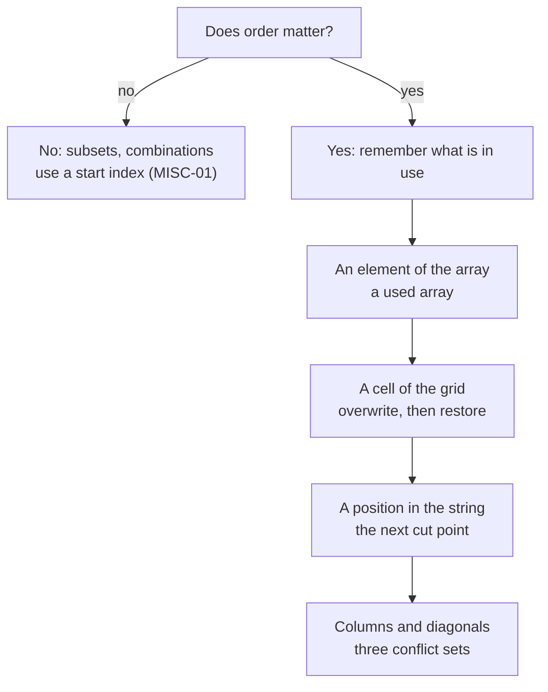
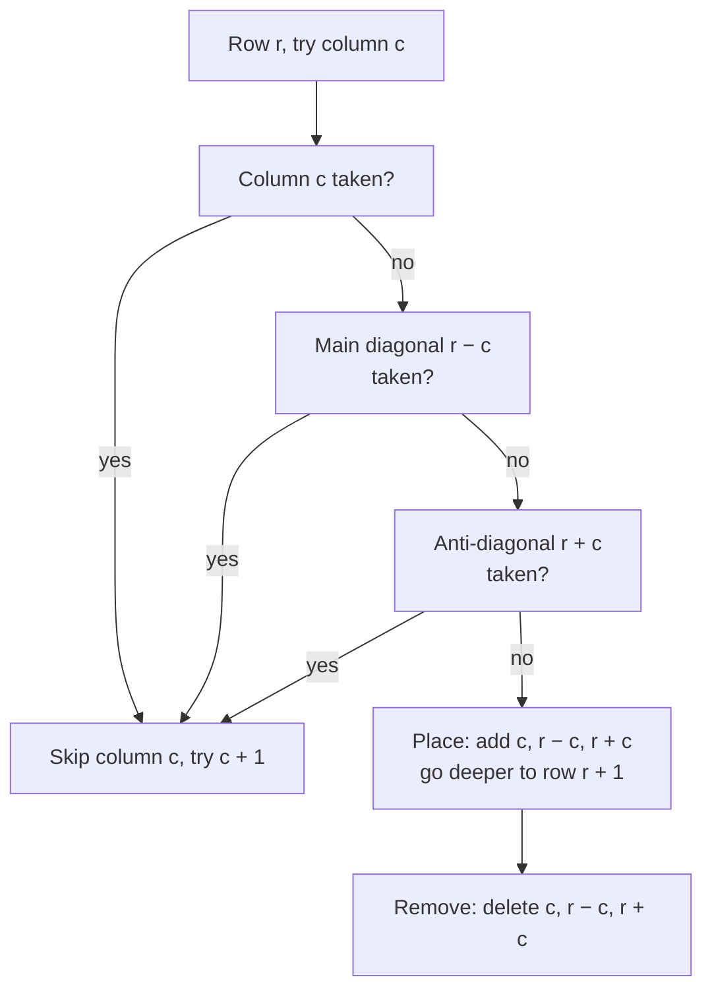

> [!tldr] Quick read
> - At [[en/posts/2026-11-28-neetcode-subsets-combinations|station MISC-01]], `[2, 5]` and `[5, 2]` were the same answer, so a start index stopped the walk from going back. Here they are two different answers, so every node reconsiders every element, and what prevents repeats is an **"in use" mark**.
> - The template is still choose, go deeper, undo. What is new is **the state you must undo**: the `used` array for permutations, the overwritten grid cell for word search, the cut position for palindrome partitioning, three sets of columns and diagonals for queens.
> - Check as early as possible. A piece that is not a palindrome, or a square under attack, is dropped right away instead of going deeper and filtering later.
> - Count the tree's nodes to know the price: permuting 8 numbers makes 109,601 calls, while 8 queens, thanks to pruning, make only 2,057.

> [!info] Context
> This is the second station of [[en/series/neetcode-misc|the NeetCode Line: Mixed Techniques]]. The previous station built the backtracking template and its three knobs (where to record, where to start, how to skip duplicates) for subsets and combinations. This station keeps that template but drops the "where to start" knob, because order now matters. You only need arrays, 2-D grids, sets and recursive functions.

> [!abstract]- Quick glossary for this post (click to open)
> - [[en/concepts/backtracking|Backtracking]] means trying a choice, going on, then undoing it to try another.
> - [[en/concepts/choice-tree|Choice Tree]] is the tree whose nodes are partial solutions and whose edges are the choices added.
> - [[en/concepts/start-index|Start Index]] is the index where the loop at a node starts; the previous station used it, this one does not.
> - [[en/concepts/used-marker|Used Marker]] is an array that marks which elements are currently in `path`, set on choose and cleared on undo.
> - [[en/concepts/visit-and-restore|Visit-and-Restore]] means overwriting the cell being walked with a symbol, then putting the old value back on the way back.
> - [[en/concepts/conflict-sets|Conflict Sets]] are the sets that record which columns and diagonals already hold a queen, so checking whether a square is attacked takes O(1).
> - A **permutation** is one way to line up all elements in an order; n distinct elements have n! permutations.
> - A **palindrome** reads the same forwards and backwards, like `noon` or `racecar`. Station [[en/posts/2026-11-27-neetcode-palindrome-centers|DP-02]] checked palindromes by expanding from a centre.
> - **Pruning** means stopping a branch once it surely cannot lead to an answer.

## Picture it first: preparing a party

I am organising a party. The first job is seating guests along a row of chairs: the leftmost chair first, then the next. Anyone already seated wears a "seated" badge, so nobody gets two chairs; when I change the plan, I ask that guest to stand up and take the badge off. The second job is tracing a word on a tiled floor printed with letters: each step goes to a neighbouring tile, and I put tape on the tile I stand on so I never step on it again; when I step back, I peel the tape off. The third job is cutting a banner into pieces that each read the same forwards and backwards. The last job is seating some picky guests on a chessboard: no two of them may share a column or a diagonal.

| Everyday life | Concept |
|---|---|
| A row of chairs filled from left to right | Each level of the tree chooses the element for one position |
| The "seated" badge a guest wears | [[en/concepts/used-marker\|Used Marker]]: `used[i] = true` |
| Asking the guest to stand up and removing the badge | Undo the choice and clear the mark |
| Two seatings in a different order are two plans | Permutations: no start index |
| Tape on the tile I am standing on | [[en/concepts/visit-and-restore\|Visit-and-Restore]]: overwrite the cell with `#` |
| Peeling the tape off when stepping back | Put the cell's old value back |
| Where the scissors cut the banner next | Choose the cut point `end`, go deeper from `end + 1` |
| A banner piece that reads differently backwards is dropped at once | Prune early when a piece is not a palindrome |
| A notebook of columns and diagonals already taken | [[en/concepts/conflict-sets\|Conflict Sets]] for N-Queens |



The last four boxes are the station's four problems in order of difficulty: the more state there is to undo, the easier it is to forget some.

## The problem: no canonical order to stop repeats

I used to think a permutation was just a subset "with all n elements", so I reused the previous station's template. But that template passes `i + 1` to the child branch, so after choosing 7 it never goes back to 4. For `[4, 7, 9]` it builds exactly one full-length sequence, `[4, 7, 9]`, and loses the other five permutations.

If I drop the start index and let every node scan from the beginning, I get `[4, 4, 4]`, because nothing stops me from choosing a number already in `path`. Checking `path.includes(x)` is correct but costs O(n) each time. The real question is: how do I know in O(1) what is in use, and remember to release it on the way back?

## How it works

<figure class="figure-map" style="--ar: 3 / 4">
<div class="frame"><iframe data-archify="../../diagrams/neetcode-permutations-search/used-marker.en.html" title="Marking and unmarking while permuting [1, 2, 3]" loading="lazy"></iframe></div>
<figcaption><span><b>Figure 1.</b> Permuting <code>[1, 2, 3]</code>: each choice sets a mark and each backtrack clears it, so 2 is free again to come after 3. The tree has 16 nodes and exactly 3! = 6 leaves.</span><a href="../diagrams/neetcode-permutations-search/used-marker.en.html" target="_blank" rel="noopener">Open full screen</a></figcaption>
</figure>

### The permutation template: a mark instead of a start index

The recursive function takes no `start`. At each node the loop goes over **every** index `i`:

1. If `path` already has n elements, record a copy and return.
2. For each `i` whose `used[i]` is still off: set `used[i]`, push `nums[i]` onto `path`, recurse, then pop `nums[i]` and clear `used[i]`.

The undo step has two parts and must run in the reverse order of the choose step. Forget to clear `used[i]` and that number is locked forever: every later sibling branch misses it, and the result shrinks to one permutation.

The first level has n choices, the second n − 1, and so on. The tree has n! leaves, and its node count is n! times 1 + 1/1! + 1/2! + …, about e · n!. Each leaf copies a `path` of length n, so the total is O(n · n!).

### Four shapes of state to undo

The other three problems keep the choose, go deeper, undo template. They differ only in what they must remember so as not to walk in circles or break a rule.

**Tracing a word on a grid (Word Search).** The path must move between adjacent cells and never reuse one. Instead of a separate `visited` array, I overwrite the current cell with `#`, a symbol that never matches a letter of the word, and put the old letter back when backtracking. That is [[en/concepts/visit-and-restore|Visit-and-Restore]]. Each step has at most three new directions (the fourth is the cell just left), so for a word of length L each starting cell opens at most 4 · 3^(L−1) paths. Checking the letter at the top of the recursive function cuts almost all of them at the first step.

**Cutting palindromes (Palindrome Partitioning).** The state is the position `start` where the next piece begins. The choice is the end point `end` of that piece. Go deeper only when `s[start..end]` is a palindrome, so every leaf is a valid way to cut. A string of length n has n − 1 gaps, each cut or not, so there are at most 2^(n−1) ways to cut; a string of one repeated letter such as `aaaaaaaa` reaches that bound exactly, 128 ways.

**Placing N queens (N-Queens).** Each row holds exactly one queen, so level r chooses the column for row r. Two queens attack each other when they share a column, a main diagonal (same `r − c`) or an anti-diagonal (same `r + c`). Three [[en/concepts/conflict-sets|Conflict Sets]] answer "is this square attacked?" in O(1). Placing a queen adds to all three sets; removing it deletes from all three.



### The earlier the cut, the cheaper

The last three problems all check the rule **before** going deeper, never generating first and filtering after. The difference is measurable. Each file prints two counts: the number of recursive calls to generate every permutation of 8 numbers, and to place 8 queens.

| Tree | Calls | Results |
|---|---|---|
| Permutations of 8 numbers, no pruning | 109,601 | 40,320 permutations |
| 8 queens, pruned by three sets | 2,057 | 92 solutions |

A valid placement of 8 queens is also a permutation of 8 columns (each row a different column). Generating all 40,320 permutations and then filtering diagonals walks over more than 109 thousand nodes. Checking the diagonals as each queen is placed makes the tree more than 50 times smaller.

### Four problems on one station

| Problem | What is different |
|---|---|
| [[en/problems/permutations\|Permutations]] | The anchor problem. No start index; the `used` array stops a number from being chosen again; record at a leaf when `path` has n elements. n! leaves. |
| [[en/problems/word-search\|Word Search]] | Start from every cell; move to the four neighbours; overwrite the current cell with `#`, then restore it. Return `true` as soon as the word is found, without listing paths. |
| [[en/problems/palindrome-partitioning\|Palindrome Partitioning]] | The state is where the next piece starts; go deeper only when the piece just cut is a palindrome; record once the cut reaches the end of the string. |
| [[en/problems/n-queens\|N-Queens]] | Each level is a row; three sets for column, `r − c` and `r + c`; placing and removing must update all three. Record the board once all n rows are filled. |

## Runnable example

[TypeScript](../code/neetcode-permutations-search/search.ts) · [Python](../code/neetcode-permutations-search/search.py) · [Go](../code/neetcode-permutations-search/search.go) · [Java](../code/neetcode-permutations-search/search.java) · [JavaScript](../code/neetcode-permutations-search/search.js) · [PHP](../code/neetcode-permutations-search/search.php) · [Rust](../code/neetcode-permutations-search/search.rs)

```ts
function permute(nums: number[]): number[][] {
    const result: number[][] = []
    const path: number[] = []
    const used: boolean[] = Array(nums.length).fill(false)
    function walk() {
        permuteCalls++
        if (path.length === nums.length) {
            result.push([...path]) // copy path, because path keeps changing
            return
        }
        for (let i = 0; i < nums.length; i++) {
            if (used[i]) continue // already in path
            used[i] = true // mark
            path.push(nums[i]) // choose
            walk() // go deeper
            path.pop() // undo the choice
            used[i] = false // unmark
        }
    }
    walk()
    return result
}
```

```python
def permute(nums):
    """No start; mark the elements already in path."""
    result, path = [], []
    used = [False] * len(nums)

    def walk():
        calls["permute"] += 1
        if len(path) == len(nums):
            result.append(path[:])  # copy path, because path keeps changing
            return
        for i in range(len(nums)):
            if used[i]:
                continue  # already in path
            used[i] = True  # mark
            path.append(nums[i])  # choose
            walk()  # go deeper
            path.pop()  # undo the choice
            used[i] = False  # unmark

    walk()
    return result
```

```go
func permute(nums []int) [][]int {
	result := [][]int{}
	path := []int{}
	used := make([]bool, len(nums))
	var walk func()
	walk = func() {
		permuteCalls++
		if len(path) == len(nums) {
			result = append(result, append([]int(nil), path...)) // copy path, because path keeps changing
			return
		}
		for i := range nums {
			if used[i] {
				continue // already in path
			}
			used[i] = true               // mark
			path = append(path, nums[i]) // choose
			walk()                       // go deeper
			path = path[:len(path)-1]    // undo the choice
			used[i] = false              // unmark
		}
	}
	walk()
	return result
}
```

```java
static List<List<Integer>> permute(int[] nums) {
    List<List<Integer>> result = new ArrayList<>();
    walkPermute(nums, new boolean[nums.length], new ArrayList<>(), result);
    return result;
}

static void walkPermute(int[] nums, boolean[] used, List<Integer> path, List<List<Integer>> result) {
    permuteCalls++;
    if (path.size() == nums.length) {
        result.add(new ArrayList<>(path)); // copy path, because path keeps changing
        return;
    }
    for (int i = 0; i < nums.length; i++) {
        if (used[i]) continue; // already in path
        used[i] = true; // mark
        path.add(nums[i]); // choose
        walkPermute(nums, used, path, result); // go deeper
        path.remove(path.size() - 1); // undo the choice
        used[i] = false; // unmark
    }
}
```

```js
function permute(nums) {
    const result = []
    const path = []
    const used = Array(nums.length).fill(false)
    function walk() {
        permuteCalls++
        if (path.length === nums.length) {
            result.push([...path]) // copy path, because path keeps changing
            return
        }
        for (let i = 0; i < nums.length; i++) {
            if (used[i]) continue // already in path
            used[i] = true // mark
            path.push(nums[i]) // choose
            walk() // go deeper
            path.pop() // undo the choice
            used[i] = false // unmark
        }
    }
    walk()
    return result
}
```

```php
function permute(array $nums): array {
    global $permuteCalls;
    $result = [];
    $path = [];
    $used = array_fill(0, count($nums), false);
    $walk = function () use (&$walk, &$result, &$path, &$used, $nums, &$permuteCalls) {
        $permuteCalls++;
        if (count($path) === count($nums)) {
            $result[] = $path; // PHP arrays are copied on assignment, so this is a snapshot
            return;
        }
        foreach ($nums as $i => $value) {
            if ($used[$i]) continue; // already in path
            $used[$i] = true; // mark
            $path[] = $value; // choose
            $walk(); // go deeper
            array_pop($path); // undo the choice
            $used[$i] = false; // unmark
        }
    };
    $walk();
    return $result;
}
```

```rust
fn permute(nums: &[i32], calls: &mut usize) -> Vec<Vec<i32>> {
    fn walk(nums: &[i32], used: &mut Vec<bool>, path: &mut Vec<i32>, result: &mut Vec<Vec<i32>>, calls: &mut usize) {
        *calls += 1;
        if path.len() == nums.len() {
            result.push(path.clone()); // copy path, because path keeps changing
            return;
        }
        for i in 0..nums.len() {
            if used[i] {
                continue; // already in path
            }
            used[i] = true; // mark
            path.push(nums[i]); // choose
            walk(nums, used, path, result, calls); // go deeper
            path.pop(); // undo the choice
            used[i] = false; // unmark
        }
    }
    let mut result = Vec::new();
    walk(nums, &mut vec![false; nums.len()], &mut Vec::new(), &mut result, calls);
    result
}
```

The tabs show the permutation function, including the line that counts calls. Each file also contains Word Search, Palindrome Partitioning and N-Queens, and runs 19 cases. Result lists are compared regardless of order: each element becomes a string, then the whole list is sorted. The order **inside** a permutation is kept, because `[4, 7, 9]` and `[9, 7, 4]` are two different answers. The word-search grid is `TOP / ARE / NED`; the expected answers were computed beforehand by independent brute force (a DFS keeping a set of visited cells, every set of cut gaps, every column permutation for the queens). The program prints in Vietnamese: "ca đúng" means "cases correct", "lần gọi" means "calls", "kết quả" means "results" and "lời giải" means "solutions".

```text
19/19 ca đúng
Hoán vị 8 số: 109601 lần gọi, 40320 kết quả
8 hậu: 2057 lần gọi, 92 lời giải
```

Run it with `node search.ts`, `python3 search.py`, `go run search.go`, `java search.java`, `node search.js`, `php search.php` or `rustc --edition 2021 -O search.rs -o /tmp/search && /tmp/search`. All seven versions print the same three lines.

## Misconceptions and common traps

- Reusing the subset template with `i + 1` to generate permutations. It only produces sequences in increasing index order, so `[4, 7, 9]` yields exactly one permutation.
- Popping `path` but forgetting to clear `used[i]`. The number stays locked for every later sibling branch, and the tree withers.
- Checking `path.includes(x)` instead of a `used` array. The result is correct, but each check costs O(n), and the approach breaks as soon as the array holds duplicate values.
- In Word Search, marking a cell and returning `true` early without restoring it. Harmless for a single query, but if the grid is reused for another word, the leftover `#` cells make the next answer wrong. The files check seven words on seven separate copies of the grid.
- Forgetting the "no cell reused" rule. The word `TOT` on the grid `TOP / ARE / NED` would become `true`, because the path T → O → T returns to the first cell.
- Checking palindromes only after the whole string is cut. Still correct, but it walks all 2^(n−1) ways to cut instead of dropping each branch at its first bad piece.
- Marking main diagonals by `r − c` in a language that uses arrays instead of sets. The index can be negative (down to −(n − 1)), so use `r − c + n − 1` as the array index; the anti-diagonal `r + c` is never negative. The files here use sets, so they never hit this.
- PHP has a built-in function called `key()`, so a helper with the same name fails with "Cannot redeclare". The PHP file calls its comparison helper `canon()`.

## Self-check questions

> [!question]- Why don't permutations use a start index like subsets?
> A start index forces every answer to follow increasing index order, so each set appears once. For permutations, different orders are exactly the different answers, so each node must reconsider every element not yet used.

> [!question]- For `[1, 2, 3]`, how many times is the recursive function called, and why?
> 16 times: 1 at the root, 3 at level one, 3 · 2 = 6 at level two and 6 at level three (the leaves). The total is 1 + 3 + 6 + 6.

> [!question]- Word Search moves in four directions. Why is the number of paths per step counted as 3, not 4?
> One of the four neighbours is the cell just left, which is overwritten with `#` and never matches a letter. At most three new directions remain.

> [!question]- Do the squares (1, 3) and (3, 1) share a diagonal?
> Yes. They have the same `r + c = 4`, so they lie on the same anti-diagonal. Their `r − c` values are −2 and 2, so they are on different main diagonals.

## References

- [Permutations](https://leetcode.com/problems/permutations/) · [Word Search](https://leetcode.com/problems/word-search/) · [Palindrome Partitioning](https://leetcode.com/problems/palindrome-partitioning/) · [N-Queens](https://leetcode.com/problems/n-queens/)
- [Jeff Erickson, Algorithms, chapter 2: Backtracking](https://jeffe.cs.illinois.edu/teaching/algorithms/book/02-backtracking.pdf), which opens with the N-queens problem
- [OEIS A000170](https://oeis.org/A000170), the number of N-queens solutions for each n (92 for n = 8)
