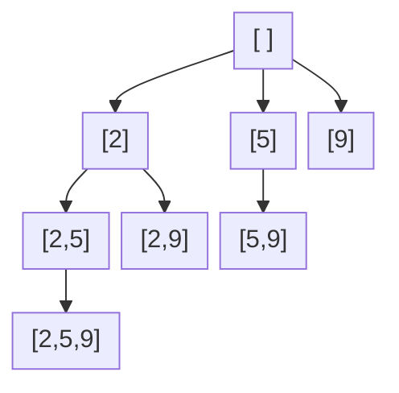
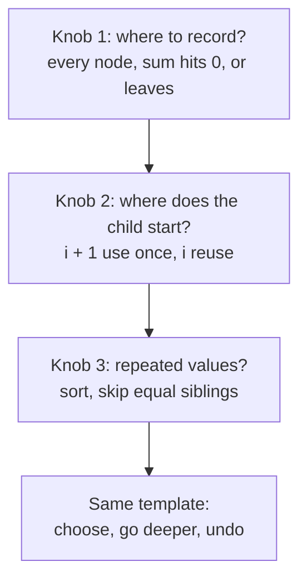

> [!tldr] Quick read
> - Every problem at this station walks a whole **choice tree**: each node is a partial solution, each edge is "add this element". The one template is choose, go deeper, undo.
> - Knob one: **where to record**. Subsets record at every node; sum combinations record when the remainder hits 0; letter combinations record at the leaves.
> - Knob two: **where the child branch starts**. From `i + 1`, each element is used once; from `i`, it can be reused. Never going back before `i` is what stops `[2, 5]` and `[5, 2]` from both being generated.
> - Knob three: **skipping duplicates**. Sort, then at the same level skip a value equal to the sibling just before it. Once sorted, you can also cut the whole rest of a branch as soon as the current number exceeds the remainder.

> [!info] Context
> This is the first station of [[en/series/neetcode-misc|the NeetCode Line: Mixed Techniques]], the line that gathers NeetCode 150's remaining groups: backtracking, greedy, intervals, matrices, math and bit manipulation. I met backtracking once already, in Generate Parentheses at [[en/posts/2026-11-23-neetcode-stack|station ARR-06: Stack]]. This station turns it into one reusable template for five problems. You only need arrays, loops and recursive functions.

> [!abstract]- Quick glossary for this post (click to open)
> - [[en/concepts/backtracking|Backtracking]] means trying one choice, going on, then undoing it to try another.
> - [[en/concepts/choice-tree|Choice Tree]] is the tree where each node is a partial solution and each edge is one more choice.
> - [[en/concepts/start-index|Start Index]] is the index where the loop at a node starts; it keeps the same combination from being generated in several orders.
> - [[en/concepts/duplicate-skipping|Duplicate Skipping]] skips a value equal to the one just before it in a sorted array.
> - **path** is the list of choices currently held on the way from the root to the current node.
> - A **subset** is a pick of some elements, order ignored; an array of n distinct elements has 2ⁿ subsets, the empty one included.
> - A **combination** here is a set (or a multiset, when reuse is allowed) of numbers that sums to the target.
> - **Pruning** means stopping a branch once it certainly cannot lead to an answer.

## Picture it first: shopping along a row of shelves

I walk along a row of shelves in one direction and never go back to a shelf I have passed. At each shelf I can drop an item into the basket and keep going, or skip it. When a branch runs out, I take the item I just added back out of the basket, step back and try another one. Some days I photograph the basket at every step (every subset); some days I only photograph it when the total exactly matches the money I brought (a sum combination). For some goods I can buy as many packs as I like, so I stay at that shelf. When two identical packs sit side by side, each round only needs to try the first.

| Everyday life | Concept |
|---|---|
| The basket I am holding | `path`, the partial solution |
| Drop an item in, keep going, then take it out | Choose, go deeper, undo |
| Only moving forward along the row | [[en/concepts/start-index\|Start Index]]: the child branch starts at `i + 1` |
| Goods I can buy many packs of, staying at the shelf | The child branch starts again at `i` |
| Photographing the basket at every step | Record at every node (Subsets) |
| Only photographing when the total is just right | Record when the remainder is 0 (Combination Sum) |
| Two identical packs side by side, only try the first | [[en/concepts/duplicate-skipping\|Duplicate Skipping]] at the same level |
| Shelf sorted cheap to expensive; this pack already busts the budget, so skip the rest of the shelf | Prune with `break` on a sorted array |
| Each phone key is a shelf, take exactly one item from each | Level k picks one letter of digit k |

The choice tree of `[2, 5, 9]` when listing every subset:



Node `[5]` has no child `[5, 2]`, because once I have passed shelf 2 I never return to it. That is why the tree has exactly 8 nodes, one per subset.

## The problem: generate everything with no gaps and no repeats

I used to think "find every subset" meant generating every permutation and filtering repeats with a Set. That works, but it is wasteful: `[2, 5, 9]` has 6 full permutations and even more ordered sub-sequences, while it has only 8 subsets. With repeated values such as `[6, 6, 6]`, naive generation gives 8 sets but only 4 are different: empty, `[6]`, `[6, 6]` and `[6, 6, 6]`.

The real difficulty is two questions. How do I make each set come out **once**, in exactly one order? And once a branch certainly cannot produce an answer, how do I **not walk into** it? Backtracking has a template that answers both.

## How it works

<figure class="figure-map" style="--ar: 3 / 4">
<div class="frame"><iframe data-archify="../../diagrams/neetcode-subsets-combinations/choice-tree.en.html" title="Walking the choice tree of [2, 5, 9]" loading="lazy"></iframe></div>
<figcaption><span><b>Figure 1.</b> Walking the choice tree of <code>[2, 5, 9]</code>: every choice is a <code>push</code>, every step back is a <code>pop</code>. Recording at every node gives exactly 8 subsets, and no branch ever returns to an earlier element.</span><a href="../diagrams/neetcode-subsets-combinations/choice-tree.en.html" target="_blank" rel="noopener">Open full screen</a></figcaption>
</figure>

### One template: choose, go deeper, undo

The recursive function takes `start`, the first index still allowed. It shares one `path` list:

1. If this node is an answer, record a **copy** of `path`.
2. For each `i` from `start` to the end: add `nums[i]` to `path` (choose), recurse with a new `start` (go deeper), then remove `nums[i]` (undo).

Step 1 must copy. `path` is the single list the whole tree shares; if you record a reference to it, every answer points at the same list, and that list is empty when the recursion ends.

The undo step is what makes this cheap: instead of creating a new list for each node, I edit one list and restore it before trying the next sibling. Recursion depth equals the longest `path`, so the stack costs only O(n) on top of the output.

### Three knobs



**Where to record.** Subsets records at every node, because every partial basket is a valid subset. Combination Sum records only when the remainder is 0. Letter Combinations records when `path` is as long as the digit string, that is, at the leaves.

**Where to start.** This is the [[en/concepts/start-index|Start Index]]. The child branches of choice `nums[i]` only look at indices from `i` onward, so each combination is generated in increasing index order only. Pass `i + 1` when each element may be used once (Subsets, Combination Sum II). Pass `i` when reuse is allowed (Combination Sum): the child can still take `nums[i]` again, but never goes back to a smaller index.

**Skipping duplicates.** When the array has repeated values, two equal elements at two different indices grow two identical branches. After sorting, they sit next to each other, and the rule is: at the **same level** (the same loop), skip `nums[i]` if `i > start` and `nums[i] == nums[i − 1]`. The `i > start` condition matters: it still lets you go **deeper** into the second copy (`[6, 6]` is a valid set) and only forbids **starting again** a sibling branch with the same value.

### Pruning thanks to sorting

For the two sum problems, a sorted array gives one more right: if `nums[i]` already exceeds the remainder, every number after it is larger still, so `break` out of the whole loop rather than `continue`. With `[2, 3, 5, 7]` and target 20, a branch that still needs 1 never tries 2, 3, 5 or 7.

The number of tree nodes is the cost. Subsets has 2ⁿ nodes, and each copies a `path` of length at most n, so O(n·2ⁿ). Letter Combinations has at most 4ⁿ leaves for n digits (keys 7 and 9 carry four letters). Combination Sum has no neat formula in n; the tree is at most `target / min` levels deep, and pruning keeps it far below that bound.

### Five problems at one station

| Problem | What differs |
|---|---|
| [[en/problems/subsets\|Subsets]] | The anchor problem. Record at every node; the child starts at `i + 1`. The tree has exactly 2ⁿ nodes. |
| [[en/problems/subsets-ii\|Subsets II]] | Like Subsets, plus sorting and skipping equal siblings at the same level (`i > start`). |
| [[en/problems/combination-sum\|Combination Sum]] | Record when the remainder is 0; the child starts again at `i` because reuse is allowed; `break` once a number exceeds the remainder. |
| [[en/problems/combination-sum-ii\|Combination Sum II]] | Each number is used once (`i + 1`) and the array has repeats, so it needs both same-level duplicate skipping and `break`. |
| [[en/problems/letter-combinations-of-a-phone-number\|Letter Combinations of a Phone Number]] | A level is a digit position and there is no `start`; each level picks one letter of that key and records at the leaves. An empty string gives an empty list. |

## Runnable example

[TypeScript](../code/neetcode-subsets-combinations/choices.ts) · [Python](../code/neetcode-subsets-combinations/choices.py) · [Go](../code/neetcode-subsets-combinations/choices.go) · [Java](../code/neetcode-subsets-combinations/choices.java) · [JavaScript](../code/neetcode-subsets-combinations/choices.js) · [PHP](../code/neetcode-subsets-combinations/choices.php) · [Rust](../code/neetcode-subsets-combinations/choices.rs)

```ts
function subsets(nums: number[]): number[][] {
    const result: number[][] = []
    const path: number[] = []
    function walk(start: number) {
        result.push([...path]) // copy path, because path keeps changing
        for (let i = start; i < nums.length; i++) {
            path.push(nums[i]) // choose
            walk(i + 1) // go deeper, each element used once
            path.pop() // undo the choice
        }
    }
    walk(0)
    return result
}
```

```python
def subsets(nums):
    """Record at EVERY node; child branches only look at elements after i."""
    result, path = [], []

    def walk(start):
        result.append(path[:])  # copy path, because path keeps changing
        for i in range(start, len(nums)):
            path.append(nums[i])  # choose
            walk(i + 1)  # go deeper, each element used once
            path.pop()  # undo the choice

    walk(0)
    return result
```

```go
func subsets(nums []int) [][]int {
	result := [][]int{}
	path := []int{}
	var walk func(start int)
	walk = func(start int) {
		result = append(result, append([]int(nil), path...)) // copy path, because path keeps changing
		for i := start; i < len(nums); i++ {
			path = append(path, nums[i]) // choose
			walk(i + 1)                  // go deeper, each element used once
			path = path[:len(path)-1]    // undo the choice
		}
	}
	walk(0)
	return result
}
```

```java
static List<List<Integer>> subsets(int[] nums) {
    List<List<Integer>> result = new ArrayList<>();
    walkSubsets(nums, 0, new ArrayList<>(), result);
    return result;
}

static void walkSubsets(int[] nums, int start, List<Integer> path, List<List<Integer>> result) {
    result.add(new ArrayList<>(path)); // copy path, because path keeps changing
    for (int i = start; i < nums.length; i++) {
        path.add(nums[i]); // choose
        walkSubsets(nums, i + 1, path, result); // go deeper, each element used once
        path.remove(path.size() - 1); // undo the choice
    }
}
```

```js
function subsets(nums) {
    const result = []
    const path = []
    function walk(start) {
        result.push([...path]) // copy path, because path keeps changing
        for (let i = start; i < nums.length; i++) {
            path.push(nums[i]) // choose
            walk(i + 1) // go deeper, each element used once
            path.pop() // undo the choice
        }
    }
    walk(0)
    return result
}
```

```php
function subsets(array $nums): array {
    $result = [];
    $path = [];
    $walk = function (int $start) use (&$walk, &$result, &$path, $nums) {
        $result[] = $path; // PHP arrays are copied on assignment, so this is a snapshot
        for ($i = $start; $i < count($nums); $i++) {
            $path[] = $nums[$i]; // choose
            $walk($i + 1); // go deeper, each element used once
            array_pop($path); // undo the choice
        }
    };
    $walk(0);
    return $result;
}
```

```rust
fn subsets(nums: &[i32]) -> Vec<Vec<i32>> {
    fn walk(nums: &[i32], start: usize, path: &mut Vec<i32>, result: &mut Vec<Vec<i32>>) {
        result.push(path.clone()); // copy path, because path keeps changing
        for i in start..nums.len() {
            path.push(nums[i]); // choose
            walk(nums, i + 1, path, result); // go deeper, each element used once
            path.pop(); // undo the choice
        }
    }
    let mut result = Vec::new();
    walk(nums, 0, &mut Vec::new(), &mut result);
    result
}
```

The tabs show the Subsets template. Each file also has the other four functions and runs 17 cases, compared without regard to order: sort inside each combination, then sort the whole list. Four large cases check only the count and that no combination repeats: 1024 subsets of 10 numbers, 16 distinct subsets of `[4, 4, 1, 4, 2]`, 18 combinations of `[2, 3, 5, 7]` summing to 20, and 256 strings for `7979`. The expected answers were computed beforehand by an independent brute force with `itertools`.

```text
17/17 cases passed
```

*(Output labels translated; the files themselves print Vietnamese.)*

Run with `node choices.ts`, `python3 choices.py`, `go run choices.go`, `java choices.java`, `node choices.js`, `php choices.php` or `rustc --edition 2021 -O choices.rs -o /tmp/choices && /tmp/choices`.

## Misconceptions and common traps

- Recording `path` itself instead of a copy. In TypeScript, JavaScript, Python, Java and Go, the result ends up full of empty lists or of the same list repeated. PHP differs: arrays are copied on assignment, so `$result[] = $path` is already a snapshot. Rust forces `clone()`, because a `&mut` cannot be pushed into the result.
- In Go, `append(result, path)` keeps the same backing array as `path`, so later `append` calls overwrite earlier answers. Copy with `append([]int(nil), path...)`.
- Forgetting the undo step. The next sibling branch then starts with a `path` that still holds the previous branch's element.
- Skipping duplicates with `i > 0` instead of `i > start`. That also forbids going deeper into the second copy, so `[6, 6]` and `[6, 6, 6]` vanish.
- Skipping duplicates without sorting first. Equal values that are not adjacent slip past a comparison with the element just before.
- Using `continue` instead of `break` once a number exceeds the remainder. Still correct, but it wastes time trying every larger number after it.
- Sorting numbers in JavaScript and TypeScript with `sort()` and no comparator. By default it compares strings, so `[10, 9, 2]` becomes `[10, 2, 9]` and `break` cuts a branch that is still valid.
- Letter Combinations with an empty string must return an empty list, not `[""]`. The template would record an empty string at the root unless you stop it first.

## Self-check questions

> [!question]- Why does starting the child branch at `i + 1` never generate `[5, 2]` after `[2, 5]`?
> In the branch that starts with 5, the loop only looks at indices after 5. The 2 comes earlier, so it is never added. Each combination only appears in increasing index order.

> [!question]- Combination Sum passes `i` to the child. Is there a risk of infinite recursion?
> No, because every number is positive and each choice lowers the remainder by at least the smallest number. When the remainder reaches 0 the path is recorded, and when a number exceeds the remainder the loop `break`s.

> [!question]- With `[6, 6, 6]`, which branches does `i > start && nums[i] == nums[i - 1]` forbid?
> At the root, it forbids starting with the second and third 6 and keeps only the first. At node `[6]`, it lets you go on into the second 6 (that is `i == start`) but forbids the third. The result is exactly four sets: empty, `[6]`, `[6, 6]`, `[6, 6, 6]`.

> [!question]- Why does Letter Combinations need no `start`?
> Each level corresponds to exactly one digit in order, and exactly one letter must be picked at each level. The digit positions already fix the order, so the same string cannot be generated in two orders.

## References

- [Subsets](https://leetcode.com/problems/subsets/) · [Subsets II](https://leetcode.com/problems/subsets-ii/) · [Combination Sum](https://leetcode.com/problems/combination-sum/) · [Combination Sum II](https://leetcode.com/problems/combination-sum-ii/) · [Letter Combinations of a Phone Number](https://leetcode.com/problems/letter-combinations-of-a-phone-number/)
- [Jeff Erickson, Algorithms, chapter 2: Backtracking](https://jeffe.cs.illinois.edu/teaching/algorithms/book/02-backtracking.pdf)
- [Python itertools.combinations](https://docs.python.org/3/library/itertools.html#itertools.combinations), used to compute the expected answers
