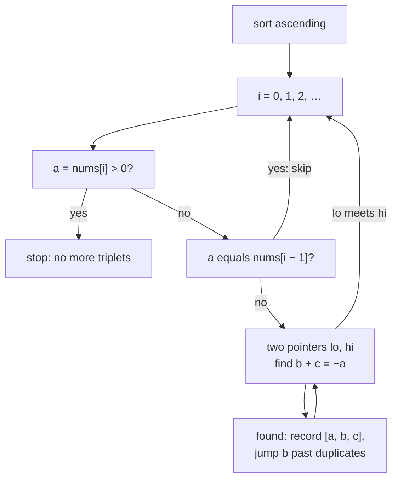

> [!tldr] Quick read
> - The problem: find **every** triplet `[a, b, c]` summing to 0, without returning two equal triplets (same values in a different order still count as equal).
> - [[en/concepts/k-sum-reduction|k-Sum reduction]]: sort, fix `a = nums[i]`, then find `b + c = −a` in the part to the right with [[en/problems/two-sum-ii-input-array-is-sorted|Two Sum II's two pointers]]. O(n²), O(1) memory apart from the sort.
> - [[en/concepts/duplicate-skipping|Duplicate skipping]] through order: skip an `a` equal to the previous `a`, and after finding a triplet, jump `b` past equal values. No Set needed.
> - Measured at n = 1000: brute force 316.6 ms, hash per anchor 22.7 ms, sort + two pointers 1.65 ms.
> - Traps: without duplicate skipping, `[0, 0, 0, 0]` gives `[[0,0,0],[0,0,0]]`; JS `sort()` without a comparator puts `-1` before `-4`.

> [!info] Context
> LeetCode problem 15, part of [[en/posts/2026-11-23-neetcode-two-pointers|station 4: Two Pointers]] on **the NeetCode line: Arrays and Strings**. This page reuses the template of [[en/problems/two-sum-ii-input-array-is-sorted|Two Sum II]], so reading that page first makes this one easier. The solutions come in TypeScript, Python, Go, Java and JavaScript.

> [!abstract]- Quick glossary for this post (click to open)
> - **Triplet**: three elements at three different positions. Their values may repeat if the array has duplicates.
> - **Anchor**: the number fixed in the outer loop, here `a = nums[i]`.
> - **Duplicate skipping**: never putting the same set of values into the result twice.
> - **Canonical key**: a way to turn a triplet into a comparable key, such as the string `"-1,0,1"`. See [[en/concepts/canonical-key|Canonical Key]].

## Picture it first: seating three people at a table

A restaurant gives each guest a number: negative means they owe money, positive means they have money to spare. You need every group of three whose numbers add up to exactly 0 at one table. Two groups with the same makeup (the same three amounts) count once.

| Everyday life | Concept |
|---|---|
| Line the guests up by amount, ascending | sorting |
| Choose one guest as table head, then look for the other two | fix `a`, solve Two Sum II with `−a` |
| The poorest table head must have an amount ≤ 0 | stop when `a > 0` |
| Two guests with the same amount taking turns as head produce the same tables | skip a duplicate `a` |
| After finding a table, the next guest with the same amount as `b` gives the exact same table | jump `b` past duplicates |



## The problem

**The problem (in my own words):** given an array `nums` (3 ≤ n ≤ 3000, values within ±10⁵), return every triplet `[nums[i], nums[j], nums[k]]` with `i, j, k` pairwise different and a sum of 0. The result must not contain two triplets with the same values. The order of triplets and within each triplet doesn't matter. Original: [LeetCode 15](https://leetcode.com/problems/3sum/).

| Input | Output |
|---|---|
| `[-1, 0, 1, 2, -1, -4]` | `[[-1, -1, 2], [-1, 0, 1]]` |
| `[0, 1, 1]` | `[]` |
| `[0, 0, 0]` | `[[0, 0, 0]]` |

I used to think the hard part was finding the triplets. It turns out finding them is easy (Two Sum II n times); the part that's easy to get wrong is **skipping duplicates** correctly.

## How it works

<figure class="figure-map" style="--ar: 3 / 4">
<div class="frame"><iframe data-archify="../../diagrams/neetcode-3sum/worked-example.en.html" title="Fix one value and find a pair" loading="lazy"></iframe></div>
<figcaption><span><b>Figure 1.</b> Fix one value and find a pair.</span><a href="../diagrams/neetcode-3sum/worked-example.en.html" target="_blank" rel="noopener">Open full screen</a></figcaption>
</figure>

<details>
<summary>Read the steps</summary>
<ol>
<li>Fix the first negative value. <code>[-4, -2, 0, 2, 4], anchor = -4</code></li>
<li>The endpoint pair gives a negative total. <code>-4 - 2 + 4 = -2</code></li>
<li>Advance left to 0 and record the triple. <code>-4 + 0 + 4 = 0</code></li>
<li>Move the anchor to -2. <code>-2 + 0 + 2 = 0</code></li>
<li>Keep the two distinct triples. <code>[-4, 0, 4], [-2, 0, 2]</code></li>
</ol>
</details>

### Three approaches

| Approach | Time | Duplicates removed by |
|---|---|---|
| brute force over every triplet | O(n³) | a Set of string keys |
| fix `a`, find `c = −a − b` with a hash set (station 1's template) | O(n²) | a Set of string keys |
| sort, fix `a`, two pointers | O(n²) | order: jump past repeated values |

The first two approaches must normalize each triplet (sort the three numbers) and turn it into a comparable key, because JS Sets and Java HashSets compare arrays by reference. The third approach avoids that entirely: after sorting, every triplet comes out in order `a ≤ b ≤ c`, and duplicates always sit next to each other.

### Skipping duplicates through order

Duplicates can come from two places:

1. **A repeated anchor.** If `a[i] = a[i − 1]`, every triplet anchored at `a[i]` was already found when anchoring at `a[i − 1]` (the range to the right of `i − 1` contains the range to the right of `i`). Skip it.
2. **A repeated `b` after a hit.** Record `[a, b, c]`, move `lo` and `hi` inward, then jump `lo` past every value equal to the `b` just recorded. With `a` and `b` fixed, `c = −a − b` is fixed too, so `hi` needs no separate jump: the loop decreases `hi` by itself when the sum is too big.

One more early exit: the array is sorted, so if `a > 0` then `b, c ≥ a > 0` and the sum cannot be 0. Stop the outer loop.

### Measured

TypeScript, n random numbers within ±10⁵, median:

| n | brute force | hash per anchor | sort + two pointers |
|---|---|---|---|
| 250 | 7.7 ms | 1.4 ms | 0.12 ms |
| 500 | 38.5 ms | 5.7 ms | 0.49 ms |
| 1 000 | 316.6 ms | 22.7 ms | 1.65 ms |
| 3 000 | (not run) | 222.5 ms | 13.06 ms |

Hash per anchor and two pointers are both O(n²), but the hash version is about 15 times slower: each inner loop creates a new Set, hashes and writes. Two pointers only read the array sequentially.

### Under the hood of the seven languages

| | Sorting numbers | Key for a triplet (if using a Set) |
|---|---|---|
| TypeScript / JavaScript | `sort((x, y) => x − y)`; without a comparator it compares as strings | the string `"a,b,c"` (Sets compare arrays by reference) |
| Python | `sorted(nums)` | a `tuple` (lists aren't hashable) |
| Go | `slices.Sort` | a fixed array `[3]int` (slices can't be map keys) |
| Java | `Arrays.sort(int[])` | `List.of(a, b, c)`: `List.equals` compares contents |
| PHP | `sort($a)` sorts in place, returns a `bool` | the string `"a,b,c"` as an array key |
| Rust | `a.sort_unstable()` | a fixed array `[i32; 3]` (hashable, compared by contents) |

## Runnable example

[TypeScript](../code/neetcode-3sum/three-sum.ts) · [Python](../code/neetcode-3sum/three_sum.py) · [Go](../code/neetcode-3sum/three_sum.go) · [Java](../code/neetcode-3sum/three-sum.java) · [JavaScript](../code/neetcode-3sum/three-sum.js) · [PHP](../code/neetcode-3sum/three-sum.php) · [Rust](../code/neetcode-3sum/three_sum.rs)

Each file has all three approaches and runs 7 cases, including `[0, 0, 0, 0]` and an array full of duplicates. Below is sort + two pointers.

```ts
// Sort + two pointers: fix a = nums[i], find b + c = −a in the part to the right. Skip duplicates by jumping past repeated values.
function sortTwoPointers(nums: number[]): number[][] {
  const a = [...nums].sort((x, y) => x - y), out: number[][] = [];
  for (let i = 0; i < a.length - 2; i++) {
    if (a[i] > 0) break; // once the smallest number is positive, three numbers can't sum to 0
    if (i > 0 && a[i] === a[i - 1]) continue; // same anchor value: every triplet was found last time
    let lo = i + 1, hi = a.length - 1;
    while (lo < hi) {
      const s = a[i] + a[lo] + a[hi];
      if (s < 0) lo++;
      else if (s > 0) hi--;
      else {
        out.push([a[i], a[lo], a[hi]]);
        lo++; hi--;
        while (lo < hi && a[lo] === a[lo - 1]) lo++; // jump past duplicate b
      }
    }
  }
  return out;
}
```

```python
def sort_two_pointers(nums: list[int]) -> list[list[int]]:
    a, out = sorted(nums), []
    for i in range(len(a) - 2):
        if a[i] > 0:
            break
        if i > 0 and a[i] == a[i - 1]:
            continue
        lo, hi = i + 1, len(a) - 1
        while lo < hi:
            s = a[i] + a[lo] + a[hi]
            if s < 0:
                lo += 1
            elif s > 0:
                hi -= 1
            else:
                out.append([a[i], a[lo], a[hi]])
                lo, hi = lo + 1, hi - 1
                while lo < hi and a[lo] == a[lo - 1]:
                    lo += 1
    return out
```

```go
func sortTwoPointers(nums []int) [][]int {
	a := slices.Clone(nums)
	slices.Sort(a)
	out := [][]int{}
	for i := 0; i < len(a)-2; i++ {
		if a[i] > 0 {
			break
		}
		if i > 0 && a[i] == a[i-1] {
			continue
		}
		for lo, hi := i+1, len(a)-1; lo < hi; {
			switch s := a[i] + a[lo] + a[hi]; {
			case s < 0:
				lo++
			case s > 0:
				hi--
			default:
				out = append(out, []int{a[i], a[lo], a[hi]})
				lo, hi = lo+1, hi-1
				for lo < hi && a[lo] == a[lo-1] {
					lo++
				}
			}
		}
	}
	return out
}
```

```java
static List<List<Integer>> sortTwoPointers(int[] nums) {
    int[] a = nums.clone();
    Arrays.sort(a);
    List<List<Integer>> out = new ArrayList<>();
    for (int i = 0; i < a.length - 2; i++) {
        if (a[i] > 0) break;
        if (i > 0 && a[i] == a[i - 1]) continue; // primitive int: == compares values
        int lo = i + 1, hi = a.length - 1;
        while (lo < hi) {
            int s = a[i] + a[lo] + a[hi];
            if (s < 0) lo++;
            else if (s > 0) hi--;
            else {
                out.add(List.of(a[i], a[lo], a[hi]));
                lo++; hi--;
                while (lo < hi && a[lo] == a[lo - 1]) lo++;
            }
        }
    }
    return out;
}
```

```js
function sortTwoPointers(nums) {
  const a = [...nums].sort((x, y) => x - y), out = [];
  for (let i = 0; i < a.length - 2; i++) {
    if (a[i] > 0) break;
    if (i > 0 && a[i] === a[i - 1]) continue;
    let lo = i + 1, hi = a.length - 1;
    while (lo < hi) {
      const s = a[i] + a[lo] + a[hi];
      if (s < 0) lo++;
      else if (s > 0) hi--;
      else {
        out.push([a[i], a[lo], a[hi]]);
        lo++; hi--;
        while (lo < hi && a[lo] === a[lo - 1]) lo++;
      }
    }
  }
  return out;
}
```

```php
// Sort + two pointers: fix a = nums[i], find b + c = −a in the part to the right.
// sort() sorts in place and returns a bool, so do NOT write $a = sort($nums).
function sortTwoPointers(array $nums): array {
    $a = $nums; sort($a); $out = []; $n = count($a);
    for ($i = 0; $i < $n - 2; $i++) {
        if ($a[$i] > 0) break; // smallest number already positive: three of them cannot sum to 0
        if ($i > 0 && $a[$i] === $a[$i - 1]) continue; // same anchor value: every triplet was already found
        $lo = $i + 1; $hi = $n - 1;
        while ($lo < $hi) {
            $s = $a[$i] + $a[$lo] + $a[$hi];
            if ($s < 0) $lo++;
            elseif ($s > 0) $hi--;
            else {
                $out[] = [$a[$i], $a[$lo], $a[$hi]];
                $lo++; $hi--;
                while ($lo < $hi && $a[$lo] === $a[$lo - 1]) $lo++; // jump past duplicate b
            }
        }
    }
    return $out;
}
```

```rust
// Sort + two pointers: fix a = nums[i], find b + c = −a in the part to the right.
fn sort_two_pointers(nums: &[i32]) -> Vec<Vec<i32>> {
    let mut a = nums.to_vec();
    a.sort_unstable();
    let mut out = vec![];
    // a.len() - 2 on a usize underflows with fewer than 2 elements; saturating_sub keeps it at 0.
    for i in 0..a.len().saturating_sub(2) {
        if a[i] > 0 {
            break; // smallest number already positive: three of them cannot sum to 0
        }
        if i > 0 && a[i] == a[i - 1] {
            continue; // same anchor value: every triplet was already found
        }
        let (mut lo, mut hi) = (i + 1, a.len() - 1);
        while lo < hi {
            let s = a[i] + a[lo] + a[hi];
            if s < 0 {
                lo += 1;
            } else if s > 0 {
                hi -= 1;
            } else {
                out.push(vec![a[i], a[lo], a[hi]]);
                lo += 1;
                hi -= 1;
                while lo < hi && a[lo] == a[lo - 1] {
                    lo += 1; // jump past duplicate b
                }
            }
        }
    }
    out
}
```


The TypeScript file also runs two wrong versions, then measures:

```text
$ node three-sum.ts
bruteForce       7/7 cases passed
hashPerAnchor    7/7 cases passed
sortTwoPointers  7/7 cases passed
noDuplicateSkip  4/7 cases passed; wrong on [-1,0,1,2,-1,-4] [0,0,0,0] [-4,-2,-2,-2,0,1,2,2,2,3,3,4,4,6,6]
noComparator     5/7 cases passed; wrong on [-4,-2,-2,-2,0,1,2,2,2,3,3,4,4,6,6] [-10,5,5,-1,11,-1]

noDuplicateSkip([0, 0, 0, 0]) = [[0,0,0],[0,0,0]]
[-1, -4, 2, 10].sort() = [-1,-4,10,2]

n        brute   hash per anchor  sort + two pointers   (ms, median)
250          7.7            1.4                   0.12
500         38.5            5.7                   0.49
1000       316.6           22.7                   1.65
3000           —          222.5                  13.06
```

*(Output labels translated; the files themselves print Vietnamese.)*

The version without duplicate skipping fails on the problem's very first example (both `-1`s act as anchors). The version without a comparator passes 5/7: it only breaks when string order and numeric order differ enough to send the pointers the wrong way. Python, Go, Java and JavaScript print `7/7 ca đúng` ("7/7 cases passed") for all three approaches. PHP and Rust also print `7/7 ca đúng` for the three approaches and `4/7` for the version without duplicate skipping; the PHP version that sorts as strings (`SORT_STRING`) prints `5/7` with the same two failing cases as the JS version without a comparator.

## Misconceptions and common traps

- **Skipping with `a[i] = a[i + 1]` instead of `a[i] = a[i − 1]`.** Comparing with the **next** element drops the first anchor of each group too, and loses triplets like `[-1, -1, 2]` that need two `-1`s.
- **Jumping past duplicate `b`s before recording.** Record the triplet first, then jump; jumping first loses triplets where `b = c`, such as `[-4, 2, 2]`.
- **Adding a Set "to be safe" on top of two pointers.** Correct but redundant, and it hides duplicate-skipping bugs.
- **JS: `sort()` without a comparator.** `[-1, -4, 2, 10]` becomes `[-1, -4, 10, 2]`. Two pointers on an array that isn't truly ascending lose their pruning argument.
- **Returning indices instead of values.** 3Sum returns values; Two Sum returns indices.
- **PHP: writing `$a = sort($nums)`.** `sort` sorts in place and returns `true`, so `$a` becomes `true`, not the sorted array. Copy first (`$a = $nums; sort($a);`). And `sort($a, SORT_STRING)` reproduces the JS bug exactly: `5/7` cases.
- **Rust: `a.len() - 2` on a `usize`.** With fewer than 2 elements the subtraction underflows: a panic in a debug build, a huge number with `-O`. The file uses `saturating_sub(2)`. The problem promises n ≥ 3, but a function reused elsewhere gets no such promise.

## Self-check questions

> [!question]- Why does skipping the anchor `a[i]` when `a[i] = a[i − 1]` lose no triplet?
> The search range of `i − 1` is `(i − 1, n)`, which contains the whole range `(i, n)` of `i`. Every pair `(b, c)` anchored at `a[i]` was already examined when anchoring at `a[i − 1]`, which has the same value.

> [!question]- After recording `[a, b, c]`, why is it enough to jump `lo` past duplicates and not `hi`?
> With `a` fixed and a new `b` different from the old one, the `c` needed differs too. If `a[hi]` still equals the old `c`, the sum won't be 0, and the loop moves `hi` or `lo` by itself. Jumping both is also correct, just not required.

> [!question]- Why can you stop when `a > 0`?
> The array is ascending, so `b, c ≥ a > 0` and the sum is positive. Every later anchor is larger still.

> [!question]- Extend to 4Sum (sum equals target). What is the complexity?
> Add one more anchor loop: fix two numbers, run two pointers for the remaining two. O(n³). In general, k-Sum reduces to (k − 2) anchor loops plus one two-pointer pass: O(n^(k−1)).

## References

- [LeetCode 15: 3Sum](https://leetcode.com/problems/3sum/) (the original problem)
- [ECMAScript 2025: SortCompare](https://tc39.es/ecma262/2025/#sec-sortcompare) (without a comparator, values are converted to strings and compared)
- [Python glossary: hashable](https://docs.python.org/3/glossary.html#term-hashable) (tuples are hashable, lists are not)
- [Go spec: Map types](https://go.dev/ref/spec#Map_types) (keys must be comparable with `==`; slices are not)
- [Java 21 `List.equals`](https://docs.oracle.com/en/java/javase/21/docs/api/java.base/java/util/List.html#equals(java.lang.Object)) (two lists are equal when they hold the same elements in the same order)
