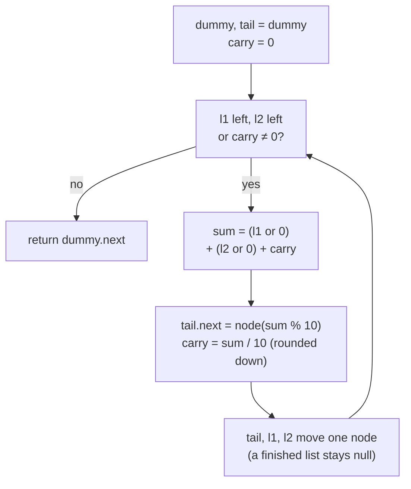

> [!tldr] Quick read
> - The problem: two non-negative numbers, each a linked list storing its digits **backwards** (ones digit first): `2 → 4 → 3` is 342. Return the sum, also as a backwards list.
> - Backwards digits are a gift: addition by hand also starts from the ones digit. Walk both lists together; at each step add two digits and the [[en/concepts/carry-propagation|carry]], write `sum % 10`, carry `sum / 10` to the next step. A [[en/concepts/dummy-node|dummy node]] holds the head of the result. O(max(m, n)).
> - The loop condition must be "digits left in **either** list **or a carry left**". Drop "or a carry" and `[9,9] + [1]` gives `[0,0]` instead of `[0,0,1]`.
> - Converting each list to a number and adding is wrong: the problem allows up to 100 digits. JavaScript's `Number` goes wrong from 2⁵³ (16 digits), Java's `long` and Go's `uint64` overflow silently at 19 to 20 digits. On 10 000 random pairs, the `Number` version is right on only 245.
> - Big integers (BigInt, `math/big`, `BigInteger`, Python's `int`) are right but much slower: at 10⁶ digits, `BigInteger` takes 23.4 seconds against 3.5 ms for digit-by-digit addition, because converting string ↔ big number is quadratic.

> [!info] Context
> LeetCode problem 2 of [[en/posts/2026-11-24-neetcode-advanced-linked-list|station 2: Advanced Linked Lists]] on **the NeetCode Line: Linked Structures**. This problem builds a new list from two input lists, with the same dummy-node pattern as [[en/problems/merge-two-sorted-lists|Merge Two Sorted Lists]], but each step has to carry a little state along (the carry). Solutions come in TypeScript, Python, Go, Java and JavaScript. You only need primary-school addition by hand and loops.

> [!abstract]- Quick glossary for this post (click to open)
> - **Linked list**: a chain of nodes, each with a value and a `next` arrow. See [[en/concepts/linked-list|Linked List]].
> - **Carry**: the part above 9 when adding one column, moved to the next column. See [[en/concepts/carry-propagation|Carry Propagation]].
> - **Dummy node**: a temporary node in front of the result's head so that every link is "append to the tail". See [[en/concepts/dummy-node|Dummy Node]].
> - **Overflow**: a result beyond the range of a fixed-size integer type (64 bits) wraps around to a wrong value without any error.
> - **Floating point (JavaScript's `Number`)**: represents every integer exactly only up to 2⁵³ = 9 007 199 254 740 992.
> - **Big integer (BigInt, BigInteger)**: an integer type of unlimited length, stored as an array of large "digits".

## Picture it first: adding two numbers on paper, right to left

In primary school we line two numbers up on the right and add from the ones column: 2 + 5 = 7, write 7; 4 + 6 = 10, write 0 carry 1; 3 + 4 + 1 = 8, write 8. The result is 807. The problem's lists already hold the digits in the order we add them, so we just walk both lists from the head. The two things that are easy to forget on paper are also the two traps of the problem: one number is shorter than the other (treat the gaps as 0), and if the last column still carries, you must **write an extra 1** on the left.

| Everyday life | Concept |
|---|---|
| A column of digits | a pair of nodes at the same position |
| The ones column comes first | the list stores digits backwards |
| "Write 0, carry 1" | `digit = sum % 10`, `carry = sum / 10` |
| Shorter number: treat the gap as 0 | `l1 ? l1.val : 0` |
| Last column carries: write an extra 1 | the loop goes on while `carry ≠ 0` |
| A blank scratch sheet to start writing on | the dummy node |
| Punching it into a pocket calculator | convert to a number and add: the display only shows a few dozen digits |



## The problem

The numbers have up to 100 digits, larger than any built-in 64-bit integer type. So the idea "read it out as a number, add, split the digits" only works on small examples. We need to add **on the digits themselves**, as by hand, and build the result list one node at a time. There is nothing to search or sort: the difficulty is all in the edge cases (different lengths, a carry in the last column, zero).

## How it works

```ts
// Standard approach: add each pair of digits from the ones place, carry over to the next node. A dummy node holds the result's head.
function addDigits(l1: ListNode | null, l2: ListNode | null): ListNode | null {
  const dummy = new ListNode(0);
  let tail = dummy, carry = 0;
  // keep going while either side has digits OR there is a carry
  while (l1 !== null || l2 !== null || carry !== 0) {
    const sum = (l1?.val ?? 0) + (l2?.val ?? 0) + carry;
    carry = Math.floor(sum / 10);
    tail.next = new ListNode(sum % 10);
    tail = tail.next;
    l1 = l1?.next ?? null;
    l2 = l2?.next ?? null;
  }
  return dummy.next;
}
```


- **Each step's sum is at most 19**: 9 + 9 + a carry of 1. So the carry is always 0 or 1, and `sum % 10`, `Math.floor(sum / 10)` are enough.
- **A finished list counts as 0.** `l1?.val ?? 0` and `l1?.next ?? null` let the walk continue after one list ends, with no separate loop to copy the remainder.
- **Three parts to the condition.** The loop runs while `l1` has digits, **or** `l2` does, **or** there is a carry. The last part handles the new leading digit (999 + 1 = 1000).
- **The dummy node** means the result's first node needs no special case; return `dummy.next`.
- Each input digit produces exactly one output digit, plus at most one node for the final carry. O(max(m, n)) time; O(1) extra memory beyond the result list itself.

### Wrong version 1: forgetting the final carry

```ts
// WRONG: stops when both lists end, forgetting the final carry. [9,9] + [1] gives [0,0] instead of [0,0,1].
function wrongNoFinalCarry(l1: ListNode | null, l2: ListNode | null): ListNode | null {
  const dummy = new ListNode(0);
  let tail = dummy, carry = 0;
  while (l1 !== null || l2 !== null) {
    const sum = (l1?.val ?? 0) + (l2?.val ?? 0) + carry;
    carry = Math.floor(sum / 10);
    tail.next = new ListNode(sum % 10);
    tail = tail.next;
    l1 = l1?.next ?? null;
    l2 = l2?.next ?? null;
  }
  return dummy.next;
}
```


Right on examples 1 and 2 of the problem, and on every addition whose last column does not carry. Wrong on `[9,9] + [1]` (gives `[0,0]`, i.e. 0 instead of 100) and on example 3 of the problem (`9999999 + 9999` gives `[8,9,9,9,0,0,0]`, missing the final 1). The Python version is also wrong on the random 100-digit case, because the two leading digits add up to more than 9.

### Wrong version 2: converting to a number and adding

```ts
// WRONG: convert each list to a Number, add, then split the digits. Number is exact only up to 2^53, and past 1e21 String() gives exponent form.
function wrongViaNumber(l1: ListNode | null, l2: ListNode | null): ListNode | null {
  const toNum = (l: ListNode | null) => { let n = 0, p = 1; for (; l !== null; l = l.next, p *= 10) n += l.val * p; return n; };
  const s = String(toNum(l1) + toNum(l2));
  return build([...s].reverse().map(Number));
}
```


This version is right on every example of the problem, because they are all small. On big numbers it goes wrong in three different ways, all run:

| Input | Result through `Number` | Why |
|---|---|---|
| 9007199254740992 + 1 (2⁵³ + 1) | 9007199254740992 | `Number` is a 64-bit float with only 53 bits of mantissa; 2⁵³ + 1 rounds to 2⁵³ |
| 12345678901234567 + 0 | 12345678901234568 | 17 digits is already past 2⁵³, so the number is rounded as soon as it is read |
| 1234567890123456789012 + 0 | `1NaN2345678901234568NaNNaN21` | from 10²¹, `String()` prints exponent form `1.2345678901234568e+21`; splitting the characters `.`, `e`, `+` gives `NaN` |

On 10 000 random pairs of 1..100 digits, this version is right on only 245 pairs: those where both numbers are short enough.

Languages with 64-bit integers go wrong differently: **silent overflow**. In Java `Long.MAX_VALUE + 1` is `-9223372036854775808`; in Go, `uint64` 18446744073709551615 + 1 gives `[0]`. Converting through `Long.parseLong` at least throws `NumberFormatException`.

### Variant LC 445: digits stored forwards

[LC 445](https://leetcode.com/problems/add-two-numbers-ii/) stores the digits **forwards** (highest place first): `7 → 2 → 4 → 3` is 7243. Now the ones column is at the end, which a singly linked list cannot walk back to. Two options: [[en/problems/reverse-linked-list|reverse]] both lists, add as in problem 2, then reverse the result; or push the digits onto two stacks, pop from the top (i.e. from the ones digit), and **insert each result digit at the head** of the list, so the result comes out forwards by itself:

```ts
// LC 445: digits stored forwards (highest place first). Push the digits onto two stacks, add from the top, insert each result digit at the HEAD.
function addForward(l1: ListNode | null, l2: ListNode | null): ListNode | null {
  const s1 = toArray(l1), s2 = toArray(l2);
  let head: ListNode | null = null, carry = 0;
  while (s1.length > 0 || s2.length > 0 || carry !== 0) {
    const sum = (s1.pop() ?? 0) + (s2.pop() ?? 0) + carry;
    carry = Math.floor(sum / 10);
    head = new ListNode(sum % 10, head);
  }
  return head;
}
```


`[7,2,4,3] + [5,6,4]` gives `[7,8,0,7]`, i.e. 7243 + 564 = 7807.

### Under the five languages

| | Dividing for the carry | Language-specific trap (run) |
|---|---|---|
| TypeScript / JavaScript | `Math.floor(sum / 10)`, since `/` gives a float | converting to `Number`: wrong from 2⁵³, `NaN` from 10²¹. Digits read from a string without `Number(...)`: `"4" + "6"` is string concatenation `"46"`, wrong on 4/5 cases |
| Python | `carry, digit = divmod(sum, 10)` | `int` is unbounded so converting gives the right result, but since Python 3.11 `int(string)` with more than 4300 digits throws `ValueError` |
| Go | `sum / 10` (integer) | converting to `uint64`: past 20 digits the multiplications and additions wrap around modulo 2⁶⁴, silently |
| Java | `sum / 10` (integer) | accumulating into a `long` by hand: silent overflow; `Long.parseLong`: throws `NumberFormatException` when the number exceeds `Long.MAX_VALUE` (19 digits) |

The JavaScript string trap deserves a word because it needs nobody to "convert to a number": it is enough for the digits to come from a string input (`"342"` split into `["2","4","3"]`). With the same unchanged `addDigits`, passing numbers is right on 5/5, while passing strings makes `"2" + "5" + 0` the string `"250"`, `Math.floor("250" / 10)` silently coerces back to the number 25, and the result is meaningless digits such as `[0,5,2,6,4,4,3]`. No error is thrown.

### Measurements

Adding two n-digit numbers, median of 5 runs, excluding the time to build the input lists. "Through a big integer" means reading the list out as a string, converting to the big-integer type, adding, converting back to a string, and building the list:

| n digits | TS digit by digit | TS BigInt | Java digit by digit | Java BigInteger | Go digit by digit | Go `math/big` | Python digit by digit | Python `int` |
|---|---|---|---|---|---|---|---|---|
| 10³ | 0.01 ms | 0.08 ms | 0.06 ms | 0.46 ms | 0.03 ms | 0.10 ms | 0.17 ms | 0.32 ms |
| 10⁵ | 2.27 ms | 35.03 ms | 0.79 ms | 251.54 ms | 1.97 ms | 42.79 ms | 32.22 ms | 95.62 ms |
| 10⁶ | 38.42 ms | 558.67 ms | 3.46 ms | 23 431 ms | 22.61 ms | 2 339 ms | – | – |

- Digit-by-digit addition grows linearly: 10 times the digits, about 10 times the time.
- Big integers grow much faster because **converting a decimal string ↔ a binary number** is close to quadratic; the addition itself is cheap. Java's `BigInteger`: 10⁵ → 10⁶ digits is 93 times slower.
- Python's string ↔ `int` conversion is quadratic too, which is why the 4300-digit limit exists (against denial-of-service attacks with long digit strings). The file calls `sys.set_int_max_str_digits(0)` to lift the limit while measuring.

The problem allows only 100 digits, so on LeetCode every approach runs under 1 ms. The lesson here is right versus wrong, not speed: the big-integer approach is right, but it takes a detour through a library to redo exactly the hand addition that an 8-line loop already does.

## Runnable example

[TypeScript](../code/neetcode-add-two-numbers/add-two-numbers.ts) · [Python](../code/neetcode-add-two-numbers/add_two_numbers.py) · [Go](../code/neetcode-add-two-numbers/add_two_numbers.go) · [Java](../code/neetcode-add-two-numbers/add-two-numbers.java) · [JavaScript](../code/neetcode-add-two-numbers/add-two-numbers.js)

The files share these cases: the three examples of the problem, `[9,9] + [1]`, two numbers of different lengths (`1 + 899999`), and two random 100-digit numbers (the problem's limit). TypeScript adds a 16-digit case and 10 000 random pairs (mulberry32); Python adds a 5000-digit case. The expected answer comes from a separate function that adds digit arrays.

Digit-by-digit addition with a carry:

```ts
// Standard approach: add each pair of digits from the ones place, carry over to the next node. A dummy node holds the result's head.
function addDigits(l1: ListNode | null, l2: ListNode | null): ListNode | null {
  const dummy = new ListNode(0);
  let tail = dummy, carry = 0;
  // keep going while either side has digits OR there is a carry
  while (l1 !== null || l2 !== null || carry !== 0) {
    const sum = (l1?.val ?? 0) + (l2?.val ?? 0) + carry;
    carry = Math.floor(sum / 10);
    tail.next = new ListNode(sum % 10);
    tail = tail.next;
    l1 = l1?.next ?? null;
    l2 = l2?.next ?? null;
  }
  return dummy.next;
}
```

```python
# Standard approach: add each pair of digits, carry over to the next node. divmod returns both the quotient (carry) and the remainder (digit).
def add_digits(l1, l2):
    dummy = tail = ListNode()
    carry = 0
    while l1 or l2 or carry:
        carry, digit = divmod((l1.val if l1 else 0) + (l2.val if l2 else 0) + carry, 10)
        tail.next = tail = ListNode(digit)
        l1 = l1.next if l1 else None
        l2 = l2.next if l2 else None
    return dummy.next
```

```go
// Standard approach: add each pair of digits, carry over to the next node, a dummy node holds the result's head.
func addDigits(l1, l2 *ListNode) *ListNode {
	dummy := &ListNode{}
	tail, carry := dummy, 0
	for l1 != nil || l2 != nil || carry != 0 {
		sum := carry
		if l1 != nil {
			sum += l1.Val
			l1 = l1.Next
		}
		if l2 != nil {
			sum += l2.Val
			l2 = l2.Next
		}
		carry = sum / 10
		tail.Next = &ListNode{Val: sum % 10}
		tail = tail.Next
	}
	return dummy.Next
}
```

```java
// Standard approach: add each pair of digits, carry over to the next node, a dummy node holds the result's head.
static ListNode addDigits(ListNode l1, ListNode l2) {
    ListNode dummy = new ListNode(0, null), tail = dummy;
    int carry = 0;
    while (l1 != null || l2 != null || carry != 0) {
        int sum = carry;
        if (l1 != null) { sum += l1.val; l1 = l1.next; }
        if (l2 != null) { sum += l2.val; l2 = l2.next; }
        carry = sum / 10;
        tail.next = new ListNode(sum % 10, null);
        tail = tail.next;
    }
    return dummy.next;
}
```

```js
// Standard approach: add each pair of digits, carry over to the next node, a dummy node holds the result's head.
function addDigits(l1, l2) {
  const dummy = new ListNode(0);
  let tail = dummy, carry = 0;
  while (l1 !== null || l2 !== null || carry !== 0) {
    const sum = (l1?.val ?? 0) + (l2?.val ?? 0) + carry;
    carry = Math.floor(sum / 10);
    tail.next = new ListNode(sum % 10);
    tail = tail.next;
    l1 = l1?.next ?? null;
    l2 = l2?.next ?? null;
  }
  return dummy.next;
}
```


The detour through big integers:

```ts
// Right but roundabout: convert to BigInt (unbounded integer), add, convert back.
function viaBigInt(l1: ListNode | null, l2: ListNode | null): ListNode | null {
  const toBig = (l: ListNode | null) => BigInt(toArray(l).reverse().join("") || "0");
  const s = (toBig(l1) + toBig(l2)).toString();
  return build([...s].reverse().map(Number));
}
```

```python
# Right but roundabout: Python's int is unbounded. String ↔ int conversion is limited to 4300 digits (since 3.11).
def via_int(l1, l2):
    to_int = lambda l: int("".join(map(str, reversed(to_list(l)))) or "0")
    return build([int(c) for c in reversed(str(to_int(l1) + to_int(l2)))])
```

```go
// Right but roundabout: math/big (unbounded integers).
func viaBig(l1, l2 *ListNode) *ListNode {
	toBig := func(l *ListNode) *big.Int {
		d := toSlice(l)
		var sb strings.Builder
		for i := len(d) - 1; i >= 0; i-- {
			sb.WriteByte(byte('0' + d[i]))
		}
		n, _ := new(big.Int).SetString(sb.String(), 10)
		return n
	}
	s := new(big.Int).Add(toBig(l1), toBig(l2)).String()
	d := make([]int, len(s))
	for i := range s {
		d[len(s)-1-i] = int(s[i] - '0')
	}
	return build(d)
}
```

```java
// Right but roundabout: BigInteger.
static ListNode viaBigInteger(ListNode l1, ListNode l2) {
    return fromString(new BigInteger(digitsForward(l1)).add(new BigInteger(digitsForward(l2))).toString());
}
```


Converting to a 64-bit integer:

```go
// WRONG: convert to uint64. Past 20 digits the multiplications and additions overflow, wrapping modulo 2^64 without any error.
func wrongViaUint64(l1, l2 *ListNode) *ListNode {
	toNum := func(l *ListNode) uint64 {
		var n, p uint64 = 0, 1
		for ; l != nil; l = l.Next {
			n += uint64(l.Val) * p
			p *= 10
		}
		return n
	}
	s := fmt.Sprint(toNum(l1) + toNum(l2))
	d := make([]int, len(s))
	for i := range s {
		d[len(s)-1-i] = int(s[i] - '0')
	}
	return build(d)
}
```

```java
// WRONG: accumulate into a long by hand. Past 19 digits it overflows and wraps around without any error.
static ListNode wrongViaLong(ListNode l1, ListNode l2) {
    long a = 0, b = 0, p = 1;
    for (ListNode c = l1; c != null; c = c.next, p *= 10) a += c.val * p;
    p = 1;
    for (ListNode c = l2; c != null; c = c.next, p *= 10) b += c.val * p;
    return fromString(Long.toString(a + b).replace("-", ""));
}

// WRONG: Long.parseLong. Beyond the range of long it throws NumberFormatException.
static ListNode wrongParseLong(ListNode l1, ListNode l2) {
    return fromString(Long.toString(Long.parseLong(digitsForward(l1)) + Long.parseLong(digitsForward(l2))));
}
```


Output of `node add-two-numbers.ts`:

```text
addDigits         7/7 cases correct
wrongNoFinalCarry 5/7 cases correct; wrong on example 3 → [8,9,9,9,0,0,0], [9,9] + [1] → [0,0]
wrongViaNumber    6/7 cases correct; wrong on 100 digits (problem limit) → [9,9,NaN,NaN,5,…] (21 digits)
viaBigInt         7/7 cases correct

random, 10000 pairs of 1..100 digits: addDigits and viaBigInt right on 10000/10000; wrongViaNumber right on 245/10000
9007199254740992 + 1 through Number: 9007199254740992 (right: 9007199254740993)
12345678901234567 + 0 through Number: 12345678901234568 (right: 12345678901234567)
1234567890123456789012 + 0 through Number: 1NaN2345678901234568NaNNaN21 (right: 1234567890123456789012)

LC 445, [7,2,4,3] + [5,6,4] (forward digits): [7,8,0,7]

n digits   digit by digit  via BigInt
1000           0.01 ms        0.08 ms
10000          0.20 ms        1.80 ms
100000         2.27 ms       35.03 ms
1000000       38.42 ms      558.67 ms
```

Output of `python3 add_two_numbers.py`:

```text
add_digits           7/7 cases correct
via_int              6/7 cases correct; wrong on 5000 digits → throws ValueError
wrong_no_final_carry 4/7 cases correct; wrong on example 3 → [8, 9, 9, 9, 0, 0, 0], [9,9] + [1] → [0, 0], 100 digits (problem limit) → 100 digits

int('9' * 4301): ValueError: Exceeds the limit (4300 digits) for integer string conversion: value has 4301 digits
sys.get_int_max_str_digits() = 4300

n digits   digit by digit  via int (limit lifted)
1000           0.17 ms        0.32 ms
10000          2.09 ms        5.46 ms
100000        32.22 ms       95.62 ms
```

Output of `go run add_two_numbers.go`:

```text
addDigits       6/6 cases correct
wrongViaUint64  5/6 cases correct; wrong on 100 digits (problem limit) → 19 digits
viaBig          6/6 cases correct

18446744073709551615 + 1 through uint64: [0] (right: [6 1 6 1 5 5 9 0 7 3 7 0 4 4 7 6 4 4 8 1])

n digits   digit by digit  via math/big
1000            0.03 ms        0.10 ms
10000           0.27 ms        1.22 ms
100000          1.97 ms       42.79 ms
1000000        22.61 ms     2338.93 ms
```

Output of `java add-two-numbers.java`:

```text
addDigits       6/6 cases correct
wrongViaLong    5/6 cases correct; wrong on 100 digits (problem limit) → 19 digits
wrongParseLong  5/6 cases correct; wrong on 100 digits (problem limit) → throws NumberFormatException
viaBigInteger   6/6 cases correct

Long.MAX_VALUE + 1 = -9223372036854775808

n digits   digit by digit  via BigInteger
1000            0.06 ms         0.46 ms
10000           0.44 ms         4.62 ms
100000          0.79 ms       251.54 ms
1000000         3.46 ms     23431.46 ms
```

Output of `node add-two-numbers.js`:

```text
addDigits (number) 5/5 cases correct
addDigits (string) 1/5 cases correct; wrong on example 1 of the problem → [0,5,2,6,4,4,3], example 3 → [0,9,9,9,9,9,9,9,9,0,9,0,9,0,9], [9,9] + [1] → [0,1,9,0,9], different lengths → [0,9,1,9,9,9,9,8]

"4" + "6" + 0 = "460"; Math.floor("460" / 10) = 46
```

*(Output labels translated; the files themselves print Vietnamese.)*

## Misconceptions and common traps

- **"Converting to a number is quicker."** The problem allows 100 digits; no 64-bit integer type holds that, and JavaScript's `Number` goes wrong from 16 digits. Nothing is thrown: the result is just quietly wrong.
- **Forgetting the final carry.** The loop must go on while there is a carry, even when both lists have ended.
- **Writing three loops** (one while both lists have digits, then two to copy the remainder). Right, but long, and easy to forget the carry in the copying loops. Treat a finished list as the digit 0 and one loop is enough.
- **Reversing the result.** The problem gives the digits backwards and wants the result backwards too; a result built from head to tail is already in the right order. Only LC 445 needs reversing or stacks.
- **Float division in JavaScript.** `sum / 10` gives `1.3`, not `1`; use `Math.floor` (or `sum >= 10 ? 1 : 0`).
- **Digits as strings.** `"4" + "6"` is `"46"`. Digits read from string input must be converted to numbers before adding.
- **Overwriting the input lists to save nodes.** Writing the sum into `l1` can be right, but it destroys the caller's data and still has to handle `l1` being shorter than `l2`.

## Self-check questions

> [!question]- Can the carry ever be 2?
> No. The largest sum per step is 9 + 9 + 1 = 19, so the carry is 0 or 1. Adding three numbers at once could push the carry to 2.

> [!question]- What is the longest possible result for two numbers of m and n digits?
> max(m, n) + 1. The extra node only appears when the last column carries, e.g. 99 + 1 = 100 (2 digits and 1 digit give 3 digits).

> [!question]- Why does `[9,9] + [1]` catch the version that forgets the final carry, while example 1 of the problem does not?
> Example 1 (342 + 465 = 807) carries in the middle column, but the last column 3 + 4 + 1 = 8 does not carry, so no new digit is needed. 99 + 1 carries all the way through the last column, creating a new digit 1 that the wrong version drops.

> [!question]- The problem stores digits backwards. If they were forwards (LC 445), why can't you add straight from the head?
> Addition must start from the ones digit, since the carry moves from right to left. With forward digits the ones digit is at the end of the list, and a singly linked list cannot walk backwards. You have to reverse the lists or use stacks to get the digits in reverse order.

> [!question]- Python's `int` is unbounded, so is converting to a number and adding fine?
> Within the problem's limit (100 digits) it is right. But the string ↔ number conversion is O(n²), slower than digit-by-digit addition, and since 3.11 `int()` throws `ValueError` on strings over 4300 digits. Interviewers ask this problem to see you add on the list.

## References

- [LeetCode 2: Add Two Numbers](https://leetcode.com/problems/add-two-numbers/) (original problem: each list has 1..100 nodes, digits 0..9, no leading zero except the number 0 itself)
- [LeetCode 445: Add Two Numbers II](https://leetcode.com/problems/add-two-numbers-ii/) (digits stored forwards)
- [ECMAScript: The Number Type](https://tc39.es/ecma262/#sec-ecmascript-language-types-number-type) (64-bit IEEE 754 floats; integers exact up to 2⁵³)
- [Python: Integer string conversion length limitation](https://docs.python.org/3/library/stdtypes.html#int-max-str-digits) (default limit of 4300 digits since 3.11, and why)
- [Java Language Specification §15.18.2](https://docs.oracle.com/javase/specs/jls/se21/html/jls-15.html#jls-15.18.2) (integer addition that overflows keeps the low-order bits, no exception)
- [Go `math/big`](https://pkg.go.dev/math/big)
