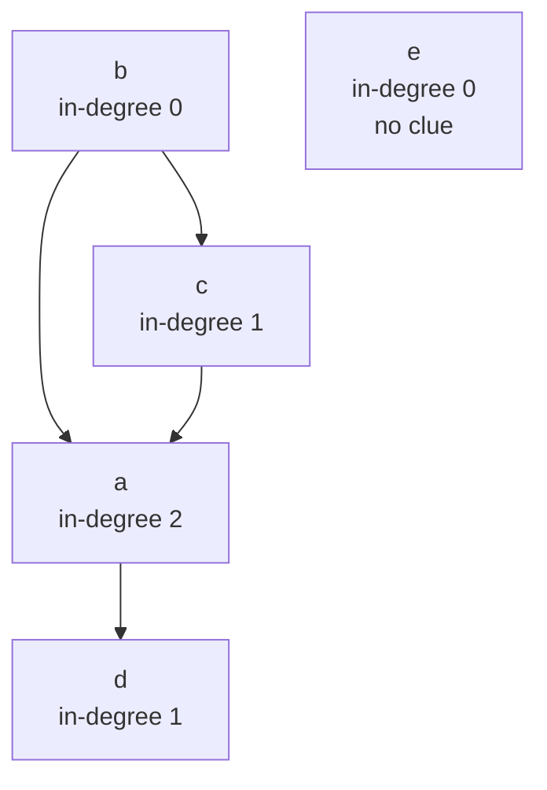

> [!tldr] Quick read
> - The word list is already sorted by an unknown alphabet. Each **pair of adjacent words** gives at most one clue: at the **first letter where they differ**, the upper word's letter comes first. Each clue is a [[en/concepts/precedence-constraint|precedence constraint]], that is, one directed edge.
> - Once I have the edges, the problem is a plain [[en/concepts/topological-sort|topological sort]]: write out any letter whose [[en/concepts/in-degree|in-degree]] is 0, remove its edges, repeat (Kahn's algorithm).
> - Return the empty string in two cases: the clues form a **cycle**, or a word sits before its own prefix (`abc` before `ab`).
> - Three traps cause most wrong answers: taking letters that differ **after** the first difference, forgetting letters that have no clue, and counting a duplicate edge's in-degree twice.
> - LeetCode accepts **any** valid order. Brute force over every permutation takes 774 ms for 9 letters in Python; Kahn takes about 54 µs, and with 26 letters brute force never finishes.

> [!info] Context
> LeetCode problem 269 (Hard, needs a LeetCode Premium account), on [[en/posts/2026-11-26-neetcode-topological-sort|station 3: Topological Sort]] of **the NeetCode Line: Graphs**. Without Premium, you can submit it for free on [LintCode 892](https://www.lintcode.com/problem/892/) or as NeetCode's [Foreign Dictionary](https://neetcode.io/problems/foreign-dictionary). The station's two earlier problems, [[en/problems/course-schedule|Course Schedule]] and [[en/problems/course-schedule-ii|Course Schedule II]], hand you the edges; this one makes you find them yourself. You only need loops, arrays and queues.

> [!abstract]- Quick glossary for this post (click to open)
> - **Lexicographic order**: how a dictionary sorts words. Compare two words left to right; the first differing letter decides which comes first. If one word is a prefix of the other (`ab` and `abc`), the shorter one comes first.
> - **Directed graph**: vertices joined by arrows. Here each vertex is a letter, and the arrow `x → y` means "x comes before y".
> - [[en/concepts/precedence-constraint|Precedence constraint]]: a statement "this must come before that". Every clue in this problem is one.
> - [[en/concepts/in-degree|In-degree]]: the number of arrows pointing into a vertex, that is, how many letters must still come before it.
> - [[en/concepts/topological-sort|Topological sort]]: lining the vertices up so every arrow points from left to right.
> - [[en/concepts/directed-acyclic-graph|DAG]]: a directed graph with no cycle. Only a DAG can be topologically sorted.
> - [[en/concepts/queue|Queue]]: a first-in, first-out list. A [[en/concepts/priority-queue|priority queue]] (min-heap) always hands out the smallest element first.
> - [[en/concepts/three-color-dfs|Three-color DFS]]: depth-first search that paints each vertex white (unvisited), gray (on the current path) or black (done) to catch cycles.

## Picture it first: an alien phone book

You find a phone book from an alien world. They use the same 26 Latin letters, but in a completely different alphabetical order. You don't know that order. All you know is that the phone book **is correctly sorted** by it.

So flip to two neighboring names: `bcd` sits right above `cb`. The very first letters already differ, `b` and `c`. Since `bcd` is above, `b` must come before `c` for them. That is one clue. Collect enough clues, then line the letters up without breaking any clue, and you have the alphabet.

| Everyday life | Concept |
|---|---|
| A phone book sorted by their alphabet | The list `words`, sorted in an unknown order |
| Flip to two neighboring names, find the first letter that differs | Compare adjacent words, take the first differing letter |
| A clue "x comes before y" | A directed edge `x → y`, that is, a [[en/concepts/precedence-constraint\|precedence constraint]] |
| Count how many letters must still come before each letter | Each vertex's [[en/concepts/in-degree\|in-degree]] |
| A letter with nothing left before it can be written down | A vertex with in-degree 0 joins the queue (Kahn) |
| Write every letter down that way | [[en/concepts/topological-sort\|Topological sort]] |
| Two clues contradict each other in a circle: x before y, y before x | The graph has a cycle, so it is not a [[en/concepts/directed-acyclic-graph\|DAG]]: return `""` |
| The name `abc` sits right above `ab` | The phone book contradicts itself: return `""` |
| A letter in the phone book with no clue about it | A vertex with no edges: it must still be written, anywhere |
| Several ways to write the letters break no clue | Several topological orders; LeetCode accepts any of them |

With the phone book `bcae, bcd, cb, cab, ad` (the example used throughout this page), the clues draw this graph:



Read the arrow `b → c` as "b comes before c". The letter `e` stands alone: it is in the phone book, but no pair says anything about it.

## The problem: from a sorted list, work out the alphabet

You get a list `words` of lowercase words, already sorted in increasing order by the alphabet of an unknown language. Return a string that holds **each letter present in the list exactly once**, ordered by that alphabet. If no alphabet could produce this list, return `""`. If several answers exist, return any of them. [Problem LC-0269](https://leetcode.com/problems/alien-dictionary/)

Limits from the LeetCode statement: 1 to 100 words, each 1 to 100 letters long, only lowercase `a`…`z`. So the graph has at most 26 vertices.

Four points that are easy to slip on in the statement itself:

| Question | Answer | Example |
|---|---|---|
| Which pairs do I compare? | Only **adjacent** pairs. | `bcd, cb, cab` gives two pairs: `bcd/cb` and `cb/cab` |
| How many clues per pair? | At most **one**, at the first differing letter. | `ab, ba` only says `a` before `b` |
| One word is a prefix of the other? | Short before long is fine; long before short returns `""`. | `ab, abc` is valid; `abc, ab` returns `""` |
| What about a letter with no clue? | It must still be in the answer. | `zx` gives `xz` or `zx`, not `""` |

**The LintCode variant.** LintCode 892 adds one rule: when several answers exist, return the **smallest in normal a…z order**. The solution stays the same; only the queue becomes a [[en/concepts/priority-queue|priority queue]] (min-heap), so each round takes the smallest ready letter. Approach 4 below goes into it.

## How it works

<figure class="figure-map" style="--ar: 3 / 4">
<div class="frame"><iframe data-archify="../../diagrams/neetcode-alien-dictionary/worked-example.en.html" title="Alien Dictionary: edges from adjacent words, then Kahn" loading="lazy"></iframe></div>
<figcaption><span><b>Figure 1.</b> Four adjacent pairs give four edges; Kahn writes out each letter whose in-degree reaches 0 and gets all 5 letters, so the phone book has no cycle.</span><a href="../diagrams/neetcode-alien-dictionary/worked-example.en.html" target="_blank" rel="noopener">Open full screen</a></figcaption>
</figure>

<details>
<summary>Read it step by step</summary>
<ol>
<li>Compare bcae with bcd: the first two letters match, the third differs (a, d). <code>edge a → d</code></li>
<li>Compare bcd with cb: the first letter already differs (b, c). <code>edge b → c</code></li>
<li>Compare cb with cab: the second letter differs (b, a). <code>edge b → a</code></li>
<li>Compare cab with ad: the first letter differs (c, a). <code>edge c → a</code></li>
<li>Count in-degrees: a has 2, c has 1, d has 1, b and e have 0. <code>queue [b, e]</code></li>
<li>Write b and remove its two edges: c drops to 0, a to 1. <code>queue [e, c]</code></li>
<li>Write e. It has no edges. <code>written: be</code></li>
<li>Write c; a drops to 0. <code>queue [a]</code></li>
<li>Write a; d drops to 0. <code>queue [d]</code></li>
<li>Write d. 5 letters written, exactly the number present. <code>answer: becad</code></li>
</ol>
</details>

### Step 1: pull clues from adjacent pairs

The table below does this step by hand on the example. Positions count from 1.

| Adjacent pair | First differing letter | Clue (edge) |
|---|---|---|
| `bcae` / `bcd` | position 3: `a` and `d` | `a → d` |
| `bcd` / `cb` | position 1: `b` and `c` | `b → c` |
| `cb` / `cab` | position 2: `b` and `a` | `b → a` |
| `cab` / `ad` | position 1: `c` and `a` | `c → a` |

The letter `e` only appears at the end of `bcae`, after the difference, so it yields no clue. It must still be in the answer.

**Why are adjacent pairs enough?** A list is sorted if and only if **every adjacent pair** is sorted, because lexicographic order is transitive: `w₁ ≤ w₂` and `w₂ ≤ w₃` imply `w₁ ≤ w₃`. Also comparing `bcae` with `cab` would only give `b → c`, a clue the adjacent pairs already imply. With n words, I compare `n − 1` pairs instead of `n(n − 1)/2`.

**Why only the first differing letter?** Because lexicographic order is decided right there. After the first difference, the remaining letters say nothing. With `ab, ba`, the first letter gives `a → b`. If I also took the second letter, I would add a false `b → a`, create a fake cycle and return `""` for a perfectly valid list.

**The prefix case.** If two words match up to the end of the shorter one, the pair gives no clue. But if the **longer** word is on top (`abc` above `ab`), no alphabet can sort them that way, so return `""` at once.

**Duplicate edges.** Two different pairs can give the same clue (`ac/ab` and `zc/zb` both give `c → b`). I store edges in a 26 × 26 table of true/false cells, and raise the in-degree only when that cell was **not** already set.

### Approach 1: brute force over every permutation, O(k!·C)

The simplest way to be sure: try every ordering of the k letters present, and for each one check whether the whole list is sorted. Let C be the total number of letters across all words; checking one ordering costs O(C), and there are k! orderings. Trying them in a…z order means the **first** valid ordering found is also the smallest in a…z order, so brute force is a good yardstick for every other approach. The test file uses it for cross-checking, but it only runs when k is small: 26! is about 4·10²⁶ orderings.

### Approach 2: build the graph, then run Kahn, O(C)

This is the approach I chose. After Step 1, I have a graph with at most 26 vertices. Kahn's algorithm does exactly what the phone-book picture described:

1. Put every present letter whose in-degree is 0 into the queue.
2. Take a letter out, write it into the answer, and lower the in-degree of every letter it points to. Any letter that just reached 0 joins the queue.
3. Stop when the queue is empty. If all k letters were written, that is the answer. If some are missing, the rest are waiting on each other in a cycle: return `""`.

| Step | Taken out | In-degrees lowered | Queue after the step | Written |
|---|---|---|---|---|
| Start | | a: 2, c: 1, d: 1, b: 0, e: 0 | `[b, e]` | |
| 1 | `b` | c → 0, a → 1 | `[e, c]` | `b` |
| 2 | `e` | none | `[c]` | `be` |
| 3 | `c` | a → 0 | `[a]` | `bec` |
| 4 | `a` | d → 0 | `[d]` | `beca` |
| 5 | `d` | none | `[]` | `becad` |

Why is counting the written letters enough to detect a cycle? In a cycle, every letter always has at least one letter in the cycle that must come before it, so its in-degree never reaches 0 and it never joins the queue. I don't need to find the cycle; I only need to notice missing letters.

**Cost.** Step 1 compares `n − 1` pairs, each costing at most the shorter word's length, O(C) in total. Kahn on the 26 × 26 table scans 26 cells per letter, at most 676 operations, a constant. Total time O(C), memory O(1) beyond the input (a fixed 26 × 26 table).

### Approach 3: three-color DFS

On the same graph, [[en/concepts/three-color-dfs|three-color DFS]] can replace Kahn. Each letter has one of three colors: **white** means unvisited, **gray** means on the current path, **black** means every letter after it has been fully visited.

- From a letter, follow each arrow. On a white letter, go into it.
- On a **gray** letter, the arrow leads back to a letter on this very path: there is a cycle, return `""`.
- After following all of a letter's arrows, paint it black and add it to a "finished" list.

A letter only finishes after every letter that must come after it has finished. So the **reversed** "finished" list is a valid order. On the example, DFS gives `ebcad`, different from Kahn's `becad` but just as correct.

Why gray, and not just one "visited" set? With `b → c → a` and `b → a`, when I reach `a` a second time through the arrow `b → a`, `a` is already visited, but that is **not** a cycle. Only a gray letter signals a cycle. The graph here is at most 26 levels deep, so recursion never hits any language's limit.

### Approach 4: the LintCode variant, the smallest string

If the problem wants the smallest string in a…z order among all correct answers, I keep Kahn and change exactly one thing: replace the queue with a **min-heap**, so each round takes the smallest letter with in-degree 0. On the example, the first round offers `b` and `e`, pick `b`; then `c` and `e`, pick `c`; and so on to `bcade`. Picking the smallest letter each round gives the smallest string, because the first position decides lexicographic order and I always put the smallest possible letter there. The test file compares this result with brute force on 2,000 random lists. With only 26 letters, scanning 26 cells per round is as fast as a heap; the Python and Java versions use the built-in heap (`heapq`, `PriorityQueue`), while TS, JS and Go scan an array.

### Checking an answer when many answers are accepted

Since LeetCode accepts any valid order, comparing the answer with one fixed string is the wrong check: on the example, Kahn gives `becad` and DFS gives `ebcad`, and both are correct. The test file checks **properties** instead of comparing strings:

- for a contradictory list, the answer must be `""`;
- otherwise the answer must hold each present letter exactly once, and when used as the alphabet, the list must come out sorted.

### Measuring brute force against Kahn

The test file builds 100 random words of 1–10 letters over k letters and sorts them by the reversed alphabet (`ihgfedcba` when k = 9). The reversed alphabet is the **last** permutation brute force reaches, so it has to try all k! orderings.

| k letters | Brute force tries | TS | Python | Go | Java |
|---:|---:|---:|---:|---:|---:|
| 7 | 5,040 orderings | 0.5 ms | 9.4 ms | 0.3 ms | 0.8 ms |
| 8 | 40,320 orderings | 4.8 ms | 84 ms | 1.7 ms | 6.9 ms |
| 9 | 362,880 orderings | 43 ms | 774 ms | 12 ms | 17 ms |
| Kahn, k = 9 | 1 run | 8 µs | 54 µs | 1 µs | 3.6 µs |

Timings change with the machine and the run; the count of orderings tried is identical in all five languages. Each extra letter makes brute force about k times slower, while Kahn barely moves. With 26 letters, brute force never finishes.

## Runnable example

Each of the original five files runs the same 8 cases: the example on this page, a single word, the prefix case `abc, ab`, a cycle `a, b, a`, two identical words, the valid prefix case `ab, abc`, a duplicate edge `ac, ab, zc, zb`, and `ab, ba` (only the first differing letter counts). Each case runs all four approaches and is checked by the properties above. The file also runs four wrong versions, cross-checks against brute force on 2,000 random lists, and measures as in the table above. Below are Step 1 and Approach 2; brute force, DFS, the min-heap version and the wrong versions are in the full file.

[TypeScript](../code/neetcode-alien-dictionary/alien-dictionary.ts) · [Python](../code/neetcode-alien-dictionary/alien_dictionary.py) · [Go](../code/neetcode-alien-dictionary/alien_dictionary.go) · [Java](../code/neetcode-alien-dictionary/alien-dictionary.java) · [JavaScript](../code/neetcode-alien-dictionary/alien-dictionary.js) · [PHP](../code/neetcode-alien-dictionary/alien-dictionary.php) · [Rust](../code/neetcode-alien-dictionary/alien_dictionary.rs)

```ts
// Shared step: compare each pair of ADJACENT words; the FIRST differing letter gives one edge u → v.
// Return null when the list contradicts itself: a word placed before its own prefix.
function buildGraph(words: string[]): Graph | null {
  const present: boolean[] = Array(26).fill(false)
  for (const w of words) for (const ch of w) present[code(ch)] = true // every letter present must be in the answer
  const adj = Array.from({ length: 26 }, () => Array(26).fill(false) as boolean[])
  const indeg: number[] = Array(26).fill(0)
  for (let i = 0; i + 1 < words.length; i++) {
    const a = words[i]
    const b = words[i + 1]
    const len = Math.min(a.length, b.length)
    let j = 0
    while (j < len && a[j] === b[j]) j++
    if (j === len) {
      if (a.length > b.length) return null // "abc" before "ab": the phone book is wrong
      continue // "ab" before "abc": valid, no clue
    }
    const u = code(a[j])
    const v = code(b[j])
    if (!adj[u][v]) {
      adj[u][v] = true
      indeg[v]++ // count a duplicate edge only once
    }
  }
  return { present, adj, indeg }
}

// Kahn on a built graph: write out each letter with nothing left before it (in-degree 0).
function kahnOrder(g: Graph): string {
  const indeg = g.indeg.slice()
  const queue: number[] = []
  for (let c = 0; c < 26; c++) if (g.present[c] && indeg[c] === 0) queue.push(c)
  let out = ""
  for (let head = 0; head < queue.length; head++) {
    const u = queue[head]
    out += chr(u)
    for (let v = 0; v < 26; v++) {
      if (g.adj[u][v] && --indeg[v] === 0) queue.push(v)
    }
  }
  const total = g.present.filter(Boolean).length
  return out.length === total ? out : "" // missing letters mean a cycle
}

// Approach 2: build the graph, then run Kahn.
function alienOrderKahn(words: string[]): string {
  const g = buildGraph(words)
  return g ? kahnOrder(g) : ""
}
```

```python
# Shared step: compare each pair of ADJACENT words; the FIRST differing letter gives one edge u → v.
# Return None when the list contradicts itself: a word placed before its own prefix.
def build_graph(words):
    present = [False] * 26
    for w in words:
        for ch in w:
            present[code(ch)] = True  # every letter present must be in the answer
    adj = [[False] * 26 for _ in range(26)]
    indeg = [0] * 26
    for a, b in zip(words, words[1:]):
        n = min(len(a), len(b))
        j = 0
        while j < n and a[j] == b[j]:
            j += 1
        if j == n:
            if len(a) > len(b):
                return None  # "abc" before "ab": the phone book is wrong
            continue  # "ab" before "abc": valid, no clue
        u, v = code(a[j]), code(b[j])
        if not adj[u][v]:
            adj[u][v] = True
            indeg[v] += 1  # count a duplicate edge only once
    return present, adj, indeg


# Kahn on a built graph: write out each letter with nothing left before it (in-degree 0).
def kahn_order(g):
    present, adj, indeg = g
    indeg = indeg[:]
    queue = deque(c for c in range(26) if present[c] and indeg[c] == 0)
    out = []
    while queue:
        u = queue.popleft()
        out.append(chr_(u))
        for v in range(26):
            if adj[u][v]:
                indeg[v] -= 1
                if indeg[v] == 0:
                    queue.append(v)
    return "".join(out) if len(out) == sum(present) else ""  # missing letters mean a cycle


# Approach 2: build the graph, then run Kahn.
def alien_order_kahn(words):
    g = build_graph(words)
    return kahn_order(g) if g is not None else ""
```

```go
// Shared step: compare each pair of ADJACENT words; the FIRST differing letter gives one edge u → v.
// Return nil when the list contradicts itself: a word placed before its own prefix.
func buildGraph(words []string) *graph {
	g := &graph{}
	for _, w := range words {
		for i := 0; i < len(w); i++ {
			g.present[w[i]-'a'] = true // every letter present must be in the answer
		}
	}
	for i := 0; i+1 < len(words); i++ {
		a, b := words[i], words[i+1]
		n := min(len(a), len(b))
		j := 0
		for j < n && a[j] == b[j] {
			j++
		}
		if j == n {
			if len(a) > len(b) {
				return nil // "abc" before "ab": the phone book is wrong
			}
			continue // "ab" before "abc": valid, no clue
		}
		u, v := a[j]-'a', b[j]-'a'
		if !g.adj[u][v] {
			g.adj[u][v] = true
			g.indeg[v]++ // count a duplicate edge only once
		}
	}
	return g
}

func countPresent(p [26]bool) int {
	n := 0
	for _, x := range p {
		if x {
			n++
		}
	}
	return n
}

// Kahn on a built graph: write out each letter with nothing left before it (in-degree 0).
func kahnOrder(g *graph) string {
	indeg := g.indeg // Go arrays are copied on assignment, so g.indeg stays intact
	queue := []int{}
	for c := 0; c < 26; c++ {
		if g.present[c] && indeg[c] == 0 {
			queue = append(queue, c)
		}
	}
	out := make([]byte, 0, 26)
	for head := 0; head < len(queue); head++ {
		u := queue[head]
		out = append(out, byte('a'+u))
		for v := 0; v < 26; v++ {
			if g.adj[u][v] {
				indeg[v]--
				if indeg[v] == 0 {
					queue = append(queue, v)
				}
			}
		}
	}
	if len(out) != countPresent(g.present) {
		return "" // missing letters mean a cycle
	}
	return string(out)
}

// Approach 2: build the graph, then run Kahn.
func alienOrderKahn(words []string) string {
	g := buildGraph(words)
	if g == nil {
		return ""
	}
	return kahnOrder(g)
}
```

```java
// Shared step: compare each pair of ADJACENT words; the FIRST differing letter gives one edge u → v.
// Return null when the list contradicts itself: a word placed before its own prefix.
static Graph buildGraph(String[] words) {
    boolean[] present = new boolean[26];
    for (String w : words) for (char ch : w.toCharArray()) present[ch - 'a'] = true; // every letter present must be in the answer
    boolean[][] adj = new boolean[26][26];
    int[] indeg = new int[26];
    for (int i = 0; i + 1 < words.length; i++) {
        String a = words[i], b = words[i + 1];
        int n = Math.min(a.length(), b.length());
        int j = 0;
        while (j < n && a.charAt(j) == b.charAt(j)) j++;
        if (j == n) {
            if (a.length() > b.length()) return null; // "abc" before "ab": the phone book is wrong
            continue; // "ab" before "abc": valid, no clue
        }
        int u = a.charAt(j) - 'a', v = b.charAt(j) - 'a';
        if (!adj[u][v]) {
            adj[u][v] = true;
            indeg[v]++; // count a duplicate edge only once
        }
    }
    return new Graph(present, adj, indeg);
}

static int countPresent(boolean[] p) {
    int n = 0;
    for (boolean x : p) if (x) n++;
    return n;
}

// Kahn on a built graph: write out each letter with nothing left before it (in-degree 0).
static String kahnOrder(Graph g) {
    int[] indeg = g.indeg().clone();
    ArrayDeque<Integer> queue = new ArrayDeque<>();
    for (int c = 0; c < 26; c++) if (g.present()[c] && indeg[c] == 0) queue.add(c);
    StringBuilder out = new StringBuilder();
    while (!queue.isEmpty()) {
        int u = queue.poll();
        out.append((char) ('a' + u));
        for (int v = 0; v < 26; v++) {
            if (g.adj()[u][v] && --indeg[v] == 0) queue.add(v);
        }
    }
    return out.length() == countPresent(g.present()) ? out.toString() : ""; // missing letters mean a cycle
}

// Approach 2: build the graph, then run Kahn.
static String alienOrderKahn(String[] words) {
    Graph g = buildGraph(words);
    return g == null ? "" : kahnOrder(g);
}
```

```js
// Shared step: compare each pair of ADJACENT words; the FIRST differing letter gives one edge u → v.
// Return null when the list contradicts itself: a word placed before its own prefix.
function buildGraph(words) {
  const present = Array(26).fill(false)
  for (const w of words) for (const ch of w) present[code(ch)] = true // every letter present must be in the answer
  const adj = Array.from({ length: 26 }, () => Array(26).fill(false))
  const indeg = Array(26).fill(0)
  for (let i = 0; i + 1 < words.length; i++) {
    const a = words[i]
    const b = words[i + 1]
    const len = Math.min(a.length, b.length)
    let j = 0
    while (j < len && a[j] === b[j]) j++
    if (j === len) {
      if (a.length > b.length) return null // "abc" before "ab": the phone book is wrong
      continue // "ab" before "abc": valid, no clue
    }
    const u = code(a[j])
    const v = code(b[j])
    if (!adj[u][v]) {
      adj[u][v] = true
      indeg[v]++ // count a duplicate edge only once
    }
  }
  return { present, adj, indeg }
}

// Kahn on a built graph: write out each letter with nothing left before it (in-degree 0).
function kahnOrder(g) {
  const indeg = g.indeg.slice()
  const queue = []
  for (let c = 0; c < 26; c++) if (g.present[c] && indeg[c] === 0) queue.push(c)
  let out = ""
  for (let head = 0; head < queue.length; head++) {
    const u = queue[head]
    out += chr(u)
    for (let v = 0; v < 26; v++) {
      if (g.adj[u][v] && --indeg[v] === 0) queue.push(v)
    }
  }
  const total = g.present.filter(Boolean).length
  return out.length === total ? out : "" // missing letters mean a cycle
}

// Approach 2: build the graph, then run Kahn.
function alienOrderKahn(words) {
  const g = buildGraph(words)
  return g ? kahnOrder(g) : ""
}
```

```php
<?php
declare(strict_types=1);

function alienOrder(array $words): string {
    $edges = $indegree = [];
    foreach ($words as $word) {
        foreach (str_split($word) as $letter) {
            $indegree[$letter] = 0;
        }
    }
    for ($i = 1; $i < count($words); $i++) {
        [$a, $b] = [$words[$i - 1], $words[$i]];
        $limit = min(strlen($a), strlen($b));
        $j = 0;
        while ($j < $limit && $a[$j] === $b[$j]) {
            $j++;
        }
        if ($j === $limit) {
            if (strlen($a) > strlen($b)) return '';
        } elseif (!isset($edges[$a[$j]][$b[$j]])) {
            $edges[$a[$j]][$b[$j]] = true;
            $indegree[$b[$j]]++;
        }
    }
    $queue = array_keys(array_filter($indegree, fn(int $n): bool => $n === 0));
    for ($head = 0; $head < count($queue); $head++) {
        foreach ($edges[$queue[$head]] ?? [] as $next => $_) {
            if (--$indegree[$next] === 0) $queue[] = $next;
        }
    }
    return count($queue) === count($indegree) ? implode($queue) : '';
}
```

```rust
fn alien_order(words: &[&str]) -> String {
    let index = |b: u8| usize::from(b - b'a');
    let (mut present, mut indegree, mut edges) = ([false; 26], [0; 26], [[false; 26]; 26]);
    for word in words {
        for b in word.bytes() {
            present[index(b)] = true;
        }
    }
    for pair in words.windows(2) {
        let (a, b) = (pair[0], pair[1]);
        if let Some((u, v)) = a.bytes().zip(b.bytes()).find(|(u, v)| u != v) {
            let (u, v) = (index(u), index(v));
            if !edges[u][v] {
                edges[u][v] = true;
                indegree[v] += 1;
            }
        } else if a.len() > b.len() {
            return String::new();
        }
    }
    let mut queue: Vec<_> = (0..26)
        .filter(|&i| present[i] && indegree[i] == 0)
        .collect();
    let mut head = 0;
    while head < queue.len() {
        let u = queue[head];
        head += 1;
        for (v, degree) in indegree.iter_mut().enumerate() {
            if edges[u][v] {
                *degree -= 1;
                if *degree == 0 {
                    queue.push(v);
                }
            }
        }
    }
    if queue.len() != present.iter().filter(|&&found| found).count() {
        return String::new();
    }
    queue
        .into_iter()
        .map(|i| char::from(b'a' + i as u8))
        .collect()
}
```

Output of `node alien-dictionary.ts` (the other four languages print the same, apart from timings):

```text
case 1 [bcae bcd cb cab ad]: Kahn becad, DFS ebcad, smallest bcade, brute force bcade (31 permutations) correct
case 2 [zx]: Kahn xz, DFS zx, smallest xz, brute force xz (1 permutations) correct
case 3 [abc ab]: Kahn "", DFS "", smallest "", brute force "" (6 permutations) correct
case 4 [a b a]: Kahn "", DFS "", smallest "", brute force "" (2 permutations) correct
case 5 [ab ab]: Kahn ab, DFS ba, smallest ab, brute force ab (1 permutations) correct
case 6 [ab abc]: Kahn abc, DFS cba, smallest abc, brute force abc (1 permutations) correct
case 7 [ac ab zc zb]: Kahn aczb, DFS cbaz, smallest acbz, brute force acbz (3 permutations) correct
case 8 [ab ba]: Kahn ab, DFS ab, smallest ab, brute force ab (1 permutations) correct
8/8 cases passed
wrong version allDiffs: 5/8 cases passed
wrong version noPrefix: 7/8 cases passed
wrong version edgeLettersOnly: 4/8 cases passed
wrong version dupIndeg: 7/8 cases passed
cross-check on 2000 random lists (1508 valid): matches brute force 2000/2000
measure 7 letters, 100 words: brute force gives gfedcba after 5040 permutations, 0.5 ms; Kahn gives gfedcba, 8.4 µs
measure 8 letters, 100 words: brute force gives hgfedcba after 40320 permutations, 4.8 ms; Kahn gives hgfedcba, 8.0 µs
measure 9 letters, 100 words: brute force gives ihgfedcba after 362880 permutations, 42.9 ms; Kahn gives ihgfedcba, 7.6 µs
```
*(Output labels translated; the files themselves print Vietnamese.)*

The added versions use Kahn’s algorithm. They count each edge once and include letters that appear without edges. PHP `5/5 ca đúng` · Rust `5/5 ca đúng`.

## Misconceptions and common traps

- **Taking every differing letter as a clue.** Only the **first** differing letter means anything. The wrong version `allDiffs` turns `ab, ba` into a fake cycle and passes only 5/8 cases.
- **Comparing every pair of words, not just adjacent ones.** Still correct, since the extra clues all follow from the adjacent pairs, but it costs `n(n − 1)/2` comparisons instead of `n − 1`.
- **Forgetting the prefix case.** `abc` above `ab` gives no clue, so a version without the check happily returns an alphabet. The wrong version `noPrefix` returns `abc` for this case; the correct answer is `""`.
- **Writing only the letters that have edges.** A letter with no clue (`e` in the example, both letters of `zx`) must still be in the answer. The wrong version `edgeLettersOnly` passes only 4/8 cases: it returns `""` for `zx` and for `ab, ab`.
- **Counting a duplicate edge's in-degree twice.** If edges live in a set (no duplicates) but the in-degree goes up every time a clue appears, the `b` in `ac, ab, zc, zb` gets in-degree 2 but is lowered only once, so it never reaches 0. Kahn thinks there is a cycle and returns `""`. The wrong version `dupIndeg` fails exactly that case. The fix: raise the in-degree only when a new edge is actually added. (Keeping edges in a list with duplicates and lowering the in-degree once per entry is also correct, because the increments and decrements match.)
- **Comparing the answer with one fixed string.** Many orders are correct. The test has to check properties, not compare strings.
- **DFS with a single "visited" set.** The diamond `b → c → a`, `b → a` gets falsely reported as a cycle. You need to tell gray (on the path) from black (done).
- **TypeScript and JavaScript: storing edges as `Map<string, Set<string>>`.** It works, but the answer's order depends on the `Map`'s insertion order. That is why two correct solutions can print two different strings. The 26 × 26 table in the file gives a fixed a…z order.
- **Python: a `set` for edges, then `indeg[v] += 1` unconditionally.** That is exactly the duplicate-edge trap above. Check `if v not in adj[u]` before raising it.
- **Go: arrays and slices copy differently.** `indeg := g.indeg` copies the whole `[26]int` array, so Kahn edits the copy while the original graph stays intact. Switch to a `[]int` slice and the assignment copies only the header, so a second run would see in-degrees already lowered. Then you need `copy`.
- **Java: using `String.compareTo` for the check.** `compareTo` compares by the normal alphabet, not the alien one. Write your own comparison using the `rank` array.

## Self-check questions

> [!question]- Which clues does the list `xa, xb, ya` give?
> `xa/xb` differ at the second letter: `a → b`. `xb/ya` differ at the very first letter: `x → y`. The `b` and `a` of the second pair come after the difference, so they don't count.

> [!question]- Why does comparing only adjacent pairs never miss a clue?
> Lexicographic order is transitive. If every adjacent pair is sorted by some alphabet, the whole list is sorted by it. A clue from a non-adjacent pair always follows from the adjacent ones.

> [!question]- What does `abc, ab` return, and why doesn't the lack of any clue save it?
> It returns `""`. In every alphabet, a word comes before every longer word that starts with it. `abc` above `ab` is wrong under every alphabet, even though the pair gives no clue.

> [!question]- How does Kahn know there is a cycle when it never looks for one?
> It counts the letters written. Every letter in a cycle always has at least one letter that must come before it, so it never reaches in-degree 0. Missing letters mean a cycle.

> [!question]- LintCode wants the smallest answer in a…z order. Where do you change Approach 2?
> Replace the queue with a min-heap (or scan the 26 letters for the smallest one with in-degree 0). Everything else stays. On the example, the answer changes from `becad` to `bcade`.

## References

- [LeetCode · Alien Dictionary](https://leetcode.com/problems/alien-dictionary/): the original problem and its limits (Premium).
- [LintCode · 892 Alien Dictionary](https://www.lintcode.com/problem/892/): a free version that asks for the smallest answer in a…z order.
- [NeetCode · Foreign Dictionary](https://neetcode.io/problems/foreign-dictionary): another free version of the same problem.
- [Kahn (1962) · Topological sorting of large networks](https://doi.org/10.1145/368996.369025): the original paper behind Kahn's algorithm.
- [Princeton · Topological.java](https://algs4.cs.princeton.edu/42digraph/Topological.java.html) and [DirectedCycle.java](https://algs4.cs.princeton.edu/42digraph/DirectedCycle.java.html): topological order as reversed DFS postorder, and cycle detection through vertices on the current path.
- [Python · heapq](https://docs.python.org/3/library/heapq.html): the built-in min-heap.
- [Java · PriorityQueue](https://docs.oracle.com/en/java/javase/21/docs/api/java.base/java/util/PriorityQueue.html): a priority queue that hands out the smallest element by default.
