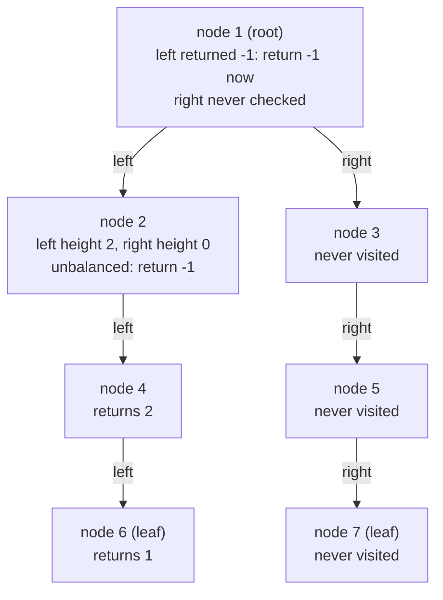
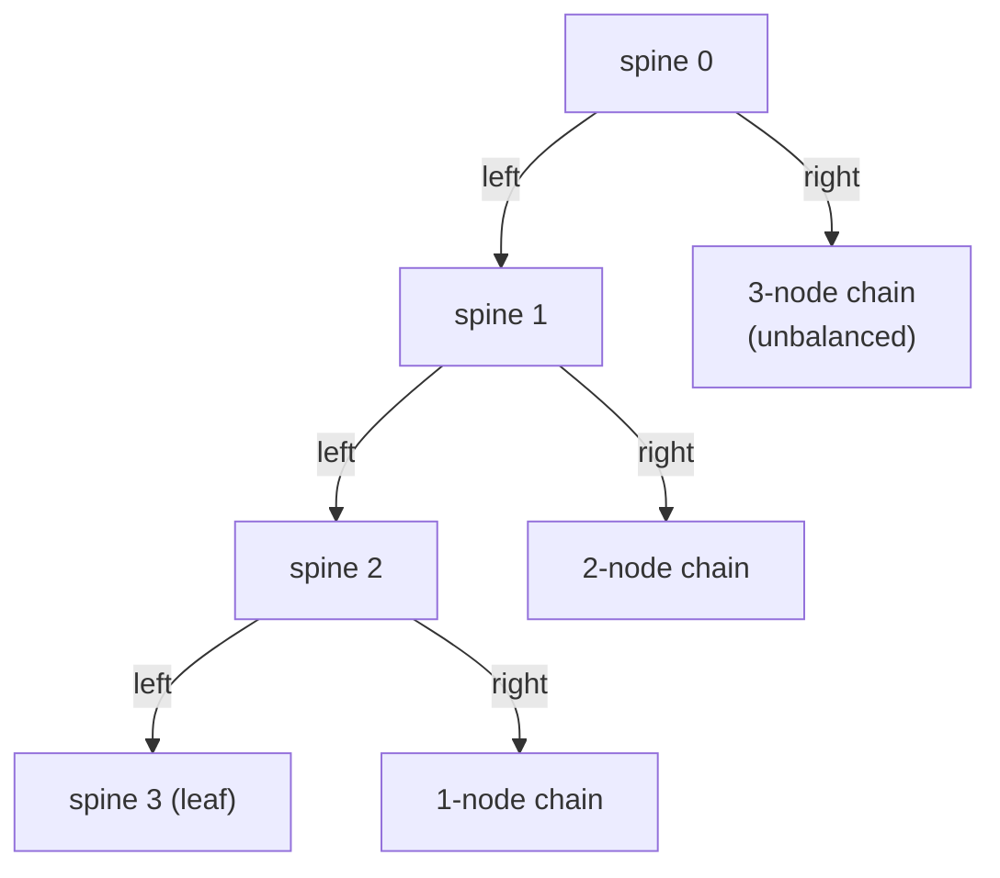
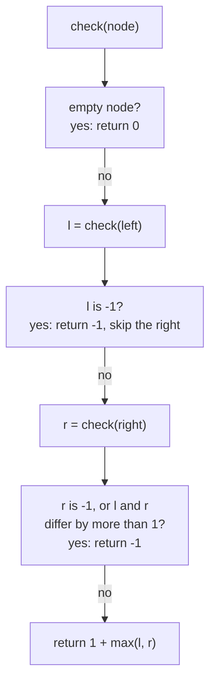

> [!tldr] Quick read
> - The problem: a binary tree is **balanced** when at **every** node the heights of the left and right subtrees differ by at most 1. Return `true` or `false`.
> - The O(n) approach: one [[en/concepts/post-order-traversal|post-order]] pass that returns the height to the parent, but returns **-1** as soon as it sees an unbalanced node. -1 is never a real height, so it is a [[en/concepts/sentinel-value|sentinel value]] that carries "already broken" all the way to the root, and every node above stops at once without looking at its other side.
> - The top-down approach (calling the height function again at every node) is correct but slow: a perfect tree of 10⁶ nodes takes 18.9 million node visits (146 ms) against 10⁶ (9.8 ms). Its worst case is not O(n²) as often written but Θ(n√n): a comb tree of 500,500 nodes needs 167 million visits.
> - Three misreadings that actually run: comparing only the root's two subtrees; comparing the shallowest and the deepest leaf (wrong in both directions); forgetting to check a child's -1, so -1 next to 0 slips through `|l − r| ≤ 1`.
> - The problem allows up to 5,000 nodes. A 5,000-node skewed chain makes the recursive Python versions throw `RecursionError`; the iterative version does not.

> [!info] Context
> LeetCode problem 110 (Easy), on [[en/posts/2026-11-25-neetcode-tree-recursion|station 3: Tree Recursion]] of **the NeetCode Line: Linked Structures**. It uses exactly the frame of [[en/problems/diameter-of-binary-tree|Diameter of Binary Tree]]: the recursive function returns the height to the parent, and every node has a second piece of information. In the diameter problem the second piece (the longest path) goes into an outside variable; here it (is the tree already unbalanced?) is **packed into the return value itself**. The height is the function from [[en/problems/maximum-depth-of-binary-tree|Maximum Depth of Binary Tree]]. Solutions come in TypeScript, Python, Go, Java and JavaScript. You need to know what recursion is; binary trees are explained right below.

> [!abstract]- Quick glossary for this post (click to open)
> - **Binary tree**: every node has at most two children, left and right. See [[en/concepts/binary-tree|Binary Tree]].
> - **Height** (on this page): the number of nodes on the longest path from a node straight down to a leaf. An empty tree has height 0.
> - **Balanced (height-balanced)**: at every node, |height(left) − height(right)| ≤ 1. An empty tree is balanced.
> - **Post-order**: handle both subtrees first, then the node. See [[en/concepts/post-order-traversal|Post-order Traversal]].
> - **Sentinel value**: a value that is never a valid result, used to signal a special state. Here it is -1. See [[en/concepts/sentinel-value|Sentinel Value]].
> - **Perfect tree**: every level is full, 2ᵏ − 1 nodes. **Skewed chain**: every node has only a left child. **Comb tree**: defined under How it works.
> - **Call stack** and its depth limit: see [[en/concepts/recursion-depth-limit|Recursion Depth Limit]].

## Picture it first: inspecting a crib mobile

A crib mobile is a set of nested horizontal bars: each bar has two ends, and each end holds a smaller bar or nothing. The inspector wants to know whether at **every** bar the two sides hang down about equally far (differing by at most one level).

- **Top-down:** the inspector stands at the top bar, follows each side all the way to the bottom to measure it, and compares the two numbers. Then they step down to the next bar and measure again from scratch, even though they just measured that stretch.
- **Bottom-up:** each bar at the bottom reports up "my side is 1 level long". A bar that receives two numbers compares them itself: if they differ too much it shouts "broken" upward, otherwise it reports "my side is one level longer". A bar that hears "broken" from its left passes "broken" straight up without measuring its right.

| Everyday life | Concept |
|---|---|
| A bar with two ends | a node with a left and a right child |
| How many levels a side hangs down | the height of a subtree |
| Standing at the top and re-measuring each side at every bar | top-down, calling `height` again |
| Every bar reports its own length upward | bottom-up, returning the height |
| Shouting "broken" | returning -1 (the sentinel) |
| Hearing "broken", passing it up, measuring nothing more | `if (l === -1) return -1` |
| Only looking at the top bar | misreading: checking only the root |

The tree below is the "balanced root, unbalanced child" case in the runnable files. The root's two subtrees have equal heights (3 and 3), but nodes 2 and 3 are both unbalanced. Each box shows what the bottom-up version returns:



## The problem

The input is the root of a binary tree with 0 to 5,000 nodes, values in [−10⁴, 10⁴] (the values do not affect the answer). Return whether the tree is balanced in the sense above. Original problem: [LeetCode 110](https://leetcode.com/problems/balanced-binary-tree/).

"Balanced" here has a narrow, specific meaning: the height difference **at each node**. I used to read it as "the leaves sit at roughly the same depth", and that is a different definition: some trees are balanced in the problem's sense while their leaves differ by two levels (see the traps in the runnable example).

## How it works

<figure class="figure-map" style="--ar: 3 / 4">
<div class="frame"><iframe data-archify="../../diagrams/neetcode-balanced-binary-tree/worked-example.en.html" title="Reuse height to check balance" loading="lazy"></iframe></div>
<figcaption><span><b>Figure 1.</b> Reuse height to check balance.</span><a href="../diagrams/neetcode-balanced-binary-tree/worked-example.en.html" target="_blank" rel="noopener">Open full screen</a></figcaption>
</figure>

<details>
<summary>Read the steps</summary>
<ol>
<li>The children of X return heights 0 and 1. <code>difference = 1</code></li>
<li>X is balanced and returns height 2. <code>height = 1 + max(0, 1)</code></li>
<li>The other child of X&#x27;s parent is empty. <code>left = 2; right = 0</code></li>
<li>A difference of 2 breaks balance. <code>2 &gt; 1 → false</code></li>
</ol>
</details>

### Approach 1: top-down

Write it straight from the definition: the root is balanced, and the left subtree is balanced, and the right subtree is balanced.

```ts
// Approach 1: top-down. At each node, recompute both subtree heights before checking the subtrees.
function balancedTopDown(root: TreeNode | null): boolean {
  if (root === null) return true;
  return Math.abs(height(root.left) - height(root.right)) <= 1 && balancedTopDown(root.left) && balancedTopDown(root.right);
}
```

Every node that gets checked calls `height` on both subtrees, which walks its whole subtree. For a balanced tree (height about log₂ n) the total is O(n log n): a perfect tree of 2²⁰ − 1 nodes takes 18,874,370 visits, about 18 times n.

**What is the worst case?** Many write-ups say O(n²), and that is a true but loose upper bound. On a skewed chain this version stops right at the root (the two sides have heights n − 1 and 0), so it costs only O(n). To cost a lot, it has to go deep along a long path on which **every** node passes the check. For each node on the path to pass, the subtree on the other side must be almost as tall as the rest of the path, so a path of length d needs at least about d²/2 nodes. So d ≤ √(2n), and the total cost is at most n · √(2n): **O(n√n)**. The bound is reached by a "comb" tree: a spine of length L whose i-th spine node holds a chain of L − 1 − i nodes on its right. Every spine node is balanced (both sides equally tall), while chains of 3 or more nodes are unbalanced.



The top-down version walks along the spine, re-measures the whole tree below at every spine node, and only reaches the first unbalanced chain near the bottom. With L = 1,000 (500,500 nodes): 167,166,003 visits, exactly 0.472 · n^1.5 at all three measured sizes. The bottom-up version goes down to the bottom of the spine, meets the first unbalanced chain and stops: 1,006 visits.

### Approach 2: bottom-up, return -1 once unbalanced

Turn it around: compute the height from the bottom up, as in [[en/problems/maximum-depth-of-binary-tree|Maximum Depth]], and check at each node along the way. The function must tell its parent two things, the height and whether it is already unbalanced. A height is never negative, so -1 can mean "unbalanced" without being mistaken for any height:

```ts
// Approach 2: bottom-up. check returns the height, or -1 if the subtree is unbalanced somewhere. -1 is never a real height.
function balancedBottomUp(root: TreeNode | null): boolean {
  const check = (node: TreeNode | null): number => {
    if (node === null) return 0;
    const l = check(node.left);
    if (l === -1) return -1; // the left side is already unbalanced: skip the right side
    const r = check(node.right);
    if (r === -1 || Math.abs(l - r) > 1) return -1;
    return 1 + Math.max(l, r);
  };
  return check(root) !== -1;
}
```

Every node is visited at most once: O(n) time, O(h) memory for the call stack. The two -1 checks are the part most easily forgotten. Without them the sentinel is treated as an ordinary height: one child returns -1, the other 0, |−1 − 0| = 1 passes the comparison, and the node returns 1 + max(−1, 0) = 1 as if all were well.



Instead of a sentinel you can return a pair `(balanced, height)`: clearer, but every call creates an object or tuple (except in Go, which returns two values). The sentinel is shorter and faster, at the cost of a convention the reader has to know.

### Approach 3: iterative

The same trick as in the diameter problem: walk pre-order with an [[en/concepts/stack|explicit stack]], process in reverse so children always finish before their parent, and keep heights in a table. Return `false` at the first unbalanced node.

```ts
// Approach 3: the same bottom-up computation without recursion: pre-order with a stack, processed in reverse.
function balancedIterative(root: TreeNode | null): boolean {
  if (root === null) return true;
  const order: TreeNode[] = [];
  const stack: TreeNode[] = [root];
  while (stack.length > 0) {
    const node = stack.pop()!;
    order.push(node);
    if (node.left !== null) stack.push(node.left);
    if (node.right !== null) stack.push(node.right);
  }
  const h = new Map<TreeNode | null, number>([[null, 0]]);
  for (let i = order.length - 1; i >= 0; i--) {
    const node = order[i];
    const l = h.get(node.left)!, r = h.get(node.right)!;
    if (Math.abs(l - r) > 1) return false;
    h.set(node, 1 + Math.max(l, r));
  }
  return true;
}
```

No depth limit, but it loses the recursive version's early stop: the pre-order step always walks the whole tree before any node is checked. On the comb tree with L = 1,000, the iterative Go version takes 18.8 ms while the recursive bottom-up version takes 0.01 ms.

| Approach | Time | Extra memory | Stops early when unbalanced |
|---|---|---|---|
| Top-down | O(n log n) balanced, Θ(n√n) worst | O(h) | yes, but only after measuring whole subtrees |
| Bottom-up, -1 | O(n) | O(h) | yes, right at the first unbalanced node |
| Iterative | O(n) | O(n) | only in the second step, after walking the whole tree |

### Measurements

TypeScript, Node 24, median of 5 runs (comb: 3 runs):

| Tree | n | Top-down: visits | Top-down | Bottom-up: visits | Bottom-up |
|---|---|---|---|---|---|
| perfect | 1,023 | 8,194 | 0.08 ms | 1,023 | 0.01 ms |
| perfect | 16,383 | 196,610 | 1.52 ms | 16,383 | 0.14 ms |
| perfect | 131,071 | 1,966,082 | 14.3 ms | 131,071 | 1.04 ms |
| perfect | 1,048,575 | 18,874,370 | 146 ms | 1,048,575 | 9.78 ms |
| comb L = 250 | 31,375 | 2,635,253 | 38.3 ms | 256 | 0.01 ms |
| comb L = 500 | 125,250 | 20,958,003 | 337 ms | 506 | 0.01 ms |
| comb L = 1,000 | 500,500 | 167,166,003 | 3,149 ms | 1,006 | 0.02 ms |

- Perfect trees: the top-down version's visits divided by n grow from 8 to 18 as n grows 1,000-fold, the n log n shape.
- Comb trees: 4 times the nodes means 8 times the visits, which is n^1.5. The ratio visits / n^1.5 stays at 0.474, 0.473, 0.472.

Other languages, median of 5 runs (ms):

| | Perfect 2²⁰ − 1: top-down | bottom-up | iterative | Comb L = 1,000: top-down | bottom-up | iterative |
|---|---|---|---|---|---|---|
| Go | 72.5 | 5.27 | 144 | 2,243 | 0.01 | 18.8 |
| Java | 65.3 | 5.44 | 174 | 1,553 | 0.02 | 8.56 |

Python, perfect tree of 2¹⁷ − 1 nodes: top-down 270 ms, bottom-up 22.3 ms, iterative 37.0 ms. In every language the iterative version is slower than the recursive bottom-up one, because every node writes and reads a hash table.

### Under the five languages

| | Returning "height or unbalanced" | Specific trap |
|---|---|---|
| TypeScript / JavaScript | `number`, -1 as the sentinel | a 10⁶-node skewed chain makes the recursive version throw `RangeError`; the iterative one finishes in 23 ms |
| Python | `int`, -1; or return a tuple `(balanced, height)` | a 5,000-node chain (the problem's limit) throws `RecursionError` in both recursive versions; use the iterative one or `sys.setrecursionlimit` |
| Go | `int`, -1; or return two values `(int, bool)` with no allocation | the iterative version with `map[*TreeNode]int` is up to 27 times slower than recursion on a perfect tree |
| Java | `int`, -1; a `(boolean, int)` record may create an object per node | the `IdentityHashMap` in the iterative version: 174 ms against 5.44 ms for recursion |

## Runnable example

[TypeScript](../code/neetcode-balanced-binary-tree/balanced.ts) · [Python](../code/neetcode-balanced-binary-tree/balanced.py) · [Go](../code/neetcode-balanced-binary-tree/balanced.go) · [Java](../code/neetcode-balanced-binary-tree/balanced.java) · [JavaScript](../code/neetcode-balanced-binary-tree/balanced.js) · [PHP](../code/neetcode-balanced-binary-tree/balanced.php) · [Rust](../code/neetcode-balanced-binary-tree/balanced.rs)

Each of the original five files builds trees from a LeetCode-style level-order array and runs 9 shared cases: empty tree, one node, a full 7-node tree, unbalanced right at the root, balanced root with an unbalanced child (the tree in the figure above), a 4-node chain (where -1 sits next to 0), a Fibonacci tree of order 5 (left child of order h − 1, right child of order h − 2: balanced at every node, but its leaves differ by two levels), a complete 5,000-node tree, and a 5,000-node skewed chain (the problem's limit). The TypeScript file also cross-checks the three approaches on 3,000 random trees (generated with mulberry32).

Bottom-up, returning -1 once unbalanced:

```ts
function balancedBottomUp(root: TreeNode | null): boolean {
  const check = (node: TreeNode | null): number => {
    if (node === null) return 0;
    const l = check(node.left);
    if (l === -1) return -1; // the left side is already unbalanced: skip the right side
    const r = check(node.right);
    if (r === -1 || Math.abs(l - r) > 1) return -1;
    return 1 + Math.max(l, r);
  };
  return check(root) !== -1;
}
```

```python
def balanced_bottom_up(root):
    """Approach 2: check returns the height, or -1 when the subtree is unbalanced. O(n)."""
    def check(node):
        if node is None:
            return 0
        l = check(node.left)
        if l == -1:
            return -1
        r = check(node.right)
        if r == -1 or abs(l - r) > 1:
            return -1
        return 1 + max(l, r)

    return check(root) != -1
```

```go
// Approach 2: bottom-up, -1 means "unbalanced".
func check(node *TreeNode) int {
	if node == nil {
		return 0
	}
	l := check(node.Left)
	if l == -1 {
		return -1
	}
	r := check(node.Right)
	if r == -1 || abs(l-r) > 1 {
		return -1
	}
	return 1 + max(l, r)
}

func balancedBottomUp(root *TreeNode) bool { return check(root) != -1 }
```

```java
// Approach 2: bottom-up; -1 means "unbalanced", so one int carries both pieces of information.
static int check(TreeNode node) {
    if (node == null) return 0;
    int l = check(node.left);
    if (l == -1) return -1;
    int r = check(node.right);
    if (r == -1 || Math.abs(l - r) > 1) return -1;
    return 1 + Math.max(l, r);
}

static boolean balancedBottomUp(TreeNode root) { return check(root) != -1; }
```

```js
// Approach 2: bottom-up; -1 means "unbalanced".
function balancedBottomUp(root) {
  const check = (node) => {
    if (node === null) return 0;
    const l = check(node.left);
    if (l === -1) return -1;
    const r = check(node.right);
    if (r === -1 || Math.abs(l - r) > 1) return -1;
    return 1 + Math.max(l, r);
  };
  return check(root) !== -1;
}
```

```php
<?php
declare(strict_types=1);

final class TreeNode {
    public function __construct(
        public int $val,
        public ?TreeNode $left = null,
        public ?TreeNode $right = null,
    ) {}
}

function isBalanced(?TreeNode $root): bool {
    return balancedHeight($root) !== -1;
}

function balancedHeight(?TreeNode $node): int {
    if ($node === null) return 0;
    $left = balancedHeight($node->left);
    if ($left === -1) return -1;
    $right = balancedHeight($node->right);
    return $right === -1 || abs($left - $right) > 1 ? -1 : 1 + max($left, $right);
}
```

```rust
use std::{cell::RefCell, rc::Rc};

type Node = Option<Rc<RefCell<TreeNode>>>;

struct TreeNode {
    _val: i32,
    left: Node,
    right: Node,
}

fn node(val: i32, left: Node, right: Node) -> Node {
    Some(Rc::new(RefCell::new(TreeNode {
        _val: val,
        left,
        right,
    })))
}

fn is_balanced(root: &Node) -> bool {
    fn height(root: &Node) -> Option<i32> {
        let Some(root) = root else { return Some(0) };
        let root = root.borrow();
        let left = height(&root.left)?;
        let right = height(&root.right)?;
        (left.abs_diff(right) <= 1).then_some(1 + left.max(right))
    }
    height(root).is_some()
}
```

The iterative version, safe for a 5,000-node chain in every language:

```ts
function balancedIterative(root: TreeNode | null): boolean {
  if (root === null) return true;
  const order: TreeNode[] = [];
  const stack: TreeNode[] = [root];
  while (stack.length > 0) {
    const node = stack.pop()!;
    order.push(node);
    if (node.left !== null) stack.push(node.left);
    if (node.right !== null) stack.push(node.right);
  }
  const h = new Map<TreeNode | null, number>([[null, 0]]);
  for (let i = order.length - 1; i >= 0; i--) {
    const node = order[i];
    const l = h.get(node.left)!, r = h.get(node.right)!;
    if (Math.abs(l - r) > 1) return false;
    h.set(node, 1 + Math.max(l, r));
  }
  return true;
}
```

```python
def balanced_iterative(root):
    """Approach 3: pre-order with a stack, processed in reverse; no depth limit."""
    if root is None:
        return True
    order, stack = [], [root]
    while stack:
        node = stack.pop()
        order.append(node)
        if node.left:
            stack.append(node.left)
        if node.right:
            stack.append(node.right)
    h = {None: 0}
    for node in reversed(order):
        l, r = h[node.left], h[node.right]
        if abs(l - r) > 1:
            return False
        h[node] = 1 + max(l, r)
    return True
```

```go
// Approach 3: pre-order with a stack, processed in reverse; h[nil] reads 0.
func balancedIterative(root *TreeNode) bool {
	if root == nil {
		return true
	}
	order := []*TreeNode{}
	stack := []*TreeNode{root}
	for len(stack) > 0 {
		node := stack[len(stack)-1]
		stack = stack[:len(stack)-1]
		order = append(order, node)
		if node.Left != nil {
			stack = append(stack, node.Left)
		}
		if node.Right != nil {
			stack = append(stack, node.Right)
		}
	}
	h := make(map[*TreeNode]int, len(order))
	for i := len(order) - 1; i >= 0; i-- {
		node := order[i]
		l, r := h[node.Left], h[node.Right]
		if abs(l-r) > 1 {
			return false
		}
		h[node] = 1 + max(l, r)
	}
	return true
}
```

```java
// Approach 3: pre-order with a stack, processed in reverse.
static boolean balancedIterative(TreeNode root) {
    if (root == null) return true;
    List<TreeNode> order = new ArrayList<>();
    Deque<TreeNode> stack = new ArrayDeque<>();
    stack.push(root);
    while (!stack.isEmpty()) {
        TreeNode node = stack.pop();
        order.add(node);
        if (node.left != null) stack.push(node.left);
        if (node.right != null) stack.push(node.right);
    }
    Map<TreeNode, Integer> h = new IdentityHashMap<>();
    for (int i = order.size() - 1; i >= 0; i--) {
        TreeNode node = order.get(i);
        int l = node.left == null ? 0 : h.get(node.left);
        int r = node.right == null ? 0 : h.get(node.right);
        if (Math.abs(l - r) > 1) return false;
        h.put(node, 1 + Math.max(l, r));
    }
    return true;
}
```

```js
// Approach 3: pre-order with a stack, processed in reverse.
function balancedIterative(root) {
  if (root === null) return true;
  const order = [], stack = [root];
  while (stack.length > 0) {
    const node = stack.pop();
    order.push(node);
    if (node.left !== null) stack.push(node.left);
    if (node.right !== null) stack.push(node.right);
  }
  const h = new Map([[null, 0]]);
  for (let i = order.length - 1; i >= 0; i--) {
    const node = order[i];
    const l = h.get(node.left), r = h.get(node.right);
    if (Math.abs(l - r) > 1) return false;
    h.set(node, 1 + Math.max(l, r));
  }
  return true;
}
```

Output of `node balanced.ts`:

```text
balancedTopDown     9/9 cases passed
balancedBottomUp    9/9 cases passed
balancedIterative   9/9 cases passed
wrongRootOnly       8/9 cases passed; wrong on balanced root, unbalanced child → true
wrongMinMaxDepth    4/9 cases passed; wrong on unbalanced at the root → true, balanced root, unbalanced child → true, 4-node chain (-1 next to 0) → true, Fibonacci tree of order 5 → false, 5000-node skewed chain (problem limit) → true
wrongIgnoreSentinel 6/9 cases passed; wrong on balanced root, unbalanced child → true, 4-node chain (-1 next to 0) → true, 5000-node skewed chain (problem limit) → true

cross-check on 3000 random trees of 0..15 nodes: the three approaches agree 3000/3000 (846 balanced trees)

perfect tree (balanced, answer true): node visits and median time (ms)
n          top-down: visits       ms   bottom-up: visits      ms
1023                   8194     0.08           1023    0.01
16383                196610     1.52          16383    0.14
131071              1966082    14.28         131071    1.04
1048575            18874370   146.42        1048575    9.78

comb tree with spine L (answer false): node visits
L      n            top-down: visits   visits / n^1.5        ms   bottom-up: visits      ms
250    31375                 2635253         0.474     38.27            256    0.01
500    125250               20958003         0.473    337.13            506    0.01
1000   500500              167166003         0.472   3148.66           1006    0.02

10⁶-node skewed chain: iterative → false (23.05 ms), recursive bottom-up → throws RangeError
```

*(Output labels translated; the files themselves print Vietnamese.)*

`wrongMinMaxDepth` is wrong in both directions: it accepts all four unbalanced trees whose leaves sit at nearby depths (a chain has only one leaf), and rejects the Fibonacci tree, which is balanced at every node but has leaves at depths 3 and 5. Whether `wrongIgnoreSentinel` is right on a skewed chain depends on the node count modulo 3: counted from the bottom, the nodes return 1, 2, -1, then -1 next to 0 becomes 1, 2, -1, … again. Only a chain whose node count is divisible by 3 ends with -1 at the root; the 4-node and 5,000-node chains do not.

`python3 balanced.py`:

```text
balanced_top_down    8/9 cases passed; wrong on 5000-node skewed chain (problem limit) → throws RecursionError
balanced_bottom_up   8/9 cases passed; wrong on 5000-node skewed chain (problem limit) → throws RecursionError
balanced_iterative   9/9 cases passed
wrong_min_max_depth  4/9 cases passed; wrong on unbalanced at the root → True, balanced root, unbalanced child → True, 4-node chain (-1 next to 0) → True, Fibonacci tree of order 5 → False, 5000-node skewed chain (problem limit) → True

perfect tree of 2^17 - 1 nodes, median of 5 runs (ms)
balanced_top_down       270.0
balanced_bottom_up       22.3
balanced_iterative       37.0
```

`go run balanced.go`:

```text
balancedTopDown      9/9 cases passed
balancedBottomUp     9/9 cases passed
balancedIterative    9/9 cases passed
wrongIgnoreSentinel  6/9 cases passed; wrong on balanced root, unbalanced child → true, 4-node chain (-1 next to 0) → true, 5000-node skewed chain (problem limit) → true

median of 5 runs (ms)
tree                         top-down   bottom-up   iterative
perfect 2^20 - 1 nodes          72.53       5.27     144.48
comb L = 1000                 2242.93       0.01      18.77
```

`java balanced.java`:

```text
balancedTopDown    9/9 cases passed
balancedBottomUp   9/9 cases passed
balancedIterative  9/9 cases passed
wrongRootOnly      8/9 cases passed; wrong on balanced root, unbalanced child → true

median of 5 runs (ms)
tree                         top-down   bottom-up   iterative
perfect 2^20 - 1 nodes          65.31       5.44     173.66
comb L = 1000                 1553.20       0.02       8.56
```

`node balanced.js`:

```text
balancedTopDown     9/9 cases passed
balancedBottomUp    9/9 cases passed
balancedIterative   9/9 cases passed
wrongMinMaxDepth    4/9 cases passed; wrong on unbalanced at the root → true, balanced root, unbalanced child → true, 4-node chain (-1 next to 0) → true, Fibonacci tree of order 5 → false, 5000-node skewed chain (problem limit) → true
wrongIgnoreSentinel 6/9 cases passed; wrong on balanced root, unbalanced child → true, 4-node chain (-1 next to 0) → true, 5000-node skewed chain (problem limit) → true
```

PHP uses `-1` for an unbalanced branch. Rust uses `None` and `?` to propagate it immediately. PHP `5/5 ca đúng` · Rust `5/5 ca đúng`.

## Misconceptions and common traps

- **"Only the root needs to be balanced."** The problem requires **every** node. The "balanced root, unbalanced child" tree has root subtrees of equal height and is still not balanced.
- **"Balanced means the shallowest and deepest leaves differ by at most 1."** That is a different definition. It accepts a skewed chain (which has only one leaf) and rejects the Fibonacci tree (balanced at every node, leaves two levels apart).
- **Forgetting to pass -1 up.** Without the `l === -1` and `r === -1` checks, the sentinel is treated as a height: -1 next to 0 passes `|l − r| ≤ 1`, and the "unbalanced" signal is lost on the way up.
- **"Top-down is O(n²)."** It is indeed no worse than O(n²), but the tight bound is Θ(n√n), reached by the comb tree. On a balanced tree it is O(n log n). On a skewed chain it stops right at the root.
- **"The iterative version is always better because it cannot overflow."** It cannot overflow, but it walks the whole tree before checking, so it loses the early stop, and its hash table makes it 1.7 to 32 times slower than the recursive version in the measurements above.
- **The problem's limit is not safe for Python recursion.** 5,000 nodes arranged as a chain exceed the default limit of 1,000 levels.

## Self-check questions

> [!question]- Why can -1 serve as the "unbalanced" signal, while 0 cannot?
> A real height is always ≥ 0, and 0 is the height of an empty tree, a valid result. -1 is never a height, so when the function sees -1 it knows for sure it is a signal and not a measurement.

> [!question]- In the bottom-up version, if the left child has returned -1, why is there no need to call `check` on the right?
> One unbalanced node anywhere is enough to make the whole tree unbalanced, so the answer is already certainly `false`. Checking the right side only costs time; skipping it is the early stop that makes this version take only 1,006 visits on the 500,500-node comb tree.

> [!question]- Draw a tree that is balanced in the problem's sense but whose shallowest and deepest leaves differ by two levels.
> The Fibonacci tree of order 5: the root's left child is a Fibonacci tree of order 4 and its right child one of order 3, and so on down. At every node the two sides differ by exactly 1, but the deepest leaf is at depth 5 (counting the root as 1) and the shallowest at depth 3.

> [!question]- On a skewed chain of n nodes, how many visits does the top-down version make?
> At the root it measures the height of the left subtree (n − 1 nodes) and the right subtree (empty), sees a difference of n − 1 > 1 and returns `false` right away thanks to the short-circuiting `&&`. About n visits in total, O(n), even though the skewed chain is the worst case for many other tree problems.

> [!question]- Diameter of Binary Tree and this problem both return the height to the parent. Where does each problem's second piece of information go, and why do they differ?
> In the diameter problem, the second piece is a number (the longest turning path) that the parent does not use for anything, so it goes into an outside variable. In this problem, the second piece is a flag (unbalanced), and the parent **needs** it to decide whether to stop, so it travels with the return value, packed into -1.

## References

- [LeetCode 110: Balanced Binary Tree](https://leetcode.com/problems/balanced-binary-tree/) (original problem: 0 to 5,000 nodes, values in [−10⁴, 10⁴])
- [Python `sys.setrecursionlimit`](https://docs.python.org/3/library/sys.html#sys.setrecursionlimit)
- G. M. Adelson-Velsky, E. M. Landis, "An algorithm for the organization of information" (1962): AVL trees, where this "height-balanced" definition comes from; the Fibonacci tree is the AVL tree with the fewest nodes for each height
- Donald Knuth, *The Art of Computer Programming*, volume 3, §6.2.3 (balanced trees; an AVL tree with n nodes has height at most about 1.44 log₂ n)
