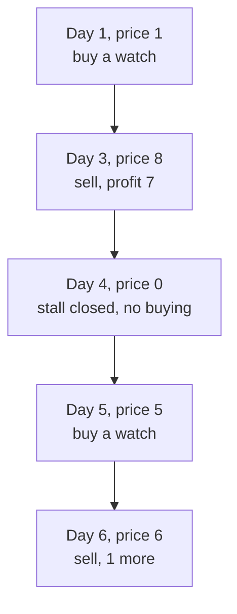
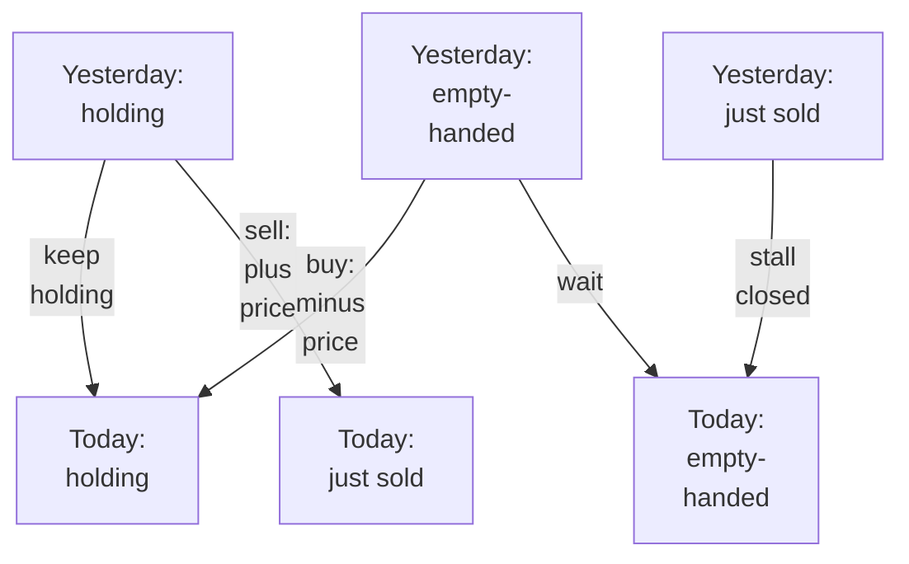

> [!tldr] Quick read
> - Each evening needs only three numbers: the best profit if I am **holding** a share, if I **just sold** today, and if I am **empty-handed**. That is a [[en/concepts/state-machine-dp|state machine DP]].
> - The rest day after a sale lives in the transition rules: I may only buy from yesterday's empty-handed state, and a day on which I sold does not count as empty-handed yet.
> - Recursion over the pair (day, holding) gives the same answer: selling on day d jumps straight to d + 2.
> - Each day reads only the previous day's three numbers, so three variables are enough. Keep the old values before overwriting them, or the rest day disappears.

> [!info] Context
> This is LeetCode problem 309 at [[en/posts/2026-11-27-neetcode-state-machine-dp|station DP-06: State Machines and Memoized Search]] on **the NeetCode line: Dynamic Programming**. It is a sibling of [[en/problems/best-time-to-buy-and-sell-stock|Best Time to Buy and Sell Stock]], but it allows many trades and adds a rest day. You only need arrays, loops and the `max` function.

> [!abstract]- Quick glossary for this post (click to open)
> - A [[en/concepts/dp-state|DP state]] says what one cell of the table stores. Here the state is "day i, in which situation".
> - A [[en/concepts/recurrence-relation|recurrence relation]] says which of yesterday's cells today's cell reads.
> - [[en/concepts/memoization|Memoization]] stores the answer of a state the first time it is computed.
> - [[en/concepts/rolling-state|Rolling State]] reuses storage once later steps no longer read the old values.
> - The rest day (cooldown) is the day right after a sale, when I may not buy again yet.
> - Profit here is total sale money minus total purchase money. Buying pushes the running profit down; selling adds the price.

## Picture it first: trading used watches at a weekly market

I trade used watches and can carry only one at a time. On any day the buying price and the selling price are the same, and they change from day to day. After I sell a watch, I must close the stall the next day for stocktaking and cannot buy a new one. Every evening I write three lines in my notebook: the best money so far if I am holding a watch tonight, if I sold one today, and if I am empty-handed with the stall still open.

| Everyday life | Concept |
|---|---|
| Holding a watch tonight | Holding state (`hold[i]`) |
| Sold the watch I held today | Just-sold state (`sold[i]`) |
| Empty-handed, free to buy tomorrow | Empty-handed state (`rest[i]`) |
| The closed-stall day after a sale | Cooldown: just sold can only move to empty-handed |
| Three notebook lines each evening | The three cells of day i in the table |
| Only last night's notebook matters | Three rolling variables instead of three arrays |

With prices `[4, 1, 2, 8, 0, 5, 6]` (days counted from 0), the best plan earns 8. Without the rest day, buying at price 0 right after selling at 8 would earn 13, but day 4 is a closed-stall day.



## The problem: the most profit when every sale costs a rest day

Given an array `prices` of length 1–5,000, each price between 0 and 1,000, `prices[i]` is the stock price on day i. I may buy and sell as many times as I like, but I can hold at most one share at a time, must sell before buying again, and may not buy on the day right after a sale. Return the largest total profit, or 0 if no trade is worth it. [Original problem, LeetCode 309](https://leetcode.com/problems/best-time-to-buy-and-sell-stock-with-cooldown/)

I used to think I could treat it like the unlimited-trades version: add up every rising step. On `[4, 1, 2, 8, 0, 5, 6]` that adds up to 13. It sells on day 3 and buys on day 4, exactly the day I must rest. The rest day makes a sale affect the next day's choices, so I need to remember one more thing: "did I just sell yesterday?".

## How it works

### Brute force over the pair (day, holding)

Let `go(day, holding)` be the best profit from day `day` onward, while holding a share (`holding = true`) or not. Past the last day it returns 0. Each day has two choices:

| Currently | Wait | Act |
|---|---|---|
| Not holding | `go(day + 1, false)` | buy: `-prices[day] + go(day + 1, true)` |
| Holding | `go(day + 1, true)` | sell: `prices[day] + go(day + 2, false)` |

The rest day lives in the `day + 2`: after selling, skip the next day. Every call splits into two branches and the depth reaches n, so time is O(2ⁿ) and stack O(n). On 20 days of prices the function is called 194,457 times.

### Memoization: only 2n states

The answer of `go(day, holding)` depends only on those two arguments, not on the path that led here. There are n days and two values of `holding`, so only 2n states. Storing each result the first time it is computed brings the same 20 days down to 79 calls, counting the calls answered from the cache. Time and memory are both O(n).

An answer of 0 is a valid result. So the memo table must tell "not computed yet" apart from "computed as 0": `undefined`, `None`, `null` or `isset`, never a truthiness check. The recursion also goes n = 5,000 levels deep, enough to hit the limits of a few languages (see the traps).

### A three-state table by day

The iterative version splits "not holding" into two situations so the rest day shows up in the table. After processing day i:

- `hold[i]`: the best profit when holding a share tonight;
- `sold[i]`: the best profit when I sold today;
- `rest[i]`: the best profit when empty-handed and I did not sell today.



The diagram gives three formulas:

```text
hold[i] = max(hold[i-1], rest[i-1] - prices[i])
sold[i] = hold[i-1] + prices[i]
rest[i] = max(rest[i-1], sold[i-1])
```

There is no arrow from "yesterday: just sold" to "today: holding". That missing arrow is the rest day. On day 0: `hold[0] = -prices[0]`, `rest[0] = 0`, and `sold[0]` is a very negative number because there is nothing to sell yet. The answer is `max(sold[n-1], rest[n-1])`: ending while still holding a share means I paid for it and never got the money back.

Running it by hand on `[4, 1, 2, 8, 0, 5, 6]`:

| Day | Price | hold | sold | rest |
|---|---|---|---|---|
| 0 | 4 | −4 | very negative | 0 |
| 1 | 1 | −1 | −3 | 0 |
| 2 | 2 | −1 | 1 | 0 |
| 3 | 8 | −1 | 7 | 1 |
| 4 | 0 | 1 | −1 | 7 |
| 5 | 5 | 2 | 6 | 7 |
| 6 | 6 | 2 | 8 | 7 |

On day 4, `hold` only rises to 1 (buying at 0 from `rest[3] = 1`), not to 7. The profit 7 from the day-3 sale sits in `sold[3]` and only flows into `rest[4]`, so it cannot fund a purchase until day 5. Each day costs O(1), for O(n) time and O(n) memory overall.

### Three rolling variables

Day i reads only the three cells of day i − 1, so three variables `hold`, `sold`, `rest` replace the three arrays. Memory drops to O(1). The catch is that all three assignments must read the *old* values. The version below saves `prevSold` before writing `sold`, computes `sold` before writing `hold`, and computes `hold` before writing `rest`. Python and Go have parallel assignment, where the right-hand side is fully evaluated before anything is assigned, so they need no temporary.

## Runnable example

[TypeScript](../code/neetcode-best-time-to-buy-and-sell-stock-with-cooldown/cooldown.ts) · [Python](../code/neetcode-best-time-to-buy-and-sell-stock-with-cooldown/cooldown.py) · [Go](../code/neetcode-best-time-to-buy-and-sell-stock-with-cooldown/cooldown.go) · [Java](../code/neetcode-best-time-to-buy-and-sell-stock-with-cooldown/cooldown.java) · [JavaScript](../code/neetcode-best-time-to-buy-and-sell-stock-with-cooldown/cooldown.js) · [PHP](../code/neetcode-best-time-to-buy-and-sell-stock-with-cooldown/cooldown.php) · [Rust](../code/neetcode-best-time-to-buy-and-sell-stock-with-cooldown/stock_cooldown.rs)

```ts
function maxProfit(prices: number[]): number {
    let hold = -prices[0], sold = NEG, rest = 0
    for (let i = 1; i < prices.length; i++) {
        const prevSold = sold
        sold = hold + prices[i]
        hold = Math.max(hold, rest - prices[i])
        rest = Math.max(rest, prevSold)
    }
    return Math.max(sold, rest)
}
```

```python
def max_profit(prices):
    hold, sold, rest = -prices[0], NEG, 0
    for price in prices[1:]:
        hold, sold, rest = max(hold, rest - price), hold + price, max(rest, sold)
    return max(sold, rest)
```

```go
func maxProfit(prices []int) int {
	hold, sold, rest := -prices[0], NEG, 0
	for _, price := range prices[1:] {
		hold, sold, rest = max(hold, rest-price), hold+price, max(rest, sold)
	}
	return max(sold, rest)
}
```

```java
static int maxProfit(int[] prices) {
    int hold = -prices[0], sold = NEG, rest = 0;
    for (int i = 1; i < prices.length; i++) {
        int prevSold = sold;
        sold = hold + prices[i];
        hold = Math.max(hold, rest - prices[i]);
        rest = Math.max(rest, prevSold);
    }
    return Math.max(sold, rest);
}
```

```js
function maxProfit(prices) {
    let hold = -prices[0], sold = NEG, rest = 0
    for (let i = 1; i < prices.length; i++) {
        const prevSold = sold
        sold = hold + prices[i]
        hold = Math.max(hold, rest - prices[i])
        rest = Math.max(rest, prevSold)
    }
    return Math.max(sold, rest)
}
```

```php
function maxProfit(array $prices): int {
    [$hold, $sold, $rest] = [-$prices[0], NEG, 0];
    for ($i = 1; $i < count($prices); $i++) {
        $prevSold = $sold;
        $sold = $hold + $prices[$i];
        $hold = max($hold, $rest - $prices[$i]);
        $rest = max($rest, $prevSold);
    }
    return max($sold, $rest);
}
```

```rust
fn max_profit(prices: &[i32]) -> i32 {
    let (mut hold, mut sold, mut rest) = (-prices[0], NEG, 0);
    for &price in &prices[1..] {
        let prev_sold = sold;
        sold = hold + price;
        hold = hold.max(rest - price);
        rest = rest.max(prev_sold);
    }
    sold.max(rest)
}
```

The tabs show the three-variable version. `NEG` is the constant `-1_000_000_000`, which marks a state that cannot happen yet. The downloadable files also hold the brute force, the memoized version and the three-array table. The 13 cases include a single day, falling prices, flat prices, two 5,000-day cases (a 1, 3 sawtooth and five ramps 0 → 999), and the `[4, 1, 2, 8, 0, 5, 6]` case above. The second line checks all four approaches against an independent enumerator. It tries every set of trades (buy on day b, sell on day s, next buy from s + 2) on every array of length 1–6 with prices 0–3.

```text
13/13 cases passed
5460/5460 cases passed (checked against trade enumeration)
20 days: brute force 194457 calls, memo 79 calls
```

*(Output labels translated; the files themselves print Vietnamese.)*

All seven languages print exactly these three lines. The last line counts entries into the function, not running time.

## Misconceptions and common traps

- **Adding up every rising step.** That solves the version without a rest day. On `[1, 3, 1, 5]` it gives 6, while the right answer is 4: selling at 3 forbids buying at 1 the next day.
- **Updating the three variables in the wrong order.** If `rest` is written first and `hold` is then computed from the new `rest`, yesterday's sale funds a purchase today. I ran that wrong order: `[1, 3, 1, 5]` gives 6 and `[4, 1, 2, 8, 0, 5, 6]` gives 13, exactly the profit of the version without a rest day. Keep the old value in a temporary, or use parallel assignment.
- **Taking `hold[n-1]` as the answer.** Ending with a share still in hand means I paid for it and never got the money back. The answer is `max(sold, rest)`.
- **A memo table that treats 0 as "not computed".** A profit of 0 is a common answer, for example when prices only fall. TypeScript and JavaScript compare with `undefined`, Python checks `is not None`, Java uses an `Integer` that can be `null`, PHP uses `isset`, Rust uses `Option`.
- **Recursion 5,000 levels deep.** Python allows about 1,000 levels by default, so the file raises `sys.setrecursionlimit`. With the default thread stack (1 MB on my machine), `java cooldown.java` throws `StackOverflowError` on the 5,000-day case. The Java file runs its checks in a `Thread` with a 64 MB stack. PHP runs with `-d xdebug.mode=off` because Xdebug cuts recursion off at 512 levels.

## Self-check questions

> [!question]- Why split "not holding" into "just sold" and "empty-handed"?
> In both situations I hold no share, but they differ in the right to buy tomorrow. Just sold means tomorrow is a rest day; empty-handed means I may buy. Merging them loses the rest day.

> [!question]- The recursive version has only two states. Why is it still correct?
> It encodes the rest day as a jump: selling on day `day` calls `go(day + 2, false)` next, skipping the rest day right in the argument.

> [!question]- What changes if the cooldown lasts k days?
> In the recursive version, a sale jumps to `day + k + 1`. In the iterative version, buying on day i must read the not-holding state of day i − k − 1, so I keep the last k days instead of only yesterday.

## References

- [LeetCode 309](https://leetcode.com/problems/best-time-to-buy-and-sell-stock-with-cooldown/)
- [Jeff Erickson, Algorithms, Dynamic Programming chapter](https://jeffe.cs.illinois.edu/teaching/algorithms/book/03-dynprog.pdf)
- [Python, assignment statements](https://docs.python.org/3/reference/simple_stmts.html#assignment-statements) · [Go spec, Assignment statements](https://go.dev/ref/spec#Assignment_statements) · [Java Thread with stackSize](https://docs.oracle.com/en/java/javase/21/docs/api/java.base/java/lang/Thread.html#%3Cinit%3E(java.lang.ThreadGroup,java.lang.Runnable,java.lang.String,long)) · [Python sys.setrecursionlimit](https://docs.python.org/3/library/sys.html#sys.setrecursionlimit) · [PHP isset](https://www.php.net/manual/en/function.isset.php)
