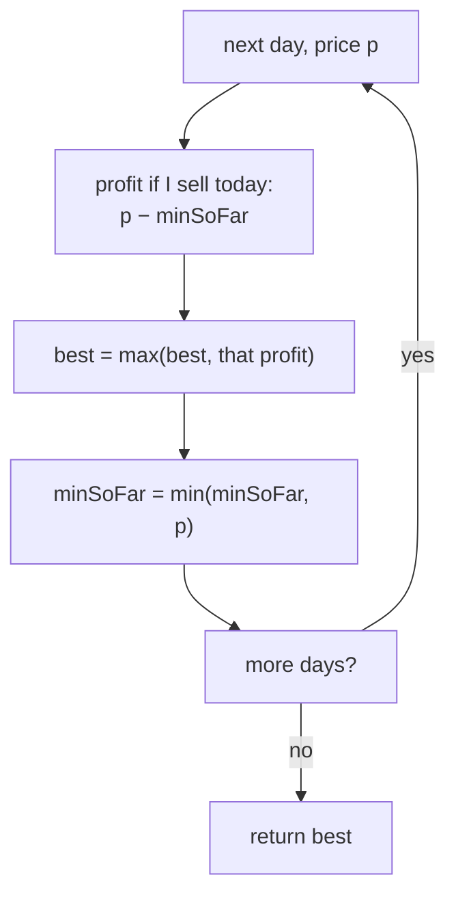

> [!tldr] Quick read
> - The problem: an array of daily prices; buy on one day, sell on a **later** day; return the largest profit, or 0 if no profit is possible.
> - Brute force tries every pair (buy i, sell j > i): O(n²). At n = 40 000 it already takes 585 ms; the problem allows up to 10⁵.
> - One pass: each day ask "how much would I make selling today?", that is today's price minus the [[en/concepts/running-minimum|lowest price so far]]. O(n), O(1) memory.
> - The same idea written as a [[en/concepts/sliding-window|sliding window]]: the left end is the buy day, the right end the sell day; on a price lower than the left end, move the left end there.
> - Traps: `max − min` ignores the order of days (wrong on 3/6 cases). In JS, `Math.min(...prices)` also throws `RangeError` on a 10⁶-element array.

> [!info] Context
> LeetCode problem 121, the opening problem of [[en/posts/2026-11-23-neetcode-sliding-window|station 5: Sliding Window]] on **the NeetCode line: Arrays and Strings**. It is the simplest window: no count table, just one remembered number. The solutions come in TypeScript, Python, Go, Java and JavaScript. All you need to know is loops and arrays.

> [!abstract]- Quick glossary for this post (click to open)
> - **Profit**: selling price minus buying price. No trade means a profit of 0.
> - **Lowest price so far (running minimum)**: a variable holding the smallest price among the days already passed. See [[en/concepts/running-minimum|Running Minimum]].
> - **Sliding window**: a contiguous range `[left, right]` whose two ends only move forward. See [[en/concepts/sliding-window|Sliding Window]].
> - **The spread operator `...`**: in JS, `f(...a)` passes each element of array `a` as a separate argument.

## Picture it first: a week at the flea market

You visit a flea market every day for a week, see the price of one item, and may buy once and sell once. You don't know future prices, but you have a small notebook.

| Everyday life | Concept |
|---|---|
| Each evening, write down "the cheapest price I've ever seen" | `minSoFar` |
| Each day, ask "if I sell today, having bought on the cheapest earlier day, what do I make?" | `price − minSoFar` |
| Keep the largest profit you ever computed | `best` |
| You can't sell before you buy | the sell day must follow the buy day: `max − min` is wrong |
| Today is cheaper than every earlier day: from now on, this is the buy day | move the window's left end |



## The problem

**The problem (in my own words):** given an array `prices` (1 ≤ n ≤ 10⁵, each price 0..10⁴), where `prices[i]` is the price on day i, pick one buy day and one sell day **after** it to make the largest profit. Return that profit, or 0 if prices only go down. Original: [LeetCode 121](https://leetcode.com/problems/best-time-to-buy-and-sell-stock/).

| Input | Output | Why |
|---|---|---|
| `[7, 1, 5, 3, 6, 4]` | `5` | buy at 1, sell at 6 |
| `[7, 6, 4, 3, 1]` | `0` | prices only fall, no trade |
| `[2, 4, 1]` | `2` | the lowest price (1) comes **after** the highest (4) |

I used to think you just find the highest and the lowest price. The third example shows why that's wrong: the lowest price is last, and there is no day to sell after it.

## How it works

### Approach 1, brute force: O(n²)

Two loops over every pair `(i, j)` with `j > i`. About n²/2 subtractions.

### Approach 2, the lowest price so far

Change the question: instead of "which day to buy, which day to sell", ask **for each sell day j**, what is the best buy day. The answer is always the day with the lowest price in `0..j−1`, and that number updates in O(1) as j moves on. The order of the two lines in the loop matters: compute the profit **first**, update the lowest price **after**, so you never buy and sell on the same day (same day means a profit of 0, so here the wrong order still gives the right answer, but the idea is wrong).

### Approach 3, written as a sliding window

`left` is the buy day, `right` the sell day. Move `right` from 1 to the end:
- `prices[right] < prices[left]`: a cheaper buy day. For every later sell day, buying at `right` beats buying at `left`, so set `left = right`;
- otherwise: compute the profit of window `[left, right]`.

`left` only moves forward and so does `right`: O(n). Approaches 2 and 3 are the same: `prices[left]` is exactly `minSoFar`. This problem opens the station because it shows the sliding-window frame before any count table is needed.

### Measured

TypeScript, random prices 0..10⁴, median:

| n | brute force | lowest price | two pointers |
|---|---|---|---|
| 5 000 | 9.2 ms | 0.27 ms | 0.03 ms |
| 10 000 | 36.6 ms | 0.21 ms | 0.05 ms |
| 20 000 | 145.9 ms | 0.07 ms | 0.02 ms |
| 40 000 | 584.8 ms | 0.14 ms | 0.03 ms |
| 10⁶ | (not run) | 3.68 ms | 0.88 ms |

Brute force has exactly the n² shape: double n and the time goes up 4 times. At the problem's n = 10⁵ it would need about 3.6 seconds. At 10⁶, the two-pointer version is about 4 times faster than the lowest-price version: both are O(n), but the lowest-price version calls `Math.max` and `Math.min` every day, while the two-pointer version only compares once on days when the price falls. The difference is in the constant.

### Under the hood of the five languages

| | Starting value of `minSoFar` | Language-specific trap |
|---|---|---|
| TypeScript / JavaScript | `Infinity` | `Math.min(...prices)` passes 10⁶ arguments: `RangeError` |
| Python | `math.inf` | `max(...)` on an empty sequence raises `ValueError`; brute force must start with `best = 0` |
| Go | `math.MaxInt` | uses the built-in `min` and `max` (since Go 1.21) |
| Java | `Integer.MAX_VALUE` | `p − MAX_VALUE` doesn't overflow because prices are ≥ 0; with negative prices it would |

## Runnable example

[TypeScript](../code/neetcode-best-time-to-buy-and-sell-stock/best-time-stock.ts) · [Python](../code/neetcode-best-time-to-buy-and-sell-stock/best_time_stock.py) · [Go](../code/neetcode-best-time-to-buy-and-sell-stock/best_time_stock.go) · [Java](../code/neetcode-best-time-to-buy-and-sell-stock/best-time-stock.java) · [JavaScript](../code/neetcode-best-time-to-buy-and-sell-stock/best-time-stock.js)

Each file has brute force, lowest price and two pointers, and runs 6 cases. Below are the two O(n) approaches.

```ts
// Approach 2, lowest price so far: each day ask "how much profit if I sell today?".
function runningMin(prices: number[]): number {
  let minSoFar = Infinity, best = 0;
  for (const p of prices) {
    best = Math.max(best, p - minSoFar); // sell today, buying on the cheapest day BEFORE it
    minSoFar = Math.min(minSoFar, p);
  }
  return best;
}

// Approach 3, two pointers (sliding window): left is the buy day, right the sell day; on a cheaper price, move left there.
function twoPointers(prices: number[]): number {
  let left = 0, best = 0;
  for (let right = 1; right < prices.length; right++) {
    if (prices[right] < prices[left]) left = right; // the old window can't beat buying here
    else best = Math.max(best, prices[right] - prices[left]);
  }
  return best;
}
```

```python
def running_min(prices: list[int]) -> int:
    min_so_far, best = math.inf, 0
    for p in prices:
        best = max(best, p - min_so_far)  # p - inf = -inf on day one; max with 0 is still 0
        min_so_far = min(min_so_far, p)
    return best

def two_pointers(prices: list[int]) -> int:
    left, best = 0, 0
    for right in range(1, len(prices)):
        if prices[right] < prices[left]:
            left = right
        else:
            best = max(best, prices[right] - prices[left])
    return best
```

```go
func runningMin(prices []int) int {
	minSoFar, best := math.MaxInt, 0
	for _, p := range prices {
		if minSoFar != math.MaxInt { // p - MaxInt doesn't overflow for prices ≥ 0, but check first to make the intent clear
			best = max(best, p-minSoFar)
		}
		minSoFar = min(minSoFar, p)
	}
	return best
}

func twoPointers(prices []int) int {
	left, best := 0, 0
	for right := 1; right < len(prices); right++ {
		if prices[right] < prices[left] {
			left = right
		} else {
			best = max(best, prices[right]-prices[left])
		}
	}
	return best
}
```

```java
static int runningMin(int[] prices) {
    int minSoFar = Integer.MAX_VALUE, best = 0;
    for (int p : prices) {
        // day one: p - MAX_VALUE is negative (no overflow since p ≥ 0), so best stays 0
        best = Math.max(best, p - minSoFar);
        minSoFar = Math.min(minSoFar, p);
    }
    return best;
}

static int twoPointers(int[] prices) {
    int left = 0, best = 0;
    for (int right = 1; right < prices.length; right++) {
        if (prices[right] < prices[left]) left = right;
        else best = Math.max(best, prices[right] - prices[left]);
    }
    return best;
}
```

```js
function runningMin(prices) {
  let minSoFar = Infinity, best = 0;
  for (const p of prices) {
    best = Math.max(best, p - minSoFar);
    minSoFar = Math.min(minSoFar, p);
  }
  return best;
}

function twoPointers(prices) {
  let left = 0, best = 0;
  for (let right = 1; right < prices.length; right++) {
    if (prices[right] < prices[left]) left = right;
    else best = Math.max(best, prices[right] - prices[left]);
  }
  return best;
}
```


```text
$ node best-time-stock.ts
bruteForce   6/6 cases passed
maxMinusMin  3/6 cases passed; wrong on [7,1,5,3,6,4] → 6 [7,6,4,3,1] → 6 [2,4,1] → 3
runningMin   6/6 cases passed
twoPointers  6/6 cases passed

n          brute force   lowest price   two pointers   (ms, median)
5000            9.2            0.27          0.03
10000          36.6            0.21          0.05
20000         145.9            0.07          0.02
40000         584.8            0.14          0.03
1000000           —            3.68          0.88
```

*(Output labels translated; the files themselves print Vietnamese.)*

`maxMinusMin` is wrong even on the first example: 7 − 1 = 6, but 7 comes **before** 1. The JavaScript file also tries `Math.min(...array)`:

```text
$ node best-time-stock.js
bruteForce   6/6 cases passed
runningMin   6/6 cases passed
twoPointers  6/6 cases passed
Math.min(...array of 10000) works
Math.min(...array of 100000) works
Math.min(...array of 1000000): RangeError: Maximum call stack size exceeded
```

Spread turns every element into an argument on the stack, and the stack is limited. At 10⁵ elements (the problem's limit) it still works on this machine, but the limit differs between engines; a plain loop never hits this error. Python, Go and Java print `6/6 ca đúng` ("6/6 cases passed") for all three approaches.

## Misconceptions and common traps

- **"Largest profit = highest price − lowest price."** It ignores the order of days; wrong on `[2, 4, 1]` and even on the problem's own example.
- **Returning a negative number when prices only fall.** The problem allows not trading, so the smallest answer is 0. Start with `best = 0`.
- **`Math.min(...prices)` in JS.** Calling a function with millions of arguments overflows the stack. Use a loop or `reduce`.
- **Thinking you must find both the buy day and the sell day.** The problem only asks for the profit. Once you know the sell day, the best buy day is fixed by the lowest earlier price.
- **Mixing it up with the many-trades problem (LeetCode 122).** There you add up every rising stretch; here there is a single trade.

## Self-check questions

> [!question]- Run the lowest-price approach on `[3, 8, 1, 4]`; write `minSoFar` and `best` after each day.
> (3, 0), (3, 5), (1, 5), (1, 5). The last day makes 4 − 1 = 3 < 5, so the answer is 5 (buy at 3, sell at 8).

> [!question]- In the two-pointer approach, why can you drop the old `left` for good when you meet a lower price?
> For every later sell day, buying at the new (lower) price always beats buying at the old `left`. The old `left` can never be the best buy day again.

> [!question]- Why does the O(n) solution need neither sorting nor a hash table?
> The question for each sell day only needs **one** number about the past (the lowest price), and that number updates in O(1).

## References

- [LeetCode 121: Best Time to Buy and Sell Stock](https://leetcode.com/problems/best-time-to-buy-and-sell-stock/) (the original problem)
- [MDN: `Math.min`](https://developer.mozilla.org/en-US/docs/Web/JavaScript/Reference/Global_Objects/Math/min) (spreading a very large array can fail because of the argument limit)
- [Go 1.21 release notes](https://go.dev/doc/go1.21#language) (the built-in `min` and `max`)
- [Python: built-in `max`](https://docs.python.org/3/library/functions.html#max) (an empty sequence raises `ValueError` without `default`)
