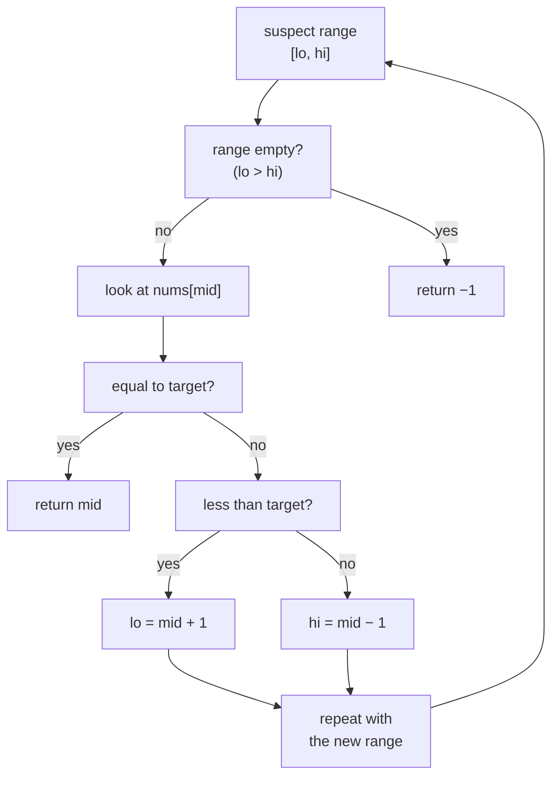

> [!tldr] Quick read
> - The problem: given an integer array sorted in **ascending** order with distinct elements, find `target`; return its index, or `-1` if absent. The problem demands O(log n).
> - [[en/concepts/binary-search|Binary search]]: look at the middle of the suspect range, compare with `target`, drop one half entirely. 10⁶ elements need at most 20 looks.
> - Correctness comes from one sentence: "if `target` is present, it is inside the suspect range" (a [[en/concepts/loop-invariant|loop invariant]]). Pick one range convention, [lo, hi] or a [[en/concepts/half-open-interval|half-open [lo, hi)]], and let it decide the loop condition and how `hi` is assigned.
> - Two wrong versions, actually run: a closed range looping on `lo < hi` skips the last cell (4/8 cases); assigning `lo = mid` loops forever once two cells remain (4/8 cases, stopped by an iteration cap).
> - `(lo + hi) / 2` overflows a 32-bit `int` once the array passes 2³⁰ elements. This bug sat in Java's `Arrays.binarySearch` for about 9 years ([[en/concepts/midpoint-overflow|midpoint overflow]]).

> [!info] Context
> LeetCode 704, the anchor problem of [[en/posts/2026-11-23-neetcode-binary-search|station 1: Binary Search on Arrays]], the opening station of **The NeetCode Line: Search and Heaps**. The previous line, [[en/series/neetcode-arr|Arrays and Strings]], always had to read the whole array at least once; here the array is already sorted, so the answer needs only about log₂ n reads. Solutions come in TypeScript, Python, Go, Java and JavaScript. You only need loops and arrays.

> [!abstract]- Quick glossary for this post (click to open)
> - **Sorted array**: each element is no smaller than the one before it.
> - **log₂ n**: how many times n halves before reaching 1. log₂ 1,000 ≈ 10, log₂ 10⁶ ≈ 20. See [[en/concepts/big-o-notation|Big-O]].
> - **Invariant**: a statement that holds before and after every pass of a loop. See [[en/concepts/loop-invariant|Loop Invariant]].
> - **Half-open range [lo, hi)**: includes `lo`, excludes `hi`. See [[en/concepts/half-open-interval|Half-open Interval]].
> - **Overflow**: a result too large for its integer type wraps around into a wrong number, usually a negative one.

## Picture it first: guess a number from 1 to 100

Someone thinks of a number from 1 to 100; you guess, and they only say "higher" or "lower". Guess 50 first: either answer rules out 50 numbers. Then guess the middle of what remains. Seven guesses cover every number, because 2⁷ = 128 ≥ 100. Guessing 1, 2, 3… could take 100 guesses.

| Everyday | Concept |
|---|---|
| The numbers that could still be the answer | the suspect range `[lo, hi]` |
| Guess the middle number | `mid = lo + (hi − lo) / 2` |
| "Higher": drop every number up to the guess | `lo = mid + 1` |
| "Lower": drop every number from the guess up | `hi = mid − 1` |
| No numbers left to guess | empty range: `target` is absent |
| Rule of the game: the other person never lies | invariant: `target` (if present) stays in the range |



## The problem

Linear search reads one element at a time: n looks in the worst case, and the "absent" case is always the worst case. It ignores the fact that the array is sorted. One comparison of `nums[mid]` with `target` proves `target` cannot be anywhere in the other half, since every element there is larger (or smaller) than `nums[mid]`. That is [[en/concepts/search-space-pruning|search space pruning]] at full strength: each step drops half.

The idea is easy; getting it right is not. Jon Bentley reports in *Programming Pearls* that when he had professional programmers write binary search, about 90% of the submissions had bugs. The bug almost always sits in one of three places: the loop condition (`<` or `<=`), the bound update (`mid` or `mid ± 1`), and the computation of `mid`.

## How it works

<figure class="figure-map" style="--ar: 3 / 4">
<div class="frame"><iframe data-archify="../../diagrams/neetcode-binary-search/worked-example.en.html" title="Discard the half that cannot hold the target" loading="lazy"></iframe></div>
<figcaption><span><b>Figure 1.</b> Discard the half that cannot hold the target.</span><a href="../diagrams/neetcode-binary-search/worked-example.en.html" target="_blank" rel="noopener">Open full screen</a></figcaption>
</figure>

<details>
<summary>Read the steps</summary>
<ol>
<li>Choose midpoint index 2. <code>[1, 4, 6, 9, 13], target = 9</code></li>
<li>Since 6 is below 9, discard the left half. <code>[lo, hi] = [3, 4]</code></li>
<li>The new midpoint holds 9. <code>mid = 3</code></li>
<li>Return the matching index. <code>3</code></li>
</ol>
</details>

### Invariant first, code second

I used to write binary search by flipping `<` to `<=` until the tests passed. The surer way is to write the invariant down first:

> If `target` is in the array, it lies within `nums[lo..hi]` (both ends included).

Every other line follows from that sentence:

| Question | What the invariant says |
|---|---|
| Initialise? | At the start the whole array is suspect: `lo = 0`, `hi = n − 1`. |
| Loop until when? | `[lo, hi]` still holds elements while `lo <= hi`. When `lo = hi`, **one** cell is still left to check. |
| `nums[mid] < target`? | Every cell from `lo` to `mid` is `< target`, `mid` included. Drop them all: `lo = mid + 1`. |
| `nums[mid] > target`? | Drop `mid` through `hi`: `hi = mid − 1`. |
| Out of the loop? | The range is empty, and the invariant says `target` (if present) is inside it. So it is absent: return `-1`. |

Why the loop is sure to stop: each pass, `mid` lies within `[lo, hi]`, and both `mid + 1` and `mid − 1` rule out at least the cell `mid`, so the range shrinks by at least 1. In practice it shrinks by half.

The interactive diagram in [[en/posts/2026-11-23-neetcode-binary-search|the station post]] steps through eight elements: finding 15 takes three looks; finding 4 shrinks the suspect range to empty, and that is the proof 4 is absent.

### Two range conventions

The second convention, the [[en/concepts/half-open-interval|half-open range]] `[lo, hi)`, treats `hi` as the **first cell no longer suspect**. Switching conventions changes three places, and only those three:

| | Closed `[lo, hi]` | Half-open `[lo, hi)` |
|---|---|---|
| Initial `hi` | `n − 1` | `n` |
| Elements remain while | `lo <= hi` | `lo < hi` |
| Drop the right half | `hi = mid − 1` | `hi = mid` (cell `mid` is already outside, since `hi` is not in the range) |
| Drop the left half | `lo = mid + 1` | `lo = mid + 1` |

Neither convention is "more correct". The closed range reads naturally when searching for one specific value. The half-open range is the standard library's convention (`bisect`, `sort.Search`, C++'s `std::lower_bound`): the length is `hi − lo`, empty means `lo == hi`, and the result can be `n` ("insert at the end") with no special case. Bugs come from **mixing** the two: initialising one way and updating bounds the other.

### Lower bound: no early exit

When the array has duplicates, or you need "where would `target` be inserted", the question becomes: **the first position with `nums[i] >= target`**. That is the [[en/concepts/lower-bound|lower bound]] (`lower_bound`, `bisect_left`). The loop drops the "equal, so return" branch: when `nums[mid] >= target`, `mid` **might** be the answer, so keep it with `hi = mid`. The invariant becomes "every cell before `lo` is `< target`, every cell from `hi` on is `>= target`". When `lo == hi`, that is exactly the boundary.

`bisect_right` is the first position with `nums[i] > target`. The difference `bisect_right − bisect_left` counts how often `target` appears: on `[1, 2, 2, 2, 3]` the two return 1 and 4, so 2 appears 3 times.

### First wrong version: looping forever with `lo = mid`

Assign `lo = mid` (forgetting the `+ 1`) in a closed range: when two cells remain, `hi = lo + 1`, and rounding down gives `mid = lo`. If `nums[mid] < target`, `lo = mid` changes nothing and the loop runs forever. One cell does the same: the array `[5]` searched for 7 has `lo = hi = mid = 0`, `5 < 7`, `lo = 0`. The TypeScript file runs this version with a 1000-pass cap: 4 of 8 cases "loop forever", exactly those where the range shrinks to one or two cells with the `mid` cell below `target`.

`lo = mid` is safe only when `mid` rounds **up**, `mid = lo + (hi − lo + 1) / 2`. That is the template for "find the **last** position that satisfies a condition", which comes back at the next station.

### Second wrong version: a closed range with `lo < hi`

Keep `hi = n − 1` but loop on `lo < hi`: when `lo == hi` the loop exits before the last cell is looked at. This version fails 4/8 cases, including `[5]` searched for 5 and both ends of an array: 13 and 1 in `[1, 3, …, 13]`. The problem's own case, `[-1, 0, 3, 5, 9, 12]` searched for 9, still passes, so running only the given example hides the bug.

### `(lo + hi) / 2` overflows

In 2006 Joshua Bloch wrote on Google's research blog that the line `int mid = (low + high) / 2;` in `java.util.Arrays.binarySearch`, which he had written himself, breaks when `low + high` exceeds `Integer.MAX_VALUE` (2³¹ − 1): the sum wraps to a negative number and `nums[mid]` throws `ArrayIndexOutOfBoundsException`. That needs an array longer than about 2³⁰ elements, so the bug lay dormant for about 9 years, until someone used arrays that size. The JDK fix is `(low + high) >>> 1`. The Java file prints the exact numbers:

```text
lo = 1500000000, hi = 2000000000
(lo + hi) / 2         = -397483648
(lo + hi) >>> 1       = 1750000000
lo + (hi - lo) / 2    = 1750000000
```

`>>>` is an **unsigned** right shift: the overflowing sum only flips the sign bit, and reading those 32 bits as unsigned still gives the true sum (at most 2³² − 2), so halving it gives the right result. `lo + (hi − lo) / 2` avoids the overflow another way: `hi − lo` never exceeds `hi`. See [[en/concepts/midpoint-overflow|Midpoint Overflow]].

### Under the hood of the seven languages

| | Computing `mid` | Standard library | Language-specific trap |
|---|---|---|---|
| TypeScript / JavaScript | `(lo + hi) >>> 1` or `Math.floor((lo + hi) / 2)` | no binary search on `Array` | numbers are `double`, so `lo + hi` cannot overflow below 2⁵³; but `>> 1` casts to a **signed** int32: `(1.5e9 + 2e9) >> 1` gives `-397483648`. `>>> 1` reads the sum as uint32, correct while `lo + hi < 2³²`, plenty for real arrays |
| Python | `(lo + hi) // 2` | `bisect_left`, `bisect_right`, `insort` | `int` is unbounded, no overflow. `bisect` returns an **insertion point**, never `-1`: check `i < n and nums[i] == target` yourself |
| Go | `lo + (hi-lo)/2`, or `int(uint(lo+hi) >> 1)` as in `sort.Search` | `sort.Search(n, f)`: smallest `i` with `f(i)` true; `slices.BinarySearch(s, x)` returns `(i, found)` | `int` is 64-bit on 64-bit machines, so overflow is unlikely, but the library still writes the safe form. `sort.Search`'s `f` must flip from `false` to `true` exactly once |
| Java | `lo + (hi - lo) / 2` or `(lo + hi) >>> 1` | `Arrays.binarySearch`, `Collections.binarySearch` | when absent it returns `-(insertion point) − 1`, **always negative** but not `-1`: `binarySearch([1, 3, 5], 4)` gives `-3`. `if (i == -1)` is wrong; write `if (i < 0)`. With duplicates there is no guarantee which one is found |
| PHP | `intdiv($lo + $hi, 2)` or `($lo + $hi) >> 1` | no binary search for arrays; `array_search` is a linear scan | `int` is 64-bit so the sum doesn't overflow, but `/` returns a **float** when the division isn't exact: using `($lo + $hi) / 2` as an index triggers a deprecation in PHP 8.1+ because the float gets truncated |
| Rust | `lo + (hi - lo) / 2` | `slice::binary_search` returns `Ok(i)` or `Err(insertion point)`; `partition_point(\|&x\| x < t)` is the lower bound | indices are `usize`: `nums.len() - 1` on an empty array, or `hi = mid - 1` when `mid = 0`, makes the program **panic** in a debug build; the half-open convention avoids this. `i32` overflow panics in debug and silently wraps with `-O` |

### Measurements

TypeScript, 10⁵ random lookups (about half present), median of 5 runs:

| n | linear | binary |
|---|---|---|
| 100 | 7.2 ms | 3.76 ms |
| 1,000 | 60.7 ms | 5.47 ms |
| 10,000 | 606.9 ms | 7.76 ms |
| 100,000 | (not run) | 9.14 ms |
| 10⁶ | (not run) | 14.09 ms |

Linear search follows n exactly: 10 times the n, 10 times the time. Binary search is nearly flat: from 100 to 10⁶ elements (10,000 times more), the time grows only about 4 times. The number of looks goes from 7 to 20 (3 times); the rest is because a 10⁶-element array does not fit in cache, so each long-distance look is slower. At n = 100 binary search is only 2 times faster: on small arrays, sequential reads are very cheap.

Python, n = 10⁶, 10⁵ lookups: hand-written loop 224 ms, `bisect_left` 80 ms. Same algorithm, but `bisect` is written in C.

## Runnable example

[TypeScript](../code/neetcode-binary-search-problem/binary-search.ts) · [Python](../code/neetcode-binary-search-problem/binary_search.py) · [Go](../code/neetcode-binary-search-problem/binary_search.go) · [Java](../code/neetcode-binary-search-problem/binary-search.java) · [JavaScript](../code/neetcode-binary-search-problem/binary-search.js) · [PHP](../code/neetcode-binary-search-problem/binary-search.php) · [Rust](../code/neetcode-binary-search-problem/binary_search.rs)

Each file has a closed-range version, a half-open version and one built on the lower bound or the standard library, and runs 8 cases: the problem's examples, a one-element array, a two-element array, and both ends of an odd-length array. Below are the two range conventions.

```ts
// Closed range [lo, hi]: invariant "if target is present, it lies in nums[lo..hi]".
function closedInterval(nums: number[], target: number): number {
  let lo = 0, hi = nums.length - 1;
  while (lo <= hi) { // the range still holds one element when lo = hi
    const mid = lo + ((hi - lo) >> 1);
    if (nums[mid] === target) return mid;
    if (nums[mid] < target) lo = mid + 1; // mid has been checked: drop it too
    else hi = mid - 1;
  }
  return -1;
}

// Half-open range [lo, hi): hi is the FIRST position no longer considered.
function halfOpen(nums: number[], target: number): number {
  let lo = 0, hi = nums.length;
  while (lo < hi) { // lo = hi means the range is empty
    const mid = lo + ((hi - lo) >> 1);
    if (nums[mid] === target) return mid;
    if (nums[mid] < target) lo = mid + 1;
    else hi = mid; // hi is outside the range, so assign mid, not mid - 1
  }
  return -1;
}
```

```python
def closed_interval(nums: list[int], target: int) -> int:
    lo, hi = 0, len(nums) - 1
    while lo <= hi:
        mid = (lo + hi) // 2  # Python ints do not overflow, so (lo + hi) // 2 is safe
        if nums[mid] == target:
            return mid
        if nums[mid] < target:
            lo = mid + 1
        else:
            hi = mid - 1
    return -1

def half_open(nums: list[int], target: int) -> int:
    lo, hi = 0, len(nums)
    while lo < hi:
        mid = (lo + hi) // 2
        if nums[mid] == target:
            return mid
        if nums[mid] < target:
            lo = mid + 1
        else:
            hi = mid
    return -1
```

```go
func closedInterval(nums []int, target int) int {
	lo, hi := 0, len(nums)-1
	for lo <= hi {
		mid := lo + (hi-lo)/2 // Go's int is 64-bit on 64-bit machines, but this form is correct at any size
		switch {
		case nums[mid] == target:
			return mid
		case nums[mid] < target:
			lo = mid + 1
		default:
			hi = mid - 1
		}
	}
	return -1
}

func halfOpen(nums []int, target int) int {
	lo, hi := 0, len(nums)
	for lo < hi {
		mid := int(uint(lo+hi) >> 1) // how sort.Search writes it: add as uint, then shift, never negative
		switch {
		case nums[mid] == target:
			return mid
		case nums[mid] < target:
			lo = mid + 1
		default:
			hi = mid
		}
	}
	return -1
}
```

```java
static int closedInterval(int[] nums, int target) {
    int lo = 0, hi = nums.length - 1;
    while (lo <= hi) {
        int mid = lo + (hi - lo) / 2; // do NOT write (lo + hi) / 2: the sum can exceed Integer.MAX_VALUE
        if (nums[mid] == target) return mid;
        if (nums[mid] < target) lo = mid + 1;
        else hi = mid - 1;
    }
    return -1;
}

static int halfOpen(int[] nums, int target) {
    int lo = 0, hi = nums.length;
    while (lo < hi) {
        int mid = (lo + hi) >>> 1; // unsigned shift: a sum that overflowed to negative is still read as positive
        if (nums[mid] == target) return mid;
        if (nums[mid] < target) lo = mid + 1;
        else hi = mid;
    }
    return -1;
}
```

```js
function closedInterval(nums, target) {
  let lo = 0, hi = nums.length - 1;
  while (lo <= hi) {
    const mid = Math.floor((lo + hi) / 2); // JS numbers are doubles: the sum cannot overflow below 2^53
    if (nums[mid] === target) return mid;
    if (nums[mid] < target) lo = mid + 1;
    else hi = mid - 1;
  }
  return -1;
}

function halfOpen(nums, target) {
  let lo = 0, hi = nums.length;
  while (lo < hi) {
    const mid = (lo + hi) >>> 1; // >>> reads the sum as uint32: correct while lo + hi < 2^32, plenty for real arrays
    if (nums[mid] === target) return mid;
    if (nums[mid] < target) lo = mid + 1;
    else hi = mid;
  }
  return -1;
}
```

```php
// Closed interval [lo, hi]: invariant "if target is present, it is in nums[lo..hi]".
function closedInterval(array $nums, int $target): int
{
    $lo = 0;
    $hi = count($nums) - 1;
    while ($lo <= $hi) {
        $mid = $lo + (($hi - $lo) >> 1); // PHP int is 64-bit; intdiv($lo + $hi, 2) is safe too
        if ($nums[$mid] === $target) return $mid;
        if ($nums[$mid] < $target) $lo = $mid + 1;
        else $hi = $mid - 1;
    }
    return -1;
}

// Half-open interval [lo, hi): hi is the FIRST position no longer considered.
function halfOpen(array $nums, int $target): int
{
    $lo = 0;
    $hi = count($nums);
    while ($lo < $hi) {
        $mid = intdiv($lo + $hi, 2); // DON'T write ($lo + $hi) / 2: PHP's / returns a float when the division isn't exact
        if ($nums[$mid] === $target) return $mid;
        if ($nums[$mid] < $target) $lo = $mid + 1;
        else $hi = $mid;
    }
    return -1;
}
```

```rust
// Closed interval [lo, hi]. A usize index can't go negative, so either keep hi = "one past the last cell" (lo..hi)
// or use i64. Here i64 keeps the closed-interval shape.
fn closed_interval(nums: &[i32], target: i32) -> i32 {
    let (mut lo, mut hi) = (0i64, nums.len() as i64 - 1); // usize: 0 - 1 makes the program panic
    while lo <= hi {
        let mid = lo + (hi - lo) / 2;
        let v = nums[mid as usize];
        if v == target {
            return mid as i32;
        }
        if v < target {
            lo = mid + 1;
        } else {
            hi = mid - 1;
        }
    }
    -1
}

// Half-open interval [lo, hi): fits usize, since hi never has to go below 0.
fn half_open(nums: &[i32], target: i32) -> i32 {
    let (mut lo, mut hi) = (0usize, nums.len());
    while lo < hi {
        let mid = lo + (hi - lo) / 2;
        match nums[mid].cmp(&target) {
            std::cmp::Ordering::Equal => return mid as i32,
            std::cmp::Ordering::Less => lo = mid + 1,
            std::cmp::Ordering::Greater => hi = mid,
        }
    }
    -1
}
```


The lower bound, and how each standard library answers the same question:

```ts
// Lower bound: the first position with nums[i] >= target (like bisect_left). No early exit.
function lowerBound(nums: number[], target: number): number {
  let lo = 0, hi = nums.length;
  while (lo < hi) {
    const mid = lo + ((hi - lo) >> 1);
    if (nums[mid] < target) lo = mid + 1;
    else hi = mid;
  }
  return lo;
}

function viaLowerBound(nums: number[], target: number): number {
  const i = lowerBound(nums, target);
  return i < nums.length && nums[i] === target ? i : -1;
}
```

```python
def via_bisect(nums: list[int], target: int) -> int:
    i = bisect_left(nums, target)  # first position with nums[i] >= target
    return i if i < len(nums) and nums[i] == target else -1
```

```go
func viaSortSearch(nums []int, target int) int {
	i := sort.Search(len(nums), func(i int) bool { return nums[i] >= target }) // smallest i for which the function returns true
	if i < len(nums) && nums[i] == target {
		return i
	}
	return -1
}

func viaSlices(nums []int, target int) int {
	if i, found := slices.BinarySearch(nums, target); found { // returns both the insertion point and a "found" flag
		return i
	}
	return -1
}
```

```java
static int viaLibrary(int[] nums, int target) {
    int i = Arrays.binarySearch(nums, target); // when absent returns -(insertion point) - 1, always negative
    return i >= 0 ? i : -1;
}
```

```js
function lowerBound(nums, target) {
  let lo = 0, hi = nums.length;
  while (lo < hi) {
    const mid = (lo + hi) >>> 1;
    if (nums[mid] < target) lo = mid + 1;
    else hi = mid;
  }
  return lo;
}

function viaLowerBound(nums, target) {
  const i = lowerBound(nums, target);
  return i < nums.length && nums[i] === target ? i : -1;
}
```

```php
// Lower bound: the first position with nums[i] >= target. PHP has no binary search for arrays.
function lowerBound(array $nums, int $target): int
{
    $lo = 0;
    $hi = count($nums);
    while ($lo < $hi) {
        $mid = ($lo + $hi) >> 1;
        if ($nums[$mid] < $target) $lo = $mid + 1;
        else $hi = $mid;
    }
    return $lo;
}

function viaLowerBound(array $nums, int $target): int
{
    $i = lowerBound($nums, $target);
    return $i < count($nums) && $nums[$i] === $target ? $i : -1;
}
```

```rust
// Standard library: binary_search returns Ok(position) or Err(insertion point); partition_point is the lower bound.
fn via_std(nums: &[i32], target: i32) -> i32 {
    match nums.binary_search(&target) {
        Ok(i) => i as i32,
        Err(_) => -1,
    }
}

fn via_partition_point(nums: &[i32], target: i32) -> i32 {
    let i = nums.partition_point(|&x| x < target); // first position with nums[i] >= target
    if i < nums.len() && nums[i] == target { i as i32 } else { -1 }
}
```


Output of `node binary-search.ts`, both wrong versions included:

```text
linearScan         8/8 correct
closedInterval     8/8 correct
halfOpen           8/8 correct
viaLowerBound      8/8 correct
wrongLoopCondition 4/8 correct; wrong at [5] t=5 → -1, [1,3] t=3 → -1, [1,3,5,7,9,11,13] t=13 → -1, [1,3,5,7,9,11,13] t=1 → -1
wrongLoEqualsMid   4/8 correct; wrong at [-1,0,3,5,9,12] t=2 → loops forever, [5] t=7 → loops forever, [1,3] t=3 → loops forever, [1,3,5,7,9,11,13] t=13 → loops forever

lo = 1500000000, hi = 2000000000
(lo + hi) >> 1       = -397483648
(lo + hi) >>> 1      = 1750000000
lo + ((hi - lo) >> 1) = 1750000000
```

*(Output labels translated; the files themselves print Vietnamese.)*

Python, Go and JavaScript print `8/8` correct for every correct version; Go also prints `slices.BinarySearch([1 3 5], 4) = 2, false`, and Java prints `Arrays.binarySearch([1, 3, 5], 4) = -3`.

PHP (`php binary-search.php`) and Rust (`rustc --edition 2021 -O binary_search.rs`) print `8/8 ca đúng` for every correct version and the same failing counts for the two broken ones. PHP also prints `(lo + hi + 1) / 2 = 1750000000.5` (`/` returns a float); Rust prints `lo.wrapping_add(hi) / 2 = -397483648` (i32 wraps around), `lo.checked_add(hi) = None` and `[1, 3, 5].binary_search(&4) = Err(2)`.

## Misconceptions and common traps

- **"Tweak `<` into `<=` until the tests pass."** Pick the range convention first; the loop condition and the `hi` update follow from it (table above).
- **`lo = mid` with `mid` rounded down.** Loops forever once two cells remain. In this problem it is always `lo = mid + 1`.
- **Testing only the given examples.** The `lo < hi` version passes the given example but fails on one-element arrays and at both ends. Always try `n = 1`, `n = 2`, the first element, the last element, and values below or above every element.
- **"Python and JS cannot overflow, so `(lo + hi) / 2` is fine."** Python is fine. JS is fine with `Math.floor` or `>>> 1`, but `>> 1` breaks once the sum passes 2³¹. Java, C, C++ and Go with `int32` really overflow.
- **Java: comparing `Arrays.binarySearch(...) == -1`.** The return value is `-(insertion point) − 1`; it equals `-1` only when the insertion point is 0.
- **Using it on an unsorted array.** No error, just a wrong result. Sorting costs O(n log n), so it only pays off when searching the same array many times.
- **PHP: `($lo + $hi) / 2` as an index.** `/` returns a float when the sum is odd (`1750000000.5`); use `intdiv` or `>> 1`. Compare with `===` so `0` doesn't equal `"0"` or `false`.
- **Rust: a closed interval with `usize`.** `hi = mid - 1` when `mid = 0` panics (debug) or wraps to a huge number (`-O`). Use the half-open convention, or `i64` as the sample file does. `binary_search` returns `Err(insertion point)` when the value is missing, not `-1`.

## Self-check questions

> [!question]- The array has 1,000,000 elements. How many looks at most?
> ⌊log₂ 10⁶⌋ + 1 = 19 + 1 = 20. After k looks, the suspect range holds at most ⌊n / 2ᵏ⌋ cells.

> [!question]- Run the closed range on `[2, 4, 6, 8, 10]` searching for 7; write down `lo`, `hi`, `mid` each pass.
> (0, 4, 2): 6 < 7, `lo = 3`. (3, 4, 3): 8 > 7, `hi = 2`. `lo = 3 > hi = 2`, return `-1`. When it stops, `lo = 3` is exactly where 7 would be inserted.

> [!question]- Why does the half-open range write `hi = mid` and not `hi = mid − 1`?
> `hi` is the first cell **no longer** suspect. Once `nums[mid] > target`, `mid` is no longer suspect, so `hi = mid` rules out exactly cell `mid`. Writing `mid − 1` would wrongly rule out cell `mid − 1` too.

> [!question]- With duplicates `[1, 2, 2, 2, 3]`, searching for 2, which index does the closed range return? How do you get the first one?
> `mid = 2`, `nums[2] = 2`, it returns 2, not the first. For the first, use the lower bound (`bisect_left`), which returns 1.

## References

- [LeetCode 704: Binary Search](https://leetcode.com/problems/binary-search/) (original problem)
- Joshua Bloch, [Extra, Extra – Read All About It: Nearly All Binary Searches and Mergesorts are Broken](https://research.google/blog/extra-extra-read-all-about-it-nearly-all-binary-searches-and-mergesorts-are-broken/), Google Research blog, 2006 (the `(low + high) / 2` bug in the JDK)
- Jon Bentley, *Programming Pearls* (2nd ed.), column 4 "Writing Correct Programs" (binary search and loop invariants)
- [Python `bisect`](https://docs.python.org/3/library/bisect.html) (`bisect_left`, `bisect_right`)
- [Go `sort.Search`](https://pkg.go.dev/sort#Search) and [`slices.BinarySearch`](https://pkg.go.dev/slices#BinarySearch)
- [Java 21 `Arrays.binarySearch`](https://docs.oracle.com/en/java/javase/21/docs/api/java.base/java/util/Arrays.html#binarySearch(int%5B%5D,int)) (the return value when absent)
