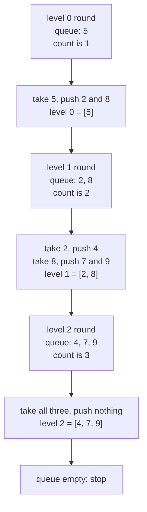
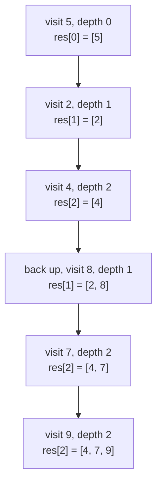

> [!tldr] Quick read
> - The problem: given the root of a binary tree, return the list of its levels, each level being its values **from left to right**. An empty tree gives an empty list.
> - Plain [[en/concepts/breadth-first-search|BFS]] gives one flat sequence and loses the boundaries between levels. The key trick is the [[en/concepts/level-size-snapshot|level size snapshot]]: at the start of each round the queue holds **exactly one level**, so count it first and dequeue exactly that many nodes.
> - Three other O(n) approaches: two lists (this level builds the next), a level marker in the queue, and a [[en/concepts/pre-order-traversal|pre-order]] DFS that carries the depth and writes into `res[depth]`.
> - The most common trap is rereading the queue length in the `for` condition while pushing children: levels get mixed, failing 5/10 cases in TypeScript and Java and 8/10 in Go.
> - The problem allows up to 2000 nodes, so a 2000-level skewed chain makes Python's recursive DFS throw `RecursionError`. At the problem's size, `shift()` or `list.pop(0)` is nothing to worry about; on trees 16,384 nodes wide and more, V8's `shift()` gets much slower.

> [!info] Context
> LeetCode problem 102 (Medium), on [[en/posts/2026-11-25-neetcode-level-order|station 5: Level Order and Carried State]] of **the NeetCode Line: Linked Structures**. The earlier stations walk trees depth-first: [[en/posts/2026-11-25-neetcode-tree-recursion|station 3]] returns results bottom-up, [[en/posts/2026-11-25-neetcode-binary-search-tree|station 4]] passes bounds top-down. This is the first problem that walks a tree **breadth-first**, one level at a time, with a queue. Solutions come in TypeScript, Python, Go, Java and JavaScript. You need to know what a binary tree is; the queue is explained right below.

> [!abstract]- Quick glossary for this post (click to open)
> - **Binary tree**: every node has at most two children, left and right. See [[en/concepts/binary-tree|Binary Tree]].
> - **Level, depth**: the root is on level 0, its children on level 1, and so on. A node's depth is the number of edges from the root to it.
> - **Queue**: first in, first out; push at the back, take from the front. Here it is an in-memory data structure, not a message queue.
> - **BFS (breadth-first search)**: visit every node at depth d before any node at depth d + 1, using a queue. See [[en/concepts/breadth-first-search|Breadth-First Search]].
> - **DFS (depth-first search)**: follow one branch to the end before turning back to another, usually with recursion. **Pre-order**: handle the node first, then its two children. See [[en/concepts/pre-order-traversal|Pre-order Traversal]].
> - **Level size snapshot**: record the queue length when a level starts and dequeue exactly that many nodes. See [[en/concepts/level-size-snapshot|Level Size Snapshot]].
> - **Marker**: a special element placed in the queue to say "this level is over".
> - **Skewed chain**: every node has a single child, so the tree is as deep as it has nodes. Recursion depth limits: see [[en/concepts/recursion-depth-limit|Recursion Depth Limit]].
> - **`deque`, `ArrayDeque`**: Python's and Java's double-ended queues, which remove from the front in O(1).

## Picture it first: family photos, one generation at a time

A family takes commemorative photos, one per **generation**, with people standing in order from the left branch of the family tree to the right. The photographer has a single hallway for people to line up in.

- **Lining up in the hallway:** whoever is called in for a photo brings their children out to the back of the line. The line always follows generation order, because children only join after their parents have gone in.
- **Counting the line before calling:** at the start of each photo, the photographer counts how many people are in line and calls exactly that many. The children brought out during the calling wait for the next photo.
- **Forgetting to count, calling while looking at the line:** the line keeps growing during the calling, so the photographer pulls a few children into their parents' photo. The picture mixes two generations.
- **A rope after each generation:** instead of counting, stretch a rope behind the last person of the generation. Reaching the rope means take the photo, then stretch a new rope behind the children.
- **Two rooms:** this generation stands in one room, their children go to the room next door. Once this room is photographed, the room next door becomes the photo room.
- **Leafing through the family book with badges:** no line at all; leaf through the book branch by branch, each person wears a badge "generation k" and gets pasted onto album page k. The left branch is read first, so each page is still in left-to-right order.

| Everyday life | Concept |
|---|---|
| The family tree | binary tree |
| One generation, one photo | one level, one inner list in the result |
| The line in the hallway | the BFS queue |
| Counting the line before calling | level size snapshot |
| Calling while looking at the line, mixed generations | the trap of rereading the queue length in the loop condition |
| The rope after a generation | a level marker in the queue |
| Two rooms | two lists: this level and the next |
| The "generation k" badge, album page k | DFS carrying the depth, writing into `res[depth]` |
| A family of 2000 generations, one person each | a 2000-level skewed chain, the recursion depth limit |

On the tree `[5, 2, 8, null, 4, 7, 9]` (2 has only a right child 4; 8 has two children 7 and 9), the counting approach runs three rounds:



## The problem

The input is the root of a binary tree with 0 to 2000 nodes, each value in [−1000, 1000]. Return a list of levels, from the root's level down to the deepest; each level is the list of values of the nodes at that depth, read left to right. An empty tree gives an empty list. The original problem: [LeetCode 102](https://leetcode.com/problems/binary-tree-level-order-traversal/).

I used to think BFS was enough: take a node out, push its two children to the back, repeat until the queue is empty. That gives the right **order** (5, 2, 8, 4, 7, 9), but as one flat sequence. The hard part of the problem is knowing where a level ends, when the queue almost always holds nodes of this level and the next one at the same time.

## How it works

<figure class="figure-map" style="--ar: 3 / 4">
<div class="frame"><iframe data-archify="../../diagrams/neetcode-binary-tree-level-order-traversal/worked-example.en.html" title="Snapshot queue length to separate levels" loading="lazy"></iframe></div>
<figcaption><span><b>Figure 1.</b> Snapshot queue length to separate levels.</span><a href="../diagrams/neetcode-binary-tree-level-order-traversal/worked-example.en.html" target="_blank" rel="noopener">Open full screen</a></figcaption>
</figure>

<details>
<summary>Read the steps</summary>
<ol>
<li>Snapshot the length before removing the root. <code>queue = [8]; size = 1</code></li>
<li>Record the first level and enqueue both children. <code>level = [8]; queue = [3, 9]</code></li>
<li>Process exactly two nodes before visiting grandchildren. <code>level = [3, 9]; queue = [1]</code></li>
<li>Node 1 belongs to the next level. <code>&#91;[8], [3, 9], [1]]</code></li>
</ol>
</details>

### Approach 1: snapshot the level size

The invariant behind the whole problem: **at the start of every outer round, the queue holds exactly the nodes of one level, in left-to-right order.** At first it holds the root, the whole of level 0. If at the start of a round the queue holds all of level d, then taking out exactly those `size` nodes, each pushing its children to the back, leaves exactly the nodes of level d + 1 in the queue: none missing (every node on level d + 1 is a child of a node on level d), none extra, and in left-to-right order because the left parent is taken out first.

```ts
// Approach 1: BFS, snapshot the level size before dequeuing. The queue is an array plus a head index.
function levelSnapshot(root: TreeNode | null): number[][] {
  const res: number[][] = [];
  if (root === null) return res;
  const queue: TreeNode[] = [root];
  let head = 0;
  while (head < queue.length) {
    const size = queue.length - head; // the number of nodes on this level, recorded before pushing children
    const level: number[] = [];
    for (let i = 0; i < size; i++) {
      const node = queue[head++];
      level.push(node.val);
      if (node.left !== null) queue.push(node.left);
      if (node.right !== null) queue.push(node.right);
    }
    res.push(level);
  }
  return res;
}
```

Each node is pushed and taken out exactly once: O(n) time. The queue's memory is proportional to the **widest level**, which can reach about n/2 on a full tree (a full 2000-node tree has 977 nodes on its last level). The "array plus head index" version above never deletes the front of the array, so in the end the array holds all n nodes. In exchange it avoids `shift()`; see the measurements.

**Trap: no snapshot.** Write `queue.length - head` straight into the `for` condition and the number changes as soon as children are pushed:

```ts
// Wrong 1: no level size snapshot. queue.length - head changes as soon as children are pushed.
function wrongLiveLength(root: TreeNode | null): number[][] {
  const res: number[][] = [];
  if (root === null) return res;
  const queue: TreeNode[] = [root];
  let head = 0;
  while (head < queue.length) {
    const level: number[] = [];
    for (let i = 0; i < queue.length - head; i++) {
      const node = queue[head++];
      level.push(node.val);
      if (node.left !== null) queue.push(node.left);
      if (node.right !== null) queue.push(node.right);
    }
    res.push(level);
  }
  return res;
}
```

On the tree above: after taking 5 and pushing 2 and 8, two nodes are waiting, so the `for` loop takes 2 into **level 0** as well. The result is `[[5,2],[8,4],[7],[9]]`. This function passes 5/10 cases: trees where every level has a single node (chains), the one-node tree, the empty tree. Java's `i < queue.size()` fails the same way, also 5/10. Go's `i < len(queue)` is worse: the `for` loop runs through the whole tree, the whole tree becomes one level, 2/10.

Each language has its own safe way to "snapshot":

| Language | Safe snapshot | Reread every round (wrong) |
|---|---|---|
| TypeScript / JavaScript | `const size = queue.length - head` before the `for` loop | `i < queue.length - head` |
| Python | `for _ in range(len(queue))`: `range` computes `len` once | `for node in q` while appending to that same `q` |
| Go | `size := len(queue)` first; or `for _, node := range cur`, since `range` reads the slice once | `for i := 0; i < len(queue); i++` |
| Java | `int size = queue.size()` before the `for` loop | `i < queue.size()` |

Python has its own variant: `for node in q` while calling `q.append(...)`. The list iterator checks the length at every step, so it walks into the nodes just added too, and the whole tree becomes one level: `wrong_iterate_while_append` passes 2/10 cases.

### Approach 2: two lists

No queue needed: keep the list of nodes on the current level, build the next level's list from it, then swap.

```ts
// Approach 2: two lists. The current level produces the next; no queue needed.
function levelTwoLists(root: TreeNode | null): number[][] {
  const res: number[][] = [];
  let cur: TreeNode[] = root === null ? [] : [root];
  while (cur.length > 0) {
    res.push(cur.map((n) => n.val));
    const next: TreeNode[] = [];
    for (const node of cur) {
      if (node.left !== null) next.push(node.left);
      if (node.right !== null) next.push(node.right);
    }
    cur = next;
  }
  return res;
}
```

The level boundary lives in the data structure itself, so there is nothing to miscount. At any moment memory holds two adjacent levels, never the whole tree. This is the hardest approach to get wrong.

### Approach 3: a level marker

Put a special element after the last node of each level. Taking out the marker means the level just ended; if the queue still has nodes (the next level has been fully pushed), put a new marker at the back.

```ts
// Approach 3: level marker. null in the queue means "end of a level".
function levelMarker(root: TreeNode | null): number[][] {
  const res: number[][] = [];
  if (root === null) return res;
  const queue: (TreeNode | null)[] = [root, null];
  let head = 0;
  let level: number[] = [];
  while (head < queue.length) {
    const node = queue[head++];
    if (node === null) {
      res.push(level);
      level = [];
      if (head < queue.length) queue.push(null); // another level follows, so give it a marker
    } else {
      level.push(node.val);
      if (node.left !== null) queue.push(node.left);
      if (node.right !== null) queue.push(node.right);
    }
  }
  return res;
}
```

The `if (head < queue.length)` condition is the easy one to forget: without it, the last marker spawns a new marker forever and the loop never stops. In Java, using `null` as the marker in an `ArrayDeque` breaks on the very first line: the documentation says "Null elements are prohibited", and `offer(null)` throws `NullPointerException` (`wrongNullMarker` passes 1/10, only the empty tree). The correct Java version uses a dedicated sentinel node and compares **references**:

```java
    // Approach 3: level marker. ArrayDeque forbids null, so the marker is a dedicated sentinel node.
    static final TreeNode MARK = new TreeNode(0);
```

### Approach 4: pre-order DFS carrying the depth

Switch to depth-first entirely: walk the tree recursively, carrying the depth of the current node, and drop its value into `res[depth]`. The first time a new depth is reached, open another list. The depth here is a [[en/concepts/path-state|path state]]: each call receives it from its parent and hands `depth + 1` to its children.

```ts
// Approach 4: pre-order DFS carrying the depth. Left before right, so each level fills in left to right.
function levelDfs(root: TreeNode | null): number[][] {
  const res: number[][] = [];
  const go = (node: TreeNode | null, depth: number): void => {
    if (node === null) return;
    if (res.length === depth) res.push([]); // first time this level is reached
    res[depth].push(node.val);
    go(node.left, depth + 1);
    go(node.right, depth + 1);
  };
  go(root, 0);
  return res;
}
```

Why is the order inside each level still right, when DFS jumps back and forth between levels? For two nodes at the same depth, the left one sits in a subtree that is visited **before** the subtree holding the right one (at their common ancestor, the left branch goes first). Pre-order keeps that relationship, so each `res[depth]` is appended from left to right:



Swap the two calls (right before left) and you still get every level, but each one reversed: `wrongRightFirst` gives `[[5],[8,2],[9,7,4]]`. Post-order or in-order also give the right result as long as left goes before right; pre-order is just the most natural, since the node is recorded before going down.

DFS memory is the call stack, proportional to the **height** h, not the width: a balanced 2000-node tree is only 11 levels deep, but a 2000-node skewed chain is 2000 levels deep. Python allows about 1,000 levels by default, so `level_dfs` throws `RecursionError` right at the problem's limit. The iterative version uses a hand-managed [[en/concepts/stack|stack]] and pushes the right child first so the left one comes out first:

```python
def level_dfs_iterative(root):
    """Approach 4b: DFS with a hand-managed stack; push right first so left comes out first."""
    res = []
    stack = [(root, 0)] if root else []
    while stack:
        node, depth = stack.pop()
        if len(res) == depth:
            res.append([])
        res[depth].append(node.val)
        if node.right:
            stack.append((node.right, depth + 1))
        if node.left:
            stack.append((node.left, depth + 1))
    return res
```

| Approach | Time | Extra memory | Note |
|---|---|---|---|
| BFS with level size snapshot | O(n) | O(w), w is the widest level | array plus head index keeps all n nodes |
| BFS with two lists | O(n) | O(w) | the hardest to get wrong |
| BFS with a level marker | O(n) | O(w) | mind the stop condition; no `null` in Java |
| DFS carrying depth, recursive | O(n) | O(h) | a 2000-level chain exceeds Python's limit |
| DFS carrying depth, iterative | O(n) | O(h) | safe in every language |

On a full tree, w ≈ n/2 while h ≈ log₂ n, so DFS uses far less memory. On a skewed chain it is the other way around: w = 1, h = n.

### Measurements

TypeScript, Node 24, full trees, median of 5 runs (ms):

| n | widest level | snapshot (head index) | snapshot with `shift()` | two lists | marker | DFS |
|---|---|---|---|---|---|---|
| 2,000 | 977 | 0.01 | 0.08 | 0.01 | 0.01 | 0.02 |
| 16,383 | 8,192 | 0.15 | 0.71 | 0.08 | 0.13 | 0.14 |
| 32,767 | 16,384 | 0.62 | 22.9 | 0.68 | 0.38 | 0.36 |
| 131,071 | 65,536 | 2.57 | 498 | 3.71 | 2.45 | 1.85 |

At the problem's size (2000 nodes), every approach stays under 0.1 ms. The `shift()` column jumps, though: n doubles from 16,383 to 32,767 while the time grows about 30 times. Draining an array with `shift()` shows the threshold more clearly:

| Array size | ns per `shift()` |
|---|---|
| 4,000 | 58 |
| 16,000 | 55 |
| 16,384 | 885 |
| 65,536 | 3,696 |

Below 16,000 elements, V8 makes `shift()` almost O(1): it moves the start of the element store forward by one slot instead of copying the whole array. From 16,384 elements on (8 bytes per slot, so the store passes 128 KB), the array lives in the space reserved for large objects, where V8 cannot move the start, so each `shift()` copies every remaining element and the cost grows with the array. The 16,384 figure matches V8's 128 KB limit for regular objects; I measured the threshold, while the reason comes from reading V8's source (`Heap::CanMoveObjectStart` refuses large objects), which I have not verified further.

Python 3.12, median of 5 runs (ms):

| n | widest level | `deque` | `list.pop(0)` | two lists | marker | recursive DFS |
|---|---|---|---|---|---|---|
| 2,000 | 977 | 0.09 | 0.15 | 0.13 | 0.09 | 0.16 |
| 16,383 | 8,192 | 0.71 | 6.14 | 1.02 | 0.73 | 1.29 |
| 65,535 | 32,768 | 3.04 | 126 | 4.45 | 3.06 | 5.56 |

`list.pop(0)` shifts every remaining element forward by one slot, so each call is O(queue length); n grows four times and the time about 20 times. `deque.popleft()` is O(1). At the problem's size the difference is only 0.06 ms.

Go and Java, median of 5 runs (ms):

| | n | snapshot | variant | two lists | marker | DFS |
|---|---|---|---|---|---|---|
| Go | 131,071 | 4.57 | `q = q[1:]`: 2.44 | 0.78 | 4.28 | 2.36 |
| Go | 1,048,575 | 18.7 | `q = q[1:]`: 22.7 | 8.61 | 30.5 | 16.4 |
| Java | 131,071 | 1.32 (`ArrayDeque`) | `LinkedList`: 4.81 | 3.82 | 5.76 | 1.03 |
| Java | 1,048,575 | 22.3 (`ArrayDeque`) | `LinkedList`: 16.5 | 21.7 | 21.8 | 14.6 |

In Go, `q = q[1:]` copies nothing, it only moves the start of the slice, so it is in the same range as keeping an index. In Java, the 10⁶-node row is dominated by the garbage collector and changes order between runs; read only the 131,071 row. The machine was running other work in parallel, so read the order and the ratios, not the last digits.

### Under the five languages

| | Queue to use | Language-specific traps |
|---|---|---|
| TypeScript / JavaScript | array plus head index, or two lists | `shift()` gets much slower once the queue passes about 16,000 elements; returning `null` instead of `[]` for an empty tree is wrong (`wrongEmptyNull` 9/10) |
| Python | `collections.deque`, or two lists | `list.pop(0)` is O(n); `for node in q` while appending to `q`; `res=[]` as a default value is shared between calls; recursive DFS exceeds 1,000 levels |
| Go | slice plus index, or `q = q[1:]` | `i < len(queue)` is reread every round; passing `res` by value into a recursive function loses the appends made inside; `var res [][]int` becomes `null` through `json.Marshal`, `[][]int{}` becomes `[]` |
| Java | `ArrayDeque` | `ArrayDeque` forbids `null`; `i < queue.size()` is reread every round |

Python's `res=[]` trap: a default value is created **once**, when the function is defined, so every call that does not pass `res` shares one list. The third call (the tree `[5, 2, 8, …]`) gets back `[[7,5],[2,8],[4,7,9]]`, including the 7 from the previous case. Go's pass-by-value trap: `res = append(res, []int{})` inside the child function creates a new slice header that the caller never sees, so `wrongPassByValue` returns `[]` for every tree.

## Runnable example

[TypeScript](../code/neetcode-binary-tree-level-order-traversal/level-order.ts) · [Python](../code/neetcode-binary-tree-level-order-traversal/level_order.py) · [Go](../code/neetcode-binary-tree-level-order-traversal/level_order.go) · [Java](../code/neetcode-binary-tree-level-order-traversal/level-order.java) · [JavaScript](../code/neetcode-binary-tree-level-order-traversal/level-order.js)

Each file builds trees from a LeetCode-style level-order array (`null` is a gap) and runs 10 shared cases: the empty tree, one node, the three-level tree with gaps from the top of the page, left children only, right children only, a full 15-node tree, staggered branches `[1, 2, 3, 4, null, null, 5, 6, null, null, 7]`, negative and duplicate values, a full-size 2000-node tree, and a 2000-node left chain. Each file also cross-checks the correct approaches against each other on 2000 to 3000 random trees of 0 to 59 nodes.

BFS with a level size snapshot:

```ts
function levelSnapshot(root: TreeNode | null): number[][] {
  const res: number[][] = [];
  if (root === null) return res;
  const queue: TreeNode[] = [root];
  let head = 0;
  while (head < queue.length) {
    const size = queue.length - head; // the number of nodes on this level, recorded before pushing children
    const level: number[] = [];
    for (let i = 0; i < size; i++) {
      const node = queue[head++];
      level.push(node.val);
      if (node.left !== null) queue.push(node.left);
      if (node.right !== null) queue.push(node.right);
    }
    res.push(level);
  }
  return res;
}
```

```python
def level_snapshot(root):
    """Approach 1: BFS with a deque; len(queue) is recorded once per level."""
    res = []
    if root is None:
        return res
    queue = deque([root])
    while queue:
        level = []
        for _ in range(len(queue)):  # range() computes len once, before the loop
            node = queue.popleft()
            level.append(node.val)
            if node.left:
                queue.append(node.left)
            if node.right:
                queue.append(node.right)
        res.append(level)
    return res
```

```go
// Approach 1: BFS, snapshot the level size. The queue is a slice plus a head index.
func levelSnapshot(root *TreeNode) [][]int {
	res := [][]int{}
	if root == nil {
		return res
	}
	queue := []*TreeNode{root}
	head := 0
	for head < len(queue) {
		size := len(queue) - head // recorded before pushing children
		level := make([]int, 0, size)
		for i := 0; i < size; i++ {
			node := queue[head]
			head++
			level = append(level, node.Val)
			if node.Left != nil {
				queue = append(queue, node.Left)
			}
			if node.Right != nil {
				queue = append(queue, node.Right)
			}
		}
		res = append(res, level)
	}
	return res
}
```

```java
// Approach 1: BFS with an ArrayDeque, recording size() before pushing children.
static List<List<Integer>> levelSnapshot(TreeNode root) {
    List<List<Integer>> res = new ArrayList<>();
    if (root == null) return res;
    Deque<TreeNode> queue = new ArrayDeque<>();
    queue.offer(root);
    while (!queue.isEmpty()) {
        int size = queue.size();
        List<Integer> level = new ArrayList<>(size);
        for (int i = 0; i < size; i++) {
            TreeNode node = queue.poll();
            level.add(node.val);
            if (node.left != null) queue.offer(node.left);
            if (node.right != null) queue.offer(node.right);
        }
        res.add(level);
    }
    return res;
}
```

```js
// Approach 1: BFS, snapshot the level size before dequeuing. The queue is an array plus a head index.
function levelSnapshot(root) {
  const res = [];
  if (root === null)
    return res;
  const queue = [root];
  let head = 0;
  while (head < queue.length) {
    const size = queue.length - head; // the number of nodes on this level, recorded before pushing children
    const level = [];
    for (let i = 0; i < size; i++) {
      const node = queue[head++];
      level.push(node.val);
      if (node.left !== null)
        queue.push(node.left);
      if (node.right !== null)
        queue.push(node.right);
    }
    res.push(level);
  }
  return res;
}
```

DFS carrying the depth, recursive (this Python version breaks on the 2000-level chain; the iterative one in How it works does not):

```ts
function levelDfs(root: TreeNode | null): number[][] {
  const res: number[][] = [];
  const go = (node: TreeNode | null, depth: number): void => {
    if (node === null) return;
    if (res.length === depth) res.push([]); // first time this level is reached
    res[depth].push(node.val);
    go(node.left, depth + 1);
    go(node.right, depth + 1);
  };
  go(root, 0);
  return res;
}
```

```python
def level_dfs(root):
    """Approach 4: pre-order DFS carrying the depth, recursive."""
    res = []

    def go(node, depth):
        if node is None:
            return
        if len(res) == depth:
            res.append([])
        res[depth].append(node.val)
        go(node.left, depth + 1)
        go(node.right, depth + 1)

    go(root, 0)
    return res
```

```go
// Approach 4: pre-order DFS carrying the depth. The closure writes straight into the outer function's res.
func levelDfs(root *TreeNode) [][]int {
	res := [][]int{}
	var walk func(node *TreeNode, depth int)
	walk = func(node *TreeNode, depth int) {
		if node == nil {
			return
		}
		if len(res) == depth {
			res = append(res, []int{})
		}
		res[depth] = append(res[depth], node.Val)
		walk(node.Left, depth+1)
		walk(node.Right, depth+1)
	}
	walk(root, 0)
	return res
}
```

```java
// Approach 4: pre-order DFS carrying the depth.
static List<List<Integer>> levelDfs(TreeNode root) {
    List<List<Integer>> res = new ArrayList<>();
    dfs(root, 0, res);
    return res;
}

static void dfs(TreeNode node, int depth, List<List<Integer>> res) {
    if (node == null) return;
    if (res.size() == depth) res.add(new ArrayList<>());
    res.get(depth).add(node.val);
    dfs(node.left, depth + 1, res);
    dfs(node.right, depth + 1, res);
}
```

```js
// Approach 4: pre-order DFS carrying the depth. Left before right, so each level fills in left to right.
function levelDfs(root) {
  const res = [];
  const go = (node, depth) => {
    if (node === null)
      return;
    if (res.length === depth)
      res.push([]); // first time this level is reached
    res[depth].push(node.val);
    go(node.left, depth + 1);
    go(node.right, depth + 1);
  };
  go(root, 0);
  return res;
}
```

Output of `node level-order.ts`:

```text
levelSnapshot      10/10 cases passed
levelSnapshotShift 10/10 cases passed
levelTwoLists      10/10 cases passed
levelMarker        10/10 cases passed
levelDfs           10/10 cases passed
wrongLiveLength    5/10 cases passed; wrong on three levels with gaps → [[5,2],[8,4],[7],[9]], full 15-node tree → [[1,2,3,4,5,6,7,8],[9,10,11,12],[13,1..., staggered branches → [[1,2],[3,4],[5,6],[7]], negative and duplicate values → [[0,-1000],[1000,-1000],[1000]], full-size 2000-node tree → [[-1000,-963,-926,-889,-852,-815,-778...
wrongRightFirst    5/10 cases passed; wrong on three levels with gaps → [[5],[8,2],[9,7,4]], full 15-node tree → [[1],[3,2],[7,6,5,4],[15,14,13,12,11,..., staggered branches → [[1],[3,2],[5,4],[7,6]], negative and duplicate values → [[0],[1000,-1000],[1000,-1000]], full-size 2000-node tree → [[-1000],[-926,-963],[-778,-815,-852,...
wrongEmptyNull     9/10 cases passed; wrong on empty tree → null

cross-check on 3000 random trees of 0..59 nodes: the five approaches agree 3000/3000

median time of 5 runs (ms), full tree
        n     widest   snapshot  shift()      two lists     marker     DFS
     2000        977       0.01     0.08           0.01       0.01    0.02
    16383       8192       0.15     0.71           0.08       0.13    0.14
    32767      16384       0.62    22.86           0.68       0.38    0.36
   131071      65536       2.57   497.74           3.71       2.45    1.85

draining an array with shift(): ns per call
  4000 elements:    58 ns per shift()
 16000 elements:    55 ns per shift()
 16384 elements:   885 ns per shift()
 65536 elements:  3696 ns per shift()
```

*(Output labels translated; the files themselves print Vietnamese.)*

`python3 level_order.py`:

```text
level_snapshot             10/10 cases passed
level_snapshot_pop0        10/10 cases passed
level_two_lists            10/10 cases passed
level_marker               10/10 cases passed
level_dfs                  9/10 cases passed; wrong on 2000-node left chain → throws RecursionError
level_dfs_iterative        10/10 cases passed
wrong_iterate_while_append 2/10 cases passed; wrong on three levels with gaps → [[5,2,8,4,7,9]], left children only → [[1,2,3,4]], right children only → [[1,2,3]], full 15-node tree → [[1,2,3,4,5,6,7,8,9,10,11,12,13,14,15]], staggered branches → [[1,2,3,4,5,6,7]], negative and duplicate values → [[0,-1000,1000,-1000,1000]], full-size 2000-node tree → [[-1000,-963,-926,-889,-852,-815,-778..., 2000-node left chain → [[1,2,3,4,5,6,7,8,9,10,11,12,13,14,15...
wrong_right_first          4/10 cases passed; wrong on three levels with gaps → [[5],[8,2],[9,7,4]], full 15-node tree → [[1],[3,2],[7,6,5,4],[15,14,13,12,11,..., staggered branches → [[1],[3,2],[5,4],[7,6]], negative and duplicate values → [[0],[1000,-1000],[1000,-1000]], full-size 2000-node tree → [[-1000],[-926,-963],[-778,-815,-852,..., 2000-node left chain → throws RecursionError
wrong_mutable_default      2/10 cases passed; wrong on three levels with gaps → [[7,5],[2,8],[4,7,9]], left children only → [[7,5,1],[2,8,2],[4,7,9,3],[4]], right children only → [[7,5,1,1],[2,8,2,2],[4,7,9,3,3],[4]], full 15-node tree → [[7,5,1,1,1],[2,8,2,2,2,3],[4,7,9,3,3..., staggered branches → [[7,5,1,1,1,1],[2,8,2,2,2,3,2,3],[4,7..., negative and duplicate values → [[7,5,1,1,1,1,0],[2,8,2,2,2,3,2,3,-10..., full-size 2000-node tree → [[7,5,1,1,1,1,0,-1000],[2,8,2,2,2,3,2..., 2000-node left chain → throws RecursionError

cross-check on 2000 random trees of 0..59 nodes: the six approaches agree 2000/2000

median time of 5 runs (ms), full tree
      n     widest    deque    pop(0)      two lists     marker      DFS
   2000        977     0.09      0.15           0.13       0.09     0.16
  16383       8192     0.71      6.14           1.02       0.73     1.29
  65535      32768     3.04    125.78           4.45       3.06     5.56
```

`go run level_order.go`:

```text
levelSnapshot        10/10 cases passed
levelSnapshotReslice 10/10 cases passed
levelTwoLists        10/10 cases passed
levelMarker          10/10 cases passed
levelDfs             10/10 cases passed
wrongLiveLen         2/10 cases passed; wrong on three levels with gaps → [[5,2,8,4,7,9]], left children only → [[1,2,3,4]], right children only → [[1,2,3]], full 15-node tree → [[1,2,3,4,5,6,7,8,9,10,11,12,13,14,15]], staggered branches → [[1,2,3,4,5,6,7]], negative and duplicate values → [[0,-1000,1000,-1000,1000]], full-size 2000-node tree → [[-1000,-963,-926,-889,-852,-815,-778..., 2000-node left chain → [[1,2,3,4,5,6,7,8,9,10,11,12,13,14,15...
wrongPassByValue     1/10 cases passed; wrong on one node → [], three levels with gaps → [], left children only → [], right children only → [], full 15-node tree → [], staggered branches → [], negative and duplicate values → [], full-size 2000-node tree → [], 2000-node left chain → []

empty tree through json.Marshal: var res [][]int → null, [][]int{} → []

cross-check on 3000 random trees of 0..59 nodes: the five approaches agree 3000/3000

median time of 5 runs (ms), full tree
       n     widest    snapshot    q[1:]      two lists     marker     DFS
    2000        977        0.01     0.01           0.03       0.06    0.01
  131071      65536        4.57     2.44           0.78       4.28    2.36
 1048575     524288       18.69    22.69           8.61      30.54   16.41
```

`java level-order.java`:

```text
levelSnapshot       10/10 cases passed
levelSnapshotLinked 10/10 cases passed
levelTwoLists       10/10 cases passed
levelMarker         10/10 cases passed
levelDfs            10/10 cases passed
wrongLiveSize       5/10 cases passed; wrong on three levels with gaps → [[5,2],[8,4],[7],[9]], full 15-node tree → [[1,2,3,4,5,6,7,8],[9,10,11,12],[13,1..., staggered branches → [[1,2],[3,4],[5,6],[7]], negative and duplicate values → [[0,-1000],[1000,-1000],[1000]], full-size 2000-node tree → [[-1000,-963,-926,-889,-852,-815,-778...
wrongNullMarker     1/10 cases passed; wrong on one node → throws NullPointerException, three levels with gaps → throws NullPointerException, left children only → throws NullPointerException, right children only → throws NullPointerException, full 15-node tree → throws NullPointerException, staggered branches → throws NullPointerException, negative and duplicate values → throws NullPointerException, full-size 2000-node tree → throws NullPointerException, 2000-node left chain → throws NullPointerException

cross-check on 3000 random trees of 0..59 nodes: the five approaches agree 3000/3000

median time of 5 runs (ms), full tree, after warm-up
       n     widest  ArrayDeque  LinkedList      two lists     marker     DFS
    2000        977        0.04        0.06           0.03       0.05    0.03
  131071      65536        1.32        4.81           3.82       5.76    1.03
 1048575     524288       22.26       16.46          21.74      21.82   14.64
```

`node level-order.js` prints the same test lines as the TypeScript version; the measurements are in the same range (the `shift()` column on the 131,071-node tree: 481 ms).

## Misconceptions and common traps

- **"BFS is enough."** BFS gives the right order but as one flat sequence. The problem needs level boundaries, and the queue almost always mixes nodes of two adjacent levels. Snapshot the size, use two lists, or place a marker.
- **Rereading the queue length in the loop condition.** `i < queue.length - head`, `i < queue.size()` and `i < len(queue)` all change while children are pushed. TypeScript and Java fail 5/10 cases, Go fails 8/10. Python's `for _ in range(len(q))` is safe because `range` evaluates once, but `for node in q` while appending to `q` is not.
- **"DFS cannot do a level-by-level problem."** It can: carry the depth, write into `res[depth]`, and go left before right. Going right first reverses every level: only 5/10 cases pass in TypeScript (trees with no level of two or more nodes), 4/10 in Python because the 2000-level chain case also exceeds the recursion limit.
- **"`shift()` and `pop(0)` are always slow."** They are O(n) in theory, but at the problem's size (a queue of at most 977 nodes) the difference is under 0.1 ms. V8's `shift()` even stays close to O(1) up to about 16,000 elements. The problem is real for large queues, which is why you reach for a `deque` or a head index from the start.
- **`null` as a marker in Java.** `ArrayDeque` forbids `null`. Use a sentinel node, or snapshot the size.
- **The empty tree.** Return an empty list, not `null`. In Go, a nil slice and an empty slice look the same to `len`, but `json.Marshal` turns nil into `null`.
- **Python's mutable default value.** `def f(root, depth=0, res=[])` shares one `res` between all calls: the third case already contains numbers from the previous one.

## Self-check questions

> [!question]- Why does the queue hold exactly one level at the start of every outer round?
> Induction. At first it holds the root, the whole of level 0. If at the start of a round it holds all of level d, that round takes out exactly those `size` nodes and pushes their children, which is all of level d + 1 in left-to-right order, and nothing else.

> [!question]- What does `for (let i = 0; i < queue.length - head; i++)` produce on the tree `[5, 2, 8, null, 4, 7, 9]`?
> `[[5,2],[8,4],[7],[9]]`. After taking 5 and pushing 2 and 8, two nodes are waiting and `i` is 1, so the loop takes 2 into level 0 as well. Each round `i` grows while the number of waiting nodes both shrinks and grows, so levels get cut at arbitrary points.

> [!question]- DFS jumps back and forth between levels. Why is `res[depth]` still in left-to-right order?
> Two nodes at the same depth have a lowest common ancestor; the left node sits in that ancestor's left subtree and the right node in its right subtree. DFS goes left first, so it finishes the whole left subtree first, which means the left node is appended to `res[depth]` first.

> [!question]- Which tree makes BFS use more memory than DFS, and which the other way around?
> A full tree: the widest level has about n/2 nodes (977 for n = 2000) while the height is only about log₂ n (11). A skewed chain: every level has one node, so BFS holds only 1 node, while DFS must hold all 2000 call frames.

> [!question]- Why does `def f(root, depth=0, res=[])` fail on the third call but not the first two?
> `[]` is created once, when the function is defined. The first call (empty tree) adds nothing. The second (a single node 7) adds `[7]` and returns the right answer. The third starts with a list that already holds `[[7]]`, so the 7 ends up in level 0.

> [!question]- At the problem's size, do you need to avoid `shift()`?
> Not for speed: the queue holds at most 977 nodes and the whole problem runs under 0.1 ms. But it is worth the habit of a head index or a `deque`, because the same code on a tree 65,536 nodes wide slows from 2.6 ms to 498 ms.

## References

- [LeetCode 102: Binary Tree Level Order Traversal](https://leetcode.com/problems/binary-tree-level-order-traversal/) (the original problem: 0 to 2000 nodes, values in [−1000, 1000]; I checked the limits against the problem page on Nov 25, 2026)
- [Python `collections.deque`](https://docs.python.org/3/library/collections.html#collections.deque): `popleft` is O(1); the Python tutorial also notes that lists are not efficient for removing from the front
- [Java `ArrayDeque`](https://docs.oracle.com/en/java/javase/21/docs/api/java.base/java/util/ArrayDeque.html): "Null elements are prohibited"
- [Go `encoding/json.Marshal`](https://pkg.go.dev/encoding/json#Marshal): a nil slice encodes as `null`
- V8 source, `src/heap/heap.cc`, function `Heap::CanMoveObjectStart`: does not move the start of an object in large object space
- Cormen, Leiserson, Rivest, Stein, *Introduction to Algorithms*, section 22.2 (BFS and the queue; third edition)
