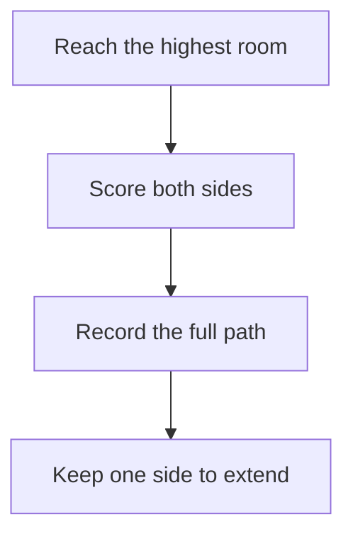
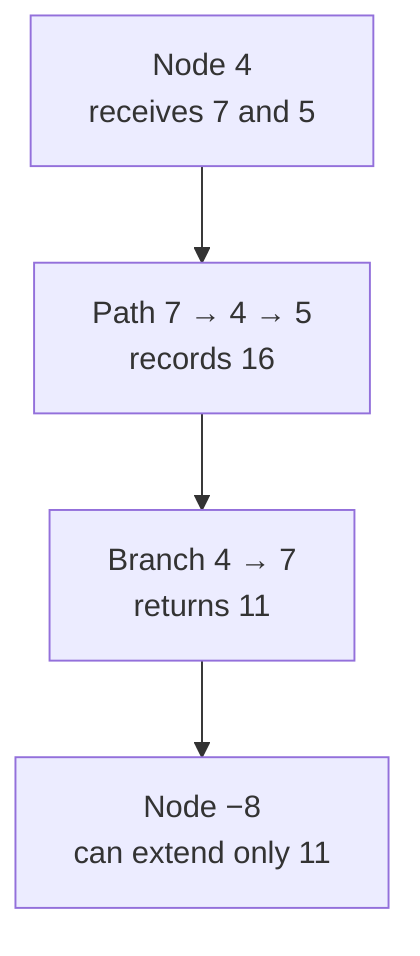

> [!tldr] Quick read
> - The endpoints can be anywhere. Each path has one highest node, where two branches can meet.
> - At a node, I use both positive branches to update the answer. The return value carries at most one branch so the parent can extend it.
> - Brute force from every endpoint takes O(n²). [[en/concepts/post-order-traversal|Post-order traversal]] combines results in O(n) time and O(h) auxiliary space.
> - A single node still forms a valid path when every value is negative. The iterative version manages its own stack and is tested on a 30,000-node chain.

> [!info] Context
> LeetCode 124 (Hard) belongs to [[en/posts/2026-11-26-neetcode-tree-reconstruction|station 6: Building and Serializing Trees]] on **the NeetCode line: Linked Structures**. [[en/problems/diameter-of-binary-tree|Diameter of Binary Tree]] also joins two branches at a node and counts their edges. Here, nodes have scores, and keeping a branch can lower the sum. You only need to know binary trees and basic traversal.

> [!abstract]- Quick glossary for this post (click to open)
> - **Binary tree**: each node has at most two children, left and right. See [[en/concepts/binary-tree|Binary Tree]].
> - **Post-order**: compute the results for both subtrees before processing the current node. See [[en/concepts/post-order-traversal|Post-order Traversal]].
> - **Highest node**: the node on a path nearest the root. It is the lowest common ancestor of the two endpoints.
> - **Downward path gain**: the highest sum of a path starting at the current node and continuing down at most one branch. See [[en/concepts/downward-path-gain|Downward Path Gain]].
> - **Stack frame**: the state for one node, including the step that is pending and the left child's result when available. See [[en/concepts/recursion-depth-limit|Recursion Depth Limit]].

## Picture it first: carrying mail between rooms

Imagine a building whose rooms connect in a tree. Each room has a bonus or penalty, and the mail carrier chooses a starting room, an ending room, and a route through the corridors. Every room along the way contributes its score once, including rooms the carrier only passes through.

| Everyday life | Concept |
|---|---|
| The room where the route turns from up to down | the highest node on the path |
| Two corridors leading to the endpoints | two branches that score a complete candidate |
| Connecting a corridor to the floor above | the return value keeps one branch |
| Skipping an area that costs points | clipping a negative gain |
| Staying in one room | a single-node path |



## The problem: choose any path with the largest sum

The tree has 1 to 30,000 nodes. Each value is an integer from −1000 to 1000. Consecutive nodes on the path must share a parent–child edge, and each node can appear once. A path can consist of a single node or lie wholly within a subtree. Return the sum of the values on the best path. [Original problem on LeetCode](https://leetcode.com/problems/binary-tree-maximum-path-sum/)

I first wanted to ask each node one question: “How much is your best path worth?” The parent needs a path ending at that child, though, so it has an edge to extend. The best path deeper in the subtree might have no endpoint at the child.

## How it works

### Brute force by endpoint

Build a parent map so each edge can be followed in either direction. Start from each node and visit every other node, accumulating the sum along the way. A tree has one simple path between any pair of nodes, so in a traversal from one endpoint it suffices to skip the edge just taken. The initial node is already a valid endpoint. The search can visit a path in both directions, which is harmless when taking the maximum.

Each traversal visits n nodes. There are n traversals, so the time is O(n²). The parent map and list of nodes require O(n) auxiliary space. Use references to identify nodes because distinct nodes can share a value. This implementation is easy to verify and makes a useful oracle for the faster solutions.

### Post-order and two kinds of result

At a node with value `v`, first compute the best sums each child offers for extension. Let `left` and `right` be those sums after clipping absent or negative branches to zero. The node computes two quantities.

| Calculation | Meaning |
|---|---|
| `v + left + right` | the best path with this node as its highest point |
| `v + max(left, right)` | the best path starting here that the parent can extend |

Take the test tree with root −8, left child 4 (with leaves 7 and 5), and right child −3. At node 4, the complete path is `7 → 4 → 5`, with a sum of 16. The branch the parent can extend is `4 → 7`, with a sum of 11. At the root, the candidate is `−8 + 11 = 3`, so the answer stays at 16.



Every path has a unique highest node, so examining the complete candidate at each node is sufficient. A path through its highest node can use one downward segment to the left and one to the right. When a parent extends the path, the upward edge takes one of the two edges a simple path can use at that node, leaving room for one downward segment. Computing the sums from the leaves up makes both child results available.

The recursive version processes each node once, taking O(n) time and O(h) auxiliary space for the call stack, where h is the number of nodes on the longest root-to-leaf path. Initialize the best score to the root value and only update it with paths containing at least one node.

### Post-order with an explicit stack

The iterative version simulates three stages of a call. A frame holds the node, its pending step, and the left gain. On returning from the left child, copy the returned gain into the frame and visit the right child. On returning from the right child, use both gains to update the answer and replace the last return value with the current node's result. For an absent child, use zero on that side. The return variable may still hold another node's result when there is no child to visit.

Each node takes three frame steps, which is still O(n). The stack holds only the path from the root to the node being processed, using O(h) auxiliary space. The loop avoids the call stack's depth limit and still needs additional memory on a skewed tree.

### Counting work on the same tree

I ran JavaScript with a counter for each brute-force candidate and one for each iterative node completion. On a chain of 512 nodes, each with value 1, both returned 512. Brute force evaluated 262,144 directed candidates and the iterative version completed 512 nodes. Those counts measure work at corresponding points and do not give a runtime ratio. The iterative version passed a chain of 30,000 nodes in all five languages. When I ran the JavaScript recursive version separately on Node 24.22.1, it raised `RangeError: Maximum call stack size exceeded`.

## Runnable example

Download [TypeScript](../code/neetcode-binary-tree-maximum-path-sum/max-path.ts), [Python](../code/neetcode-binary-tree-maximum-path-sum/max_path.py), [Go](../code/neetcode-binary-tree-maximum-path-sum/max_path.go), [Java](../code/neetcode-binary-tree-maximum-path-sum/max-path.java), or [JavaScript](../code/neetcode-binary-tree-maximum-path-sum/max-path.js). Run the corresponding command: `node max-path.ts`, `python3 max_path.py`, `go run max_path.go`, `java max-path.java`, or `node max-path.js`.

All three implementations run on eight small fixtures. These include an all-negative tree, an optimum below the root, repeated node values, and a positive branch that passes through a negative node. The ninth case runs the iterative solution on a 30,000-node chain.

```ts
type TreeNode = { value: number; left: TreeNode | null; right: TreeNode | null }

function node(value: number, left: TreeNode | null = null, right: TreeNode | null = null): TreeNode {
  return { value, left, right }
}

function brute(root: TreeNode): number {
  let best = root.value
  const parent = new Map<TreeNode, TreeNode | null>([[root, null]])
  const nodes = [root]
  for (const current of nodes) {
    for (const child of [current.left, current.right]) {
      if (child !== null) {
        parent.set(child, current)
        nodes.push(child)
      }
    }
  }

  for (const start of nodes) {
    const stack: [TreeNode, TreeNode | null, number][] = [[start, null, start.value]]
    while (stack.length > 0) {
      const [current, previous, sum] = stack.pop()!
      best = Math.max(best, sum)
      for (const next of [current.left, current.right, parent.get(current)!]) {
        if (next !== null && next !== previous) stack.push([next, current, sum + next.value])
      }
    }
  }
  return best
}

function recursive(root: TreeNode): number {
  let best = root.value
  function gain(current: TreeNode | null): number {
    if (current === null) return 0
    const left = Math.max(0, gain(current.left))
    const right = Math.max(0, gain(current.right))
    best = Math.max(best, current.value + left + right)
    return current.value + Math.max(left, right)
  }
  gain(root)
  return best
}

type Frame = { current: TreeNode; step: number; leftGain: number }

function frame(current: TreeNode): Frame {
  return { current, step: 0, leftGain: 0 }
}

function iterative(root: TreeNode): number {
  let best = root.value
  let returned = 0
  const stack = [frame(root)]

  while (stack.length > 0) {
    const top = stack[stack.length - 1]
    const { current } = top
    if (top.step === 0) {
      top.step = 1
      if (current.left !== null) stack.push(frame(current.left))
      continue
    }

    if (top.step === 1) {
      if (current.left !== null) top.leftGain = Math.max(0, returned)
      top.step = 2
      if (current.right !== null) stack.push(frame(current.right))
      continue
    }

    const rightGain = current.right === null ? 0 : Math.max(0, returned)
    best = Math.max(best, current.value + top.leftGain + rightGain)
    returned = current.value + Math.max(top.leftGain, rightGain)
    stack.pop()
  }
  return best
}

const cases: [TreeNode, number][] = [
  [node(-9), -9],
  [node(-6, node(-1), node(-4)), -1],
  [node(6, node(3), node(5)), 14],
  [node(-8, node(4, node(7), node(5)), node(-3)), 16],
  [node(8, node(2, node(4), node(5)), node(1)), 16],
  [node(5, node(-7, node(1)), node(4)), 9],
  [node(2, node(2, node(2)), node(2)), 8],
  [node(6, node(-2, node(9)), node(4)), 17],
]

let passed = 0
for (const [root, expected] of cases) {
  for (const solve of [brute, recursive, iterative]) {
    const actual = solve(root)
    if (actual !== expected) throw new Error(`${solve.name}: ${actual} != ${expected}`)
  }
  passed++
}

let deep = node(1)
for (let length = 1; length < 30_000; length++) deep = node(1, deep)
if (iterative(deep) !== 30_000) throw new Error("iterative: 30_000")
passed++

console.log(`${passed}/${cases.length + 1} ca đúng`)

export {}
```
```python
from dataclasses import dataclass


@dataclass(eq=False)
class Node:
    value: int
    left: "Node | None" = None
    right: "Node | None" = None


def brute(root: Node) -> int:
    best = root.value
    parent = {root: None}
    nodes = [root]
    cursor = 0
    while cursor < len(nodes):
        current = nodes[cursor]
        cursor += 1
        for child in (current.left, current.right):
            if child is not None:
                parent[child] = current
                nodes.append(child)

    for start in nodes:
        stack = [(start, None, start.value)]
        while stack:
            current, previous, total = stack.pop()
            best = max(best, total)
            for neighbor in (current.left, current.right, parent[current]):
                if neighbor is not None and neighbor is not previous:
                    stack.append((neighbor, current, total + neighbor.value))
    return best


def recursive(root: Node) -> int:
    best = root.value

    def gain(current: Node | None) -> int:
        nonlocal best
        if current is None:
            return 0
        left = max(0, gain(current.left))
        right = max(0, gain(current.right))
        best = max(best, current.value + left + right)
        return current.value + max(left, right)

    gain(root)
    return best


@dataclass
class Frame:
    current: Node
    step: int = 0
    left_gain: int = 0


def iterative(root: Node) -> int:
    best = root.value
    returned = 0
    stack = [Frame(root)]

    while stack:
        top = stack[-1]
        current = top.current
        if top.step == 0:
            top.step = 1
            if current.left is not None:
                stack.append(Frame(current.left))
            continue

        if top.step == 1:
            if current.left is not None:
                top.left_gain = max(0, returned)
            top.step = 2
            if current.right is not None:
                stack.append(Frame(current.right))
            continue

        right_gain = 0 if current.right is None else max(0, returned)
        best = max(best, current.value + top.left_gain + right_gain)
        returned = current.value + max(top.left_gain, right_gain)
        stack.pop()
    return best


if __name__ == "__main__":
    cases = [
        (Node(-9), -9),
        (Node(-6, Node(-1), Node(-4)), -1),
        (Node(6, Node(3), Node(5)), 14),
        (Node(-8, Node(4, Node(7), Node(5)), Node(-3)), 16),
        (Node(8, Node(2, Node(4), Node(5)), Node(1)), 16),
        (Node(5, Node(-7, Node(1)), Node(4)), 9),
        (Node(2, Node(2, Node(2)), Node(2)), 8),
        (Node(6, Node(-2, Node(9)), Node(4)), 17),
    ]
    passed = 0
    for root, expected in cases:
        for solve in (brute, recursive, iterative):
            actual = solve(root)
            if actual != expected:
                raise AssertionError(f"{solve.__name__}: {actual} != {expected}")
        passed += 1

    deep = Node(1)
    for _ in range(1, 30_000):
        deep = Node(1, deep)
    if iterative(deep) != 30_000:
        raise AssertionError("iterative: 30_000")
    passed += 1

    print(f"{passed}/{len(cases) + 1} ca đúng")
```
```go
package main

import "fmt"

type Node struct {
	value       int
	left, right *Node
}

func leaf(value int) *Node {
	return &Node{value: value}
}

type Walk struct {
	current, previous *Node
	sum               int
}

func brute(root *Node) int {
	best := root.value
	parent := map[*Node]*Node{root: nil}
	nodes := []*Node{root}
	for cursor := 0; cursor < len(nodes); cursor++ {
		current := nodes[cursor]
		for _, child := range []*Node{current.left, current.right} {
			if child != nil {
				parent[child] = current
				nodes = append(nodes, child)
			}
		}
	}

	for _, start := range nodes {
		stack := []Walk{{start, nil, start.value}}
		for len(stack) > 0 {
			walk := stack[len(stack)-1]
			stack = stack[:len(stack)-1]
			best = max(best, walk.sum)
			for _, neighbor := range []*Node{walk.current.left, walk.current.right, parent[walk.current]} {
				if neighbor != nil && neighbor != walk.previous {
					stack = append(stack, Walk{neighbor, walk.current, walk.sum + neighbor.value})
				}
			}
		}
	}
	return best
}

func recursive(root *Node) int {
	best := root.value
	var gain func(*Node) int
	gain = func(current *Node) int {
		if current == nil {
			return 0
		}
		left := max(0, gain(current.left))
		right := max(0, gain(current.right))
		best = max(best, current.value+left+right)
		return current.value + max(left, right)
	}
	gain(root)
	return best
}

type Frame struct {
	current        *Node
	step, leftGain int
}

func iterative(root *Node) int {
	best := root.value
	returned := 0
	stack := []Frame{{current: root}}

	for len(stack) > 0 {
		top := &stack[len(stack)-1]
		current := top.current
		if top.step == 0 {
			top.step = 1
			if current.left != nil {
				stack = append(stack, Frame{current: current.left})
			}
			continue
		}

		if top.step == 1 {
			if current.left != nil {
				top.leftGain = max(0, returned)
			}
			top.step = 2
			if current.right != nil {
				stack = append(stack, Frame{current: current.right})
			}
			continue
		}

		rightGain := 0
		if current.right != nil {
			rightGain = max(0, returned)
		}
		best = max(best, current.value+top.leftGain+rightGain)
		returned = current.value + max(top.leftGain, rightGain)
		stack = stack[:len(stack)-1]
	}
	return best
}

func main() {
	cases := []struct {
		root     *Node
		expected int
	}{
		{leaf(-9), -9},
		{&Node{-6, leaf(-1), leaf(-4)}, -1},
		{&Node{6, leaf(3), leaf(5)}, 14},
		{&Node{-8, &Node{4, leaf(7), leaf(5)}, leaf(-3)}, 16},
		{&Node{8, &Node{2, leaf(4), leaf(5)}, leaf(1)}, 16},
		{&Node{5, &Node{-7, leaf(1), nil}, leaf(4)}, 9},
		{&Node{2, &Node{2, leaf(2), nil}, leaf(2)}, 8},
		{&Node{6, &Node{-2, leaf(9), nil}, leaf(4)}, 17},
	}
	passed := 0
	for _, test := range cases {
		for _, solve := range []func(*Node) int{brute, recursive, iterative} {
			if actual := solve(test.root); actual != test.expected {
				panic(fmt.Sprintf("%d != %d", actual, test.expected))
			}
		}
		passed++
	}

	deep := leaf(1)
	for length := 1; length < 30_000; length++ {
		deep = &Node{1, deep, nil}
	}
	if iterative(deep) != 30_000 {
		panic("iterative: 30_000")
	}
	passed++

	fmt.Printf("%d/%d ca đúng\n", passed, len(cases)+1)
}
```
```java
import java.util.ArrayDeque;
import java.util.ArrayList;
import java.util.IdentityHashMap;
import java.util.function.ToIntFunction;

class Main {
    record Node(int value, Node left, Node right) {
        Node(int value) { this(value, null, null); }
    }

    record Walk(Node current, Node previous, int sum) {}

    static int brute(Node root) {
        int best = root.value();
        var parent = new IdentityHashMap<Node, Node>();
        parent.put(root, null);
        var nodes = new ArrayList<Node>();
        nodes.add(root);
        for (int cursor = 0; cursor < nodes.size(); cursor++) {
            Node current = nodes.get(cursor);
            for (Node child : new Node[] {current.left(), current.right()}) {
                if (child != null) {
                    parent.put(child, current);
                    nodes.add(child);
                }
            }
        }

        for (Node start : nodes) {
            var stack = new ArrayDeque<Walk>();
            stack.push(new Walk(start, null, start.value()));
            while (!stack.isEmpty()) {
                Walk walk = stack.pop();
                best = Math.max(best, walk.sum());
                Node current = walk.current();
                for (Node next : new Node[] {current.left(), current.right(), parent.get(current)}) {
                    if (next != null && next != walk.previous()) {
                        stack.push(new Walk(next, current, walk.sum() + next.value()));
                    }
                }
            }
        }
        return best;
    }

    static int recursive(Node root) {
        int[] best = {root.value()};
        gain(root, best);
        return best[0];
    }

    static int gain(Node current, int[] best) {
        if (current == null) return 0;
        int left = Math.max(0, gain(current.left(), best));
        int right = Math.max(0, gain(current.right(), best));
        best[0] = Math.max(best[0], current.value() + left + right);
        return current.value() + Math.max(left, right);
    }

    static class Frame {
        final Node current;
        int step;
        int leftGain;

        Frame(Node current) { this.current = current; }
    }

    static int iterative(Node root) {
        int best = root.value();
        int returned = 0;
        var stack = new ArrayDeque<Frame>();
        stack.push(new Frame(root));

        while (!stack.isEmpty()) {
            Frame top = stack.peek();
            Node current = top.current;
            if (top.step == 0) {
                top.step = 1;
                if (current.left() != null) stack.push(new Frame(current.left()));
                continue;
            }

            if (top.step == 1) {
                if (current.left() != null) top.leftGain = Math.max(0, returned);
                top.step = 2;
                if (current.right() != null) stack.push(new Frame(current.right()));
                continue;
            }

            int rightGain = current.right() == null ? 0 : Math.max(0, returned);
            best = Math.max(best, current.value() + top.leftGain + rightGain);
            returned = current.value() + Math.max(top.leftGain, rightGain);
            stack.pop();
        }
        return best;
    }

    record TestCase(Node root, int expected) {}

    public static void main(String[] args) {
        TestCase[] cases = {
            new TestCase(new Node(-9), -9),
            new TestCase(new Node(-6, new Node(-1), new Node(-4)), -1),
            new TestCase(new Node(6, new Node(3), new Node(5)), 14),
            new TestCase(new Node(-8, new Node(4, new Node(7), new Node(5)), new Node(-3)), 16),
            new TestCase(new Node(8, new Node(2, new Node(4), new Node(5)), new Node(1)), 16),
            new TestCase(new Node(5, new Node(-7, new Node(1), null), new Node(4)), 9),
            new TestCase(new Node(2, new Node(2, new Node(2), null), new Node(2)), 8),
            new TestCase(new Node(6, new Node(-2, new Node(9), null), new Node(4)), 17),
        };
        var solvers = java.util.List.<ToIntFunction<Node>>of(Main::brute, Main::recursive, Main::iterative);
        int passed = 0;
        for (TestCase test : cases) {
            for (var solve : solvers) {
                int actual = solve.applyAsInt(test.root());
                if (actual != test.expected()) throw new AssertionError(actual + " != " + test.expected());
            }
            passed++;
        }

        Node deep = new Node(1);
        for (int length = 1; length < 30_000; length++) deep = new Node(1, deep, null);
        if (iterative(deep) != 30_000) throw new AssertionError("iterative: 30_000");
        passed++;

        System.out.printf("%d/%d ca đúng%n", passed, cases.length + 1);
    }
}
```
```js
function node(value, left = null, right = null) {
  return { value, left, right }
}

function brute(root) {
  let best = root.value
  const parent = new Map([[root, null]])
  const nodes = [root]
  for (const current of nodes) {
    for (const child of [current.left, current.right]) {
      if (child !== null) {
        parent.set(child, current)
        nodes.push(child)
      }
    }
  }

  for (const start of nodes) {
    const stack = [[start, null, start.value]]
    while (stack.length > 0) {
      const [current, previous, sum] = stack.pop()
      best = Math.max(best, sum)
      for (const next of [current.left, current.right, parent.get(current)]) {
        if (next !== null && next !== previous) stack.push([next, current, sum + next.value])
      }
    }
  }
  return best
}

function recursive(root) {
  let best = root.value
  function gain(current) {
    if (current === null) return 0
    const left = Math.max(0, gain(current.left))
    const right = Math.max(0, gain(current.right))
    best = Math.max(best, current.value + left + right)
    return current.value + Math.max(left, right)
  }
  gain(root)
  return best
}

function frame(current) {
  return { current, step: 0, leftGain: 0 }
}

function iterative(root) {
  let best = root.value
  let returned = 0
  const stack = [frame(root)]

  while (stack.length > 0) {
    const top = stack[stack.length - 1]
    const { current } = top
    if (top.step === 0) {
      top.step = 1
      if (current.left !== null) stack.push(frame(current.left))
      continue
    }

    if (top.step === 1) {
      if (current.left !== null) top.leftGain = Math.max(0, returned)
      top.step = 2
      if (current.right !== null) stack.push(frame(current.right))
      continue
    }

    const rightGain = current.right === null ? 0 : Math.max(0, returned)
    best = Math.max(best, current.value + top.leftGain + rightGain)
    returned = current.value + Math.max(top.leftGain, rightGain)
    stack.pop()
  }
  return best
}

const cases = [
  [node(-9), -9],
  [node(-6, node(-1), node(-4)), -1],
  [node(6, node(3), node(5)), 14],
  [node(-8, node(4, node(7), node(5)), node(-3)), 16],
  [node(8, node(2, node(4), node(5)), node(1)), 16],
  [node(5, node(-7, node(1)), node(4)), 9],
  [node(2, node(2, node(2)), node(2)), 8],
  [node(6, node(-2, node(9)), node(4)), 17],
]

let passed = 0
for (const [root, expected] of cases) {
  for (const solve of [brute, recursive, iterative]) {
    const actual = solve(root)
    if (actual !== expected) throw new Error(`${solve.name}: ${actual} != ${expected}`)
  }
  passed++
}

let deep = node(1)
for (let length = 1; length < 30_000; length++) deep = node(1, deep)
if (iterative(deep) !== 30_000) throw new Error("iterative: 30_000")
passed++

console.log(`${passed}/${cases.length + 1} ca đúng`)

export {}
```

All five files print the same line:

```text
9/9 cases passed
```

*(Output labels translated; the files themselves print Vietnamese.)*

## Misconceptions and common traps

- **Returning both branches to the parent.** Joining both branches at a child and attaching the parent would put three path edges at that child. Use both gains to update the answer, then return one.
- **Initializing the answer to zero.** Clipping a child gain to zero means that child is optional. Every valid path contains at least one node, so the tree `−6, −1, −4` returns −1.
- **Stopping at a negative node.** A negative node can be worth crossing to reach a larger positive one. In the test with branch `−2 → 9`, the branch contributes 7.
- **Keying the parent map by value.** Java uses `IdentityHashMap`, Python uses `@dataclass(eq=False)`, Go uses `*Node`, and TypeScript and JavaScript use objects as `Map` keys.
- **Assuming O(h) recursion always fits.** Java can raise `StackOverflowError`, Python's recursion limit depends on its environment, and TypeScript runs on the same runtime as JavaScript. A Go goroutine's stack can grow as needed, and deep calls still consume memory. The iterative version manages depth with its own stack. The largest absolute sum allowed by the input is 30,000,000, which fits in a 32-bit `int` and a `Number`.

## Self-check questions

> [!question]- Node 4 gets branch gains of 7 and 5. What score does it record locally, and what does it return?
> The complete candidate scores 16. Its parent receives 11, made up of node 4 and the branch contributing 7.

> [!question]- If both branches are clipped to zero in an all-negative tree, is the answer zero?
> No. Every candidate still adds the value of the current node. The least negative node wins.

> [!question]- Why does the iterative frame keep the left gain separately?
> Processing the right branch overwrites the last return value. The frame saves the left gain before visiting the right.

## References

- [LeetCode 124 — Binary Tree Maximum Path Sum](https://leetcode.com/problems/binary-tree-maximum-path-sum/)
- [Python — recursion limit](https://docs.python.org/3/library/sys.html#sys.setrecursionlimit) and [dataclasses](https://docs.python.org/3/library/dataclasses.html)
- [Java — IdentityHashMap](https://docs.oracle.com/en/java/javase/21/docs/api/java.base/java/util/IdentityHashMap.html) and [StackOverflowError](https://docs.oracle.com/en/java/javase/24/docs/api/java.base/java/lang/StackOverflowError.html)
- [MDN — error when exceeding call stack depth](https://developer.mozilla.org/en-US/docs/Web/JavaScript/Reference/Errors/Too_much_recursion)
- [Go FAQ — goroutine stacks](https://go.dev/doc/faq#goroutines)
