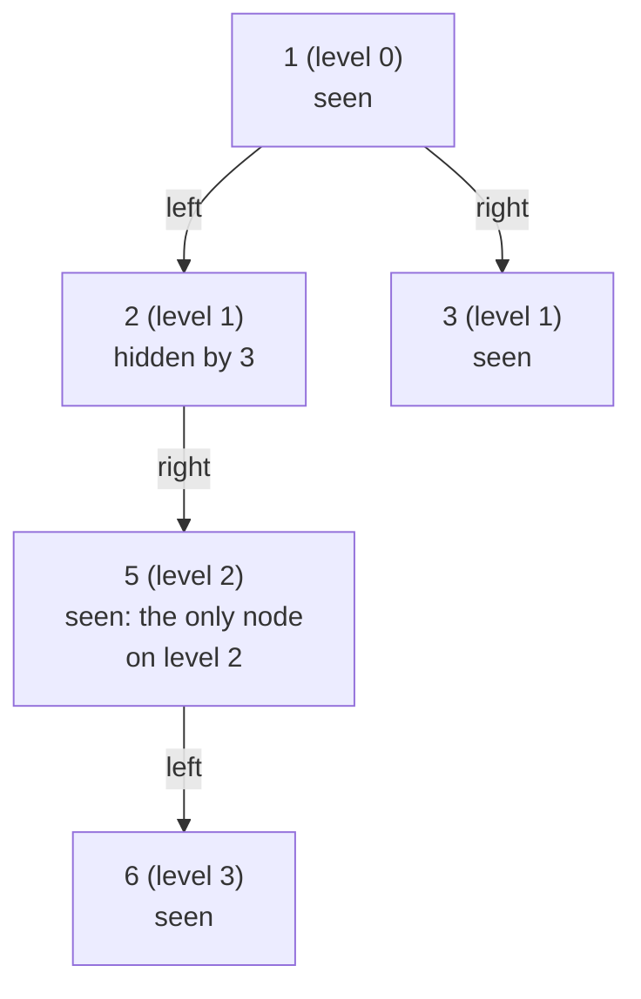
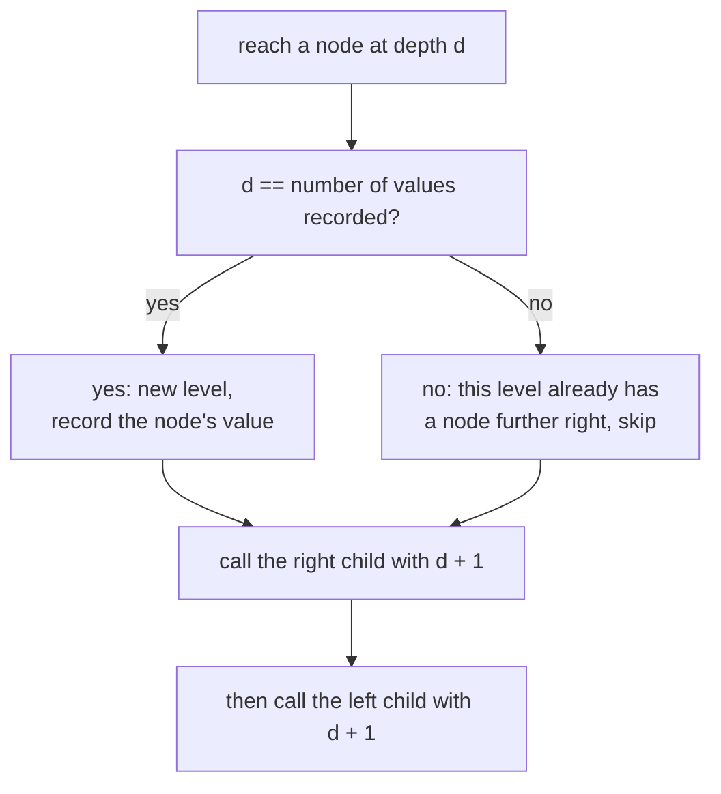

> [!tldr] Quick read
> - The problem: stand to the right of a binary tree, look in, and list the values you see from top to bottom. Each **level** shows exactly one node: the **rightmost node of that level**.
> - The rightmost node of a level can sit in the **left** subtree: the tree `[1, 2, 3, 4]` gives `[1, 3, 4]`, and 4 is a child of 2. Following right pointers from the root gives `[1, 3]` and fails 7/11 test cases.
> - Approach 1: [[en/concepts/breadth-first-search|BFS]] level by level, [[en/concepts/level-size-snapshot|snapshot the level size]] before dequeuing, keep the last node. Approach 2: **right-first** DFS, recording a node when its depth equals the number of values recorded so far (`depth == res.length`), that is, the first time a new level is reached.
> - Both take O(n) time. Their extra memory differs: BFS holds a whole level (524,288 nodes on a complete tree of 2²⁰ − 1 nodes), DFS holds one path from the root (20 levels on that same tree, but 10⁵ levels on a skewed chain).
> - Language traps: the condition `i < queue.length` re-reads the length on every pass and mixes two levels (TS, JS, Java 5/11, Go 2/11); `shift()` and `list.pop(0)` turn BFS into O(n²) (518 ms against 1.4 ms in TypeScript); Python `for node in q` over a `deque` that is being modified throws `RuntimeError`.

> [!info] Context
> LeetCode problem 199 (Medium), on [[en/posts/2026-11-25-neetcode-level-order|station 5: Level Order and Carried State]] of **the NeetCode Line: Linked Structures**. At [[en/posts/2026-11-25-neetcode-tree-recursion|station 3]], every problem went depth-first and combined results bottom-up. This problem asks about **levels**, something that only makes sense when you compare nodes of the same depth on different branches, so the natural way is to go across: finish one level before the next. The other two problems on the station are [[en/problems/binary-tree-level-order-traversal|Binary Tree Level Order Traversal]] (print the whole level) and [[en/problems/count-good-nodes-in-binary-tree|Count Good Nodes in Binary Tree]] (carry the state of the path down). Solutions come in TypeScript, Python, Go, Java and JavaScript. You only need to know what a binary tree and recursion are.

> [!abstract]- Quick glossary for this post (click to open)
> - **Binary tree**: every node has at most two children, left and right. See [[en/concepts/binary-tree|Binary Tree]].
> - **Depth, level**: the root is at depth 0; a child of a node at depth d is at depth d + 1. All nodes of the same depth form a level.
> - **Queue**: a list where you add at the back and remove from the front, first in, first out. On this page it is an in-memory data structure, not a message queue.
> - **BFS (breadth-first search)**: visit every node close to the root before the ones further away, using a queue. See [[en/concepts/breadth-first-search|Breadth-First Search]].
> - **Level size snapshot**: read the number of items in the queue **once** at the start of each level, then dequeue exactly that many nodes. See [[en/concepts/level-size-snapshot|Level Size Snapshot]].
> - **DFS (depth-first search)**: go all the way down one branch before coming back for another, usually written as recursion.
> - **Pre-order**: handle the node first, then its two subtrees. The right-first DFS of this problem is pre-order with the children swapped: node, right, left. See [[en/concepts/pre-order-traversal|Pre-order Traversal]].
> - **Complete tree**: every level is full except the last, which is filled from the left. A complete tree of n nodes is about log₂ n levels tall.
> - **Skewed chain**: every node has only one child, so the tree is exactly as deep as it has nodes. The recursion depth limit: see [[en/concepts/recursion-depth-limit|Recursion Depth Limit]].

## Picture it first: a group photo taken from the side

A class lines up for a group photo. The teacher stands alone in the front row. Each person brings at most two people to stand right behind them, one shifted to the left, one shifted to the right. Those people bring more people, and so on, row after row. The photographer stands to the **right** of the whole group and shoots from the side: in each row the lens only sees the person at the far right; that person hides everyone else in the row.

- **Calling row by row:** the photographer counts how many people the current row has, lets exactly that many step up, writes down the name of the last one, and only then moves to the next row. Anyone brought along in the meantime lines up in the next row, without cutting into the row being shot.
- **Walking down the right side:** the photographer starts at the teacher and follows the "behind, to the right" person first, and only then turns to "behind, to the left". They hold a list: in a row that has **nobody** on the list yet, the first person they meet is the one seen.
- **Following the right shoulder:** only look at the person behind and to the right of the person behind and to the right… When a person on the right brings nobody, the photographer stops, even though the next row still has people brought by someone on the left. That is the wrong approach.

| Everyday life | Concept |
|---|---|
| A row of people | a level, the nodes of one depth |
| The person at the far right of the row | the node seen from the right |
| The person behind to the left, to the right | left child, right child |
| Call this whole row before the next | [[en/concepts/breadth-first-search|BFS]] with a queue |
| Count how many are in the current row before calling | [[en/concepts/level-size-snapshot|level size snapshot]] |
| A newcomer cuts into the row being shot | the trap of re-reading the queue length while it grows |
| Walk down the right side first, record rows with nobody yet | right-first DFS, [[en/concepts/pre-order-traversal|pre-order]] node, right, left |
| The list "which rows already have someone seen" | `depth == res.length`: state carried on the way down |
| Only follow the right shoulder | misconception: only follow right pointers |

The tree from the "bottom under left subtree" case in the test file. Boxes marked "seen" are the nodes in the answer `[1, 3, 5, 6]`:



Node 3 is a leaf, so from level 2 down, everything you see sits in the root's **left** subtree. Following right children stops at 3.

## The problem: the right side is not the right path

The input is the root of a binary tree with 0 to 100 nodes, each value in [−100, 100]. Return the values of the nodes you see when standing to the right of the tree, from the root down: one value per level, the value of the rightmost node on that level. An empty tree gives an empty list. Original problem: [LeetCode 199](https://leetcode.com/problems/binary-tree-right-side-view/) (limits checked against the LeetCode page on 2026-11-25).

I used to think "the right side view" meant "follow right children until they run out". That works on a full tree and on a right-skewed chain, so it passes the first few examples easily. It breaks as soon as the left subtree is deeper than the right one: the bottom level has only nodes on the left, and from the right you still see them because nothing is in the way.

## How it works

### Wrong: follow the right pointers

```ts
function wrongRightPointers(root: TreeNode | null): number[] {
  const res: number[] = [];
  for (let node = root; node !== null; node = node.right) res.push(node.val);
  return res;
}
```

This function returns the path down the right edge, not the right side view. The two coincide only when every level has a node on that path. Of the 11 test cases it gets only 4 right (empty tree, single node, full 7-node tree, right-skewed chain), and on 3,000 random trees of 0 to 30 nodes it is wrong on about 2,550. On the 100-node complete tree it stops at 63, because the last level is only filled from the left up to node 100.

### Approach 1: BFS, snapshot the level size, keep the last node

Going level by level is BFS's job ([[en/concepts/breadth-first-search|Breadth-First Search]]): the queue starts with the root; take a node from the front and push its children to the back. Since children always enter after their parent, nodes leave the queue in exactly level order: level 0, level 1, level 2, and within each level from left to right.

One thing is missing: knowing **where a level ends**. The trick is the [[en/concepts/level-size-snapshot|level size snapshot]]: at the start of each outer pass, the queue holds **exactly** the nodes of one level, no more, no less. Read `size = queue.length` once, dequeue exactly `size` nodes; node number `size` is the rightmost one. The children pushed meanwhile sit behind those `size` nodes, so they are the next level and get their own snapshot on the next pass.

Running it on the tree `[1, 2, 3, 4]`:

| Pass | Queue at the snapshot | `size` | Dequeued | Last node (recorded) | Queue after the pass |
|---|---|---|---|---|---|
| level 0 | `[1]` | 1 | 1 | 1 | `[2, 3]` |
| level 1 | `[2, 3]` | 2 | 2, 3 | 3 | `[4]` |
| level 2 | `[4]` | 1 | 4 | 4 | `[]` |

The result is `[1, 3, 4]`. A variant: push the **right** child before the left one; then the rightmost node comes **first** in its level, and you record the first node instead of the last (`bfsRightFirst` in the test file).

### Approach 2: right-first DFS, record on reaching a new level

You do not need a queue if you go depth-first, as long as you go **right first**: the order node, right child, left child (a kind of [[en/concepts/pre-order-traversal|pre-order]] with the two children swapped). In that order, the first node to reach a depth d is the rightmost node of level d: every other node on that level sits to its left and is visited later.

How do you know "the first time level d is reached"? The result list already holds one value for each level 0, 1, …, d − 1 met so far. So level d is new exactly when `depth == res.length`. That is a small piece of [[en/concepts/path-state|state]] carried on the way down: the depth is passed into the child call, and `res.length` tells you how deep you have already been.

Running it on the tree in the figure at the top, `[1, 2, 3, null, 5, null, null, 6]`:

| Step | Node | `depth` | `res.length` | Action | `res` |
|---|---|---|---|---|---|
| 1 | 1 | 0 | 0 | record | `[1]` |
| 2 | 3 | 1 | 1 | record | `[1, 3]` |
| 3 | 2 | 1 | 2 | skip: level 1 already has one | `[1, 3]` |
| 4 | 5 | 2 | 2 | record | `[1, 3, 5]` |
| 5 | 6 | 3 | 3 | record | `[1, 3, 5, 6]` |

Swap the two calls (left first) while still recording "the first time a level is met" and you get the **left side view**: `wrongLeftFirst` returns `[1, 2, 4]` for the full 7-node tree. To go left first, you have to **overwrite** `res[depth]` at every visit; the last write on each level is the rightmost node (`dfsOverwrite`).



### Complexity

| Approach | Time | Extra memory | Note |
|---|---|---|---|
| Follow right pointers | O(h) | O(1) | wrong |
| BFS, level size snapshot | O(n) | O(w), w is the widest level | dequeuing from the front must be O(1) |
| BFS, right first | O(n) | O(w) | record the first node instead of the last |
| Right-first DFS, recursive | O(n) | O(h), h is the height | recursion depth limit |
| Right-first DFS, iterative | O(n) | O(h) | self-managed stack |
| Left-first DFS, overwriting | O(n) | O(h) | writes several times per level |

Every correct approach has to visit every node: a deepest node can be anywhere, including at the far left. What differs is the extra memory. Real counts from the TypeScript file:

| Tree | Largest BFS queue | Deepest DFS depth |
|---|---|---|
| 100-node complete tree | 37 nodes | 7 levels |
| 100-node left chain | 1 node | 100 levels |
| complete tree of 2²⁰ − 1 nodes | 524,288 nodes | 20 levels |
| 10⁵-node left chain | 1 node | 100,000 levels |

On a wide tree DFS is lighter; on a deep tree BFS is lighter. At the problem's limit (100 nodes) both are small; a depth of 100 is nowhere near any language's recursion limit.

### Measured: is dequeuing from the front really O(1)?

BFS is O(n) only if taking the front item of the queue costs O(1). A plain array does not do that: JavaScript's `Array.prototype.shift()` and Python's `list.pop(0)` move every remaining item up one slot. On a complete tree the queue holds up to half the nodes, so the total cost becomes O(n²). Median of 5 runs (ms), complete trees, doubling in size:

| Language, approach | 2¹⁵ − 1 nodes | 2¹⁶ − 1 nodes | 2¹⁷ − 1 nodes |
|---|---|---|---|
| TS, new array per level (`bfsLast`) | 0.30 | 0.70 | 1.42 |
| TS, `shift()` | 22.5 | 116 | 518 |
| TS, right-first DFS | 0.20 | 0.40 | 1.18 |
| Python, `deque.popleft` | 1.5 | 3.1 | 6.5 |
| Python, `list.pop(0)` | 29.2 | 124 | 494 |

- Double the size and `shift()` and `list.pop(0)` get 4 to 5 times slower, the shape of n². The other approaches get about 2 times slower, the shape of n.
- At the problem's limit of 100 nodes this difference is invisible. It becomes real once the same BFS code is reused to walk a large graph on a later line.
- Go (`queue = queue[size:]` or two slices) and Java (`ArrayDeque`) do not have this problem: on a tree of 2²⁰ − 1 nodes, BFS takes 5 to 27 ms in Go and 13 to 18 ms in Java, DFS 2 to 9 ms.

## Runnable example

[TypeScript](../code/neetcode-binary-tree-right-side-view/right-side.ts) · [Python](../code/neetcode-binary-tree-right-side-view/right_side.py) · [Go](../code/neetcode-binary-tree-right-side-view/right_side.go) · [Java](../code/neetcode-binary-tree-right-side-view/right-side.java) · [JavaScript](../code/neetcode-binary-tree-right-side-view/right-side.js)

Each file builds trees from LeetCode-style level-order arrays (`null` is a gap) and runs 11 shared cases: empty tree, single node, full 7-node tree, left branch deeper (`[1, 2, 3, 4]`), left branch only, right branch only, bottom under the left subtree (the figure at the top), zigzag (`[1, 2, 3, 4, null, null, null, null, 5]`, where the seen nodes go right, then left, then the right child of a left node), negative and boundary values ±100, a 100-node left chain, and a 100-node complete tree. Each file also cross-checks the five correct approaches on 3,000 random trees of 0 to 30 nodes.

BFS with the level size snapshot:

```ts
function bfsLast(root: TreeNode | null): number[] {
  const res: number[] = [];
  if (root === null) return res;
  let queue: TreeNode[] = [root];
  while (queue.length > 0) {
    const size = queue.length;              // level size snapshot: only this many nodes belong to the current level
    const next: TreeNode[] = [];
    for (let i = 0; i < size; i++) {
      const node = queue[i];
      if (i === size - 1) res.push(node.val);
      if (node.left) next.push(node.left);
      if (node.right) next.push(node.right);
    }
    queue = next;
  }
  return res;
}
```

```python
def bfs_last(root):
    """Approach 1: BFS with a level size snapshot; the last node of the level is the one seen."""
    res = []
    if root is None:
        return res
    q = deque([root])
    while q:
        size = len(q)  # range(size) is computed once, so children pushed later do not slip into this level
        for i in range(size):
            node = q.popleft()
            if i == size - 1:
                res.append(node.val)
            if node.left:
                q.append(node.left)
            if node.right:
                q.append(node.right)
    return res
```

```go
func bfsLast(root *TreeNode) []int {
	res := []int{}
	if root == nil {
		return res
	}
	queue := []*TreeNode{root}
	for len(queue) > 0 {
		size := len(queue) // level size snapshot
		for i := 0; i < size; i++ {
			node := queue[i]
			if i == size-1 {
				res = append(res, node.Val)
			}
			if node.Left != nil {
				queue = append(queue, node.Left)
			}
			if node.Right != nil {
				queue = append(queue, node.Right)
			}
		}
		queue = queue[size:] // drop the level just processed: O(1), only moves the start of the slice
	}
	return res
}
```

```java
static List<Integer> bfsLast(TreeNode root) {
    List<Integer> res = new ArrayList<>();
    if (root == null) return res;
    Deque<TreeNode> q = new ArrayDeque<>();
    q.offer(root);
    while (!q.isEmpty()) {
        int size = q.size();                 // level size snapshot
        for (int i = 0; i < size; i++) {
            TreeNode node = q.poll();
            if (i == size - 1) res.add(node.val);
            if (node.left != null) q.offer(node.left);
            if (node.right != null) q.offer(node.right);
        }
    }
    return res;
}
```

```js
function bfsLast(root) {
  const res = [];
  if (root === null) return res;
  let queue = [root];
  while (queue.length > 0) {
    const size = queue.length;               // level size snapshot
    const next = [];
    for (let i = 0; i < size; i++) {
      const node = queue[i];
      if (i === size - 1) res.push(node.val);
      if (node.left) next.push(node.left);
      if (node.right) next.push(node.right);
    }
    queue = next;
  }
  return res;
}
```

Right-first DFS, recording on reaching a new level:

```ts
function dfsRightFirst(root: TreeNode | null): number[] {
  const res: number[] = [];
  const go = (node: TreeNode | null, depth: number): void => {
    if (node === null) return;
    if (depth === res.length) res.push(node.val);
    go(node.right, depth + 1);
    go(node.left, depth + 1);
  };
  go(root, 0);
  return res;
}
```

```python
def dfs_right_first(root):
    """Approach 3: right-first DFS; the first node to reach a new depth is the one seen."""
    res = []

    def go(node, depth):
        if node is None:
            return
        if depth == len(res):
            res.append(node.val)
        go(node.right, depth + 1)
        go(node.left, depth + 1)

    go(root, 0)
    return res
```

```go
func dfsRightFirst(root *TreeNode) []int {
	res := []int{}
	var walk func(node *TreeNode, depth int)
	walk = func(node *TreeNode, depth int) {
		if node == nil {
			return
		}
		if depth == len(res) {
			res = append(res, node.Val)
		}
		walk(node.Right, depth+1)
		walk(node.Left, depth+1)
	}
	walk(root, 0)
	return res
}
```

```java
static List<Integer> dfsRightFirst(TreeNode root) {
    List<Integer> res = new ArrayList<>();
    walkRight(root, 0, res);
    return res;
}
static void walkRight(TreeNode node, int depth, List<Integer> res) {
    if (node == null) return;
    if (depth == res.size()) res.add(node.val);
    walkRight(node.right, depth + 1, res);
    walkRight(node.left, depth + 1, res);
}
```

```js
function dfsRightFirst(root) {
  const res = [];
  const go = (node, depth) => {
    if (node === null) return;
    if (depth === res.length) res.push(node.val);
    go(node.right, depth + 1);
    go(node.left, depth + 1);
  };
  go(root, 0);
  return res;
}
```

Output of `node right-side.ts`:

```text
bfsLast                11/11 cases passed
bfsRightFirst          11/11 cases passed
dfsRightFirst          11/11 cases passed
dfsRightFirstIterative 11/11 cases passed
dfsOverwrite           11/11 cases passed
wrongRightPointers     4/11 cases passed; wrong on left branch deeper → [1,3], left branch only → [1], bottom under left subtree → [1,3], zigzag → [1,3], negative and boundary values → [0,100], 100-node left chain → [1], 100-node complete tree → [1,3,7,15,31,63]
wrongLeftFirst         5/11 cases passed; wrong on full 7-node tree → [1,2,4], left branch deeper → [1,2,4], bottom under left subtree → [1,2,5,6], zigzag → [1,2,4,5], negative and boundary values → [0,-100,-50], 100-node complete tree → [1,2,4,8,16,32,64]
wrongLiveLength        5/11 cases passed; wrong on full 7-node tree → [4,6,7], left branch deeper → [2,3,4], bottom under left subtree → [2,3,5,6], zigzag → [2,3,4,5], negative and boundary values → [-100,100,-50], 100-node complete tree → [50,75,88,94,97,99,100]

cross-check on 3000 random trees of 0..30 nodes: the five correct approaches agree 3000/3000; wrongRightPointers wrong on 2552 trees

extra memory: largest BFS queue (nodes) and deepest DFS depth (levels)
100-node complete tree   BFS      37   DFS       7
100-node left chain      BFS       1   DFS     100
complete 2^20 − 1 nodes  BFS  524288   DFS      20
10^5-node left chain     BFS       1   DFS  100000

median time of 5 runs (ms)
complete 2^15 − 1 nodes  bfsLast 0.30   bfsRightFirst 0.35   bfsShift 22.47   dfsRightFirst 0.20
complete 2^16 − 1 nodes  bfsLast 0.70   bfsRightFirst 0.71   bfsShift 116.09   dfsRightFirst 0.40
complete 2^17 − 1 nodes  bfsLast 1.42   bfsRightFirst 1.56   bfsShift 517.89   dfsRightFirst 1.18
```

*(Output labels translated; the files themselves print Vietnamese.)*

`wrongLiveLength` writes the inner loop as `for (let i = 0; i < queue.length; i++)` with `shift()` and `push()` inside, so the length in the condition changes on every pass. On the full 7-node tree, the first pass dequeues 1, 2, 3, 4 before stopping (when `i` is 4 the queue has only 3 items left), and records 4 as "the node of level 0".

`python3 right_side.py`:

```text
bfs_last                  11/11 cases passed
bfs_right_first           11/11 cases passed
dfs_right_first           11/11 cases passed
dfs_right_first_iterative 11/11 cases passed
dfs_overwrite             11/11 cases passed
wrong_right_pointers      4/11 cases passed; wrong on left branch deeper → [1,3], left branch only → [1], bottom under left subtree → [1,3], zigzag → [1,3], negative and boundary values → [0,100], 100-node left chain → [1], 100-node complete tree → [1,3,7,15,31,63]
wrong_left_first          5/11 cases passed; wrong on full 7-node tree → [1,2,4], left branch deeper → [1,2,4], bottom under left subtree → [1,2,5,6], zigzag → [1,2,4,5], negative and boundary values → [0,-100,-50], 100-node complete tree → [1,2,4,8,16,32,64]
wrong_iterate_deque       1/11 cases passed; wrong on single node → threw RuntimeError, full 7-node tree → threw RuntimeError, left branch deeper → threw RuntimeError, left branch only → threw RuntimeError, right branch only → threw RuntimeError, bottom under left subtree → threw RuntimeError, zigzag → threw RuntimeError, negative and boundary values → threw RuntimeError, 100-node left chain → threw RuntimeError, 100-node complete tree → threw RuntimeError

wrong_iterate_deque threw RuntimeError: deque mutated during iteration

cross-check on 3000 random trees of 0..30 nodes: the five correct approaches agree 3000/3000; wrong_right_pointers wrong on 2571 trees

median time of 5 runs (ms)
complete 2^15 − 1    deque 1.5   two lists 0.8   list.pop(0) 29.2   iterative DFS 2.0
complete 2^16 − 1    deque 3.1   two lists 1.5   list.pop(0) 123.7   iterative DFS 4.1
complete 2^17 − 1    deque 6.5   two lists 3.1   list.pop(0) 494.1   iterative DFS 8.2

dfs_right_first on a 5000-node left chain: threw RecursionError (default limit 1000 levels)
bfs_last on a 5000-node left chain: 5000 numbers
```

`go run right_side.go`:

```text
bfsLast                11/11 cases passed
bfsRightFirst          11/11 cases passed
dfsRightFirst          11/11 cases passed
dfsRightFirstIterative 11/11 cases passed
dfsOverwrite           11/11 cases passed
wrongRightPointers     4/11 cases passed; wrong on left branch deeper → [1,3], left branch only → [1], bottom under left subtree → [1,3], zigzag → [1,3], negative and boundary values → [0,100], 100-node left chain → [1], 100-node complete tree → [1,3,7,15,31,63]
wrongLeftFirst         5/11 cases passed; wrong on full 7-node tree → [1,2,4], left branch deeper → [1,2,4], bottom under left subtree → [1,2,5,6], zigzag → [1,2,4,5], negative and boundary values → [0,-100,-50], 100-node complete tree → [1,2,4,8,16,32,64]
wrongLiveLength        2/11 cases passed; wrong on full 7-node tree → [7], left branch deeper → [4], left branch only → [3], right branch only → [3], bottom under left subtree → [6], zigzag → [5], negative and boundary values → [-50], 100-node left chain → [100], 100-node complete tree → [100]

cross-check on 3000 random trees of 0..30 nodes: the five correct approaches agree 3000/3000; wrongRightPointers wrong on 2554 trees

median time of 5 runs (ms)
complete 2^17 − 1    bfsLast 2.60   bfsRightFirst 0.88   dfsRightFirst 0.42   dfsRightFirstIterative 0.30
complete 2^20 − 1    bfsLast 26.64   bfsRightFirst 5.00   dfsRightFirst 3.46   dfsRightFirstIterative 2.39
dfsRightFirst on a 10^6-node left chain: 1000000 numbers
```

The Go version of `wrongLiveLength` does not dequeue inside the loop (it only reads `queue[i]` and slices after the loop), so `len(queue)` only grows: the inner loop runs over the whole tree as one "level" and records a single number, the last node in BFS order.

`java right-side.java`:

```text
bfsLast                11/11 cases passed
bfsRightFirst          11/11 cases passed
dfsRightFirst          11/11 cases passed
dfsRightFirstIterative 11/11 cases passed
dfsOverwrite           11/11 cases passed
wrongRightPointers     4/11 cases passed; wrong on left branch deeper → [1,3], left branch only → [1], bottom under left subtree → [1,3], zigzag → [1,3], negative and boundary values → [0,100], 100-node left chain → [1], 100-node complete tree → [1,3,7,15,31,63]
wrongLeftFirst         5/11 cases passed; wrong on full 7-node tree → [1,2,4], left branch deeper → [1,2,4], bottom under left subtree → [1,2,5,6], zigzag → [1,2,4,5], negative and boundary values → [0,-100,-50], 100-node complete tree → [1,2,4,8,16,32,64]
wrongLiveLength        5/11 cases passed; wrong on full 7-node tree → [4,6,7], left branch deeper → [2,3,4], bottom under left subtree → [2,3,5,6], zigzag → [2,3,4,5], negative and boundary values → [-100,100,-50], 100-node complete tree → [50,75,88,94,97,99,100]

cross-check on 3000 random trees of 0..30 nodes: the five correct approaches agree 3000/3000; wrongRightPointers wrong on 2534 trees

median time of 5 runs (ms)
complete 2^17 − 1    bfsLast 1.03   bfsRightFirst 0.80   dfsRightFirst 0.20   dfsRightFirstIterative 2.50
complete 2^20 − 1    bfsLast 18.38   bfsRightFirst 12.57   dfsRightFirst 4.30   dfsRightFirstIterative 8.87
dfsRightFirst on a 10^5-node left chain: threw StackOverflowError
```

`node right-side.js`:

```text
bfsLast                11/11 cases passed
bfsRightFirst          11/11 cases passed
dfsRightFirst          11/11 cases passed
dfsRightFirstIterative 11/11 cases passed
dfsOverwrite           11/11 cases passed
wrongRightPointers     4/11 cases passed; wrong on left branch deeper → [1,3], left branch only → [1], bottom under left subtree → [1,3], zigzag → [1,3], negative and boundary values → [0,100], 100-node left chain → [1], 100-node complete tree → [1,3,7,15,31,63]
wrongLeftFirst         5/11 cases passed; wrong on full 7-node tree → [1,2,4], left branch deeper → [1,2,4], bottom under left subtree → [1,2,5,6], zigzag → [1,2,4,5], negative and boundary values → [0,-100,-50], 100-node complete tree → [1,2,4,8,16,32,64]
wrongLiveLength        5/11 cases passed; wrong on full 7-node tree → [4,6,7], left branch deeper → [2,3,4], bottom under left subtree → [2,3,5,6], zigzag → [2,3,4,5], negative and boundary values → [-100,100,-50], 100-node complete tree → [50,75,88,94,97,99,100]

cross-check on 3000 random trees of 0..30 nodes: the five correct approaches agree 3000/3000; wrongRightPointers wrong on 2552 trees
```

The number of random trees that `wrongRightPointers` gets wrong differs between languages (2,534 to 2,571) because each language has its own random generator; TypeScript and JavaScript share mulberry32 with seed 42 and so print the same number. The timings were taken while the machine was busy with other work, so read the ratios, not the last digits.

### Under the five languages

| | The queue to use | Language-specific trap |
|---|---|---|
| TypeScript / JavaScript | a new array per level, or an array plus a `head` index | `shift()` moves the whole array: 518 ms against 1.4 ms on a tree of 2¹⁷ − 1 nodes; `for (let i = 0; i < queue.length; i++)` re-reads the length on every pass |
| Python | `collections.deque` with `popleft()`, or two lists | `list.pop(0)` is O(n); `for node in q` while modifying the `deque` inside the loop throws `RuntimeError: deque mutated during iteration`; `for _ in range(len(q))` is safe because the `range` is computed once |
| Go | a slice, cut with `queue = queue[size:]` after each level | `for i := 0; i < len(queue); i++` recomputes `len` on every pass; together with `append` inside the loop the whole tree becomes one level (2/11) |
| Java | `ArrayDeque` | `ArrayDeque` forbids `null` elements, so check `node.left != null` before `offer`; `i < q.size()` in the condition is also re-read each pass (5/11); recursion on a 10⁵-node chain throws `StackOverflowError` |

Recursion is not a problem at the problem's limit (depth at most 100), but it is one when the function is reused on large trees: Python throws `RecursionError` on a 5,000-node chain, Java throws `StackOverflowError` on a 10⁵-node chain, and Go handles a 10⁶-node chain because goroutine stacks grow on their own.

## Misconceptions and common traps

- **"The right side view is the path along right children."** A level can have nodes only on the left. `[1, 2, 3, 4]` gives `[1, 3, 4]`; following right children gives `[1, 3]`.
- **"A seen node is always somebody's right child."** In the left-branch-only case, every seen node is a left child.
- **Not snapshotting the level size.** Re-reading the queue length in the loop condition lets this level's children slip into the level being processed. Depending on the language and how you dequeue, the result goes wrong in different ways (5/11 in TS, JS and Java; 2/11 in Go). Store `size` in a variable before the loop, or use two lists `level`/`next`.
- **Swapping the two calls in the DFS.** "Record the first time a level is met" is only right when you go right first. Going left first gives the left side view, unless you switch to overwriting.
- **Using `shift()` or `list.pop(0)` as the queue.** The result is right, but BFS becomes O(n²). At 100 nodes you do not notice; at 10⁵ nodes you do.
- **Taking the largest value of each level.** The problem asks for the **rightmost** node, not the **largest**. The tree `[1, 5, 2]` has level 1 as 5 then 2; from the right you see 2, even though 5 is larger. In the file's "negative and boundary values" case the rightmost node happens to be the largest too, so that case does not catch this bug.

## Self-check questions

> [!question]- Draw a tree where following right children from the root gives a shorter result than the answer.
> `[1, 2, 3, 4]`: 4 is the left child of 2, on level 2. Level 2 has only 4, so you still see 4 from the right. Following right children stops at 3 (a leaf) and gives `[1, 3]`.

> [!question]- Why does the queue hold exactly one level at the start of each outer BFS pass?
> By induction. At the start the queue holds only the root, which is level 0. If at the start of a pass the queue is exactly level d with `size` nodes, the pass dequeues exactly those `size` nodes and enqueues their children, which are all the nodes of level d + 1, from left to right. At the end of the pass only level d + 1 is left in the queue.

> [!question]- In right-first DFS, why does `depth == res.length` mean "the first time this level is reached"?
> `res` has one value for every level met so far, and levels are first met in the order 0, 1, 2, … because reaching depth d means passing through every smaller depth. So `res.length` is the number of levels met, that is, the deepest level met plus one. A depth equal to that number means nobody has recorded this level yet.

> [!question]- Which tree makes BFS use more memory than DFS, and which the other way round?
> A complete tree: the BFS queue holds the whole last level, about n/2 nodes (524,288 for n = 2²⁰ − 1), while DFS goes only 20 levels deep. A skewed chain: BFS holds 1 node, DFS goes n levels deep.

> [!question]- To write a left-first DFS that is still correct, what do you change?
> Overwrite instead of recording only the first time: at each node set `res[depth] = node.val`. Going left first, the rightmost node of each level is visited **last** within that level, so the last write is the answer.

> [!question]- Why is `for _ in range(len(q))` safe in Python while `for (let i = 0; i < queue.length; i++)` in JavaScript is not?
> `range(len(q))` evaluates `len(q)` once when the `range` is created, so the number of passes is fixed even if `q` grows. The condition of a JavaScript `for` loop (as in Go and Java) is evaluated again before every pass, so it sees the new length after each `push` or `shift`.

## References

- [LeetCode 199: Binary Tree Right Side View](https://leetcode.com/problems/binary-tree-right-side-view/) (original problem: 0 to 100 nodes, values in [−100, 100])
- [Python `collections.deque`](https://docs.python.org/3/library/collections.html#collections.deque): adding and removing at both ends is O(1); for a list, `pop(0)` costs O(n) because memory has to move
- [Java `ArrayDeque`](https://docs.oracle.com/en/java/javase/21/docs/api/java.base/java/util/ArrayDeque.html): "Null elements are prohibited"
- [The Go Programming Language Specification, For statements](https://go.dev/ref/spec#For_statements): the condition is evaluated before each iteration
- Cormen, Leiserson, Rivest, Stein, *Introduction to Algorithms*, section 22.2 (breadth-first search)
