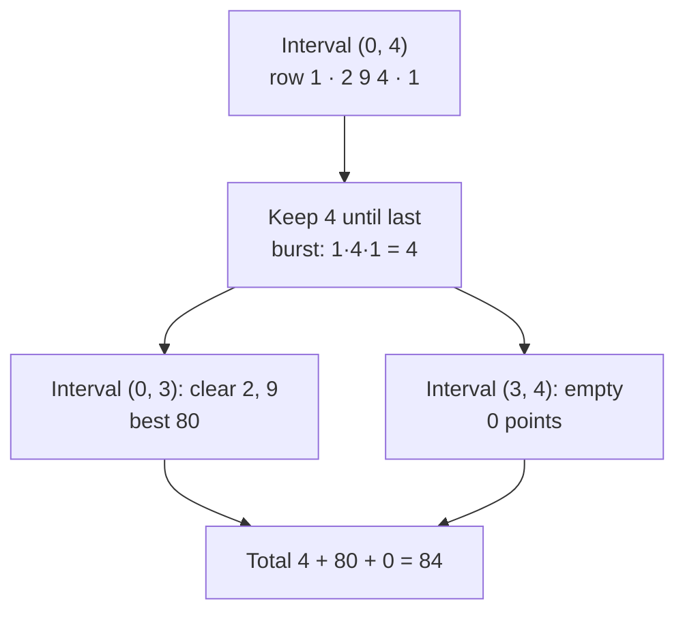
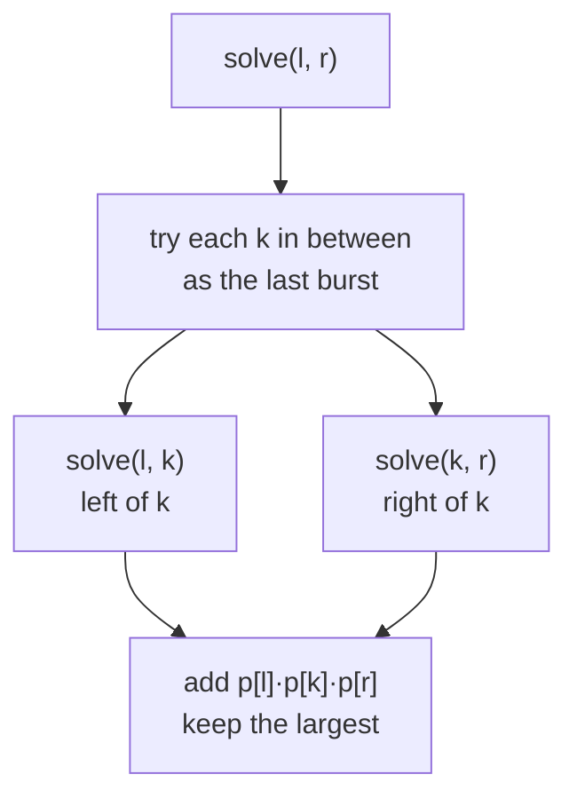

> [!tldr] Quick read
> - Add a balloon worth 1 at each end. Let `dp[l][r]` be the best score for bursting every balloon strictly **between** l and r while l and r stay put. That is [[en/concepts/interval-dp|DP over intervals]].
> - Don't ask which balloon bursts first. Ask which balloon k bursts **last** in the interval: when it bursts, its neighbors are guaranteed to be l and r. That is the [[en/concepts/last-split-choice|last split choice]].
> - `dp[l][r] = max(p[l]·p[k]·p[r] + dp[l][k] + dp[k][r])` over every k in between. The two sub-intervals never touch, because k stands between them until the end.
> - Fill by increasing interval length: O(n³) time, O(n²) memory.

> [!info] Context
> This is LeetCode 312 at [[en/posts/2026-11-27-neetcode-interval-dp|station DP-07: Interval DP and Pattern Matching]] on **the NeetCode Line: Dynamic Programming**. I picture a row of balloons tied close together on a string, each with a number written on it. All you need is arrays, 2D arrays and nested loops.

> [!abstract]- Quick glossary for this post (click to open)
> - The open interval (l, r) holds the positions strictly between l and r, not l and r themselves.
> - A sentinel is a fake element added at the start and end of an array so the edges need no special case.
> - A [[en/concepts/dp-state|DP state]] says exactly what one cell of the table stores.
> - A [[en/concepts/recurrence-relation|recurrence relation]] says which cells the current cell reads.
> - [[en/concepts/memoization|Memoization]] stores a state's answer the first time it is computed.

## Picture it first: balloons on a string

A row of balloons is tied close together, each with a number. Bursting one scores its number times the two balloons standing right next to it; the end of the string counts as a balloon worth 1. A burst balloon disappears, and the two on either side close up and become new neighbors. The question is which order gives the largest total.

The trick in this problem: instead of thinking about which balloon to burst first, I think about which one stays until the end. The balloon kept until last works like a stake that splits the string in two: the two pieces on either side never touch, so I can score them separately.

| Everyday life | Concept |
|---|---|
| The two stakes at the ends of the string | Sentinels `p[0] = p[n+1] = 1` |
| The piece of string between two standing balloons | The open interval (l, r) |
| The best score for clearing that piece | `dp[l][r]` |
| The balloon kept until last in the piece | The balloon k that bursts last |
| When the last balloon bursts, only the two stakes remain beside it | Score `p[l]·p[k]·p[r]` |
| The two pieces on either side of the last balloon | Two subproblems `dp[l][k]` and `dp[k][r]` |



## The problem: burst every balloon for the most points

You get an array `nums` of n integers, 1 ≤ n ≤ 300, each from 0 to 100. Bursting the balloon at position i scores `nums[i-1] · nums[i] · nums[i+1]` among the balloons **still standing** at that moment, with positions outside the array counting as 1. Every balloon must be burst; return the largest total. For the row `[2, 9, 4]`: bursting 9 first scores 2·9·4 = 72, then 2 scores 1·2·4 = 8, and finally 4 scores 1·4·1 = 4, for 84, and no order does better. [Original problem, LeetCode 312](https://leetcode.com/problems/burst-balloons/)

I used to think the small balloons should go first, so the big ones stay around as neighbors for as long as possible. On `[2, 9, 4]`, bursting 2 first (1·2·9 = 18), then 4 (9·4·1 = 36), then 9 (9) gives only 63. The 9 is the largest, yet it should burst first, because at that moment it multiplies with both 2 and 4. No simple greedy rule is correct, so the orders have to be tried in an organized way.

## How it works

### Brute force: try every bursting order

Take the remaining row, try bursting each balloon, add its score and solve the shorter row. There are n! orders. The call count is higher still, because every prefix of an order is a call of its own: with 8 balloons the function runs 109,601 times. Each call also copies the remaining array, so the time is about O(n·n!).

Memoizing on "the remaining row" does not save it: the remaining balloons can be any subset, so there are up to 2ⁿ states.

### Splitting on the balloon that bursts first is wrong

The natural idea is to pick the balloon k that bursts **first**, then solve the left part and the right part as two separate problems. But the moment k bursts, the last balloon on the left and the first balloon on the right become neighbors. Later scores depend on both sides, so the two subproblems are not independent.

The runnable file has a function that does exactly this on purpose: it scores k with its two original neighbors, then adds the two subproblems. On `[2, 3]` it returns 12, while the right answer is 9: it lets both balloons multiply with each other, as if each burst before the other.

### Flip the question: which balloon bursts last?

Add a 1 at both ends to get an array `p` of length n + 2. Let `solve(l, r)` be the best score for bursting every balloon between l and r while l and r stay standing.

Suppose k is the balloon that bursts **last** in the interval. Until k bursts, k always stands in the middle. Balloons to the left of k can only be next to each other or next to l and k, never next to a balloon on the right of k. So the left part is exactly `solve(l, k)` and the right part is `solve(k, r)`, two truly independent problems. When k finally bursts, every other balloon in the interval is gone, so its neighbors are l and r:

```text
solve(l, r) = max over l < k < r of  p[l]·p[k]·p[r] + solve(l, k) + solve(k, r)
solve(l, r) = 0  when r = l + 1  (no balloon left between them)
```

The answer is `solve(0, n + 1)`. There are about (n + 2)²/2 pairs (l, r), and each tries at most n values of k, so memoization gives O(n³) time and O(n²) memory, with a stack at most n + 1 deep. On the same 8 balloons, the call count drops from 109,601 to 241, counting calls that return straight from the cache.



### A table by interval length

`dp[l][r]` reads only `dp[l][k]` and `dp[k][r]`, both shorter intervals. So I fill the table by length `r − l` from 2 up to n + 1, with no recursion. For `p = [1, 2, 9, 4, 1]`:

| Length | Cell | Choices of k | Value |
|---|---|---|---|
| 2 | `dp[0][2]` | k = 1: 1·2·9 | 18 |
| 2 | `dp[1][3]` | k = 2: 2·9·4 | 72 |
| 2 | `dp[2][4]` | k = 3: 9·4·1 | 36 |
| 3 | `dp[0][3]` | k = 1: 1·2·4 + 0 + 72 = 80; k = 2: 1·9·4 + 18 + 0 = 54 | 80 |
| 3 | `dp[1][4]` | k = 2: 2·9·1 + 0 + 36 = 54; k = 3: 2·4·1 + 72 + 0 = 80 | 80 |
| 4 | `dp[0][4]` | k = 1: 2 + 0 + 80 = 82; k = 2: 9 + 18 + 36 = 63; k = 3: 4 + 80 + 0 = 84 | 84 |

The last cell picks k = 3, so balloon 4 bursts last. Time stays O(n³) and memory O(n²). For n = 300 that is about 4.5 million tries of k. The largest single burst is 100³ = 10⁶, and 300 bursts total at most 3·10⁸, so a 32-bit integer is enough.

## Runnable example

[TypeScript](../code/neetcode-burst-balloons/balloons.ts) · [Python](../code/neetcode-burst-balloons/balloons.py) · [Go](../code/neetcode-burst-balloons/balloons.go) · [Java](../code/neetcode-burst-balloons/balloons.java) · [JavaScript](../code/neetcode-burst-balloons/balloons.js) · [PHP](../code/neetcode-burst-balloons/balloons.php) · [Rust](../code/neetcode-burst-balloons/balloons.rs)

```ts
function maxCoins(nums: number[]): number {
    const p = [1, ...nums, 1]
    const n = p.length
    const dp: number[][] = Array.from({ length: n }, () => Array(n).fill(0))
    for (let len = 2; len < n; len++) {
        for (let l = 0; l + len < n; l++) {
            const r = l + len
            let best = 0
            for (let k = l + 1; k < r; k++) {
                best = Math.max(best, p[l] * p[k] * p[r] + dp[l][k] + dp[k][r])
            }
            dp[l][r] = best
        }
    }
    return dp[0][n - 1]
}
```

```python
def max_coins(nums):
    p = [1] + list(nums) + [1]
    n = len(p)
    dp = [[0] * n for _ in range(n)]
    for length in range(2, n):
        for l in range(0, n - length):
            r = l + length
            pl_pr = p[l] * p[r]
            row_l = dp[l]
            best = 0
            for k in range(l + 1, r):
                v = pl_pr * p[k] + row_l[k] + dp[k][r]
                if v > best:
                    best = v
            dp[l][r] = best
    return dp[0][n - 1]
```

```go
func maxCoins(nums []int) int {
	p := append(append([]int{1}, nums...), 1)
	n := len(p)
	dp := make([][]int, n)
	for i := range dp {
		dp[i] = make([]int, n)
	}
	for length := 2; length < n; length++ {
		for l := 0; l+length < n; l++ {
			r := l + length
			best := 0
			for k := l + 1; k < r; k++ {
				best = max(best, p[l]*p[k]*p[r]+dp[l][k]+dp[k][r])
			}
			dp[l][r] = best
		}
	}
	return dp[0][n-1]
}
```

```java
static int maxCoins(int[] nums) {
    int[] p = pad(nums);
    int n = p.length;
    int[][] dp = new int[n][n];
    for (int len = 2; len < n; len++) {
        for (int l = 0; l + len < n; l++) {
            int r = l + len;
            int best = 0;
            for (int k = l + 1; k < r; k++) {
                best = Math.max(best, p[l] * p[k] * p[r] + dp[l][k] + dp[k][r]);
            }
            dp[l][r] = best;
        }
    }
    return dp[0][n - 1];
}
```

```js
function maxCoins(nums) {
    const p = [1, ...nums, 1]
    const n = p.length
    const dp = Array.from({ length: n }, () => Array(n).fill(0))
    for (let len = 2; len < n; len++) {
        for (let l = 0; l + len < n; l++) {
            const r = l + len
            let best = 0
            for (let k = l + 1; k < r; k++) {
                best = Math.max(best, p[l] * p[k] * p[r] + dp[l][k] + dp[k][r])
            }
            dp[l][r] = best
        }
    }
    return dp[0][n - 1]
}
```

```php
function maxCoins(array $nums): int {
    $p = array_merge([1], $nums, [1]);
    $n = count($p);
    $dp = array_fill(0, $n, array_fill(0, $n, 0));
    for ($len = 2; $len < $n; $len++) {
        for ($l = 0; $l + $len < $n; $l++) {
            $r = $l + $len;
            $best = 0;
            for ($k = $l + 1; $k < $r; $k++) {
                $v = $p[$l] * $p[$k] * $p[$r] + $dp[$l][$k] + $dp[$k][$r];
                if ($v > $best) $best = $v;
            }
            $dp[$l][$r] = $best;
        }
    }
    return $dp[0][$n - 1];
}
```

```rust
fn max_coins(nums: Vec<i32>) -> i32 {
    let p = pad(&nums);
    let n = p.len();
    let mut dp = vec![vec![0i32; n]; n];
    for len in 2..n {
        for l in 0..n - len {
            let r = l + len;
            let mut best = 0;
            for k in l + 1..r {
                best = best.max(p[l] * p[k] * p[r] + dp[l][k] + dp[k][r]);
            }
            dp[l][r] = best;
        }
    }
    dp[0][n - 1]
}
```

The tabs show the table-filling function; `pad` in the Java and Rust versions adds a 1 at both ends. The downloadable files also hold the brute force over every bursting order, the memoized version and the wrong "split on the first burst" function. The 11 cases include a single balloon, rows with zeros, 300 balloons all worth 1, 300 all worth 100 and a mixed row of 300 numbers. Every array of length 1–5 with values 0–3 is checked against brute force. All seven languages print the same result:

```text
11/11 cases passed
1364/1364 cases passed (checked against every bursting order)
Split on the first burst with [2,3]: 12, correct is 9
8 balloons: brute force 109601 calls, memo 241 calls
```

*(Output labels translated; the files themselves print Vietnamese.)*

Run with `node balloons.ts`, `python3 balloons.py`, `go run balloons.go`, `java balloons.java`, `node balloons.js`, `php -d xdebug.mode=off balloons.php` or `rustc --edition 2021 -O balloons.rs -o /tmp/balloons && /tmp/balloons`.

## Misconceptions and common traps

- Burst the small balloons first to keep the big ones as neighbors. On `[2, 9, 4]` that scores 63, while bursting 9 first scores 84. No greedy rule is right for every row.
- Split on the balloon that bursts first. The two sides become neighbors once it bursts, so the subproblems are not independent. Choose the balloon that bursts last.
- Define `dp[l][r]` on a closed interval that includes l and r. Then the last balloon's neighbors are `p[l-1]` and `p[r+1]`; it still works but invites off-by-one errors. An open interval with two sentinels keeps the formula tidiest.
- Forget the two 1s at the ends, or add them but let the `k` loop run over them. Sentinels are never burst.
- Skip balloons worth 0. A 0 still has to be burst and still splits the row; with `[4, 0, 4]` you should burst 0 first so the two 4s become neighbors, for 20.
- Fill the table by increasing l instead of by length. `dp[l][r]` needs `dp[k][r]` with k > l, which is not ready yet if l runs from small to large. Filling by length is safe, or run l from large to small.
- Python: the O(n³) table at n = 300 is about 4.5 million inner iterations, roughly 0.2 seconds on my machine; reading `dp[l]` and `p[l]·p[r]` into locals first makes the inner loop lighter. The memoized version is only n + 1 deep, well under the default recursion limit of 1,000.
- PHP: a recursive closure must capture itself with `use (&$solve)`, and the memo array must be captured by reference too, or every call works on a copy. Run with `-d xdebug.mode=off` so Xdebug does not stop at 512 levels.
- Rust: `Vec::remove` in the brute force shifts every later element, which is fine because brute force only runs on small arrays. Indices are `usize`, so `for l in 0..n - len` is safe because `len < n`.

## Self-check questions

> [!question]- Why does choosing the balloon that bursts last make the two subproblems independent, while the first one does not?
> The last balloon stands in the middle the whole time, like a wall: no balloon on the left ever becomes a neighbor of one on the right. The first balloon disappears right away, so the two sides touch.

> [!question]- In `dp[l][r]`, why is the last balloon's score `p[l]·p[k]·p[r]`?
> When k bursts, every other balloon between l and r is already gone, while l and r have not been burst (they lie outside the interval or are sentinels). The two balloons next to k at that moment are exactly l and r.

> [!question]- When computing `dp[1][4]`, which cells does the table read, and are they ready?
> The open interval (1, 4) has two balloons inside, k = 2 and k = 3. For k = 2 it reads `dp[1][2]` and `dp[2][4]`; for k = 3 it reads `dp[1][3]` and `dp[3][4]`. `dp[1][2]` and `dp[3][4]` are length-1 intervals with no balloon inside, so they stay 0 and the loop never writes them. `dp[1][3]` and `dp[2][4]` have length 2 and are filled in the pass before length 3.

> [!question]- Why does memoizing on the pair (l, r) need only O(n²) cells, while memoizing on "the remaining row" needs 2ⁿ?
> After a few bursts, the remaining balloons can be any subset. Once the last balloon is fixed, every subproblem is a contiguous piece between two standing balloons, so its two endpoints describe it completely.

## References

- [LeetCode 312](https://leetcode.com/problems/burst-balloons/)
- [Jeff Erickson, Algorithms, chapter 3: dynamic programming](https://jeffe.cs.illinois.edu/teaching/algorithms/book/03-dynprog.pdf)
- [cp-algorithms, introduction to dynamic programming](https://cp-algorithms.com/dynamic_programming/intro-to-dp.html)
- [Xdebug max_nesting_level](https://xdebug.org/docs/all_settings#max_nesting_level) · [Rust Vec::remove](https://doc.rust-lang.org/std/vec/struct.Vec.html#method.remove)
