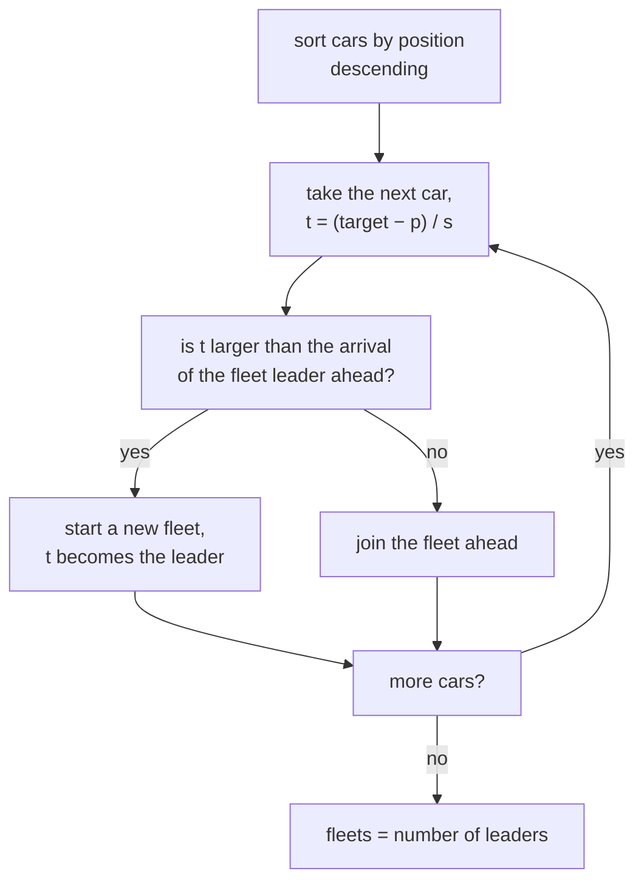

> [!tldr] Quick read
> - The problem: n cars drive the same way towards `target`, and no car may pass another. A car that catches up with the car ahead slows down to its speed and they become one **fleet**. How many fleets reach the target?
> - The key: you only need each car's **arrival time if it drove alone**, `(target − position) / speed`. Go through the cars from **closest to farthest**: a car that arrives later than the fleet leader ahead starts a new fleet; otherwise it joins.
> - The fleet leaders form a [[en/concepts/monotonic-stack|monotonic stack]]: times increase from bottom to top. Since you only compare with the **top**, one variable is enough. O(n log n) in total, mostly the sort.
> - Positions are distinct and below `target`, so you can skip the sort: an array indexed by position, O(n + target).
> - Two wrong ways to compare: computing the time as `target/s − p/s` (two roundings) splits two cars arriving together into two fleets; cross-multiplying with `int` in Java overflows and merges two fleets.

> [!info] Context
> LeetCode problem 853, part of [[en/posts/2026-11-23-neetcode-monotonic-stack|station 7: Monotonic Stack]] on **the NeetCode line: Arrays and Strings**. The solutions come in TypeScript, Python, Go, Java and JavaScript. All you need to know is sorting, loops and division.

> [!abstract]- Quick glossary for this post (click to open)
> - **Fleet**: a group of cars driving bumper to bumper at the speed of the leading car. A car driving alone is also a fleet.
> - **Arrival time**: `(target − position) / speed`, when the car would reach the target if nobody blocked it.
> - **Stack**: add and remove only at the top. See [[en/concepts/stack|Stack]].
> - **Cross-multiplication**: compare `a/b > c/d` as `a·d > c·b` when b and d are positive, avoiding division.
> - **Overflow**: a result goes beyond the range of the integer type and "wraps around" into a wrong number, often negative.

## Picture it first: fleets on a single-lane road

A single-lane road with no room to pass. A fast car that catches up with a slow car ahead has to tail it all the way to the finish. Standing at the finish line looking back, you only need to know when each car **intends** to arrive.

| Everyday life | Concept |
|---|---|
| The car closest to the finish is blocked by nobody | process cars by descending position |
| When the car would arrive on an empty road | `(target − p) / s` |
| The car behind intends to arrive **earlier or at the same time** as the car ahead | it catches up and joins the fleet |
| The car behind intends to arrive **later** | it never catches up: a new fleet |
| A board listing the arrival times of the fleet leaders | the stack, times increasing |



## The problem

**The problem (in my own words):** given `target`, an array `position` (distinct positions, `0 ≤ position[i] < target`) and `speed` of the same length n (n ≤ 10⁵, `target` and speeds ≤ 10⁶). Cars can't pass; a car that catches the car ahead (even exactly at the finish line) counts as the same fleet. Return the number of fleets that reach the target. Original: [LeetCode 853](https://leetcode.com/problems/car-fleet/).

| target | position | speed | Output |
|---|---|---|---|
| 12 | `[10, 8, 0, 5, 3]` | `[2, 4, 1, 1, 3]` | 3 |
| 100 | `[0, 2, 4]` | `[4, 2, 1]` | 1 |
| 10 | `[6, 8]` | `[3, 2]` | 2 |

The first example: the car at 10 arrives at time 1, the car at 8 at time 1 (it catches up right at the finish line, one fleet); the car at 5 arrives at 7, the car at 3 at 3 (it catches the car at 5); the car at 0 arrives at 12. Three fleets.

I used to think you had to simulate the cars second by second. It turns out you don't need to know **where** or **when** cars meet, only to compare arrival times in the right order along the road.

## How it works

### Approach 1, brute force: O(n²)

Car i leads a fleet when it arrives **later than every car ahead of it**: if some car ahead arrives later or at the same time, car i catches up and gets blocked. Check that for each car by scanning the whole array.

### Approach 2, sort, then scan with a stack

Sort by position descending. Starting from the car closest to the target:
- compute `t = (target − p) / s`;
- if the stack is empty or `t` is **larger** than the top: this car never catches the fleet ahead, push `t` (a new fleet leader);
- otherwise the car joins the fleet ahead. Push nothing: the fleet keeps its leader's time, because the car behind is blocked.

The number of entries on the stack is the number of fleets. The stack always **increases** from bottom to top, and each step only looks at the top, so the whole stack can be replaced by one variable, "the arrival time of the nearest fleet leader". The comparison is `>`, not `≥`: two cars arriving **at the same time** meet at the finish line, and the problem counts that as one fleet.

### Approach 3, no sorting

Positions are distinct integers in `[0, target)`. Write the times into an array `timeAt[position]`, then walk from `target − 1` down to 0. No comparisons for sorting, O(n + target) in total. The price: an array of size `target` (10⁶ cells) even when there are only a few cars.

### Measured

TypeScript, median, every car at the same speed (the worst case for brute force: the farther the car, the later it arrives, every car is its own fleet, and the inner loop never stops early):

| n | brute force | sort + stack | array by position |
|---|---|---|---|
| 2 000 | 9.6 ms | 0.31 ms | 2.71 ms |
| 4 000 | 40.6 ms | 0.85 ms | 2.57 ms |
| 8 000 | 168.2 ms | 1.92 ms | 1.44 ms |
| 16 000 | 679.8 ms | 3.94 ms | 2.89 ms |
| 10⁵ (target 2·10⁶) | (not run) | 28.91 ms | 6.51 ms |
| 10⁶ (target 2·10⁶) | (not run) | 441.64 ms | 15.39 ms |

Brute force follows the n² shape: double n, 4 times the time. The position array pays a fixed 2–3 ms to walk 10⁶ cells, so it only wins once n is large enough. The last two rows use `target = 2·10⁶` to fit 10⁶ cars, beyond the problem's limits, only to show the shape: sorting an array of `[position, speed]` pairs in JS is expensive, while the position array stays almost linear.

### Comparing times: which division is safe

Times are fractions. There are three ways to compare them:
- **One division `(target − p) / s`**: IEEE 754 rounds each division correctly, so two **equal** fractions always give the same float. Within the problem's limits (numerators and denominators ≤ 10⁶), two **different** fractions differ by at least 1/(s₁·s₂) ≥ 10⁻¹², far more than the gap between neighbouring floats of that size, so they don't get rounded together either. The TypeScript file checks 20 000 random inputs against cross-multiplication: 0 mismatches.
- **Two divisions `target/s − p/s`**: correct on paper, but each division rounds separately before the subtraction. With `target = 4`, the car at 3 with speed 3 and the car at 1 with speed 9 both arrive at 1/3, yet this formula gives `0.33333333333333326` and `0.3333333333333333`: the car behind is "later", and you get two fleets.
- **Integer cross-multiplication**: `d₁·s₂ > d₂·s₁`, exact, provided the integer type is wide enough. 10⁶ · 10⁶ = 10¹² exceeds Java's 32-bit `int` (about 2.1·10⁹).

### Under the hood of the five languages

| | Sorting by position descending | Language-specific trap |
|---|---|---|
| TypeScript / JavaScript | `sort((a, b) => b[0] − a[0])` | without a comparator `sort` compares **strings**: `"17"` comes before `"2"` |
| Python | `sorted(zip(position, speed), reverse=True)` | forgetting `reverse=True`: starting from the farthest car, wrong on 4/7 cases |
| Go | `slices.SortFunc(idx, …)` | `int / int` is **integer** division: convert to `float64` before dividing |
| Java | `Arrays.sort(Integer[], Comparator)` | the `(double)` cast must come before the division; cross-multiplication needs `long`, `int` overflows silently |

## Runnable example

[TypeScript](../code/neetcode-car-fleet/car-fleet.ts) · [Python](../code/neetcode-car-fleet/car_fleet.py) · [Go](../code/neetcode-car-fleet/car_fleet.go) · [Java](../code/neetcode-car-fleet/car-fleet.java) · [JavaScript](../code/neetcode-car-fleet/car-fleet.js)

Each file runs 7 cases (the Java file adds an overflow case). Below are the sort-with-stack and cross-multiplication approaches.

```ts
// Sort by position descending, then a stack of the fleet leaders' arrival times.
function sortStack(target: number, position: number[], speed: number[]): number {
  const cars = position.map((p, i) => [p, speed[i]]).sort((a, b) => b[0] - a[0]); // closest to the target first
  const stack: number[] = [];
  for (const [p, s] of cars) {
    const t = (target - p) / s;
    if (stack.length === 0 || t > stack[stack.length - 1]) stack.push(t); // arrives later than the fleet ahead: a new fleet
    // otherwise: catches the fleet ahead before the target, joins it, pushes nothing
  }
  return stack.length;
}

// Only the top matters: one variable replaces the whole stack. Compare by integer cross-multiplication, no division.
function sortCrossMultiply(target: number, position: number[], speed: number[]): number {
  const idx = position.map((_, i) => i).sort((a, b) => position[b] - position[a]);
  let fleets = 0, leadDist = 0, leadSpeed = 1; // leader's time = leadDist / leadSpeed
  for (const i of idx) {
    const d = target - position[i];
    // d / speed[i] > leadDist / leadSpeed  ⇔  d·leadSpeed > leadDist·speed[i] (positive denominators)
    if (fleets === 0 || d * leadSpeed > leadDist * speed[i]) { fleets++; leadDist = d; leadSpeed = speed[i]; }
  }
  return fleets;
}
```

```python
def sort_stack(target: int, position: list[int], speed: list[int]) -> int:
    stack: list[float] = []
    for p, s in sorted(zip(position, speed), reverse=True):  # reverse=True: closest to the target first
        t = (target - p) / s  # "/" always gives a float in Python 3
        if not stack or t > stack[-1]:
            stack.append(t)
    return len(stack)

def sort_cross_multiply(target: int, position: list[int], speed: list[int]) -> int:
    fleets, lead_d, lead_s = 0, 0, 1
    for p, s in sorted(zip(position, speed), reverse=True):
        d = target - p
        if fleets == 0 or d * lead_s > lead_d * s:  # Python ints don't overflow, cross-multiplication is always exact
            fleets, lead_d, lead_s = fleets + 1, d, s
    return fleets
```

```go
func sortStack(target int, position, speed []int) int {
	idx := make([]int, len(position))
	for i := range idx {
		idx[i] = i
	}
	slices.SortFunc(idx, func(a, b int) int { return position[b] - position[a] }) // position descending
	stack := []float64{}
	for _, i := range idx {
		t := float64(target-position[i]) / float64(speed[i]) // int / int in Go is INTEGER division: convert to float64 first
		if len(stack) == 0 || t > stack[len(stack)-1] {
			stack = append(stack, t)
		}
	}
	return len(stack)
}

func sortCrossMultiply(target int, position, speed []int) int {
	idx := make([]int, len(position))
	for i := range idx {
		idx[i] = i
	}
	slices.SortFunc(idx, func(a, b int) int { return position[b] - position[a] })
	fleets, leadD, leadS := 0, 0, 1
	for _, i := range idx {
		d := target - position[i]
		if fleets == 0 || d*leadS > leadD*speed[i] { // Go's int is 64-bit: 10⁶ · 10⁶ = 10¹² fits
			fleets, leadD, leadS = fleets+1, d, speed[i]
		}
	}
	return fleets
}
```

```java
static int sortStack(int target, int[] position, int[] speed) {
    Deque<Double> stack = new ArrayDeque<>();
    for (int i : byPositionDesc(position)) {
        double t = (double) (target - position[i]) / speed[i]; // cast BEFORE dividing, or it's integer division
        if (stack.isEmpty() || t > stack.peek()) stack.push(t);
    }
    return stack.size();
}

static int sortCrossMultiply(int target, int[] position, int[] speed) {
    int fleets = 0;
    long leadD = 0, leadS = 1;
    for (int i : byPositionDesc(position)) {
        long d = target - position[i];
        if (fleets == 0 || d * leadS > leadD * speed[i]) { fleets++; leadD = d; leadS = speed[i]; } // long: 10¹² fits
    }
    return fleets;
}
```

```js
function sortStack(target, position, speed) {
  const cars = position.map((p, i) => [p, speed[i]]).sort((a, b) => b[0] - a[0]); // a comparator is REQUIRED
  const stack = [];
  for (const [p, s] of cars) {
    const t = (target - p) / s;
    if (stack.length === 0 || t > stack[stack.length - 1]) stack.push(t);
  }
  return stack.length;
}

function sortCrossMultiply(target, position, speed) {
  const idx = position.map((_, i) => i).sort((a, b) => position[b] - position[a]);
  let fleets = 0, leadDist = 0, leadSpeed = 1;
  for (const i of idx) {
    const d = target - position[i];
    if (fleets === 0 || d * leadSpeed > leadDist * speed[i]) { fleets++; leadDist = d; leadSpeed = speed[i]; } // ≤ 10¹² < 2⁵³: still exact
  }
  return fleets;
}
```


```text
$ node car-fleet.ts
bruteForce         7/7 cases passed
sortStack          7/7 cases passed
sortCrossMultiply  7/7 cases passed
bucketByPosition   7/7 cases passed
noComparator       6/7 cases passed; wrong on t=20 [6,2,17]
subtractFormula    6/7 cases passed; wrong on t=4 [3,1]

(4 − 3) / 3 = 0.3333333333333333, (4 − 1) / 9 = 0.3333333333333333
4/3 − 3/3 = 0.33333333333333326, 4/9 − 1/9 = 0.3333333333333333
20 000 random inputs (target, speed ≤ 10⁶): one division vs cross-multiplication, 0 mismatches

n          brute     sort + stack         position array     (ms, median)
2000           9.6                 0.31               2.71
4000          40.6                 0.85               2.57
8000         168.2                 1.92               1.44
16000        679.8                 3.94               2.89
100000           —                28.91               6.51
1000000          —               441.64              15.39
```

*(Output labels translated; the files themselves print Vietnamese.)*

`noComparator` calls `sort()` without a comparator on the `[position, speed]` pairs: each pair becomes the string `"6,3"`, `"2,9"`, `"17,2"` and they are compared character by character, so `"17,2"` comes first because `"1" < "2"`. Reversed, the order is 6, 2, 17: the car at 17, closest to the target, is processed last. Now Java, cross-multiplying with `int`:

```text
$ java car-fleet.java
sortStack          8/8 cases passed
sortCrossMultiply  8/8 cases passed
crossMultiplyInt   7/8 cases passed; wrong on t=1000000 [500000, 0] → 1
1_000_000 * 999_999 as int = -728379968
```

The car at 0 with speed 10⁶ arrives at time 1, the car at 500 000 with speed 999 999 at about 0.5: two fleets. But `1 000 000 · 999 999` overflows into a negative number, the comparison flips, and the two cars get merged into one. Python has no such trap (its ints are unbounded) but it has an ordering trap:

```text
$ python3 car_fleet.py
sort_stack           7/7 cases passed
sort_cross_multiply  7/7 cases passed
bucket_by_position   7/7 cases passed
sort_ascending       3/7 cases passed; wrong on t=12 [10, 8, 0, 5, 3] t=100 [0, 2, 4] t=10 [6, 8] t=10 [0, 4, 2]
```

The Go file also runs a version that forgets the `float64` conversion (`intDivision`, 6/7: with `target = 10`, `(10 − 6) / 3` and `(10 − 8) / 2` both become 1 under integer division). JavaScript prints `7/7 ca đúng` ("7/7 cases passed") for all three approaches.

## Misconceptions and common traps

- **"You have to simulate the cars."** You only need arrival times and the order of positions. Where cars meet doesn't change the number of fleets.
- **Comparing with `≥` instead of `>`.** Two cars arriving together meet exactly at the finish line, which the problem counts as one fleet. Starting a new fleet on `≥` overcounts.
- **Updating the leader when a car joins.** The car behind is blocked, so the fleet still arrives at its leader's time. Overwriting it with the (earlier) time of the car behind makes cars further back "catch up" too easily.
- **Sorting by position ascending.** You must start from the car closest to the target, because only a car ahead can block a car behind.
- **Computing the time with two divisions.** `target/s − p/s` drifts in the last digit and splits one fleet into two. Use `(target − p) / s` or cross-multiplication.
- **Cross-multiplying in a 32-bit `int`.** 10⁶ · 10⁶ exceeds 2³¹. Java needs `long`; Go's `int` is already 64-bit; JS stays exact because 10¹² < 2⁵³.

## Self-check questions

> [!question]- With `target = 10`, `position = [0, 4, 2]`, `speed = [2, 1, 3]`, how many fleets are there?
> Sorted descending: the car at 4 arrives at 6, the car at 2 at 8/3 ≈ 2.67 (it catches up and joins), the car at 0 at 5 (≤ 6, it joins). One fleet.

> [!question]- Why does the stack of fleet leaders always increase from bottom to top?
> A car is pushed only when its time is **larger** than the top. So every new entry is larger than everything already there.

> [!question]- When is the "array by position" approach slower than sorting?
> When n is small compared with `target`: it always walks all `target` cells. With 2 000 cars and `target = 10⁶` it takes 2.71 ms against 0.31 ms for sorting.

> [!question]- In Java, what is enough to fix `crossMultiplyInt`?
> Declare the multiplied variables as `long` (or cast one factor to `long` before multiplying). Casting **after** multiplying, as in `(long) (d * leadS)`, is too late: it has already overflowed.

## References

- [LeetCode 853: Car Fleet](https://leetcode.com/problems/car-fleet/) (the original problem)
- [Java Language Specification SE 21, §15.17.1 Multiplication Operator](https://docs.oracle.com/javase/specs/jls/se21/html/jls-15.html#jls-15.17.1) (integer multiplication that overflows keeps the low-order bits, no error)
- [ECMAScript 2025: `Array.prototype.sort`](https://tc39.es/ecma262/2025/#sec-array.prototype.sort) (without a comparator it compares strings)
- [Go spec: Arithmetic operators](https://go.dev/ref/spec#Arithmetic_operators) (dividing two integers truncates)
- [Python: Sorting Techniques](https://docs.python.org/3/howto/sorting.html) (`sorted` with `reverse=True`, tuples compared element by element)
