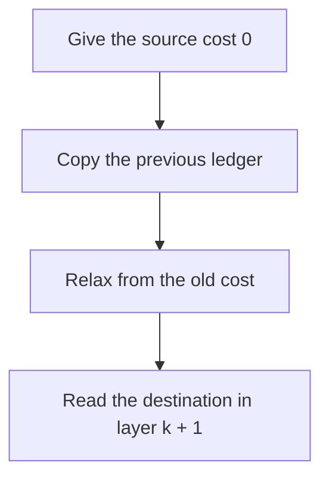

> [!tldr] Quick read
> - At most `k` intermediate stops means at most `k + 1` flight segments.
> - The best cost to a city depends on the remaining segment budget. A cheap arrival that used it all may be useless.
> - [[en/concepts/edge-layer-relaxation|Edge-layer relaxation]] reads the previous ledger and writes the new one, so one iteration can add only one edge.

> [!info] Context
> LeetCode 787, at [[en/posts/2026-11-27-neetcode-shortest-path|station 5: Shortest Paths]] on the NeetCode Graphs line. Loops and arrays are enough to get started.

> [!abstract]- Quick glossary for this post (click to open)
> - A stop is an intermediate city, excluding the source and destination.
> - A flight segment is one directed edge with a price.
> - Layer `i` keeps the lowest price with at most `i` segments.

## Picture it first: connecting tickets with a segment budget

From A, A → B → C costs 2 and A → C costs 6. C → D costs 1. If only one intermediate stop is allowed, the cheap route to C via B already spent both segments. The valid ticket to D costs 7 via C.

| Everyday life | Concept |
| --- | --- |
| Allowed connections | At most k intermediate stops |
| Each ticket stub spends a segment | One edge |
| Cost ledger by stubs spent | State indexed by edge layer |



## The problem: the cheapest route within the budget

There are 2 to 100 cities numbered from 0. An edge is a one-way flight that costs 1 to 10,000. Find the minimum price from the source to a different destination using at most k intermediate cities, where `0 ≤ k < n`. Return −1 if there is no valid trip.

## How it works

### Exhaustive search and edge layers

We can enumerate trips by the number of segments remaining and keep the lowest price. If b is the maximum out-degree and b ≥ 2, the number of states visited can grow as O(bᵏ⁺¹), with O(k + 1) stack depth when outgoing edges are indexed first. The small oracle scans the edge list to avoid another data structure.

I use `best[i][v]` for the lowest price to v with at most i segments. Keep the previous-layer cost or extend a route with exactly one edge `u → v`. At layer 0, the source costs 0 and other cities cost infinity. Advance from layer 1 through `k + 1`.

In the example, layer 1 has cost 6 for C. Layer 2 lowers C to 2 and sets D to 7 using **C’s layer 1 price**. Updating one array in the order A → B, B → C, C → D would silently take three edges in the first round.

Only two layers are needed. The algorithm takes O((k + 1)(V + E)) time and O(V) extra space. The generated example has six layers of two vertices with a source and a destination. DFS makes 191 calls, and the DP loop examines 168 edges. These counts describe work in each method and do not give a runtime ratio.

## Runnable example

[TypeScript](../code/neetcode-cheapest-flights-within-k-stops/flight-budget.ts) · [Python](../code/neetcode-cheapest-flights-within-k-stops/flight_budget.py) · [Go](../code/neetcode-cheapest-flights-within-k-stops/flight_budget.go) · [Java](../code/neetcode-cheapest-flights-within-k-stops/flight-budget.java) · [JavaScript](../code/neetcode-cheapest-flights-within-k-stops/flight-budget.js) · [PHP](../code/neetcode-cheapest-flights-within-k-stops/flight-budget.php) · [Rust](../code/neetcode-cheapest-flights-within-k-stops/flight_budget.rs)

The tabs show the central function. The standalone files also run the comparison methods on the small cases. The TypeScript file adds randomized comparisons.

```ts
function cheapestFlight(n: number, flights: number[][], start: number, end: number, k: number): number {
  let best = Array<number>(n).fill(Infinity)
  best[start] = 0
  for (let used = 0; used <= k; used++) {
    const next = best.slice()
    for (const [from, to, price] of flights) next[to] = Math.min(next[to], best[from] + price)
    best = next
  }
  return best[end] === Infinity ? -1 : best[end]
}
```

```python
def cheapest_flight(n, flights, start, end, k):
    best = [float("inf")] * n
    best[start] = 0
    for _ in range(k + 1):
        following = best.copy()
        for source, target, price in flights:
            following[target] = min(following[target], best[source] + price)
        best = following
    return -1 if best[end] == float("inf") else best[end]
```

```go
func cheapestFlight(n int, flights [][3]int, start, end, k int) int {
	best := make([]int, n)
	for i := range best {
		best[i] = infinity
	}
	best[start] = 0
	for used := 0; used <= k; used++ {
		next := append([]int(nil), best...)
		for _, flight := range flights {
			from, to, price := flight[0], flight[1], flight[2]
			if best[from] != infinity {
				next[to] = min(next[to], best[from]+price)
			}
		}
		best = next
	}
	if best[end] == infinity {
		return -1
	}
	return best[end]
}
```

```java
static int cheapestFlight(int n, int[][] flights, int start, int end, int k) {
    int[] best = new int[n];
    Arrays.fill(best, Integer.MAX_VALUE);
    best[start] = 0;
    for (int used = 0; used <= k; used++) {
        int[] next = best.clone();
        for (int[] flight : flights) {
            int from = flight[0], to = flight[1], price = flight[2];
            if (best[from] != Integer.MAX_VALUE) {
                next[to] = Math.min(next[to], best[from] + price);
            }
        }
        best = next;
    }
    return best[end] == Integer.MAX_VALUE ? -1 : best[end];
}
```

```js
function cheapestFlight(n, flights, start, end, k) {
  let best = Array(n).fill(Infinity)
  best[start] = 0
  for (let used = 0; used <= k; used++) {
    const next = best.slice()
    for (const [from, to, price] of flights) next[to] = Math.min(next[to], best[from] + price)
    best = next
  }
  return best[end] === Infinity ? -1 : best[end]
}
```

```php
function cheapestFlight(int $n, array $flights, int $start, int $end, int $k): int {
    $best = array_fill(0, $n, PHP_INT_MAX);
    $best[$start] = 0;
    for ($used = 0; $used <= $k; $used++) {
        $next = $best;
        foreach ($flights as [$from, $to, $price]) {
            if ($best[$from] !== PHP_INT_MAX) {
                $next[$to] = min($next[$to], $best[$from] + $price);
            }
        }
        $best = $next;
    }
    return $best[$end] === PHP_INT_MAX ? -1 : $best[$end];
}
```

```rust
fn cheapest_flight(
    n: usize,
    flights: &[(usize, usize, i32)],
    start: usize,
    end: usize,
    k: usize,
) -> i32 {
    let mut best = vec![i32::MAX; n];
    best[start] = 0;
    for _ in 0..=k {
        let mut next = best.clone();
        for &(from, to, price) in flights {
            if best[from] != i32::MAX {
                next[to] = next[to].min(best[from] + price);
            }
        }
        best = next;
    }
    if best[end] == i32::MAX {
        -1
    } else {
        best[end]
    }
}
```

```text
5/5 cases passed
201/201 cross-checks passed; DFS 191 calls, DP 168 edge checks
```

*(Output labels translated; the files themselves print Vietnamese.)*

## Misconceptions and common traps

- **Run k rounds.** Zero stops still permits one direct flight.
- **Read and write one ledger.** A freshly updated cost can cross several edges in one iteration.
- **Keep one Dijkstra cost per city.** With an edge limit, trips to the same location may not substitute for one another.
- **Add to an integer sentinel.** Java, Go, PHP, and Rust check that the source value is finite before addition.

## Self-check questions

> [!question]- What if k rises from 1 to 2 in the example?
> The optimum is 3 via A → B → C → D.

> [!question]- Why copy the previous ledger?
> The state is the best price using up to i segments. A route that uses fewer segments is still valid.

## References

- [LeetCode 787 · Cheapest Flights Within K Stops](https://leetcode.com/problems/cheapest-flights-within-k-stops/)
- [MIT 6.006 · Bellman–Ford](https://ocw.mit.edu/courses/6-006-introduction-to-algorithms-spring-2020/resources/mit6_006s20_lec12/)
