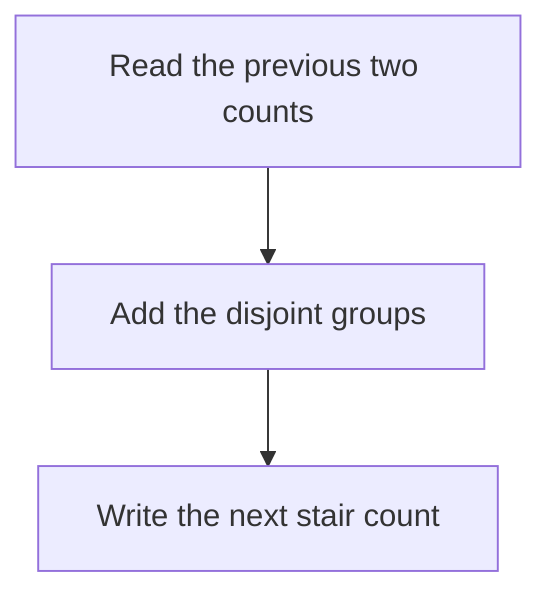

> [!tldr] Quick read
> - Partition paths to stair i by whether the last move is one or two stairs. The groups are disjoint, so add the counts for the previous two stairs.
> - Stair zero has one way to reach it, the empty sequence. This makes the recurrence count a jump straight from the floor to stair two.
> - Saving each count reduces exponential work to linear work. Two recent values suffice when I only need the final count.

> [!info] Context
> This is LeetCode 70 at [[en/posts/2026-11-27-neetcode-linear-dp|station DP-01: One-Dimensional Recurrences]]. I use a warehouse staircase to count paths to each landing. All you need is arrays and loops.

> [!abstract]- Quick glossary for this post (click to open)
> - A [[en/concepts/dp-state|DP state]] is a smaller question tied to an index. Here it is the number of ways to stand exactly on stair i.
> - [[en/concepts/memoization|Memoization]] saves an answer so a later call can read it.
> - [[en/concepts/rolling-state|Rolling state]] keeps values the next iteration still reads.

## Picture it first: a ledger by the stairs

At stair four, I group a delivery worker's paths by their previous landing. One group just stepped up from stair three. The other just jumped from stair two. If the ledger already has those two counts, I add them.

| Everyday life | Concept |
|---|---|
| The ledger page for stair i | State f(i) |
| Two places to start the last move | Two state dependencies |
| Write once, read many times | Memoization or a DP table |
| Two pages used at the next stair | Rolling state |



## The problem: count move sequences that reach the target

The number of stairs n lies between 1 and 45. Each move advances exactly one or two stairs. Order matters, so `1,2,1` and `2,1,1` are distinct. On a four-stair staircase, I can use `1111`, `112`, `121`, `211`, or `22`. The answer is 5. [Original LeetCode 70 problem](https://leetcode.com/problems/climbing-stairs/)

## How it works

For i ≥ 2, any sequence ending at i appends one last move to a valid sequence reaching i−1 or i−2. Removing that move is the unique inverse. The split is exhaustive and disjoint, so `f(i) = f(i−1) + f(i−2)`. Set `f(0) = f(1) = 1`. The table from the floor starts `1,1,2,3,5`.

| Approach | Time | Auxiliary space |
|---|---|---|
| Brute-force two branches | Θ(φⁿ), φ ≈ 1.618 | O(n) stack |
| Recursion with memoization | O(n) | O(n) table and stack |
| Fill a bottom-up table | O(n) | O(n) table |
| Keep the previous two counts | O(n) | O(1) |

The call tree for `f(4)` reaches `f(2)` through `f(3)` and directly via the two-stair move. Brute force repeats the entire subtree. The memoized version maps index i to its answer because every call at i has the same meaning. The bottom-up table uses that same rule and follows the dependency order.

Before rolling iteration i, the variables contain `f(i−2)` and `f(i−1)`. Compute the sum, then slide the window up a stair. The invariant repeats until the newer variable holds `f(n)`. A full table gives direct access to each stair's count for analysis.

## Runnable example

[TypeScript](../code/neetcode-climbing-stairs/stairs.ts) · [Python](../code/neetcode-climbing-stairs/stairs.py) · [Go](../code/neetcode-climbing-stairs/stairs.go) · [Java](../code/neetcode-climbing-stairs/stairs.java) · [JavaScript](../code/neetcode-climbing-stairs/stairs.js) · [PHP](../code/neetcode-climbing-stairs/stairs.php) · [Rust](../code/neetcode-climbing-stairs/stairs.rs)

```ts
function candidates(n: number, add: (i: number) => number, choose: (a: number, b: number) => number, base: number) {
    function brute(i: number): number {
        return i < 2 ? base : choose(brute(i - 1) + add(i - 1), brute(i - 2) + add(i - 2))
    }

    const cache: Map<number, number> = new Map<number, number>()
    function memoized(i: number): number {
        if (i < 2) return base
        const saved = cache.get(i)
        if (saved !== undefined) return saved
        const answer = choose(memoized(i - 1) + add(i - 1), memoized(i - 2) + add(i - 2))
        cache.set(i, answer)
        return answer
    }

    function tabulated() {
        const dp = [base, base]
        for (let i = 2; i <= n; i++) {
            dp[i] = choose(dp[i - 1] + add(i - 1), dp[i - 2] + add(i - 2))
        }
        return dp[n]
    }

    function rolling() {
        let twoBack = base
        let oneBack = base
        for (let i = 2; i <= n; i++) {
            const next = choose(oneBack + add(i - 1), twoBack + add(i - 2))
            twoBack = oneBack
            oneBack = next
        }
        return oneBack
    }

    return { brute: () => brute(n), memoized: () => memoized(n), tabulated, rolling }
}
```

```python
def check(n, add, choose, base, expected, small):
    def brute(i):
        if i < 2:
            return base
        return choose(brute(i - 1) + add(i - 1), brute(i - 2) + add(i - 2))

    # Avoid Python’s recursion limit when n can reach 1000.
    def table():
        dp = [base, base]
        for i in range(2, n + 1):
            dp.append(choose(dp[i - 1] + add(i - 1), dp[i - 2] + add(i - 2)))
        return dp[n]

    def rolling():
        two_back = one_back = base
        for i in range(2, n + 1):
            two_back, one_back = one_back, choose(one_back + add(i - 1), two_back + add(i - 2))
        return one_back

    if small:
        assert brute(n) == expected
    assert table() == expected
    assert rolling() == expected
```

```go
package main

import "fmt"

func check(n int, add func(int) int, choose func(int, int) int, base, expected int, small bool) {
	var brute func(int) int
	brute = func(i int) int {
		if i < 2 {
			return base
		}
		return choose(brute(i-1)+add(i-1), brute(i-2)+add(i-2))
	}
	if small && brute(n) != expected {
		panic("vét cạn sai")
	}

	dp := make([]int, n+1)
	dp[0], dp[1] = base, base
	twoBack, oneBack := base, base
	for i := 2; i <= n; i++ {
		dp[i] = choose(dp[i-1]+add(i-1), dp[i-2]+add(i-2))
		twoBack, oneBack = oneBack, choose(oneBack+add(i-1), twoBack+add(i-2))
	}
	if dp[n] != expected || oneBack != expected {
		panic("quy hoạch động sai")
	}
}
```

```java
import java.util.function.IntBinaryOperator;
import java.util.function.IntUnaryOperator;

class Stairs {
    static int brute(int i, IntUnaryOperator add, IntBinaryOperator choose, int base) {
        if (i < 2) return base;
        return choose.applyAsInt(brute(i-1, add, choose, base) + add.applyAsInt(i-1),
                                 brute(i-2, add, choose, base) + add.applyAsInt(i-2));
    }

    static void check(int n, IntUnaryOperator add, IntBinaryOperator choose, int base, int expected, boolean small) {
        if (small && brute(n, add, choose, base) != expected) throw new AssertionError();
        int[] dp = new int[n+1];
        dp[0] = dp[1] = base;
        int twoBack = base;
        int oneBack = base;
        for (int i = 2; i <= n; i++) {
            dp[i] = choose.applyAsInt(dp[i-1] + add.applyAsInt(i-1), dp[i-2] + add.applyAsInt(i-2));
            int next = choose.applyAsInt(oneBack + add.applyAsInt(i-1), twoBack + add.applyAsInt(i-2));
            twoBack = oneBack;
            oneBack = next;
        }
        if (dp[n] != expected || oneBack != expected) throw new AssertionError();
    }
}
```

```js
function candidates(n, add, choose, base) {
    function brute(i) {
        return i < 2 ? base : choose(brute(i - 1) + add(i - 1), brute(i - 2) + add(i - 2))
    }

    const cache = new Map()
    function memoized(i) {
        if (i < 2) return base
        const saved = cache.get(i)
        if (saved !== undefined) return saved
        const answer = choose(memoized(i - 1) + add(i - 1), memoized(i - 2) + add(i - 2))
        cache.set(i, answer)
        return answer
    }

    function tabulated() {
        const dp = [base, base]
        for (let i = 2; i <= n; i++) {
            dp[i] = choose(dp[i - 1] + add(i - 1), dp[i - 2] + add(i - 2))
        }
        return dp[n]
    }

    function rolling() {
        let twoBack = base
        let oneBack = base
        for (let i = 2; i <= n; i++) {
            const next = choose(oneBack + add(i - 1), twoBack + add(i - 2))
            twoBack = oneBack
            oneBack = next
        }
        return oneBack
    }

    return { brute: () => brute(n), memoized: () => memoized(n), tabulated, rolling }
}
```

```php
<?php
declare(strict_types=1);

function brute(int $i, callable $add, callable $choose, int $base): int {
    if ($i < 2) return $base;
    return $choose(brute($i - 1, $add, $choose, $base) + $add($i - 1),
                   brute($i - 2, $add, $choose, $base) + $add($i - 2));
}

function check(int $n, callable $add, callable $choose, int $base, int $expected, bool $small): void {
    if ($small && brute($n, $add, $choose, $base) !== $expected) {
        throw new RuntimeException('vét cạn sai');
    }
    $dp = [$base, $base];
    $twoBack = $oneBack = $base;
    for ($i = 2; $i <= $n; $i++) {
        $dp[$i] = $choose($dp[$i - 1] + $add($i - 1), $dp[$i - 2] + $add($i - 2));
        [$twoBack, $oneBack] = [$oneBack, $choose($oneBack + $add($i - 1), $twoBack + $add($i - 2))];
    }
    if ($dp[$n] !== $expected || $oneBack !== $expected) {
        throw new RuntimeException('quy hoạch động sai');
    }
}
```

```rust
fn brute(
    i: usize,
    add: &impl Fn(usize) -> i32,
    choose: &impl Fn(i32, i32) -> i32,
    base: i32,
) -> i32 {
    if i < 2 {
        return base;
    }
    choose(
        brute(i - 1, add, choose, base) + add(i - 1),
        brute(i - 2, add, choose, base) + add(i - 2),
    )
}

fn check(
    n: usize,
    add: impl Fn(usize) -> i32,
    choose: impl Fn(i32, i32) -> i32,
    base: i32,
    expected: i32,
    small: bool,
) {
    if small {
        assert_eq!(brute(n, &add, &choose, base), expected);
    }
    let mut dp = vec![base; n + 1];
    let (mut two_back, mut one_back) = (base, base);
    for i in 2..=n {
        dp[i] = choose(dp[i - 1] + add(i - 1), dp[i - 2] + add(i - 2));
        (two_back, one_back) = (
            one_back,
            choose(one_back + add(i - 1), two_back + add(i - 2)),
        );
    }
    assert_eq!(dp[n], expected);
    assert_eq!(one_back, expected);
}
```

Each file checks 5 inputs, including n = 45. Brute force stops at n ≤ 24 to keep checks quick. Node.js runs all four approaches. The other files check brute force on small cases, the table, and two rolling values. The merge adds two values and every move costs zero here, so the code exposes the same template used by the stair toll problem.

These TypeScript counts measure merge operations, excluding base cases. At n = 24 the memoized version merges only for indices 2 through 24.

```text
5/5 cases passed
n=24: brute force 75024, memoization 23 merges
```

*(Output labels translated; the files themselves print Vietnamese.)*

## Misconceptions and common traps

- Setting `f(0) = 0` loses the single jump from zero to two. An empty sequence is one way of completing state zero.
- Shifting a variable before adding can make the calculation read two copies of one stair. Use a temporary value or simultaneous assignment.
- At the problem limit, `f(45) = 1,836,311,903` fits a signed 32-bit integer. Computing stair 46 needs a wider type in Java and Rust, or big integers if the bound grows substantially.

## Self-check questions

> [!question]- Why can't I multiply n by 2?
> Each move changes how many stairs remain. Only sequences whose moves sum to exactly n are valid.

> [!question]- Why can I discard f(i−2) after iteration i?
> The next iteration reads f(i−1) and f(i). No later iteration uses f(i−2).

## References

- [LeetCode 70](https://leetcode.com/problems/climbing-stairs/)
- [MIT 6.006 lecture on subproblems and Fibonacci](https://ocw.mit.edu/courses/6-006-introduction-to-algorithms-fall-2011/resources/mit6_006f11_lec19/)
