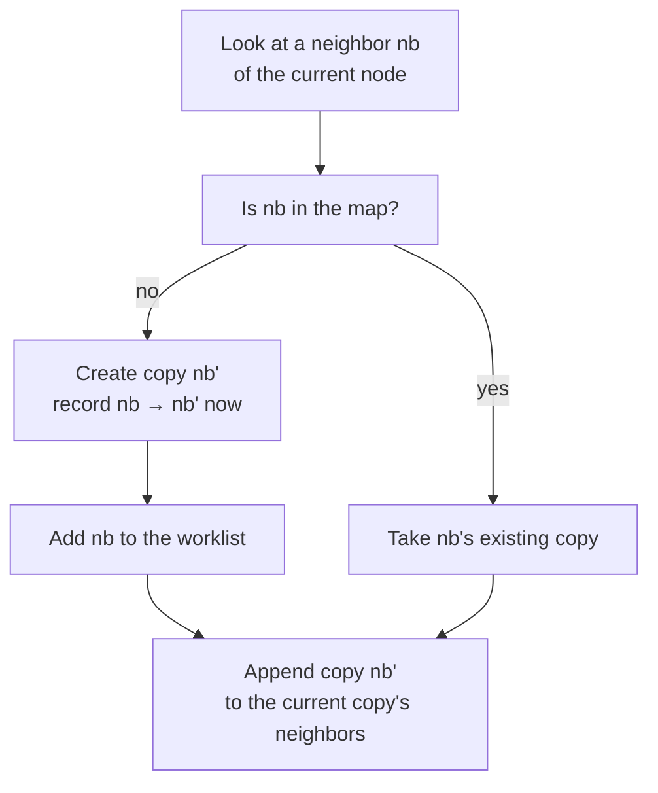

> [!tldr] Quick read
> - The task: given one node of a connected undirected graph, return a **deep copy**: new nodes, new edges, and no object shared with the original.
> - The graph has **cycles**: if 1 links to 2, then 2 links to 1. A naive recursive copy walks 1 → 2 → 1 → 2 forever.
> - The one trick is an [[en/concepts/clone-map|old → new map]]: a [[en/concepts/hash-map|hash map]] from each original node to its copy. When you meet a node that is already in the map, **reuse its existing copy** instead of making another one.
> - Record the copy in the map **as soon as you create it**, before moving on to the neighbors. Record it any later and you still loop forever.
> - Recursive DFS, [[en/concepts/breadth-first-search|BFS]] and iterative DFS all run in `O(V + E)`. The iterative versions don't hit the recursion limit.

> [!info] Context
> LeetCode 133 (Medium) belongs to [[en/posts/2026-11-26-neetcode-graph-bfs|station 2: Graph Traversal and BFS]] on **the NeetCode Line: Graphs**. At [[en/posts/2026-11-26-neetcode-grid-traversal|station 1]], the graph was a grid of squares. This problem uses a "real" graph: each node keeps a list of neighbors, and I have to rebuild the whole network. You only need to know hash maps and queues; graphs are explained right below.

> [!abstract]- Quick glossary for this post (click to open)
> - **Graph**: a set of **nodes** (vertices) and **edges** that join two nodes. In an **undirected** graph an edge works both ways: if 1 links to 2, then 2 links to 1.
> - [[en/concepts/adjacency-list|Adjacency list]]: each node keeps the list of nodes it is linked to. The problem stores the graph exactly this way: `node.neighbors`.
> - **Cycle**: a path that comes back to where it started, such as 1 → 2 → 3 → 1. In an undirected graph, any edge lets you walk back.
> - **Shallow copy**: a new object whose fields still point at the old contents. **Deep copy**: the contents are new too.
> - **Object identity**: two variables pointing at the same object in memory. Two nodes with the same `val` are still two different objects.
> - [[en/concepts/hash-map|Hash map]]: a key → value lookup table with `O(1)` average time.

## Picture it first: building a model of a group of friends

You want to build a model of a group of friends out of figurines. Each real person gets one figurine. If two people are friends, their figurines are joined by a string. The finished model must match the real group exactly, but **no real person may stand in the model**.

You start with the first person, ask "who are your friends?", and go to each friend in turn. The catch: Ann is Ben's friend, so when you reach Ben, Ben points back at Ann. If you carve a new figurine for everyone you meet, you will carve Ann a second time, a third time, forever.

The fix: carry a **notebook** that says "real person → their figurine". When you meet someone, check the notebook first. If they are in it, just tie a string to the existing figurine. If not, carve one, **write it down right away**, and only then go ask about that person's friends.

| Everyday life | Concept |
|---|---|
| A group of friends, each with a list of friends | A graph stored as an [[en/concepts/adjacency-list\|adjacency list]] |
| Ann is Ben's friend, Ben is Ann's friend | An undirected edge, which makes a cycle |
| A person's figurine | The copy of a node |
| Tying a string between two figurines | Adding a copy to another copy's `neighbors` |
| The "real person → figurine" notebook | The [[en/concepts/clone-map\|old → new map]] (a hash map) |
| Writing it down right after carving, before moving on | Recording in the map before visiting the neighbors |
| Putting a real person in the model | Shallow copy: the copy points at an original node |
| The list of people waiting to be asked | The BFS queue or the DFS stack |



## The problem: copying a network with cycles

The problem hands you **one node** of an undirected graph. Each node has a value `val` and a list `neighbors`. Every other node can be reached from it. Build a deep copy and return the copy of the given node. [Problem LC-0133](https://leetcode.com/problems/clone-graph/)

Limits (I checked them on the LeetCode page on 2026-11-26):

- 0 to 100 nodes; 0 nodes means the input is `null`;
- `val` from 1 to 100, a different value for each node;
- no repeated edges, and no edge from a node to itself;
- the graph is connected.

LeetCode describes the graph as a 1-indexed adjacency list: entry `i` is the neighbor list of the node with `val = i + 1`. Here is the "triangle with a tail" I use throughout the page:

```text
1 — 2
 \  |
   3 — 4

adjacency list: [[2,3],[1,3],[1,2,4],[3]]
```

"Deep copy" has three conditions, and the test files check all three:

1. No node of the copy is a node of the original.
2. Each value has **one** node in the copy (don't carve Ann twice).
3. The copy's adjacency list matches the original exactly, neighbor order included.

I used to think it was enough to "walk over every node and create a new one". Two linked nodes show the problem right away: create 1', go to 2, create 2', go from 2 back to 1, create another 1', then go to 2 again... Nothing tells me to stop. What's missing is **memory**: I need to know which original nodes already have a copy, and **which object** that copy is, so I can tie a string to it.

## How it works

<figure class="figure-map" style="--ar: 3 / 4">
<div class="frame"><iframe data-archify="../../diagrams/neetcode-clone-graph/worked-example.en.html" title="Copying a 4-node graph with BFS and an old → new map" loading="lazy"></iframe></div>
<figcaption><span><b>Figure 1.</b> BFS on the triangle with a tail creates exactly 4 copies: each time a node comes up again, the map returns its existing copy.</span><a href="../diagrams/neetcode-clone-graph/worked-example.en.html" target="_blank" rel="noopener">Open full screen</a></figcaption>
</figure>

<details>
<summary>Read the steps</summary>
<ol>
<li>Copy node 1, record it, enqueue. <code>map {1→1'}; queue [1]</code></li>
<li>Take 1: first sight of 2 and 3. <code>create 2', 3'; 1' = [2', 3']</code></li>
<li>Take 2: 1 and 3 already mapped. <code>nothing new; 2' = [1', 3']</code></li>
<li>Take 3: only 4 is new. <code>create 4'; 3' = [1', 2', 4']</code></li>
<li>Take 4: 3 already mapped. <code>4' = [3']</code></li>
<li>Queue empty: return 1', 4 nodes made. <code>map holds 4 entries</code></li>
</ol>
</details>

### The old → new map does two jobs at once

A "visited" set only answers "have I seen this node?". This problem also needs "**which object is its copy?**", because I have to tie a string to exactly that copy. So the map is a map, not a set:

- the **key** is the original node, compared by object identity (not by `val`);
- the **value** is that node's copy.

The map is both the "visited" mark (the key is present) and the place to look up the copy (the value). That's why every solution below has exactly one map.

### Approach 1 — recursive DFS

`visit(old)` returns the copy of `old`:

1. If `old` is already in the map, return its copy right away.
2. If not: create `copy`, **record `old → copy`**, then for each neighbor `nb`, append `visit(nb)` to `copy.neighbors`.

The order inside step 2 matters more than anything else on this page. Trace two nodes 1 ⇄ 2:

| Call | Map on entry | What it does |
|---|---|---|
| `visit(1)` | empty | create 1', record `1→1'`, call `visit(2)` |
| `visit(2)` | `1→1'` | create 2', record `2→2'`, call `visit(1)` |
| second `visit(1)` | `1→1'`, `2→2'` | found in the map: return 1' at once, **the loop stops** |

Swap the order and record the copy **after** the neighbor loop, and on the third row the map is still empty: `visit(1)` creates 1'' and calls `visit(2)` again, until the stack overflows. The test file has this broken version (`wrongMapAfterRecurse`): 2/10 cases passed, only the empty graph and the single node.

Recursion depth equals the longest path DFS walks down. With 100 nodes that's fine. On a straight line of 100,000 nodes (beyond the problem's limits, only for measuring), the recursive version throws `RangeError` in Node, `RecursionError` in Python and `StackOverflowError` in Java; see [[en/concepts/recursion-depth-limit|recursion depth limit]].

### Approach 2 — BFS with a queue

[[en/concepts/breadth-first-search|BFS]] processes nodes in the order they were queued:

1. Create the copy of the start node, record it, and put the start node in the queue.
2. Take a node `old` out. For each neighbor `nb`: if `nb` is not in the map, create its copy, record it and enqueue `nb`. Then, new or not, append `nb`'s copy to the neighbors of `old`'s copy.
3. When the queue is empty, return the start node's copy.

Figure 1 runs exactly this. Look at steps 3 and 5: a node already in the map only gets **a string tied to it**; it is not created again and not queued again. Since each node is created and queued exactly once, the queue never fills up with duplicates.

The copy's neighbor order still matches the original, because for each `old` I walk `old.neighbors` from first to last and append in that same order.

### Approach 3 — iterative DFS with a stack

Exactly like BFS, with the queue swapped for a stack: the node pushed last comes out first. The order in which nodes are **processed** changes, but the neighbor order in each copy does not, because it is set by the `for nb of old.neighbors` loop, not by the order nodes come out. There is no recursion, so it handles the 100,000-node line too.

### Complexity

Let `V` be the number of nodes and `E` the number of edges. Each node is copied once and taken out for processing once. Each undirected edge shows up twice in the adjacency lists (once at each end), and each time costs one `O(1)` average map lookup. Total time is `O(V + E)`. Extra memory: the map holds `V` entries, the queue or stack holds at most `V` nodes, and the recursive version adds a call stack up to `V` deep. The copy itself also takes `O(V + E)`, but that is the result you have to return.

### Measuring beyond the problem's limits

The line 1 — 2 — … — 100,000, from the last run of each file (the machine was running other work at the same time, so read the order, not the decimals):

| Language | Recursive DFS | BFS | Iterative DFS |
|---|---|---:|---:|
| TypeScript | `RangeError` | 34.3 ms | 32.2 ms |
| Python | `RecursionError` | 93.0 ms | 106.6 ms |
| Go | 45.4 ms | 19.2 ms | 19.0 ms |
| Java | `StackOverflowError` | 22.2 ms | 18.8 ms |

Go runs the recursive version because goroutine stacks grow on their own (up to 1 GB on a 64-bit machine). At the problem's real limit (100 nodes), every approach runs in under a millisecond.

## Runnable example

Each file builds 10 graphs (empty, one node, two nodes, a triangle, a square with a diagonal, a star, lines of 5 and 100 nodes, the complete graph on 6 nodes, a random 100-node graph), runs the three correct approaches and four broken ones, and checks the three deep-copy conditions above. On top of that come 500 random graphs of up to 100 nodes for the three correct approaches. All five languages use the same mulberry32 generator, so they build the same graphs. Below is the solution part; the full files also hold the broken versions and the checks.

[TypeScript](../code/neetcode-clone-graph/clone-graph.ts) · [Python](../code/neetcode-clone-graph/clone_graph.py) · [Go](../code/neetcode-clone-graph/clone_graph.go) · [Java](../code/neetcode-clone-graph/clone-graph.java) · [JavaScript](../code/neetcode-clone-graph/clone-graph.js)

```ts
// ---------- Approach 1: recursive DFS with an "old → new" map ----------
function cloneDfs(node: GraphNode | null): GraphNode | null {
  if (node === null) return null;
  const copies = new Map<GraphNode, GraphNode>(); // original node → its copy
  function visit(old: GraphNode): GraphNode {
    const seen = copies.get(old);
    if (seen !== undefined) return seen; // already copied: reuse it, never copy twice
    const copy = new GraphNode(old.val);
    copies.set(old, copy); // record it BEFORE moving on, so a cycle coming back finds it at once
    for (const nb of old.neighbors) copy.neighbors.push(visit(nb));
    return copy;
  }
  return visit(node);
}

// ---------- Approach 2: BFS with an "old → new" map ----------
function cloneBfs(node: GraphNode | null): GraphNode | null {
  if (node === null) return null;
  const copies = new Map<GraphNode, GraphNode>([[node, new GraphNode(node.val)]]);
  const queue: GraphNode[] = [node];
  for (let head = 0; head < queue.length; head++) {
    const old = queue[head];
    const copy = copies.get(old)!;
    for (const nb of old.neighbors) {
      let nbCopy = copies.get(nb);
      if (nbCopy === undefined) {
        nbCopy = new GraphNode(nb.val);
        copies.set(nb, nbCopy); // create the copy on first sight, then enqueue
        queue.push(nb);
      }
      copy.neighbors.push(nbCopy);
    }
  }
  return copies.get(node)!;
}

// ---------- Approach 3: iterative DFS with a stack ----------
function cloneDfsIterative(node: GraphNode | null): GraphNode | null {
  if (node === null) return null;
  const copies = new Map<GraphNode, GraphNode>([[node, new GraphNode(node.val)]]);
  const stack: GraphNode[] = [node];
  while (stack.length > 0) {
    const old = stack.pop()!;
    const copy = copies.get(old)!;
    for (const nb of old.neighbors) {
      let nbCopy = copies.get(nb);
      if (nbCopy === undefined) {
        nbCopy = new GraphNode(nb.val);
        copies.set(nb, nbCopy);
        stack.push(nb);
      }
      copy.neighbors.push(nbCopy);
    }
  }
  return copies.get(node)!;
}
```

```python
# ---------- Approach 1: recursive DFS with an "old → new" map ----------
def clone_dfs(node: Optional[Node]) -> Optional[Node]:
    if node is None:
        return None
    copies: dict[Node, Node] = {}  # original node → copy; the key is the object itself (hashed by id)

    def visit(old: Node) -> Node:
        if old in copies:
            return copies[old]  # already copied: reuse it
        copy = Node(old.val)
        copies[old] = copy  # record it BEFORE moving on
        for nb in old.neighbors:
            copy.neighbors.append(visit(nb))
        return copy

    return visit(node)


# ---------- Approach 2: BFS with an "old → new" map ----------
def clone_bfs(node: Optional[Node]) -> Optional[Node]:
    if node is None:
        return None
    copies = {node: Node(node.val)}
    queue = deque([node])
    while queue:
        old = queue.popleft()
        for nb in old.neighbors:
            if nb not in copies:
                copies[nb] = Node(nb.val)  # create the copy on first sight, then enqueue
                queue.append(nb)
            copies[old].neighbors.append(copies[nb])
    return copies[node]


# ---------- Approach 3: iterative DFS with a stack ----------
def clone_dfs_iterative(node: Optional[Node]) -> Optional[Node]:
    if node is None:
        return None
    copies = {node: Node(node.val)}
    stack = [node]
    while stack:
        old = stack.pop()
        for nb in old.neighbors:
            if nb not in copies:
                copies[nb] = Node(nb.val)
                stack.append(nb)
            copies[old].neighbors.append(copies[nb])
    return copies[node]
```

```go
// ---------- Approach 1: recursive DFS with an "old → new" map ----------
func cloneDfs(node *Node) *Node {
	if node == nil {
		return nil
	}
	copies := map[*Node]*Node{} // the key is a pointer: one entry per original node
	var visit func(old *Node) *Node
	visit = func(old *Node) *Node {
		if c, ok := copies[old]; ok {
			return c // already copied: reuse it
		}
		c := &Node{Val: old.Val}
		copies[old] = c // record it BEFORE moving on
		for _, nb := range old.Neighbors {
			c.Neighbors = append(c.Neighbors, visit(nb))
		}
		return c
	}
	return visit(node)
}

// ---------- Approach 2: BFS with an "old → new" map ----------
func cloneBfs(node *Node) *Node {
	if node == nil {
		return nil
	}
	copies := map[*Node]*Node{node: {Val: node.Val}}
	queue := []*Node{node}
	for head := 0; head < len(queue); head++ {
		old := queue[head]
		for _, nb := range old.Neighbors {
			c, ok := copies[nb]
			if !ok {
				c = &Node{Val: nb.Val} // create the copy on first sight, then enqueue
				copies[nb] = c
				queue = append(queue, nb)
			}
			copies[old].Neighbors = append(copies[old].Neighbors, c)
		}
	}
	return copies[node]
}

// ---------- Approach 3: iterative DFS with a stack ----------
func cloneDfsIterative(node *Node) *Node {
	if node == nil {
		return nil
	}
	copies := map[*Node]*Node{node: {Val: node.Val}}
	stack := []*Node{node}
	for len(stack) > 0 {
		old := stack[len(stack)-1]
		stack = stack[:len(stack)-1]
		for _, nb := range old.Neighbors {
			c, ok := copies[nb]
			if !ok {
				c = &Node{Val: nb.Val}
				copies[nb] = c
				stack = append(stack, nb)
			}
			copies[old].Neighbors = append(copies[old].Neighbors, c)
		}
	}
	return copies[node]
}
```

```java
  // ---------- Approach 1: recursive DFS with an "old → new" map ----------
  static Node cloneDfs(Node node) {
    if (node == null) return null;
    return visit(node, new HashMap<>());
  }

  static Node visit(Node old, Map<Node, Node> copies) {
    Node seen = copies.get(old);
    if (seen != null) return seen; // already copied: reuse it
    Node copy = new Node(old.val);
    copies.put(old, copy); // record it BEFORE moving on
    for (Node nb : old.neighbors) copy.neighbors.add(visit(nb, copies));
    return copy;
  }

  // ---------- Approach 2: BFS with an "old → new" map ----------
  static Node cloneBfs(Node node) {
    if (node == null) return null;
    Map<Node, Node> copies = new HashMap<>();
    copies.put(node, new Node(node.val));
    ArrayDeque<Node> queue = new ArrayDeque<>();
    queue.offer(node);
    while (!queue.isEmpty()) {
      Node old = queue.poll();
      for (Node nb : old.neighbors) {
        Node c = copies.get(nb);
        if (c == null) {
          c = new Node(nb.val); // create the copy on first sight, then enqueue
          copies.put(nb, c);
          queue.offer(nb);
        }
        copies.get(old).neighbors.add(c);
      }
    }
    return copies.get(node);
  }

  // ---------- Approach 3: iterative DFS with a stack ----------
  static Node cloneDfsIterative(Node node) {
    if (node == null) return null;
    Map<Node, Node> copies = new HashMap<>();
    copies.put(node, new Node(node.val));
    ArrayDeque<Node> stack = new ArrayDeque<>();
    stack.push(node);
    while (!stack.isEmpty()) {
      Node old = stack.pop();
      for (Node nb : old.neighbors) {
        Node c = copies.get(nb);
        if (c == null) {
          c = new Node(nb.val);
          copies.put(nb, c);
          stack.push(nb);
        }
        copies.get(old).neighbors.add(c);
      }
    }
    return copies.get(node);
  }
```

```js
// ---------- Approach 1: recursive DFS with an "old → new" map ----------
function cloneDfs(node) {
  if (node === null) return null;
  const copies = new Map(); // original node → its copy
  function visit(old) {
    const seen = copies.get(old);
    if (seen !== undefined) return seen; // already copied: reuse it, never copy twice
    const copy = new GraphNode(old.val);
    copies.set(old, copy); // record it BEFORE moving on, so a cycle coming back finds it at once
    for (const nb of old.neighbors) copy.neighbors.push(visit(nb));
    return copy;
  }
  return visit(node);
}

// ---------- Approach 2: BFS with an "old → new" map ----------
function cloneBfs(node) {
  if (node === null) return null;
  const copies = new Map([[node, new GraphNode(node.val)]]);
  const queue = [node];
  for (let head = 0; head < queue.length; head++) {
    const old = queue[head];
    const copy = copies.get(old);
    for (const nb of old.neighbors) {
      let nbCopy = copies.get(nb);
      if (nbCopy === undefined) {
        nbCopy = new GraphNode(nb.val);
        copies.set(nb, nbCopy); // create the copy on first sight, then enqueue
        queue.push(nb);
      }
      copy.neighbors.push(nbCopy);
    }
  }
  return copies.get(node);
}

// ---------- Approach 3: iterative DFS with a stack ----------
function cloneDfsIterative(node) {
  if (node === null) return null;
  const copies = new Map([[node, new GraphNode(node.val)]]);
  const stack = [node];
  while (stack.length > 0) {
    const old = stack.pop();
    const copy = copies.get(old);
    for (const nb of old.neighbors) {
      let nbCopy = copies.get(nb);
      if (nbCopy === undefined) {
        nbCopy = new GraphNode(nb.val);
        copies.set(nb, nbCopy);
        stack.push(nb);
      }
      copy.neighbors.push(nbCopy);
    }
  }
  return copies.get(node);
}
```

Running `node clone-graph.ts`:

```text
cloneDfs             10/10 cases passed
cloneBfs             10/10 cases passed
cloneDfsIterative    10/10 cases passed
wrongShallow         2/10 cases passed; failing: two linked nodes → shares a node with the original, triangle 1-2-3 → shares a node with the original and 6 other cases
wrongNoMap           2/10 cases passed; failing: two linked nodes → throws RangeError, triangle 1-2-3 → throws RangeError and 6 other cases
wrongMapAfterRecurse 2/10 cases passed; failing: two linked nodes → throws RangeError, triangle 1-2-3 → throws RangeError and 6 other cases
wrongSetOnly         2/10 cases passed; failing: two linked nodes → node 1 copied 2 times, triangle 1-2-3 → node 1 copied 3 times and 6 other cases
500 random graphs: all three correct approaches pass 500/500
wrongSetOnly on the complete graph on 6 nodes: created 31 nodes instead of 6
line of 100,000 nodes, cloneDfs: throws RangeError
line of 100,000 nodes, cloneBfs: correct, 34.3 ms
line of 100,000 nodes, cloneDfsIterative: correct, 32.2 ms
clone-graph: all correct approaches pass
```

*(Output labels translated; the files themselves print Vietnamese.)*

The other four files print the same pass counts. The only difference is how the endlessly recursive broken versions die: Python throws `RecursionError`, Java throws `StackOverflowError`. Go cannot catch a stack overflow (the program dies outright with `fatal error: stack overflow`), so the Go file stops those two broken versions at depth 10,000 with `panic` and `recover`, and prints "đệ quy quá 10000 tầng (đi vòng mãi)" ("recursed past 10000 levels (looping forever)").

## Misconceptions and common traps

- **"Create a new node; copy the neighbors later."** `wrongShallow` creates a new node for the start but keeps the old `neighbors` array. The copy points straight at original nodes: 2/10 cases passed, failing every graph with an edge. Change a node of the "copy" and you change the original.

  ```ts
  return new GraphNode(node.val, node.neighbors); // new node, but its neighbors are OLD nodes
  ```

- **No map.** `wrongNoMap` walks 1 → 2 → 1 → … until the stack overflows, even on two nodes. An undirected graph with an edge has a cycle, so this version only passes the empty graph and the single node.
- **Recording the copy after visiting the neighbors.** There is a map, yet it still loops forever, as the table in Approach 1 shows. Record the copy right after creating it.
- **A "visited" set instead of a map.** `wrongSetOnly` knows a node was seen but not which object its copy is, so it makes a fresh empty node. On the complete graph on 6 nodes it creates **31** nodes instead of 6; on the random 100-node graph, node 1 is copied 11 times.
- **Keying the map by value.** Here the `val`s are distinct, so keying by `val` happens to work. That's luck: real graphs often have two nodes with the same label. Keying by the node object itself is right in every case.
- **Forgetting the `null` case.** A graph with 0 nodes arrives as `null`. Every approach checks it on the first line.
- **Python: `@dataclass` for the node.** `@dataclass` generates `__eq__` and therefore sets `__hash__ = None`; using a node as a dict key throws `TypeError: unhashable type`. A plain class hashes by `id`, which is exactly what you want. Also don't write `neighbors=[]` as a default argument: every node would share one list.
- **Python: the recursion limit.** It defaults to about 1000 levels. Enough for 100 nodes, but for longer graphs pick BFS or iterative DFS.
- **Java: `record` for the node.** A `record` generates `hashCode` from every field, the neighbor list included. On a graph with a cycle, computing `hashCode` walks 1 → 2 → 1 → … and throws `StackOverflowError` as soon as you `put` it into a `HashMap`. The Java file prints exactly this error. A plain class that doesn't override `equals`/`hashCode` compares by identity.
- **Go: map keys must be comparable.** `map[*Node]*Node` keys by pointer, which is identity. `map[Node]*Node` doesn't compile, because `Node` has a slice field and slices can't be compared with `==`.
- **JavaScript/TypeScript: a plain object as the map.** `{}` turns every key into a string, so every node becomes `"[object Object]"` and they overwrite each other. Use `Map`, which keeps the object itself as the key.

## Self-check questions

> [!question]- Why isn't a "visited" set enough? Why does it have to be a map?
> When a node comes up again, I have to tie a string to **its existing copy**. A set only says "seen"; it doesn't say where the copy is. A map answers both.

> [!question]- In recursive DFS, do you record the copy before or after the neighbor loop? Why?
> Before. A neighbor will come back to the current node through the reverse edge; if the node isn't in the map yet, that call creates a second copy and loops forever.

> [!question]- BFS and iterative DFS process nodes in different orders. Does the neighbor order in the copy differ?
> No. Each copy's neighbor order is set by the `for nb of old.neighbors` loop, which always walks the original list from first to last.

> [!question]- A graph has `V` nodes and `E` undirected edges. How many map lookups happen in total?
> About `2E`, because each edge sits in the adjacency lists of both its ends. Add the `V` copies created, and the total time is `O(V + E)`.

## References

- [LeetCode · Clone Graph](https://leetcode.com/problems/clone-graph/): input limits and the adjacency-list format.
- [Princeton · Breadth-first paths](https://github.com/kevin-wayne/algs4/blob/master/src/main/java/edu/princeton/cs/algs4/BreadthFirstPaths.java): mark a vertex when it enters the queue.
- [Python · copy](https://docs.python.org/3/library/copy.html): `deepcopy` also uses a `memo` dict from the original object's `id` to its copy, which is exactly the old → new map.
- [Python · dataclasses](https://docs.python.org/3/library/dataclasses.html): with `eq=True` and no `frozen`, `__hash__` is set to `None`.
- [Java · Record](https://docs.oracle.com/en/java/javase/21/docs/api/java.base/java/lang/Record.html): `hashCode` is derived from every component of the record.
- [Go spec · Map types](https://go.dev/ref/spec#Map_types): keys must be comparable with `==`.
