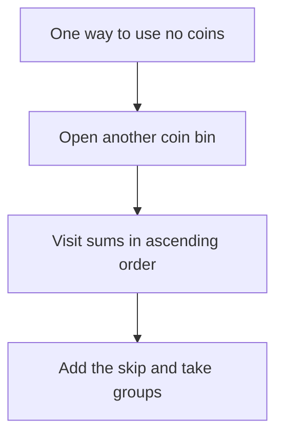

> [!tldr] Quick read
> - The number of copies of each denomination identifies a combination. Rearranging its coins preserves the combination.
> - When adding denomination `c`, a way to reach sum `s` either skips `c` or uses one copy and solves `s − c` with the same denomination set.
> - The 1D array loops over denominations outside and ascending sums inside. Ascending order lets the current pass read results that already use `c`.
> - The 32-bit bound applies to the final answer. I cap the counters at that limit to protect addition when an intermediate entry grows larger.

> [!info] Context
> LeetCode 518 belongs to [[en/posts/2026-11-27-neetcode-knapsack|station 3, “Knapsack and Coin Change”]] on the NeetCode Dynamic Programming line. I picture a counter with a bin that holds plenty of coins for each denomination. A cashier wants to count the multisets of coins that settle the bill exactly. You only need to read arrays and loops.

> [!abstract]- Quick glossary for this post (click to open)
> - A denomination is the value marked on a coin.
> - A [[en/concepts/coin-combinations|coin combination]] can be recorded as a list of counts, with one entry per denomination.
> - [[en/concepts/unbounded-knapsack|Unbounded knapsack]] allows several copies of an item type.
> - The [[en/concepts/knapsack-update-order|update order]] determines whether a source entry belongs to the preceding or current pass.

## Picture it first: logging coins from each bin

The counter has bins for 2, 3, and 5. The bill is 8. I record only how many coins came from each bin. A slip with one 3 and one 5 counts once, whichever coin I pick up first.

| Everyday life | Concept |
| --- | --- |
| How many coins came from each bin | A combination |
| A table with only the first few bins available | One row of DP |
| Add a coin from the bin just opened | Read a smaller sum from the same row |



## The problem: count multisets of coins with the same total

There are 1 to 300 distinct denominations, each from 1 to 5,000. Each denomination can be reused any number of times. Given a total `A` from 0 to 5,000, return the number of multisets of coins that add up to it exactly. The **final answer** is guaranteed to fit in a signed 32-bit integer.

For example, `A = 8` with denominations `[2, 3, 5]` has three valid slips. They are `2 + 2 + 2 + 2`, `2 + 3 + 3`, and `3 + 5`. If I record the order of selection as well, these slips produce 1, 3, and 2 sequences respectively. CSES’s [Coin Combinations I](https://cses.fi/problemset/task/1635) illustrates the sequence-counting version.

## How it works

### Enumerate the number of copies

For each denomination `c`, try taking from 0 to `floor(s / c)` copies, then move on to the next denomination with the amount `s` still outstanding. Once all bins have been considered, a branch with zero left contributes one way. A path through the tree identifies one set of counts. This provides an oracle for small inputs. With `n` denominations, a loose upper bound is `O(n(A + 1)^n)` time and `O(n)` stack space.

### Build a table indexed by open bins

Let `D[i][s]` be the number of ways to form sum `s` using the first `i` denominations. With all bins closed, `D[0][0] = 1`, and all positive sums have zero ways. When adding denomination `c`, the group that skips it has `D[i − 1][s]` ways. Removing one copy of `c` from each remaining slip gives a bijection with the `D[i][s − c]` ways. The remainder may still use `c`, so the second term is in **row i**. The second group is empty when `s < c`.

| Bin just opened | 0 | 2 | 3 | 5 | 6 | 8 |
| --- | ---: | ---: | ---: | ---: | ---: | ---: |
| No bins open | 1 | 0 | 0 | 0 | 0 | 0 |
| 2 | 1 | 1 | 0 | 0 | 1 | 1 |
| 3 | 1 | 1 | 1 | 1 | 2 | 2 |
| 5 | 1 | 1 | 1 | 2 | 2 | 3 |

The illustration shows selected sums. The full table has `n + 1` rows and `A + 1` columns. Filling it takes `O(n(A + 1))` time and that many counter cells.

### Fold the table into one array

When the pass for denomination `c` visits sum `s`, `ways[s]` still holds the preceding row’s value. Since sums ascend, `ways[s − c]` already holds the current row’s value. The operands match the two groups in the 2D recurrence. After the pass, the entire array holds the new row. The answer is `ways[A]`. Each denomination adds one pass, so the proof also applies when the input is unsorted.

The update count is the sum of `max(0, A − c + 1)` over denominations. Time is bounded by `O(n(A + 1))`, and the array uses `O(A + 1)` counter cells. Putting sums outside counts sequences by choosing the *last coin*. Keeping denominations outside and visiting sums in descending order allows just one copy per pass, as in 0/1 knapsack.

### Cap counters at the problem limit

Let `L = 2³¹ − 1`. For nonnegative counts `u, v`, `min(L, min(L, u) + min(L, v)) = min(L, u + v)`. Capping every addition at `L` therefore stores the correct capped value at every entry. The answer falls in `[0, L]`, so it comes out exact.

One test uses 299 even denominations from 2 through 598, plus a 4,999 coin. I computed entry 4,998 separately with exact Python integers and got roughly `2.76 × 10⁵¹` ways. Entry 4,999 still has exactly one way. An odd total requires the 4,999 coin, which already fills the entire amount.

## Runnable example

The tabs excerpt the 1D implementation. In these files, `LIMIT` or `limit` is 2,147,483,647. The TypeScript and JavaScript files return the whole array for inspection. Their checks read the answer at index `amount`. The other files return the answer directly. Each file checks the same 10 cases with both DP approaches and runs enumeration for small sums.

[TypeScript](../code/neetcode-coin-change-ii/combinations.ts) · [Python](../code/neetcode-coin-change-ii/combinations.py) · [Go](../code/neetcode-coin-change-ii/combinations.go) · [Java](../code/neetcode-coin-change-ii/combinations.java) · [JavaScript](../code/neetcode-coin-change-ii/combinations.js) · [PHP](../code/neetcode-coin-change-ii/combinations.php) · [Rust](../code/neetcode-coin-change-ii/combinations.rs)

```ts
function countCombinations(amount: number, coins: number[]): number[] {
  const ways = Array<number>(amount + 1).fill(0)
  ways[0] = 1
  for (const coin of coins) {
    for (let total = coin; total <= amount; total++) {
      ways[total] = Math.min(LIMIT, ways[total] + ways[total - coin])
    }
  }
  return ways
}
```

```python
def count_combinations(amount, coins):
    ways = [1] + [0] * amount
    for coin in coins:
        for total in range(coin, amount + 1):
            ways[total] = min(LIMIT, ways[total] + ways[total - coin])
    return ways[amount]
```

```go
func countCombinations(amount int, coins []int) int64 {
	ways := make([]int64, amount+1)
	ways[0] = 1
	for _, coin := range coins {
		for total := coin; total <= amount; total++ {
			ways[total] = min(limit, ways[total]+ways[total-coin])
		}
	}
	return ways[amount]
}
```

```java
static int countCombinations(int amount, int[] coins) {
    int[] ways = new int[amount + 1];
    ways[0] = 1;
    for (int coin : coins) {
        for (int total = coin; total <= amount; total++) {
            ways[total] = (int) Math.min(Integer.MAX_VALUE,
                (long) ways[total] + ways[total - coin]);
        }
    }
    return ways[amount];
}
```

```js
function countCombinations(amount, coins) {
  const ways = Array(amount + 1).fill(0)
  ways[0] = 1
  for (const coin of coins) {
    for (let total = coin; total <= amount; total++) {
      ways[total] = Math.min(LIMIT, ways[total] + ways[total - coin])
    }
  }
  return ways
}
```

```php
function countCombinations(int $amount, array $coins): int
{
    $ways = array_fill(0, $amount + 1, 0);
    $ways[0] = 1;
    foreach ($coins as $coin) {
        for ($total = $coin; $total <= $amount; $total++) {
            $ways[$total] = min(LIMIT, $ways[$total] + $ways[$total - $coin]);
        }
    }
    return $ways[$amount];
}
```

```rust
fn count_combinations(amount: usize, coins: &[usize]) -> i32 {
    let mut ways = vec![0_i32; amount + 1];
    ways[0] = 1;
    for &coin in coins {
        for total in coin..=amount {
            ways[total] = ways[total].saturating_add(ways[total - coin]);
        }
    }
    ways[amount]
}
```

TypeScript and JavaScript also cross-check enumeration on every nonempty subset of denominations 1 through 6 and every amount from 0 through 20. Both count the actual cells they allocate for the 4,999 test using array lengths. The metric is measured in counter cells, so it stays consistent across runtimes with different array representations.

```text
10/10 cases passed
Brute-force cross-check: 1323 cases
Counter cells: 2D table 1505000, 1D array 5000
Capped entry 4998: 2147483647; answer for 4999: 1
```

*(Output labels translated; the files themselves print Vietnamese.)*

The other five files print `10/10 cases passed`. Run with `node combinations.ts`, `python3 combinations.py`, `go run combinations.go`, `java combinations.java`, `node combinations.js`, `php -d xdebug.mode=off combinations.php`, or `rustc --edition 2021 -O combinations.rs -o /tmp/combinations-rs && /tmp/combinations-rs`.

## Misconceptions and common traps

- Initializing the zero-sum entry to zero loses the empty slip. Then there is no way to append the first coin.
- Java must widen an operand to `long` **before** adding. Rust uses `saturating_add` on `i32`. Go stores counts as `int64`. A 64-bit PHP integer has room for the temporary sum.
- JavaScript and TypeScript keep the sum below `2³²` by capping both operands, so `Number` is exact here. Python supports arbitrary-size integers. The Python example uses the same cap as the other implementations.
- Repeated denominations create two count coordinates for the same coin type and overcount. The problem guarantees distinct denominations.

## Self-check questions

> [!question]- With coin 4 and total 12, which row does entry 8 belong to when updating entry 12?
> It belongs to the current row for coin 4. Entry 8 already includes a way with two copies of 4. Adding one more copy creates a way to form 12.

> [!question]- Why does adding coin 5 to a way to form 3 give exactly one new slip for total 8?
> Any slip for 8 that uses a 5 returns to exactly one slip for 3 when one 5 is removed. The counts of the other denominations stay the same.

> [!question]- Does another entry exceeding 32 bits force the answer to exceed 32 bits?
> Entries propagate through their valid dependency edges. With even coins, a large count for an even amount can coexist with zero at every odd amount.

## References

- [LeetCode 518, original problem](https://leetcode.com/problems/coin-change-ii/)
- [Shubham Chatterjee’s CS 2500 lecture on unbounded knapsack and Coin Change II](https://shubham-chatterjee-mst.github.io/assets/pdf/cs2500-2024-2/lectures/Lecture26.pdf)
- [CSES Coin Combinations I, counting ordered sequences](https://cses.fi/problemset/task/1635)
