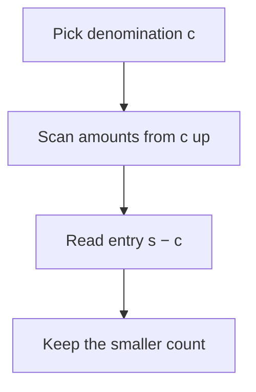

> [!tldr] Quick read
> - `dp[s]` records the fewest coins needed to make exactly `s`. A final coin of value `c` leads to the subproblem at `s − c`.
> - I initialize `dp[0] = 0` and mark unreachable amounts as `A + 1`, where `A` is the target.
> - Either amount or denomination can be the outer loop. With denomination outside, scan amounts upward to reuse results that already include the current coin.

> [!info] Context
> This is LeetCode 322 at [[en/posts/2026-11-27-neetcode-knapsack|DP-03 Knapsack and Coin Change]] on the [[en/series/neetcode-dp|NeetCode Dynamic Programming Line]]. I picture a cashier making exact change with as few coins as possible. You only need arrays and loops.

> [!abstract]- Quick glossary for this post (click to open)
> - A [[en/concepts/knapsack-state|knapsack state]] identifies the exact amount a subproblem asks about and the kinds of items available to it.
> - [[en/concepts/unbounded-knapsack|Unbounded knapsack]] allows repeated picks of each item type.
> - [[en/concepts/memoization|Memoization]] saves a subproblem's result for later calls to reuse.
> - A sentinel is a special value that represents an unreachable amount. I use `A + 1`.

## Picture it first: a change tray

The cashier has a drawer for each denomination and a ledger with the fewest coins found for each amount. To work out a new amount, I try putting down one last coin and look up the remainder. When I work through a whole drawer, I start at the smallest amounts. That lets the same type of coin appear again later in the pass.

| Everyday life | Concept |
|---|---|
| Ledger entry for change amount `s` | State `dp[s]` |
| Empty tray for amount zero | Base case `dp[0] = 0` |
| Add a coin of value `c` | Candidate `dp[s − c] + 1` |
| Pull from the same drawer repeatedly | Unbounded knapsack |
| Fill ledger entries in increasing order | [[en/concepts/knapsack-update-order|DP update order]] |



## The problem: give exact change with the fewest coins

There are 1 to 12 positive integer denominations, each at most `2³¹ − 1`. The target amount `A` ranges from 0 to 10,000. Any denomination can be used arbitrarily many times. Return the fewest coins that make exactly `A`, or `-1` if exact change is impossible.

With denominations 1, 5, and 7, choosing the largest coin first to pay 10 gives `7 + 1 + 1 + 1`. Two coins of value 5 make the same amount and reduce the count from 4 to 2. With denominations 4 and 7, amount 13 is unreachable even though there are coins smaller than the target.

## How it works

### Split by the last coin

Let `f(s)` be the minimum number of coins needed to make exactly `s` from all denominations. When `s > 0`, a valid solution has a final coin `c ≤ s`. Removing it leaves the subproblem at `s − c`. If the remainder had a solution with fewer coins, substituting it would improve the original solution. Conversely, adding `c` to any valid solution for `s − c` yields exactly `s`. Together these facts give `f(s) = min(f(s − c) + 1)` over denominations with `c ≤ s`.

Every coin is worth at least 1, so a reachable amount `s ≤ A` needs at most `A` coins. I use `A + 1` as the sentinel, set `f(0) = 0`, and compare a candidate with the sentinel when the destination has no solution yet. Adding 1 to an unreachable predecessor gives `A + 2`. Taking the minimum leaves the destination at the sentinel if there is still no valid candidate. The function converts that sentinel to `-1` at the end.

### From a call tree to a table

Brute force opens a branch for every coin that fits the remainder. The same amount can be visited more than once. From 10, taking 1 then 5 leaves 4, and taking 5 then 1 also leaves 4. Memoization saves both finite answers and the sentinel so future calls can reuse results for impossible amounts too.

The amount-first table loops through `s = 1…A` on the outside. All coins are positive, so entry `s − c` is already final when I fill entry `s`. This follows the dependencies of the recurrence and avoids a recursion stack on large amounts.

### Swap the two loop levels

Let `D(i, s)` be the fewest coins needed to make `s` with the first `i` denominations. On adding denomination `c`, either keep `D(i − 1, s)` or take at least one `c` and extend `D(i, s − c) + 1`. The second alternative reads **the current row i** because the remainder can still use `c`. When both rows share one array, scan `s` upward so the source entry is already from the current pass.

For denominations 4 then 7 with `A = 14`, the pass for 4 reaches amounts 4, 8, and 12. The pass for 7 sets `dp[7] = 1` and immediately reuses that entry to set `dp[14] = 2`. A downward scan would read entry 7 before this pass had updated it, so each denomination could only be used once in that pass.

Both increasing loop orders give the minimum. Amount-first can encounter the same coins in different orders, and repeating a candidate leaves the minimum unchanged. In [[en/problems/coin-change-ii|Coin Change II]], the operation adds **counts** and duplicates change the result.

Let `k` be the number of denominations and `d = floor(A / min(coins))` the maximum depth of the call tree in edges. The table uses space linear in the target's value. Time depends on `A`, while its binary representation takes about `log A` bits. This is pseudopolynomial complexity.

| Approach | Time | Auxiliary space |
|---|---|---|
| Brute force | O(k · (1 + k + … + kᵈ)) for the tree and denomination checks | O(A), including the stack |
| Recursion with memoization | O(kA) | O(A), for the memo and stack |
| Amount-first or denomination-first table | O(kA) | O(A) |

## Runnable example

Each file runs both tabulations on all 10 cases. The cases cover amount zero, impossible amounts, a denomination larger than the target, and a target of 10,000. The recursive versions run on smaller inputs. The tabs show the denomination-first loop from those files.

[TypeScript](../code/neetcode-coin-change/min_coins.ts) · [Python](../code/neetcode-coin-change/min_coins.py) · [Go](../code/neetcode-coin-change/min_coins.go) · [Java](../code/neetcode-coin-change/min_coins.java) · [JavaScript](../code/neetcode-coin-change/min_coins.js) · [PHP](../code/neetcode-coin-change/min_coins.php) · [Rust](../code/neetcode-coin-change/min_coins.rs)

```ts
function minCoins(coins: number[], amount: number) {
    const impossible = amount + 1
    const dp = Array(amount + 1).fill(impossible)
    dp[0] = 0

    for (const coin of coins) {
        for (let sum = coin; sum <= amount; sum++) {
            dp[sum] = Math.min(dp[sum], dp[sum - coin] + 1)
        }
    }
    return dp[amount] === impossible ? -1 : dp[amount]
}
```

```python
def min_coins(coins, amount):
    impossible = amount + 1
    dp = [impossible] * (amount + 1)
    dp[0] = 0
    for coin in coins:
        for total in range(coin, amount + 1):
            dp[total] = min(dp[total], dp[total - coin] + 1)
    return -1 if dp[amount] == impossible else dp[amount]
```

```go
func minCoins(coins []int, amount int) int {
	impossible := amount + 1
	dp := make([]int, amount+1)
	for sum := 1; sum <= amount; sum++ {
		dp[sum] = impossible
	}

	for _, coin := range coins {
		for sum := coin; sum <= amount; sum++ {
			dp[sum] = min(dp[sum], dp[sum-coin]+1)
		}
	}
	if dp[amount] == impossible {
		return -1
	}
	return dp[amount]
}
```

```java
static int minCoins(int[] coins, int amount) {
    int impossible = amount + 1;
    int[] dp = new int[amount + 1];
    Arrays.fill(dp, impossible);
    dp[0] = 0;

    for (int coin : coins) {
        for (int sum = coin; sum <= amount; sum++) {
            dp[sum] = Math.min(dp[sum], dp[sum - coin] + 1);
        }
    }
    return dp[amount] == impossible ? -1 : dp[amount];
}
```

```js
function minCoins(coins, amount) {
    const impossible = amount + 1
    const dp = Array(amount + 1).fill(impossible)
    dp[0] = 0

    for (const coin of coins) {
        for (let sum = coin; sum <= amount; sum++) {
            dp[sum] = Math.min(dp[sum], dp[sum - coin] + 1)
        }
    }
    return dp[amount] === impossible ? -1 : dp[amount]
}
```

```php
function minCoins(array $coins, int $amount): int {
    $impossible = $amount + 1;
    $dp = array_fill(0, $amount + 1, $impossible);
    $dp[0] = 0;

    foreach ($coins as $coin) {
        for ($sum = $coin; $sum <= $amount; $sum++) {
            $dp[$sum] = min($dp[$sum], $dp[$sum - $coin] + 1);
        }
    }
    return $dp[$amount] === $impossible ? -1 : $dp[$amount];
}
```

```rust
fn min_coins(coins: &[usize], amount: usize) -> i32 {
    let impossible = amount + 1;
    let mut dp = vec![impossible; amount + 1];
    dp[0] = 0;

    for &coin in coins {
        for sum in coin..=amount {
            dp[sum] = dp[sum].min(dp[sum - coin] + 1);
        }
    }
    if dp[amount] == impossible {
        -1
    } else {
        dp[amount] as i32
    }
}
```

With denominations 4, 6, and 9 and target 36, the counter increments on each entry to the recursive function, including memo hits and calls that reach zero. Both versions return 4 coins. All seven files report the same counts.

```text
10/10 cases passed
A=36: brute force 804, memoization 75 calls
```

*(Output labels translated; the files themselves print Vietnamese.)*

## Misconceptions and common traps

- Save the return value `-1` for the final step. Using it in the recurrence would make `-1 + 1` look like a solution with zero coins. The sentinel `A + 1` also avoids adding to `Integer.MAX_VALUE` in Java or equivalent limits in other fixed-width integer types.
- Denominations can be very large, and the table still needs only `A + 1` entries. The denomination-first loop is empty when its lower bound exceeds `A`. In amount-first order, check `coin <= sum` before subtracting, especially with Rust's `usize` index type.
- A downward scan is suitable when [[en/concepts/zero-one-knapsack|each item can be used once]]. Coins are reusable here, so scan upward within each denomination.
- Memoization cuts repeated work. The recursion depth can still equal the target with a coin of value 1. Use iterative tabulation to avoid recursion limits, especially in Python and JavaScript.

## Self-check questions

> [!question]- Why is `dp[0]` equal to zero?
> The empty tray already makes exactly zero with zero coins. This value lets the table mark the amount of any one denomination as reachable with one coin.

> [!question]- With only the coin 7, where does `dp[14]` get its value?
> The increasing scan has already set `dp[7] = dp[0] + 1 = 1`. The later step reads that newly written value and adds 1.

> [!question]- Can I stop once I find my first solution for the target?
> The first branch can use more coins than a later one because the branches are not ordered by total coin count. The table examines the remaining candidates and keeps the minimum.

## References

- Problem statement and input constraints. [LeetCode 322, Coin Change](https://leetcode.com/problems/coin-change/)
- The last-coin recurrence and pseudopolynomial cost. [MIT 6.046J, Recitation 5](https://live.ocw.mit.edu/courses/6-046j-design-and-analysis-of-algorithms-spring-2015/d187472426117c2ebec700a22c209b3f_MIT6_046JS15_Recitation5.pdf)
- Amount-first tabulation and the limits of taking the largest coin first. [Princeton COS 226, Dynamic Programming](https://www.cs.princeton.edu/courses/archive/fall24/cos226/lectures/DynamicProgramming.pdf)
