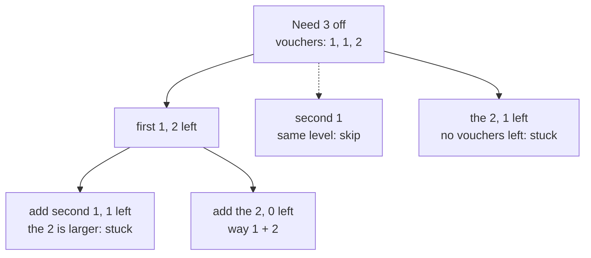
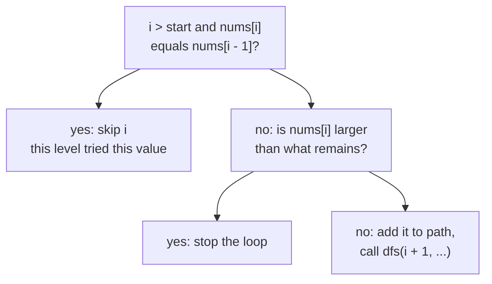

> [!tldr] Quick read
> - It differs from [[en/problems/combination-sum|Combination Sum]] in two ways: each **position** may be used only once, and the array may contain **duplicates**.
> - Used once, so recurse with `i + 1`. Keep the [[en/concepts/start-index|start index]] so a bag is not printed in several orders.
> - Duplicates make the same bag appear several times (two 1s at different positions, but equal). Sort so equal values sit next to each other, then on **the same level** try only the first copy: skip when `i > start && nums[i] == nums[i - 1]`.
> - The condition is `i > start`, not `i > 0`: on a deeper level the second copy may still be chosen, which is how you get bags like `[2, 2]`.
> - Deduplicating with a set is also correct, but with twenty 1s and target 10 it makes 616,666 calls against 11 for same-level skipping.

> [!info] Context
> This is LeetCode problem 40 at [[en/posts/2026-11-28-neetcode-subsets-combinations|station MISC-01: Backtracking: Subsets and Combinations]] on **the NeetCode Line: Mixed Techniques**. I picture a box of discount vouchers: each can be used once, and several have the same value. You only need arrays, sorting and recursive functions; reading the Combination Sum page first makes this easier.

> [!abstract]- Quick glossary for this post (click to open)
> - [[en/concepts/backtracking|Backtracking]]: add a choice, go deeper, then remove it to try another.
> - [[en/concepts/choice-tree|Choice tree]]: each node is a partial solution, each edge is one choice.
> - A **level** of the tree: all the choices one node can add next. In the code, those are the iterations of the `for i` loop in a single `dfs(start, …)` call.
> - [[en/concepts/start-index|Start index]] `start`: only pick elements at position `start` or later.
> - [[en/concepts/duplicate-skipping|Duplicate skipping on a sorted array]]: equal values sit next to each other, so comparing with the previous element is enough.
> - [[en/concepts/zero-one-knapsack|0/1 knapsack]]: the family of problems where each item is used at most once; there we usually count or optimize, here we list.

## Picture it first: a box of discount vouchers

I have vouchers worth 1, 1 and 2 thousand and want a discount of exactly 3 thousand. Each voucher can be used once. The first 1 plus the 2 gives 3 thousand, the second 1 plus the 2 also gives 3 thousand, but to the cashier it is **the same way**: "one 1-voucher, one 2-voucher". The trick is to sort the vouchers by value, then whenever I choose "which voucher comes next", name each value only once.

| Everyday life | Concept |
|---|---|
| Each voucher can be used once | Recurse with `i + 1` |
| Sort the vouchers by value | Sort `candidates` |
| When choosing the next voucher, name each value once | Skip `nums[i]` if `i > start` and `nums[i] == nums[i - 1]` |
| Already holding one 1-voucher, I may still take the other | On a deeper level `i == start`, so it is not skipped |
| This voucher is already larger than the discount still needed | Sort, then `break` |
| Write down every way, then cross out repeats | Deduplicate with a set |



Without skipping the "second 1" branch on the first level, it would go on to the 2 and print `[1, 2]` again. I ran the version without skipping on `[1, 1, 2]` with target 3: the result was `[[1, 2], [1, 2]]`.

## The problem: distinct combinations when each element is used once

You get an array `candidates` of 1 to 100 integers, each from 1 to 50, possibly with repeats, and a `target` from 1 to 30. Return every **distinct** combination whose sum is exactly `target`, where each element of the array is used at most once. Two combinations with the same values (even taken from different positions) count once. For example, `[3, 1, 3, 5, 1, 1]` with target 8 has three combinations: `[1, 1, 1, 5]`, `[1, 1, 3, 3]` and `[3, 5]`. [Original problem: LeetCode 40](https://leetcode.com/problems/combination-sum-ii/)

I used to think I only had to take the Combination Sum solution, change `i` to `i + 1`, and drop the duplicate answers into a set. That gives the right answer. The problem is that it still walks every duplicate branch before crossing it out, and there can be far more duplicate branches than answers.

## How it works

### Enumerate every subset

Each element has two states: taken or not. Walk all 2ⁿ bitmasks, keep the subsets whose sum is the target, sort each one and deduplicate. With n = 100 this is impossible, so I use it only as a referee on arrays of at most 6 elements.

### Backtracking with single use, deduplicated with a set

Sort the array, then build the tree as in Combination Sum but call `dfs(i + 1, …)`. Each `path` is a strictly increasing sequence of positions, that is, a subset of positions. Because the array is sorted, two subsets with the same values produce the same `path`, so putting `path` into a set is enough to deduplicate. `break` when a number exceeds what remains still works as before.

The cost: each duplicate opens its own branch. With twenty 1s and target 10, the tree visits every subset of the 20 positions with sum at most 10, that is C(20,0) + C(20,1) + … + C(20,10) = 616,666 nodes, just to print the single answer `[1 × 10]`.

### Skip duplicates on the same level

At one node, the loop `for i from start` lists the choices for the **next** element of `path`. If `nums[i] == nums[i - 1]` and `i - 1` also belongs to this loop (that is, `i > start`), then the branch for `i` produces exactly the bags the branch for `i - 1` already produced, since after `i - 1` there are even more elements to choose from. Skipping it loses no answer.

The condition has to be `i > start`. When `i == start`, the element `i - 1` (if equal) is the one just chosen on the level above, not a choice on the same level. Taking it as well is valid: the bag `[2, 2]` needs both 2s. I tried writing `i > 0` with `[2, 2, 2]` and target 4: the result was empty instead of `[[2, 2]]`.



**Complexity.** Sorting costs O(n log n). After skipping duplicates, each node of the tree is a distinct bag of values whose sum does not exceed the target. The worst case (all values distinct) can still be O(2ⁿ) nodes, and each answer costs an extra O(n) to copy. Since every number is ≥ 1 and the target is ≤ 30, a root-to-leaf path is at most 30 levels deep, so the stack and `path` take O(min(n, target)). With twenty 1s and target 10, the skipping version makes only 11 calls: each level has exactly one choice left.

## Runnable example

[TypeScript](../code/neetcode-combination-sum-ii/once.ts) · [Python](../code/neetcode-combination-sum-ii/once.py) · [Go](../code/neetcode-combination-sum-ii/once.go) · [Java](../code/neetcode-combination-sum-ii/once.java) · [JavaScript](../code/neetcode-combination-sum-ii/once.js) · [PHP](../code/neetcode-combination-sum-ii/once.php) · [Rust](../code/neetcode-combination-sum-ii/combination_sum_once.rs)

```ts
// Sort, skip duplicates on the same level, stop once a number exceeds what remains.
function combinationSum2(candidates: number[], target: number): number[][] {
    const nums = [...candidates].sort((a, b) => a - b)
    const out: number[][] = []
    const path: number[] = []
    const dfs = (start: number, remain: number): void => {
        calls++
        if (remain === 0) {
            out.push([...path])
            return
        }
        for (let i = start; i < nums.length; i++) {
            if (i > start && nums[i] === nums[i - 1]) continue // this level already tried this value
            if (nums[i] > remain) break
            path.push(nums[i])
            dfs(i + 1, remain - nums[i]) // i + 1: this position is used up
            path.pop()
        }
    }
    dfs(0, target)
    return out
}
```

```python
def combination_sum2(candidates, target):
    """Sort, skip duplicates on the same level, stop once a number exceeds what remains."""
    global calls
    nums = sorted(candidates)
    out, path = [], []

    def dfs(start, remain):
        global calls
        calls += 1
        if remain == 0:
            out.append(path[:])
            return
        for i in range(start, len(nums)):
            if i > start and nums[i] == nums[i - 1]:
                continue  # this level already tried this value
            if nums[i] > remain:
                break
            path.append(nums[i])
            dfs(i + 1, remain - nums[i])  # i + 1: this position is used up
            path.pop()

    dfs(0, target)
    return out
```

```go
// Sort, skip duplicates on the same level, stop once a number exceeds what remains.
func combinationSum2(candidates []int, target int) [][]int {
	nums := append([]int(nil), candidates...)
	sort.Ints(nums)
	out := [][]int{}
	path := []int{}
	var dfs func(start, remain int)
	dfs = func(start, remain int) {
		calls++
		if remain == 0 {
			out = append(out, append([]int(nil), path...)) // copy it: path keeps changing
			return
		}
		for i := start; i < len(nums); i++ {
			if i > start && nums[i] == nums[i-1] {
				continue // this level already tried this value
			}
			if nums[i] > remain {
				break
			}
			path = append(path, nums[i])
			dfs(i+1, remain-nums[i]) // i + 1: this position is used up
			path = path[:len(path)-1]
		}
	}
	dfs(0, target)
	return out
}
```

```java
// Sort, skip duplicates on the same level, stop once a number exceeds what remains.
static List<List<Integer>> combinationSum2(int[] candidates, int target) {
    int[] nums = candidates.clone();
    Arrays.sort(nums);
    List<List<Integer>> out = new ArrayList<>();
    dfs(nums, 0, target, new ArrayList<>(), out);
    return out;
}

static void dfs(int[] nums, int start, int remain, List<Integer> path, List<List<Integer>> out) {
    calls++;
    if (remain == 0) {
        out.add(new ArrayList<>(path)); // copy it: path keeps changing
        return;
    }
    for (int i = start; i < nums.length; i++) {
        if (i > start && nums[i] == nums[i - 1]) continue; // this level already tried this value
        if (nums[i] > remain) break;
        path.add(nums[i]);
        dfs(nums, i + 1, remain - nums[i], path, out); // i + 1: this position is used up
        path.remove(path.size() - 1);
    }
}
```

```js
// Sort, skip duplicates on the same level, stop once a number exceeds what remains.
function combinationSum2(candidates, target) {
    const nums = [...candidates].sort((a, b) => a - b)
    const out = []
    const path = []
    const dfs = (start, remain) => {
        calls++
        if (remain === 0) {
            out.push([...path])
            return
        }
        for (let i = start; i < nums.length; i++) {
            if (i > start && nums[i] === nums[i - 1]) continue // this level already tried this value
            if (nums[i] > remain) break
            path.push(nums[i])
            dfs(i + 1, remain - nums[i]) // i + 1: this position is used up
            path.pop()
        }
    }
    dfs(0, target)
    return out
}
```

```php
// Sort, skip duplicates on the same level, stop once a number exceeds what remains.
function combinationSum2(array $candidates, int $target): array {
    $nums = $candidates;
    sort($nums);
    $out = [];
    $path = [];
    $dfs = function (int $start, int $remain) use (&$dfs, &$out, &$path, $nums) {
        global $calls;
        $calls++;
        if ($remain === 0) {
            $out[] = $path; // PHP copies arrays by value
            return;
        }
        for ($i = $start; $i < count($nums); $i++) {
            if ($i > $start && $nums[$i] === $nums[$i - 1]) continue; // this level already tried this value
            if ($nums[$i] > $remain) break;
            $path[] = $nums[$i];
            $dfs($i + 1, $remain - $nums[$i]); // i + 1: this position is used up
            array_pop($path);
        }
    };
    $dfs(0, $target);
    return $out;
}
```

```rust
// Sort, skip duplicates on the same level, stop once a number exceeds what remains.
fn combination_sum2(candidates: &[i32], target: i32) -> Vec<Vec<i32>> {
    fn dfs(nums: &[i32], start: usize, remain: i32, path: &mut Vec<i32>, out: &mut Vec<Vec<i32>>) {
        tick();
        if remain == 0 {
            out.push(path.clone()); // copy it: path keeps changing
            return;
        }
        for i in start..nums.len() {
            if i > start && nums[i] == nums[i - 1] {
                continue; // this level already tried this value
            }
            if nums[i] > remain {
                break;
            }
            path.push(nums[i]);
            dfs(nums, i + 1, remain - nums[i], path, out); // i + 1: this position is used up
            path.pop();
        }
    }
    let mut nums = candidates.to_vec();
    nums.sort();
    let mut out = Vec::new();
    dfs(&nums, 0, target, &mut Vec::new(), &mut out);
    out
}
```

The tabs show the same-level skipping version. The downloadable files also contain the set-deduplicating version and the bitmask enumerator. The first line covers 7 hand-made cases, including an array of all duplicates, a number larger than the target, and twenty 1s. The second line checks both backtracking versions against the enumerator on every array of length 1 to 6 made only of 1, 2 and 3, with every target from 1 to 8. The third line counts function calls, not time.

```text
7/7 cases passed
8736/8736 cases passed (checked against enumerating subsets)
twenty 1s, target 10: set deduplication 616666 calls, same-level skipping 11 calls
```

*(Output labels translated; the files themselves print Vietnamese.)*

Run with `node once.ts`, `python3 once.py`, `go run once.go`, `java once.java`, `node once.js`, `php -d xdebug.mode=off once.php` or `rustc --edition 2021 -O combination_sum_once.rs -o /tmp/combination_sum_once && /tmp/combination_sum_once`. All seven languages print the same numbers.

## Misconceptions and common traps

- Writing `i > 0` instead of `i > start`. That condition also blocks taking a duplicate on a deeper level, so `[2, 2, 2]` with target 4 returns nothing.
- Forgetting to sort. Duplicates are not adjacent, so comparing with `nums[i - 1]` misses them, and `break` is wrong too (see the matching trap on [[en/problems/combination-sum|Combination Sum]]).
- Calling `dfs(i, …)` as in problem 39. One element gets used several times: `[5]` with target 10 would give `[5, 5]`.
- Using `continue` for a number larger than what remains once the array is sorted. Still correct, but wasteful: every later number is larger too, so `break` is enough.
- Adding `path` to the result without copying. Go hits the shared backing array bug (`append([]int(nil), path...)` is safe); Python, TypeScript, JavaScript and Java store a reference to the same list that keeps changing. PHP copies arrays by value; Rust forces `path.clone()`. Details on the Combination Sum page.
- Deduplicating with a `Set` of arrays. TypeScript and JavaScript compare arrays by reference, so `new Set([[1, 2], [1, 2]])` has two elements; use a string key such as `path.join(",")`. Java `List` and Rust `Vec` have content-based `equals`/`Hash`, so they go straight into a `HashSet`. PHP uses strings as array keys.
- Java: if you switch from an `int[]` array to a `List<Integer>`, then `nums.get(i) == nums.get(i - 1)` compares references to two `Integer` objects. The JLS only guarantees that values from -128 to 127 share one object, so with the problem's values ≤ 50 the `==` happens to work, and the bug only shows up with larger numbers. Use `equals` or an `int[]` array.

## Self-check questions

> [!question]- Why does skipping the second copy's branch on the same level lose no answer?
> Every bag the branch for `i` produces can be produced by the branch for `i - 1`: replace the element at position `i` with the equal element at position `i - 1`, and the rest of the bag still comes from positions after `i`, which lie inside the range of the `i - 1` branch.

> [!question]- With `[1, 1, 1]` and target 2, which nodes does the skipping tree visit?
> The root picks the first 1 (the other two are skipped on this level). The node `[1]` has `start = 1`, picks the second 1 and reaches `[1, 1]` with sum 2; the third copy is skipped because it is on the same level. Three calls in total.

> [!question]- When the array has no duplicates, how does this problem differ from Combination Sum?
> Only by `i + 1` in place of `i`: each number is used at most once. The skip condition is never true, so it does nothing.

> [!question]- Why is deduplicating with a set correct yet slow?
> It produces each bag once for every way of choosing positions and only then crosses it out, so the work grows with the number of position subsets rather than the number of distinct bags.

## References

- [LeetCode 40](https://leetcode.com/problems/combination-sum-ii/)
- [Jeff Erickson, Algorithms, chapter 2: backtracking](https://jeffe.cs.illinois.edu/teaching/algorithms/book/02-backtracking.pdf)
- [JLS 5.1.7: boxing conversion and the shared value range](https://docs.oracle.com/javase/specs/jls/se21/html/jls-5.html#jls-5.1.7) · [Rust HashSet](https://doc.rust-lang.org/std/collections/struct.HashSet.html)
