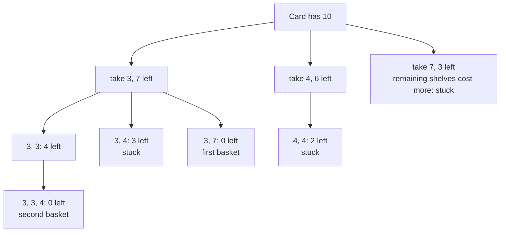
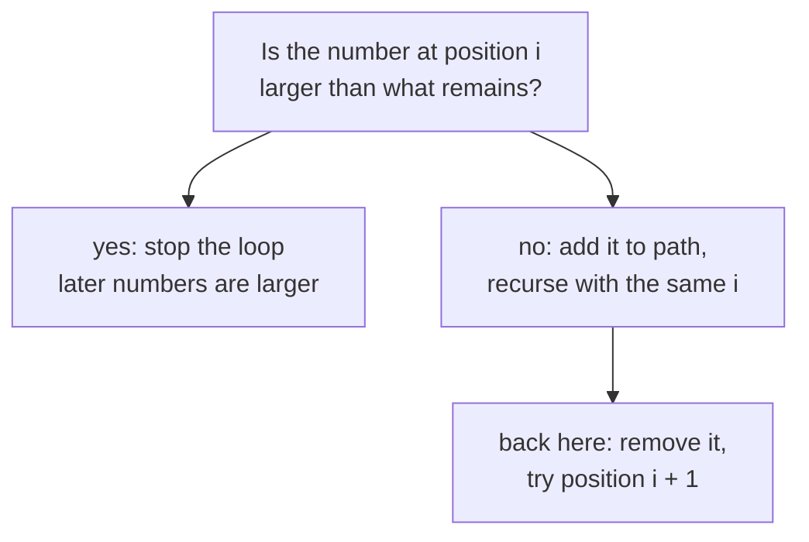

> [!tldr] Quick read
> - This is a **listing** problem, not a counting one. Each answer is a bag of numbers (order does not matter), and a number may be taken many times.
> - Build a [[en/concepts/choice-tree|choice tree]]: each level adds one more number. So that `[2, 3]` and `[3, 2]` are not listed twice, only allow numbers at positions **from `start` onward** (a [[en/concepts/start-index|start index]]).
> - Reuse is allowed, so recurse with the **same `i`**, not `i + 1`.
> - Sort first, then `break` as soon as a number exceeds what remains: every later number does too. On the 12 primes up to 37 with target 40, this cuts the calls from 18,976 to 2,699.
> - To know only **how many** combinations there are, use DP as in [[en/problems/coin-change-ii|Coin Change II]]; to **print** each one, you have to backtrack.

> [!info] Context
> This is LeetCode problem 39 at [[en/posts/2026-11-28-neetcode-subsets-combinations|station MISC-01: Backtracking: Subsets and Combinations]] on **the NeetCode Line: Mixed Techniques**. I picture a gift card that must be spent to exactly zero, at a shop where every item is in unlimited stock. You only need arrays, loops and recursive functions.

> [!abstract]- Quick glossary for this post (click to open)
> - [[en/concepts/backtracking|Backtracking]]: add a choice to the partial solution, go deeper, then remove that choice to try another.
> - [[en/concepts/choice-tree|Choice tree]]: each node is a partial solution, each edge is one choice added to it.
> - [[en/concepts/start-index|Start index]] (`start`): at each level, only numbers at position `start` or later may be chosen, so each bag appears in exactly one order.
> - Pruning: stop a branch as soon as you know it cannot lead to an answer.
> - `path`: the list of numbers chosen on the way from the root to the current node. One `path` is shared by the whole tree, so when an answer is found it must be **copied** out.
> - [[en/concepts/unbounded-knapsack|Unbounded knapsack]]: a problem from the same family, where every item can be reused; there we usually count or optimize, here we list.

## Picture it first: spending a gift card to exactly zero

The card has 10 thousand left. The shop has three shelves, priced 3, 4 and 7 thousand, all well stocked. I want **every basket** that spends the card exactly. The basket `3, 7` and the basket `7, 3` are the same basket. The trick: walk along the shelves in one direction. At a shelf I may take its item as many times as I like, but once I move to a later shelf I never walk back. That way each basket is picked up in exactly one sequence.

| Everyday life | Concept |
|---|---|
| Balance left on the card | `remain`, the part of the target still missing |
| Shelves arranged by increasing price | The sorted `candidates` array |
| Standing at a shelf, only take from it or later ones | [[en/concepts/start-index\|Start index]] `start` |
| Take one more item while staying at the same shelf | Recurse with the same `i` (reuse allowed) |
| The basket being filled | `path` |
| Card back at exactly 0 | An answer: copy `path` out |
| This shelf's item already costs more than the balance, so later shelves do too | Sort, then `break` |



The picture leaves out the node `3, 3, 3` (1 left) to stay compact. That node is still called, then gets stuck at once because the cheapest item it may still take costs more than the balance.

## The problem: list every combination that sums to the target

You get an array `candidates` of 1 to 30 **distinct** integers, each from 2 to 40, and a `target` from 1 to 40. Return every combination of numbers from the array whose sum is exactly `target`. Each number may be reused without limit. Two combinations that differ only in order count as one. The problem guarantees fewer than 150 combinations. For example, `[3, 4, 7]` with target 10 has two combinations: `[3, 3, 4]` and `[3, 7]`. [Original problem: LeetCode 39](https://leetcode.com/problems/combination-sum/)

I used to think I could just try "any number at every step" and remove duplicates at the end. That still gives the right answer if the deduplication is careful, but every bag of `k` different numbers gets generated up to `k!` times in different orders. The real question is: how do I make the tree produce **each bag exactly once**?

## How it works

### Enumerate every vector of usage counts

The crudest way: for each number `c`, try every usage count from 0 to `target / c`, then keep the combinations whose sum is right. Each vector of counts corresponds to exactly one bag, so there are no duplicates. But the number of vectors to try is the product of `(target / c + 1)` over all numbers, which grows exponentially with the array length, including vectors that overshoot the target very early. I use this only as a "referee" to check results on small inputs.

### Backtracking with a start index

The function `dfs(start, remain)` stands at one node of the tree: `path` holds the numbers chosen so far, `remain` is what is still missing.

| Step | What it does |
|---|---|
| step 1 | If `remain` is 0: copy `path` into the result and return. |
| step 2 | For each `i` from `start` to the end of the array: add `candidates[i]` to `path`. |
| step 3 | Call `dfs(i, remain - candidates[i])`. Pass `i`, not `i + 1`, because this number may be taken again. |
| step 4 | Remove the number just added from `path`, then try the next `i`. |

Since each level only picks numbers at positions no smaller than the previous level, every `path` follows non-decreasing position order. Each bag of numbers has exactly one way to be written like that, so no deduplication is needed. The unpruned version only returns once `remain` turns negative.

### Sort, then prune

If the array is ascending and `candidates[i] > remain`, then every number after `i` also exceeds `remain`. So `break` out of the loop instead of recursing and only then noticing that `remain` is negative. Sorting costs O(n log n), small next to the tree. On the 12 primes from 2 to 37 with target 40 (302 combinations), the unpruned version calls the function 18,976 times, and the sorted, pruned version 2,699 times.



**Complexity.** Let n be the array length, T the target and m the smallest number. A root-to-leaf path is at most T/m long (here ≤ 20), so the recursion stack and `path` take O(T/m). The number of tree nodes is bounded by O(n^(T/m + 1)) in the worst case; each answer costs an extra O(T/m) to copy. The real running time depends on how many answers and how many dead branches there are, which is why pruning matters.

### Count with DP, list with backtracking

If the problem only asked *how many* combinations exist, the `ways[t] += ways[t - c]` table from [[en/problems/coin-change-ii|Coin Change II]] answers in O(n·T) without building a single combination. Each file below also computes that number and checks it equals the number of combinations the backtracking prints. But the DP only keeps a number per total, not the combinations, so it cannot print them. The output can be long, and a listing algorithm cannot be faster than the length of its output.

## Runnable example

[TypeScript](../code/neetcode-combination-sum/combos.ts) · [Python](../code/neetcode-combination-sum/combos.py) · [Go](../code/neetcode-combination-sum/combos.go) · [Java](../code/neetcode-combination-sum/combos.java) · [JavaScript](../code/neetcode-combination-sum/combos.js) · [PHP](../code/neetcode-combination-sum/combos.php) · [Rust](../code/neetcode-combination-sum/combination_sum.rs)

```ts
// Sort, then prune: once a number exceeds what remains, so does every later one.
function combinationSum(candidates: number[], target: number): number[][] {
    const nums = [...candidates].sort((a, b) => a - b)
    const out: number[][] = []
    const path: number[] = []
    const dfs = (start: number, remain: number): void => {
        calls++
        if (remain === 0) {
            out.push([...path])
            return
        }
        for (let i = start; i < nums.length; i++) {
            if (nums[i] > remain) break
            path.push(nums[i])
            dfs(i, remain - nums[i]) // still i: this number may be reused
            path.pop()
        }
    }
    dfs(0, target)
    return out
}
```

```python
def combination_sum(candidates, target):
    """Sort, then prune: once a number exceeds what remains, so does every later one."""
    global calls
    nums = sorted(candidates)
    out, path = [], []

    def dfs(start, remain):
        global calls
        calls += 1
        if remain == 0:
            out.append(path[:])
            return
        for i in range(start, len(nums)):
            if nums[i] > remain:
                break
            path.append(nums[i])
            dfs(i, remain - nums[i])  # still i: this number may be reused
            path.pop()

    dfs(0, target)
    return out
```

```go
// Sort, then prune: once a number exceeds what remains, so does every later one.
func combinationSum(candidates []int, target int) [][]int {
	nums := append([]int(nil), candidates...)
	sort.Ints(nums)
	out := [][]int{}
	path := []int{}
	var dfs func(start, remain int)
	dfs = func(start, remain int) {
		calls++
		if remain == 0 {
			out = append(out, append([]int(nil), path...))
			return
		}
		for i := start; i < len(nums); i++ {
			if nums[i] > remain {
				break
			}
			path = append(path, nums[i])
			dfs(i, remain-nums[i]) // still i: this number may be reused
			path = path[:len(path)-1]
		}
	}
	dfs(0, target)
	return out
}
```

```java
// Sort, then prune: once a number exceeds what remains, so does every later one.
static List<List<Integer>> combinationSum(int[] candidates, int target) {
    int[] nums = candidates.clone();
    Arrays.sort(nums);
    List<List<Integer>> out = new ArrayList<>();
    dfs(nums, 0, target, new ArrayList<>(), out);
    return out;
}

static void dfs(int[] nums, int start, int remain, List<Integer> path, List<List<Integer>> out) {
    calls++;
    if (remain == 0) {
        out.add(new ArrayList<>(path));
        return;
    }
    for (int i = start; i < nums.length; i++) {
        if (nums[i] > remain) break;
        path.add(nums[i]);
        dfs(nums, i, remain - nums[i], path, out); // still i: this number may be reused
        path.remove(path.size() - 1);
    }
}
```

```js
// Sort, then prune: once a number exceeds what remains, so does every later one.
function combinationSum(candidates, target) {
    const nums = [...candidates].sort((a, b) => a - b)
    const out = []
    const path = []
    const dfs = (start, remain) => {
        calls++
        if (remain === 0) {
            out.push([...path])
            return
        }
        for (let i = start; i < nums.length; i++) {
            if (nums[i] > remain) break
            path.push(nums[i])
            dfs(i, remain - nums[i]) // still i: this number may be reused
            path.pop()
        }
    }
    dfs(0, target)
    return out
}
```

```php
// Sort, then prune: once a number exceeds what remains, so does every later one.
function combinationSum(array $candidates, int $target): array {
    $nums = $candidates;
    sort($nums);
    $out = [];
    $path = [];
    $dfs = function (int $start, int $remain) use (&$dfs, &$out, &$path, $nums) {
        global $calls;
        $calls++;
        if ($remain === 0) {
            $out[] = $path;
            return;
        }
        for ($i = $start; $i < count($nums); $i++) {
            if ($nums[$i] > $remain) break;
            $path[] = $nums[$i];
            $dfs($i, $remain - $nums[$i]); // still i: this number may be reused
            array_pop($path);
        }
    };
    $dfs(0, $target);
    return $out;
}
```

```rust
// Sort, then prune: once a number exceeds what remains, so does every later one.
fn combination_sum(candidates: &[i32], target: i32) -> Vec<Vec<i32>> {
    fn dfs(nums: &[i32], start: usize, remain: i32, path: &mut Vec<i32>, out: &mut Vec<Vec<i32>>) {
        tick();
        if remain == 0 {
            out.push(path.clone());
            return;
        }
        for i in start..nums.len() {
            if nums[i] > remain {
                break;
            }
            path.push(nums[i]);
            dfs(nums, i, remain - nums[i], path, out); // still i: this number may be reused
            path.pop();
        }
    }
    let mut nums = candidates.to_vec();
    nums.sort();
    let mut out = Vec::new();
    dfs(&nums, 0, target, &mut Vec::new(), &mut out);
    out
}
```

The tabs show the sorted, pruned version. The downloadable files also contain the unpruned version, the DP that counts combinations, and the enumerator over every vector of usage counts. The first line covers 7 hand-made cases, including an unsorted array, a target smaller than every number, and an odd target that cannot be built. The second line checks against the enumerator for every non-empty subset of `{2, 3, 4, 5, 6, 7}` and every target from 1 to 14. The third line counts function calls, not running time.

```text
7/7 cases passed
882/882 cases passed (checked against enumerating usage counts)
12 primes up to 37, target 40: no pruning 18976 calls, sort + prune 2699 calls, 302 combinations
```

*(Output labels translated; the files themselves print Vietnamese.)*

Run with `node combos.ts`, `python3 combos.py`, `go run combos.go`, `java combos.java`, `node combos.js`, `php -d xdebug.mode=off combos.php` or `rustc --edition 2021 -O combination_sum.rs -o /tmp/combination_sum && /tmp/combination_sum`. All seven languages print the same numbers.

## Misconceptions and common traps

- Recursing with `i + 1`. Then each number can be used only once, and `[3, 3, 4]` disappears. `i + 1` belongs to [[en/problems/combination-sum-ii|Combination Sum II]].
- Recursing with `0` instead of `i`. The tree walks back to earlier shelves, so `[3, 3, 4]`, `[3, 4, 3]` and `[4, 3, 3]` all get printed.
- Using `break` without sorting. With `[8, 2, 5]` and target 10, after choosing 8 the loop meets 8 again first, sees that 8 exceeds 2 and stops, so `[2, 8]` is lost. Without sorting you may only `continue`, never `break`.
- Adding `path` to the result without copying it. I tried this with `[2, 3, 5]` and target 8:
  - Go: `out = append(out, path)` gives `[[5 5 3 2] [5 5 3] [5 5]]` instead of `[[2 2 2 2] [2 3 3] [3 5]]`. The elements of `out` share a backing array with `path`, so later writes overwrite old answers. Write `append([]int(nil), path...)`.
  - Python: `out.append(path)` gives `[[], [], []]`, because all three entries are the same list, already popped back to empty. Write `path[:]`.
  - TypeScript, JavaScript and Java also store references, so you need `[...path]` or `new ArrayList<>(path)`.
  - PHP: `$out[] = $path` copies the array by value, so this bug does not happen. On the other hand, the closure must take `use (&$out, &$path)` by reference, or every change inside it is lost.
  - Rust: the borrow checker will not let you push `path` (mutably borrowed) into `out`, so `path.clone()` is forced.
- Worrying about stack overflow. Each level subtracts at least 2 from a target of at most 40, so the tree is at most 20 levels deep, far below Python's 1,000-level limit or Xdebug's 512.

## Self-check questions

> [!question]- Why is the start index enough to avoid printing a bag twice?
> Every `path` follows non-decreasing position order. A bag of numbers has exactly one arrangement in that order, so the tree contains it only once.

> [!question]- If you change `dfs(i, …)` to `dfs(i + 1, …)`, which problem do you get?
> Each number is used at most once. Since the array here has no duplicates, that is exactly Combination Sum II on an input with all distinct numbers.

> [!question]- When is `break` wrong while `continue` stays correct?
> When the array is not sorted. A large number at position `i` says nothing about the numbers after it, so you may only skip that one.

> [!question]- The Coin Change II DP is much faster, so why not use it to print combinations?
> Each DP cell holds only a number that already sums every way of reaching that total. To print each combination you have to keep each path, and the number of paths can be far larger than n·T.

## References

- [LeetCode 39](https://leetcode.com/problems/combination-sum/)
- [Jeff Erickson, Algorithms, chapter 2: backtracking](https://jeffe.cs.illinois.edu/teaching/algorithms/book/02-backtracking.pdf)
- [Go blog: Go Slices, usage and internals](https://go.dev/blog/slices-intro) · [Python: mutable sequence types](https://docs.python.org/3/library/stdtypes.html#mutable-sequence-types) · [PHP: anonymous functions](https://www.php.net/manual/en/functions.anonymous.php)
