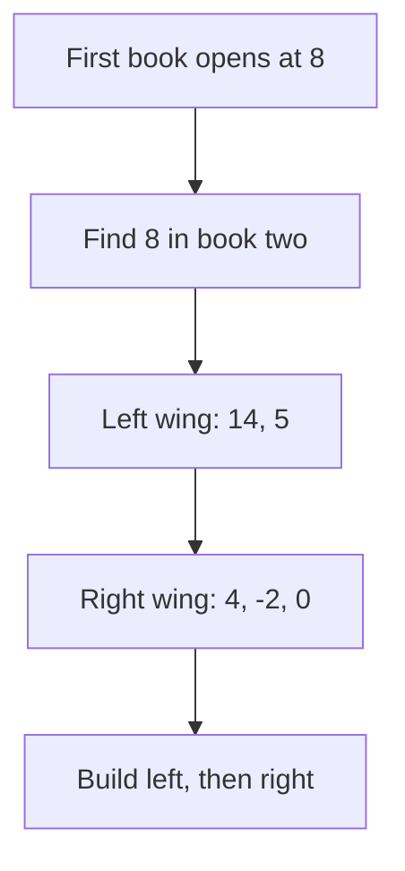

> [!tldr] Quick read
> - [[en/concepts/pre-order-traversal|Preorder]] gives the root first. [[en/concepts/in-order-traversal|Inorder]] places it between the entire left and right subtrees.
> - Keep an [[en/concepts/inorder-interval|inorder interval]] `[lo, hi)` for each subtree and a cursor into the preorder sequence. Pick the root, then build the left subtree followed by the right.
> - Scanning for the root can take O(n²). A [[en/concepts/hash-map|hash map]] of positions gives expected O(n) time with O(n) auxiliary space.
> - An explicit stack also runs in O(n) time and uses O(h) auxiliary space, where h is the height. This version handles both skewed chains of 3,000 nodes in the test suite.

> [!info] Context
> LeetCode problem 105 (Medium), on [[en/posts/2026-11-26-neetcode-tree-reconstruction|station 6: Building and Serializing Trees]] of **the NeetCode Line: Linked Structures**. At [[en/posts/2026-11-25-neetcode-binary-search-tree|station 4]] and [[en/posts/2026-11-25-neetcode-level-order|station 5]], I started with a tree and read out its nodes. This time I [[en/concepts/tree-reconstruction|reverse the process]] and rebuild the edges from two sequences. All you need to know is that a binary tree node has one slot for a left child and one for a right child.

> [!abstract]- Quick glossary for this post (click to open)
> - **Preorder** → root, entire left branch, entire right branch.
> - **Inorder** → entire left branch, root, entire right branch.
> - A **half-open interval** `[lo, hi)` includes positions from `lo` up to and excluding `hi`. Equal bounds give an empty interval.
> - A **position index** records the inorder position of each node value.
> - A **stack** keeps the most recently added item on top. Popping removes that top item.
> - **Height h** here counts nodes along the longest path from the root to a leaf.

## Picture it first: reassembling a floor plan

Imagine I receive two room inventories, with a unique code for each room. The first lists the main room before the two wings and always walks the left wing first. The second lists the main room after the entire left wing and before the right wing. The opening entry of the first book identifies the main room. Looking up that code in the second tells me which rooms are in each wing.

| Everyday life | Concept |
|---|---|
| First code in the first book | root from preorder |
| Sections on either side of the code in the second book | inorder intervals of the left and right subtrees |
| Scan each line or look up the page number | sequential scan or position lookup |
| Stack of room cards waiting for the left wing to finish | stack of nodes pending their inorder visit |



## The problem: two sequences describe one tree

Each array contains between 1 and 3,000 integers in the range −3,000 to 3,000. The values in each array are distinct. Both arrays are valid traversals of the same tree. I need to return its root with all the left and right links in place. [Original LeetCode 105 problem](https://leetcode.com/problems/construct-binary-tree-from-preorder-and-inorder-traversal/)

My example uses `preorder = [8, 14, 5, -2, 4, 0]` and `inorder = [14, 5, 8, 4, -2, 0]`. Root 8 has children 14 and −2. Node 14 has only a right child, 5. Node −2 has left child 4 and right child 0. A node's **position in inorder** decides which side it belongs on, so the left child of 8 can be greater than 8.

## How it works

### Scan for the root and keep both bounds

`build(lo, hi)` builds exactly the nodes in `inorder[lo:hi]`. An empty interval returns an empty tree and leaves the preorder cursor in place. Otherwise, take the next preorder value as the root. Scan from `lo` to find its position `mid`. Build `[lo, mid)` first, then `[mid + 1, hi)`.

| Step | Current interval | Next value or result |
|---|---|---|
| Start | `[0, 6)` | root 8 at position 2 |
| Go left from 8 | `[0, 2)` | root 14 at position 0 |
| Go left from 14 | `[0, 0)` | empty tree, cursor stays put |
| Go right from 14 | `[1, 2)` | take 5 as a leaf |
| Finish the left subtree of 8 | `[3, 6)` | next value is −2 |

Preorder reads the entire left subtree before going right, so the left call consumes exactly `mid - lo` values after the root. The cursor then sits at the right subtree's root if that subtree has any nodes. This is also why the reconstructed tree is unique. The root is fixed, its split point is fixed because the values are distinct, and the same argument applies to each smaller interval. [Cornell CS 2110](https://www.cs.cornell.edu/courses/cs2110/2025fa/discussions/dis08/) · [MIT 6.046](https://courses.csail.mit.edu/6.046/fall03/handouts/pset4-sol.pdf)

### Replace the scan with a position lookup

Build `index[value] = position in inorder` up front, then perform a lookup for each root. The bounds, cursor, and build order stay the same. The index helps most when the root is often at the far end of its interval. On a chain of only left children, scanning from the start takes n, n − 1, …, 1 comparisons. On a chain of only right children, the root is always first, so each node takes one comparison.

I counted operations in the TypeScript and JavaScript programs on a 500-node left chain. Both approaches built and checked the same tree. The scan made **125,250 comparisons**. The indexed version performed **500 lookups** after recording 500 positions. These counts measure the work of finding roots and do not translate directly into a runtime difference.

### Build with a stack and read both sequences from the start

First, create the root from the first preorder value. Each subsequent preorder value becomes a new node. The stack holds nodes that have been created but are still waiting for their inorder visit. Its top is the most recently created node. There are two cases.

1. **The top differs from the next inorder value.** Inorder still needs to go left before visiting the top, so the new node is its left child.
2. **The top equals the next inorder value.** The top's left subtree is done. Pop it, advance the inorder cursor, and keep popping while the values match. The new node is the right child of the **last node popped**, because that is where preorder must descend next.

In the example tree, right before creating −2 the stack contains 8 and 5, with 5 on top. Inorder expects 5 followed by 8, so I pop both and attach −2 to the right of **8**. When I popped 14 to attach 5 as its right child, 8 stayed on the stack because its turn came after 5.

| Approach | Build time | Build auxiliary space |
|---|---|---|
| Scan from the left bound | O(n²) worst case, Θ(n) on a right chain | O(h) call frames |
| Position lookup | O(n) expected under the usual O(1) average hash-table lookup assumption | O(n + h) for the index and call frames |
| Explicit stack | O(n), each node is pushed once and popped at most once | O(h), the stack holds at most one ancestor path |

The table counts auxiliary space for building only. All three approaches create n result nodes. ECMAScript requires `Map` access to be sublinear on average in the number of entries. The O(n) entry uses the usual hash-table assumption. [ECMAScript, Map Objects](https://tc39.es/ecma262/multipage/keyed-collections.html#sec-map-objects)

## Runnable example

Each file checks both traversals of the rebuilt tree in one loop. A run tries all three approaches on five small trees, then adds two 3,000-node chains (all left and all right) for the stack version. The five small trees include a single leaf, a tree with negative values and no search order, two one-sided chains, and a branch that changes direction.

```typescript
import assert from "node:assert/strict"

class TreeNode {
  left: TreeNode | null = null
  right: TreeNode | null = null
  value: number

  constructor(value: number) {
    this.value = value
  }
}

type FindRoot = (value: number, lo: number) => number
type Rebuild = (preorder: number[], inorder: number[]) => TreeNode | null

function buildRanges(preorder: number[], findRoot: FindRoot): TreeNode | null {
  let next = 0

  function build(lo: number, hi: number): TreeNode | null {
    if (lo === hi) return null
    const root = new TreeNode(preorder[next++])
    const mid = findRoot(root.value, lo)
    root.left = build(lo, mid)
    root.right = build(mid + 1, hi)
    return root
  }

  return build(0, preorder.length)
}

function scanFrom(inorder: number[], value: number, lo: number): number {
  while (inorder[lo] !== value) lo++
  return lo
}

const byScan: Rebuild = (preorder, inorder) =>
  buildRanges(preorder, (value, lo) => scanFrom(inorder, value, lo))

const byIndex: Rebuild = (preorder, inorder) => {
  const index = new Map(inorder.map((value, i) => [value, i]))
  return buildRanges(preorder, (value) => index.get(value)!)
}

const byStack: Rebuild = (preorder, inorder) => {
  if (preorder.length === 0) return null
  const root = new TreeNode(preorder[0])
  const pending = [root]
  let nextIn = 0

  for (let i = 1; i < preorder.length; i++) {
    const child = new TreeNode(preorder[i])
    let parent = pending[pending.length - 1]

    if (parent.value !== inorder[nextIn]) {
      parent.left = child
    } else {
      while (pending.length && pending[pending.length - 1].value === inorder[nextIn]) {
        parent = pending.pop()!
        nextIn++
      }
      parent.right = child
    }

    pending.push(child)
  }

  return root
}

function check(root: TreeNode | null, preorder: number[], inorder: number[]) {
  const before: number[] = []
  const between: number[] = []
  const pending: TreeNode[] = []
  while (root || pending.length) {
    while (root) {
      before.push(root.value)
      pending.push(root)
      root = root.left
    }
    root = pending.pop()!
    between.push(root.value)
    root = root.right
  }
  assert.deepEqual(before, preorder)
  assert.deepEqual(between, inorder)
}

const cases = [
  [[-3000], [-3000]],
  [[8, 14, 5, -2, 4, 0], [14, 5, 8, 4, -2, 0]],
  [[1, 2, 3, 4], [4, 3, 2, 1]],
  [[1, 2, 3, 4], [1, 2, 3, 4]],
  [[1, -2, 3, -4], [-2, -4, 3, 1]],
]

let ok = 0
for (const rebuild of [byScan, byIndex, byStack]) {
  for (const [preorder, inorder] of cases) {
    check(rebuild(preorder, inorder), preorder, inorder)
    ok++
  }
}

const straight = Array.from({ length: 3000 }, (_, i) => i + 1)
for (const inorder of [straight, [...straight].reverse()]) {
  check(byStack(straight, inorder), straight, inorder)
  ok++
}
console.log(`${ok}/${cases.length * 3 + 2} ca đúng`)

const preorder = straight.slice(0, 500)
const inorder = [...preorder].reverse()
let comparisons = 0
let lookups = 0
check(buildRanges(preorder, (value, lo) => {
  const mid = scanFrom(inorder, value, lo)
  comparisons += mid - lo + 1
  return mid
}), preorder, inorder)
const index = new Map(inorder.map((value, i) => [value, i]))
check(buildRanges(preorder, (value) => {
  lookups++
  return index.get(value)!
}), preorder, inorder)
console.log(`so sánh quét: ${comparisons}, lượt tra chỉ mục: ${lookups}`)
```

```python
from dataclasses import dataclass


@dataclass
class TreeNode:
    value: int
    left: "TreeNode | None" = None
    right: "TreeNode | None" = None


def build_ranges(preorder, find_root):
    next_pre = 0

    def build(lo, hi):
        nonlocal next_pre
        if lo == hi:
            return None
        node = TreeNode(preorder[next_pre])
        next_pre += 1
        mid = find_root(node.value, lo)
        node.left = build(lo, mid)
        node.right = build(mid + 1, hi)
        return node

    return build(0, len(preorder))


def by_scan(preorder, inorder):
    return build_ranges(preorder, lambda value, lo: inorder.index(value, lo))


def by_index(preorder, inorder):
    index = {value: i for i, value in enumerate(inorder)}
    return build_ranges(preorder, lambda value, lo: index[value])


def by_stack(preorder, inorder):
    if not preorder:
        return None
    root = TreeNode(preorder[0])
    pending = [root]
    next_in = 0

    for i in range(1, len(preorder)):
        child = TreeNode(preorder[i])
        parent = pending[-1]
        if parent.value != inorder[next_in]:
            parent.left = child
        else:
            while pending and pending[-1].value == inorder[next_in]:
                parent = pending.pop()
                next_in += 1
            parent.right = child
        pending.append(child)

    return root


def check(root, preorder, inorder):
    before, between, pending = [], [], []
    while root is not None or pending:
        while root is not None:
            before.append(root.value)
            pending.append(root)
            root = root.left
        root = pending.pop()
        between.append(root.value)
        root = root.right
    assert before == preorder
    assert between == inorder


if __name__ == "__main__":
    cases = [
        ([-3000], [-3000]),
        ([8, 14, 5, -2, 4, 0], [14, 5, 8, 4, -2, 0]),
        ([1, 2, 3, 4], [4, 3, 2, 1]),
        ([1, 2, 3, 4], [1, 2, 3, 4]),
        ([1, -2, 3, -4], [-2, -4, 3, 1]),
    ]
    ok = 0
    for rebuild in (by_scan, by_index, by_stack):
        for preorder, inorder in cases:
            check(rebuild(preorder, inorder), preorder, inorder)
            ok += 1

    straight = list(range(1, 3001))
    for inorder in (straight, straight[::-1]):
        check(by_stack(straight, inorder), straight, inorder)
        ok += 1
    print(f"{ok}/{len(cases) * 3 + 2} ca đúng")
```

```go
package main

import (
	"fmt"
	"slices"
)

type treeNode struct {
	value       int
	left, right *treeNode
}

type rebuild func(preorder, inorder []int) *treeNode

func buildRanges(preorder []int, findRoot func(value, lo int) int) *treeNode {
	next := 0
	var build func(lo, hi int) *treeNode
	build = func(lo, hi int) *treeNode {
		if lo == hi {
			return nil
		}
		node := &treeNode{value: preorder[next]}
		next++
		mid := findRoot(node.value, lo)
		node.left = build(lo, mid)
		node.right = build(mid+1, hi)
		return node
	}
	return build(0, len(preorder))
}

func byScan(preorder, inorder []int) *treeNode {
	return buildRanges(preorder, func(value, lo int) int {
		for inorder[lo] != value {
			lo++
		}
		return lo
	})
}

func byIndex(preorder, inorder []int) *treeNode {
	index := make(map[int]int, len(inorder))
	for i, value := range inorder {
		index[value] = i
	}
	return buildRanges(preorder, func(value, _ int) int { return index[value] })
}

func byStack(preorder, inorder []int) *treeNode {
	if len(preorder) == 0 {
		return nil
	}
	root := &treeNode{value: preorder[0]}
	pending := []*treeNode{root}
	nextIn := 0

	for _, value := range preorder[1:] {
		child := &treeNode{value: value}
		parent := pending[len(pending)-1]
		if parent.value != inorder[nextIn] {
			parent.left = child
		} else {
			for len(pending) > 0 && pending[len(pending)-1].value == inorder[nextIn] {
				parent = pending[len(pending)-1]
				pending = pending[:len(pending)-1]
				nextIn++
			}
			parent.right = child
		}
		pending = append(pending, child)
	}
	return root
}

func check(root *treeNode, preorder, inorder []int) {
	var before, between []int
	var pending []*treeNode
	for root != nil || len(pending) > 0 {
		for root != nil {
			before = append(before, root.value)
			pending = append(pending, root)
			root = root.left
		}
		root = pending[len(pending)-1]
		pending = pending[:len(pending)-1]
		between = append(between, root.value)
		root = root.right
	}
	if !slices.Equal(before, preorder) || !slices.Equal(between, inorder) {
		panic("thứ tự duyệt không khớp")
	}
}

func main() {
	cases := []struct{ preorder, inorder []int }{
		{[]int{-3000}, []int{-3000}},
		{[]int{8, 14, 5, -2, 4, 0}, []int{14, 5, 8, 4, -2, 0}},
		{[]int{1, 2, 3, 4}, []int{4, 3, 2, 1}},
		{[]int{1, 2, 3, 4}, []int{1, 2, 3, 4}},
		{[]int{1, -2, 3, -4}, []int{-2, -4, 3, 1}},
	}
	ok := 0
	for _, build := range []rebuild{byScan, byIndex, byStack} {
		for _, c := range cases {
			check(build(c.preorder, c.inorder), c.preorder, c.inorder)
			ok++
		}
	}

	straight, reverse := make([]int, 3000), make([]int, 3000)
	for i := range straight {
		straight[i], reverse[i] = i+1, len(straight)-i
	}
	for _, inorder := range [][]int{straight, reverse} {
		check(byStack(straight, inorder), straight, inorder)
		ok++
	}
	fmt.Printf("%d/%d ca đúng\n", ok, len(cases)*3+2)
}
```

```java
import java.util.ArrayDeque;
import java.util.Deque;
import java.util.HashMap;
import java.util.List;
import java.util.Map;
import java.util.function.IntBinaryOperator;

class RebuildTree {
    static class TreeNode {
        final int value;
        TreeNode left, right;

        TreeNode(int value) {
            this.value = value;
        }
    }

    interface Rebuild {
        TreeNode build(int[] preorder, int[] inorder);
    }

    static TreeNode buildRanges(int[] preorder, IntBinaryOperator findRoot) {
        class Builder {
            int next;

            TreeNode build(int lo, int hi) {
                if (lo == hi) return null;
                TreeNode node = new TreeNode(preorder[next++]);
                int mid = findRoot.applyAsInt(node.value, lo);
                node.left = build(lo, mid);
                node.right = build(mid + 1, hi);
                return node;
            }
        }

        return new Builder().build(0, preorder.length);
    }

    static TreeNode byScan(int[] preorder, int[] inorder) {
        return buildRanges(preorder, (value, lo) -> {
            while (inorder[lo] != value) lo++;
            return lo;
        });
    }

    static TreeNode byIndex(int[] preorder, int[] inorder) {
        Map<Integer, Integer> index = new HashMap<>();
        for (int i = 0; i < inorder.length; i++) {
            index.put(inorder[i], i);
        }
        return buildRanges(preorder, (value, lo) -> index.get(value));
    }

    static TreeNode byStack(int[] preorder, int[] inorder) {
        if (preorder.length == 0) return null;
        TreeNode root = new TreeNode(preorder[0]);
        Deque<TreeNode> pending = new ArrayDeque<>();
        pending.push(root);
        int nextIn = 0;

        for (int i = 1; i < preorder.length; i++) {
            TreeNode child = new TreeNode(preorder[i]);
            TreeNode parent = pending.peek();
            if (parent.value != inorder[nextIn]) {
                parent.left = child;
            } else {
                while (!pending.isEmpty() && pending.peek().value == inorder[nextIn]) {
                    parent = pending.pop();
                    nextIn++;
                }
                parent.right = child;
            }
            pending.push(child);
        }
        return root;
    }

    static void check(TreeNode root, int[] preorder, int[] inorder) {
        Deque<TreeNode> pending = new ArrayDeque<>();
        int before = 0, between = 0;
        while (root != null || !pending.isEmpty()) {
            while (root != null) {
                require(before < preorder.length && preorder[before++] == root.value);
                pending.push(root);
                root = root.left;
            }
            root = pending.pop();
            require(between < inorder.length && inorder[between++] == root.value);
            root = root.right;
        }
        require(before == preorder.length && between == inorder.length);
    }

    static void require(boolean passed) {
        if (!passed) throw new AssertionError("thứ tự duyệt không khớp");
    }

    public static void main(String[] args) {
        int[][][] cases = {
            {{-3000}, {-3000}},
            {{8, 14, 5, -2, 4, 0}, {14, 5, 8, 4, -2, 0}},
            {{1, 2, 3, 4}, {4, 3, 2, 1}},
            {{1, 2, 3, 4}, {1, 2, 3, 4}},
            {{1, -2, 3, -4}, {-2, -4, 3, 1}},
        };
        List<Rebuild> builders = List.of(RebuildTree::byScan, RebuildTree::byIndex, RebuildTree::byStack);
        int ok = 0;
        for (Rebuild rebuild : builders) {
            for (int[][] fixture : cases) {
                check(rebuild.build(fixture[0], fixture[1]), fixture[0], fixture[1]);
                ok++;
            }
        }

        int[] straight = new int[3000], reverse = new int[3000];
        for (int i = 0; i < straight.length; i++) {
            straight[i] = i + 1;
            reverse[i] = straight.length - i;
        }
        for (int[] inorder : new int[][] {straight, reverse}) {
            check(byStack(straight, inorder), straight, inorder);
            ok++;
        }
        System.out.printf("%d/%d ca đúng%n", ok, cases.length * 3 + 2);
    }
}
```

```javascript
import assert from "node:assert/strict"

class TreeNode {
  left = null
  right = null

  constructor(value) {
    this.value = value
  }
}

function buildRanges(preorder, findRoot) {
  let next = 0

  function build(lo, hi) {
    if (lo === hi) return null
    const root = new TreeNode(preorder[next++])
    const mid = findRoot(root.value, lo)
    root.left = build(lo, mid)
    root.right = build(mid + 1, hi)
    return root
  }

  return build(0, preorder.length)
}

function scanFrom(inorder, value, lo) {
  while (inorder[lo] !== value) lo++
  return lo
}

const byScan = (preorder, inorder) =>
  buildRanges(preorder, (value, lo) => scanFrom(inorder, value, lo))

const byIndex = (preorder, inorder) => {
  const index = new Map(inorder.map((value, i) => [value, i]))
  return buildRanges(preorder, (value) => index.get(value))
}

const byStack = (preorder, inorder) => {
  if (preorder.length === 0) return null
  const root = new TreeNode(preorder[0])
  const pending = [root]
  let nextIn = 0

  for (let i = 1; i < preorder.length; i++) {
    const child = new TreeNode(preorder[i])
    let parent = pending[pending.length - 1]

    if (parent.value !== inorder[nextIn]) {
      parent.left = child
    } else {
      while (pending.length && pending[pending.length - 1].value === inorder[nextIn]) {
        parent = pending.pop()
        nextIn++
      }
      parent.right = child
    }

    pending.push(child)
  }

  return root
}

function check(root, preorder, inorder) {
  const before = []
  const between = []
  const pending = []
  while (root || pending.length) {
    while (root) {
      before.push(root.value)
      pending.push(root)
      root = root.left
    }
    root = pending.pop()
    between.push(root.value)
    root = root.right
  }
  assert.deepEqual(before, preorder)
  assert.deepEqual(between, inorder)
}

const cases = [
  [[-3000], [-3000]],
  [[8, 14, 5, -2, 4, 0], [14, 5, 8, 4, -2, 0]],
  [[1, 2, 3, 4], [4, 3, 2, 1]],
  [[1, 2, 3, 4], [1, 2, 3, 4]],
  [[1, -2, 3, -4], [-2, -4, 3, 1]],
]

let ok = 0
for (const rebuild of [byScan, byIndex, byStack]) {
  for (const [preorder, inorder] of cases) {
    check(rebuild(preorder, inorder), preorder, inorder)
    ok++
  }
}

const straight = Array.from({ length: 3000 }, (_, i) => i + 1)
for (const inorder of [straight, [...straight].reverse()]) {
  check(byStack(straight, inorder), straight, inorder)
  ok++
}
console.log(`${ok}/${cases.length * 3 + 2} ca đúng`)

const preorder = straight.slice(0, 500)
const inorder = [...preorder].reverse()
let comparisons = 0
let lookups = 0
check(buildRanges(preorder, (value, lo) => {
  const mid = scanFrom(inorder, value, lo)
  comparisons += mid - lo + 1
  return mid
}), preorder, inorder)
const index = new Map(inorder.map((value, i) => [value, i]))
check(buildRanges(preorder, (value) => {
  lookups++
  return index.get(value)
}), preorder, inorder)
console.log(`so sánh quét: ${comparisons}, lượt tra chỉ mục: ${lookups}`)
```

Download the files [TypeScript](../code/neetcode-construct-binary-tree-from-preorder-and-inorder-traversal/rebuild.ts) · [Python](../code/neetcode-construct-binary-tree-from-preorder-and-inorder-traversal/rebuild.py) · [Go](../code/neetcode-construct-binary-tree-from-preorder-and-inorder-traversal/rebuild.go) · [Java](../code/neetcode-construct-binary-tree-from-preorder-and-inorder-traversal/rebuild.java) · [JavaScript](../code/neetcode-construct-binary-tree-from-preorder-and-inorder-traversal/rebuild.js).

I ran `node rebuild.ts`, `python3 rebuild.py`, `go run rebuild.go`, `java rebuild.java`, and `node rebuild.js` inside the example directory. All five print the first line. Both Node versions print the operation counts too.

```text
17/17 cases passed
scan comparisons: 125250, index lookups: 500
```

*(Output labels translated; the files themselves print Vietnamese.)*

## Misconceptions and common traps

- **Assuming inorder is sorted.** The problem uses a general binary tree. Split around the position of 8 even when the value 14 to its left is greater than 8.
- **Advancing the cursor before the empty case.** `[0, 0)` under node 14 consumes no node. Advancing there would skip 5.
- **Reusing an index across the arrays.** `mid` is an inorder index. The preorder cursor advances with the number of nodes actually built.
- **Popping only once.** In the example, popping just 5 and attaching −2 to it creates the wrong edge. Pop 8 too before attaching −2.
- **Assuming each value identifies one position with duplicates.** Two nodes both labeled 7 produce the same pair of sequences `[7, 7]` whether the child is left or right. Uniqueness requires distinct node IDs or extra shape information.
- **Choosing the operations for each language.** TypeScript and JavaScript remove from the end with `pop()`; `shift()` removes from the other end. Python uses `list.pop()` at the end too. In Go, reassign the slice as `pending = pending[:len(pending)-1]` so the next read sees the new top. Java uses `ArrayDeque` with `push`, `peek`, and `pop` at the same end.
- **Confusing linear time with safe recursion depth.** In Python 3.12.3, with `sys.getrecursionlimit()` returning 1000, I ran each approach on a 3,000-node left chain. Both recursive versions raised `RecursionError`, while the stack version built and passed the check. [Python recursion limit](https://docs.python.org/3.12/library/sys.html#sys.getrecursionlimit)

## Self-check questions

> [!question]- Why run `build(lo, mid)` first?
> The cursor points at the first preorder value after the root. If the left subtree has a node, this is its root.

> [!question]- When does scanning take exactly one comparison per node?
> When each root is first in its inorder interval, as on a chain of only right children.

> [!question]- Why does −2 attach under 8 instead of under 5?
> Both 5 and 8 match consecutive inorder values. Once the left branch of 8 is complete, preorder moves to the right child of 8.

> [!question]- With preorder `[8, 5]`, which inorder sequence makes 5 a left child?
> `[5, 8]`. The sequence `[8, 5]` makes it a right child.

## References

- [LeetCode 105](https://leetcode.com/problems/construct-binary-tree-from-preorder-and-inorder-traversal/)
- [Cornell CS 2110, Discussion 8](https://www.cs.cornell.edu/courses/cs2110/2025fa/discussions/dis08/)
- [MIT 6.046, problem 4-1 on tree reconstruction](https://courses.csail.mit.edu/6.046/fall03/handouts/pset4-sol.pdf)
- [ECMAScript, Map Objects](https://tc39.es/ecma262/multipage/keyed-collections.html#sec-map-objects)
- [Python, sys.getrecursionlimit](https://docs.python.org/3.12/library/sys.html#sys.getrecursionlimit)
