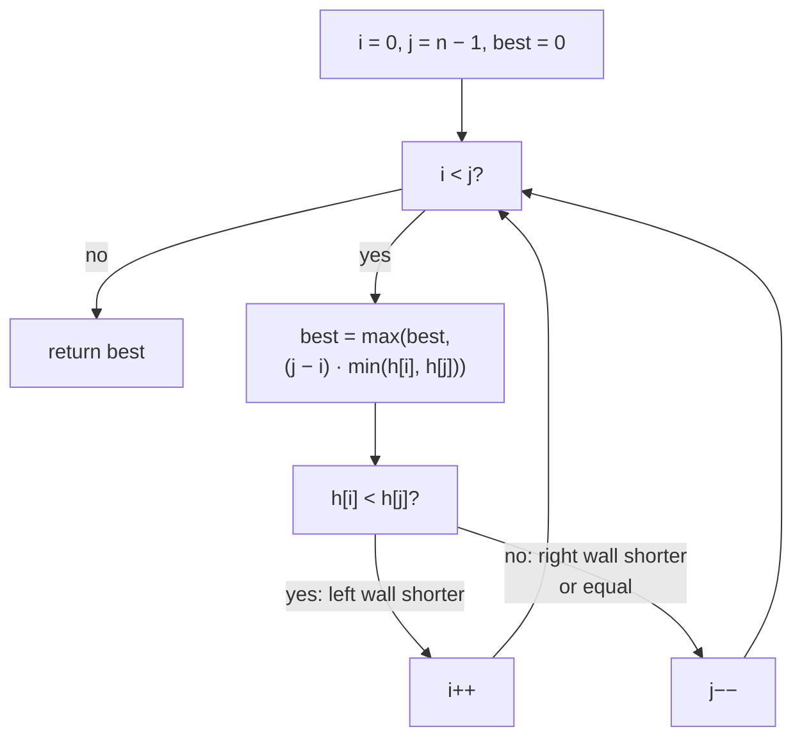

> [!tldr] Quick read
> - The problem: an array of heights `h`; pick two walls `i < j` whose container holds the most water: area `(j − i) · min(h[i], h[j])`.
> - [[en/concepts/two-pointers|Two pointers]] from both ends: compute the area, then **move the shorter wall** inward. O(n), O(1) memory.
> - Why it works: the shorter wall sets the water level. Pairing it with any **closer** wall narrows the base while the level can't rise above it, so none of those pairs beats the one just computed. This is [[en/concepts/search-space-pruning|search space pruning]].
> - Measured: brute force 639 ms at n = 20 000; two pointers 2.2 ms at n = 10⁶.
> - Trap: moving the **taller** wall gives 8 instead of 49 on the problem's first example.

> [!info] Context
> LeetCode problem 11, part of [[en/posts/2026-11-23-neetcode-two-pointers|station 4: Two Pointers]] on **the NeetCode line: Arrays and Strings**. Unlike [[en/problems/two-sum-ii-input-array-is-sorted|Two Sum II]], the array here is **not** sorted; the rule for moving pointers comes from the area formula, not from order. The solutions come in TypeScript, Python, Go, Java and JavaScript.

> [!abstract]- Quick glossary for this post (click to open)
> - **Container area**: the width `j − i` times the water height `min(h[i], h[j])`. Water spills over the shorter wall.
> - **Search space**: every pair `(i, j)` that could be the answer, here n(n − 1)/2 pairs.
> - **Pruning**: dropping a group of pairs without trying each one, because you can prove no pair in the group is better.

## Picture it first: putting up dams in a ditch

A ditch has boards of different heights stuck along its length. You may choose two boards as walls to hold water. The water between them rises to the **shorter** board and is as wide as the distance between them.

| Everyday life | Concept |
|---|---|
| The two boards at the two ends of the ditch | `i = 0`, `j = n − 1`: the widest base |
| Water only reaches the shorter board | `min(h[i], h[j])` |
| Swap the tall board for a closer one: narrower base, water still held by the short board | moving the taller wall never helps |
| Swap the short board: a chance of finding a taller one to make up for the narrower base | move the shorter wall |
| The short board has already been tried with the farthest possible partner, so drop it | the shorter wall is gone for good |



## The problem

**The problem (in my own words):** given an array `height` (2 ≤ n ≤ 10⁵, each value 0..10⁴), wall i is a vertical segment of height `height[i]` at x = i. Choose two walls that, together with the x-axis, form the container holding the most water, and return that amount. You may not tilt the container. Original: [LeetCode 11](https://leetcode.com/problems/container-with-most-water/).

| Input | Output | Best pair |
|---|---|---|
| `[1, 8, 6, 2, 5, 4, 8, 3, 7]` | 49 | wall 1 (height 8) and wall 8 (height 7): 7 · 7 |
| `[1, 1]` | 1 | |
| `[4, 3, 2, 1, 4]` | 16 | the two height-4 walls at both ends: 4 · 4 |

I used to think you should move whichever wall looks more "promising", that is, the taller one. It turns out to be the opposite: the taller wall is the only one worth keeping.

## How it works

<figure class="figure-map" style="--ar: 3 / 4">
<div class="frame"><iframe data-archify="../../diagrams/neetcode-container-with-most-water/worked-example.en.html" title="Move the shorter wall to seek more area" loading="lazy"></iframe></div>
<figcaption><span><b>Figure 1.</b> Move the shorter wall to seek more area.</span><a href="../diagrams/neetcode-container-with-most-water/worked-example.en.html" target="_blank" rel="noopener">Open full screen</a></figcaption>
</figure>

<details>
<summary>Read the steps</summary>
<ol>
<li>Compute the area at both ends. <code>[2, 7, 4, 6]: 3 × 2 = 6</code></li>
<li>Move 2 because it caps the height. <code>i = 1, j = 3</code></li>
<li>New endpoint heights are 7 and 6. <code>2 × 6 = 12</code></li>
<li>Remaining pairs give less area. <code>best = 12</code></li>
</ol>
</details>

### The pruning argument

Suppose `h[i] ≤ h[j]` and we just computed the area `(j − i) · h[i]`. Consider every pair `(i, k)` with `i < k < j`:
- the width `k − i < j − i`;
- the water height `min(h[i], h[k]) ≤ h[i]`.

So the area of `(i, k)` is smaller than that of `(i, j)`. Wall `i` has already reached its best with `j`; no remaining pair involving `i` is worth trying. Drop `i`.

If we moved `j` (the taller wall) instead, we would drop every pair `(k, j)`, which may include the best pair, for example a wall `k` almost as tall as `h[j]` right next to `i`. No argument guarantees they are worse.

Picture the n × n table of all pairs: each step crosses out a whole row (or column), so n − 1 steps are enough instead of n²/2 tries.

### When the two walls are equal

Move either side. With `h[i] = h[j]`, every pair `(i, k)` and `(k, j)` inside has height ≤ `h[i]` and a narrower base, so both walls are used up.

### Measured

TypeScript, random heights 0..10⁴, median:

| n | brute force | two pointers |
|---|---|---|
| 5 000 | 36.1 ms | 0.10 ms |
| 10 000 | 155.7 ms | 0.10 ms |
| 20 000 | 639.3 ms | 0.03 ms |
| 10⁵ (the problem's limit) | (not run) | 0.16 ms |
| 10⁶ | (not run) | 2.20 ms |

Brute force quadruples when n doubles; at n = 10⁵ it would need about 5·10⁹ operations.

### Under the hood of the five languages

| | `min`, `max` | Language-specific trap |
|---|---|---|
| TypeScript / JavaScript | `Math.min`, `Math.max` | `Math.max(...arr)` on a large array can overflow the call stack; use a loop |
| Python | built-in `min`, `max` | a brute force written as a generator is still O(n²): neat but not faster |
| Go | built-in `min`, `max` since Go 1.21 | older versions need your own |
| Java | `Math.min`, `Math.max` | the largest area 10⁵ · 10⁴ = 10⁹ still fits in an `int` (< 2³¹ ≈ 2.1·10⁹) |

## Runnable example

[TypeScript](../code/neetcode-container-with-most-water/container-most-water.ts) · [Python](../code/neetcode-container-with-most-water/container_most_water.py) · [Go](../code/neetcode-container-with-most-water/container_most_water.go) · [Java](../code/neetcode-container-with-most-water/container-most-water.java) · [JavaScript](../code/neetcode-container-with-most-water/container-most-water.js) · [PHP](../code/neetcode-container-with-most-water/container-most-water.php) · [Rust](../code/neetcode-container-with-most-water/container_most_water.rs)

Each of the original five files has brute force and two pointers and runs 7 cases. Below is two pointers.

```ts
// Two pointers: always move the SHORTER wall inward.
function twoPointers(h: number[]): number {
  let i = 0, j = h.length - 1, best = 0;
  while (i < j) {
    best = Math.max(best, (j - i) * Math.min(h[i], h[j]));
    // The shorter wall sets the water level. Pairing it with any closer wall narrows the base
    // while the level can't rise above it: none of those pairs can be better. Drop the shorter wall for good.
    if (h[i] < h[j]) i++; else j--;
  }
  return best;
}
```

```python
def two_pointers(h: list[int]) -> int:
    i, j, best = 0, len(h) - 1, 0
    while i < j:
        best = max(best, (j - i) * min(h[i], h[j]))
        if h[i] < h[j]:  # the shorter wall limits the water level: drop it
            i += 1
        else:
            j -= 1
    return best
```

```go
func twoPointers(h []int) int {
	i, j, best := 0, len(h)-1, 0
	for i < j {
		best = max(best, (j-i)*min(h[i], h[j]))
		if h[i] < h[j] {
			i++
		} else {
			j--
		}
	}
	return best
}
```

```java
static int twoPointers(int[] h) {
    int i = 0, j = h.length - 1, best = 0;
    while (i < j) {
        best = Math.max(best, (j - i) * Math.min(h[i], h[j])); // at most 10⁵ · 10⁴ = 10⁹ < 2³¹: fits in an int
        if (h[i] < h[j]) i++; else j--;
    }
    return best;
}
```

```js
function twoPointers(h) {
  let i = 0, j = h.length - 1, best = 0;
  while (i < j) {
    best = Math.max(best, (j - i) * Math.min(h[i], h[j]));
    if (h[i] < h[j]) i++; else j--;
  }
  return best;
}
```

```php
<?php
declare(strict_types=1);

function maxArea(array $height): int {
    $left = 0;
    $right = count($height) - 1;
    $best = 0;
    while ($left < $right) {
        $best = max($best, ($right - $left) * min($height[$left], $height[$right]));
        if ($height[$left] < $height[$right]) {
            $left++;
        } else {
            $right--;
        }
    }
    return $best;
}
```

```rust
fn max_area(height: &[i32]) -> i32 {
    let (mut left, mut right) = (0, height.len().saturating_sub(1));
    let mut best = 0;
    while left < right {
        best = best.max((right - left) as i32 * height[left].min(height[right]));
        if height[left] < height[right] {
            left += 1;
        } else {
            right -= 1;
        }
    }
    best
}
```


The TypeScript file also runs the move-the-taller-wall version, then measures:

```text
$ node container-most-water.ts
bruteForce   7/7 cases passed
twoPointers  7/7 cases passed
moveTaller   4/7 cases passed; wrong on [1,8,6,2,5,4,8,3,7] → 8 (expected 49) [2,3,4,5,18,17,6] → 12 (expected 17) [1,3,2,5,25,24,5] → 6 (expected 24)

n          brute   two pointers   (ms, median; random heights 0..10⁴)
5000          36.1          0.10
10000        155.7          0.10
20000        639.3          0.03
100000           —          0.16
1000000          —          2.20
```

*(Output labels translated; the files themselves print Vietnamese.)*

On the first example, the move-the-taller-wall version keeps wall 0 (height 1) to the end and only ever sees containers of height 1: it gets 8. Python, Go, Java and JavaScript print `7/7 ca đúng` ("7/7 cases passed") for both approaches.

PHP and Rust use two pointers. Rust uses `saturating_sub(1)` so the loop condition also works for an empty slice. PHP `4/4 ca đúng` · Rust `4/4 ca đúng`.

## Misconceptions and common traps

- **Moving the taller wall.** Fails on the problem's first example: 8 instead of 49.
- **"Two pointers need a sorted array."** Two pointers need a reason to drop one side. In Two Sum II the reason is order; here it is the `min` in the formula.
- **Confusing it with Trapping Rain Water.** This problem picks **two** walls and ignores the walls in between (they don't block water). [[en/problems/trapping-rain-water|Trapping Rain Water]] adds up the water above **every** wall.
- **Using `Math.max(...arr)` on a 10⁵-element array** anywhere in the solution: it can throw a `RangeError` because the argument count exceeds the stack limit.

## Self-check questions

> [!question]- For `[2, 3, 10, 5, 7, 8, 9]`, write the first three two-pointer steps.
> (0, 6): 6 · min(2, 9) = 12, move i. (1, 6): 5 · 3 = 15, move i. (2, 6): 4 · 9 = 36, move j (9 < 10).

> [!question]- Why does dropping the shorter wall never lose the answer?
> Every remaining pair containing the shorter wall has a narrower base and a water level no higher than the shorter wall, so its area is not larger than the pair just computed.

> [!question]- How many pairs does each step remove from the n × n table of all pairs?
> A whole row (every pair of the dropped shorter wall with the remaining walls in the range). The table has n rows, so at most n − 1 steps.

## References

- [LeetCode 11: Container With Most Water](https://leetcode.com/problems/container-with-most-water/) (the original problem)
- [MDN: `Math.max`](https://developer.mozilla.org/en-US/docs/Web/JavaScript/Reference/Global_Objects/Math/max) (spreading a very large array can exceed the argument limit)
- [Go 1.21 release notes](https://go.dev/doc/go1.21#language) (built-in `min`, `max`)
