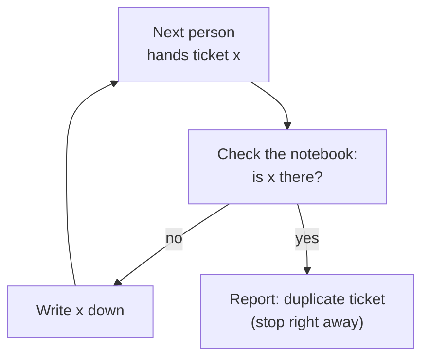

> [!tldr] Quick read
> - The problem: given an array of integers, return `true` if some number appears two or more times.
> - [[en/concepts/brute-force|Brute force]] compares every pair: [[en/concepts/big-o-notation|O(n²)]]. With 10,000 numbers it takes 38 ms; with 100,000 numbers it would take several seconds.
> - [[en/concepts/sort-then-scan|Sort then scan]]: duplicates end up next to each other, O(n log n). In JS you must pass a comparator, because `sort()` compares **strings** by default.
> - [[en/concepts/hash-set|Hash set]]: write every number you have seen into a `Set`; a lookup costs O(1) on average, O(n) in total. When a duplicate shows up early, it stops right away: 0.000 ms against 206 ms for the sorting approach.
> - Trading memory for time is a [[en/concepts/space-time-tradeoff|tradeoff]], not a free lunch: the Set costs O(n) memory, while sorting in place costs almost none.

> [!info] Context
> LeetCode problem 217, part of [[en/posts/2026-11-22-neetcode-hash-lookup|station 1: Hash Lookup]] on **the NeetCode line: Arrays and Strings**. NeetCode 150 is a list of 150 LeetCode problems ordered by solution pattern; this is the very first problem on the list. Every problem page has runnable solutions in TypeScript, JavaScript, Python, Go and Java. All you need is to be able to write a loop and a function in any language.

> [!abstract]- Quick glossary for this post (click to open)
> - **Array**: a sequence of elements numbered from 0. Reading element i takes the same time whether i is large or small.
> - **n**: the number of elements in the input. Every measurement in this post is in terms of n.
> - **Time / space complexity**: how the number of steps, or the amount of extra memory, grows as n grows.
> - **Hash**: a function that turns a value into a number, used to pick the slot to store it in a table. Two equal values always have the same hash.
> - **Set**: a structure that holds non-repeating values and can answer "is x in here?". `Set` (JS/TS), `set` (Python), `HashSet` (Java); Go has no dedicated type and uses a `map`.
> - **Median**: the middle value when you sort the measurements; a single outlier run skews it less than the mean.

## Picture it first: the ticket checker at the door

A concert hands out numbered tickets. You stand at the door, and your only job is to spot whether two people hold **the same ticket number**.

| Everyday life | Concept |
|---|---|
| Each time someone arrives, you compare their ticket with that of **every person** already inside | [[en/concepts/brute-force\|Brute force]], O(n²) |
| Collect all the tickets, sort them by number, then look at each pair of adjacent tickets | [[en/concepts/sort-then-scan\|Sort then scan]], O(n log n) |
| Hold a notebook indexed by ticket number; when someone arrives, look it up, and if it is not there, write it down | [[en/concepts/hash-set\|Hash set]], O(n) |
| The notebook must be thick enough to hold every ticket number | [[en/concepts/space-time-tradeoff\|Trading memory for time]] |
| If the number of guests doubles, how many times more work do you have? | [[en/concepts/big-o-notation\|Big-O]] |



## The problem

**The problem (in my own words):** given an integer array `nums`, return `true` if at least one value appears two or more times, otherwise return `false`. Original problem: [LeetCode 217](https://leetcode.com/problems/contains-duplicate/).

| Input | Output | Why |
|---|---|---|
| `[1, 2, 3, 1]` | `true` | 1 appears twice |
| `[1, 2, 3, 4]` | `false` | all numbers are distinct |
| `[1, 1, 1, 3, 3, 4, 3, 2, 4, 2]` | `true` | several numbers repeat |

Constraints: the array has up to **100,000** elements, and each number lies in the range **±10⁹**. These constraints are exactly what decides which solution passes. I used to think "easy problem, two loops and done". Two loops over 100,000 elements is about 5 billion comparisons, well over the time limit.

Values up to 10⁹ also rule out the trick of "make a marker array with 10⁹ slots": that array would take several GB.

## How it works

<figure class="figure-map" style="--ar: 3 / 4">
<div class="frame"><iframe data-archify="../../diagrams/neetcode-contains-duplicate/seen-set.en.html" title="Walking [1, 2, 3, 1] with a seen Set" loading="lazy"></iframe></div>
<figcaption><span><b>Figure 1.</b> Walking [1, 2, 3, 1]: each number asks the notebook "is it there?", and if not, writes itself down. The second 1 finds it already there, so the loop stops right away without reading further.</span><a href="../diagrams/neetcode-contains-duplicate/seen-set.en.html" target="_blank" rel="noopener">Open full screen</a></figcaption>
</figure>

### Big-O: measuring shape, not seconds

[[en/concepts/big-o-notation|Big-O]] describes how the number of steps grows as n grows, ignoring constants and lower-order terms. "O(n²)" means that when n grows 10 times, the number of steps grows about 100 times. Big-O does not say how many milliseconds an algorithm takes; it says how steeply the curve bends. Two O(n) algorithms can differ by a factor of 10, and an O(n) algorithm can be slower than an O(n log n) algorithm at every size you will actually meet (Top K Frequent Elements has an example).

There are two things to measure: **time** (number of steps) and **auxiliary space** (memory used beyond the input). When people say "O(1) space", they usually do not count the input array itself.

### Approach 1, brute force: O(n²) time, O(1) space

[[en/concepts/brute-force|Brute force]] tries every possibility: for each i, compare `nums[i]` with every `nums[j]` after it. The number of pairs is n(n−1)/2, that is, O(n²). It is correct, uses no memory, and is a good starting point for saying "I know a correct approach, now let's make it faster".

### Approach 2, sort then scan: O(n log n) time

After sorting, all equal numbers sit next to each other, so you only need to compare each element with the one right before it. This is the [[en/concepts/sort-then-scan|sort then scan]] trick, which gets reused a lot later. The cost is in the sorting step, O(n log n) for any comparison-based sort.

The auxiliary space depends:

- Sorting **in place** over the caller's array: almost O(1), but it ruins their input. In real code, that is a worrying side effect.
- Copy, then sort: O(n).
- The sorting algorithm itself may also use extra memory. The TimSort in V8 and Python needs up to n/2 temporary slots when merging.

Each language uses a different algorithm (table below), but all of them are O(n log n).

### Approach 3, hash set: O(n) time, O(n) space

A [[en/concepts/hash-set|hash set]] answers "is x in here?" without scanning everything. It computes the hash of x to know which slot x must be in, then looks only at that slot. On average, each lookup and insert is O(1), so the whole problem is O(n). The ECMAScript specification does not require `Set` to be a hash table; it only requires average access time that is **sublinear** in the number of elements.

An advantage that rarely gets mentioned: **early exit**. If the first two numbers are already equal, the loop ends after 2 steps. The sorting approach always has to sort the whole array first.

It is a [[en/concepts/space-time-tradeoff|trade of memory for time]]: the notebook costs O(n) memory. For 100,000 numbers that is negligible. For a billion numbers on a machine with little RAM, sorting in place may be the only option.

### Under the five languages

| | What "Set" is | Default sort |
|---|---|---|
| TypeScript / JavaScript | `Set`, compares keys with SameValueZero (`NaN` equals `NaN`); V8 implements it as a hash table that keeps insertion order | `Array.prototype.sort`: TimSort in V8; **without a comparator it compares as strings** |
| Python | `set`, an open-addressing hash table; `hash(n)` of an integer is n itself (except −1) | `sorted` / `list.sort`: TimSort, merging with the powersort strategy since 3.11 |
| Go | no set type; use `map[int]struct{}` (empty value, 0 bytes). Since Go 1.24 maps are Swiss Tables | `slices.Sort`: pdqsort since Go 1.19 |
| Java | `HashSet<Integer>`, which is really a `HashMap`; every `int` gets **boxed** into an `Integer` | `Arrays.sort(int[])`: Dual-Pivot Quicksort, no boxing |

## Runnable example

One file per language, each running its own tests: [TypeScript](../code/neetcode-contains-duplicate/contains-duplicate.ts) · [JavaScript](../code/neetcode-contains-duplicate/contains-duplicate.js) · [Python](../code/neetcode-contains-duplicate/contains_duplicate.py) · [Go](../code/neetcode-contains-duplicate/contains_duplicate.go) · [Java](../code/neetcode-contains-duplicate/contains-duplicate.java).

```ts
// TypeScript: node contains-duplicate.ts
function hashSet(nums: number[]): boolean {
  const seen = new Set<number>();
  for (const x of nums) {
    if (seen.has(x)) return true; // seen before: a duplicate, stop right away
    seen.add(x);
  }
  return false;
}

function sortThenScan(nums: number[]): boolean {
  const a = [...nums].sort((x, y) => x - y); // numeric compare; by default JS compares strings
  for (let i = 1; i < a.length; i++) if (a[i] === a[i - 1]) return true;
  return false;
}
```

```python
def contains_duplicate(nums: list[int]) -> bool:
    seen: set[int] = set()
    for x in nums:
        if x in seen:  # set lookup: O(1) on average
            return True
        seen.add(x)
    return False

# one-liner: compact, but always builds the whole set, no early exit
def contains_duplicate_oneliner(nums: list[int]) -> bool:
    return len(set(nums)) != len(nums)
```

```go
// map[int]struct{} is how you write a "set" in Go: struct{} takes no bytes.
func containsDuplicate(nums []int) bool {
	seen := make(map[int]struct{}, len(nums)) // preallocate to avoid growing the table many times
	for _, x := range nums {
		if _, ok := seen[x]; ok {
			return true
		}
		seen[x] = struct{}{}
	}
	return false
}
```

```java
// HashSet.add returns false if the element is already present: one lookup instead of contains + add.
static boolean containsDuplicate(int[] nums) {
    Set<Integer> seen = new HashSet<>(nums.length * 2);
    for (int x : nums) {
        if (!seen.add(x)) return true;
    }
    return false;
}
```

```js
function containsDuplicate(nums) {
  const seen = new Set();
  for (const x of nums) {
    if (seen.has(x)) return true;
    seen.add(x);
  }
  return false;
}
```

The TypeScript file runs the tests for all four approaches, then measures on an array **with no duplicates** (the worst case, where no approach can exit early):

```text
$ node contains-duplicate.ts
test: 4 approaches × 6 cases, 0 cases failed

[10, 9, 1, 100].sort()           → [1,10,100,9]
[10, 9, 1, 100].sort((a,b)=>a-b) → [1,9,10,100]
Set treats NaN as equal to NaN: true | NaN === NaN: false

n         brute force    sort  hash set  one-liner   (ms, median of 5 runs)
1000          0.50      0.12      0.08      0.03
10000        38.46      1.32      0.60      0.46
100000           –     16.94      4.85      4.47
1000000          –    205.57     66.85     65.29

duplicate at positions 0 and 1, n = 1 000 000: sort 206.11 ms, hash set 0.000 ms, one-liner 64.48 ms
```

*(Output labels translated; the files themselves print Vietnamese.)*

Reading the results:

- **Brute force**: n grows 10 times (1,000 → 10,000), time grows 77 times, exactly the shape of O(n²). At the same ratio, 100,000 numbers would take about 4 seconds, so I did not run it.
- **Sort** and **hash set**: n grows 10 times, time grows about 10–13 times. The hash set is about 3 times faster than sorting at every size.
- **The one-liner** (`new Set(nums).size !== nums.length`) is as fast as the hash set when there are no duplicates, because building a `Set` from a whole array in one go is well optimized. But when the duplicate sits right at the start of the array, it still takes 64 ms, while the loop with early exit takes nothing.
- Python, Go and Java print `✓` for the same test cases.

## Misconceptions and common traps

- **"The algorithm with the smaller Big-O is always faster."** Big-O drops constants. Here the order matches Big-O, but Top K Frequent Elements has a case where O(n) is slower than O(n log n).
- **Calling `sort()` without a comparator in JS.** `[10, 9, 1, 100].sort()` gives `[1, 10, 100, 9]`, because the spec converts each number to a string before comparing. In this problem, luckily, equal numbers still end up next to each other, so the result is still correct. In Two Sum, the same mistake makes the answer flat-out wrong.
- **Sorting the caller's array in place.** `nums.sort()` in JS, `list.sort()` in Python, `Arrays.sort(nums)` in Java and `slices.Sort(nums)` in Go all modify the input directly. Copy it first if the caller still uses that array.
- **"A hash set is always O(1)."** That is the average. Two Sum shows that when every key lands in the same bucket, a Java `HashMap` slows down to O(n) per lookup.
- **Forgetting that the "one-liner" has no early exit.** `len(set(nums)) != len(nums)` is neat and compact, but it always costs O(n) time and O(n) memory, even when the first two numbers are already equal.
- **Java: assuming `HashSet<Integer>` is as cheap as an `int` array.** Each element is a separate `Integer` object, plus a node in the table. With a few million elements, sorting an `int[]` can use far less memory.

## Self-check questions

> [!question]- Brute force with n = 10,000 takes about 38 ms. Estimate n = 100,000, and explain why.
> About 3.8 seconds. O(n²) means that when n grows 10 times, the number of pairs to compare grows about 100 times.

> [!question]- Why, after sorting, is it enough to compare each element with the one right before it?
> Sorting puts all equal values into one contiguous run. If two numbers are equal, at least one pair in that run consists of two adjacent elements.

> [!question]- Where do the hash set and the "one-liner" `new Set(nums).size !== nums.length` differ, even though both are O(n)?
> The loop with `has` then `add` stops as soon as it meets the first duplicate. The one-liner always reads the whole array and builds the whole set.

> [!question]- The machine has very little RAM left, and an array of a billion numbers may be modified in place. Which approach do you pick?
> Sort in place, then scan: O(n log n) time but almost no auxiliary space. A hash set needs memory proportional to n.

> [!question]- In Go, why do people write `map[int]struct{}` instead of `map[int]bool` for a set?
> `struct{}` has size 0 bytes, so the values take no room, and the type says clearly "only the keys matter". `map[int]bool` works too, but each element costs an extra byte.

## References

- [LeetCode 217: Contains Duplicate](https://leetcode.com/problems/contains-duplicate/) (original problem)
- [ECMAScript 2025](https://tc39.es/ecma262/2025/) (Set: sublinear average access, keys compared with SameValueZero; `Array.prototype.sort` compares as strings without a comparator)
- [V8: Getting things sorted in V8](https://v8.dev/blog/array-sort) (TimSort)
- [Go 1.19 release notes](https://go.dev/doc/go1.19) (pdqsort) and [Go 1.24 release notes](https://go.dev/doc/go1.24) (maps use Swiss Tables)
- [Java 21: Arrays](https://docs.oracle.com/en/java/javase/21/docs/api/java.base/java/util/Arrays.html) (Dual-Pivot Quicksort for primitive arrays)
- [CPython: listsort.txt](https://github.com/python/cpython/blob/main/Objects/listsort.txt) (TimSort and powersort)
