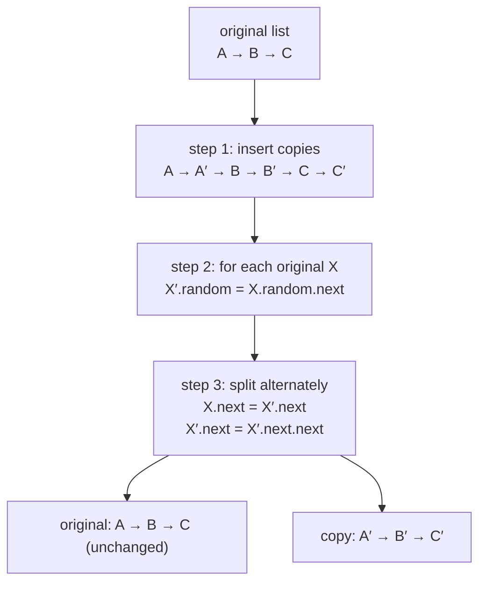

> [!tldr] Quick read
> - The problem: each node has `next` plus a `random` pointer (to any node in the list, or null). Make a **deep** copy: brand-new nodes, and every `next` and `random` of the copy points to a node **of the copy**, never to an old node.
> - The difficulty: when copying node A, the node that `A.random` points to may not be copied yet. The natural fix is a [[en/concepts/hash-map|hash map]] from **old node → new node**: pass 1 creates every new node, pass 2 wires them through the table. O(n) time, O(n) extra memory.
> - The table-free way: [[en/concepts/node-interleaving|weave each copy]] right after its original (A → A′ → B → B′ …). Then the copy of `X.random` is simply `X.random.next`. Set the randoms, then split the two lists. At 10⁶ nodes in TypeScript: 30 ms and 48 MB, against 175 ms and 107 MB for the table.
> - The most dangerous wrong version prints **exactly** like the answer: the copy's random points to old nodes. Change the original list and the copy changes with it. Weaving that forgets to give the original its `next` back is also wrong on 6/7 cases, even though the copy itself is right.
> - Ready-made deep copies don't do the job either: `structuredClone` breaks at 1645 nodes and loses the `Node` class, Python's `copy.deepcopy` breaks at 249 nodes, while the problem allows up to 1000.

> [!info] Context
> LeetCode problem 138 of [[en/posts/2026-11-24-neetcode-advanced-linked-list|station 2: Advanced Linked Lists]] on **the NeetCode Line: Linked Structures**. At station 1, every problem only changed the `next` arrows of existing nodes. This one has to build a whole new list, and the hard part is the second pointer, `random`, which jumps anywhere. Solutions come in TypeScript, Python, Go, Java and JavaScript. You only need loops, objects and a hash map.

> [!abstract]- Quick glossary for this post (click to open)
> - **Linked list**: a chain of nodes, each with a value and a `next` arrow. See [[en/concepts/linked-list|Linked List]].
> - **Shallow copy**: a new object whose pointer fields still point to the old objects.
> - **Deep copy**: also copy whatever is pointed to, recursively, so the copy shares nothing with the original.
> - **Identity**: two variables refer to **the same** object. Different from "equal by value": two nodes with `val = 3` are still two different nodes.
> - **Hash map**: key → value lookup in O(1) on average. See [[en/concepts/hash-map|Hash Map]].
> - **Node interleaving**: inserting new nodes between the old ones so that an old node's position tells you its new counterpart. See [[en/concepts/node-interleaving|Node Interleaving]].

## Picture it first: moving a whole class into a new room

A class sits in a row (each student knows who sits behind them: `next`), and each student is also assigned to **mentor** some classmate (`random`). The school opens a parallel class: a group of new students seated exactly like the old class, where new student number 2 mentors **the new** counterpart, not the old one. The teacher has two options. The first: write a **lookup sheet** "old An ↔ new An" for the whole class, then use it to seat everyone and assign mentors. The second needs no paper: seat each new student **right behind** their old counterpart. To find whom new An mentors, look at whom old An mentors, then take **the person sitting right behind** them. Once that is done, split the two rows and give the old class its seats back as they were.

| Everyday life | Concept |
|---|---|
| A student | a node |
| The person behind you | `next` |
| The classmate you mentor | `random` |
| The old ↔ new lookup sheet | hash map from old node to new node |
| New student right behind the old one | node interleaving: A → A′ → B → B′ |
| New mentor target = whoever sits behind the old target | `X.next.random = X.random.next` |
| Split the rows, give the old class its seats back | split the lists, restore the original `next` |
| A new student mentoring an old one | the wrong version: random points into the old list |



## The problem

Copying a list with only `next` is easy: walk from the head, create a new node, append it to the tail. `random` gets in the way: while copying node 2, if its `random` points to node 5, the **new** node 5 does not exist yet. Assigning `copy.random = cur.random` directly makes the copy point to an **old** node: the printed values are still right, but it is a shallow copy. We need a way to go from any old node to its new counterpart.

## How it works

<figure class="figure-map" style="--ar: 3 / 4">
<div class="frame"><iframe data-archify="../../diagrams/neetcode-copy-list-with-random-pointer/worked-example.en.html" title="Interleave copies to locate random targets" loading="lazy"></iframe></div>
<figcaption><span><b>Figure 1.</b> Interleave copies to locate random targets.</span><a href="../diagrams/neetcode-copy-list-with-random-pointer/worked-example.en.html" target="_blank" rel="noopener">Open full screen</a></figcaption>
</figure>

<details>
<summary>Read the steps</summary>
<ol>
<li>Copy each node directly after its original. <code>A → A&#x27; → B → B&#x27;</code></li>
<li>Read the random pointer from A to B. <code>A.random = B</code></li>
<li>The target copy sits right after B. <code>A&#x27;.random = B.next = B&#x27;</code></li>
<li>Separate the two lists. <code>A → B; A&#x27; → B&#x27;</code></li>
</ol>
</details>

### Approach 1: an old → new table, two passes

Pass 1 walks the list, creates each new node (unwired) and records `map[old] = new`. Pass 2 walks again and wires `new.next = map[old.next]` and `new.random = map[old.random]`. By now every new node exists, so a lookup never misses.

```ts
// Approach 1: a hash map from old node → new node, two passes.
function copyTwoPass(head: Node | null): Node | null {
  const map = new Map<Node, Node>();
  // pass 1: create every new node, unwired
  for (let cur = head; cur !== null; cur = cur.next) map.set(cur, new Node(cur.val));
  // pass 2: wire next and random through the table
  for (let cur = head; cur !== null; cur = cur.next) {
    const copy = map.get(cur)!;
    copy.next = cur.next === null ? null : map.get(cur.next)!;
    copy.random = cur.random === null ? null : map.get(cur.random)!;
  }
  return head === null ? null : map.get(head)!;
}
```


The table's key is **the node object itself**, compared by identity. The problem allows several nodes with the same value (example 3: three nodes all `3`), so keying by value is wrong. This is where each language sets its own trap; see the table below.

### Approach 2: one pass, create on demand

Merge the two passes: whenever an old node (the current one, its `next`, its `random`) has no copy yet, create it right away and record it.

```ts
// Approach 2: one pass, create a node's copy as soon as it is needed (get-or-create).
function copyOnePass(head: Node | null): Node | null {
  const map = new Map<Node, Node>();
  const get = (n: Node | null): Node | null => {
    if (n === null) return null;
    let c = map.get(n);
    if (c === undefined) { c = new Node(n.val); map.set(n, c); }
    return c;
  };
  for (let cur = head; cur !== null; cur = cur.next) {
    const copy = get(cur)!;
    copy.next = get(cur.next);
    copy.random = get(cur.random);
  }
  return get(head);
}
```


Fewer passes but not faster: each step does 3 lookups instead of 2. Measured at 10⁶ nodes: 222 ms against 175 ms for two passes.

### Approach 3: weave the copies in, O(1) extra memory

The table spends memory only to answer "which new node belongs to X?". Put the new node **right after** X and the answer is `X.next`, no table needed.

```ts
// Approach 3: weave each copy right after its original (A → A' → B → B' …), set random, then split. O(1) extra memory.
function copyInterleave(head: Node | null): Node | null {
  if (head === null) return null;
  // step 1: insert A' right after A
  for (let cur: Node | null = head; cur !== null; cur = cur.next!.next) {
    const copy = new Node(cur.val);
    copy.next = cur.next;
    cur.next = copy;
  }
  // step 2: the copy of X.random is X.random.next
  for (let cur: Node | null = head; cur !== null; cur = cur.next!.next) {
    cur.next!.random = cur.random === null ? null : cur.random.next;
  }
  // step 3: split the two lists, give the original its next back
  const newHead = head.next!;
  for (let cur: Node | null = head; cur !== null; cur = cur.next) {
    const copy: Node = cur.next!;
    cur.next = copy.next;
    copy.next = copy.next === null ? null : copy.next.next;
  }
  return newHead;
}
```


- **Step 1** inserts A′ after A, B′ after B, … The `for` loop jumps `cur.next.next` to skip the node it just inserted.
- **Step 2** sets the randoms: if `A.random` is C then `A′.random` must be C′, and C′ sits at `C.next`. This step reads only `next`, so it must happen **before** the split.
- **Step 3** splits: each original skips over its copy (`cur.next = copy.next`), each copy skips over the next original.

"O(1) extra memory" means nothing beyond the new nodes themselves (which the problem requires). That is why the measured memory for weaving (48 MB at 10⁶ nodes) equals exactly the size of 10⁶ new nodes, while the table approach spends about 58 MB more on the table.

### Wrong version 1: random points back into the old list

```ts
// WRONG: next is copied right but random still points to nodes of the OLD list. It prints exactly the same.
function wrongRandomToOld(head: Node | null): Node | null {
  const dummy = new Node(0);
  let tail = dummy;
  for (let cur = head; cur !== null; cur = cur.next) {
    const copy = new Node(cur.val);
    copy.random = cur.random; // an old node, not a copy
    tail.next = copy;
    tail = copy;
  }
  return dummy.next;
}
```


Compared by value, this version is right everywhere. The file also checks what the problem actually demands: no node of the copy, and no `random` of the copy, points into the old list. This version is wrong on 5/7 cases and only passes the empty list and the list with all randoms null. To see it with your own eyes, the file adds 100 to every value of the **original** list after copying: the copy's random values read `[null,7,1,11,7]` before and `[null,107,101,111,107]` after. The "copy" is still attached to the original.

### Wrong version 2: weave, then forget to restore the original

```ts
// WRONG: weaves and splits the copy out but forgets to give the original its next back. The copy is right, the original is broken.
function wrongNoRestore(head: Node | null): Node | null {
  if (head === null) return null;
  for (let cur: Node | null = head; cur !== null; cur = cur.next!.next) {
    const copy = new Node(cur.val);
    copy.next = cur.next;
    cur.next = copy;
  }
  for (let cur: Node | null = head; cur !== null; cur = cur.next!.next) {
    cur.next!.random = cur.random === null ? null : cur.random.next;
  }
  const newHead = head.next!;
  for (let copy: Node | null = newHead; copy !== null; copy = copy.next) {
    copy.next = copy.next === null ? null : copy.next.next;
  }
  return newHead;
}
```


Step 3 only splits the copy out, and the original nodes still point into the copy: walking `next` from the original head meets A, A′, B, B′, … The returned copy is **entirely right**, but the problem forbids changing the input, and LeetCode checks the original list too. Wrong on 6/7 cases; only the empty list gets through.

### Under the five languages

An old → new table is right only when the table compares keys by **identity**. Each language has a way to compare by something else by accident:

| | Table to use | Language-specific trap (run) |
|---|---|---|
| TypeScript | `Map<Node, Node>` (compares object keys by identity) | `structuredClone(head)` copies the cyclic structure correctly but returns plain objects, `c instanceof Node` is `false`; and it throws `RangeError` when the list is longer than 1645 nodes |
| Python | `dict` with a plain class (hashed by `id`) | a node written as a `@dataclass` cannot be a key: `TypeError: unhashable type`, wrong on 6/7 cases. `copy.deepcopy` is right but throws `RecursionError` from 250 nodes |
| Go | `map[*Node]*Node` (the key is the address) | `c := *cur` copies the whole struct, so `Next` and `Random` are still the old pointers: a shallow copy, wrong on 6/7 |
| Java | `HashMap` with a plain class, or `IdentityHashMap` | a node class with `equals`/`hashCode` by `val`: two nodes with the same value become one key, wrong on the `[3,3,3]` case; `IdentityHashMap` is right on 7/7 |
| JavaScript | `Map` | a plain object `{}` as the table: object keys turn into the string `"[object Object]"`, every node shares one slot, wrong on 5/7 |

The `@dataclass` trap has the same root as on the [[en/problems/linked-list-cycle|Linked List Cycle]] page: `@dataclass` defaults to `eq=True`, which generates a field-by-field `__eq__` and sets `__hash__ = None`. On problem 141 it made the `set` of visited nodes throw `TypeError`; here it makes the old → new `dict` throw the same error. Even with `unsafe_hash=True`, the key would hash by `(val, next, random)` and recurse through the whole list, both slow and wrong when two nodes look identical. A plain class that does not define `__eq__` hashes by `id`, which is exactly what we need.

As for `copy.deepcopy` and `structuredClone`, both are "built-in deep copies": they keep a table of already-copied objects (exactly the idea of approach 1), so they handle cycles and sharing. But both follow pointers **recursively**, so a long list becomes a chain of nested calls as long as the list. The problem allows up to 1000 nodes: Python breaks first (249), JavaScript passes the limit but loses the `Node` class.

### Measurements

TypeScript, random lists (mulberry32, 20% null randoms), median of 5 runs; memory is the heap growth after the function runs, **including the new nodes**:

| n nodes | Two passes (Map) | One pass (Map) | Weaving |
|---|---|---|---|
| 10⁵ | 10.12 ms, 12.3 MB | 11.20 ms, 12.2 MB | 2.09 ms, 4.8 MB |
| 10⁶ | 174.60 ms, 106.8 MB | 222.17 ms, 106.8 MB | 30.45 ms, 48.0 MB |

- Weaving is about 6 times faster than the table: no hashing, no table allocation, only arrow changes.
- 48 MB is the price of 10⁶ new nodes, which every approach pays. The 58 MB difference is the table.

The other languages at 10⁶ nodes: Go table 186.82 ms and 99.6 MB allocated, weaving 24.93 ms and 24.0 MB; Java `HashMap` 257.44 ms, `IdentityHashMap` 219.95 ms, weaving 19.83 ms. Python at 10⁵ nodes: table 106.07 ms and 15.55 MB peak, weaving 123.62 ms and 8.80 MB (Python is not faster because three interpreted loops cost more than three `dict` lookups written in C, but it still halves the memory). `copy.deepcopy` on 200 nodes takes 20.85 ms against 0.12 ms for the table: about 170 times slower, because it inspects types and copies every attribute generically.

## Runnable example

[TypeScript](../code/neetcode-copy-list-with-random-pointer/copy-random-list.ts) · [Python](../code/neetcode-copy-list-with-random-pointer/copy_random_list.py) · [Go](../code/neetcode-copy-list-with-random-pointer/copy_random_list.go) · [Java](../code/neetcode-copy-list-with-random-pointer/copy-random-list.java) · [JavaScript](../code/neetcode-copy-list-with-random-pointer/copy-random-list.js) · [PHP](../code/neetcode-copy-list-with-random-pointer/copy-random-list.php)

Each of the original five files runs 7 shared cases: the three examples of the problem, an empty list, one node whose random points to itself, all randoms null, all randoms pointing to the last node. Each case checks three things: the copy has the right structure (values and random positions), no node of the copy (including through random) belongs to the original list, and the original list is unchanged. TypeScript also runs 2000 random lists of length 0..60.

Old → new table, two passes:

```ts
// Approach 1: a hash map from old node → new node, two passes.
function copyTwoPass(head: Node | null): Node | null {
  const map = new Map<Node, Node>();
  // pass 1: create every new node, unwired
  for (let cur = head; cur !== null; cur = cur.next) map.set(cur, new Node(cur.val));
  // pass 2: wire next and random through the table
  for (let cur = head; cur !== null; cur = cur.next) {
    const copy = map.get(cur)!;
    copy.next = cur.next === null ? null : map.get(cur.next)!;
    copy.random = cur.random === null ? null : map.get(cur.random)!;
  }
  return head === null ? null : map.get(head)!;
}
```

```python
# Approach 1: a dict from old node → new node, two passes. The key is the node object itself: a plain Node hashes by identity (id).
def copy_two_pass(head):
    m = {}
    cur = head
    while cur:
        m[cur] = Node(cur.val)
        cur = cur.next
    cur = head
    while cur:
        m[cur].next = m.get(cur.next)
        m[cur].random = m.get(cur.random)
        cur = cur.next
    return m.get(head)
```

```go
// Approach 1: a map from old node pointer → new node, two passes. A *Node key compares by address.
func copyTwoPass(head *Node) *Node {
	m := map[*Node]*Node{nil: nil}
	for cur := head; cur != nil; cur = cur.Next {
		m[cur] = &Node{Val: cur.Val}
	}
	for cur := head; cur != nil; cur = cur.Next {
		m[cur].Next = m[cur.Next]
		m[cur].Random = m[cur.Random]
	}
	return m[head]
}
```

```java
// Approach 1: old node → new node table, two passes. HashMap uses the key's equals/hashCode; a plain Node inherits Object's (identity).
static Node copyTwoPass(Node head) {
    Map<Node, Node> map = new HashMap<>();
    for (Node cur = head; cur != null; cur = cur.next) map.put(cur, new Node(cur.val));
    for (Node cur = head; cur != null; cur = cur.next) {
        map.get(cur).next = map.get(cur.next);
        map.get(cur).random = map.get(cur.random);
    }
    return map.get(head);
}
```

```js
// Approach 1: a Map from old node → new node, two passes. Map compares object keys by identity.
function copyTwoPass(head) {
  const map = new Map();
  for (let cur = head; cur !== null; cur = cur.next) map.set(cur, new Node(cur.val));
  for (let cur = head; cur !== null; cur = cur.next) {
    map.get(cur).next = cur.next === null ? null : map.get(cur.next);
    map.get(cur).random = cur.random === null ? null : map.get(cur.random);
  }
  return head === null ? null : map.get(head);
}
```

```php
<?php
declare(strict_types=1);

final class Node {
    public ?Node $next = null;
    public ?Node $random = null;

    public function __construct(public int $val) {}
}

function copyRandomList(?Node $head): ?Node {
    if ($head === null) return null;
    $copies = new SplObjectStorage();
    for ($old = $head; $old !== null; $old = $old->next) {
        $copies[$old] = new Node($old->val);
    }
    for ($old = $head; $old !== null; $old = $old->next) {
        $new = $copies[$old];
        $new->next = $old->next === null ? null : $copies[$old->next];
        $new->random = $old->random === null ? null : $copies[$old->random];
    }
    return $copies[$head];
}
```


Weaving, O(1) extra memory:

```ts
// Approach 3: weave each copy right after its original (A → A' → B → B' …), set random, then split. O(1) extra memory.
function copyInterleave(head: Node | null): Node | null {
  if (head === null) return null;
  // step 1: insert A' right after A
  for (let cur: Node | null = head; cur !== null; cur = cur.next!.next) {
    const copy = new Node(cur.val);
    copy.next = cur.next;
    cur.next = copy;
  }
  // step 2: the copy of X.random is X.random.next
  for (let cur: Node | null = head; cur !== null; cur = cur.next!.next) {
    cur.next!.random = cur.random === null ? null : cur.random.next;
  }
  // step 3: split the two lists, give the original its next back
  const newHead = head.next!;
  for (let cur: Node | null = head; cur !== null; cur = cur.next) {
    const copy: Node = cur.next!;
    cur.next = copy.next;
    copy.next = copy.next === null ? null : copy.next.next;
  }
  return newHead;
}
```

```python
# Approach 3: weave copies after the originals, set random, split. O(1) extra memory.
def copy_interleave(head):
    if head is None:
        return None
    cur = head
    while cur:
        cur.next = Node(cur.val, cur.next)
        cur = cur.next.next
    cur = head
    while cur:
        cur.next.random = cur.random.next if cur.random else None
        cur = cur.next.next
    new_head = head.next
    cur = head
    while cur:
        c = cur.next
        cur.next = c.next
        c.next = c.next.next if c.next else None
        cur = cur.next
    return new_head
```

```go
// Approach 3: weave copies after the originals, set random, split.
func copyInterleave(head *Node) *Node {
	if head == nil {
		return nil
	}
	for cur := head; cur != nil; cur = cur.Next.Next {
		cur.Next = &Node{Val: cur.Val, Next: cur.Next}
	}
	for cur := head; cur != nil; cur = cur.Next.Next {
		if cur.Random != nil {
			cur.Next.Random = cur.Random.Next
		}
	}
	newHead := head.Next
	for cur := head; cur != nil; cur = cur.Next {
		c := cur.Next
		cur.Next = c.Next
		if c.Next != nil {
			c.Next = c.Next.Next
		}
	}
	return newHead
}
```

```java
// Approach 3: weave copies after the originals, set random, split.
static Node copyInterleave(Node head) {
    if (head == null) return null;
    for (Node cur = head; cur != null; cur = cur.next.next) {
        Node c = new Node(cur.val);
        c.next = cur.next;
        cur.next = c;
    }
    for (Node cur = head; cur != null; cur = cur.next.next) cur.next.random = cur.random == null ? null : cur.random.next;
    Node newHead = head.next;
    for (Node cur = head; cur != null; cur = cur.next) {
        Node c = cur.next;
        cur.next = c.next;
        c.next = c.next == null ? null : c.next.next;
    }
    return newHead;
}
```

```js
// Approach 3: weave copies after the originals, set random, split.
function copyInterleave(head) {
  if (head === null) return null;
  for (let cur = head; cur !== null; cur = cur.next.next) {
    const c = new Node(cur.val);
    c.next = cur.next;
    cur.next = c;
  }
  for (let cur = head; cur !== null; cur = cur.next.next) cur.next.random = cur.random === null ? null : cur.random.next;
  const newHead = head.next;
  for (let cur = head; cur !== null; cur = cur.next) {
    const c = cur.next;
    cur.next = c.next;
    c.next = c.next === null ? null : c.next.next;
  }
  return newHead;
}
```


Each language's own trap:

```python
# A node written as a @dataclass: the default eq=True generates __eq__ and sets __hash__ = None, so it cannot be a dict key.
@dataclass
class DataNode:
    val: int
    next: "DataNode | None" = None
    random: "DataNode | None" = None
```

```go
// WRONG: c := *cur copies the whole struct, so the copy's Next and Random still point into the OLD list (a shallow copy).
func wrongStructCopy(head *Node) *Node {
	if head == nil {
		return nil
	}
	c := *head
	return &c
}
```

```java
// A "convenient" node with value-based equals/hashCode: HashMap treats two nodes with the same val as one key.
static class ValueNode extends Node {
    ValueNode(int val) { super(val); }
    @Override public boolean equals(Object o) { return o instanceof ValueNode v && v.val == val; }
    @Override public int hashCode() { return Integer.hashCode(val); }
}
```

```js
// WRONG: a plain object {} as the table. Object keys turn into the string "[object Object]", so every node shares one slot.
function wrongObjectMap(head) {
  const map = {};
  for (let cur = head; cur !== null; cur = cur.next) map[cur] = new Node(cur.val);
  for (let cur = head; cur !== null; cur = cur.next) {
    map[cur].next = cur.next === null ? null : map[cur.next];
    map[cur].random = cur.random === null ? null : map[cur.random];
  }
  return head === null ? null : map[head];
}
```


Output of `node copy-random-list.ts`:

```text
copyTwoPass      7/7 cases correct
copyOnePass      7/7 cases correct
copyInterleave   7/7 cases correct
wrongRandomToOld 2/7 cases correct; wrong on example 1 of the problem → shares nodes with the original list, example 2 → shares nodes with the original list, example 3 (repeated values) → shares nodes with the original list, one node pointing to itself → shares nodes with the original list, all randoms point to the last node → shares nodes with the original list
wrongNoRestore   1/7 cases correct; wrong on example 1 of the problem → original list changed, example 2 → original list changed, example 3 (repeated values) → original list changed, one node pointing to itself → original list changed, all randoms null → original list changed, all randoms point to the last node → original list changed

wrongRandomToOld, the copy's random values: before [null,7,1,11,7] → after changing the original list [null,107,101,111,107]
random: the three correct versions pass the checks (structure, no shared nodes, original intact) on 2000/2000 lists

structuredClone: structure right, random of node 2 points to node 1 of the copy: true, still a Node: false
JSON.stringify(head): ném TypeError
structuredClone copies lists of at most 1645 nodes; longer ones throw RangeError

n nodes    two passes (Map)       one pass (Map)         weaving
100000        10.16 ms  12.3 MB      11.20 ms  12.2 MB       2.09 ms   4.8 MB
1000000      174.60 ms 106.8 MB     222.17 ms 106.8 MB      30.45 ms  48.0 MB
```

Output of `python3 copy_random_list.py`:

```text
copy_two_pass            7/7 cases correct
copy_interleave          7/7 cases correct
copy_deepcopy            7/7 cases correct
copy_two_pass (DataNode) 1/7 cases correct; wrong on 6 cases, first: example 1 of the problem → throws TypeError

copy.deepcopy copies lists of at most 249 nodes (recursion limit 1000); longer ones throw RecursionError

n nodes    two passes (dict)      weaving                deepcopy
200             0.12 ms   0.03 MB        0.10 ms   0.02 MB       20.85 ms   0.20 MB
100000        106.07 ms  15.55 MB      123.62 ms   8.80 MB        RecursionError     
```

Output of `go run copy_random_list.go`:

```text
copyTwoPass      7/7 cases correct
copyInterleave   7/7 cases correct
wrongStructCopy  1/7 cases correct; wrong on example 1 of the problem → shares nodes with the original list, example 2 → shares nodes with the original list, example 3 (repeated values) → shares nodes with the original list, one node pointing to itself → shares nodes with the original list, all randoms null → shares nodes with the original list, all randoms point to the last node → shares nodes with the original list

n nodes    two passes (map)             weaving
100000          9.83 ms     7.1 MB allocated        2.52 ms     2.4 MB allocated
1000000       186.82 ms    99.6 MB allocated       24.93 ms    24.0 MB allocated
```

Output of `java copy-random-list.java`:

```text
copyTwoPass                7/7 cases correct
copyIdentity               7/7 cases correct
copyInterleave             7/7 cases correct
copyTwoPass (ValueNode)    6/7 cases correct; wrong on example 3 (repeated values) → wrong structure
copyIdentity (ValueNode)   7/7 cases correct

n nodes    HashMap      IdentityHashMap   weaving
100000        11.58 ms      10.72 ms           1.85 ms
1000000      257.44 ms     219.95 ms          19.83 ms
```

Output of `node copy-random-list.js`:

```text
copyTwoPass     7/7 cases correct
copyInterleave  7/7 cases correct
wrongObjectMap  2/7 cases correct; wrong on example 1 of the problem → wrong structure, example 2 → wrong structure, example 3 (repeated values) → wrong structure, all randoms null → wrong structure, all randoms point to the last node → wrong structure

the key {} actually stores for a node: ["[object Object]"]
```

*(Output labels translated; the files themselves print Vietnamese.)*

The PHP version uses two passes and `SplObjectStorage`, so two equal-valued nodes still get separate copies. This page has six languages because LeetCode does not provide a Rust template for its node with a `random` pointer. PHP `3/3 ca đúng`.

## Misconceptions and common traps

- **"It prints right, so it copied right."** The version with random pointing into the old list prints exactly like the answer. Check identity: no pointer of the copy may land in the original list.
- **Keying the table by value.** The problem allows repeated values. The key must be the node itself; in Python avoid the default `@dataclass`, in Java watch out for classes with value-based `equals`, in JavaScript don't use `{}`.
- **Forgetting to restore the original when weaving.** The copy is right but the input is changed. The split must relink `next` for **both** lists.
- **Setting random after the split.** Step 2 relies on `X.random.next` being the copy of `X.random`; after the split that relation is gone. Set the randoms while the two lists are still woven together.
- **Forgetting null randoms.** `X.random.next` throws when `X.random` is null; check first.
- **"There is a built-in deep copy, use it."** `copy.deepcopy` breaks at 249 nodes, `structuredClone` breaks at 1645 nodes and returns plain objects. And interviewers ask this problem precisely to see you do their job yourself.
- **"One pass is faster than two."** The number of lookups decides. The one-pass version does 3 lookups per node and is slower at 10⁶ nodes (222 ms against 175 ms).

## Self-check questions

> [!question]- In the two-pass table approach, why does pass 2 never miss a lookup?
> Pass 1 already created a copy of **every** old node. `cur.next` and `cur.random` are both old nodes in the list (or null), so both are already in the table. The one-pass version has to take care of this itself with get-or-create.

> [!question]- In the weaving approach, why is `X′.random = X.random.next` right?
> After step 1, right after each original node Y sits its copy Y′. `X.random` is some original node Y, so `X.random.next` is Y′, exactly the node `X′.random` must point to.

> [!question]- The copy whose random points into the old list prints right everywhere. What check catches it?
> Collect every original node in a set by identity, then walk the copy: any node, or any node's `random`, found in the set is wrong. Or change the values of the original after copying and see whether the copy changes too.

> [!question]- Why can't a Python `@dataclass` node be a `dict` key while a plain class can?
> `@dataclass` generates a field-by-field `__eq__` by default, and a class that defines `__eq__` without `__hash__` gets `__hash__ = None`, i.e. unhashable. A plain class inherits `__eq__` and `__hash__` from `object`, comparing and hashing by identity.

> [!question]- Weaving is O(1) extra memory, yet it measures 48 MB at 10⁶ nodes. Is that a contradiction?
> No. 48 MB is the 10⁶ new nodes, which the problem requires, so it does not count as extra memory. The table approach takes 107 MB: the same 48 MB of new nodes plus about 58 MB for the table.

## References

- [LeetCode 138: Copy List with Random Pointer](https://leetcode.com/problems/copy-list-with-random-pointer/) (original problem: 0 ≤ nodes ≤ 1000, values in −10⁴..10⁴, random is null or points to a node in the list)
- [Python `copy`](https://docs.python.org/3/library/copy.html) (deepcopy uses a `memo` dict to handle cycles and sharing)
- [Python `dataclasses`](https://docs.python.org/3/library/dataclasses.html) (`eq=True` by default; `__hash__` is set to `None` when `eq=True` and `frozen=False`)
- [Java `IdentityHashMap`](https://docs.oracle.com/en/java/javase/21/docs/api/java.base/java/util/IdentityHashMap.html) (compares keys with `==` instead of `equals`)
- [HTML Standard: structured cloning](https://html.spec.whatwg.org/multipage/structured-data.html#structured-cloning) (the algorithm behind `structuredClone`; keeps sharing through a memory map, does not keep the class prototype)
