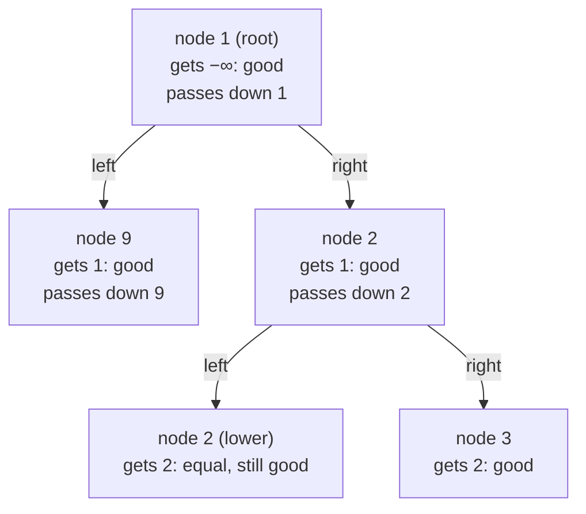
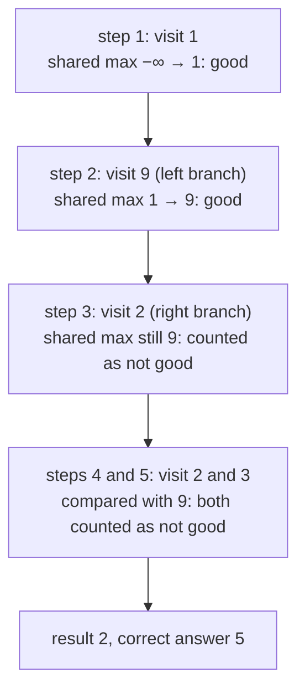

> [!tldr] Quick read
> - The problem: count the **good** nodes in a binary tree. A node X is good if no node on the path from the root down to X is **greater** than X. The root is always good; a node **equal** to the largest value above it is still good.
> - Brute force: for each node, climb back to the root and compare with every ancestor. Correct, but O(n·h): a 10⁴-node chain costs 49,995,000 comparisons.
> - The O(n) approach: walk down from the root and **carry the largest value on the path** (the [[en/concepts/path-state|path state]]). Each node needs one comparison `val >= max`, then hands `max(max, val)` down to its two children. Recursion, a stack or [[en/concepts/breadth-first-search|BFS]] all work, as long as each node keeps the max **of its own path**.
> - Three wrong versions, run for real: the strict comparison `>` (fails 4/10 cases), initializing max to 0 although values can be negative (fails 3/10), and one max variable shared by the whole tree, so the left branch's record leaks into the right branch (fails 1/10, disagrees on 802 of 3,000 random trees).
> - The problem allows up to **10⁵ nodes**. A 10⁵-node skewed chain makes the recursive version throw in TypeScript, JavaScript, Python and Java; only Go survives. A queue built on `shift()`, `pop(0)` or `remove(0)` is correct but 100 to 200 times slower on a 10⁵-node tree.

> [!info] Context
> LeetCode problem 1448 (Medium), on [[en/posts/2026-11-25-neetcode-level-order|station 5: Level Order and Carried State]] of **the NeetCode Line: Linked Structures**. At [[en/posts/2026-11-25-neetcode-tree-recursion|station 3]], results flow **bottom-up** (the height returned to the parent). At [[en/posts/2026-11-25-neetcode-binary-search-tree|station 4]], [[en/problems/validate-binary-search-tree|Validate BST]] carries an interval **top-down**. This problem also flows top-down, but what it carries is one number that sums up the whole path: the largest value from the root to here. The other two problems on the station, [[en/problems/binary-tree-level-order-traversal|Binary Tree Level Order Traversal]] and [[en/problems/binary-tree-right-side-view|Binary Tree Right Side View]], traverse level by level; this one can be solved depth-first or level by level. Solutions come in TypeScript, Python, Go, Java and JavaScript. You only need to know what recursion is.

> [!abstract]- Quick glossary for this post (click to open)
> - **Binary tree**: every node has at most two children, left and right. See [[en/concepts/binary-tree|Binary Tree]].
> - **Path from the root**: the sequence of nodes from the root down to a node, each step going from a parent to a child. The nodes on that path (except the node itself) are its **ancestors**.
> - **Path state**: a value that sums up the path from the root to the current node, computed by the parent and handed down to the child. Here it is the largest value. See [[en/concepts/path-state|Path State]].
> - **Pre-order**: handle the node first, then its two subtrees. See [[en/concepts/pre-order-traversal|Pre-order Traversal]].
> - **DFS (depth-first search)**: go all the way down one branch before coming back for another; written with recursion or with a self-managed [[en/concepts/stack|stack]].
> - **BFS (breadth-first search)**: visit a whole level before the next one, using a first-in, first-out queue. See [[en/concepts/breadth-first-search|Breadth-First Search]].
> - **Skewed chain**: every node has a single child, so the tree is exactly as deep as it has nodes. See [[en/concepts/recursion-depth-limit|Recursion Depth Limit]].
> - **O(n·h)**: time proportional to the number of nodes times the tree's height; on a skewed chain h = n, so it becomes O(n²).

## Picture it first: a family tree and a record book

A family keeps its genealogy as a tree, and everyone has an "achievement score", which can be negative. A person makes the **honor roll** if no one in their direct line above them beats their score: father, grandfather, great-grandfather, … up to the founder. Siblings, uncles and aunts don't count, because they are not on the path from the founder down to that person.

- **Asking every generation:** for each person, trace the family tree up to the founder and compare with each one. Correct, but the more generations the family has, the more often the same people get asked again.
- **The record book:** the founder opens a book that says "the line's record so far". Each person checks the book to see whether they make the honor roll, updates the record if they beat it, and **copies the book once for each child**. The two child branches hold separate copies, so one branch's record never slips into the other.
- **The whole family shares one book:** an uncle writes a record of 9 into it, and a nephew on another branch (the uncle's brother's son) gets compared with 9, even though the uncle is not his ancestor.

| Everyday life | Concept |
|---|---|
| The family tree | [[en/concepts/binary-tree\|binary tree]] |
| The direct line from the founder to you | the path from the root to the node |
| No one in your direct line beats you | a good node: `val >= the path's max` |
| Tying the record still makes the honor roll | compare with `>=`, not `>` |
| Tracing the family tree for each person | brute force climbing back to the root, O(n·h) |
| The record book, one copy per child | [[en/concepts/path-state\|path state]] carried down, O(n) |
| Check the honor roll before copying the book for the children | [[en/concepts/pre-order-traversal\|pre-order]]: handle the node before its children |
| Scores can be negative, but the book starts with a record of 0 | the trap of initializing max to 0 |
| The whole family shares one book | the shared-max trap, a record leaking into another branch |
| Finishing one branch of the family before the next | DFS, recursive or with a stack |
| Calling out generation by generation | [[en/concepts/breadth-first-search\|BFS]] with a queue |

The tree below is the "big max in the left branch" case from the test file, level-order array `[1, 9, 2, null, null, 2, 3]`. Each box shows the max the node receives from its parent:



All five nodes are good. Node 9 is the largest in the tree, but it sits in the left branch, so it has no effect on the three nodes on the right.

## The problem

The input is the root of a binary tree with 1 to 10⁵ nodes, each value an integer in [−10⁴, 10⁴]. Call a node X good if no node on the path from the root to X has a value greater than X's. Return the number of good nodes. The original problem: [LeetCode 1448](https://leetcode.com/problems/count-good-nodes-in-binary-tree/). I checked the limits above against the problem page on November 25, 2026.

I first read "no node greater than it" as "greater than every node above", a strict comparison, and undercounted every node that ties the record. The wording says no node is **greater** than it: an equal node breaks nothing. The second thing I had to rethink is that "above" means **ancestors**, not every node visited earlier.

## How it works

<figure class="figure-map" style="--ar: 3 / 4">
<div class="frame"><iframe data-archify="../../diagrams/neetcode-count-good-nodes-in-binary-tree/worked-example.en.html" title="Carry the maximum along the path" loading="lazy"></iframe></div>
<figcaption><span><b>Figure 1.</b> Carry the maximum along the path.</span><a href="../diagrams/neetcode-count-good-nodes-in-binary-tree/worked-example.en.html" target="_blank" rel="noopener">Open full screen</a></figcaption>
</figure>

<details>
<summary>Read the steps</summary>
<ol>
<li>Count the root 5. <code>previous max = -∞; max = 5</code></li>
<li>Reach child 2 and keep threshold 5. <code>2 &lt; 5 → skip</code></li>
<li>Reach grandchild 4 and still compare with 5. <code>4 &lt; 5 → skip</code></li>
<li>The other branch has 7, so count it. <code>7 ≥ 5; total = 2</code></li>
</ol>
</details>

### Approach 1: brute force, each node climbs back to the root

Write the definition down directly: record each node's parent, then for each node walk up to the root and stop at the first ancestor that is larger.

```ts
// Approach 1: brute force, each node climbs back to the root. O(n·h).
function goodBrute(root: TreeNode | null): number {
  if (root === null) return 0;
  const parent = new Map<TreeNode, TreeNode | null>([[root, null]]);
  const order: TreeNode[] = [root];
  for (let i = 0; i < order.length; i++) {
    const node = order[i];
    for (const child of [node.left, node.right]) {
      if (child !== null) { parent.set(child, node); order.push(child); }
    }
  }
  let good = 0;
  for (const node of order) {
    let ok = true;
    for (let a = parent.get(node) ?? null; a !== null; a = parent.get(a) ?? null) {
      compares++;
      if (a.val > node.val) { ok = false; break; }
    }
    if (ok) good++;
  }
  return good;
}
```

Each node costs at most its depth, so the total is O(n·h) time, plus O(n) memory for the parent table. The worst case is when **every node is good**: it never stops early, and the k-th node compares against all k − 1 ancestors. A non-decreasing 10⁴-node chain costs 49,995,000 comparisons, exactly n(n − 1)/2. On a 10⁵-node chain that number is about 5·10⁹, so the file doesn't run brute force at that size.

Where does brute force waste work? Two sibling nodes ask the exact same list of ancestors again. The "largest among the ancestors" is recomputed from scratch for every node, while the parent already knows it.

### Approach 2: carry the path's max down

Flip the direction: instead of each node asking upward, the parent **hands down** to the child the only thing the child needs, the largest value on the path from the root to the parent. The child compares once, then hands down `max(maxSoFar, val)`.

```ts
// Approach 2: pre-order DFS, carrying the path's max down. O(n), O(h).
function goodDfs(root: TreeNode | null): number {
  const go = (node: TreeNode | null, maxSoFar: number): number => {
    if (node === null) return 0;
    const good = node.val >= maxSoFar ? 1 : 0;   // equal to max still counts as good
    const m = Math.max(maxSoFar, node.val);
    return good + go(node.left, m) + go(node.right, m);
  };
  return go(root, -Infinity);
}
```

Each node is checked exactly once: O(n) time, O(h) memory for the call stack. Why is **one** number enough? The question "is any ancestor larger than me" is the same as "is the largest ancestor larger than me". And max accumulates: the max of the path to the child equals the max of (the max of the path to the parent, the parent's value). That is what lets a [[en/concepts/path-state|path state]] be carried down without losing information. [[en/problems/validate-binary-search-tree|Validate BST]] uses exactly this idea with two numbers (a lower and an upper bound); see [[en/concepts/bounds-propagation|Bounds Propagation]].

The order here is [[en/concepts/pre-order-traversal|pre-order]]: the node is checked **before** its two children, because the children need the max the node just updated. The count still flows bottom-up like the [[en/concepts/post-order-traversal|post-order]] of station 3: each call returns the number of good nodes in its subtree. One function, two directions of information: the max goes down through the parameter, the count comes up through the return value.

**The initial value.** The root is always good, so the starting max must be less than or equal to every possible value. `-Infinity` (JS), `float("-inf")` (Python), `math.MinInt` (Go) and `Integer.MIN_VALUE` (Java) all work, because the problem only goes down to −10⁴. The simplest choice is `root.val` itself. Starting at 0 fails as soon as the root is negative.

### Approach 3: iterative DFS, a stack of (node, max) pairs

Drop the recursion for a self-managed stack. The key point: push **pairs** (node, the max of the path to that node), not just nodes. Each entry on the stack carries the state of its own path, so popping them in any order is still correct.

```ts
// Approach 3: iterative DFS, the stack holds (node, max up to that node) pairs.
function goodIterative(root: TreeNode | null): number {
  if (root === null) return 0;
  let good = 0;
  const stack: [TreeNode, number][] = [[root, root.val]];
  while (stack.length > 0) {
    const [node, maxSoFar] = stack.pop()!;
    if (node.val >= maxSoFar) good++;
    const m = Math.max(maxSoFar, node.val);
    if (node.right !== null) stack.push([node.right, m]);
    if (node.left !== null) stack.push([node.left, m]);
  }
  return good;
}
```

Same O(n) time; memory is O(h) for the stack (each level has at most one sibling waiting). There is no recursion depth limit, so the 10⁵-node chain runs in all five languages.

### Approach 4: BFS level by level

Swap the stack for a queue and you have [[en/concepts/breadth-first-search|BFS]]: visit level 0, then level 1, … Still (node, max) pairs, still O(n). This problem doesn't need to know which level a node is on, so unlike the other two problems on the station it needs no [[en/concepts/level-size-snapshot|level size snapshot]]; the visiting order doesn't affect the answer. Memory is different: a BFS queue can hold a whole level, up to about n/2 nodes on a full tree, while a DFS stack is only O(h).

The trap is in **how you take the front of the queue**:

| Language | Slow way to take the front | Fast way to take the front |
|---|---|---|
| TypeScript / JavaScript | `queue.shift()`: moves the whole array | read `queue[head++]`, delete nothing |
| Python | `list.pop(0)`: moves the whole list (the Python docs state O(n)) | `collections.deque` with `popleft()` |
| Java | `ArrayList.remove(0)`: shifts every element after it | `ArrayDeque` with `poll()` |
| Go | no common slow way | `queue = queue[1:]` only moves the slice's start, O(1) |

All three slow ways give the right answer, so only a measurement exposes them. In the measurements below, on a 10⁵-node tree, they are 100 to 200 times slower than the fast version.

### Three wrong versions

**Wrong 1: strict comparison.** Writing `val > maxSoFar` doesn't count a node that ties the record. The tree `[5, 5, 5]` has 3 good nodes; this version returns 1. On the non-decreasing 10⁵-node chain (each value repeated 5 times in a row), it counts only 20,000 out of 100,000.

**Wrong 2: initializing max to 0.** Many people are used to problems with non-negative values. Here values go down to −10⁴, so the one-node tree `[-10000]` returns 0, and in an all-negative tree no node is counted.

**Wrong 3: one max variable shared by the whole tree.** This is the subtlest bug, because it is right on every chain and on every tree where the max only grows along the traversal order:

```ts
// Wrong 3: one max variable for the whole tree. The left branch's max leaks into the right branch.
function wrongSharedMax(root: TreeNode | null): number {
  if (root === null) return 0;
  let max = -Infinity, good = 0;
  const stack: TreeNode[] = [root];
  while (stack.length > 0) {
    const node = stack.pop()!;
    if (node.val >= max) { good++; max = node.val; }
    if (node.right !== null) stack.push(node.right);
    if (node.left !== null) stack.push(node.left);
  }
  return good;
}
```

On the tree at the top of the page, it walks in pre-order 1, 9, 2, 2, 3 with a single `max` variable:



The bug is that 9 is not an ancestor of the nodes on the right, yet it is still in the `max` variable when the walk moves to the right branch. A recursive version makes the same mistake if it uses an outer variable and forgets to **restore** the max on the way back: `max = old` after finishing a branch. Passing the max as a parameter (approach 2) or keeping it in the pair (approach 3) removes the need to remember the restore, because each call or each stack entry has its own copy. On 3,000 small random trees, this version disagrees on 802.

| Approach | Time | Extra memory | Note |
|---|---|---|---|
| Brute force climbing to the root | O(n·h): O(n log n) balanced, O(n²) chain | O(n) | correct but slow |
| Recursive DFS carrying max | O(n) | O(h) | 10⁵ levels exceed the recursion limit in 4/5 languages |
| Iterative DFS, (node, max) pairs | O(n) | O(h) | safe at any depth |
| BFS, (node, max) pairs | O(n) | O(width), up to n/2 | watch how you take the front of the queue |
| Strict comparison `>` | O(n) | O(h) | **wrong** when values tie |
| Max initialized to 0 | O(n) | O(h) | **wrong** with negative values |
| Shared max | O(n) | O(h) | **wrong** when an earlier branch holds a higher record |

### Measurements

**Brute force on a non-decreasing chain** (every node is good, so brute force never stops early), median of 5 runs (ms):

| n | Brute-force comparisons | TypeScript | Python | Go | Java | Iterative DFS (TS) |
|---|---|---|---|---|---|---|
| 1,000 | 499,500 | 4.83 | 32.9 | 7.36 | 2.96 | 0.01 |
| 2,000 | 1,999,000 | 22.8 | 135 | 28.6 | 9.83 | 0.01 |
| 4,000 | 7,998,000 | 117 | 536 | 123 | 46.9 | 0.04 |
| 10,000 | 49,995,000 | 793 | (not measured) | 803 | 446 | 0.07 |

When n doubles, the comparison count quadruples, exactly the n² shape. The iterative DFS visits exactly n nodes. TypeScript and Go brute force are about equally slow here because each step up is a lookup in the `parent` hash table, not a pointer read.

**A full 10⁵-node tree** (height 17), with values from the same linear generator in all five languages, so all five count 8,191 good nodes. Brute force costs only 330,132 comparisons (about 3.3 times n) because random values make it meet a larger ancestor very early. Median of 5 runs (ms):

| | TypeScript | Python | Go | Java |
|---|---|---|---|---|
| Brute force | 17.0 | 39.6 | 15.6 | 12.4 |
| Recursive DFS | 1.00 | 14.0 | 0.28 | 0.16 |
| Iterative DFS | 1.83 | 13.1 | 0.18 | 2.13 |
| BFS, fast queue | 1.67 | 29.6 | 5.56 | 0.81 |
| BFS, `shift()` / `pop(0)` / `remove(0)` | **287** | **328** | (none) | **170** |

The three bold cells are the same O(n) algorithm as the cell right above them, differing only in how they take the front of the queue. A BFS queue on a full 10⁵-node tree at times holds tens of thousands of entries, and each take from the front shifts that many. A separate experiment on Node 24: taking all 10⁴ entries with `shift()` took 0.9 ms, but 10⁵ entries took 575 ms, while reading by index took only 2.1 ms.

The numbers change with the machine and the run; the ratios between approaches are stable. I measured while the machine was running other work in parallel.

### Under the five languages

| | Recursion on a 10⁵-node chain | Language-specific trap |
|---|---|---|
| TypeScript / JavaScript | `RangeError`; Node survives about 7,400 to 7,800 levels of `goodDfs` depending on the run | `shift()` on a large array; read by a `head` index |
| Python | `RecursionError` (default limit 1,000 levels); with `sys.setrecursionlimit(200000)` it runs | forgetting `nonlocal` when counting in an outer variable: `count += 1` turns `count` into an unassigned local variable and throws `UnboundLocalError` in all 10/10 cases; `list.pop(0)` |
| Go | runs: goroutine stacks grow on their own | passing an `int` counter into a recursive function passes a copy; to count through a parameter use `*int`, or return the value |
| Java | `StackOverflowError` on the main thread; a self-created thread with a 256 MB stack runs it | `int` is always passed by value, so `countInto(node, max, count)` can never change the caller's `count`: 0/10 cases; `ArrayList.remove(0)` |

## Runnable example

[TypeScript](../code/neetcode-count-good-nodes-in-binary-tree/good-nodes.ts) · [Python](../code/neetcode-count-good-nodes-in-binary-tree/good_nodes.py) · [Go](../code/neetcode-count-good-nodes-in-binary-tree/good_nodes.go) · [Java](../code/neetcode-count-good-nodes-in-binary-tree/good-nodes.java) · [JavaScript](../code/neetcode-count-good-nodes-in-binary-tree/good-nodes.js)

Each file builds trees from a LeetCode-style level-order array (`null` is a gap) and runs 10 shared cases: one node, one negative node (−10⁴), three nodes, three nodes with the same value, an all-negative tree, the tree at the top of the page, a full 7-node tree, a branch that dips and then beats the record again (`[6, 2, null, 1, 7]`), a non-decreasing right chain of 10⁵ nodes (every node good) and a non-increasing left chain of 10⁵ nodes (only the first 5, equal to the root, are good). Brute force skips the non-decreasing 10⁵-node chain (5·10⁹ comparisons) and is measured separately at smaller sizes. The TypeScript and JavaScript files also check the four correct approaches against brute force on 3,000 random trees of 1 to 12 nodes with values −3 to 3 (generated with mulberry32), so that ties and negative values come up often.

Recursive DFS, carrying max through a parameter:

```ts
function goodDfs(root: TreeNode | null): number {
  const go = (node: TreeNode | null, maxSoFar: number): number => {
    if (node === null) return 0;
    const good = node.val >= maxSoFar ? 1 : 0;   // equal to max still counts as good
    const m = Math.max(maxSoFar, node.val);
    return good + go(node.left, m) + go(node.right, m);
  };
  return go(root, -Infinity);
}
```

```python
def good_dfs(root):
    def go(node, max_so_far):
        if node is None:
            return 0
        good = 1 if node.val >= max_so_far else 0  # equal to max still counts as good
        m = max(max_so_far, node.val)
        return good + go(node.left, m) + go(node.right, m)

    return go(root, float("-inf"))
```

```go
func goodDfs(root *TreeNode) int {
	var walk func(node *TreeNode, maxSoFar int) int
	walk = func(node *TreeNode, maxSoFar int) int {
		if node == nil {
			return 0
		}
		good := 0
		if node.Val >= maxSoFar { // equal to max still counts as good
			good = 1
		}
		m := max(maxSoFar, node.Val)
		return good + walk(node.Left, m) + walk(node.Right, m)
	}
	return walk(root, math.MinInt) // MinInt (64-bit) is below every value the problem allows
}
```

```java
static int goodDfs(TreeNode root) { return walk(root, Integer.MIN_VALUE); }

static int walk(TreeNode node, int maxSoFar) {
    if (node == null) return 0;
    int good = node.val >= maxSoFar ? 1 : 0;  // equal to max still counts as good
    int m = Math.max(maxSoFar, node.val);
    return good + walk(node.left, m) + walk(node.right, m);
}
```

```js
function goodDfs(root) {
  const go = (node, maxSoFar) => {
    if (node === null) return 0;
    const good = node.val >= maxSoFar ? 1 : 0;   // equal to max still counts as good
    const m = Math.max(maxSoFar, node.val);
    return good + go(node.left, m) + go(node.right, m);
  };
  return go(root, -Infinity);
}
```

Iterative DFS, a stack of (node, max) pairs, safe on the 10⁵-node chain in every language:

```ts
function goodIterative(root: TreeNode | null): number {
  if (root === null) return 0;
  let good = 0;
  const stack: [TreeNode, number][] = [[root, root.val]];
  while (stack.length > 0) {
    const [node, maxSoFar] = stack.pop()!;
    if (node.val >= maxSoFar) good++;
    const m = Math.max(maxSoFar, node.val);
    if (node.right !== null) stack.push([node.right, m]);
    if (node.left !== null) stack.push([node.left, m]);
  }
  return good;
}
```

```python
def good_iterative(root):
    if root is None:
        return 0
    good = 0
    stack = [(root, root.val)]
    while stack:
        node, max_so_far = stack.pop()
        if node.val >= max_so_far:
            good += 1
        m = max(max_so_far, node.val)
        if node.right is not None:
            stack.append((node.right, m))
        if node.left is not None:
            stack.append((node.left, m))
    return good
```

```go
type item struct {
	node     *TreeNode
	maxSoFar int
}

func goodIterative(root *TreeNode) int {
	if root == nil {
		return 0
	}
	good := 0
	stack := []item{{root, root.Val}}
	for len(stack) > 0 {
		it := stack[len(stack)-1]
		stack = stack[:len(stack)-1]
		if it.node.Val >= it.maxSoFar {
			good++
		}
		m := max(it.maxSoFar, it.node.Val)
		if it.node.Right != nil {
			stack = append(stack, item{it.node.Right, m})
		}
		if it.node.Left != nil {
			stack = append(stack, item{it.node.Left, m})
		}
	}
	return good
}
```

```java
record Item(TreeNode node, int maxSoFar) {}

static int goodIterative(TreeNode root) {
    if (root == null) return 0;
    int good = 0;
    Deque<Item> stack = new ArrayDeque<>();
    stack.push(new Item(root, root.val));
    while (!stack.isEmpty()) {
        Item it = stack.pop();
        if (it.node().val >= it.maxSoFar()) good++;
        int m = Math.max(it.maxSoFar(), it.node().val);
        if (it.node().right != null) stack.push(new Item(it.node().right, m));
        if (it.node().left != null) stack.push(new Item(it.node().left, m));
    }
    return good;
}
```

```js
function goodIterative(root) {
  if (root === null) return 0;
  let good = 0;
  const stack = [[root, root.val]];
  while (stack.length > 0) {
    const [node, maxSoFar] = stack.pop();
    if (node.val >= maxSoFar) good++;
    const m = Math.max(maxSoFar, node.val);
    if (node.right !== null) stack.push([node.right, m]);
    if (node.left !== null) stack.push([node.left, m]);
  }
  return good;
}
```

Output of `node good-nodes.ts`:

```text
goodBrute       10/10 cases passed
goodDfs         8/10 cases passed; failed on non-decreasing chain of 10^5 nodes → threw RangeError, non-increasing chain of 10^5 nodes → threw RangeError
goodIterative   10/10 cases passed
goodBfs         10/10 cases passed
wrongStrict     6/10 cases passed; failed on equal to max is still good → 1, big max in the left branch → 4, non-decreasing chain of 10^5 nodes → 20000, non-increasing chain of 10^5 nodes → 1
wrongInitZero   7/10 cases passed; failed on one negative node → 0, all negative → 0, non-decreasing chain of 10^5 nodes → 50000
wrongSharedMax  9/10 cases passed; failed on big max in the left branch → 2

checked 3000 random trees of 1..12 nodes, values -3..3: the four correct approaches match brute force 3000/3000
wrong versions disagreeing with brute force: wrongStrict 1546, wrongInitZero 1292, wrongSharedMax 802 trees

non-decreasing chain (every node good, brute force never stops early), median of 5 runs (ms)
n        brute force: comparisons     ms   iterative DFS ms
1000               499500     4.83         0.01
2000              1999000    22.77         0.01
4000              7998000   116.85         0.04
10000            49995000   793.39         0.07

full tree of 10^5 nodes (height 17): 8191 good nodes, brute force 330132 comparisons
brute force         17.02 ms
recursive DFS        1.00 ms
iterative DFS        1.83 ms
BFS head index       1.67 ms
BFS shift()        287.10 ms

longest chain the recursive goodDfs survives: 7822 nodes (the problem allows up to 10^5)
chain of 10^5 nodes: goodIterative → 100000, goodBfs → 100000
```

*(Output labels translated; the files themselves print Vietnamese.)*

The "longest" line binary-searches for the chain length at which the recursive version still runs. Across runs of the file the number ranged from 7,421 to 7,822: Node sets a stack of about 1 MB, and each call frame is larger or smaller depending on how far the JIT has optimized the function. Either way, it is less than a tenth of the problem's limit.

`python3 good_nodes.py`:

```text
good_brute         10/10 cases passed
good_dfs           8/10 cases passed; failed on non-decreasing chain of 10^5 nodes → threw RecursionError, non-increasing chain of 10^5 nodes → threw RecursionError
good_dfs_nonlocal  8/10 cases passed; failed on non-decreasing chain of 10^5 nodes → threw RecursionError, non-increasing chain of 10^5 nodes → threw RecursionError
good_iterative     10/10 cases passed
good_bfs           10/10 cases passed
wrong_strict       6/10 cases passed; failed on equal to max is still good → 1, big max in the left branch → 4, non-decreasing chain of 10^5 nodes → 20000, non-increasing chain of 10^5 nodes → 1
wrong_init_zero    7/10 cases passed; failed on one negative node → 0, all negative → 0, non-decreasing chain of 10^5 nodes → 50000
wrong_shared_max   9/10 cases passed; failed on big max in the left branch → 2
wrong_no_nonlocal  0/10 cases passed; failed on one node → threw UnboundLocalError, one negative node → threw UnboundLocalError, three nodes → threw UnboundLocalError, equal to max is still good → threw UnboundLocalError, all negative → threw UnboundLocalError, big max in the left branch → threw UnboundLocalError, full 7-node tree → threw UnboundLocalError, dips then beats the record → threw UnboundLocalError, non-decreasing chain of 10^5 nodes → threw UnboundLocalError, non-increasing chain of 10^5 nodes → threw UnboundLocalError

non-decreasing chain (every node good, brute force never stops early), median of 5 runs (ms)
n        brute force: comparisons       ms   iterative DFS ms
1000               499500       32.9         0.14
2000              1999000      135.4         0.30
4000              7998000      535.7         0.55

full tree of 10^5 nodes (height 17): 8191 good nodes, brute force 330132 comparisons
brute force           39.6 ms
recursive DFS         14.0 ms
iterative DFS         13.1 ms
BFS deque             29.6 ms
BFS list.pop(0)      327.6 ms

default recursion limit: 1000
after sys.setrecursionlimit(200000): good_dfs on the chain of 10^5 nodes → 100000
```

`go run good_nodes.go`:

```text
goodBrute         10/10 cases passed
goodDfs           10/10 cases passed
goodIterative     10/10 cases passed
goodBfs           10/10 cases passed
wrongStrict       6/10 cases passed; failed on equal to max is still good → 1, big max in the left branch → 4, non-decreasing chain of 10^5 nodes → 20000, non-increasing chain of 10^5 nodes → 1
wrongInitZero     7/10 cases passed; failed on one negative node → 0, all negative → 0, non-decreasing chain of 10^5 nodes → 50000
wrongSharedMax    9/10 cases passed; failed on big max in the left branch → 2
wrongCountByValue 2/10 cases passed; failed on three nodes → 1, equal to max is still good → 1, all negative → 1, big max in the left branch → 1, full 7-node tree → 1, dips then beats the record → 1, non-decreasing chain of 10^5 nodes → 1, non-increasing chain of 10^5 nodes → 1

non-decreasing chain (every node good, brute force never stops early), median of 5 runs (ms)
n        brute force: comparisons       ms   iterative DFS ms
1000               499500       7.36        0.002
2000              1999000      28.61        0.004
4000              7998000     122.70        0.008
10000            49995000     802.69        0.024

full tree of 10^5 nodes (height 17): 8191 good nodes, brute force 330132 comparisons
brute force         15.61 ms
recursive DFS        0.28 ms
iterative DFS        0.18 ms
BFS                  5.56 ms

recursive DFS on the chain of 10^5 nodes: 100000 (goroutine stacks grow on their own)
```

Go's `wrongCountByValue` reads the counter at the root after the recursion finishes. That counter only went up because of the root itself (the root is always good), so the function returns 1 for every tree; it is only "right" on the two one-node cases.

`java good-nodes.java`:

```text
goodBrute         10/10 cases passed
goodDfs           8/10 cases passed; failed on non-decreasing chain of 10^5 nodes → threw StackOverflowError, non-increasing chain of 10^5 nodes → threw StackOverflowError
goodIterative     10/10 cases passed
goodBfs           10/10 cases passed
wrongStrict       6/10 cases passed; failed on equal to max is still good → 1, big max in the left branch → 4, non-decreasing chain of 10^5 nodes → 20000, non-increasing chain of 10^5 nodes → 1
wrongInitZero     7/10 cases passed; failed on one negative node → 0, all negative → 0, non-decreasing chain of 10^5 nodes → 50000
wrongSharedMax    9/10 cases passed; failed on big max in the left branch → 2
wrongCountByValue 0/10 cases passed; failed on one node → 0, one negative node → 0, three nodes → 0, equal to max is still good → 0, all negative → 0, big max in the left branch → 0, full 7-node tree → 0, dips then beats the record → 0, non-decreasing chain of 10^5 nodes → threw StackOverflowError, non-increasing chain of 10^5 nodes → threw StackOverflowError

non-decreasing chain (every node good, brute force never stops early), median of 5 runs (ms)
n        brute force: comparisons       ms   iterative DFS ms
1000               499500       2.96        0.022
2000              1999000       9.83        0.037
4000              7998000      46.89        0.037
10000            49995000     445.52        0.118

full tree of 10^5 nodes (height 17): 8191 good nodes, brute force 330132 comparisons
brute force         12.41 ms
recursive DFS        0.16 ms
iterative DFS        2.13 ms
BFS ArrayDeque       0.81 ms
BFS remove(0)      170.03 ms

thread with a 256 MB stack: goodDfs on the chain of 10^5 nodes → 100000
```

`node good-nodes.js` prints the same test-case and cross-check lines as the TypeScript version; the timings shift by a few percent (`BFS shift()` 308.79 ms), and the longest chain the recursive version survives is 7,421 nodes.

## Misconceptions and common traps

- **"A good node must be greater than every node above it."** The problem says no node above it is **greater** than it; equal is still good. `>` instead of `>=` fails 4/10 cases and disagrees on 1,546 of 3,000 random trees.
- **"Above" means every node visited earlier.** Only ancestors count. One max for the whole traversal lets the left branch's record leak into the right branch: the tree `[1, 9, 2, null, null, 2, 3]` gives 2 instead of 5.
- **Initializing max to 0.** Values go down to −10⁴. Start with `root.val` or negative infinity.
- **"Recursion is enough, LeetCode trees aren't deep."** The problem allows 10⁵ nodes, which means a chain 10⁵ levels deep. The recursive version throws in TypeScript, JavaScript (about 7,400 to 7,800 levels), Python (1,000 levels) and Java (main thread); only Go survives. The iterative version with (node, max) pairs has no such limit.
- **Counting in an outer variable in Python without `nonlocal`.** The assignment `count += 1` inside a nested function makes `count` local, and its first read throws `UnboundLocalError`. Return the count as the function's value and you need no outer variable.
- **Passing the counter as an `int` parameter in Go or Java.** Each call increments its own copy; the caller sees nothing. Java gives 0 for every case, Go gives 1.
- **A queue built on `shift()`, `pop(0)`, `remove(0)`.** Correct, but it moves the whole array on every take: 287 ms, 328 ms, 170 ms on a 10⁵-node tree, against 1 to 30 ms for a proper queue.

## Self-check questions

> [!question]- Why is it enough to carry **one** number (the path's max) down, rather than the whole list of ancestors?
> The question "is any ancestor larger than me" depends only on the largest ancestor. And the max of the path to the child can be computed from the max of the path to the parent plus the parent's value, so the parent can always hand down the right number without remembering the whole path.

> [!question]- How many good nodes does `[3, 3, null, 4, 2]` have? What does the strict version return?
> The root 3 is good. Its left child 3 equals the max 3: good. Node 4 (left child of the second 3) is greater than the max 3: good. Node 2 is less than the max 3: not good. The answer is 3. The strict version drops the second 3 and returns 2.

> [!question]- On which tree does the version with one shared `max` fail? Is there a tree with many nodes where it is still right?
> It fails when a branch visited earlier holds a value larger than the record of a branch visited later, as in `[1, 9, 2, null, null, 2, 3]`. On any chain (a single branch) it is always right, because a chain's pre-order is exactly its path; so testing on chains won't catch this bug.

> [!question]- If you swap the stack in approach 3 for a queue, does the answer change? What about memory?
> The answer doesn't change, because each entry carries the max of its own path, so the visiting order doesn't matter. Memory does change: a DFS stack holds O(h) entries, a BFS queue holds a whole level, up to about n/2 on a full tree.

> [!question]- Why does brute force on a non-decreasing 10⁴-node chain cost exactly 49,995,000 comparisons, while on a full 10⁵-node tree with random values it costs only 330,132?
> On the non-decreasing chain every node is good, so the k-th node must compare against all k − 1 ancestors: the total 0 + 1 + … + 9,999 = n(n − 1)/2. On the random tree the paths are short (height 17), and a larger ancestor usually shows up within a few steps, so the climb stops early.

> [!question]- In Python, `count += 1` inside a nested function throws `UnboundLocalError`, but `stack.append(...)` inside a nested function doesn't. Why?
> An assignment (including `+=`) to a name anywhere in a function makes that name a local variable of the function. `stack.append` doesn't assign the name `stack`; it only calls a method on the object the name points to, so Python still finds `stack` in the outer function.

## References

- [LeetCode 1448: Count Good Nodes in Binary Tree](https://leetcode.com/problems/count-good-nodes-in-binary-tree/) (original problem: 1 to 10⁵ nodes, values in [−10⁴, 10⁴]; checked on November 25, 2026)
- [Python `collections.deque`](https://docs.python.org/3/library/collections.html#collections.deque): a list costs O(n) for `pop(0)` and `insert(0, v)`, a deque is O(1) at both ends
- [Python FAQ: UnboundLocalError when the variable has a value](https://docs.python.org/3/faq/programming.html#why-am-i-getting-an-unboundlocalerror-when-the-variable-has-a-value)
- [Java `ArrayList.remove(int)`](https://docs.oracle.com/en/java/javase/21/docs/api/java.base/java/util/ArrayList.html#remove(int)): shifts every element after it to the left
- [Go blog: Go Slices: usage and internals](https://go.dev/blog/slices-intro): re-slicing only creates a new view, it doesn't copy the array
