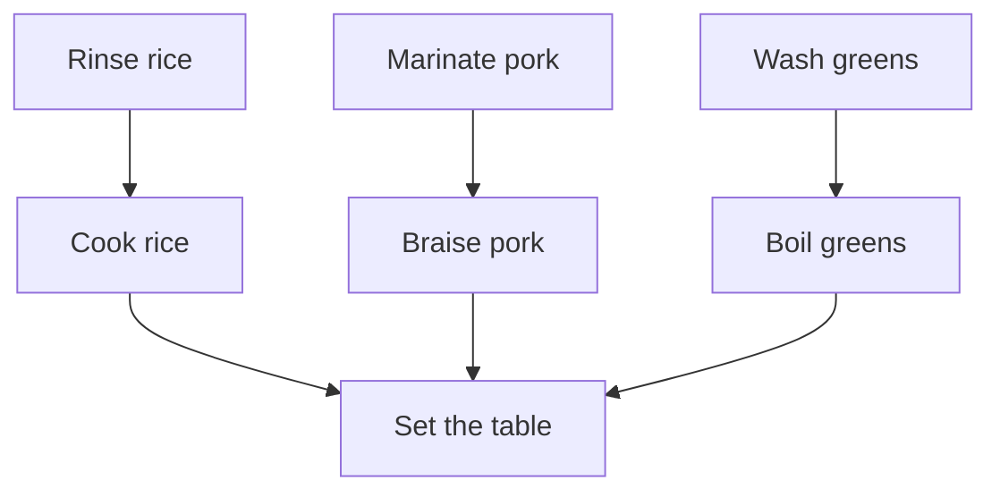
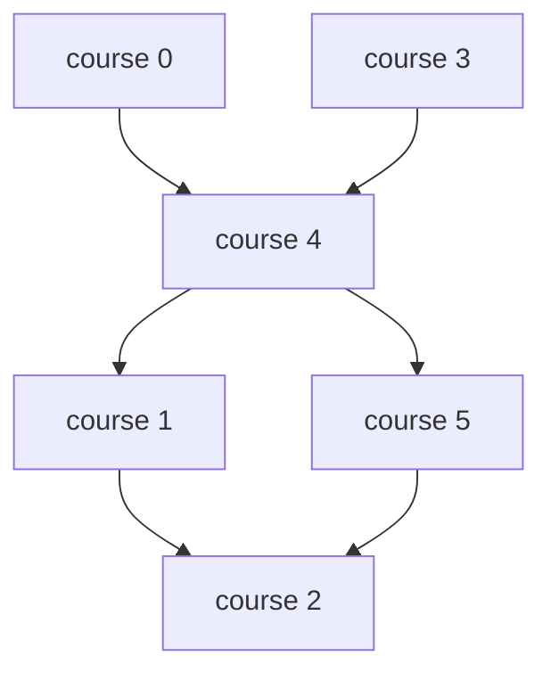
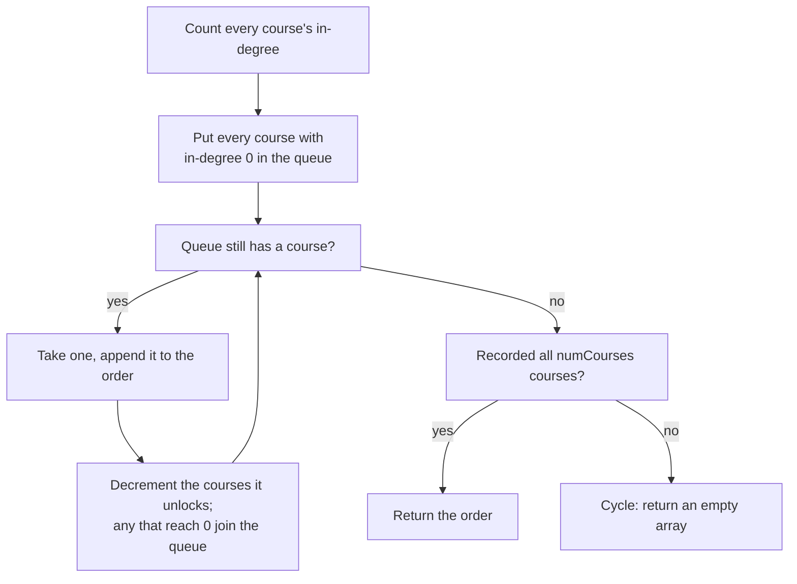
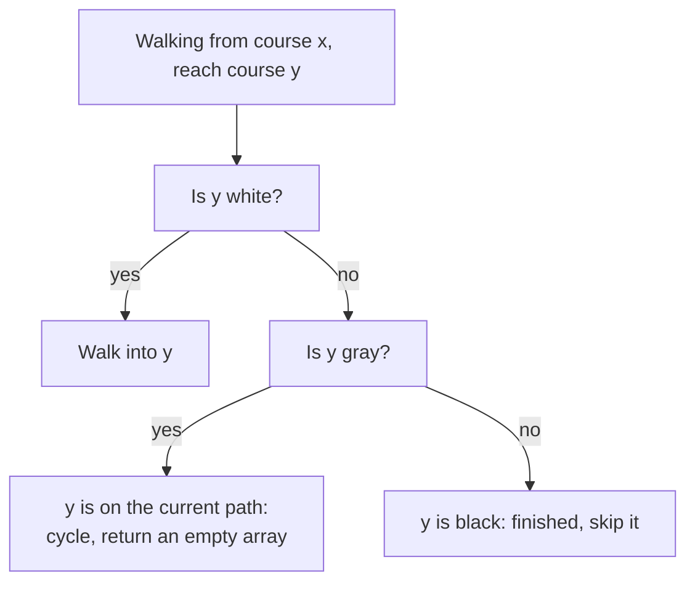

> [!tldr] Quick read
> - Each course is a vertex. A prerequisite `[a, b]` means **take `b` first, then `a`**, so the edge runs from `b` to `a`. The problem asks for a [[en/concepts/topological-sort|topological order]]: a line-up of every course in which every edge points forward.
> - The easiest approach to follow is **Kahn's algorithm**: count each course's [[en/concepts/in-degree|in-degree]] (how many courses must come before it), put the courses with in-degree 0 in a [[en/concepts/queue|queue]], and each time you finish a course, decrement the in-degree of every course it unlocks. The queue itself is the answer.
> - If the queue runs dry while some courses are still unplaced, the remaining courses wait on each other in a cycle. Return `[]`. A graph has a topological order if and only if it is a [[en/concepts/directed-acyclic-graph|DAG]].
> - The second approach is [[en/concepts/three-color-dfs|three-color DFS]]: record a course when it is "finished", then reverse the list. The gray color (on the current path) is required. With a single "visited" set, you report false cycles, even with two courses.
> - The answer is **not unique**: the six-course example has 4 valid orders, and Kahn and DFS return two different ones. To check your own answers, verify each prerequisite instead of comparing with one fixed answer.

> [!info] Context
> LeetCode problem 210 (Medium), on [[en/posts/2026-11-26-neetcode-topological-sort|station 3: Topological Sort]] of **the NeetCode Line: Graphs**. [[en/problems/course-schedule|Course Schedule]] (LC 207) only asks "can you finish every course?". This problem also asks "in what order?", so the algorithm is the same; the only difference is that you keep the order. You only need arrays, loops and queues; everything else is explained right below.

> [!abstract]- Quick glossary for this post (click to open)
> - **Vertex, directed edge**: a vertex is a course. An edge `b → a` is a one-way arrow: "finish `b`, then `a` can start".
> - [[en/concepts/adjacency-list|Adjacency list]]: each course keeps the list of courses it unlocks (`next[b]` holds `a`).
> - [[en/concepts/in-degree|In-degree]]: the number of arrows pointing into a course, that is, how many courses must come before it.
> - [[en/concepts/queue|Queue]]: a first-in, first-out list.
> - [[en/concepts/topological-sort|Topological order]]: a line-up of every vertex in which every edge goes from earlier to later.
> - **Cycle**: following the arrows brings you back where you started, for example `0 → 1 → 0`. With a cycle there is no valid order.
> - [[en/concepts/directed-acyclic-graph|DAG]]: a directed graph with no cycle.
> - **DFS** (depth-first search): follow one arrow as deep as it goes, and only turn back at a dead end.
> - [[en/concepts/three-color-dfs|Three-color DFS]]: each vertex has one of three colors: white (not reached), gray (on the current path), black (finished).

## Picture it first: cooking a family dinner

You cook a whole dinner by yourself. Some tasks need other tasks done first: rinse the rice before cooking it, marinate the pork before braising it, and you can only set the table once the rice, pork and greens are ready. You want a **to-do list in order**, so you can work from top to bottom and be done.

The most natural way: look for a task that **no longer waits on anything**, do it, then cross it off the waiting lists of the tasks after it. Repeat until nothing is left. Rinsing the rice first or washing the greens first both work, so there can be several correct lists.

| Everyday | Concept |
|---|---|
| A task in the kitchen | A course, that is, a vertex |
| "Rinse the rice before cooking it" | Prerequisite `[cook rice, rinse rice]`, that is, edge `rinse rice → cook rice` |
| How many tasks a dish still waits on | [[en/concepts/in-degree\|In-degree]] |
| The basket of tasks you can do right now | The queue of courses with in-degree 0 |
| Finish a task, cross it off the waiting lists of later tasks | Decrement the in-degree of every course it unlocks |
| The to-do list in order | [[en/concepts/topological-sort\|Topological order]], the answer |
| Rinse the rice or wash the greens first, either works | A topological order is not unique |
| A recipe that says "the sauce needs the braised pork, the braised pork needs the sauce" | A cycle: nobody can start, return `[]` |
| Someone who checks the list: every task comes after the tasks it needs | The checker that verifies each edge |



The three tasks on the top row wait on nothing, so they can start right away. "Set the table" waits on three tasks, so it has to come last.

## The problem: schedule every course

You get `numCourses` courses, numbered `0` to `numCourses − 1`, and a list of prerequisites `prerequisites`. Each prerequisite `[a, b]` says: to take `a` you must have finished `b`. Return **one** order that takes every course without breaking any prerequisite. If no such order exists, return an empty array. If several orders are correct, any of them is accepted. [Problem LC-0210](https://leetcode.com/problems/course-schedule-ii/)

Limits (checked against LeetCode on 26/11/2026): 1 to 2,000 courses; 0 to `numCourses × (numCourses − 1)` prerequisites; within one prerequisite `a ≠ b`; no two prerequisites are the same.

Four easy slips straight from the statement:

| Question | Answer | Example |
|---|---|---|
| Does `[a, b]` put `a` or `b` first? | `b` first, `a` after. The edge is `b → a`. | `[1, 0]`: take `0`, then `1` |
| A course with no prerequisites? | It must still appear in the answer. | 3 courses, no prerequisites: `[0, 1, 2]` is one answer |
| Several correct answers? | Any of them is accepted. | the six-course example below has 4 answers |
| Courses waiting on each other in a cycle? | Return `[]`, not a partial order. | `[[0, 1], [1, 0]]` returns `[]` |

The running example of this page: **6 courses**, prerequisites `[[4, 3], [4, 0], [1, 4], [5, 4], [2, 1], [2, 5]]`. Turning each prerequisite into an arrow:



Courses 0 and 3 need nothing. Course 4 needs both 0 and 3. Course 2 needs both 1 and 5.

## How it works

<figure class="figure-map" style="--ar: 3 / 4">
<div class="frame"><iframe data-archify="../../diagrams/neetcode-course-schedule-ii/worked-example.en.html" title="Course Schedule II: Kahn orders six courses by in-degree" loading="lazy"></iframe></div>
<figcaption><span><b>Figure 1.</b> Kahn only takes courses with in-degree 0, so every course that leaves the queue has all its prerequisites done. Taking out all 6 courses means there is no cycle.</span><a href="../diagrams/neetcode-course-schedule-ii/worked-example.en.html" target="_blank" rel="noopener">Open full screen</a></figcaption>
</figure>

<details>
<summary>Read it step by step</summary>
<ol>
<li>Count in-degrees from the 6 prerequisites. <code>in-degree: 0→0 1→1 2→2 3→0 4→2 5→1</code></li>
<li>Queue every course with in-degree 0. <code>queue: [0, 3]</code></li>
<li>Take 0; course 4 drops to 1. <code>order: [0]</code></li>
<li>Take 3; course 4 drops to 0, so 4 joins the queue. <code>order: [0, 3], queue: [4]</code></li>
<li>Take 4, unlocking both 1 and 5. <code>order: [0, 3, 4], queue: [1, 5]</code></li>
<li>Take 1; course 2 drops to 1. <code>order: [0, 3, 4, 1]</code></li>
<li>Take 5; course 2 drops to 0. <code>order: [0, 3, 4, 1, 5], queue: [2]</code></li>
<li>Take 2: all 6/6 courses, no cycle. <code>answer: [0, 3, 4, 1, 5, 2]</code></li>
</ol>
</details>

### Approach 1: scan again and again, O(V·(V+E))

My first idea: in each round, walk from course 0 to the last course and find the first course that is **not taken yet and has all its prerequisites done**. Take it, then scan again from the start. If no course qualifies while some are still untaken, there is a cycle.

```ts
// Cách 1: quét lặp. Mỗi lượt đi từ môn 0, lấy môn đầu tiên đã học đủ điều kiện. O(V·(V+E)).
function orderScan(n: number, prereqs: number[][]): number[] {
  const need: number[][] = Array.from({ length: n }, () => [])
  for (const [a, b] of prereqs) need[a].push(b) // muốn học a thì phải xong b
  const taken: boolean[] = new Array(n).fill(false)
  const order: number[] = []
  while (order.length < n) {
    let found = -1
    for (let c = 0; c < n && found < 0; c++) {
      work++ // cả môn đã học cũng tốn một lần nhìn qua
      if (taken[c]) continue
      let ready = true
      for (const b of need[c]) {
        work++
        if (!taken[b]) { ready = false; break }
      }
      if (ready) found = c
    }
    if (found < 0) return [] // còn môn chưa học mà không môn nào đủ điều kiện: có vòng
    taken[found] = true
    order.push(found)
  }
  return order
}
```

This is correct, but each round may look at nearly all `V` courses and `E` prerequisites, and there are `V` rounds: `O(V·(V+E))`. The bad case is a **backward chain**: course `i` needs course `i + 1`, so the only course you can take always sits at the end. With 2,000 courses, the runnable file counts **4,001,999** steps.

### Approach 2: Kahn's algorithm, O(V+E)

What Approach 1 wastes is asking "is this course ready yet?" from scratch every round. Kahn keeps the answer in one number: the [[en/concepts/in-degree|in-degree]], the count of courses that still have to come first. When `b` is done, every course in `next[b]` has one fewer course to wait on. A course that reaches 0 joins the queue. Like in the kitchen: once the rice is rinsed, you cross it off the waiting list of "cook rice", without rereading the whole recipe.

| Round | Take out | In-degrees after decrementing | Joins the queue | Order |
|---|---|---|---|---|
| start | (nothing yet) | `0:0 1:1 2:2 3:0 4:2 5:1` | 0, 3 | `[]` |
| 1 | 0 | 4 down to 1 | | `[0]` |
| 2 | 3 | 4 down to 0 | 4 | `[0, 3]` |
| 3 | 4 | 1 down to 0, 5 down to 0 | 1, 5 | `[0, 3, 4]` |
| 4 | 1 | 2 down to 1 | | `[0, 3, 4, 1]` |
| 5 | 5 | 2 down to 0 | 2 | `[0, 3, 4, 1, 5]` |
| 6 | 2 | (unlocks nothing) | | `[0, 3, 4, 1, 5, 2]` |

Each course joins the queue at most once and each edge is decremented at most once: `O(V + E)` time and `O(V + E)` memory for the adjacency list. The order in which courses leave the queue is the answer, so the code returns the queue array itself (walked with a `head` index).

**Why does a missing course mean a cycle?** Take a cycle `1 → 2 → 1`. Course 1 waits on course 2, and course 2 waits on course 1. Each course on the cycle always keeps an in-degree of at least 1 (the arrow from the course before it on the cycle), because that other course is never taken out. No course on the cycle ever reaches 0, so none of them ever joins the queue. Conversely, if there is no cycle, among the remaining courses there is always at least one with in-degree 0, so Kahn takes them all. That is why a single comparison is enough: `courses taken out < numCourses` means return `[]`.



### Approach 3: three-color DFS, reversed finishing order, O(V+E)

This approach looks from the other end. Follow the arrows as deep as they go from a course. A course counts as **finished** only when every course after it (every course it unlocks, and the ones after those) is finished. Append a course to the list `post` when it finishes. In `post`, then, every course sits **after** every course that needs it. Reverse `post` and you have a study order.

To detect a cycle, each course has one of three colors:

| Color | Meaning | Meeting this course again while walking |
|---|---|---|
| White | not reached yet | walk into it |
| Gray | on the current path | **cycle**: you are walking out of it and reached it again |
| Black | finished, every path after it explored | skip it, no cycle runs through it |

Running it on the six-course example, trying the courses from 0 to 5:

| Step | What happens | Gray courses on the path | `post` |
|---|---|---|---|
| 1 | enter 0, go to 4, then 1, then 2 | 0, 4, 1, 2 | `[]` |
| 2 | 2 unlocks nothing: 2 finishes | 0, 4, 1 | `[2]` |
| 3 | 1 has no more paths: 1 finishes | 0, 4 | `[2, 1]` |
| 4 | 4 goes to 5; 5 sees 2 is black and skips it; 5 finishes | 0, 4 | `[2, 1, 5]` |
| 5 | 4 finishes, then 0 finishes | (none) | `[2, 1, 5, 4, 0]` |
| 6 | 1 and 2 are black; enter 3, see 4 is black; 3 finishes | (none) | `[2, 1, 5, 4, 0, 3]` |
| 7 | reverse `post` | | `[3, 0, 4, 5, 1, 2]` |

DFS also touches each course once and each edge once: `O(V + E)`. In exchange, it uses recursion (or a hand-managed stack) as deep as the longest path in the graph. On a chain of 2,000 courses, the recursion goes 2,000 levels deep. Python stops at 1,000 levels by default (see the traps).

### Why one "visited" set is not enough

Many people write cycle-detecting DFS with a single set `seen`: meeting a course already seen means a cycle. Try **two courses** with prerequisite `[[0, 1]]` (take 1, then 0; edge `1 → 0`):

- The outer loop tries course 0 first. Course 0 unlocks nothing, so 0 finishes and sits in `seen`.
- The outer loop then tries course 1. Course 1 has an edge to 0, and 0 is in `seen`. The wrong version reports a cycle and returns `[]`.

But 0 is **finished** (black), not on the current path (gray). Reaching a finished course only means meeting a part that is already settled, the way two dishes both needing "rinse rice" is no contradiction. The `wrongOneSetDfs` version in the file fails 3/8 cases because of exactly this. Only gray proves a cycle.



### The order is not unique: check each edge

Kahn returns `[0, 3, 4, 1, 5, 2]`. DFS returns `[3, 0, 4, 5, 1, 2]`. Both are correct. The runnable file tries all 720 permutations of the 6 courses and counts **4** valid orders: 0 and 3 can swap, and so can 1 and 5.

So the checker in the file does **not** compare the answer with a fixed array. Compared with `[0, 3, 4, 1, 5, 2]`, DFS would be marked wrong even though it is right. The checker does three things:

1. If there is a cycle, the answer must be `[]`.
2. If there is no cycle, the answer must contain each course exactly once.
3. Record each course's position `pos[c]`, then check that every prerequisite `[a, b]` satisfies `pos[b] < pos[a]`.

Those three steps are the definition of a topological order, written as code. To know whether a graph has a cycle without trusting the very approaches being tested, the file also tries 1,000 random graphs of up to 6 courses, brute-forces every permutation to get the true answer, then checks all three approaches. Result: 1,000/1,000 agree, 338 of them with a cycle.

### Measured on 2,000 courses

The runnable file builds three graphs of 2,000 courses: a forward chain (course `i + 1` needs course `i`), a backward chain (course `i` needs course `i + 1`) and a random DAG with 20,000 prerequisites. A "step" is looking at one course or checking one prerequisite; the count is identical in all five languages.

| Graph | Approach | Steps | TS | Python | Go | Java |
|---|---|---:|---:|---:|---:|---:|
| forward chain | Approach 1: repeated scan | 2,002,999 | 7.2 ms | 59.7 ms | 1.6 ms | 5.3 ms |
| | Approach 2: Kahn | 3,999 | 0.66 ms | 0.39 ms | 0.06 ms | 0.07 ms |
| | Approach 3: DFS | 3,999 | 0.41 ms | RecursionError | 0.41 ms | 0.19 ms |
| backward chain | Approach 1: repeated scan | 4,001,999 | 27.3 ms | 151 ms | 5.1 ms | 15.7 ms |
| | Approach 2: Kahn | 3,999 | 0.17 ms | 0.38 ms | 0.04 ms | 0.14 ms |
| | Approach 3: DFS | 3,999 | 0.43 ms | 0.33 ms | 0.04 ms | 0.18 ms |
| random DAG | Approach 1: repeated scan | 4,551,896 | 32.8 ms | 170 ms | 7.1 ms | 8.6 ms |
| | Approach 2: Kahn | 22,000 | 1.0 ms | 2.2 ms | 0.79 ms | 0.69 ms |
| | Approach 3: DFS | 22,000 | 1.0 ms | 1.7 ms | 0.33 ms | 0.57 ms |

Timings change with the machine and the run; the "steps" column does not. Three things worth remembering:

- Kahn and DFS always take exactly `V + E` steps (2,000 + 1,999 = 3,999 on a chain, 2,000 + 20,000 = 22,000 on the DAG). The repeated scan takes 200 to 1,000 times as many.
- In Python, recursive DFS **dies** on the forward chain, because the 2,000-course path is deeper than the 1,000-level recursion limit. The version with a hand-managed stack (`order_dfs_iterative`) finishes in 0.7 ms, in the same 3,999 steps.
- The same chain, numbered the other way round, makes recursive Python DFS live or die. The problem allows `numCourses ≤ 2,000`, so that case can absolutely appear.

| Approach | Time | Extra memory | Notes |
|---|---|---|---|
| Repeated scan | `O(V·(V+E))` | `O(V + E)` | easy to come up with, slow with many courses |
| Kahn | `O(V + E)` | `O(V + E)` | no recursion, detects a cycle with one count |
| Three-color DFS | `O(V + E)` | `O(V + E)`, stack up to `V` deep | needs gray; in Python, use a hand-managed stack |

## Runnable example

Each of the original five files runs the same 8 cases: the six-course example, no prerequisites, one course, two courses, a two-course cycle, a three-course cycle, a diamond (two courses need the same course, then both unlock one course) and a cycle sitting in one corner of the graph. The checker verifies each prerequisite instead of comparing with one answer. The file also counts the valid orders of the six-course example, cross-checks against brute force on 1,000 random graphs, and measures three graphs of 2,000 courses. Below are Kahn and DFS; the repeated scan and the wrong versions are in the full file.

[TypeScript](../code/neetcode-course-schedule-ii/course-schedule-ii.ts) · [Python](../code/neetcode-course-schedule-ii/course_schedule_ii.py) · [Go](../code/neetcode-course-schedule-ii/course_schedule_ii.go) · [Java](../code/neetcode-course-schedule-ii/course-schedule-ii.java) · [JavaScript](../code/neetcode-course-schedule-ii/course-schedule-ii.js) · [PHP](../code/neetcode-course-schedule-ii/course-schedule-ii.php) · [Rust](../code/neetcode-course-schedule-ii/course_schedule_ii.rs)

```ts
// Cách 2: Kahn. Đếm bậc vào, môn nào về 0 thì xếp hàng. Chính hàng đợi là thứ tự. O(V+E).
function orderKahn(n: number, prereqs: number[][]): number[] {
  const next: number[][] = Array.from({ length: n }, () => [])
  const indegree: number[] = new Array(n).fill(0)
  for (const [a, b] of prereqs) {
    next[b].push(a) // cạnh b → a: học b xong mới mở khóa a
    indegree[a]++
  }
  const queue: number[] = []
  for (let c = 0; c < n; c++) if (indegree[c] === 0) queue.push(c)
  for (let head = 0; head < queue.length; head++) {
    const c = queue[head]
    work++
    for (const d of next[c]) {
      work++
      if (--indegree[d] === 0) queue.push(d)
    }
  }
  return queue.length === n ? queue : [] // thiếu môn nghĩa là có vòng
}

// Cách 3: DFS ba màu. Môn xong hết đường phía sau thì ghi vào post; đảo post là thứ tự. O(V+E).
function orderDfs(n: number, prereqs: number[][]): number[] {
  const next: number[][] = Array.from({ length: n }, () => [])
  for (const [a, b] of prereqs) next[b].push(a)
  const color: number[] = new Array(n).fill(0) // 0 trắng: chưa tới, 1 xám: đang trên đường đi, 2 đen: đã xong
  const post: number[] = []
  function visit(c: number): boolean {
    color[c] = 1
    work++
    for (const d of next[c]) {
      work++
      if (color[d] === 1) return false // quay lại một môn đang xám: vòng
      if (color[d] === 0 && !visit(d)) return false
    }
    color[c] = 2
    post.push(c)
    return true
  }
  for (let c = 0; c < n; c++) {
    if (color[c] === 0 && !visit(c)) return []
  }
  return post.reverse() // push rồi đảo một lần, không unshift từng phần tử
}
```

```python
# Cách 2: Kahn. Đếm bậc vào, môn nào về 0 thì xếp hàng. O(V+E).
def order_kahn(n: int, prereqs: list[list[int]]) -> list[int]:
    global work
    nxt: list[list[int]] = [[] for _ in range(n)]
    indegree = [0] * n
    for a, b in prereqs:
        nxt[b].append(a)  # cạnh b → a: học b xong mới mở khóa a
        indegree[a] += 1
    queue = deque(c for c in range(n) if indegree[c] == 0)
    order: list[int] = []
    while queue:
        c = queue.popleft()
        work += 1
        order.append(c)
        for d in nxt[c]:
            work += 1
            indegree[d] -= 1
            if indegree[d] == 0:
                queue.append(d)
    return order if len(order) == n else []  # thiếu môn nghĩa là có vòng


WHITE, GRAY, BLACK = 0, 1, 2  # chưa tới, đang trên đường đi, đã xong


# Cách 3: DFS ba màu, đệ quy. Đảo thứ tự "xong" là thứ tự học. O(V+E).
# Chuỗi 2 000 môn đệ quy sâu 2 000 tầng, vượt giới hạn mặc định 1 000 của Python.
def order_dfs(n: int, prereqs: list[list[int]]) -> list[int]:
    nxt: list[list[int]] = [[] for _ in range(n)]
    for a, b in prereqs:
        nxt[b].append(a)
    color = [WHITE] * n
    post: list[int] = []

    def visit(c: int) -> bool:
        global work
        color[c] = GRAY
        work += 1
        for d in nxt[c]:
            work += 1
            if color[d] == GRAY:
                return False  # quay lại một môn đang xám: vòng
            if color[d] == WHITE and not visit(d):
                return False
        color[c] = BLACK
        post.append(c)
        return True

    for c in range(n):
        if color[c] == WHITE and not visit(c):
            return []
    post.reverse()
    return post


# Cách 3, bản dùng ngăn xếp tự quản: cùng thứ tự với bản đệ quy, không lo giới hạn đệ quy.
def order_dfs_iterative(n: int, prereqs: list[list[int]]) -> list[int]:
    global work
    nxt: list[list[int]] = [[] for _ in range(n)]
    for a, b in prereqs:
        nxt[b].append(a)
    color = [WHITE] * n
    post: list[int] = []
    for start in range(n):
        if color[start] != WHITE:
            continue
        color[start] = GRAY
        work += 1
        stack = [(start, 0)]  # (môn, vị trí hàng xóm sẽ xét tiếp)
        while stack:
            c, i = stack[-1]
            if i == len(nxt[c]):
                stack.pop()
                color[c] = BLACK
                post.append(c)
                continue
            stack[-1] = (c, i + 1)
            d = nxt[c][i]
            work += 1
            if color[d] == GRAY:
                return []
            if color[d] == WHITE:
                color[d] = GRAY
                work += 1
                stack.append((d, 0))
    post.reverse()
    return post
```

```go
// Cách 2: Kahn. Đếm bậc vào, môn nào về 0 thì xếp hàng. Chính hàng đợi là thứ tự. O(V+E).
func orderKahn(n int, prereqs [][2]int) []int {
	next := make([][]int, n)
	indegree := make([]int, n)
	for _, p := range prereqs {
		next[p[1]] = append(next[p[1]], p[0]) // cạnh b → a: học b xong mới mở khóa a
		indegree[p[0]]++
	}
	queue := make([]int, 0, n)
	for c := 0; c < n; c++ {
		if indegree[c] == 0 {
			queue = append(queue, c)
		}
	}
	for head := 0; head < len(queue); head++ {
		c := queue[head]
		work++
		for _, d := range next[c] {
			work++
			indegree[d]--
			if indegree[d] == 0 {
				queue = append(queue, d)
			}
		}
	}
	if len(queue) < n {
		return []int{} // thiếu môn nghĩa là có vòng
	}
	return queue
}

const (
	white = iota // chưa tới
	gray         // đang trên đường đi
	black        // đã xong
)

// Cách 3: DFS ba màu. Môn xong hết đường phía sau thì ghi vào post; đảo post là thứ tự. O(V+E).
func orderDfs(n int, prereqs [][2]int) []int {
	next := make([][]int, n)
	for _, p := range prereqs {
		next[p[1]] = append(next[p[1]], p[0])
	}
	color := make([]int, n)
	post := make([]int, 0, n)
	var visit func(c int) bool
	visit = func(c int) bool {
		color[c] = gray
		work++
		for _, d := range next[c] {
			work++
			if color[d] == gray {
				return false // quay lại một môn đang xám: vòng
			}
			if color[d] == white && !visit(d) {
				return false
			}
		}
		color[c] = black
		post = append(post, c)
		return true
	}
	for c := 0; c < n; c++ {
		if color[c] == white && !visit(c) {
			return []int{}
		}
	}
	for i, j := 0, len(post)-1; i < j; i, j = i+1, j-1 {
		post[i], post[j] = post[j], post[i]
	}
	return post
}
```

```java
// Cách 2: Kahn. Đếm bậc vào, môn nào về 0 thì xếp hàng. Chính hàng đợi là thứ tự. O(V+E).
static int[] orderKahn(int n, int[][] prereqs) {
    List<Integer>[] next = lists(n);
    int[] indegree = new int[n];
    for (int[] p : prereqs) {
        next[p[1]].add(p[0]); // cạnh b → a: học b xong mới mở khóa a
        indegree[p[0]]++;
    }
    int[] queue = new int[n]; // mảng cỡ n kèm chỉ số đầu/cuối: mỗi môn vào hàng đúng một lần
    int tail = 0;
    for (int c = 0; c < n; c++) if (indegree[c] == 0) queue[tail++] = c;
    for (int head = 0; head < tail; head++) {
        int c = queue[head];
        work++;
        for (int d : next[c]) {
            work++;
            if (--indegree[d] == 0) queue[tail++] = d;
        }
    }
    return tail == n ? queue : new int[0]; // thiếu môn nghĩa là có vòng
}

static final int WHITE = 0, GRAY = 1, BLACK = 2; // chưa tới, đang trên đường đi, đã xong

// Cách 3: DFS ba màu. Môn xong hết đường phía sau thì ghi vào post; đảo post là thứ tự. O(V+E).
static int[] orderDfs(int n, int[][] prereqs) {
    List<Integer>[] next = lists(n);
    for (int[] p : prereqs) next[p[1]].add(p[0]);
    int[] color = new int[n];
    int[] post = new int[n];
    int[] size = {0};
    for (int c = 0; c < n; c++) {
        if (color[c] == WHITE && !visit(c, next, color, post, size)) return new int[0];
    }
    int[] order = new int[n];
    for (int i = 0; i < n; i++) order[i] = post[n - 1 - i];
    return order;
}

static boolean visit(int c, List<Integer>[] next, int[] color, int[] post, int[] size) {
    color[c] = GRAY;
    work++;
    for (int d : next[c]) {
        work++;
        if (color[d] == GRAY) return false; // quay lại một môn đang xám: vòng
        if (color[d] == WHITE && !visit(d, next, color, post, size)) return false;
    }
    color[c] = BLACK;
    post[size[0]++] = c;
    return true;
}
```

```js
// Cách 2: Kahn. Đếm bậc vào, môn nào về 0 thì xếp hàng. Chính hàng đợi là thứ tự. O(V+E).
function orderKahn(n, prereqs) {
    const next = Array.from({ length: n }, () => []);
    const indegree = new Array(n).fill(0);
    for (const [a, b] of prereqs) {
        next[b].push(a); // cạnh b → a: học b xong mới mở khóa a
        indegree[a]++;
    }
    const queue = [];
    for (let c = 0; c < n; c++)
        if (indegree[c] === 0)
            queue.push(c);
    for (let head = 0; head < queue.length; head++) {
        const c = queue[head];
        work++;
        for (const d of next[c]) {
            work++;
            if (--indegree[d] === 0)
                queue.push(d);
        }
    }
    return queue.length === n ? queue : []; // thiếu môn nghĩa là có vòng
}
// Cách 3: DFS ba màu. Môn xong hết đường phía sau thì ghi vào post; đảo post là thứ tự. O(V+E).
function orderDfs(n, prereqs) {
    const next = Array.from({ length: n }, () => []);
    for (const [a, b] of prereqs)
        next[b].push(a);
    const color = new Array(n).fill(0); // 0 trắng: chưa tới, 1 xám: đang trên đường đi, 2 đen: đã xong
    const post = [];
    function visit(c) {
        color[c] = 1;
        work++;
        for (const d of next[c]) {
            work++;
            if (color[d] === 1)
                return false; // quay lại một môn đang xám: vòng
            if (color[d] === 0 && !visit(d))
                return false;
        }
        color[c] = 2;
        post.push(c);
        return true;
    }
    for (let c = 0; c < n; c++) {
        if (color[c] === 0 && !visit(c))
            return [];
    }
    return post.reverse(); // push rồi đảo một lần, không unshift từng phần tử
}
```

```php
<?php
// LC 210 Course Schedule II: tìm một thứ tự học hợp lệ, hoặc [] nếu các môn chờ nhau thành vòng.
// Chạy: php -d xdebug.mode=off course-schedule-ii.php
declare(strict_types=1);

$work = 0; // số bước cơ bản (nhìn qua một môn, xét một điều kiện), dùng cho phép đo

// Cách 1: quét lặp. Mỗi lượt đi từ môn 0, lấy môn đầu tiên đã học đủ điều kiện. O(V·(V+E)).
function orderScan(int $n, array $prereqs): array
{
    global $work;
    $need = array_fill(0, $n, []);
    foreach ($prereqs as [$a, $b]) $need[$a][] = $b; // muốn học a thì phải xong b
    $taken = array_fill(0, $n, false);
    $order = [];
    while (count($order) < $n) {
        $found = -1;
        for ($c = 0; $c < $n && $found < 0; $c++) {
            $work++; // cả môn đã học cũng tốn một lần nhìn qua
            if ($taken[$c]) continue;
            $ready = true;
            foreach ($need[$c] as $b) {
                $work++;
                if (!$taken[$b]) { $ready = false; break; }
            }
            if ($ready) $found = $c;
        }
        if ($found < 0) return []; // còn môn chưa học mà không môn nào đủ điều kiện: có vòng
        $taken[$found] = true;
        $order[] = $found;
    }
    return $order;
}

// Cách 2: Kahn. Đếm bậc vào, môn nào về 0 thì xếp hàng. Chính hàng đợi là thứ tự. O(V+E).
function orderKahn(int $n, array $prereqs): array
{
    global $work;
    $next = array_fill(0, $n, []);
    $indegree = array_fill(0, $n, 0);
    foreach ($prereqs as [$a, $b]) {
        $next[$b][] = $a; // cạnh b → a: học b xong mới mở khóa a
        $indegree[$a]++;
    }
    $queue = [];
    for ($c = 0; $c < $n; $c++) if ($indegree[$c] === 0) $queue[] = $c;
    for ($head = 0; $head < count($queue); $head++) { // chỉ số đầu thay cho array_shift
        $c = $queue[$head];
        $work++;
        foreach ($next[$c] as $d) {
            $work++;
            if (--$indegree[$d] === 0) $queue[] = $d;
        }
    }
    return count($queue) === $n ? $queue : []; // thiếu môn nghĩa là có vòng
}

// Cách 3: DFS ba màu. Môn xong hết đường phía sau thì ghi vào post; đảo post là thứ tự. O(V+E).
function orderDfs(int $n, array $prereqs): array
{
    $next = array_fill(0, $n, []);
    foreach ($prereqs as [$a, $b]) $next[$b][] = $a;
    $color = array_fill(0, $n, 0); // 0 trắng: chưa tới, 1 xám: đang trên đường đi, 2 đen: đã xong
    $post = [];
    // &$color, &$post: mảng PHP là giá trị, thiếu & thì closure sửa bản sao
    $visit = function (int $c) use (&$visit, &$color, &$post, $next): bool {
        global $work;
        $color[$c] = 1;
        $work++;
        foreach ($next[$c] as $d) {
            $work++;
            if ($color[$d] === 1) return false; // quay lại một môn đang xám: vòng
            if ($color[$d] === 0 && !$visit($d)) return false;
        }
        $color[$c] = 2;
        $post[] = $c;
        return true;
    };
    for ($c = 0; $c < $n; $c++) {
        if ($color[$c] === 0 && !$visit($c)) return [];
    }
    return array_reverse($post); // nối vào cuối rồi đảo một lần, không array_unshift từng phần tử
}

// Bản sai 1: lật chiều cạnh (a → b). Thứ tự ra ngược hẳn.
function wrongEdgeDirection(int $n, array $prereqs): array
{
    return orderKahn($n, array_map(fn($p) => [$p[1], $p[0]], $prereqs));
}

// Bản sai 2: DFS chỉ có một tập "đã thăm". Gặp lại môn đã xong cũng tưởng là vòng.
function wrongOneSetDfs(int $n, array $prereqs): array
{
    $next = array_fill(0, $n, []);
    foreach ($prereqs as [$a, $b]) $next[$b][] = $a;
    $seen = array_fill(0, $n, false);
    $post = [];
    $visit = function (int $c) use (&$visit, &$seen, &$post, $next): bool {
        $seen[$c] = true;
        foreach ($next[$c] as $d) {
            if ($seen[$d]) return false;
            if (!$visit($d)) return false;
        }
        $post[] = $c;
        return true;
    };
    for ($c = 0; $c < $n; $c++) {
        if (!$seen[$c] && !$visit($c)) return [];
    }
    return array_reverse($post);
}

// Bản sai 3: Kahn nhưng quên kiểm số môn đã xếp. Có vòng vẫn trả một thứ tự thiếu.
function wrongNoCycleCheck(int $n, array $prereqs): array
{
    $next = array_fill(0, $n, []);
    $indegree = array_fill(0, $n, 0);
    foreach ($prereqs as [$a, $b]) { $next[$b][] = $a; $indegree[$a]++; }
    $queue = [];
    for ($c = 0; $c < $n; $c++) if ($indegree[$c] === 0) $queue[] = $c;
    for ($head = 0; $head < count($queue); $head++) {
        foreach ($next[$queue[$head]] as $d) if (--$indegree[$d] === 0) $queue[] = $d;
    }
    return $queue;
}

// Bộ chấm: không so với một đáp án cố định, mà kiểm mọi điều kiện đều đi xuôi.
function isValid(int $n, array $prereqs, array $order, bool $possible): bool
{
    if (!$possible) return count($order) === 0;
    if (count($order) !== $n) return false;
    $pos = array_fill(0, $n, -1);
    foreach ($order as $i => $c) {
        if ($c < 0 || $c >= $n || $pos[$c] !== -1) return false;
        $pos[$c] = $i;
    }
    foreach ($prereqs as [$a, $b]) if (!($pos[$b] < $pos[$a])) return false;
    return true;
}

$cases = [
    ["ví dụ sáu môn", 6, [[4, 3], [4, 0], [1, 4], [5, 4], [2, 1], [2, 5]], true],
    ["không có điều kiện", 3, [], true],
    ["một môn", 1, [], true],
    ["hai môn", 2, [[0, 1]], true],
    ["vòng hai môn", 2, [[0, 1], [1, 0]], false],
    ["vòng ba môn", 3, [[0, 1], [1, 2], [2, 0]], false],
    ["hình kim cương", 4, [[0, 2], [1, 2], [3, 0], [3, 1]], true],
    ["vòng ở một góc", 5, [[1, 0], [2, 1], [1, 2], [3, 0], [4, 3]], false],
];

$solvers = ['orderScan', 'orderKahn', 'orderDfs', 'wrongEdgeDirection', 'wrongOneSetDfs', 'wrongNoCycleCheck'];
foreach ($solvers as $name) {
    $wrong = [];
    foreach ($cases as [$label, $n, $p, $possible]) {
        if (!isValid($n, $p, $name($n, $p), $possible)) $wrong[] = $label;
    }
    $tail = $wrong ? '; sai ở ' . implode(', ', $wrong) : '';
    printf("%-20s %d/%d ca đúng%s\n", $name, count($cases) - count($wrong), count($cases), $tail);
}

// Thứ tự không duy nhất: đếm mọi hoán vị hợp lệ của ví dụ sáu môn.
function permutations(int $n): array
{
    if ($n === 0) return [[]];
    $out = [];
    foreach (permutations($n - 1) as $p) {
        for ($i = 0; $i <= count($p); $i++) {
            $out[] = [...array_slice($p, 0, $i), $n - 1, ...array_slice($p, $i)];
        }
    }
    return $out;
}
[, $exN, $exP] = $cases[0];
$fromKahn = orderKahn($exN, $exP);
$fromDfs = orderDfs($exN, $exP);
$allValid = count(array_filter(permutations($exN), fn($o) => isValid($exN, $exP, $o, true)));
$both = isValid($exN, $exP, $fromKahn, true) && isValid($exN, $exP, $fromDfs, true);
printf("ví dụ sáu môn: Kahn → [%s], DFS → [%s]; cả hai hợp lệ: %s; có %d/720 thứ tự hợp lệ\n",
    implode(',', $fromKahn), implode(',', $fromDfs), $both ? 'true' : 'false', $allValid);
printf("chấm bằng cách so với đáp án cố định [%s]: DFS bị chấm %s\n", implode(',', $fromKahn), $fromDfs === $fromKahn ? 'đúng' : 'sai');

// Số ngẫu nhiên MINSTD: các ngôn ngữ sinh cùng một dãy.
$seed = 42;
function rnd(int $k): int
{
    global $seed;
    $seed = ($seed * 48271) % 2147483647;
    return $seed % $k;
}

// Đối chiếu với vét cạn: n ≤ 6, thử mọi hoán vị để biết có thứ tự hợp lệ hay không.
$agree = 0;
$cyclic = 0;
$trials = 1000;
$permsOf = [];
for ($t = 0; $t < $trials; $t++) {
    $n = 1 + rnd(6);
    $m = rnd($n * ($n - 1) + 1);
    $keys = [];
    $p = [];
    for ($i = 0; $i < $m; $i++) {
        $a = rnd($n);
        $b = rnd($n);
        if ($a !== $b && !isset($keys[$a * $n + $b])) { $keys[$a * $n + $b] = true; $p[] = [$a, $b]; }
    }
    $permsOf[$n] ??= permutations($n);
    $possible = false;
    foreach ($permsOf[$n] as $o) if (isValid($n, $p, $o, true)) { $possible = true; break; }
    if (!$possible) $cyclic++;
    $ok = true;
    foreach (['orderScan', 'orderKahn', 'orderDfs'] as $f) if (!isValid($n, $p, $f($n, $p), $possible)) $ok = false;
    if ($ok) $agree++;
}
echo "ngẫu nhiên: $agree/$trials đồ thị, ba cách đều hợp lệ ($cyclic đồ thị có vòng)\n";

// Đo trên 2 000 môn.
const N = 2000;
$forward = [];  // môn i+1 cần môn i
$backward = []; // môn i cần môn i+1
for ($i = 0; $i + 1 < N; $i++) { $forward[] = [$i + 1, $i]; $backward[] = [$i, $i + 1]; }
$rank = range(0, N - 1);
for ($i = N - 1; $i > 0; $i--) {
    $j = rnd($i + 1);
    [$rank[$i], $rank[$j]] = [$rank[$j], $rank[$i]];
}
$randomDag = [];
$dagKeys = [];
while (count($randomDag) < 20000) {
    $u = rnd(N);
    $v = rnd(N);
    if ($u === $v) continue;
    [$a, $b] = $rank[$u] > $rank[$v] ? [$u, $v] : [$v, $u]; // môn hạng cao cần môn hạng thấp
    if (isset($dagKeys[$a * N + $b])) continue;
    $dagKeys[$a * N + $b] = true;
    $randomDag[] = [$a, $b];
}
$graphs = [
    ['chuỗi xuôi (i+1 cần i)', $forward],
    ['chuỗi ngược (i cần i+1)', $backward],
    ['DAG ngẫu nhiên, 20000 điều kiện', $randomDag],
];
foreach ($graphs as [$label, $p]) {
    echo "$label, " . N . " môn:\n";
    foreach (array_slice($solvers, 0, 3) as $name) {
        $work = 0;
        $t0 = hrtime(true);
        $order = $name(N, $p);
        $ms = (hrtime(true) - $t0) / 1e6;
        printf("  %-10s hợp lệ: %s, %d bước, %.2f ms\n", $name, isValid(N, $p, $order, true) ? 'true' : 'false', $work, $ms);
    }
}
```

```rust
// LC 210 Course Schedule II: tìm một thứ tự học hợp lệ, hoặc [] nếu các môn chờ nhau thành vòng.
// Chạy: rustc --edition 2021 -O course_schedule_ii.rs && ./course_schedule_ii

use std::cell::Cell;
use std::collections::{HashMap, HashSet, VecDeque};
use std::time::Instant;

thread_local! {
    // số bước cơ bản (nhìn qua một môn, xét một điều kiện), dùng cho phép đo
    static WORK: Cell<u64> = Cell::new(0);
}
fn tick() {
    WORK.with(|w| w.set(w.get() + 1));
}

type Solver = fn(usize, &[[usize; 2]]) -> Vec<usize>;

// Cách 1: quét lặp. Mỗi lượt đi từ môn 0, lấy môn đầu tiên đã học đủ điều kiện. O(V·(V+E)).
fn order_scan(n: usize, prereqs: &[[usize; 2]]) -> Vec<usize> {
    let mut need = vec![Vec::new(); n];
    for &[a, b] in prereqs {
        need[a].push(b); // muốn học a thì phải xong b
    }
    let mut taken = vec![false; n];
    let mut order = Vec::with_capacity(n);
    while order.len() < n {
        let mut found = None;
        for c in 0..n {
            tick(); // cả môn đã học cũng tốn một lần nhìn qua
            if taken[c] {
                continue;
            }
            let mut ready = true;
            for &b in &need[c] {
                tick();
                if !taken[b] {
                    ready = false;
                    break;
                }
            }
            if ready {
                found = Some(c);
                break;
            }
        }
        match found {
            Some(c) => {
                taken[c] = true;
                order.push(c);
            }
            None => return Vec::new(), // còn môn chưa học mà không môn nào đủ điều kiện: có vòng
        }
    }
    order
}

// Cách 2: Kahn. Đếm bậc vào, môn nào về 0 thì xếp hàng. Chính thứ tự lấy ra là đáp án. O(V+E).
fn order_kahn(n: usize, prereqs: &[[usize; 2]]) -> Vec<usize> {
    let mut next = vec![Vec::new(); n];
    let mut indegree = vec![0usize; n];
    for &[a, b] in prereqs {
        next[b].push(a); // cạnh b → a: học b xong mới mở khóa a
        indegree[a] += 1;
    }
    let mut queue: VecDeque<usize> = (0..n).filter(|&c| indegree[c] == 0).collect();
    let mut order = Vec::with_capacity(n);
    while let Some(c) = queue.pop_front() {
        tick();
        order.push(c);
        for &d in &next[c] {
            tick();
            indegree[d] -= 1;
            if indegree[d] == 0 {
                queue.push_back(d);
            }
        }
    }
    if order.len() == n { order } else { Vec::new() } // thiếu môn nghĩa là có vòng
}

// Cách 3: DFS ba màu. Môn xong hết đường phía sau thì ghi vào post; đảo post là thứ tự. O(V+E).
fn order_dfs(n: usize, prereqs: &[[usize; 2]]) -> Vec<usize> {
    let mut next = vec![Vec::new(); n];
    for &[a, b] in prereqs {
        next[b].push(a);
    }
    // 0 trắng: chưa tới, 1 xám: đang trên đường đi, 2 đen: đã xong
    fn visit(c: usize, next: &[Vec<usize>], color: &mut [u8], post: &mut Vec<usize>) -> bool {
        color[c] = 1;
        tick();
        for &d in &next[c] {
            tick();
            if color[d] == 1 {
                return false; // quay lại một môn đang xám: vòng
            }
            if color[d] == 0 && !visit(d, next, color, post) {
                return false;
            }
        }
        color[c] = 2;
        post.push(c);
        true
    }
    let mut color = vec![0u8; n];
    let mut post = Vec::with_capacity(n);
    for c in 0..n {
        if color[c] == 0 && !visit(c, &next, &mut color, &mut post) {
            return Vec::new();
        }
    }
    post.reverse(); // push rồi đảo một lần, không insert(0, …) từng phần tử
    post
}

// Bản sai 1: lật chiều cạnh (a → b). Thứ tự ra ngược hẳn.
fn wrong_edge_direction(n: usize, prereqs: &[[usize; 2]]) -> Vec<usize> {
    let flipped: Vec<[usize; 2]> = prereqs.iter().map(|&[a, b]| [b, a]).collect();
    order_kahn(n, &flipped)
}

// Bản sai 2: DFS chỉ có một tập "đã thăm". Gặp lại môn đã xong cũng tưởng là vòng.
fn wrong_one_set_dfs(n: usize, prereqs: &[[usize; 2]]) -> Vec<usize> {
    let mut next = vec![Vec::new(); n];
    for &[a, b] in prereqs {
        next[b].push(a);
    }
    fn visit(c: usize, next: &[Vec<usize>], seen: &mut [bool], post: &mut Vec<usize>) -> bool {
        seen[c] = true;
        for &d in &next[c] {
            if seen[d] || !visit(d, next, seen, post) {
                return false;
            }
        }
        post.push(c);
        true
    }
    let mut seen = vec![false; n];
    let mut post = Vec::new();
    for c in 0..n {
        if !seen[c] && !visit(c, &next, &mut seen, &mut post) {
            return Vec::new();
        }
    }
    post.reverse();
    post
}

// Bản sai 3: Kahn nhưng quên kiểm số môn đã xếp. Có vòng vẫn trả một thứ tự thiếu.
fn wrong_no_cycle_check(n: usize, prereqs: &[[usize; 2]]) -> Vec<usize> {
    let mut next = vec![Vec::new(); n];
    let mut indegree = vec![0usize; n];
    for &[a, b] in prereqs {
        next[b].push(a);
        indegree[a] += 1;
    }
    let mut queue: Vec<usize> = (0..n).filter(|&c| indegree[c] == 0).collect();
    let mut head = 0;
    while head < queue.len() {
        for &d in &next[queue[head]] {
            indegree[d] -= 1;
            if indegree[d] == 0 {
                queue.push(d);
            }
        }
        head += 1;
    }
    queue
}

// Bộ chấm: không so với một đáp án cố định, mà kiểm mọi điều kiện đều đi xuôi.
fn is_valid(n: usize, prereqs: &[[usize; 2]], order: &[usize], possible: bool) -> bool {
    if !possible {
        return order.is_empty();
    }
    if order.len() != n {
        return false;
    }
    let mut pos = vec![usize::MAX; n];
    for (i, &c) in order.iter().enumerate() {
        if c >= n || pos[c] != usize::MAX {
            return false;
        }
        pos[c] = i;
    }
    prereqs.iter().all(|&[a, b]| pos[b] < pos[a])
}

// Thứ tự không duy nhất: sinh mọi hoán vị (cùng thứ tự sinh như các ngôn ngữ kia).
fn permutations(n: usize) -> Vec<Vec<usize>> {
    if n == 0 {
        return vec![vec![]];
    }
    let mut out = Vec::new();
    for p in permutations(n - 1) {
        for i in 0..=p.len() {
            let mut q = p[..i].to_vec();
            q.push(n - 1);
            q.extend_from_slice(&p[i..]);
            out.push(q);
        }
    }
    out
}

// Số ngẫu nhiên MINSTD: các ngôn ngữ sinh cùng một dãy.
struct Minstd(u64);
impl Minstd {
    fn rand(&mut self, k: usize) -> usize {
        self.0 = self.0 * 48271 % 2147483647;
        (self.0 % k as u64) as usize
    }
}

fn join(v: &[usize]) -> String {
    v.iter().map(|x| x.to_string()).collect::<Vec<_>>().join(",")
}

fn main() {
    let cases: Vec<(&str, usize, Vec<[usize; 2]>, bool)> = vec![
        ("ví dụ sáu môn", 6, vec![[4, 3], [4, 0], [1, 4], [5, 4], [2, 1], [2, 5]], true),
        ("không có điều kiện", 3, vec![], true),
        ("một môn", 1, vec![], true),
        ("hai môn", 2, vec![[0, 1]], true),
        ("vòng hai môn", 2, vec![[0, 1], [1, 0]], false),
        ("vòng ba môn", 3, vec![[0, 1], [1, 2], [2, 0]], false),
        ("hình kim cương", 4, vec![[0, 2], [1, 2], [3, 0], [3, 1]], true),
        ("vòng ở một góc", 5, vec![[1, 0], [2, 1], [1, 2], [3, 0], [4, 3]], false),
    ];
    let solvers: [(&str, Solver); 6] = [
        ("order_scan", order_scan),
        ("order_kahn", order_kahn),
        ("order_dfs", order_dfs),
        ("wrong_edge_direction", wrong_edge_direction),
        ("wrong_one_set_dfs", wrong_one_set_dfs),
        ("wrong_no_cycle_check", wrong_no_cycle_check),
    ];
    for (name, solve) in solvers {
        let wrong: Vec<&str> = cases
            .iter()
            .filter(|(_, n, p, possible)| !is_valid(*n, p, &solve(*n, p), *possible))
            .map(|c| c.0)
            .collect();
        let tail = if wrong.is_empty() { String::new() } else { format!("; sai ở {}", wrong.join(", ")) };
        println!("{:<22} {}/{} ca đúng{}", name, cases.len() - wrong.len(), cases.len(), tail);
    }

    let (ex_n, ex_p) = (cases[0].1, &cases[0].2);
    let from_kahn = order_kahn(ex_n, ex_p);
    let from_dfs = order_dfs(ex_n, ex_p);
    let all_valid = permutations(ex_n).iter().filter(|o| is_valid(ex_n, ex_p, o, true)).count();
    let both = is_valid(ex_n, ex_p, &from_kahn, true) && is_valid(ex_n, ex_p, &from_dfs, true);
    println!(
        "ví dụ sáu môn: Kahn → [{}], DFS → [{}]; cả hai hợp lệ: {}; có {}/720 thứ tự hợp lệ",
        join(&from_kahn), join(&from_dfs), both, all_valid
    );
    println!(
        "chấm bằng cách so với đáp án cố định [{}]: DFS bị chấm {}",
        join(&from_kahn),
        if from_dfs == from_kahn { "đúng" } else { "sai" }
    );

    // Đối chiếu với vét cạn: n ≤ 6, thử mọi hoán vị để biết có thứ tự hợp lệ hay không.
    let mut rng = Minstd(42);
    let (mut agree, mut cyclic) = (0, 0);
    let trials = 1000;
    let mut perms_of: HashMap<usize, Vec<Vec<usize>>> = HashMap::new();
    for _ in 0..trials {
        let n = 1 + rng.rand(6);
        let m = rng.rand(n * (n - 1) + 1);
        let mut keys = HashSet::new();
        let mut p = Vec::new();
        for _ in 0..m {
            let (a, b) = (rng.rand(n), rng.rand(n));
            if a != b && keys.insert(a * n + b) {
                p.push([a, b]);
            }
        }
        let perms = perms_of.entry(n).or_insert_with(|| permutations(n));
        let possible = perms.iter().any(|o| is_valid(n, &p, o, true));
        if !possible {
            cyclic += 1;
        }
        if solvers[..3].iter().all(|(_, solve)| is_valid(n, &p, &solve(n, &p), possible)) {
            agree += 1;
        }
    }
    println!("ngẫu nhiên: {agree}/{trials} đồ thị, ba cách đều hợp lệ ({cyclic} đồ thị có vòng)");

    // Đo trên 2 000 môn.
    const N: usize = 2000;
    let forward: Vec<[usize; 2]> = (0..N - 1).map(|i| [i + 1, i]).collect(); // môn i+1 cần môn i
    let backward: Vec<[usize; 2]> = (0..N - 1).map(|i| [i, i + 1]).collect(); // môn i cần môn i+1
    let mut rank: Vec<usize> = (0..N).collect();
    for i in (1..N).rev() {
        let j = rng.rand(i + 1);
        rank.swap(i, j);
    }
    let mut random_dag = Vec::new();
    let mut dag_keys = HashSet::new();
    while random_dag.len() < 20000 {
        let (u, v) = (rng.rand(N), rng.rand(N));
        if u == v {
            continue;
        }
        let (a, b) = if rank[u] > rank[v] { (u, v) } else { (v, u) }; // môn hạng cao cần môn hạng thấp
        if !dag_keys.insert(a * N + b) {
            continue;
        }
        random_dag.push([a, b]);
    }
    let graphs = [
        ("chuỗi xuôi (i+1 cần i)", forward),
        ("chuỗi ngược (i cần i+1)", backward),
        ("DAG ngẫu nhiên, 20000 điều kiện", random_dag),
    ];
    for (label, p) in &graphs {
        println!("{label}, {N} môn:");
        for (name, solve) in &solvers[..3] {
            WORK.with(|w| w.set(0));
            let t0 = Instant::now();
            let order = solve(N, p);
            let ms = t0.elapsed().as_secs_f64() * 1000.0;
            let w = WORK.with(|w| w.get());
            println!("  {:<10} hợp lệ: {}, {} bước, {:.2} ms", name, is_valid(N, p, &order, true), w, ms);
        }
    }
}
```

Output of `node course-schedule-ii.ts` (the program prints Vietnamese: "ca đúng" means cases correct, "sai ở" lists the failing cases, "hợp lệ" means valid, "bước" means steps, "môn" means courses, "có vòng" means has a cycle). The other four versions print the same case lines and step counts; only the timings differ, and the Python version adds `order_dfs_iterative` and a `RecursionError` line on the forward chain:

```text
orderScan            8/8 ca đúng
orderKahn            8/8 ca đúng
orderDfs             8/8 ca đúng
wrongEdgeDirection   5/8 ca đúng; sai ở ví dụ sáu môn, hai môn, hình kim cương
wrongOneSetDfs       5/8 ca đúng; sai ở ví dụ sáu môn, hai môn, hình kim cương
wrongNoCycleCheck    7/8 ca đúng; sai ở vòng ở một góc
ví dụ sáu môn: Kahn → [0,3,4,1,5,2], DFS → [3,0,4,5,1,2]; cả hai hợp lệ: true; có 4/720 thứ tự hợp lệ
chấm bằng cách so với đáp án cố định [0,3,4,1,5,2]: DFS bị chấm sai
ngẫu nhiên: 1000/1000 đồ thị, ba cách đều hợp lệ (338 đồ thị có vòng)
chuỗi xuôi (i+1 cần i), 2000 môn:
  orderScan  hợp lệ: true, 2002999 bước, 7.24 ms
  orderKahn  hợp lệ: true, 3999 bước, 0.66 ms
  orderDfs   hợp lệ: true, 3999 bước, 0.41 ms
chuỗi ngược (i cần i+1), 2000 môn:
  orderScan  hợp lệ: true, 4001999 bước, 27.29 ms
  orderKahn  hợp lệ: true, 3999 bước, 0.17 ms
  orderDfs   hợp lệ: true, 3999 bước, 0.43 ms
DAG ngẫu nhiên, 20000 điều kiện, 2000 môn:
  orderScan  hợp lệ: true, 4551896 bước, 32.83 ms
  orderKahn  hợp lệ: true, 22000 bước, 1.02 ms
  orderDfs   hợp lệ: true, 22000 bước, 1.04 ms
```

Both added files run DFS and Kahn, then validate the order against each prerequisite edge. PHP `orderScan            8/8 ca đúng` · Rust `order_scan             8/8 ca đúng`.

## Misconceptions and common traps

- **Flipping the edge.** `[a, b]` means `b` before `a`, so the edge is `next[b].push(a)` and the in-degree goes up at `a`. Written backwards, you still get an order, but exactly the reversed one. The `wrongEdgeDirection` version fails 3/8 cases. The cycle cases still pass, because a flipped cycle is still a cycle, so testing only with cycles will not catch this bug.
- **DFS with a single "visited" set.** Meeting a finished course is not a cycle. The `wrongOneSetDfs` version fails 3/8 cases, including the two-course case `[[0, 1]]`.
- **Forgetting to count the placed courses.** The `wrongNoCycleCheck` version returns the queue as is. It passes "two-course cycle" and "three-course cycle", because there no course has in-degree 0 and the queue is empty from the start. It only shows on the "cycle in one corner" case: courses 0, 3 and 4 can be placed, the cycle `1 ⇄ 2` cannot, and the wrong version returns `[0, 3, 4]` instead of `[]`. A test suite with only whole-graph cycles will not catch this bug.
- **Checking against one fixed answer.** The six-course example has 4 correct answers. Compared with `[0, 3, 4, 1, 5, 2]`, the correct DFS answer is marked wrong.
- **Forgetting courses with no prerequisites.** In Kahn, they have in-degree 0 and join the queue by themselves. In DFS, the outer loop must go through **every** course, not only the ones that appear in `prerequisites`.
- **Python: deep recursion.** The default limit is 1,000 levels (`sys.getrecursionlimit()`). A 2,000-course chain makes `order_dfs` raise `RecursionError`. Raising the limit with `sys.setrecursionlimit` can overflow the C stack and crash the whole process. Use Kahn, or DFS with a hand-managed stack like `order_dfs_iterative`.
- **TypeScript and JavaScript: `queue.shift()` and `order.unshift()`.** `shift` and `unshift` move the whole array on every call. I walk the queue array with a `head` index, and in DFS I `push` onto `post` and reverse once at the end.
- **Java: a fixed-size queue.** Each course joins the queue at most once, so an `int[]` of length `n` with two indexes `head` and `tail` is enough, with no `ArrayDeque<Integer>` (where each element is a boxed `Integer`). Checking `tail == n` is the cycle check.
- **Go: a recursive function inside a function.** A closure that calls itself must be declared first (`var visit func(int) bool`) and assigned after. To reverse `post`, use `slices.Reverse` (Go 1.21 and later) or two indexes walking toward the middle, as in the file.

## Self-check questions

> [!question]- Which edge does prerequisite `[3, 7]` add, and whose in-degree goes up?
> Take 7, then 3, so the edge is `7 → 3`: `next[7]` gains 3, and course 3's in-degree goes up by 1.

> [!question]- Kahn finishes after taking out 4 of 6 courses. What do the other two courses have in common?
> Their in-degree never reached 0. Each remaining course waits on at least one other remaining course, so following those waiting arrows leads back to where you started: they sit on a cycle, or after one. The answer is `[]`.

> [!question]- In three-color DFS, while at course x you meet a black course y. Why can no cycle run through y?
> Suppose there is a path from y back to x. While y was gray, DFS walked that path. If x was gray at that moment, the cycle was already detected. If x was still white, DFS walked into x and finished it (black) before y. Both contradict x being gray now, so no such path exists.

> [!question]- A friend submits `[3, 0, 4, 5, 1, 2]` for the six-course example, and the sample answer is `[0, 3, 4, 1, 5, 2]`. Is your friend right? How do you check?
> Yes. Record each course's position, then check the six prerequisites: 3 and 0 before 4, 4 before 1 and 5, 1 and 5 before 2. All six point forward.

> [!question]- 2,000 courses form one long chain. Why can recursive DFS in Python die while Kahn does not?
> Recursive DFS goes as deep as the path, here up to 2,000 levels, past Python's default limit of 1,000. Kahn only uses a loop and a queue, with no recursion.

## References

- [LeetCode · Course Schedule II](https://leetcode.com/problems/course-schedule-ii/): the problem and its input limits.
- [Princeton · Directed Graphs](https://algs4.cs.princeton.edu/42digraph/): directed graphs, DAGs and topological order as reverse postorder.
- [Princeton · Topological.java](https://algs4.cs.princeton.edu/42digraph/Topological.java.html) and [DirectedCycle.java](https://algs4.cs.princeton.edu/42digraph/DirectedCycle.java.html): a topological order exists only without a cycle, and how to find a cycle with the vertices "on the stack".
- [Wikipedia · Topological sorting](https://en.wikipedia.org/wiki/Topological_sorting): Kahn's algorithm (1962) and the DFS-based algorithm.
- [Python · sys.getrecursionlimit](https://docs.python.org/3/library/sys.html#sys.getrecursionlimit): the recursion depth limit and the warning about raising it.
